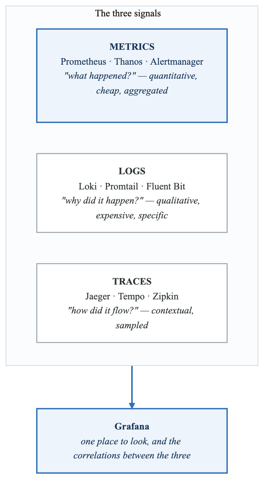
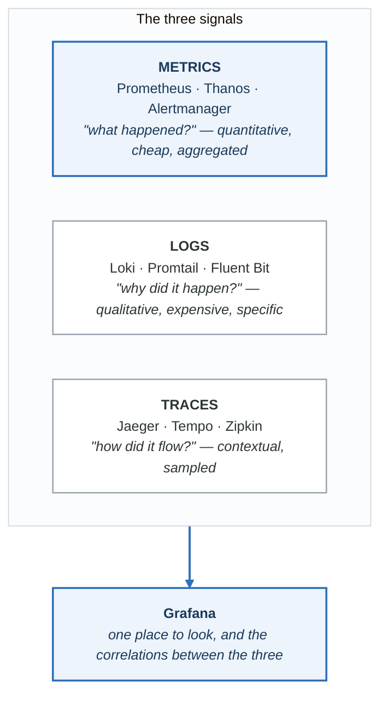
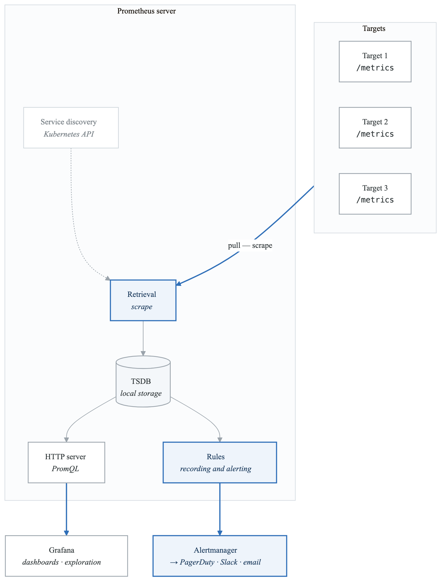
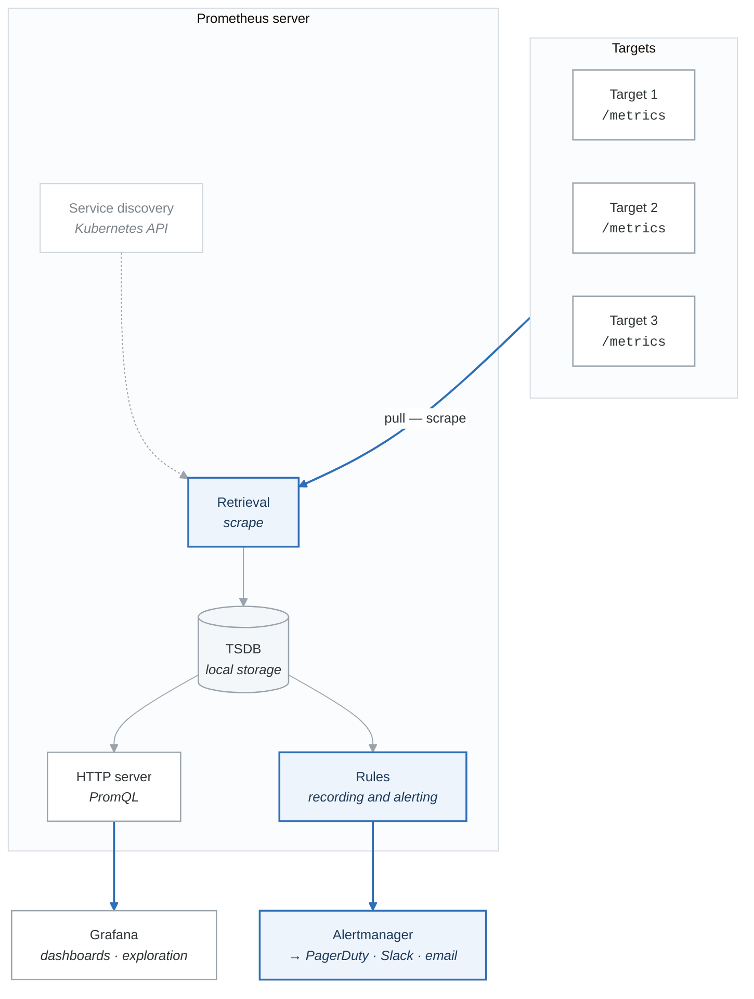

# Observability Stack

Comprehensive monitoring, logging, and tracing for production Kubernetes.

## Learning Path

1. [Metrics with Prometheus](#metrics-with-prometheus)
2. [Visualization with Grafana](#visualization-with-grafana)
3. [Logging with Loki](#logging-with-loki)
4. [Tracing with Jaeger](#tracing-with-jaeger)
5. [SLOs and Error Budgets](#slos-and-error-budgets)

---

## The Three Pillars of Observability

<!-- figure: generated from the Mermaid below by _shared/diagrams/embed-figures.py — do not edit the image -->


<details>
<summary>Diagram source (Mermaid)</summary>



</details>

---

## Metrics with Prometheus

### Prometheus Architecture

<!-- figure: generated from the Mermaid below by _shared/diagrams/embed-figures.py — do not edit the image -->


<details>
<summary>Diagram source (Mermaid)</summary>



</details>

### Installing Prometheus Stack

```bash
# Add helm repo
helm repo add prometheus-community https://prometheus-community.github.io/helm-charts
helm repo update

# Install kube-prometheus-stack (includes Prometheus, Grafana, AlertManager)
helm install prometheus prometheus-community/kube-prometheus-stack \
  --namespace monitoring --create-namespace \
  --values values-prometheus.yaml
```

```yaml
# values-prometheus.yaml
prometheus:
  prometheusSpec:
    retention: 30d
    retentionSize: "50GB"

    # Resource allocation
    resources:
      requests:
        memory: 2Gi
        cpu: 500m
      limits:
        memory: 4Gi
        cpu: 2000m

    # Persistent storage
    storageSpec:
      volumeClaimTemplate:
        spec:
          storageClassName: ebs-gp3
          accessModes: ["ReadWriteOnce"]
          resources:
            requests:
              storage: 100Gi

    # External labels for multi-cluster
    externalLabels:
      cluster: production-us-west-2
      environment: production

    # Remote write to Thanos/Mimir (optional)
    remoteWrite:
    - url: http://thanos-receive:19291/api/v1/receive
      writeRelabelConfigs:
      - sourceLabels: [__name__]
        regex: 'go_.*'
        action: drop

alertmanager:
  alertmanagerSpec:
    storage:
      volumeClaimTemplate:
        spec:
          storageClassName: ebs-gp3
          accessModes: ["ReadWriteOnce"]
          resources:
            requests:
              storage: 10Gi

grafana:
  persistence:
    enabled: true
    size: 10Gi
    storageClassName: ebs-gp3

  # Admin credentials
  adminPassword: "changeme"  # Use sealed secrets in production

  # Additional data sources
  additionalDataSources:
  - name: Loki
    type: loki
    url: http://loki:3100
    access: proxy
  - name: Tempo
    type: tempo
    url: http://tempo:3100
    access: proxy
```

### ServiceMonitor for Custom Applications

```yaml
apiVersion: monitoring.coreos.com/v1
kind: ServiceMonitor
metadata:
  name: my-app
  namespace: monitoring
  labels:
    release: prometheus  # Must match Prometheus selector
spec:
  selector:
    matchLabels:
      app: my-app
  namespaceSelector:
    matchNames:
    - production
  endpoints:
  - port: metrics
    path: /metrics
    interval: 30s
    scrapeTimeout: 10s

    # TLS configuration
    scheme: https
    tlsConfig:
      insecureSkipVerify: false
      ca:
        secret:
          name: my-app-tls
          key: ca.crt

    # Metric relabeling
    metricRelabelings:
    # Drop high-cardinality metrics
    - sourceLabels: [__name__]
      regex: 'http_request_duration_seconds_bucket'
      action: drop
    # Rename metrics
    - sourceLabels: [__name__]
      regex: 'my_app_(.*)'
      targetLabel: __name__
      replacement: 'app_$1'

    # Add custom labels
    relabelings:
    - sourceLabels: [__meta_kubernetes_pod_label_version]
      targetLabel: version
```

### PodMonitor for Sidecar Metrics

```yaml
apiVersion: monitoring.coreos.com/v1
kind: PodMonitor
metadata:
  name: envoy-sidecar
  namespace: monitoring
spec:
  selector:
    matchLabels:
      sidecar: envoy
  namespaceSelector:
    any: true
  podMetricsEndpoints:
  - port: admin
    path: /stats/prometheus
    interval: 15s
```

### PrometheusRule for Alerts

```yaml
apiVersion: monitoring.coreos.com/v1
kind: PrometheusRule
metadata:
  name: application-alerts
  namespace: monitoring
  labels:
    release: prometheus
spec:
  groups:
  - name: application
    interval: 30s
    rules:
    # High error rate alert
    - alert: HighErrorRate
      expr: |
        (
          sum(rate(http_requests_total{status=~"5.."}[5m])) by (service)
          /
          sum(rate(http_requests_total[5m])) by (service)
        ) > 0.05
      for: 5m
      labels:
        severity: critical
        team: platform
      annotations:
        summary: "High error rate on {{ $labels.service }}"
        description: "Error rate is {{ $value | humanizePercentage }} for {{ $labels.service }}"
        runbook_url: "https://runbooks.example.com/high-error-rate"
        dashboard_url: "https://grafana.example.com/d/abc123?var-service={{ $labels.service }}"

    # Pod memory pressure
    - alert: PodMemoryPressure
      expr: |
        (
          container_memory_usage_bytes{container!=""}
          /
          container_spec_memory_limit_bytes{container!=""}
        ) > 0.9
      for: 10m
      labels:
        severity: warning
      annotations:
        summary: "Pod {{ $labels.pod }} memory usage > 90%"
        description: "Memory usage is {{ $value | humanizePercentage }}"

    # Pod crash looping
    - alert: PodCrashLooping
      expr: rate(kube_pod_container_status_restarts_total[15m]) > 0
      for: 5m
      labels:
        severity: warning
      annotations:
        summary: "Pod {{ $labels.pod }} is crash looping"
        description: "Pod has restarted {{ $value }} times in the last 15 minutes"

    # Deployment replica mismatch
    - alert: DeploymentReplicaMismatch
      expr: |
        kube_deployment_spec_replicas != kube_deployment_status_replicas_available
      for: 15m
      labels:
        severity: warning
      annotations:
        summary: "Deployment {{ $labels.deployment }} has replica mismatch"

  - name: slo
    rules:
    # Error budget burn rate
    - alert: ErrorBudgetBurn
      expr: |
        (
          1 - (
            sum(rate(http_requests_total{status!~"5.."}[1h])) by (service)
            /
            sum(rate(http_requests_total[1h])) by (service)
          )
        ) > (1 - 0.999) * 14.4
      for: 5m
      labels:
        severity: critical
      annotations:
        summary: "{{ $labels.service }} burning error budget too fast"
        description: "At current error rate, monthly error budget will be exhausted"
```

### AlertManager Configuration

```yaml
apiVersion: monitoring.coreos.com/v1alpha1
kind: AlertmanagerConfig
metadata:
  name: main-config
  namespace: monitoring
spec:
  route:
    receiver: 'default'
    groupBy: ['alertname', 'service', 'severity']
    groupWait: 30s
    groupInterval: 5m
    repeatInterval: 4h

    routes:
    # Critical alerts go to PagerDuty
    - receiver: 'pagerduty-critical'
      matchers:
      - name: severity
        value: critical
      continue: true

    # Warning alerts go to Slack
    - receiver: 'slack-warnings'
      matchers:
      - name: severity
        value: warning

    # Team-specific routing
    - receiver: 'platform-team'
      matchers:
      - name: team
        value: platform

    - receiver: 'application-team'
      matchers:
      - name: team
        value: application

  receivers:
  - name: 'default'
    slackConfigs:
    - apiURL:
        name: slack-webhook
        key: url
      channel: '#alerts-default'
      sendResolved: true
      title: '{{ template "slack.title" . }}'
      text: '{{ template "slack.text" . }}'

  - name: 'pagerduty-critical'
    pagerdutyConfigs:
    - serviceKey:
        name: pagerduty-key
        key: service-key
      severity: '{{ if eq .Status "firing" }}critical{{ else }}info{{ end }}'
      description: '{{ .CommonAnnotations.summary }}'
      details:
        firing: '{{ template "pagerduty.instances" .Alerts.Firing }}'
        resolved: '{{ template "pagerduty.instances" .Alerts.Resolved }}'
        num_firing: '{{ .Alerts.Firing | len }}'
        num_resolved: '{{ .Alerts.Resolved | len }}'

  - name: 'slack-warnings'
    slackConfigs:
    - apiURL:
        name: slack-webhook
        key: url
      channel: '#alerts-warnings'
      sendResolved: true
      iconEmoji: ':warning:'

  - name: 'platform-team'
    slackConfigs:
    - apiURL:
        name: slack-webhook
        key: url
      channel: '#platform-alerts'

  - name: 'application-team'
    slackConfigs:
    - apiURL:
        name: slack-webhook
        key: url
      channel: '#app-alerts'

  # Inhibition rules
  inhibitRules:
  # Don't alert on warnings if critical is firing for same service
  - sourceMatch:
    - name: severity
      value: critical
    targetMatch:
    - name: severity
      value: warning
    equal: ['alertname', 'service']
```

---

## Visualization with Grafana

### Dashboard as Code

```yaml
apiVersion: v1
kind: ConfigMap
metadata:
  name: grafana-dashboard-app
  namespace: monitoring
  labels:
    grafana_dashboard: "1"  # Discovered by Grafana sidecar
data:
  app-dashboard.json: |
    {
      "annotations": {
        "list": []
      },
      "editable": true,
      "fiscalYearStartMonth": 0,
      "graphTooltip": 0,
      "id": null,
      "links": [],
      "liveNow": false,
      "panels": [
        {
          "datasource": {
            "type": "prometheus",
            "uid": "prometheus"
          },
          "fieldConfig": {
            "defaults": {
              "color": {
                "mode": "palette-classic"
              },
              "custom": {
                "axisCenteredZero": false,
                "axisColorMode": "text",
                "axisLabel": "",
                "axisPlacement": "auto",
                "barAlignment": 0,
                "drawStyle": "line",
                "fillOpacity": 10,
                "gradientMode": "none",
                "hideFrom": {
                  "legend": false,
                  "tooltip": false,
                  "viz": false
                },
                "lineInterpolation": "linear",
                "lineWidth": 1,
                "pointSize": 5,
                "scaleDistribution": {
                  "type": "linear"
                },
                "showPoints": "auto",
                "spanNulls": false,
                "stacking": {
                  "group": "A",
                  "mode": "none"
                },
                "thresholdsStyle": {
                  "mode": "off"
                }
              },
              "mappings": [],
              "thresholds": {
                "mode": "absolute",
                "steps": [
                  {
                    "color": "green",
                    "value": null
                  }
                ]
              },
              "unit": "reqps"
            }
          },
          "gridPos": {
            "h": 8,
            "w": 12,
            "x": 0,
            "y": 0
          },
          "id": 1,
          "options": {
            "legend": {
              "calcs": ["mean", "max"],
              "displayMode": "table",
              "placement": "bottom",
              "showLegend": true
            },
            "tooltip": {
              "mode": "single",
              "sort": "none"
            }
          },
          "targets": [
            {
              "datasource": {
                "type": "prometheus",
                "uid": "prometheus"
              },
              "expr": "sum(rate(http_requests_total{service=\"$service\"}[5m])) by (status_code)",
              "legendFormat": "{{status_code}}",
              "refId": "A"
            }
          ],
          "title": "Request Rate by Status",
          "type": "timeseries"
        },
        {
          "datasource": {
            "type": "prometheus",
            "uid": "prometheus"
          },
          "fieldConfig": {
            "defaults": {
              "color": {
                "mode": "thresholds"
              },
              "mappings": [],
              "thresholds": {
                "mode": "absolute",
                "steps": [
                  {
                    "color": "green",
                    "value": null
                  },
                  {
                    "color": "yellow",
                    "value": 0.01
                  },
                  {
                    "color": "red",
                    "value": 0.05
                  }
                ]
              },
              "unit": "percentunit"
            }
          },
          "gridPos": {
            "h": 8,
            "w": 6,
            "x": 12,
            "y": 0
          },
          "id": 2,
          "options": {
            "orientation": "auto",
            "reduceOptions": {
              "calcs": ["lastNotNull"],
              "fields": "",
              "values": false
            },
            "showThresholdLabels": false,
            "showThresholdMarkers": true
          },
          "targets": [
            {
              "expr": "sum(rate(http_requests_total{service=\"$service\",status=~\"5..\"}[5m])) / sum(rate(http_requests_total{service=\"$service\"}[5m]))",
              "refId": "A"
            }
          ],
          "title": "Error Rate",
          "type": "gauge"
        },
        {
          "datasource": {
            "type": "prometheus",
            "uid": "prometheus"
          },
          "fieldConfig": {
            "defaults": {
              "custom": {
                "drawStyle": "line",
                "fillOpacity": 20
              },
              "unit": "s"
            }
          },
          "gridPos": {
            "h": 8,
            "w": 12,
            "x": 0,
            "y": 8
          },
          "id": 3,
          "targets": [
            {
              "expr": "histogram_quantile(0.50, sum(rate(http_request_duration_seconds_bucket{service=\"$service\"}[5m])) by (le))",
              "legendFormat": "p50",
              "refId": "A"
            },
            {
              "expr": "histogram_quantile(0.95, sum(rate(http_request_duration_seconds_bucket{service=\"$service\"}[5m])) by (le))",
              "legendFormat": "p95",
              "refId": "B"
            },
            {
              "expr": "histogram_quantile(0.99, sum(rate(http_request_duration_seconds_bucket{service=\"$service\"}[5m])) by (le))",
              "legendFormat": "p99",
              "refId": "C"
            }
          ],
          "title": "Response Time Percentiles",
          "type": "timeseries"
        }
      ],
      "schemaVersion": 38,
      "style": "dark",
      "tags": ["application"],
      "templating": {
        "list": [
          {
            "current": {},
            "datasource": {
              "type": "prometheus",
              "uid": "prometheus"
            },
            "definition": "label_values(http_requests_total, service)",
            "hide": 0,
            "includeAll": false,
            "label": "Service",
            "multi": false,
            "name": "service",
            "options": [],
            "query": {
              "query": "label_values(http_requests_total, service)",
              "refId": "StandardVariableQuery"
            },
            "refresh": 2,
            "regex": "",
            "skipUrlSync": false,
            "sort": 1,
            "type": "query"
          }
        ]
      },
      "time": {
        "from": "now-1h",
        "to": "now"
      },
      "title": "Application Dashboard",
      "uid": "app-dashboard",
      "version": 1
    }
```

---

## Logging with Loki

### Loki Installation

```yaml
# values-loki.yaml
loki:
  auth_enabled: false

  storage:
    type: s3
    bucketNames:
      chunks: loki-chunks
      ruler: loki-ruler
      admin: loki-admin
    s3:
      region: us-west-2

  schemaConfig:
    configs:
    - from: 2024-01-01
      store: tsdb
      object_store: s3
      schema: v13
      index:
        prefix: index_
        period: 24h

  limits_config:
    retention_period: 30d
    ingestion_rate_mb: 10
    ingestion_burst_size_mb: 20
    max_query_series: 500
    max_query_parallelism: 32

  compactor:
    retention_enabled: true
    delete_request_store: s3

# Promtail configuration
promtail:
  config:
    clients:
    - url: http://loki:3100/loki/api/v1/push

    snippets:
      pipelineStages:
      # Parse JSON logs
      - cri: {}
      - json:
          expressions:
            level: level
            msg: msg
            trace_id: trace_id
            span_id: span_id
      # Add labels from JSON
      - labels:
          level:
          trace_id:
      # Drop debug logs in production
      - match:
          selector: '{namespace="production"}'
          stages:
          - drop:
              expression: '.*level=debug.*'
      # Extract metrics from logs
      - metrics:
          log_lines_total:
            type: Counter
            description: "Total log lines"
            source: msg
            config:
              match_all: true
              action: inc
```

### LogQL Queries

```logql
# Find all errors in the last hour
{namespace="production"} |= "error" | json | level="error"

# Count errors by service
sum by (service) (
  count_over_time({namespace="production"} |= "error" [1h])
)

# Extract and aggregate response times from logs
{namespace="production", app="api"}
  | json
  | unwrap response_time_ms
  | __error__=""
  | quantile_over_time(0.95, [5m]) by (endpoint)

# Find slow requests > 1s
{namespace="production", app="api"}
  | json
  | response_time_ms > 1000
  | line_format "{{.endpoint}} took {{.response_time_ms}}ms"

# Correlate logs with trace ID
{namespace="production"} |= "trace_id=abc123"
```

---

## Tracing with Jaeger

### Jaeger Installation

```yaml
# values-jaeger.yaml
provisionDataStore:
  cassandra: false
  elasticsearch: true

storage:
  type: elasticsearch
  elasticsearch:
    host: elasticsearch
    port: 9200

collector:
  service:
    type: ClusterIP
  resources:
    requests:
      cpu: 500m
      memory: 512Mi

query:
  service:
    type: ClusterIP
  ingress:
    enabled: true
    hosts:
    - jaeger.example.com

agent:
  # Deploy as DaemonSet for node-local collection
  daemonset:
    useHostPort: true
```

### OpenTelemetry Configuration

```yaml
apiVersion: v1
kind: ConfigMap
metadata:
  name: otel-collector-config
  namespace: observability
data:
  config.yaml: |
    receivers:
      otlp:
        protocols:
          grpc:
            endpoint: 0.0.0.0:4317
          http:
            endpoint: 0.0.0.0:4318

      # Kubernetes metrics
      k8s_cluster:
        collection_interval: 30s

      # Prometheus scraping
      prometheus:
        config:
          scrape_configs:
          - job_name: 'kubernetes-pods'
            kubernetes_sd_configs:
            - role: pod
            relabel_configs:
            - source_labels: [__meta_kubernetes_pod_annotation_prometheus_io_scrape]
              action: keep
              regex: true

    processors:
      batch:
        timeout: 10s
        send_batch_size: 1000

      memory_limiter:
        limit_mib: 1500
        spike_limit_mib: 512
        check_interval: 5s

      # Add Kubernetes attributes
      k8s_attributes:
        auth_type: serviceAccount
        extract:
          metadata:
          - k8s.namespace.name
          - k8s.deployment.name
          - k8s.pod.name
          labels:
          - key: app
            from: pod
          - key: version
            from: pod

      # Tail sampling for traces
      tail_sampling:
        decision_wait: 10s
        num_traces: 100000
        policies:
        - name: error-policy
          type: status_code
          status_code:
            status_codes: [ERROR]
        - name: slow-policy
          type: latency
          latency:
            threshold_ms: 1000
        - name: sampling-policy
          type: probabilistic
          probabilistic:
            sampling_percentage: 10

    exporters:
      otlp/jaeger:
        endpoint: jaeger-collector:4317
        tls:
          insecure: true

      prometheus:
        endpoint: 0.0.0.0:8889
        namespace: otel

      loki:
        endpoint: http://loki:3100/loki/api/v1/push

    service:
      pipelines:
        traces:
          receivers: [otlp]
          processors: [memory_limiter, k8s_attributes, tail_sampling, batch]
          exporters: [otlp/jaeger]

        metrics:
          receivers: [otlp, prometheus, k8s_cluster]
          processors: [memory_limiter, k8s_attributes, batch]
          exporters: [prometheus]

        logs:
          receivers: [otlp]
          processors: [memory_limiter, k8s_attributes, batch]
          exporters: [loki]
```

---

## SLOs and Error Budgets

### SLO Definition

```yaml
apiVersion: sloth.slok.dev/v1
kind: PrometheusServiceLevel
metadata:
  name: api-service-slo
  namespace: monitoring
spec:
  service: "api-service"
  labels:
    team: platform

  slos:
  # Availability SLO: 99.9%
  - name: "requests-availability"
    objective: 99.9
    description: "99.9% of requests should be successful"
    sli:
      events:
        errorQuery: sum(rate(http_requests_total{service="api",status=~"5.."}[{{.window}}]))
        totalQuery: sum(rate(http_requests_total{service="api"}[{{.window}}]))
    alerting:
      name: APIHighErrorRate
      labels:
        team: platform
      annotations:
        summary: "API error rate SLO breach"
      pageAlert:
        labels:
          severity: critical
      ticketAlert:
        labels:
          severity: warning

  # Latency SLO: 99% of requests < 500ms
  - name: "requests-latency"
    objective: 99
    description: "99% of requests should complete within 500ms"
    sli:
      events:
        errorQuery: |
          sum(rate(http_request_duration_seconds_bucket{service="api",le="0.5"}[{{.window}}]))
        totalQuery: |
          sum(rate(http_request_duration_seconds_count{service="api"}[{{.window}}]))
    alerting:
      name: APIHighLatency
      labels:
        team: platform
      annotations:
        summary: "API latency SLO breach"
```

### Error Budget Dashboard Queries

```promql
# Error budget remaining (30-day window)
1 - (
  (
    1 - sum(rate(http_requests_total{status!~"5.."}[30d]))
        / sum(rate(http_requests_total[30d]))
  ) / (1 - 0.999)
)

# Error budget burn rate (should be < 1 to stay within budget)
(
  1 - sum(rate(http_requests_total{status!~"5.."}[1h]))
      / sum(rate(http_requests_total[1h]))
) / (1 - 0.999) * 720  # 720 hours in 30 days

# Time until error budget exhaustion (hours)
(
  1 - (
    1 - sum(rate(http_requests_total{status!~"5.."}[30d]))
        / sum(rate(http_requests_total[30d]))
  ) / (1 - 0.999)
) / (
  (
    1 - sum(rate(http_requests_total{status!~"5.."}[1h]))
        / sum(rate(http_requests_total[1h]))
  ) / (1 - 0.999) / 720
)
```

---

## Exercises

1. **[Exercise 1: Prometheus Setup](./exercises/01-prometheus-setup.md)** - Deploy and configure Prometheus
2. **[Exercise 2: Custom Metrics](./exercises/02-custom-metrics.md)** - Instrument applications
3. **[Exercise 3: Alert Rules](./exercises/03-alert-rules.md)** - Create comprehensive alerting
4. **[Exercise 4: Grafana Dashboards](./exercises/04-grafana-dashboards.md)** - Build dashboards from scratch
5. **[Exercise 5: Loki Logging](./exercises/05-loki-logging.md)** - Deploy centralized logging
6. **[Exercise 6: Distributed Tracing](./exercises/06-distributed-tracing.md)** - Implement tracing
7. **[Exercise 7: SLO Implementation](./exercises/07-slo-implementation.md)** - Define and monitor SLOs
8. **[Exercise 8: Full Stack Integration](./exercises/08-full-stack.md)** - Integrate all pillars

---

## Next Section

[02-security-rbac](../02-security-rbac/) - Security and access control

<!-- feynman-check -->

---

## Feynman check

Close the file. Blank page, no notes. Explain each of these to a competent engineer who has never
used this tool — **under five minutes, no jargon you can't define on the spot:**

- The Three Pillars of Observability
- Metrics with Prometheus
- Visualization with Grafana
- Logging with Loki

**The gap is not what you forgot. It is where you used a word instead of a mechanism.**

| | |
|---|---|
| ✗ | *"Kubernetes schedules the pod."* |
| ✓ | *"The scheduler watches for pods with no `nodeName`, filters nodes by predicates, scores the survivors, and writes `nodeName` into the pod spec. The kubelet on that node is watching the API for pods bound to it, and starts the containers."* |

**Trace it:** `kubectl apply -f pod.yaml` → a running container. Name every component that acts, in order, and what each one writes.

Stop at the first component you cannot name. Reopen this file and read **only** that.

**Go deeper — only once the gap has a name:** [Kubernetes the Hard Way](https://github.com/kelseyhightower/kubernetes-the-hard-way) — one weekend, and "the control plane" stops being a word.
Full list per domain: [`SOURCES.md`](../../SOURCES.md#kubernetes)

→ Protocol, the three levels of knowing, and worked examples: [`MASTERY.md`](../../MASTERY.md)

<!-- /feynman-check -->
