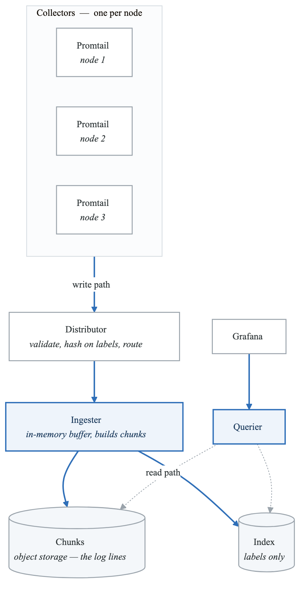

# Exercise 2: Centralized Logging with Loki

## Objectives

- Deploy Loki for log aggregation
- Configure Promtail for log collection
- Query logs with LogQL
- Integrate with Grafana

## Prerequisites

- Completed Exercise 1 (Prometheus setup)
- Running Kubernetes cluster
- Grafana deployed

---

## Part 1: Loki Architecture

### 1.1 Understanding Components

```mermaid
%%{init: {'theme':'base','themeVariables':{'fontFamily':'Helvetica, Arial, sans-serif','fontSize':'13px','primaryColor':'#ffffff','primaryTextColor':'#2d3436','primaryBorderColor':'#9aa3ab','lineColor':'#9aa3ab','textColor':'#2d3436','clusterBkg':'#fbfcfd','clusterBorder':'#d4dae0','edgeLabelBackground':'#ffffff','tertiaryColor':'#eef4fb'},'flowchart':{'curve':'basis','padding':14,'nodeSpacing':42,'rankSpacing':58}}}%%
flowchart TB
  classDef default fill:#ffffff,stroke:#9aa3ab,stroke-width:1.3px,color:#2d3436
  classDef n    fill:#ffffff,stroke:#9aa3ab,stroke-width:1.3px,color:#2d3436
  classDef crit fill:#eef4fb,stroke:#2f6fb8,stroke-width:1.8px,color:#1b3a5c
  classDef data fill:#f4f7fa,stroke:#9aa3ab,stroke-width:1.3px,color:#2d3436
  classDef mut  fill:#ffffff,stroke:#cfd6dc,stroke-width:1.1px,color:#7a8288
  classDef warn fill:#fdf0ec,stroke:#c0522d,stroke-width:1.6px,color:#8a3a1e
  subgraph COL["Collectors &nbsp;—&nbsp; one per node"]
    direction LR
    P1["Promtail<br/><i>node 1</i>"]
    P2["Promtail<br/><i>node 2</i>"]
    P3["Promtail<br/><i>node 3</i>"]
  end
  DI["Distributor<br/><i>validate, hash on labels, route</i>"]
  IN["Ingester<br/><i>in-memory buffer, builds chunks</i>"]
  CH[("Chunks<br/><i>object storage — the log lines</i>")]
  IX[("Index<br/><i>labels only</i>")]
  QU["Querier"]
  GF["Grafana"]
  COL ==>|"write path"| DI ==> IN
  IN ==> CH
  IN ==> IX
  QU -.->|"read path"| CH
  QU -.-> IX
  GF ==> QU
  class P1,P2,P3 n
  class DI n
  class IN crit
  class CH,IX data
  class QU crit
  class GF n
  linkStyle 0,1,2,3,6 stroke:#2f6fb8,stroke-width:2px

%% Only the labels are indexed. That is the entire cost model: a query filtered
%% by label is fast and cheap, and a query that greps across everything reads
%% chunks from object storage until it finds what you asked for. Label
%% cardinality is therefore a budget, not a style choice.
```

<!-- figure: generated from the Mermaid below by _shared/diagrams/embed-figures.py — do not edit the image -->


<details>
<summary>Diagram source (Mermaid)</summary>



</details>

---

## Part 2: Deploy Loki Stack

### 2.1 Install with Helm

```bash
# Add Grafana Helm repo
helm repo add grafana https://grafana.github.io/helm-charts
helm repo update

# Install Loki stack (simple mode)
helm install loki grafana/loki-stack \
  --namespace monitoring \
  --set loki.persistence.enabled=true \
  --set loki.persistence.size=50Gi \
  --set promtail.enabled=true
```

### 2.2 Production Loki Values

```yaml
# loki-values.yaml
loki:
  # Storage configuration
  storage:
    type: s3
    s3:
      endpoint: s3.amazonaws.com
      region: us-west-2
      bucketnames: loki-chunks
      access_key_id: ${AWS_ACCESS_KEY_ID}
      secret_access_key: ${AWS_SECRET_ACCESS_KEY}

  # Schema configuration
  schemaConfig:
    configs:
      - from: "2024-01-01"
        store: tsdb
        object_store: s3
        schema: v13
        index:
          prefix: loki_index_
          period: 24h

  # Limits
  limits_config:
    retention_period: 720h  # 30 days
    ingestion_rate_mb: 10
    ingestion_burst_size_mb: 20
    max_streams_per_user: 10000
    max_entries_limit_per_query: 5000

  # Compactor for retention
  compactor:
    working_directory: /data/retention
    shared_store: s3
    retention_enabled: true
    retention_delete_delay: 2h

  # Resources
  resources:
    requests:
      cpu: 500m
      memory: 1Gi
    limits:
      cpu: 2000m
      memory: 4Gi

  # Persistence for WAL
  persistence:
    enabled: true
    size: 50Gi
    storageClassName: fast-ssd

  # Replicas for HA
  replicas: 3

  # Anti-affinity
  affinity:
    podAntiAffinity:
      requiredDuringSchedulingIgnoredDuringExecution:
      - labelSelector:
          matchLabels:
            app.kubernetes.io/name: loki
        topologyKey: kubernetes.io/hostname

# Promtail configuration
promtail:
  enabled: true

  config:
    clients:
      - url: http://loki:3100/loki/api/v1/push
        tenant_id: default

    snippets:
      pipelineStages:
        - cri: {}
        - json:
            expressions:
              level: level
              msg: msg
        - labels:
            level:
        - timestamp:
            source: time
            format: RFC3339Nano

  resources:
    requests:
      cpu: 100m
      memory: 128Mi
    limits:
      cpu: 500m
      memory: 512Mi
```

### 2.3 Scalable Deployment (Microservices Mode)

```yaml
# loki-distributed-values.yaml
loki:
  # Enable distributed mode
  structuredConfig:
    auth_enabled: true

    memberlist:
      join_members:
        - loki-memberlist

    ingester:
      lifecycler:
        ring:
          kvstore:
            store: memberlist
          replication_factor: 3
      chunk_idle_period: 30m
      chunk_block_size: 262144
      chunk_retain_period: 1m

    distributor:
      ring:
        kvstore:
          store: memberlist

    query_scheduler:
      max_outstanding_requests_per_tenant: 2048

    querier:
      max_concurrent: 4

# Component replicas
ingester:
  replicas: 3
  persistence:
    enabled: true
    size: 50Gi

distributor:
  replicas: 3

querier:
  replicas: 2

queryFrontend:
  replicas: 2

gateway:
  replicas: 2
```

---

## Part 3: Promtail Configuration

### 3.1 Basic Promtail Config

```yaml
# promtail-config.yaml
apiVersion: v1
kind: ConfigMap
metadata:
  name: promtail-config
  namespace: monitoring
data:
  promtail.yaml: |
    server:
      http_listen_port: 9080
      grpc_listen_port: 0

    positions:
      filename: /tmp/positions.yaml

    clients:
      - url: http://loki:3100/loki/api/v1/push

    scrape_configs:
      # Kubernetes pods
      - job_name: kubernetes-pods
        kubernetes_sd_configs:
          - role: pod
        relabel_configs:
          # Only scrape pods with logging enabled
          - source_labels: [__meta_kubernetes_pod_annotation_logging_enabled]
            action: keep
            regex: "true"
          # Pod namespace
          - source_labels: [__meta_kubernetes_namespace]
            target_label: namespace
          # Pod name
          - source_labels: [__meta_kubernetes_pod_name]
            target_label: pod
          # Container name
          - source_labels: [__meta_kubernetes_pod_container_name]
            target_label: container
          # App label
          - source_labels: [__meta_kubernetes_pod_label_app]
            target_label: app
          # Team label
          - source_labels: [__meta_kubernetes_pod_label_team]
            target_label: team

        pipeline_stages:
          # Parse container logs
          - cri: {}
          # Detect log level
          - regex:
              expression: '(?P<level>(DEBUG|INFO|WARN|ERROR|FATAL))'
          - labels:
              level:

      # System logs
      - job_name: system
        static_configs:
          - targets:
              - localhost
            labels:
              job: varlogs
              __path__: /var/log/*.log
```

### 3.2 Advanced Pipeline Stages

```yaml
# promtail-advanced-config.yaml
scrape_configs:
  - job_name: application-logs
    kubernetes_sd_configs:
      - role: pod
    pipeline_stages:
      # Parse JSON logs
      - json:
          expressions:
            level: level
            message: msg
            trace_id: trace_id
            span_id: span_id
            user_id: user_id
            request_id: request_id
            duration: duration_ms

      # Add labels from JSON
      - labels:
          level:
          trace_id:

      # Metrics from logs
      - metrics:
          log_entries_total:
            type: Counter
            description: "Total log entries"
            source: level
            config:
              action: inc
          request_duration_seconds:
            type: Histogram
            description: "Request duration from logs"
            source: duration
            config:
              buckets: [0.01, 0.05, 0.1, 0.5, 1, 5, 10]

      # Drop debug logs in production
      - match:
          selector: '{namespace="production"}'
          stages:
            - drop:
                expression: ".*DEBUG.*"

      # Mask sensitive data
      - replace:
          expression: '(password[=:]\s*)(\S+)'
          replace: '${1}***REDACTED***'

      # Multi-line logs (Java stack traces)
      - multiline:
          firstline: '^\d{4}-\d{2}-\d{2}'
          max_wait_time: 3s
```

### 3.3 Promtail DaemonSet

```yaml
# promtail-daemonset.yaml
apiVersion: apps/v1
kind: DaemonSet
metadata:
  name: promtail
  namespace: monitoring
spec:
  selector:
    matchLabels:
      app: promtail
  template:
    metadata:
      labels:
        app: promtail
    spec:
      serviceAccountName: promtail
      tolerations:
      - operator: Exists
      containers:
      - name: promtail
        image: grafana/promtail:2.9.0
        args:
        - -config.file=/etc/promtail/promtail.yaml
        - -config.expand-env=true
        ports:
        - containerPort: 9080
          name: http-metrics
        volumeMounts:
        - name: config
          mountPath: /etc/promtail
        - name: varlog
          mountPath: /var/log
          readOnly: true
        - name: varlibdockercontainers
          mountPath: /var/lib/docker/containers
          readOnly: true
        - name: positions
          mountPath: /tmp
        resources:
          requests:
            cpu: 100m
            memory: 128Mi
          limits:
            cpu: 500m
            memory: 512Mi
      volumes:
      - name: config
        configMap:
          name: promtail-config
      - name: varlog
        hostPath:
          path: /var/log
      - name: varlibdockercontainers
        hostPath:
          path: /var/lib/docker/containers
      - name: positions
        emptyDir: {}
```

---

## Part 4: LogQL Queries

### 4.1 Basic Queries

```logql
# View all logs from a namespace
{namespace="production"}

# Filter by app label
{app="api-gateway"}

# Filter by multiple labels
{namespace="production", app="api-gateway", container="app"}

# Filter by log content
{app="api-gateway"} |= "error"

# Case-insensitive filter
{app="api-gateway"} |~ "(?i)error"

# Exclude pattern
{app="api-gateway"} != "healthcheck"

# Regular expression filter
{app="api-gateway"} |~ "status=5\\d{2}"
```

### 4.2 JSON Parsing

```logql
# Parse JSON and filter
{app="api-gateway"} | json | level="error"

# Extract specific fields
{app="api-gateway"} | json | line_format "{{.user_id}} - {{.message}}"

# Filter parsed fields
{app="api-gateway"} | json | duration > 1000

# Extract nested JSON
{app="api-gateway"} | json | json request_body="body" | request_body_user_id != ""
```

### 4.3 Log Aggregations

```logql
# Count logs by level
sum by (level) (count_over_time({app="api-gateway"} | json [5m]))

# Error rate
sum(rate({app="api-gateway"} |= "error" [5m]))
/
sum(rate({app="api-gateway"} [5m]))

# Logs per second by service
sum by (app) (rate({namespace="production"} [1m]))

# P99 latency from logs
quantile_over_time(0.99,
  {app="api-gateway"}
  | json
  | unwrap duration
  [5m]
)

# Unique users
count(
  sum by (user_id) (
    count_over_time({app="api-gateway"} | json [1h])
  )
)
```

### 4.4 Pattern Matching

```logql
# Extract patterns
{app="nginx"} | pattern `<ip> - - [<_>] "<method> <uri> <_>" <status> <size>`

# Use extracted fields
{app="nginx"}
| pattern `<ip> - - [<_>] "<method> <uri> <_>" <status> <size>`
| status >= 400

# Aggregate by extracted field
sum by (status) (
  count_over_time(
    {app="nginx"}
    | pattern `<_> - - [<_>] "<_> <_> <_>" <status> <_>`
    [5m]
  )
)
```

---

## Part 5: Grafana Integration

### 5.1 Add Loki Data Source

```yaml
# grafana-datasource.yaml
apiVersion: v1
kind: ConfigMap
metadata:
  name: grafana-datasources
  namespace: monitoring
  labels:
    grafana_datasource: "1"
data:
  loki-datasource.yaml: |
    apiVersion: 1
    datasources:
      - name: Loki
        type: loki
        access: proxy
        url: http://loki:3100
        jsonData:
          maxLines: 1000
          derivedFields:
            - datasourceUid: tempo
              matcherRegex: "trace_id=(\\w+)"
              name: TraceID
              url: "$${__value.raw}"
```

### 5.2 Log Dashboard

```json
{
  "dashboard": {
    "title": "Application Logs",
    "panels": [
      {
        "title": "Log Volume",
        "type": "timeseries",
        "targets": [
          {
            "expr": "sum by (level) (count_over_time({namespace=\"production\"} | json [1m]))",
            "legendFormat": "{{level}}"
          }
        ]
      },
      {
        "title": "Error Logs",
        "type": "logs",
        "targets": [
          {
            "expr": "{namespace=\"production\"} | json | level=\"error\"",
            "refId": "A"
          }
        ],
        "options": {
          "showTime": true,
          "showLabels": true,
          "wrapLogMessage": true
        }
      },
      {
        "title": "Error Rate by Service",
        "type": "stat",
        "targets": [
          {
            "expr": "sum(rate({namespace=\"production\"} |= \"error\" [5m])) / sum(rate({namespace=\"production\"} [5m])) * 100"
          }
        ],
        "options": {
          "colorMode": "value"
        },
        "thresholds": {
          "steps": [
            {"value": 0, "color": "green"},
            {"value": 1, "color": "yellow"},
            {"value": 5, "color": "red"}
          ]
        }
      }
    ]
  }
}
```

---

## Part 6: Alerting on Logs

### 6.1 Loki Alerting Rules

```yaml
# loki-alerting-rules.yaml
apiVersion: monitoring.coreos.com/v1
kind: PrometheusRule
metadata:
  name: loki-alerts
  namespace: monitoring
spec:
  groups:
  - name: loki-logs
    rules:
    # High error rate in logs
    - alert: HighLogErrorRate
      expr: |
        sum(rate({namespace="production"} |= "error" [5m]))
        /
        sum(rate({namespace="production"} [5m]))
        > 0.05
      for: 5m
      labels:
        severity: warning
      annotations:
        summary: "High error rate in logs"
        description: "Error rate is {{ $value | humanizePercentage }}"

    # Specific error pattern
    - alert: DatabaseConnectionErrors
      expr: |
        sum(count_over_time({app="api-gateway"} |= "database connection failed" [5m])) > 10
      for: 2m
      labels:
        severity: critical
      annotations:
        summary: "Database connection errors detected"
        description: "{{ $value }} database connection errors in last 5 minutes"

    # No logs (service might be down)
    - alert: NoLogsReceived
      expr: |
        sum(rate({app="critical-service"} [5m])) == 0
      for: 10m
      labels:
        severity: warning
      annotations:
        summary: "No logs from critical-service"
        description: "No logs received from critical-service for 10 minutes"
```

---

## Part 7: Hands-on Challenges

### Challenge 1: Multi-Tenant Logging

Set up Loki for multiple teams:
1. Enable multi-tenancy
2. Configure tenant-specific retention
3. Set up Grafana with tenant switching
4. Implement RBAC for log access

### Challenge 2: Log-Based Metrics

Create metrics from logs:
1. Extract request duration from logs
2. Create histogram metrics
3. Alert on P99 latency from logs
4. Compare with application metrics

### Challenge 3: Correlation

Implement log correlation:
1. Add trace IDs to all logs
2. Configure derived fields in Grafana
3. Link logs to traces
4. Link logs to metrics

---

## Verification Tasks

1. [ ] Loki deployed and receiving logs
2. [ ] Promtail collecting from all nodes
3. [ ] LogQL queries returning results
4. [ ] Grafana showing log dashboard
5. [ ] Alerting rules configured
6. [ ] Retention working correctly

---

## Key Takeaways

- Loki is label-indexed, not full-text indexed
- Keep label cardinality low for performance
- Use pipeline stages for parsing and filtering
- LogQL enables powerful log aggregations
- Integrate with Grafana for unified observability
- Log-based alerting catches issues metrics miss

---

## Next Steps

Continue to [Exercise 3: Distributed Tracing](01-observability-stack-exercises-03-distributed-tracing.md)

<!-- feynman-check -->

---

## Feynman check

Close the file. Blank page, no notes. Explain each of these to a competent engineer who has never
used this tool — **under five minutes, no jargon you can't define on the spot:**

- Loki Architecture
- Deploy Loki Stack
- Promtail Configuration
- LogQL Queries

**The gap is not what you forgot. It is where you used a word instead of a mechanism.**

| | |
|---|---|
| ✗ | *"Kubernetes schedules the pod."* |
| ✓ | *"The scheduler watches for pods with no `nodeName`, filters nodes by predicates, scores the survivors, and writes `nodeName` into the pod spec. The kubelet on that node is watching the API for pods bound to it, and starts the containers."* |

**Trace it:** `kubectl apply -f pod.yaml` → a running container. Name every component that acts, in order, and what each one writes.

Stop at the first component you cannot name. Reopen this file and read **only** that.

**Go deeper — only once the gap has a name:** [Kubernetes the Hard Way](https://github.com/kelseyhightower/kubernetes-the-hard-way) — one weekend, and "the control plane" stops being a word.
Full list per domain: [`SOURCES.md`](../../SOURCES.md#kubernetes)

→ Protocol, the three levels of knowing, and worked examples: [`MASTERY.md`](../../MASTERY.md)

<!-- /feynman-check -->
