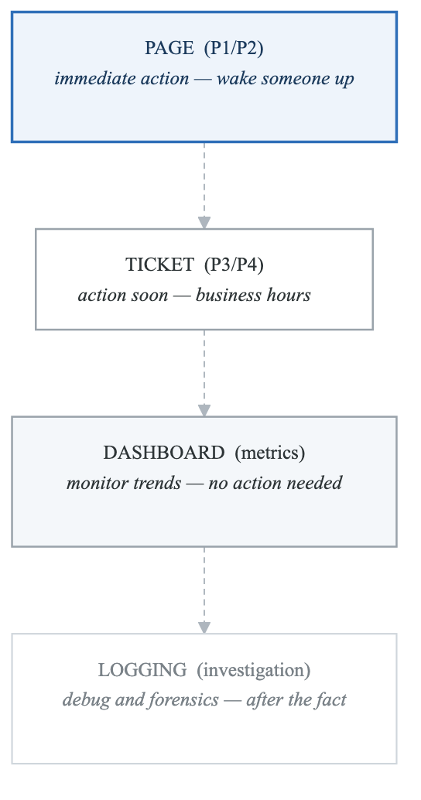
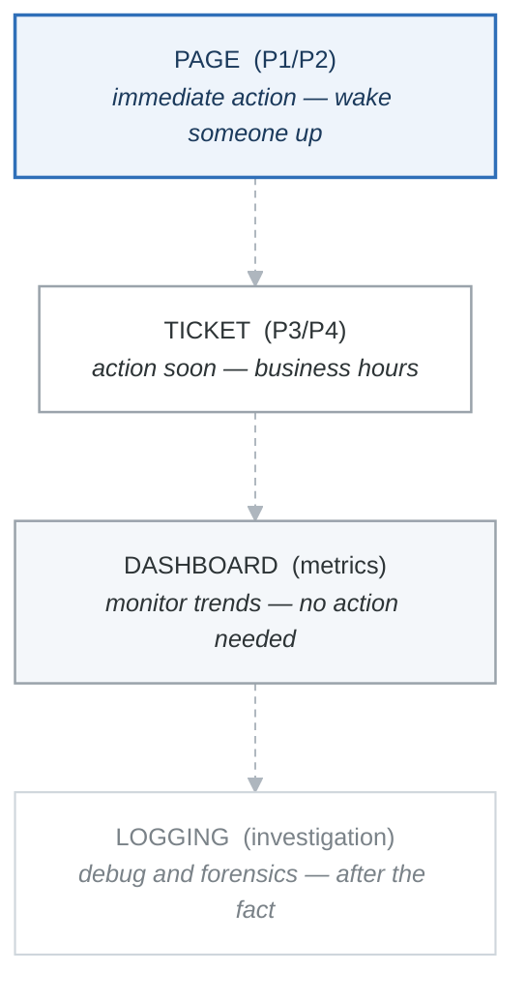

# Exercise 5: Alerting Strategies

## Objectives

- Design effective alerting rules
- Configure alert routing and escalation
- Implement alert fatigue reduction
- Set up on-call integration

## Prerequisites

- Completed Exercises 1-4
- Prometheus and Alertmanager deployed
- Understanding of PromQL

---

## Part 1: Alerting Philosophy

### 1.1 Alert Quality Principles

<!-- figure: generated from the Mermaid below by _shared/diagrams/embed-figures.py — do not edit the image -->


<details>
<summary>Diagram source (Mermaid)</summary>



</details>

Volume grows as you go down; urgency grows as you go up. Every signal belongs on
exactly one tier, and moving a signal *up* a tier is a decision someone has to
defend at the next review.

| Tier | Route a signal here when |
|---|---|
| Page | Customer-impacting, revenue-impacting, or data loss |
| Ticket | Degraded performance, approaching a limit |
| Dashboard | Usage trends, capacity planning |
| Logging | Anything you only need after an incident starts |

### 1.2 Good Alert Characteristics

```yaml
# Good alerts are:
# - Actionable: Someone needs to do something
# - Urgent: Needs attention now
# - Symptomatic: Describes user impact, not cause
# - Accurate: Low false positive rate
# - Documented: Runbook attached

# Example: Good Alert
- alert: HighErrorRate
  expr: |
    sum(rate(http_requests_total{status=~"5.."}[5m])) by (service)
    /
    sum(rate(http_requests_total[5m])) by (service)
    > 0.01  # 1% error rate
  for: 5m  # Sustained for 5 minutes
  labels:
    severity: critical
    team: platform
  annotations:
    summary: "High error rate detected"
    description: "{{ $labels.service }} has {{ $value | humanizePercentage }} error rate"
    runbook_url: "https://runbooks.example.com/high-error-rate"
    dashboard_url: "https://grafana.example.com/d/service-overview?var-service={{ $labels.service }}"

# Example: Bad Alert (avoid these)
- alert: CPUHigh
  expr: node_cpu_usage > 80  # Not symptomatic - what's the impact?
  for: 1m  # Too short - likely to flap
  # Missing: labels, annotations, runbook
```

---

## Part 2: PrometheusRule Configuration

### 2.1 SLO-Based Alerts

```yaml
# slo-alerts.yaml
apiVersion: monitoring.coreos.com/v1
kind: PrometheusRule
metadata:
  name: slo-alerts
  namespace: monitoring
spec:
  groups:
  - name: slo.rules
    rules:
    # Error budget burn rate alerts
    # Fast burn: 14.4x budget consumption = 2% budget in 1 hour
    - alert: SLOBudgetBurnFast
      expr: |
        (
          sum(rate(http_requests_total{status=~"5.."}[1h])) by (service)
          /
          sum(rate(http_requests_total[1h])) by (service)
        ) > (14.4 * 0.001)  # 14.4x of 0.1% error budget
      for: 2m
      labels:
        severity: critical
        alert_type: slo
      annotations:
        summary: "{{ $labels.service }} burning error budget fast"
        description: "Service is consuming error budget at 14.4x the sustainable rate"

    # Slow burn: 3x budget consumption = 10% budget in 3 days
    - alert: SLOBudgetBurnSlow
      expr: |
        (
          sum(rate(http_requests_total{status=~"5.."}[6h])) by (service)
          /
          sum(rate(http_requests_total[6h])) by (service)
        ) > (3 * 0.001)
      for: 1h
      labels:
        severity: warning
        alert_type: slo
      annotations:
        summary: "{{ $labels.service }} burning error budget"

  - name: availability.rules
    rules:
    # Service availability
    - alert: ServiceUnavailable
      expr: |
        sum(up{job=~".*-service"}) by (job)
        /
        count(up{job=~".*-service"}) by (job)
        < 0.5
      for: 5m
      labels:
        severity: critical
      annotations:
        summary: "{{ $labels.job }} has less than 50% instances available"

  - name: latency.rules
    rules:
    # P99 latency
    - alert: HighLatency
      expr: |
        histogram_quantile(0.99,
          sum by (le, service) (rate(http_request_duration_seconds_bucket[5m]))
        ) > 1
      for: 10m
      labels:
        severity: warning
      annotations:
        summary: "High P99 latency on {{ $labels.service }}"
        description: "P99 latency is {{ $value | humanizeDuration }}"
```

### 2.2 Infrastructure Alerts

```yaml
# infrastructure-alerts.yaml
apiVersion: monitoring.coreos.com/v1
kind: PrometheusRule
metadata:
  name: infrastructure-alerts
  namespace: monitoring
spec:
  groups:
  - name: kubernetes.node
    rules:
    - alert: NodeNotReady
      expr: kube_node_status_condition{condition="Ready",status="true"} == 0
      for: 5m
      labels:
        severity: critical
      annotations:
        summary: "Node {{ $labels.node }} is not ready"
        runbook_url: "https://runbooks.example.com/node-not-ready"

    - alert: NodeMemoryPressure
      expr: kube_node_status_condition{condition="MemoryPressure",status="true"} == 1
      for: 5m
      labels:
        severity: warning
      annotations:
        summary: "Node {{ $labels.node }} under memory pressure"

    - alert: NodeDiskPressure
      expr: kube_node_status_condition{condition="DiskPressure",status="true"} == 1
      for: 5m
      labels:
        severity: warning
      annotations:
        summary: "Node {{ $labels.node }} under disk pressure"

  - name: kubernetes.pods
    rules:
    - alert: PodCrashLooping
      expr: |
        increase(kube_pod_container_status_restarts_total[1h]) > 5
      for: 5m
      labels:
        severity: warning
      annotations:
        summary: "Pod {{ $labels.namespace }}/{{ $labels.pod }} is crash looping"
        description: "Pod has restarted {{ $value }} times in the last hour"

    - alert: PodNotReady
      expr: |
        sum by (namespace, pod) (
          max by (namespace, pod) (kube_pod_status_phase{phase=~"Pending|Unknown"}) *
          on(namespace, pod) group_left(owner_kind)
          max by (namespace, pod, owner_kind) (kube_pod_owner{owner_kind!="Job"})
        ) > 0
      for: 15m
      labels:
        severity: warning
      annotations:
        summary: "Pod {{ $labels.namespace }}/{{ $labels.pod }} not ready"

  - name: kubernetes.resources
    rules:
    - alert: ContainerCPUThrottling
      expr: |
        sum by (namespace, pod, container) (
          increase(container_cpu_cfs_throttled_periods_total[5m])
        )
        /
        sum by (namespace, pod, container) (
          increase(container_cpu_cfs_periods_total[5m])
        ) > 0.5
      for: 15m
      labels:
        severity: warning
      annotations:
        summary: "Container {{ $labels.container }} is being throttled"
        description: "{{ $value | humanizePercentage }} of CPU periods are throttled"

    - alert: PVCAlmostFull
      expr: |
        (
          kubelet_volume_stats_used_bytes
          /
          kubelet_volume_stats_capacity_bytes
        ) > 0.85
      for: 15m
      labels:
        severity: warning
      annotations:
        summary: "PVC {{ $labels.persistentvolumeclaim }} is almost full"
        description: "PVC is {{ $value | humanizePercentage }} full"
```

### 2.3 Application Alerts

```yaml
# application-alerts.yaml
apiVersion: monitoring.coreos.com/v1
kind: PrometheusRule
metadata:
  name: application-alerts
  namespace: monitoring
spec:
  groups:
  - name: database
    rules:
    - alert: PostgreSQLDown
      expr: pg_up == 0
      for: 1m
      labels:
        severity: critical
      annotations:
        summary: "PostgreSQL instance {{ $labels.instance }} is down"

    - alert: PostgreSQLHighConnections
      expr: |
        sum by (instance) (pg_stat_activity_count)
        /
        sum by (instance) (pg_settings_max_connections)
        > 0.8
      for: 5m
      labels:
        severity: warning
      annotations:
        summary: "PostgreSQL connection pool nearly exhausted"

    - alert: PostgreSQLSlowQueries
      expr: |
        rate(pg_stat_statements_seconds_total[5m])
        /
        rate(pg_stat_statements_calls_total[5m])
        > 1
      for: 10m
      labels:
        severity: warning
      annotations:
        summary: "PostgreSQL queries averaging over 1 second"

  - name: redis
    rules:
    - alert: RedisDown
      expr: redis_up == 0
      for: 1m
      labels:
        severity: critical
      annotations:
        summary: "Redis instance {{ $labels.instance }} is down"

    - alert: RedisHighMemory
      expr: |
        redis_memory_used_bytes / redis_memory_max_bytes > 0.9
      for: 5m
      labels:
        severity: warning
      annotations:
        summary: "Redis memory usage above 90%"

  - name: rabbitmq
    rules:
    - alert: RabbitMQQueueBacklog
      expr: |
        rabbitmq_queue_messages_ready > 10000
      for: 10m
      labels:
        severity: warning
      annotations:
        summary: "RabbitMQ queue {{ $labels.queue }} has large backlog"
        description: "Queue has {{ $value }} messages ready"
```

---

## Part 3: Alertmanager Configuration

### 3.1 Routing Configuration

```yaml
# alertmanager-config.yaml
apiVersion: v1
kind: Secret
metadata:
  name: alertmanager-main
  namespace: monitoring
stringData:
  alertmanager.yaml: |
    global:
      resolve_timeout: 5m
      smtp_smarthost: 'smtp.example.com:587'
      smtp_from: 'alerts@example.com'
      smtp_auth_username: 'alerts@example.com'
      smtp_auth_password: 'password'
      slack_api_url: 'https://hooks.slack.com/services/xxx/xxx/xxx'
      pagerduty_url: 'https://events.pagerduty.com/v2/enqueue'

    # Inhibition rules
    inhibit_rules:
      # If critical firing, suppress warning
      - source_matchers:
          - severity = critical
        target_matchers:
          - severity = warning
        equal: [alertname, namespace, service]

      # If cluster is down, suppress node alerts
      - source_matchers:
          - alertname = ClusterDown
        target_matchers:
          - alertname =~ "Node.*"
        equal: [cluster]

    # Routing tree
    route:
      receiver: 'default-receiver'
      group_by: ['alertname', 'namespace', 'service']
      group_wait: 30s
      group_interval: 5m
      repeat_interval: 4h

      routes:
        # Critical alerts -> PagerDuty + Slack
        - matchers:
            - severity = critical
          receiver: 'pagerduty-critical'
          continue: true  # Also send to Slack

        - matchers:
            - severity = critical
          receiver: 'slack-critical'

        # Warning alerts -> Slack only
        - matchers:
            - severity = warning
          receiver: 'slack-warning'

        # Team-specific routing
        - matchers:
            - team = platform
          receiver: 'platform-team'
          routes:
            - matchers:
                - severity = critical
              receiver: 'pagerduty-platform'

        - matchers:
            - team = database
          receiver: 'database-team'

        # Namespace-based routing
        - matchers:
            - namespace = production
          receiver: 'production-alerts'
          routes:
            - matchers:
                - severity = critical
              receiver: 'pagerduty-production'

    # Receivers
    receivers:
      - name: 'default-receiver'
        slack_configs:
          - channel: '#alerts-default'
            send_resolved: true

      - name: 'slack-critical'
        slack_configs:
          - channel: '#alerts-critical'
            send_resolved: true
            title: '{{ template "slack.title" . }}'
            text: '{{ template "slack.text" . }}'
            color: '{{ if eq .Status "firing" }}danger{{ else }}good{{ end }}'

      - name: 'slack-warning'
        slack_configs:
          - channel: '#alerts-warning'
            send_resolved: true

      - name: 'pagerduty-critical'
        pagerduty_configs:
          - service_key: 'your-pagerduty-key'
            send_resolved: true
            description: '{{ template "pagerduty.description" . }}'
            severity: critical
            details:
              firing: '{{ template "pagerduty.firing" . }}'
              runbook: '{{ (index .Alerts 0).Annotations.runbook_url }}'

      - name: 'pagerduty-platform'
        pagerduty_configs:
          - service_key: 'platform-team-key'
            send_resolved: true

      - name: 'pagerduty-production'
        pagerduty_configs:
          - service_key: 'production-key'
            send_resolved: true

      - name: 'platform-team'
        slack_configs:
          - channel: '#platform-alerts'
            send_resolved: true

      - name: 'database-team'
        slack_configs:
          - channel: '#database-alerts'
            send_resolved: true
        email_configs:
          - to: 'database-team@example.com'

      - name: 'production-alerts'
        slack_configs:
          - channel: '#production-alerts'
            send_resolved: true

    # Templates
    templates:
      - '/etc/alertmanager/templates/*.tmpl'
```

### 3.2 Custom Templates

```yaml
# alertmanager-templates.yaml
apiVersion: v1
kind: ConfigMap
metadata:
  name: alertmanager-templates
  namespace: monitoring
data:
  slack.tmpl: |
    {{ define "slack.title" }}
    [{{ .Status | toUpper }}{{ if eq .Status "firing" }}:{{ .Alerts.Firing | len }}{{ end }}] {{ .CommonLabels.alertname }}
    {{ end }}

    {{ define "slack.text" }}
    {{ range .Alerts }}
    *Alert:* {{ .Annotations.summary }}
    *Severity:* {{ .Labels.severity }}
    *Description:* {{ .Annotations.description }}
    {{ if .Annotations.runbook_url }}*Runbook:* {{ .Annotations.runbook_url }}{{ end }}
    {{ if .Annotations.dashboard_url }}*Dashboard:* {{ .Annotations.dashboard_url }}{{ end }}
    *Details:*
    {{ range .Labels.SortedPairs }}  • {{ .Name }}: `{{ .Value }}`
    {{ end }}
    {{ end }}
    {{ end }}

  pagerduty.tmpl: |
    {{ define "pagerduty.description" }}
    {{ .CommonAnnotations.summary }}
    {{ end }}

    {{ define "pagerduty.firing" }}
    {{ range .Alerts }}
    Labels:
    {{ range .Labels.SortedPairs }}  {{ .Name }} = {{ .Value }}
    {{ end }}
    Annotations:
    {{ range .Annotations.SortedPairs }}  {{ .Name }} = {{ .Value }}
    {{ end }}
    {{ end }}
    {{ end }}
```

---

## Part 4: Alert Fatigue Reduction

### 4.1 Aggregation Rules

```yaml
# Recording rules for alert aggregation
apiVersion: monitoring.coreos.com/v1
kind: PrometheusRule
metadata:
  name: alert-aggregation
  namespace: monitoring
spec:
  groups:
  - name: aggregated.alerts
    rules:
    # Pre-compute error rates
    - record: service:http_error_rate:5m
      expr: |
        sum by (service, namespace) (rate(http_requests_total{status=~"5.."}[5m]))
        /
        sum by (service, namespace) (rate(http_requests_total[5m]))

    # Aggregate pod restarts by deployment
    - record: deployment:pod_restarts:1h
      expr: |
        sum by (namespace, deployment) (
          increase(kube_pod_container_status_restarts_total[1h])
          * on (namespace, pod) group_left(deployment)
          label_replace(kube_pod_owner{owner_kind="ReplicaSet"}, "deployment", "$1", "owner_name", "(.*)-[^-]+$")
        )

    # Use aggregated metrics in alerts
    - alert: DeploymentHighRestarts
      expr: deployment:pod_restarts:1h > 10
      for: 5m
      labels:
        severity: warning
      annotations:
        summary: "Deployment {{ $labels.namespace }}/{{ $labels.deployment }} has high restart rate"
```

### 4.2 Time-Based Routing

```yaml
# alertmanager-time-routing.yaml
route:
  routes:
    # During business hours -> normal routing
    - matchers:
        - severity = warning
      active_time_intervals:
        - business_hours
      receiver: 'slack-warning'

    # Outside business hours -> only critical
    - matchers:
        - severity = warning
      active_time_intervals:
        - outside_hours
      receiver: 'null'  # Drop warning alerts

time_intervals:
  - name: business_hours
    time_intervals:
      - weekdays: ['monday:friday']
        times:
          - start_time: '09:00'
            end_time: '17:00'
        location: 'America/Los_Angeles'

  - name: outside_hours
    time_intervals:
      - weekdays: ['monday:friday']
        times:
          - start_time: '00:00'
            end_time: '09:00'
          - start_time: '17:00'
            end_time: '24:00'
      - weekdays: ['saturday', 'sunday']
```

### 4.3 Deduplication and Silencing

```bash
# Create silence via amtool
amtool silence add alertname="HighCPU" instance=~"test-.*" \
  --comment="Planned load test" \
  --author="ops@example.com" \
  --duration="2h"

# Create silence via API
curl -X POST http://alertmanager:9093/api/v2/silences \
  -H "Content-Type: application/json" \
  -d '{
    "matchers": [
      {"name": "alertname", "value": "HighCPU", "isRegex": false},
      {"name": "namespace", "value": "test", "isRegex": false}
    ],
    "startsAt": "2024-01-15T10:00:00Z",
    "endsAt": "2024-01-15T12:00:00Z",
    "createdBy": "ops@example.com",
    "comment": "Planned maintenance"
  }'
```

---

## Part 5: On-Call Integration

### 5.1 PagerDuty Integration

```yaml
# Full PagerDuty configuration
receivers:
  - name: 'pagerduty-primary'
    pagerduty_configs:
      - routing_key: 'your-events-api-v2-key'
        send_resolved: true
        severity: '{{ if eq .CommonLabels.severity "critical" }}critical{{ else }}warning{{ end }}'
        client: 'Kubernetes Alertmanager'
        client_url: 'https://alertmanager.example.com'
        description: '{{ template "pagerduty.description" . }}'
        details:
          firing: '{{ template "pagerduty.firing" . }}'
          resolved: '{{ template "pagerduty.resolved" . }}'
          num_firing: '{{ .Alerts.Firing | len }}'
          num_resolved: '{{ .Alerts.Resolved | len }}'
          runbook_url: '{{ (index .Alerts 0).Annotations.runbook_url }}'
        links:
          - href: '{{ (index .Alerts 0).Annotations.dashboard_url }}'
            text: 'View Dashboard'
          - href: '{{ (index .Alerts 0).Annotations.runbook_url }}'
            text: 'View Runbook'
```

### 5.2 Opsgenie Integration

```yaml
receivers:
  - name: 'opsgenie-alerts'
    opsgenie_configs:
      - api_key: 'your-opsgenie-api-key'
        send_resolved: true
        message: '{{ .CommonAnnotations.summary }}'
        description: '{{ .CommonAnnotations.description }}'
        priority: '{{ if eq .CommonLabels.severity "critical" }}P1{{ else if eq .CommonLabels.severity "warning" }}P3{{ else }}P5{{ end }}'
        tags: 'kubernetes,{{ .CommonLabels.namespace }}'
        responders:
          - type: team
            name: '{{ .CommonLabels.team }}'
```

---

## Part 6: Hands-on Challenges

### Challenge 1: SLO-Based Alerting

Implement multi-window SLO alerts:
1. Define 99.9% availability SLO
2. Create 1h and 6h burn rate alerts
3. Set up error budget dashboard
4. Configure appropriate routing

### Challenge 2: Noise Reduction

Reduce alert fatigue:
1. Audit current alert volume
2. Implement aggregation rules
3. Configure inhibition rules
4. Set up time-based routing

### Challenge 3: Runbook Automation

Create self-healing alerts:
1. Add runbook links to all alerts
2. Implement auto-remediation for common issues
3. Track MTTR improvements
4. Document manual procedures

---

## Verification Tasks

1. [ ] Created tiered alerting rules
2. [ ] Configured Alertmanager routing
3. [ ] Set up team-based routing
4. [ ] Implemented inhibition rules
5. [ ] Integrated with PagerDuty/Opsgenie
6. [ ] Created custom templates

---

## Key Takeaways

- Alert on symptoms, not causes
- Use SLO-based burn rate alerting
- Implement proper routing hierarchy
- Reduce noise with inhibition and aggregation
- Include runbooks with every alert
- Review and tune alerts regularly

---

## Next Steps

Continue to [Exercise 6: SLOs and Error Budgets](01-observability-stack-exercises-06-slo-error-budgets.md)

<!-- feynman-check -->

---

## Feynman check

Close the file. Blank page, no notes. Explain each of these to a competent engineer who has never
used this tool — **under five minutes, no jargon you can't define on the spot:**

- Alerting Philosophy
- PrometheusRule Configuration
- Alertmanager Configuration
- Alert Fatigue Reduction

**The gap is not what you forgot. It is where you used a word instead of a mechanism.**

| | |
|---|---|
| ✗ | *"Kubernetes schedules the pod."* |
| ✓ | *"The scheduler watches for pods with no `nodeName`, filters nodes by predicates, scores the survivors, and writes `nodeName` into the pod spec. The kubelet on that node is watching the API for pods bound to it, and starts the containers."* |

**Trace it:** `kubectl apply -f pod.yaml` → a running container. Name every component that acts, in order, and what each one writes.

Stop at the first component you cannot name. Reopen this file and read **only** that.

**Go deeper — only once the gap has a name:** [Kubernetes the Hard Way](https://github.com/kelseyhightower/kubernetes-the-hard-way) — one weekend, and "the control plane" stops being a word.
Full list per domain: [`SOURCES.md`](../../SOURCES.md#kubernetes)

→ Protocol, the three levels of knowing, and worked examples: [`MASTERY.md`](../../MASTERY.md)

<!-- /feynman-check -->
