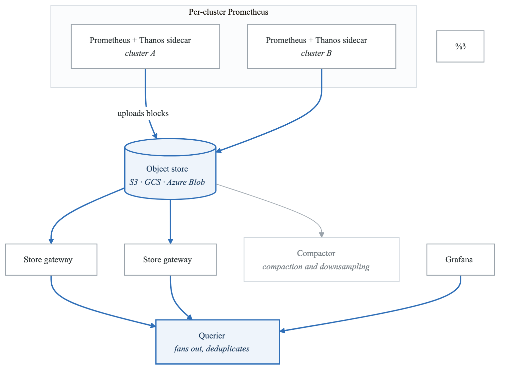
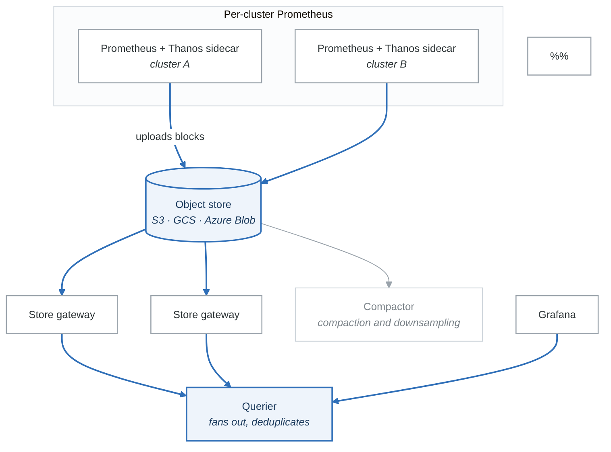

# Exercise 7: Long-term Storage with Thanos

## Objectives

- Deploy Thanos for long-term metrics storage
- Configure multi-cluster metrics aggregation
- Implement global querying
- Set up cost-effective retention

## Prerequisites

- Completed Exercises 1-6
- Prometheus deployed
- Object storage available (S3, GCS, Azure Blob)

---

## Part 1: Thanos Architecture

### 1.1 Component Overview

<!-- figure: generated from the Mermaid below by _shared/diagrams/embed-figures.py — do not edit the image -->


<details>
<summary>Diagram source (Mermaid)</summary>



</details>

### 1.2 Component Functions

| Component | Function |
|-----------|----------|
| Sidecar | Ships blocks to object storage, serves real-time data |
| Store Gateway | Serves historical data from object storage |
| Compactor | Downsamples and compacts blocks |
| Querier | Aggregates data from all sources |
| Query Frontend | Caches queries, splits large queries |
| Ruler | Evaluates recording rules and alerts |
| Receive | Accepts remote write (alternative to Sidecar) |

---

## Part 2: Sidecar Deployment

### 2.1 Prometheus with Thanos Sidecar

```yaml
# prometheus-thanos-sidecar.yaml
apiVersion: monitoring.coreos.com/v1
kind: Prometheus
metadata:
  name: prometheus
  namespace: monitoring
spec:
  replicas: 2
  version: v2.47.0

  # External labels for deduplication
  externalLabels:
    cluster: production-us-west-2
    region: us-west-2

  # Thanos sidecar
  thanos:
    image: quay.io/thanos/thanos:v0.32.0
    version: v0.32.0
    objectStorageConfig:
      key: thanos.yaml
      name: thanos-objstore-config

  # Storage retention (local)
  retention: 2h
  retentionSize: "5GB"

  # Resources
  resources:
    requests:
      cpu: 500m
      memory: 2Gi
    limits:
      cpu: 2000m
      memory: 8Gi

  # Storage
  storage:
    volumeClaimTemplate:
      spec:
        storageClassName: fast-ssd
        resources:
          requests:
            storage: 50Gi
```

### 2.2 Object Storage Configuration

```yaml
# thanos-objstore-secret.yaml
apiVersion: v1
kind: Secret
metadata:
  name: thanos-objstore-config
  namespace: monitoring
stringData:
  thanos.yaml: |
    type: S3
    config:
      bucket: thanos-metrics
      endpoint: s3.us-west-2.amazonaws.com
      region: us-west-2
      access_key: ${AWS_ACCESS_KEY_ID}
      secret_key: ${AWS_SECRET_ACCESS_KEY}
      insecure: false
      signature_version2: false
      # For MinIO
      # endpoint: minio.minio.svc:9000
      # insecure: true
---
# For GCS
apiVersion: v1
kind: Secret
metadata:
  name: thanos-objstore-config-gcs
  namespace: monitoring
stringData:
  thanos.yaml: |
    type: GCS
    config:
      bucket: thanos-metrics
      service_account: |
        {
          "type": "service_account",
          "project_id": "my-project",
          ...
        }
---
# For Azure
apiVersion: v1
kind: Secret
metadata:
  name: thanos-objstore-config-azure
  namespace: monitoring
stringData:
  thanos.yaml: |
    type: AZURE
    config:
      storage_account: thanosmetrics
      storage_account_key: ${AZURE_STORAGE_KEY}
      container: metrics
```

---

## Part 3: Store Gateway

### 3.1 Store Gateway Deployment

```yaml
# thanos-store-gateway.yaml
apiVersion: apps/v1
kind: StatefulSet
metadata:
  name: thanos-store-gateway
  namespace: monitoring
spec:
  replicas: 2
  serviceName: thanos-store-gateway
  selector:
    matchLabels:
      app: thanos-store-gateway
  template:
    metadata:
      labels:
        app: thanos-store-gateway
    spec:
      containers:
      - name: thanos-store
        image: quay.io/thanos/thanos:v0.32.0
        args:
        - store
        - --data-dir=/var/thanos/store
        - --objstore.config-file=/etc/thanos/objstore.yaml
        - --http-address=0.0.0.0:10902
        - --grpc-address=0.0.0.0:10901
        # Time-based partitioning
        - --min-time=-2w
        - --max-time=-0h
        # Index cache
        - --index-cache-size=500MB
        - --chunk-pool-size=2GB
        ports:
        - containerPort: 10901
          name: grpc
        - containerPort: 10902
          name: http
        volumeMounts:
        - name: objstore-config
          mountPath: /etc/thanos
        - name: data
          mountPath: /var/thanos/store
        resources:
          requests:
            cpu: 500m
            memory: 2Gi
          limits:
            cpu: 2000m
            memory: 8Gi
        livenessProbe:
          httpGet:
            path: /-/healthy
            port: http
          initialDelaySeconds: 10
        readinessProbe:
          httpGet:
            path: /-/ready
            port: http
          initialDelaySeconds: 15
      volumes:
      - name: objstore-config
        secret:
          secretName: thanos-objstore-config
  volumeClaimTemplates:
  - metadata:
      name: data
    spec:
      accessModes: [ReadWriteOnce]
      resources:
        requests:
          storage: 20Gi
---
apiVersion: v1
kind: Service
metadata:
  name: thanos-store-gateway
  namespace: monitoring
spec:
  type: ClusterIP
  clusterIP: None
  ports:
  - port: 10901
    name: grpc
  - port: 10902
    name: http
  selector:
    app: thanos-store-gateway
```

### 3.2 Store Gateway with Sharding

```yaml
# For large deployments, shard by time
# Store Gateway 1: Recent data
- --min-time=-2w
- --max-time=-0h

# Store Gateway 2: Older data
- --min-time=-4w
- --max-time=-2w

# Store Gateway 3: Historical
- --min-time=-1y
- --max-time=-4w
```

---

## Part 4: Querier

### 4.1 Thanos Querier Deployment

```yaml
# thanos-querier.yaml
apiVersion: apps/v1
kind: Deployment
metadata:
  name: thanos-querier
  namespace: monitoring
spec:
  replicas: 3
  selector:
    matchLabels:
      app: thanos-querier
  template:
    metadata:
      labels:
        app: thanos-querier
    spec:
      containers:
      - name: thanos-query
        image: quay.io/thanos/thanos:v0.32.0
        args:
        - query
        - --http-address=0.0.0.0:9090
        - --grpc-address=0.0.0.0:10901
        # Store endpoints (sidecars)
        - --endpoint=dnssrv+_grpc._tcp.prometheus-operated.monitoring.svc
        # Store endpoints (store gateways)
        - --endpoint=dnssrv+_grpc._tcp.thanos-store-gateway.monitoring.svc
        # Deduplication
        - --query.replica-label=prometheus_replica
        - --query.replica-label=replica
        # Auto-downsampling
        - --query.auto-downsampling
        # Partial response for availability
        - --query.partial-response
        # Query timeout
        - --query.timeout=2m
        ports:
        - containerPort: 9090
          name: http
        - containerPort: 10901
          name: grpc
        resources:
          requests:
            cpu: 500m
            memory: 1Gi
          limits:
            cpu: 2000m
            memory: 4Gi
        livenessProbe:
          httpGet:
            path: /-/healthy
            port: http
        readinessProbe:
          httpGet:
            path: /-/ready
            port: http
---
apiVersion: v1
kind: Service
metadata:
  name: thanos-querier
  namespace: monitoring
spec:
  type: ClusterIP
  ports:
  - port: 9090
    name: http
  - port: 10901
    name: grpc
  selector:
    app: thanos-querier
```

### 4.2 Query Frontend

```yaml
# thanos-query-frontend.yaml
apiVersion: apps/v1
kind: Deployment
metadata:
  name: thanos-query-frontend
  namespace: monitoring
spec:
  replicas: 2
  selector:
    matchLabels:
      app: thanos-query-frontend
  template:
    metadata:
      labels:
        app: thanos-query-frontend
    spec:
      containers:
      - name: query-frontend
        image: quay.io/thanos/thanos:v0.32.0
        args:
        - query-frontend
        - --http-address=0.0.0.0:9090
        - --query-frontend.downstream-url=http://thanos-querier:9090
        # Query splitting
        - --query-range.split-interval=24h
        - --query-range.max-retries-per-request=3
        # Response caching
        - --query-range.response-cache-config-file=/etc/thanos/cache.yaml
        # Labels caching
        - --labels.split-interval=24h
        - --labels.max-retries-per-request=3
        ports:
        - containerPort: 9090
          name: http
        volumeMounts:
        - name: cache-config
          mountPath: /etc/thanos
        resources:
          requests:
            cpu: 200m
            memory: 512Mi
      volumes:
      - name: cache-config
        configMap:
          name: thanos-query-frontend-config
---
apiVersion: v1
kind: ConfigMap
metadata:
  name: thanos-query-frontend-config
  namespace: monitoring
data:
  cache.yaml: |
    type: MEMCACHED
    config:
      addresses:
        - memcached.monitoring.svc:11211
      timeout: 500ms
      max_idle_connections: 100
      max_async_concurrency: 20
      max_async_buffer_size: 10000
      max_item_size: 1MiB
      max_get_multi_concurrency: 100
      max_get_multi_batch_size: 0
      dns_provider_update_interval: 10s
```

---

## Part 5: Compactor

### 5.1 Compactor Deployment

```yaml
# thanos-compactor.yaml
apiVersion: apps/v1
kind: StatefulSet
metadata:
  name: thanos-compactor
  namespace: monitoring
spec:
  replicas: 1  # MUST be 1 - compactor is singleton
  serviceName: thanos-compactor
  selector:
    matchLabels:
      app: thanos-compactor
  template:
    metadata:
      labels:
        app: thanos-compactor
    spec:
      containers:
      - name: compactor
        image: quay.io/thanos/thanos:v0.32.0
        args:
        - compact
        - --data-dir=/var/thanos/compact
        - --objstore.config-file=/etc/thanos/objstore.yaml
        - --http-address=0.0.0.0:10902
        - --wait
        # Retention configuration
        - --retention.resolution-raw=30d
        - --retention.resolution-5m=90d
        - --retention.resolution-1h=1y
        # Downsampling
        - --downsampling.disable=false
        # Deduplication
        - --deduplication.replica-label=prometheus_replica
        - --deduplication.replica-label=replica
        # Compaction
        - --compact.concurrency=1
        - --compact.cleanup-interval=15m
        ports:
        - containerPort: 10902
          name: http
        volumeMounts:
        - name: objstore-config
          mountPath: /etc/thanos
        - name: data
          mountPath: /var/thanos/compact
        resources:
          requests:
            cpu: 500m
            memory: 2Gi
          limits:
            cpu: 2000m
            memory: 8Gi
      volumes:
      - name: objstore-config
        secret:
          secretName: thanos-objstore-config
  volumeClaimTemplates:
  - metadata:
      name: data
    spec:
      accessModes: [ReadWriteOnce]
      resources:
        requests:
          storage: 100Gi
```

### 5.2 Retention and Downsampling

```yaml
# Retention settings:
# - Raw data (full resolution): 30 days
# - 5-minute downsampled: 90 days
# - 1-hour downsampled: 1 year

# Storage savings example:
# 1000 series, 15s scrape interval
# Raw: 1000 * 4 * 60 * 24 * 30 = 172.8M samples/month
# 5m downsample: 1000 * 12 * 24 * 60 = 17.28M samples/month (10x reduction)
# 1h downsample: 1000 * 24 * 365 = 8.76M samples/year (20x reduction)
```

---

## Part 6: Multi-Cluster Setup

### 6.1 Cluster Configuration

```yaml
# Cluster 1 Prometheus
spec:
  externalLabels:
    cluster: prod-us-west-2
    region: us-west-2
    environment: production

# Cluster 2 Prometheus
spec:
  externalLabels:
    cluster: prod-us-east-1
    region: us-east-1
    environment: production

# Cluster 3 Prometheus
spec:
  externalLabels:
    cluster: staging-eu-west-1
    region: eu-west-1
    environment: staging
```

### 6.2 Global Querier

```yaml
# Global querier configuration
args:
  # All sidecars from all clusters
  - --endpoint=sidecar-us-west-2.thanos.svc:10901
  - --endpoint=sidecar-us-east-1.thanos.svc:10901
  - --endpoint=sidecar-eu-west-1.thanos.svc:10901
  # Store gateways
  - --endpoint=store-gateway.thanos.svc:10901
  # Deduplication
  - --query.replica-label=prometheus_replica
```

### 6.3 Global View Queries

```promql
# Query across all clusters
sum by (cluster) (rate(http_requests_total[5m]))

# Compare clusters
sum(rate(http_requests_total{cluster="prod-us-west-2"}[5m]))
/
sum(rate(http_requests_total{cluster="prod-us-east-1"}[5m]))

# Filter by region
sum by (service) (
  rate(http_requests_total{region=~"us-.*"}[5m])
)
```

---

## Part 7: Thanos Ruler

### 7.1 Ruler Deployment

```yaml
# thanos-ruler.yaml
apiVersion: apps/v1
kind: StatefulSet
metadata:
  name: thanos-ruler
  namespace: monitoring
spec:
  replicas: 2
  serviceName: thanos-ruler
  selector:
    matchLabels:
      app: thanos-ruler
  template:
    metadata:
      labels:
        app: thanos-ruler
    spec:
      containers:
      - name: ruler
        image: quay.io/thanos/thanos:v0.32.0
        args:
        - rule
        - --data-dir=/var/thanos/ruler
        - --objstore.config-file=/etc/thanos/objstore.yaml
        - --http-address=0.0.0.0:10902
        - --grpc-address=0.0.0.0:10901
        - --rule-file=/etc/thanos/rules/*.yaml
        - --query=dnssrv+_http._tcp.thanos-querier.monitoring.svc
        - --alertmanagers.url=http://alertmanager:9093
        - --label=ruler_replica="$(POD_NAME)"
        - --alert.label-drop=ruler_replica
        env:
        - name: POD_NAME
          valueFrom:
            fieldRef:
              fieldPath: metadata.name
        ports:
        - containerPort: 10901
          name: grpc
        - containerPort: 10902
          name: http
        volumeMounts:
        - name: objstore-config
          mountPath: /etc/thanos
        - name: rules
          mountPath: /etc/thanos/rules
        - name: data
          mountPath: /var/thanos/ruler
      volumes:
      - name: objstore-config
        secret:
          secretName: thanos-objstore-config
      - name: rules
        configMap:
          name: thanos-ruler-rules
  volumeClaimTemplates:
  - metadata:
      name: data
    spec:
      accessModes: [ReadWriteOnce]
      resources:
        requests:
          storage: 10Gi
```

---

## Part 8: Helm Deployment

### 8.1 Bitnami Thanos Chart

```yaml
# thanos-values.yaml
objstoreConfig: |
  type: S3
  config:
    bucket: thanos-metrics
    endpoint: s3.amazonaws.com
    region: us-west-2

query:
  enabled: true
  replicaCount: 3
  dnsDiscovery:
    sidecarsService: prometheus-operated
    sidecarsNamespace: monitoring

queryFrontend:
  enabled: true
  replicaCount: 2

storegateway:
  enabled: true
  replicaCount: 2
  persistence:
    enabled: true
    size: 20Gi

compactor:
  enabled: true
  persistence:
    enabled: true
    size: 100Gi
  retentionResolutionRaw: 30d
  retentionResolution5m: 90d
  retentionResolution1h: 1y

ruler:
  enabled: true
  replicaCount: 2
  alertmanagers:
    - http://alertmanager:9093
  config: |
    groups:
      - name: global-alerts
        rules:
          - alert: GlobalHighErrorRate
            expr: sum(rate(http_requests_total{status=~"5.."}[5m])) > 100
            for: 5m

metrics:
  enabled: true
  serviceMonitor:
    enabled: true
```

```bash
# Install
helm repo add bitnami https://charts.bitnami.com/bitnami
helm install thanos bitnami/thanos \
  --namespace monitoring \
  --values thanos-values.yaml
```

---

## Part 9: Hands-on Challenges

### Challenge 1: Multi-Region Setup

Deploy Thanos across regions:
1. Set up Prometheus in 2+ regions
2. Configure shared object storage
3. Deploy global querier
4. Create cross-region dashboards

### Challenge 2: Cost Optimization

Optimize storage costs:
1. Analyze current storage usage
2. Configure appropriate retention
3. Enable downsampling
4. Compare costs before/after

### Challenge 3: Disaster Recovery

Implement DR for metrics:
1. Set up cross-region replication
2. Test querier failover
3. Document recovery procedures
4. Test full recovery

---

## Verification Tasks

1. [ ] Deployed Thanos sidecar with Prometheus
2. [ ] Configured object storage
3. [ ] Deployed store gateway
4. [ ] Set up global querier
5. [ ] Configured compactor with retention
6. [ ] Tested multi-cluster queries

---

## Key Takeaways

- Thanos enables unlimited retention with object storage
- Sidecars ship data, Store Gateways serve it
- Compactor handles downsampling and deduplication
- Query Frontend improves performance
- External labels enable multi-cluster deduplication
- Downsampling significantly reduces storage costs

---

## Next Steps

Continue to [Exercise 8: Observability Patterns](08-observability-patterns.md)

<!-- feynman-check -->

---

## Feynman check

Close the file. Blank page, no notes. Explain each of these to a competent engineer who has never
used this tool — **under five minutes, no jargon you can't define on the spot:**

- Thanos Architecture
- Sidecar Deployment
- Store Gateway
- Querier

**The gap is not what you forgot. It is where you used a word instead of a mechanism.**

| | |
|---|---|
| ✗ | *"Kubernetes schedules the pod."* |
| ✓ | *"The scheduler watches for pods with no `nodeName`, filters nodes by predicates, scores the survivors, and writes `nodeName` into the pod spec. The kubelet on that node is watching the API for pods bound to it, and starts the containers."* |

**Trace it:** `kubectl apply -f pod.yaml` → a running container. Name every component that acts, in order, and what each one writes.

Stop at the first component you cannot name. Reopen this file and read **only** that.

**Go deeper — only once the gap has a name:** [Kubernetes the Hard Way](https://github.com/kelseyhightower/kubernetes-the-hard-way) — one weekend, and "the control plane" stops being a word.
Full list per domain: [`SOURCES.md`](../../SOURCES.md#kubernetes)

→ Protocol, the three levels of knowing, and worked examples: [`MASTERY.md`](../../MASTERY.md)

<!-- /feynman-check -->
