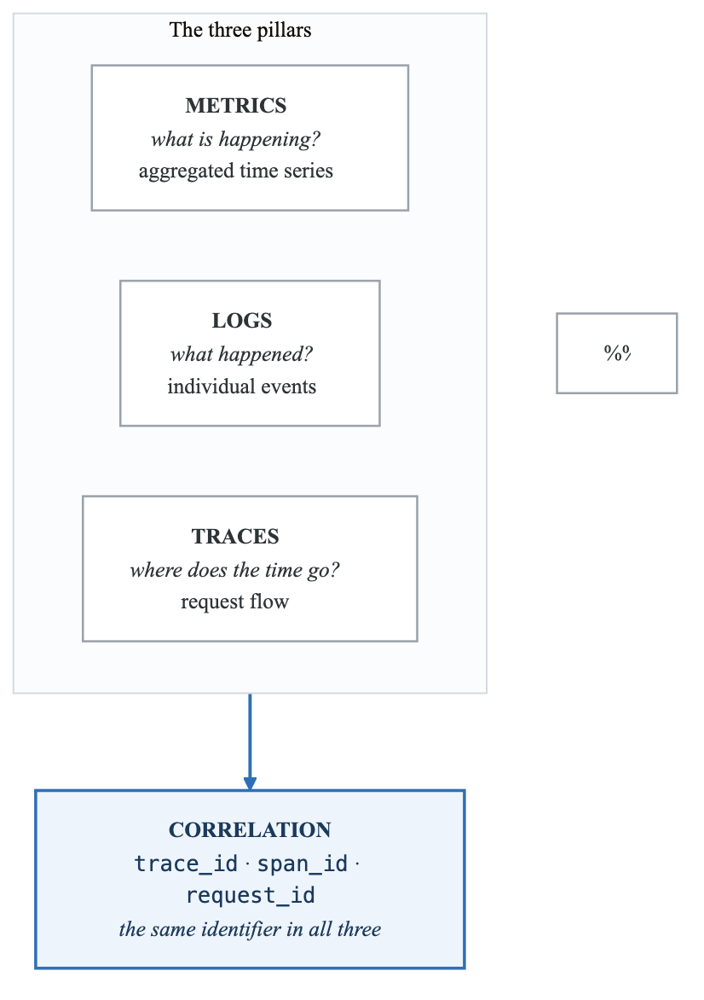
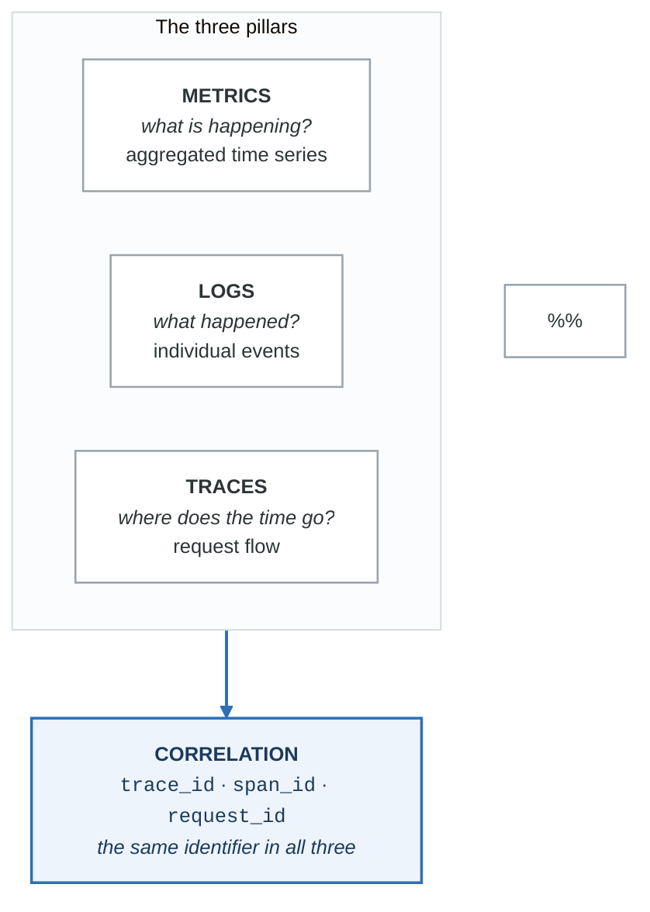
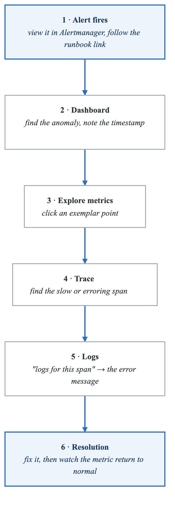
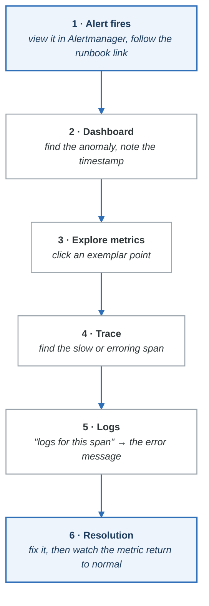

# Exercise 8: Observability Patterns

## Objectives

- Implement comprehensive observability patterns
- Correlate metrics, logs, and traces
- Design effective monitoring strategies
- Build self-healing systems

## Prerequisites

- Completed Exercises 1-7
- Full observability stack deployed
- Application instrumentation in place

---

## Part 1: The Three Pillars

### 1.1 Observability Model

<!-- figure: generated from the Mermaid below by _shared/diagrams/embed-figures.py — do not edit the image -->


<details>
<summary>Diagram source (Mermaid)</summary>



</details>

### 1.2 When to Use Each

```yaml
# Metrics: Aggregated numerical data
use_metrics_for:
  - Alert triggering
  - SLO tracking
  - Capacity planning
  - Trend analysis
  - Dashboard visualization

# Logs: Detailed event records
use_logs_for:
  - Debugging specific issues
  - Audit trails
  - Security forensics
  - Error details
  - Context around events

# Traces: Request flow tracking
use_traces_for:
  - Latency investigation
  - Dependency mapping
  - Bottleneck identification
  - Cross-service debugging
  - Performance optimization
```

---

## Part 2: Correlation Patterns

### 2.1 Trace-Log Correlation

```yaml
# Application logging with trace context
apiVersion: apps/v1
kind: Deployment
metadata:
  name: instrumented-app
spec:
  template:
    spec:
      containers:
      - name: app
        env:
        - name: OTEL_TRACES_EXPORTER
          value: otlp
        - name: OTEL_EXPORTER_OTLP_ENDPOINT
          value: http://otel-collector:4317
        - name: LOG_FORMAT
          value: json
```

```python
# Python logging with trace context
import logging
from opentelemetry import trace

class TraceContextFilter(logging.Filter):
    def filter(self, record):
        span = trace.get_current_span()
        ctx = span.get_span_context()
        record.trace_id = format(ctx.trace_id, '032x') if ctx.trace_id else ""
        record.span_id = format(ctx.span_id, '016x') if ctx.span_id else ""
        return True

# Configure logger
handler = logging.StreamHandler()
handler.setFormatter(logging.Formatter(
    '{"timestamp":"%(asctime)s","level":"%(levelname)s",'
    '"message":"%(message)s","trace_id":"%(trace_id)s",'
    '"span_id":"%(span_id)s"}'
))
handler.addFilter(TraceContextFilter())
logger = logging.getLogger()
logger.addHandler(handler)
```

### 2.2 Metrics-Trace Correlation (Exemplars)

```yaml
# Prometheus configuration for exemplars
prometheus:
  prometheusSpec:
    enableFeatures:
      - exemplar-storage

# Application exposing exemplars
from prometheus_client import Histogram
from opentelemetry import trace

REQUEST_DURATION = Histogram(
    'http_request_duration_seconds',
    'Request duration',
    ['method', 'endpoint']
)

def record_request(method, endpoint, duration):
    span = trace.get_current_span()
    ctx = span.get_span_context()

    # Record with exemplar
    REQUEST_DURATION.labels(
        method=method,
        endpoint=endpoint
    ).observe(
        duration,
        exemplar={
            'trace_id': format(ctx.trace_id, '032x')
        }
    )
```

### 2.3 Grafana Correlation Configuration

```yaml
# grafana-datasources.yaml
apiVersion: v1
kind: ConfigMap
metadata:
  name: grafana-datasources
  namespace: monitoring
data:
  datasources.yaml: |
    apiVersion: 1
    datasources:
      - name: Prometheus
        type: prometheus
        url: http://prometheus:9090
        jsonData:
          exemplarTraceIdDestinations:
            - name: trace_id
              datasourceUid: tempo

      - name: Loki
        type: loki
        url: http://loki:3100
        jsonData:
          derivedFields:
            - datasourceUid: tempo
              matcherRegex: '"trace_id":"([a-f0-9]+)"'
              name: TraceID
              url: '$${__value.raw}'

      - name: Tempo
        type: tempo
        url: http://tempo:3100
        jsonData:
          tracesToLogs:
            datasourceUid: loki
            tags: ['service.name']
            mappedTags: [{ key: 'service.name', value: 'app' }]
            mapTagNamesEnabled: true
            filterByTraceID: true
          tracesToMetrics:
            datasourceUid: prometheus
            tags: [{ key: 'service.name', value: 'service' }]
            queries:
              - name: Request rate
                query: 'sum(rate(http_requests_total{service="$${__tags.service.name}"}[5m]))'
```

---

## Part 3: Debugging Workflows

### 3.1 Alert-Driven Investigation

<!-- figure: generated from the Mermaid below by _shared/diagrams/embed-figures.py — do not edit the image -->


<details>
<summary>Diagram source (Mermaid)</summary>



</details>

### 3.2 Debugging Queries

```promql
# Step 1: Find the problematic service
topk(5, sum by (service) (rate(http_requests_total{status=~"5.."}[5m])))

# Step 2: Find the problematic endpoint
topk(5, sum by (endpoint) (
  rate(http_requests_total{service="api-gateway", status=~"5.."}[5m])
))

# Step 3: Find affected pods
sum by (pod) (
  rate(http_requests_total{service="api-gateway", endpoint="/api/users", status=~"5.."}[5m])
)
```

```logql
# Step 4: Get error logs for that service
{app="api-gateway"} |= "error" | json | endpoint="/api/users"

# Step 5: Get logs around a specific trace
{app="api-gateway"} | json | trace_id="abc123def456"
```

```traceql
# Step 6: Find traces with errors
{resource.service.name="api-gateway" && status=error}

# Step 7: Find slow traces
{resource.service.name="api-gateway"} | duration > 1s
```

---

## Part 4: Self-Healing Patterns

### 4.1 Auto-Remediation Architecture

```yaml
# auto-remediation-system.yaml
apiVersion: apps/v1
kind: Deployment
metadata:
  name: remediation-controller
  namespace: monitoring
spec:
  replicas: 1
  selector:
    matchLabels:
      app: remediation-controller
  template:
    metadata:
      labels:
        app: remediation-controller
    spec:
      serviceAccountName: remediation-controller
      containers:
      - name: controller
        image: remediation-controller:1.0
        env:
        - name: ALERTMANAGER_URL
          value: http://alertmanager:9093
        - name: ACTIONS_CONFIG
          value: /etc/remediation/actions.yaml
        volumeMounts:
        - name: config
          mountPath: /etc/remediation
      volumes:
      - name: config
        configMap:
          name: remediation-config
---
apiVersion: v1
kind: ConfigMap
metadata:
  name: remediation-config
  namespace: monitoring
data:
  actions.yaml: |
    actions:
      - alert: PodCrashLooping
        action: restart_pod
        conditions:
          - restarts > 5
          - restarts < 20
        cooldown: 10m

      - alert: HighMemoryUsage
        action: scale_up
        conditions:
          - memory_percent > 90
        cooldown: 5m
        max_replicas: 10

      - alert: DiskSpaceLow
        action: cleanup_logs
        conditions:
          - disk_percent > 85
        cooldown: 1h

      - alert: CertificateExpiringSoon
        action: renew_certificate
        conditions:
          - days_until_expiry < 7
        cooldown: 24h
```

### 4.2 Kubernetes Event-Driven Autoscaling (KEDA)

```yaml
# keda-scaledobject.yaml
apiVersion: keda.sh/v1alpha1
kind: ScaledObject
metadata:
  name: prometheus-scaledobject
  namespace: production
spec:
  scaleTargetRef:
    name: my-deployment
  pollingInterval: 30
  cooldownPeriod: 300
  minReplicaCount: 2
  maxReplicaCount: 20
  triggers:
    # Scale based on queue length
    - type: prometheus
      metadata:
        serverAddress: http://prometheus:9090
        metricName: rabbitmq_queue_messages
        query: sum(rabbitmq_queue_messages_ready{queue="orders"})
        threshold: "100"

    # Scale based on error rate
    - type: prometheus
      metadata:
        serverAddress: http://prometheus:9090
        metricName: http_error_rate
        query: |
          sum(rate(http_requests_total{status=~"5.."}[5m]))
          /
          sum(rate(http_requests_total[5m]))
        threshold: "0.01"
```

### 4.3 Chaos Engineering Integration

```yaml
# chaos-experiment.yaml
apiVersion: chaos-mesh.org/v1alpha1
kind: PodChaos
metadata:
  name: pod-failure-experiment
  namespace: production
spec:
  action: pod-failure
  mode: one
  selector:
    namespaces:
      - production
    labelSelectors:
      app: api-gateway
  duration: "60s"
  scheduler:
    cron: "@every 24h"
---
# Monitor chaos experiments
apiVersion: monitoring.coreos.com/v1
kind: PrometheusRule
metadata:
  name: chaos-monitoring
spec:
  groups:
    - name: chaos
      rules:
        - alert: ChaosExperimentRunning
          expr: chaos_mesh_experiments_running > 0
          labels:
            severity: info
          annotations:
            summary: "Chaos experiment in progress"
```

---

## Part 5: Capacity Planning

### 5.1 Resource Forecasting

```yaml
# Recording rules for capacity planning
apiVersion: monitoring.coreos.com/v1
kind: PrometheusRule
metadata:
  name: capacity-planning-rules
spec:
  groups:
    - name: capacity
      rules:
        # CPU trend (linear regression)
        - record: node:cpu_usage:trend_1w
          expr: |
            predict_linear(
              avg by (node) (
                1 - rate(node_cpu_seconds_total{mode="idle"}[5m])
              )[1w:1h],
              60 * 60 * 24 * 30
            )

        # Memory trend
        - record: node:memory_usage:trend_1w
          expr: |
            predict_linear(
              (1 - node_memory_MemAvailable_bytes / node_memory_MemTotal_bytes)[1w:1h],
              60 * 60 * 24 * 30
            )

        # Storage trend
        - record: pvc:storage_usage:trend_1w
          expr: |
            predict_linear(
              (kubelet_volume_stats_used_bytes / kubelet_volume_stats_capacity_bytes)[1w:1h],
              60 * 60 * 24 * 30
            )
```

### 5.2 Capacity Dashboard

```json
{
  "panels": [
    {
      "title": "CPU Capacity Forecast (30 days)",
      "type": "timeseries",
      "targets": [
        {
          "expr": "avg by (node) (1 - rate(node_cpu_seconds_total{mode=\"idle\"}[5m]))",
          "legendFormat": "Current {{node}}"
        },
        {
          "expr": "node:cpu_usage:trend_1w",
          "legendFormat": "Predicted {{node}}"
        }
      ],
      "fieldConfig": {
        "defaults": {
          "unit": "percentunit",
          "max": 1
        }
      }
    },
    {
      "title": "Days Until Storage Full",
      "type": "stat",
      "targets": [
        {
          "expr": "(kubelet_volume_stats_capacity_bytes - kubelet_volume_stats_used_bytes) / deriv(kubelet_volume_stats_used_bytes[1w]) / 86400"
        }
      ],
      "fieldConfig": {
        "defaults": {
          "unit": "d",
          "thresholds": {
            "steps": [
              {"value": 0, "color": "red"},
              {"value": 7, "color": "yellow"},
              {"value": 30, "color": "green"}
            ]
          }
        }
      }
    }
  ]
}
```

---

## Part 6: Observability as Code

### 6.1 Monitoring Mixin

```jsonnet
// mixin.libsonnet
{
  _config+:: {
    service: 'my-service',
    sloTarget: 0.999,
    latencyTarget: 0.2,
  },

  prometheusRules+:: {
    groups+: [
      {
        name: 'slo-rules',
        rules: [
          {
            record: 'slo:availability:ratio',
            expr: |||
              1 - (
                sum(rate(http_requests_total{service="%s",status=~"5.."}[5m]))
                /
                sum(rate(http_requests_total{service="%s"}[5m]))
              )
            ||| % [$._config.service, $._config.service],
          },
        ],
      },
    ],
  },

  prometheusAlerts+:: {
    groups+: [
      {
        name: 'slo-alerts',
        rules: [
          {
            alert: 'SLOBreach',
            expr: 'slo:availability:ratio < %s' % $._config.sloTarget,
            'for': '5m',
            labels: { severity: 'critical' },
            annotations: {
              summary: 'SLO breach for %s' % $._config.service,
            },
          },
        ],
      },
    ],
  },

  grafanaDashboards+:: {
    'service-overview.json': {
      // Dashboard definition
    },
  },
}
```

### 6.2 GitOps Monitoring

```yaml
# monitoring-gitops/
# ├── base/
# │   ├── prometheus-rules/
# │   ├── grafana-dashboards/
# │   └── alertmanager-config/
# └── overlays/
#     ├── production/
#     └── staging/

# ArgoCD Application
apiVersion: argoproj.io/v1alpha1
kind: Application
metadata:
  name: monitoring-config
  namespace: argocd
spec:
  project: default
  source:
    repoURL: https://github.com/org/monitoring-config
    path: overlays/production
    targetRevision: HEAD
  destination:
    server: https://kubernetes.default.svc
    namespace: monitoring
  syncPolicy:
    automated:
      prune: true
      selfHeal: true
```

---

## Part 7: Hands-on Challenges

### Challenge 1: End-to-End Correlation

Build complete correlation:
1. Instrument an application with traces
2. Add trace IDs to all logs
3. Configure Grafana data source links
4. Create a debugging workflow dashboard

### Challenge 2: Self-Healing System

Implement auto-remediation:
1. Create remediation controller
2. Define action rules
3. Test with simulated failures
4. Add safety guardrails

### Challenge 3: Observability Platform

Build a complete platform:
1. Deploy all observability components
2. Configure correlation
3. Create SLO dashboards
4. Implement alerting pipeline

---

## Verification Tasks

1. [ ] Implemented trace-log correlation
2. [ ] Configured exemplars for metrics-trace links
3. [ ] Created debugging workflow
4. [ ] Set up auto-remediation
5. [ ] Built capacity planning dashboards
6. [ ] Implemented observability as code

---

## Key Takeaways

- Correlation is key to effective debugging
- Exemplars link metrics to specific traces
- Self-healing reduces operational burden
- Capacity planning prevents outages
- Observability as code enables consistency
- Chaos engineering validates observability

---

## Module Complete!

You've completed the Observability Stack module. Continue to:
- [Security & RBAC Module](02-security-rbac-README.md)

<!-- feynman-check -->

---

## Feynman check

Close the file. Blank page, no notes. Explain each of these to a competent engineer who has never
used this tool — **under five minutes, no jargon you can't define on the spot:**

- The Three Pillars
- Correlation Patterns
- Debugging Workflows
- Self-Healing Patterns

**The gap is not what you forgot. It is where you used a word instead of a mechanism.**

| | |
|---|---|
| ✗ | *"Kubernetes schedules the pod."* |
| ✓ | *"The scheduler watches for pods with no `nodeName`, filters nodes by predicates, scores the survivors, and writes `nodeName` into the pod spec. The kubelet on that node is watching the API for pods bound to it, and starts the containers."* |

**Trace it:** `kubectl apply -f pod.yaml` → a running container. Name every component that acts, in order, and what each one writes.

Stop at the first component you cannot name. Reopen this file and read **only** that.

**Go deeper — only once the gap has a name:** [Kubernetes the Hard Way](https://github.com/kelseyhightower/kubernetes-the-hard-way) — one weekend, and "the control plane" stops being a word.
Full list per domain: [`SOURCES.md`](../../SOURCES.md#kubernetes)

→ Protocol, the three levels of knowing, and worked examples: [`MASTERY.md`](../../MASTERY.md)

<!-- /feynman-check -->
