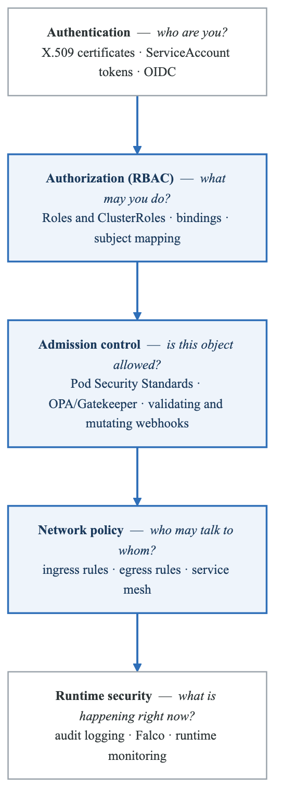
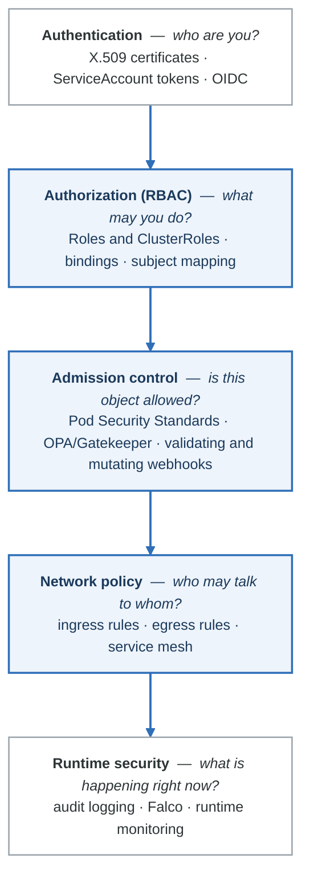
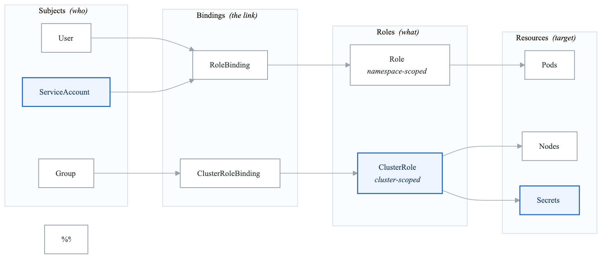
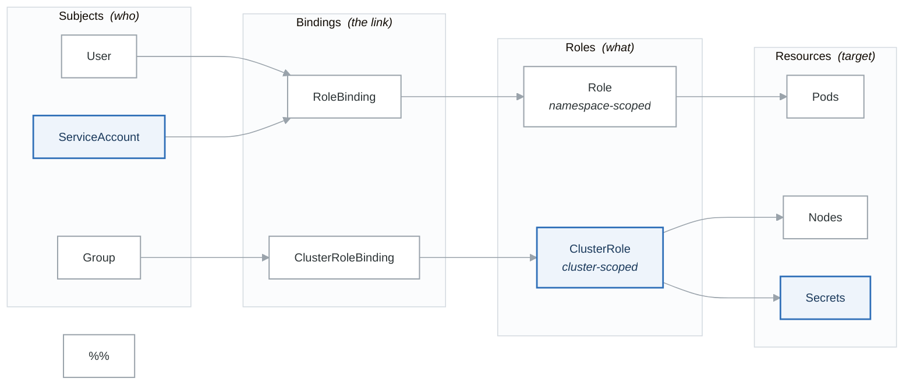

# Security & RBAC

Comprehensive security controls for production Kubernetes environments.

## Learning Path

1. [RBAC Deep Dive](#rbac-deep-dive)
2. [Pod Security Standards](#pod-security-standards)
3. [OPA Gatekeeper](#opa-gatekeeper)
4. [Secrets Encryption](#secrets-encryption)
5. [Audit Logging](#audit-logging)
6. [Workload Identity](#workload-identity)

---

## Kubernetes Security Model

<!-- figure: generated from the Mermaid below by _shared/diagrams/embed-figures.py — do not edit the image -->


<details>
<summary>Diagram source (Mermaid)</summary>



</details>

---

## RBAC Deep Dive

### RBAC Components

<!-- figure: generated from the Mermaid below by _shared/diagrams/embed-figures.py — do not edit the image -->


<details>
<summary>Diagram source (Mermaid)</summary>



</details>

### Role Examples

```yaml
# Developer role - read most resources, manage deployments
apiVersion: rbac.authorization.k8s.io/v1
kind: Role
metadata:
  name: developer
  namespace: development
rules:
# Read access to most resources
- apiGroups: [""]
  resources: ["pods", "pods/log", "services", "configmaps", "events"]
  verbs: ["get", "list", "watch"]

# Full access to deployments and replicasets
- apiGroups: ["apps"]
  resources: ["deployments", "replicasets"]
  verbs: ["get", "list", "watch", "create", "update", "patch", "delete"]

# Execute into pods (for debugging)
- apiGroups: [""]
  resources: ["pods/exec"]
  verbs: ["create"]

# Port forward for local debugging
- apiGroups: [""]
  resources: ["pods/portforward"]
  verbs: ["create"]

# No access to secrets (explicitly denied by omission)

---
# Operations role - broad read, limited write
apiVersion: rbac.authorization.k8s.io/v1
kind: Role
metadata:
  name: operations
  namespace: production
rules:
# Read everything
- apiGroups: ["*"]
  resources: ["*"]
  verbs: ["get", "list", "watch"]

# Scale deployments
- apiGroups: ["apps"]
  resources: ["deployments/scale"]
  verbs: ["update", "patch"]

# Restart deployments (via rollout)
- apiGroups: ["apps"]
  resources: ["deployments"]
  verbs: ["patch"]
  resourceNames: []  # All deployments

# Delete pods (for restarts)
- apiGroups: [""]
  resources: ["pods"]
  verbs: ["delete"]

---
# Read-only auditor role
apiVersion: rbac.authorization.k8s.io/v1
kind: ClusterRole
metadata:
  name: auditor
rules:
- apiGroups: ["*"]
  resources: ["*"]
  verbs: ["get", "list", "watch"]

# Explicitly exclude secrets content
- apiGroups: [""]
  resources: ["secrets"]
  verbs: ["list"]  # Can list but not get content
```

### RoleBinding Examples

```yaml
# Bind developer role to a group
apiVersion: rbac.authorization.k8s.io/v1
kind: RoleBinding
metadata:
  name: developers
  namespace: development
subjects:
- kind: Group
  name: "dev-team"
  apiGroup: rbac.authorization.k8s.io
roleRef:
  kind: Role
  name: developer
  apiGroup: rbac.authorization.k8s.io

---
# Bind to specific users
apiVersion: rbac.authorization.k8s.io/v1
kind: RoleBinding
metadata:
  name: senior-developers
  namespace: production
subjects:
- kind: User
  name: "alice@example.com"
  apiGroup: rbac.authorization.k8s.io
- kind: User
  name: "bob@example.com"
  apiGroup: rbac.authorization.k8s.io
roleRef:
  kind: Role
  name: operations
  apiGroup: rbac.authorization.k8s.io

---
# ServiceAccount binding
apiVersion: rbac.authorization.k8s.io/v1
kind: RoleBinding
metadata:
  name: app-reader
  namespace: production
subjects:
- kind: ServiceAccount
  name: my-app
  namespace: production
roleRef:
  kind: Role
  name: app-reader
  apiGroup: rbac.authorization.k8s.io

---
# Cluster-wide binding
apiVersion: rbac.authorization.k8s.io/v1
kind: ClusterRoleBinding
metadata:
  name: cluster-auditors
subjects:
- kind: Group
  name: "security-team"
  apiGroup: rbac.authorization.k8s.io
roleRef:
  kind: ClusterRole
  name: auditor
  apiGroup: rbac.authorization.k8s.io
```

### Aggregated ClusterRoles

```yaml
# Base edit role with aggregation label
apiVersion: rbac.authorization.k8s.io/v1
kind: ClusterRole
metadata:
  name: custom-edit
  labels:
    rbac.authorization.k8s.io/aggregate-to-edit: "true"
rules:
- apiGroups: ["custom.example.com"]
  resources: ["widgets"]
  verbs: ["create", "update", "patch", "delete"]

---
# This automatically includes rules from roles with aggregate-to-edit label
apiVersion: rbac.authorization.k8s.io/v1
kind: ClusterRole
metadata:
  name: edit
aggregationRule:
  clusterRoleSelectors:
  - matchLabels:
      rbac.authorization.k8s.io/aggregate-to-edit: "true"
rules: []  # Rules are automatically filled by aggregation
```

### RBAC Verification

```bash
# Check if user can perform action
kubectl auth can-i create deployments --namespace=production --as=alice@example.com

# Check all permissions for a user
kubectl auth can-i --list --namespace=production --as=alice@example.com

# Check ServiceAccount permissions
kubectl auth can-i --list --namespace=production --as=system:serviceaccount:production:my-app

# Impersonate user for testing
kubectl get pods --namespace=production --as=alice@example.com

# Impersonate group
kubectl get pods --namespace=production --as=bob@example.com --as-group=dev-team
```

---

## Pod Security Standards

### Pod Security Admission

```yaml
# Namespace with Pod Security Standards
apiVersion: v1
kind: Namespace
metadata:
  name: production
  labels:
    # Enforce restricted standard
    pod-security.kubernetes.io/enforce: restricted
    pod-security.kubernetes.io/enforce-version: latest

    # Warn on violations of baseline
    pod-security.kubernetes.io/warn: restricted
    pod-security.kubernetes.io/warn-version: latest

    # Audit all violations
    pod-security.kubernetes.io/audit: restricted
    pod-security.kubernetes.io/audit-version: latest

---
# Namespace for legacy apps that need privileged access
apiVersion: v1
kind: Namespace
metadata:
  name: system-tools
  labels:
    pod-security.kubernetes.io/enforce: privileged
    pod-security.kubernetes.io/warn: baseline
```

### Restricted Pod Example

```yaml
apiVersion: v1
kind: Pod
metadata:
  name: secure-app
  namespace: production
spec:
  # Required for restricted
  securityContext:
    runAsNonRoot: true
    runAsUser: 1000
    runAsGroup: 1000
    fsGroup: 1000
    seccompProfile:
      type: RuntimeDefault

  containers:
  - name: app
    image: myapp:1.0
    securityContext:
      allowPrivilegeEscalation: false
      readOnlyRootFilesystem: true
      capabilities:
        drop:
        - ALL

    # Volumes for writable directories
    volumeMounts:
    - name: tmp
      mountPath: /tmp
    - name: cache
      mountPath: /app/cache

    resources:
      limits:
        memory: "512Mi"
        cpu: "500m"
      requests:
        memory: "256Mi"
        cpu: "100m"

  volumes:
  - name: tmp
    emptyDir: {}
  - name: cache
    emptyDir: {}
```

---

## OPA Gatekeeper

### Installation

```bash
helm repo add gatekeeper https://open-policy-agent.github.io/gatekeeper/charts
helm install gatekeeper gatekeeper/gatekeeper \
  --namespace gatekeeper-system --create-namespace
```

### Constraint Template: Required Labels

```yaml
apiVersion: templates.gatekeeper.sh/v1
kind: ConstraintTemplate
metadata:
  name: k8srequiredlabels
spec:
  crd:
    spec:
      names:
        kind: K8sRequiredLabels
      validation:
        openAPIV3Schema:
          type: object
          properties:
            labels:
              type: array
              items:
                type: string
            message:
              type: string
  targets:
  - target: admission.k8s.gatekeeper.sh
    rego: |
      package k8srequiredlabels

      violation[{"msg": msg}] {
        provided := {label | input.review.object.metadata.labels[label]}
        required := {label | label := input.parameters.labels[_]}
        missing := required - provided
        count(missing) > 0
        msg := sprintf("Missing required labels: %v", [missing])
      }

---
# Apply the constraint
apiVersion: constraints.gatekeeper.sh/v1beta1
kind: K8sRequiredLabels
metadata:
  name: require-team-label
spec:
  match:
    kinds:
    - apiGroups: [""]
      kinds: ["Namespace"]
    - apiGroups: ["apps"]
      kinds: ["Deployment"]
  parameters:
    labels: ["team", "environment"]
```

### Constraint Template: Container Limits

```yaml
apiVersion: templates.gatekeeper.sh/v1
kind: ConstraintTemplate
metadata:
  name: k8scontainerlimits
spec:
  crd:
    spec:
      names:
        kind: K8sContainerLimits
      validation:
        openAPIV3Schema:
          type: object
          properties:
            cpu:
              type: string
            memory:
              type: string
  targets:
  - target: admission.k8s.gatekeeper.sh
    rego: |
      package k8scontainerlimits

      violation[{"msg": msg}] {
        container := input.review.object.spec.containers[_]
        not container.resources.limits.cpu
        msg := sprintf("Container %v has no CPU limit", [container.name])
      }

      violation[{"msg": msg}] {
        container := input.review.object.spec.containers[_]
        not container.resources.limits.memory
        msg := sprintf("Container %v has no memory limit", [container.name])
      }

      violation[{"msg": msg}] {
        container := input.review.object.spec.containers[_]
        cpu_limit := container.resources.limits.cpu
        max_cpu := input.parameters.cpu
        to_number(split(cpu_limit, "m")[0]) > to_number(split(max_cpu, "m")[0])
        msg := sprintf("Container %v CPU limit %v exceeds maximum %v", [container.name, cpu_limit, max_cpu])
      }

---
apiVersion: constraints.gatekeeper.sh/v1beta1
kind: K8sContainerLimits
metadata:
  name: container-must-have-limits
spec:
  match:
    kinds:
    - apiGroups: ["apps"]
      kinds: ["Deployment", "StatefulSet", "DaemonSet"]
    namespaces: ["production", "staging"]
  parameters:
    cpu: "4000m"
    memory: "8Gi"
```

### Constraint Template: Allowed Registries

```yaml
apiVersion: templates.gatekeeper.sh/v1
kind: ConstraintTemplate
metadata:
  name: k8sallowedrepos
spec:
  crd:
    spec:
      names:
        kind: K8sAllowedRepos
      validation:
        openAPIV3Schema:
          type: object
          properties:
            repos:
              type: array
              items:
                type: string
  targets:
  - target: admission.k8s.gatekeeper.sh
    rego: |
      package k8sallowedrepos

      violation[{"msg": msg}] {
        container := input.review.object.spec.containers[_]
        not startswith_any(container.image, input.parameters.repos)
        msg := sprintf("Container %v uses image %v from non-approved registry", [container.name, container.image])
      }

      violation[{"msg": msg}] {
        container := input.review.object.spec.initContainers[_]
        not startswith_any(container.image, input.parameters.repos)
        msg := sprintf("Init container %v uses image %v from non-approved registry", [container.name, container.image])
      }

      startswith_any(str, prefixes) {
        prefix := prefixes[_]
        startswith(str, prefix)
      }

---
apiVersion: constraints.gatekeeper.sh/v1beta1
kind: K8sAllowedRepos
metadata:
  name: allowed-repos
spec:
  match:
    kinds:
    - apiGroups: [""]
      kinds: ["Pod"]
    - apiGroups: ["apps"]
      kinds: ["Deployment", "StatefulSet", "DaemonSet"]
  parameters:
    repos:
    - "gcr.io/my-project/"
    - "123456789.dkr.ecr.us-west-2.amazonaws.com/"
    - "myregistry.azurecr.io/"
```

---

## Secrets Encryption

### Encryption Configuration

```yaml
# /etc/kubernetes/encryption-config.yaml
apiVersion: apiserver.config.k8s.io/v1
kind: EncryptionConfiguration
resources:
- resources:
  - secrets
  - configmaps
  providers:
  # Primary: AWS KMS
  - kms:
      apiVersion: v2
      name: aws-kms
      endpoint: unix:///var/run/kmsplugin/socket.sock
      timeout: 3s
  # Fallback: local encryption
  - aescbc:
      keys:
      - name: key1
        secret: <base64-encoded-32-byte-key>
  # Allow reading unencrypted (for migration)
  - identity: {}
```

### Sealed Secrets for GitOps

```bash
# Install Sealed Secrets controller
helm repo add sealed-secrets https://bitnami-labs.github.io/sealed-secrets
helm install sealed-secrets sealed-secrets/sealed-secrets \
  --namespace kube-system
```

```yaml
# Create sealed secret
# First, create a regular secret
kubectl create secret generic my-secret \
  --from-literal=password=mysecretpassword \
  --dry-run=client -o yaml > secret.yaml

# Seal it
kubeseal --format yaml < secret.yaml > sealed-secret.yaml
```

```yaml
# sealed-secret.yaml (safe to commit to git)
apiVersion: bitnami.com/v1alpha1
kind: SealedSecret
metadata:
  name: my-secret
  namespace: production
spec:
  encryptedData:
    password: AgA7...encrypted-data...
  template:
    metadata:
      name: my-secret
      namespace: production
    type: Opaque
```

---

## Audit Logging

### Audit Policy

```yaml
# audit-policy.yaml
apiVersion: audit.k8s.io/v1
kind: Policy
rules:
# Don't log read-only requests to certain resources
- level: None
  resources:
  - group: ""
    resources: ["events"]
  - group: ""
    resources: ["endpoints", "services"]
    verbs: ["get", "list", "watch"]

# Log secret access at metadata level (no content)
- level: Metadata
  resources:
  - group: ""
    resources: ["secrets", "configmaps"]

# Log all authentication events
- level: RequestResponse
  users: ["system:anonymous"]
  verbs: ["*"]

# Log all changes to important resources
- level: RequestResponse
  resources:
  - group: ""
    resources: ["pods", "services"]
  - group: "apps"
    resources: ["deployments", "statefulsets", "daemonsets"]
  - group: "rbac.authorization.k8s.io"
    resources: ["roles", "rolebindings", "clusterroles", "clusterrolebindings"]
  verbs: ["create", "update", "patch", "delete"]

# Log everything else at metadata level
- level: Metadata
  omitStages:
  - RequestReceived
```

### Audit Log Analysis

```bash
# Forward audit logs to Loki or external SIEM
# Configure kube-apiserver with:
# --audit-log-path=/var/log/kubernetes/audit.log
# --audit-policy-file=/etc/kubernetes/audit-policy.yaml
# --audit-log-maxage=30
# --audit-log-maxbackup=10
# --audit-log-maxsize=100
```

```yaml
# Fluent Bit config for audit logs
apiVersion: v1
kind: ConfigMap
metadata:
  name: fluent-bit-config
  namespace: logging
data:
  fluent-bit.conf: |
    [SERVICE]
        Flush         5
        Log_Level     info
        Daemon        off

    [INPUT]
        Name              tail
        Path              /var/log/kubernetes/audit.log
        Parser            json
        Tag               kube.audit.*
        Refresh_Interval  5

    [FILTER]
        Name          record_modifier
        Match         kube.audit.*
        Record        cluster production-us-west-2

    [OUTPUT]
        Name          loki
        Match         kube.audit.*
        Host          loki.logging.svc
        Port          3100
        Labels        job=audit,cluster=production
```

---

## Workload Identity

### AWS IRSA (IAM Roles for Service Accounts)

```yaml
# ServiceAccount with IRSA annotation
apiVersion: v1
kind: ServiceAccount
metadata:
  name: my-app
  namespace: production
  annotations:
    eks.amazonaws.com/role-arn: arn:aws:iam::123456789012:role/my-app-role

---
# Deployment using the ServiceAccount
apiVersion: apps/v1
kind: Deployment
metadata:
  name: my-app
  namespace: production
spec:
  replicas: 2
  selector:
    matchLabels:
      app: my-app
  template:
    metadata:
      labels:
        app: my-app
    spec:
      serviceAccountName: my-app
      containers:
      - name: app
        image: myapp:1.0
        env:
        # These are automatically injected by IRSA
        # - AWS_ROLE_ARN
        # - AWS_WEB_IDENTITY_TOKEN_FILE
```

```hcl
# Terraform for IRSA
module "irsa" {
  source  = "terraform-aws-modules/iam/aws//modules/iam-role-for-service-accounts-eks"
  version = "~> 5.0"

  role_name = "my-app-role"

  oidc_providers = {
    main = {
      provider_arn               = module.eks.oidc_provider_arn
      namespace_service_accounts = ["production:my-app"]
    }
  }

  role_policy_arns = {
    s3_read = "arn:aws:iam::aws:policy/AmazonS3ReadOnlyAccess"
    custom  = aws_iam_policy.my_app_policy.arn
  }
}

resource "aws_iam_policy" "my_app_policy" {
  name = "my-app-policy"

  policy = jsonencode({
    Version = "2012-10-17"
    Statement = [
      {
        Effect = "Allow"
        Action = [
          "secretsmanager:GetSecretValue",
          "secretsmanager:DescribeSecret"
        ]
        Resource = "arn:aws:secretsmanager:us-west-2:123456789012:secret:production/*"
      }
    ]
  })
}
```

### GCP Workload Identity

```yaml
# ServiceAccount with GCP Workload Identity
apiVersion: v1
kind: ServiceAccount
metadata:
  name: my-app
  namespace: production
  annotations:
    iam.gke.io/gcp-service-account: my-app@my-project.iam.gserviceaccount.com
```

```bash
# Link Kubernetes SA to GCP SA
gcloud iam service-accounts add-iam-policy-binding \
  my-app@my-project.iam.gserviceaccount.com \
  --role roles/iam.workloadIdentityUser \
  --member "serviceAccount:my-project.svc.id.goog[production/my-app]"
```

### Azure Workload Identity

```yaml
# ServiceAccount with Azure Workload Identity
apiVersion: v1
kind: ServiceAccount
metadata:
  name: my-app
  namespace: production
  annotations:
    azure.workload.identity/client-id: "<AZURE_CLIENT_ID>"
  labels:
    azure.workload.identity/use: "true"

---
# Pod with Azure identity
apiVersion: v1
kind: Pod
metadata:
  name: my-app
  namespace: production
  labels:
    azure.workload.identity/use: "true"
spec:
  serviceAccountName: my-app
  containers:
  - name: app
    image: myapp:1.0
```

---

## Security Scanning

### Trivy Operator

```yaml
# Install Trivy Operator
helm repo add aqua https://aquasecurity.github.io/helm-charts/
helm install trivy-operator aqua/trivy-operator \
  --namespace trivy-system --create-namespace \
  --set trivy.ignoreUnfixed=true

---
# View vulnerability reports
kubectl get vulnerabilityreports -A
kubectl get configauditreports -A
kubectl get rbacassessmentreports -A
```

### Kyverno Policies

```yaml
# Kyverno policy: Disallow privileged containers
apiVersion: kyverno.io/v1
kind: ClusterPolicy
metadata:
  name: disallow-privileged
spec:
  validationFailureAction: Enforce
  rules:
  - name: deny-privileged
    match:
      any:
      - resources:
          kinds:
          - Pod
    validate:
      message: "Privileged containers are not allowed"
      pattern:
        spec:
          containers:
          - securityContext:
              privileged: "!true"

---
# Kyverno policy: Require non-root
apiVersion: kyverno.io/v1
kind: ClusterPolicy
metadata:
  name: require-non-root
spec:
  validationFailureAction: Enforce
  rules:
  - name: require-non-root
    match:
      any:
      - resources:
          kinds:
          - Pod
    validate:
      message: "Containers must run as non-root"
      pattern:
        spec:
          securityContext:
            runAsNonRoot: true
          containers:
          - securityContext:
              runAsNonRoot: true
```

---

## Exercises

1. **[Exercise 1: RBAC Design](./exercises/01-rbac-design.md)** - Design RBAC for multi-team cluster
2. **[Exercise 2: Pod Security](./exercises/02-pod-security.md)** - Implement Pod Security Standards
3. **[Exercise 3: Gatekeeper Policies](./exercises/03-gatekeeper.md)** - Create custom constraints
4. **[Exercise 4: Secrets Management](./exercises/04-secrets.md)** - Implement secrets encryption
5. **[Exercise 5: Audit Logging](./exercises/05-audit.md)** - Configure and analyze audit logs
6. **[Exercise 6: Workload Identity](./exercises/06-workload-identity.md)** - Cloud IAM integration
7. **[Exercise 7: Security Assessment](./exercises/07-assessment.md)** - Full security audit

---

## Next Section

[03-scaling-performance](../03-scaling-performance/) - Scaling and performance optimization

<!-- feynman-check -->

---

## Feynman check

Close the file. Blank page, no notes. Explain each of these to a competent engineer who has never
used this tool — **under five minutes, no jargon you can't define on the spot:**

- Kubernetes Security Model
- RBAC Deep Dive
- Pod Security Standards
- OPA Gatekeeper

**The gap is not what you forgot. It is where you used a word instead of a mechanism.**

| | |
|---|---|
| ✗ | *"Kubernetes schedules the pod."* |
| ✓ | *"The scheduler watches for pods with no `nodeName`, filters nodes by predicates, scores the survivors, and writes `nodeName` into the pod spec. The kubelet on that node is watching the API for pods bound to it, and starts the containers."* |

**Trace it:** `kubectl apply -f pod.yaml` → a running container. Name every component that acts, in order, and what each one writes.

Stop at the first component you cannot name. Reopen this file and read **only** that.

**Go deeper — only once the gap has a name:** [Kubernetes the Hard Way](https://github.com/kelseyhightower/kubernetes-the-hard-way) — one weekend, and "the control plane" stops being a word.
Full list per domain: [`SOURCES.md`](../../SOURCES.md#kubernetes)

→ Protocol, the three levels of knowing, and worked examples: [`MASTERY.md`](../../MASTERY.md)

<!-- /feynman-check -->
