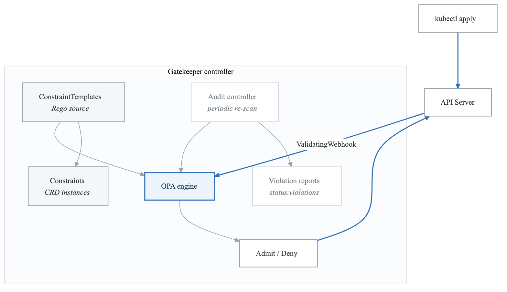
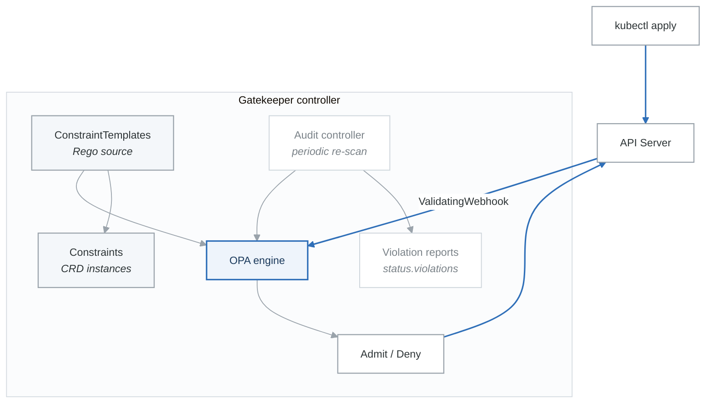

# Exercise 4: OPA Gatekeeper

## Objectives

- Deploy OPA Gatekeeper for policy enforcement
- Create constraint templates
- Implement organizational policies
- Audit existing resources

## Prerequisites

- Completed Exercises 1-3
- Kubernetes cluster with admin access
- Understanding of admission controllers

---

## Part 1: OPA Gatekeeper Overview

### 1.1 Architecture

<!-- figure: generated from the Mermaid below by _shared/diagrams/embed-figures.py — do not edit the image -->


<details>
<summary>Diagram source (Mermaid)</summary>



</details>

### 1.2 Key Concepts

```yaml
# ConstraintTemplate: Defines the policy logic (Rego)
# - Creates a new CRD for the constraint
# - Contains the Rego policy code

# Constraint: Instance of a ConstraintTemplate
# - Specifies which resources to target
# - Provides parameters for the policy
# - Sets enforcement action (deny/warn/dryrun)
```

---

## Part 2: Installation

### 2.1 Install Gatekeeper

```bash
# Install with kubectl
kubectl apply -f https://raw.githubusercontent.com/open-policy-agent/gatekeeper/v3.14.0/deploy/gatekeeper.yaml

# Or with Helm
helm repo add gatekeeper https://open-policy-agent.github.io/gatekeeper/charts
helm install gatekeeper gatekeeper/gatekeeper \
  --namespace gatekeeper-system \
  --create-namespace
```

### 2.2 Verify Installation

```bash
# Check pods
kubectl get pods -n gatekeeper-system

# Check webhook
kubectl get validatingwebhookconfiguration gatekeeper-validating-webhook-configuration

# Check CRDs
kubectl get crd | grep gatekeeper
```

### 2.3 Configuration

```yaml
# gatekeeper-config.yaml
apiVersion: config.gatekeeper.sh/v1alpha1
kind: Config
metadata:
  name: config
  namespace: gatekeeper-system
spec:
  # Sync resources for audit
  sync:
    syncOnly:
      - group: ""
        version: "v1"
        kind: "Namespace"
      - group: ""
        version: "v1"
        kind: "Pod"
      - group: "apps"
        version: "v1"
        kind: "Deployment"

  # Exempt namespaces
  match:
    - excludedNamespaces: ["kube-system", "gatekeeper-system"]
      processes: ["*"]

  # Audit settings
  validation:
    traces:
      - user: "*"
        kind:
          group: ""
          version: "v1"
          kind: "Pod"
```

---

## Part 3: Constraint Templates

### 3.1 Required Labels Template

```yaml
# required-labels-template.yaml
apiVersion: templates.gatekeeper.sh/v1
kind: ConstraintTemplate
metadata:
  name: k8srequiredlabels
spec:
  crd:
    spec:
      names:
        kind: K8sRequiredLabels
      validation:
        openAPIV3Schema:
          type: object
          properties:
            labels:
              type: array
              items:
                type: string
            message:
              type: string
  targets:
    - target: admission.k8s.gatekeeper.sh
      rego: |
        package k8srequiredlabels

        violation[{"msg": msg, "details": {"missing_labels": missing}}] {
          provided := {label | input.review.object.metadata.labels[label]}
          required := {label | label := input.parameters.labels[_]}
          missing := required - provided
          count(missing) > 0
          msg := sprintf("Missing required labels: %v", [missing])
        }
```

### 3.2 Container Limits Template

```yaml
# container-limits-template.yaml
apiVersion: templates.gatekeeper.sh/v1
kind: ConstraintTemplate
metadata:
  name: k8scontainerlimits
spec:
  crd:
    spec:
      names:
        kind: K8sContainerLimits
      validation:
        openAPIV3Schema:
          type: object
          properties:
            cpu:
              type: string
            memory:
              type: string
  targets:
    - target: admission.k8s.gatekeeper.sh
      rego: |
        package k8scontainerlimits

        violation[{"msg": msg}] {
          container := input.review.object.spec.containers[_]
          not container.resources.limits.cpu
          msg := sprintf("Container %v does not have CPU limit", [container.name])
        }

        violation[{"msg": msg}] {
          container := input.review.object.spec.containers[_]
          not container.resources.limits.memory
          msg := sprintf("Container %v does not have memory limit", [container.name])
        }

        violation[{"msg": msg}] {
          container := input.review.object.spec.containers[_]
          cpu_limit := container.resources.limits.cpu
          max_cpu := input.parameters.cpu
          not cpu_within_limit(cpu_limit, max_cpu)
          msg := sprintf("Container %v CPU limit %v exceeds maximum %v", [container.name, cpu_limit, max_cpu])
        }

        cpu_within_limit(limit, max) {
          units.parse(limit) <= units.parse(max)
        }
```

### 3.3 Allowed Repositories Template

```yaml
# allowed-repos-template.yaml
apiVersion: templates.gatekeeper.sh/v1
kind: ConstraintTemplate
metadata:
  name: k8sallowedrepos
spec:
  crd:
    spec:
      names:
        kind: K8sAllowedRepos
      validation:
        openAPIV3Schema:
          type: object
          properties:
            repos:
              type: array
              items:
                type: string
  targets:
    - target: admission.k8s.gatekeeper.sh
      rego: |
        package k8sallowedrepos

        violation[{"msg": msg}] {
          container := input.review.object.spec.containers[_]
          not image_allowed(container.image)
          msg := sprintf("Container %v uses image %v from disallowed repository", [container.name, container.image])
        }

        violation[{"msg": msg}] {
          container := input.review.object.spec.initContainers[_]
          not image_allowed(container.image)
          msg := sprintf("Init container %v uses image %v from disallowed repository", [container.name, container.image])
        }

        image_allowed(image) {
          repo := input.parameters.repos[_]
          startswith(image, repo)
        }
```

### 3.4 Block NodePort Template

```yaml
# block-nodeport-template.yaml
apiVersion: templates.gatekeeper.sh/v1
kind: ConstraintTemplate
metadata:
  name: k8sblocknodeport
spec:
  crd:
    spec:
      names:
        kind: K8sBlockNodePort
  targets:
    - target: admission.k8s.gatekeeper.sh
      rego: |
        package k8sblocknodeport

        violation[{"msg": msg}] {
          input.review.kind.kind == "Service"
          input.review.object.spec.type == "NodePort"
          msg := "Services of type NodePort are not allowed"
        }
```

### 3.5 Required Probes Template

```yaml
# required-probes-template.yaml
apiVersion: templates.gatekeeper.sh/v1
kind: ConstraintTemplate
metadata:
  name: k8srequiredprobes
spec:
  crd:
    spec:
      names:
        kind: K8sRequiredProbes
      validation:
        openAPIV3Schema:
          type: object
          properties:
            probes:
              type: array
              items:
                type: string
                enum: ["readinessProbe", "livenessProbe", "startupProbe"]
  targets:
    - target: admission.k8s.gatekeeper.sh
      rego: |
        package k8srequiredprobes

        violation[{"msg": msg}] {
          container := input.review.object.spec.containers[_]
          probe := input.parameters.probes[_]
          not has_probe(container, probe)
          msg := sprintf("Container %v is missing %v", [container.name, probe])
        }

        has_probe(container, "readinessProbe") {
          container.readinessProbe
        }

        has_probe(container, "livenessProbe") {
          container.livenessProbe
        }

        has_probe(container, "startupProbe") {
          container.startupProbe
        }
```

---

## Part 4: Constraints

### 4.1 Required Labels Constraint

```yaml
# require-team-label.yaml
apiVersion: constraints.gatekeeper.sh/v1beta1
kind: K8sRequiredLabels
metadata:
  name: require-team-label
spec:
  enforcementAction: deny
  match:
    kinds:
      - apiGroups: [""]
        kinds: ["Namespace"]
      - apiGroups: ["apps"]
        kinds: ["Deployment", "StatefulSet", "DaemonSet"]
    excludedNamespaces:
      - kube-system
      - kube-public
      - gatekeeper-system
  parameters:
    labels:
      - "team"
      - "environment"
```

### 4.2 Container Limits Constraint

```yaml
# container-limits-constraint.yaml
apiVersion: constraints.gatekeeper.sh/v1beta1
kind: K8sContainerLimits
metadata:
  name: container-must-have-limits
spec:
  enforcementAction: deny
  match:
    kinds:
      - apiGroups: [""]
        kinds: ["Pod"]
      - apiGroups: ["apps"]
        kinds: ["Deployment", "StatefulSet", "DaemonSet"]
    namespaces:
      - production
      - staging
  parameters:
    cpu: "4"
    memory: "8Gi"
```

### 4.3 Allowed Repos Constraint

```yaml
# allowed-repos-constraint.yaml
apiVersion: constraints.gatekeeper.sh/v1beta1
kind: K8sAllowedRepos
metadata:
  name: allowed-repos
spec:
  enforcementAction: deny
  match:
    kinds:
      - apiGroups: [""]
        kinds: ["Pod"]
      - apiGroups: ["apps"]
        kinds: ["Deployment", "StatefulSet", "DaemonSet", "ReplicaSet"]
    namespaces:
      - production
  parameters:
    repos:
      - "gcr.io/my-company/"
      - "docker.io/my-company/"
      - "registry.k8s.io/"
```

### 4.4 Block NodePort Constraint

```yaml
# block-nodeport-constraint.yaml
apiVersion: constraints.gatekeeper.sh/v1beta1
kind: K8sBlockNodePort
metadata:
  name: block-nodeport-services
spec:
  enforcementAction: deny
  match:
    kinds:
      - apiGroups: [""]
        kinds: ["Service"]
    namespaces:
      - production
```

---

## Part 5: Audit and Monitoring

### 5.1 Check Violations

```bash
# List all constraints
kubectl get constraints

# Check violations for a constraint
kubectl get k8srequiredlabels require-team-label -o yaml

# View all violations
kubectl get constrainttemplate -o jsonpath='{.items[*].status}'
```

### 5.2 Constraint Status

```yaml
# Example status output
status:
  auditTimestamp: "2024-01-15T10:00:00Z"
  byPod:
    - constraintUID: abc123
      enforced: true
      id: gatekeeper-audit-xyz
      operations: ["audit", "webhook"]
  totalViolations: 5
  violations:
    - enforcementAction: deny
      kind: Deployment
      message: "Missing required labels: {team}"
      name: my-deployment
      namespace: default
```

### 5.3 Prometheus Metrics

```yaml
# Gatekeeper exposes metrics at :8888/metrics
# Key metrics:
# - gatekeeper_violations: Current violation count
# - gatekeeper_constraint_templates: Template count
# - gatekeeper_constraints: Constraint count
# - gatekeeper_audit_duration_seconds: Audit duration

# ServiceMonitor for Prometheus
apiVersion: monitoring.coreos.com/v1
kind: ServiceMonitor
metadata:
  name: gatekeeper
  namespace: monitoring
spec:
  selector:
    matchLabels:
      gatekeeper.sh/system: "yes"
  namespaceSelector:
    matchNames:
      - gatekeeper-system
  endpoints:
    - port: metrics
      interval: 30s
```

---

## Part 6: Advanced Patterns

### 6.1 Mutation (Gatekeeper v3.14+)

```yaml
# mutation-add-label.yaml
apiVersion: mutations.gatekeeper.sh/v1
kind: Assign
metadata:
  name: add-team-label
spec:
  applyTo:
    - groups: ["apps"]
      kinds: ["Deployment"]
      versions: ["v1"]
  match:
    scope: Namespaced
    namespaces: ["default"]
  location: "spec.template.metadata.labels.managed-by"
  parameters:
    assign:
      value: "gatekeeper"
---
apiVersion: mutations.gatekeeper.sh/v1
kind: AssignMetadata
metadata:
  name: add-annotation
spec:
  match:
    scope: Namespaced
    kinds:
      - apiGroups: ["*"]
        kinds: ["Pod"]
  location: "metadata.annotations.policy-version"
  parameters:
    assign:
      value: "v1.0"
```

### 6.2 External Data

```yaml
# external-data-provider.yaml
apiVersion: externaldata.gatekeeper.sh/v1beta1
kind: Provider
metadata:
  name: image-scanner
spec:
  url: https://image-scanner.security.svc:8443/validate
  timeout: 5
  caBundle: <base64-encoded-ca-cert>
```

### 6.3 Expansion Templates

```yaml
# expansion-template.yaml
apiVersion: expansion.gatekeeper.sh/v1beta1
kind: ExpansionTemplate
metadata:
  name: expand-deployments
spec:
  applyTo:
    - groups: ["apps"]
      kinds: ["Deployment"]
      versions: ["v1"]
  templateSource: "spec.template"
  generatedGVK:
    group: ""
    version: "v1"
    kind: "Pod"
```

---

## Part 7: Hands-on Challenges

### Challenge 1: Compliance Policy Suite

Create comprehensive policy suite:
1. Required labels and annotations
2. Image registry restrictions
3. Resource limits enforcement
4. Security context requirements

### Challenge 2: Gradual Rollout

Implement safe policy rollout:
1. Start with audit mode
2. Review violations
3. Switch to warn mode
4. Finally enable deny mode

### Challenge 3: Custom Policies

Create organization-specific policies:
1. PCI-DSS compliance
2. HIPAA requirements
3. SOC2 controls
4. Custom business rules

---

## Verification Tasks

1. [ ] Deployed OPA Gatekeeper
2. [ ] Created constraint templates
3. [ ] Implemented constraints
4. [ ] Tested policy enforcement
5. [ ] Set up violation monitoring
6. [ ] Configured mutations

---

## Key Takeaways

- Gatekeeper provides policy-as-code
- Rego is powerful but has learning curve
- Use audit mode before enforcement
- Monitor violations continuously
- Exempt system namespaces carefully
- Combine with other admission controllers

---

## Next Steps

Continue to [Exercise 5: Secrets Encryption](02-security-rbac-exercises-05-secrets-encryption.md)

<!-- feynman-check -->

---

## Feynman check

Close the file. Blank page, no notes. Explain each of these to a competent engineer who has never
used this tool — **under five minutes, no jargon you can't define on the spot:**

- OPA Gatekeeper Overview
- Constraint Templates
- Audit and Monitoring
- Advanced Patterns

**The gap is not what you forgot. It is where you used a word instead of a mechanism.**

| | |
|---|---|
| ✗ | *"Kubernetes schedules the pod."* |
| ✓ | *"The scheduler watches for pods with no `nodeName`, filters nodes by predicates, scores the survivors, and writes `nodeName` into the pod spec. The kubelet on that node is watching the API for pods bound to it, and starts the containers."* |

**Trace it:** `kubectl apply -f pod.yaml` → a running container. Name every component that acts, in order, and what each one writes.

Stop at the first component you cannot name. Reopen this file and read **only** that.

**Go deeper — only once the gap has a name:** [Kubernetes the Hard Way](https://github.com/kelseyhightower/kubernetes-the-hard-way) — one weekend, and "the control plane" stops being a word.
Full list per domain: [`SOURCES.md`](../../SOURCES.md#kubernetes)

→ Protocol, the three levels of knowing, and worked examples: [`MASTERY.md`](../../MASTERY.md)

<!-- /feynman-check -->
