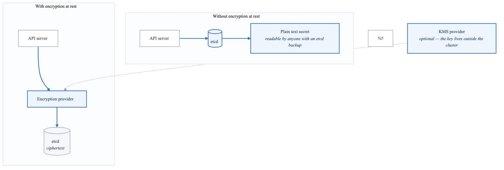
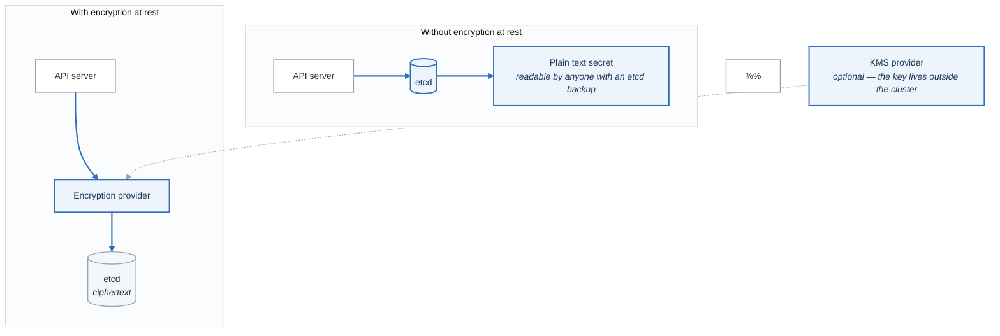

# Exercise 5: Secrets Encryption at Rest

## Objectives

- Configure encryption at rest for secrets
- Implement KMS provider integration
- Rotate encryption keys
- Audit secret access

## Prerequisites

- Completed Exercises 1-4
- Cluster admin access
- Understanding of encryption concepts

---

## Part 1: Encryption at Rest Overview

### 1.1 How It Works

<!-- figure: generated from the Mermaid below by _shared/diagrams/embed-figures.py — do not edit the image -->


<details>
<summary>Diagram source (Mermaid)</summary>



</details>

---

## Part 2: Local Encryption Configuration

### 2.1 Generate Encryption Key

```bash
# Generate 32-byte key for AES-256
head -c 32 /dev/urandom | base64

# Example output: 2Ks8G7y...base64...==
```

### 2.2 Encryption Configuration File

```yaml
# /etc/kubernetes/encryption-config.yaml
apiVersion: apiserver.config.k8s.io/v1
kind: EncryptionConfiguration
resources:
  - resources:
      - secrets
      - configmaps  # Optional: encrypt configmaps too
    providers:
      # Primary provider (for new writes)
      - aescbc:
          keys:
            - name: key1
              secret: <base64-encoded-32-byte-key>
      # Fallback provider (for reading old data)
      - identity: {}
```

### 2.3 AES-GCM Configuration (Recommended)

```yaml
# encryption-config-aesgcm.yaml
apiVersion: apiserver.config.k8s.io/v1
kind: EncryptionConfiguration
resources:
  - resources:
      - secrets
    providers:
      - aesgcm:
          keys:
            - name: key1
              secret: <base64-encoded-32-byte-key>
      - identity: {}
```

### 2.4 Apply Configuration

```bash
# Copy config to all control plane nodes
sudo cp encryption-config.yaml /etc/kubernetes/encryption-config.yaml

# Update API server manifest
# Add to /etc/kubernetes/manifests/kube-apiserver.yaml:
# spec:
#   containers:
#   - command:
#     - kube-apiserver
#     - --encryption-provider-config=/etc/kubernetes/encryption-config.yaml
#     volumeMounts:
#     - name: encryption-config
#       mountPath: /etc/kubernetes/encryption-config.yaml
#       readOnly: true
#   volumes:
#   - name: encryption-config
#     hostPath:
#       path: /etc/kubernetes/encryption-config.yaml
#       type: File

# Wait for API server restart
kubectl get pods -n kube-system -w
```

---

## Part 3: KMS Provider Integration

### 3.1 AWS KMS Configuration

```yaml
# encryption-config-aws-kms.yaml
apiVersion: apiserver.config.k8s.io/v1
kind: EncryptionConfiguration
resources:
  - resources:
      - secrets
    providers:
      - kms:
          name: aws-kms
          endpoint: unix:///var/run/kmsplugin/socket.sock
          cachesize: 1000
          timeout: 3s
      - identity: {}
```

### 3.2 AWS KMS Plugin Deployment

```yaml
# aws-kms-plugin.yaml
apiVersion: apps/v1
kind: DaemonSet
metadata:
  name: aws-encryption-provider
  namespace: kube-system
spec:
  selector:
    matchLabels:
      app: aws-encryption-provider
  template:
    metadata:
      labels:
        app: aws-encryption-provider
    spec:
      nodeSelector:
        node-role.kubernetes.io/control-plane: ""
      tolerations:
        - key: node-role.kubernetes.io/control-plane
          effect: NoSchedule
      containers:
        - name: provider
          image: amazon/aws-encryption-provider:latest
          args:
            - --key=arn:aws:kms:us-west-2:111122223333:key/1234abcd-12ab-34cd-56ef-1234567890ab
            - --region=us-west-2
            - --listen=/var/run/kmsplugin/socket.sock
          volumeMounts:
            - name: socket
              mountPath: /var/run/kmsplugin
          resources:
            requests:
              cpu: 10m
              memory: 32Mi
      volumes:
        - name: socket
          hostPath:
            path: /var/run/kmsplugin
            type: DirectoryOrCreate
```

### 3.3 GCP KMS Configuration

```yaml
# encryption-config-gcp-kms.yaml
apiVersion: apiserver.config.k8s.io/v1
kind: EncryptionConfiguration
resources:
  - resources:
      - secrets
    providers:
      - kms:
          name: gcp-kms
          endpoint: unix:///var/run/kmsplugin/socket.sock
          cachesize: 1000
          timeout: 3s
      - identity: {}
```

### 3.4 Azure Key Vault Configuration

```yaml
# encryption-config-azure-kms.yaml
apiVersion: apiserver.config.k8s.io/v1
kind: EncryptionConfiguration
resources:
  - resources:
      - secrets
    providers:
      - kms:
          name: azure-kms
          endpoint: unix:///var/run/kmsplugin/socket.sock
          cachesize: 1000
          timeout: 3s
      - identity: {}
```

---

## Part 4: Key Rotation

### 4.1 Add New Key

```yaml
# Step 1: Add new key as first in list
apiVersion: apiserver.config.k8s.io/v1
kind: EncryptionConfiguration
resources:
  - resources:
      - secrets
    providers:
      - aescbc:
          keys:
            - name: key2  # New key
              secret: <new-base64-encoded-key>
            - name: key1  # Old key for reading
              secret: <old-base64-encoded-key>
      - identity: {}
```

### 4.2 Re-encrypt All Secrets

```bash
#!/bin/bash
# rotate-secrets.sh

echo "Starting secret re-encryption..."

# Get all namespaces
NAMESPACES=$(kubectl get namespaces -o jsonpath='{.items[*].metadata.name}')

for ns in $NAMESPACES; do
  echo "Processing namespace: $ns"

  # Get all secrets in namespace
  SECRETS=$(kubectl get secrets -n $ns -o jsonpath='{.items[*].metadata.name}')

  for secret in $SECRETS; do
    echo "  Re-encrypting: $secret"
    kubectl get secret $secret -n $ns -o yaml | kubectl replace -f -
  done
done

echo "Re-encryption complete"
```

### 4.3 Remove Old Key

```yaml
# Step 3: After re-encryption, remove old key
apiVersion: apiserver.config.k8s.io/v1
kind: EncryptionConfiguration
resources:
  - resources:
      - secrets
    providers:
      - aescbc:
          keys:
            - name: key2  # Only new key
              secret: <new-base64-encoded-key>
      - identity: {}  # Still needed for any unencrypted data
```

### 4.4 Automated Key Rotation

```yaml
# key-rotation-cronjob.yaml
apiVersion: batch/v1
kind: CronJob
metadata:
  name: secret-key-rotation
  namespace: kube-system
spec:
  schedule: "0 0 1 * *"  # Monthly
  jobTemplate:
    spec:
      template:
        spec:
          serviceAccountName: secret-rotator
          containers:
          - name: rotator
            image: bitnami/kubectl:latest
            command:
            - /bin/sh
            - -c
            - |
              # Re-encrypt all secrets
              for ns in $(kubectl get namespaces -o jsonpath='{.items[*].metadata.name}'); do
                for secret in $(kubectl get secrets -n $ns -o jsonpath='{.items[*].metadata.name}'); do
                  kubectl get secret $secret -n $ns -o yaml | kubectl replace -f -
                done
              done
          restartPolicy: OnFailure
```

---

## Part 5: Verification

### 5.1 Verify Encryption Status

```bash
# Check if secrets are encrypted in etcd
# On a control plane node:
ETCDCTL_API=3 etcdctl \
  --endpoints=https://127.0.0.1:2379 \
  --cacert=/etc/kubernetes/pki/etcd/ca.crt \
  --cert=/etc/kubernetes/pki/etcd/server.crt \
  --key=/etc/kubernetes/pki/etcd/server.key \
  get /registry/secrets/default/my-secret | hexdump -C

# Encrypted data starts with 'k8s:enc:aescbc:v1:' or similar prefix
# Unencrypted data shows plain text
```

### 5.2 Create Test Secret

```bash
# Create a test secret
kubectl create secret generic test-encryption \
  --from-literal=key=value

# Verify it's encrypted in etcd
ETCDCTL_API=3 etcdctl get /registry/secrets/default/test-encryption \
  --endpoints=https://127.0.0.1:2379 \
  --cacert=/etc/kubernetes/pki/etcd/ca.crt \
  --cert=/etc/kubernetes/pki/etcd/server.crt \
  --key=/etc/kubernetes/pki/etcd/server.key | hexdump -C | head -20

# Should show encrypted prefix, not plain 'value' text
```

### 5.3 Encryption Status Check Script

```bash
#!/bin/bash
# check-encryption-status.sh

echo "=== Encryption Configuration Status ==="

# Check API server args
echo -e "\n--- API Server Configuration ---"
kubectl get pods -n kube-system -l component=kube-apiserver -o yaml | \
  grep -A5 "encryption-provider-config"

# Test a secret
echo -e "\n--- Testing Secret Encryption ---"
kubectl create secret generic encryption-test \
  --from-literal=test=encrypted-data \
  --dry-run=client -o yaml | kubectl apply -f -

# Check etcd directly (must run on control plane)
echo -e "\n--- Checking etcd Storage ---"
echo "Run this on control plane: etcdctl get /registry/secrets/default/encryption-test"

# Cleanup
kubectl delete secret encryption-test
```

---

## Part 6: Secret Access Auditing

### 6.1 Audit Policy

```yaml
# audit-policy.yaml
apiVersion: audit.k8s.io/v1
kind: Policy
rules:
  # Log all secret access at RequestResponse level
  - level: RequestResponse
    resources:
      - group: ""
        resources: ["secrets"]
    omitStages:
      - RequestReceived

  # Log secret metadata (not data) for list operations
  - level: Metadata
    resources:
      - group: ""
        resources: ["secrets"]
    verbs: ["list", "watch"]

  # Don't log reads from system accounts
  - level: None
    users:
      - system:kube-controller-manager
      - system:kube-scheduler
    resources:
      - group: ""
        resources: ["secrets"]

  # Log everything else at Metadata level
  - level: Metadata
    omitStages:
      - RequestReceived
```

### 6.2 Enable Audit Logging

```yaml
# Add to kube-apiserver manifest
# --audit-policy-file=/etc/kubernetes/audit-policy.yaml
# --audit-log-path=/var/log/kubernetes/audit/audit.log
# --audit-log-maxage=30
# --audit-log-maxbackup=10
# --audit-log-maxsize=100
```

### 6.3 Audit Log Analysis

```bash
# Find secret access events
cat /var/log/kubernetes/audit/audit.log | \
  jq 'select(.objectRef.resource == "secrets")'

# Find who accessed a specific secret
cat /var/log/kubernetes/audit/audit.log | \
  jq 'select(.objectRef.name == "my-secret" and .objectRef.resource == "secrets") | {user: .user.username, verb: .verb, time: .requestReceivedTimestamp}'

# Alert on suspicious access
cat /var/log/kubernetes/audit/audit.log | \
  jq 'select(.objectRef.resource == "secrets" and .verb == "get" and .user.username != "system:kube-controller-manager")'
```

---

## Part 7: Hands-on Challenges

### Challenge 1: Complete Encryption Setup

Configure full encryption:
1. Generate encryption key
2. Configure API server
3. Re-encrypt existing secrets
4. Verify encryption

### Challenge 2: KMS Integration

Set up cloud KMS:
1. Create KMS key
2. Deploy KMS plugin
3. Configure encryption provider
4. Test key rotation

### Challenge 3: Audit Implementation

Implement secret auditing:
1. Configure audit policy
2. Enable audit logging
3. Set up log analysis
4. Create alerting rules

---

## Verification Tasks

1. [ ] Configured encryption provider
2. [ ] Verified secrets are encrypted in etcd
3. [ ] Tested encryption/decryption
4. [ ] Implemented key rotation
5. [ ] Set up audit logging
6. [ ] Created monitoring for secret access

---

## Key Takeaways

- Encryption at rest protects etcd data
- KMS provides better key management
- Regular key rotation is essential
- Audit logging tracks secret access
- Always have identity fallback during migration
- Test encryption before production rollout

---

## Next Steps

Continue to [Exercise 6: Audit Logging](02-security-rbac-exercises-06-audit-logging.md)

<!-- feynman-check -->

---

## Feynman check

Close the file. Blank page, no notes. Explain each of these to a competent engineer who has never
used this tool — **under five minutes, no jargon you can't define on the spot:**

- Encryption at Rest Overview
- Local Encryption Configuration
- KMS Provider Integration
- Key Rotation

**The gap is not what you forgot. It is where you used a word instead of a mechanism.**

| | |
|---|---|
| ✗ | *"Kubernetes schedules the pod."* |
| ✓ | *"The scheduler watches for pods with no `nodeName`, filters nodes by predicates, scores the survivors, and writes `nodeName` into the pod spec. The kubelet on that node is watching the API for pods bound to it, and starts the containers."* |

**Trace it:** `kubectl apply -f pod.yaml` → a running container. Name every component that acts, in order, and what each one writes.

Stop at the first component you cannot name. Reopen this file and read **only** that.

**Go deeper — only once the gap has a name:** [Kubernetes the Hard Way](https://github.com/kelseyhightower/kubernetes-the-hard-way) — one weekend, and "the control plane" stops being a word.
Full list per domain: [`SOURCES.md`](../../SOURCES.md#kubernetes)

→ Protocol, the three levels of knowing, and worked examples: [`MASTERY.md`](../../MASTERY.md)

<!-- /feynman-check -->
