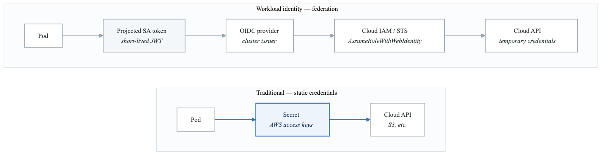
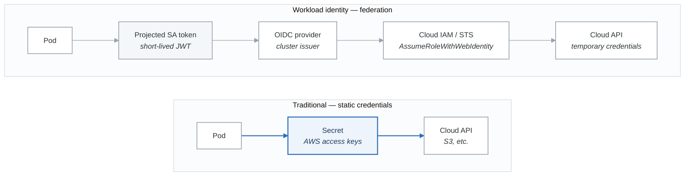

# Exercise 7: Workload Identity

## Objectives

- Implement cloud workload identity
- Configure pod identity federation
- Use projected service account tokens
- Eliminate static credentials

## Prerequisites

- Completed Exercises 1-6
- Cloud provider access (AWS/GCP/Azure)
- Understanding of IAM concepts

---

## Part 1: Workload Identity Overview

### 1.1 Identity Federation Model

<!-- figure: generated from the Mermaid below by _shared/diagrams/embed-figures.py — do not edit the image -->


<details>
<summary>Diagram source (Mermaid)</summary>



</details>

---

## Part 2: AWS IRSA (IAM Roles for Service Accounts)

### 2.1 EKS OIDC Provider Setup

```bash
# Get OIDC issuer URL
OIDC_ISSUER=$(aws eks describe-cluster \
  --name my-cluster \
  --query "cluster.identity.oidc.issuer" \
  --output text)

# Create OIDC provider
eksctl utils associate-iam-oidc-provider \
  --cluster my-cluster \
  --approve
```

### 2.2 Create IAM Role for Service Account

```bash
# Create IAM policy
cat > s3-read-policy.json << EOF
{
  "Version": "2012-10-17",
  "Statement": [
    {
      "Effect": "Allow",
      "Action": [
        "s3:GetObject",
        "s3:ListBucket"
      ],
      "Resource": [
        "arn:aws:s3:::my-bucket",
        "arn:aws:s3:::my-bucket/*"
      ]
    }
  ]
}
EOF

aws iam create-policy \
  --policy-name S3ReadPolicy \
  --policy-document file://s3-read-policy.json

# Create IAM role with trust policy
cat > trust-policy.json << EOF
{
  "Version": "2012-10-17",
  "Statement": [
    {
      "Effect": "Allow",
      "Principal": {
        "Federated": "arn:aws:iam::ACCOUNT_ID:oidc-provider/oidc.eks.REGION.amazonaws.com/id/OIDC_ID"
      },
      "Action": "sts:AssumeRoleWithWebIdentity",
      "Condition": {
        "StringEquals": {
          "oidc.eks.REGION.amazonaws.com/id/OIDC_ID:sub": "system:serviceaccount:NAMESPACE:SERVICE_ACCOUNT",
          "oidc.eks.REGION.amazonaws.com/id/OIDC_ID:aud": "sts.amazonaws.com"
        }
      }
    }
  ]
}
EOF

aws iam create-role \
  --role-name S3ReaderRole \
  --assume-role-policy-document file://trust-policy.json

aws iam attach-role-policy \
  --role-name S3ReaderRole \
  --policy-arn arn:aws:iam::ACCOUNT_ID:policy/S3ReadPolicy
```

### 2.3 Create Annotated Service Account

```yaml
# irsa-service-account.yaml
apiVersion: v1
kind: ServiceAccount
metadata:
  name: s3-reader
  namespace: production
  annotations:
    eks.amazonaws.com/role-arn: arn:aws:iam::ACCOUNT_ID:role/S3ReaderRole
```

### 2.4 Use Service Account in Pod

```yaml
# irsa-pod.yaml
apiVersion: v1
kind: Pod
metadata:
  name: s3-reader-pod
  namespace: production
spec:
  serviceAccountName: s3-reader
  containers:
  - name: app
    image: amazon/aws-cli:latest
    command: ["sleep", "infinity"]
    # AWS SDK automatically uses IRSA token
    # No credentials needed in env vars or mounted secrets
```

### 2.5 eksctl Shortcut

```bash
# Create service account with IAM role in one command
eksctl create iamserviceaccount \
  --cluster my-cluster \
  --namespace production \
  --name s3-reader \
  --attach-policy-arn arn:aws:iam::ACCOUNT_ID:policy/S3ReadPolicy \
  --approve
```

---

## Part 3: GKE Workload Identity

### 3.1 Enable Workload Identity

```bash
# Enable on cluster
gcloud container clusters update my-cluster \
  --workload-pool=PROJECT_ID.svc.id.goog

# Enable on node pool
gcloud container node-pools update default-pool \
  --cluster=my-cluster \
  --workload-metadata=GKE_METADATA
```

### 3.2 Configure IAM Binding

```bash
# Create Google Service Account
gcloud iam service-accounts create gcs-reader \
  --display-name="GCS Reader"

# Grant GCS access
gcloud projects add-iam-policy-binding PROJECT_ID \
  --member="serviceAccount:gcs-reader@PROJECT_ID.iam.gserviceaccount.com" \
  --role="roles/storage.objectViewer"

# Allow K8s SA to impersonate GSA
gcloud iam service-accounts add-iam-policy-binding \
  gcs-reader@PROJECT_ID.iam.gserviceaccount.com \
  --role="roles/iam.workloadIdentityUser" \
  --member="serviceAccount:PROJECT_ID.svc.id.goog[NAMESPACE/K8S_SA_NAME]"
```

### 3.3 Kubernetes Service Account

```yaml
# gke-workload-identity-sa.yaml
apiVersion: v1
kind: ServiceAccount
metadata:
  name: gcs-reader
  namespace: production
  annotations:
    iam.gke.io/gcp-service-account: gcs-reader@PROJECT_ID.iam.gserviceaccount.com
```

### 3.4 Pod Configuration

```yaml
# gke-workload-identity-pod.yaml
apiVersion: v1
kind: Pod
metadata:
  name: gcs-reader-pod
  namespace: production
spec:
  serviceAccountName: gcs-reader
  nodeSelector:
    iam.gke.io/gke-metadata-server-enabled: "true"
  containers:
  - name: app
    image: google/cloud-sdk:slim
    command: ["sleep", "infinity"]
    # GCP SDK automatically uses workload identity
```

---

## Part 4: Azure Workload Identity

### 4.1 Enable OIDC Issuer

```bash
# Enable OIDC issuer on AKS cluster
az aks update \
  --resource-group myResourceGroup \
  --name myAKSCluster \
  --enable-oidc-issuer \
  --enable-workload-identity

# Get OIDC issuer URL
AKS_OIDC_ISSUER=$(az aks show \
  --resource-group myResourceGroup \
  --name myAKSCluster \
  --query "oidcIssuerProfile.issuerUrl" \
  --output tsv)
```

### 4.2 Create Azure Identity

```bash
# Create managed identity
az identity create \
  --name blob-reader-identity \
  --resource-group myResourceGroup

# Get identity client ID
IDENTITY_CLIENT_ID=$(az identity show \
  --name blob-reader-identity \
  --resource-group myResourceGroup \
  --query 'clientId' \
  --output tsv)

# Assign role
az role assignment create \
  --role "Storage Blob Data Reader" \
  --assignee $IDENTITY_CLIENT_ID \
  --scope "/subscriptions/SUBSCRIPTION_ID/resourceGroups/myResourceGroup/providers/Microsoft.Storage/storageAccounts/mystorageaccount"

# Create federated credential
az identity federated-credential create \
  --name k8s-federated-credential \
  --identity-name blob-reader-identity \
  --resource-group myResourceGroup \
  --issuer $AKS_OIDC_ISSUER \
  --subject system:serviceaccount:production:blob-reader \
  --audience api://AzureADTokenExchange
```

### 4.3 Kubernetes Configuration

```yaml
# azure-workload-identity.yaml
apiVersion: v1
kind: ServiceAccount
metadata:
  name: blob-reader
  namespace: production
  annotations:
    azure.workload.identity/client-id: "${IDENTITY_CLIENT_ID}"
  labels:
    azure.workload.identity/use: "true"
---
apiVersion: v1
kind: Pod
metadata:
  name: blob-reader-pod
  namespace: production
  labels:
    azure.workload.identity/use: "true"
spec:
  serviceAccountName: blob-reader
  containers:
  - name: app
    image: mcr.microsoft.com/azure-cli:latest
    command: ["sleep", "infinity"]
    env:
    - name: AZURE_CLIENT_ID
      valueFrom:
        secretKeyRef:
          name: azure-identity
          key: clientId
```

---

## Part 5: Projected Service Account Tokens

### 5.1 Token Configuration

```yaml
# projected-token-pod.yaml
apiVersion: v1
kind: Pod
metadata:
  name: token-pod
  namespace: production
spec:
  serviceAccountName: my-service-account
  containers:
  - name: app
    image: myapp:1.0
    volumeMounts:
    - name: token
      mountPath: /var/run/secrets/tokens
      readOnly: true
  volumes:
  - name: token
    projected:
      sources:
      - serviceAccountToken:
          path: api-token
          expirationSeconds: 3600  # 1 hour
          audience: api.example.com
      - serviceAccountToken:
          path: vault-token
          expirationSeconds: 600   # 10 minutes
          audience: vault.example.com
```

### 5.2 Token Refresh Handling

```python
# token-refresh.py
import os
import time
from kubernetes import client, config

class TokenManager:
    def __init__(self, token_path, refresh_threshold=300):
        self.token_path = token_path
        self.refresh_threshold = refresh_threshold
        self._token = None
        self._token_expiry = 0

    def get_token(self):
        # Check if token needs refresh
        if time.time() > self._token_expiry - self.refresh_threshold:
            self._refresh_token()
        return self._token

    def _refresh_token(self):
        with open(self.token_path, 'r') as f:
            self._token = f.read().strip()
        # Parse JWT to get expiry (simplified)
        import jwt
        decoded = jwt.decode(self._token, options={"verify_signature": False})
        self._token_expiry = decoded['exp']

# Usage
token_manager = TokenManager('/var/run/secrets/tokens/api-token')
token = token_manager.get_token()
```

---

## Part 6: Cross-Namespace Identity

### 6.1 Shared Service Account

```yaml
# cross-namespace-identity.yaml
---
# ServiceAccount in identity namespace
apiVersion: v1
kind: ServiceAccount
metadata:
  name: shared-identity
  namespace: identity-system
  annotations:
    eks.amazonaws.com/role-arn: arn:aws:iam::ACCOUNT_ID:role/SharedRole
---
# Role for token creation
apiVersion: rbac.authorization.k8s.io/v1
kind: Role
metadata:
  name: token-creator
  namespace: identity-system
rules:
- apiGroups: [""]
  resources: ["serviceaccounts/token"]
  resourceNames: ["shared-identity"]
  verbs: ["create"]
---
# RoleBinding for apps namespace
apiVersion: rbac.authorization.k8s.io/v1
kind: RoleBinding
metadata:
  name: app-token-creator
  namespace: identity-system
roleRef:
  apiGroup: rbac.authorization.k8s.io
  kind: Role
  name: token-creator
subjects:
- kind: ServiceAccount
  name: app-service-account
  namespace: production
```

### 6.2 Token Request API

```yaml
# Request token programmatically
apiVersion: authentication.k8s.io/v1
kind: TokenRequest
metadata:
  name: shared-identity
  namespace: identity-system
spec:
  audiences:
    - "sts.amazonaws.com"
  expirationSeconds: 3600
  boundObjectRef:
    apiVersion: v1
    kind: Pod
    name: my-pod
    uid: pod-uid
```

---

## Part 7: Security Best Practices

### 7.1 Audit Identity Usage

```yaml
# audit-policy-identity.yaml
apiVersion: audit.k8s.io/v1
kind: Policy
rules:
  # Log all token requests
  - level: RequestResponse
    resources:
      - group: ""
        resources: ["serviceaccounts/token"]
    verbs: ["create"]

  # Log service account usage
  - level: Metadata
    resources:
      - group: ""
        resources: ["serviceaccounts"]
    verbs: ["get", "list"]
```

### 7.2 Least Privilege IAM

```json
// Minimal AWS IAM policy
{
  "Version": "2012-10-17",
  "Statement": [
    {
      "Effect": "Allow",
      "Action": [
        "s3:GetObject"
      ],
      "Resource": [
        "arn:aws:s3:::specific-bucket/specific-prefix/*"
      ],
      "Condition": {
        "StringEquals": {
          "aws:RequestedRegion": "us-west-2"
        }
      }
    }
  ]
}
```

### 7.3 Identity Validation

```yaml
# Validate pod can assume identity
apiVersion: batch/v1
kind: Job
metadata:
  name: identity-test
spec:
  template:
    spec:
      serviceAccountName: s3-reader
      containers:
      - name: test
        image: amazon/aws-cli:latest
        command:
        - /bin/sh
        - -c
        - |
          # Verify identity
          aws sts get-caller-identity

          # Test access
          aws s3 ls s3://my-bucket/ --max-items 1
      restartPolicy: Never
```

---

## Part 8: Hands-on Challenges

### Challenge 1: Multi-Cloud Identity

Configure workload identity for:
1. AWS S3 access
2. GCP BigQuery access
3. Azure Blob access
4. All from same cluster

### Challenge 2: Identity Rotation

Implement identity lifecycle:
1. Short-lived tokens (< 1 hour)
2. Automatic token refresh
3. Graceful credential rotation
4. Zero-downtime updates

### Challenge 3: Zero-Trust Identity

Implement strict identity:
1. No static credentials
2. Minimal IAM permissions
3. Audit all identity operations
4. Alert on anomalies

---

## Verification Tasks

1. [ ] Configured cloud OIDC provider
2. [ ] Created IAM role with federation
3. [ ] Set up annotated service account
4. [ ] Tested workload identity access
5. [ ] Configured projected tokens
6. [ ] Implemented audit logging

---

## Key Takeaways

- Workload identity eliminates static credentials
- OIDC federation provides short-lived tokens
- Each cloud has specific implementation
- Projected tokens allow audience-specific tokens
- Least privilege IAM is essential
- Audit all identity operations

---

## Module Complete!

You've completed the Security & RBAC module. Continue to:
- [Scaling & Performance Module](../03-scaling-performance/README.md)

<!-- feynman-check -->

---

## Feynman check

Close the file. Blank page, no notes. Explain each of these to a competent engineer who has never
used this tool — **under five minutes, no jargon you can't define on the spot:**

- Workload Identity Overview
- AWS IRSA (IAM Roles for Service Accounts)
- GKE Workload Identity
- Azure Workload Identity

**The gap is not what you forgot. It is where you used a word instead of a mechanism.**

| | |
|---|---|
| ✗ | *"Kubernetes schedules the pod."* |
| ✓ | *"The scheduler watches for pods with no `nodeName`, filters nodes by predicates, scores the survivors, and writes `nodeName` into the pod spec. The kubelet on that node is watching the API for pods bound to it, and starts the containers."* |

**Trace it:** `kubectl apply -f pod.yaml` → a running container. Name every component that acts, in order, and what each one writes.

Stop at the first component you cannot name. Reopen this file and read **only** that.

**Go deeper — only once the gap has a name:** [Kubernetes the Hard Way](https://github.com/kelseyhightower/kubernetes-the-hard-way) — one weekend, and "the control plane" stops being a word.
Full list per domain: [`SOURCES.md`](../../SOURCES.md#kubernetes)

→ Protocol, the three levels of knowing, and worked examples: [`MASTERY.md`](../../MASTERY.md)

<!-- /feynman-check -->
