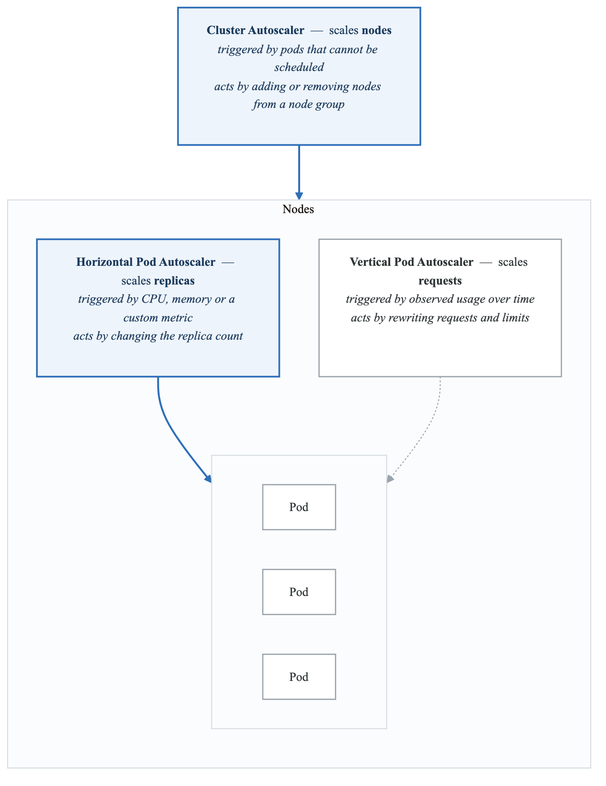
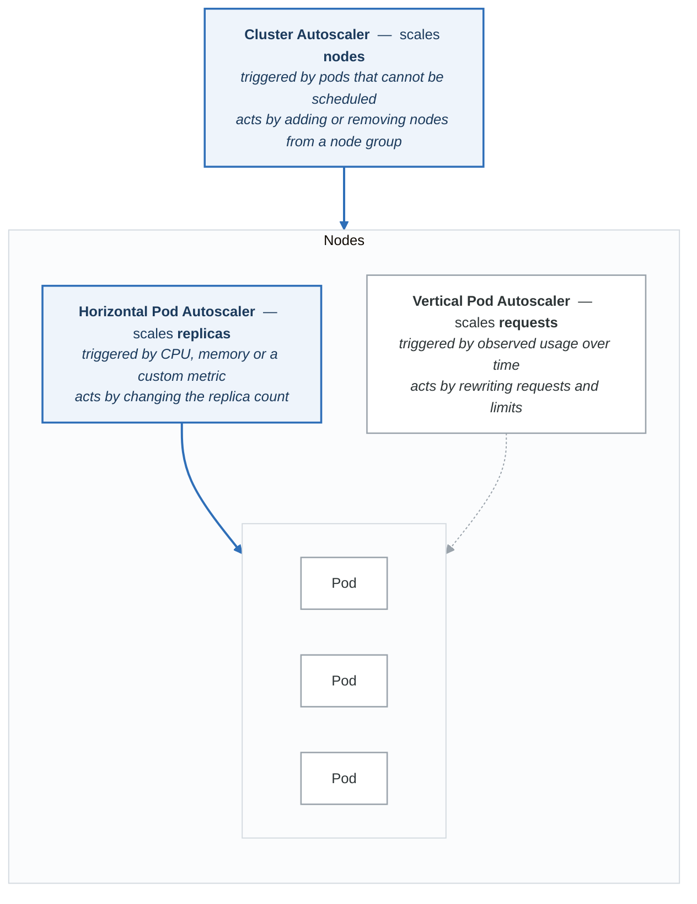

# Scaling & Performance

Master autoscaling, resource optimization, and performance tuning for production workloads.

## Learning Path

1. [Horizontal Pod Autoscaler](#horizontal-pod-autoscaler)
2. [Vertical Pod Autoscaler](#vertical-pod-autoscaler)
3. [Cluster Autoscaler](#cluster-autoscaler)
4. [Resource Management](#resource-management)
5. [Performance Optimization](#performance-optimization)

---

## Autoscaling Architecture

<!-- figure: generated from the Mermaid below by _shared/diagrams/embed-figures.py — do not edit the image -->


<details>
<summary>Diagram source (Mermaid)</summary>



</details>

---

## Horizontal Pod Autoscaler

### Basic HPA with CPU

```yaml
apiVersion: autoscaling/v2
kind: HorizontalPodAutoscaler
metadata:
  name: api-server
  namespace: production
spec:
  scaleTargetRef:
    apiVersion: apps/v1
    kind: Deployment
    name: api-server

  minReplicas: 3
  maxReplicas: 100

  metrics:
  - type: Resource
    resource:
      name: cpu
      target:
        type: Utilization
        averageUtilization: 70

  behavior:
    scaleDown:
      stabilizationWindowSeconds: 300  # Wait 5 min before scaling down
      policies:
      - type: Percent
        value: 10
        periodSeconds: 60  # Scale down max 10% per minute
      - type: Pods
        value: 4
        periodSeconds: 60  # Or max 4 pods per minute
      selectPolicy: Min  # Use the policy that removes fewer pods

    scaleUp:
      stabilizationWindowSeconds: 0  # Scale up immediately
      policies:
      - type: Percent
        value: 100
        periodSeconds: 15  # Double every 15 seconds if needed
      - type: Pods
        value: 4
        periodSeconds: 15  # Or add 4 pods every 15 seconds
      selectPolicy: Max  # Use the policy that adds more pods
```

### HPA with Custom Metrics

```yaml
apiVersion: autoscaling/v2
kind: HorizontalPodAutoscaler
metadata:
  name: api-server-custom
  namespace: production
spec:
  scaleTargetRef:
    apiVersion: apps/v1
    kind: Deployment
    name: api-server

  minReplicas: 3
  maxReplicas: 100

  metrics:
  # CPU as baseline
  - type: Resource
    resource:
      name: cpu
      target:
        type: Utilization
        averageUtilization: 70

  # Memory
  - type: Resource
    resource:
      name: memory
      target:
        type: Utilization
        averageUtilization: 80

  # Custom metric: requests per second per pod
  - type: Pods
    pods:
      metric:
        name: http_requests_per_second
      target:
        type: AverageValue
        averageValue: "1000"  # Target 1000 RPS per pod

  # External metric: message queue depth
  - type: External
    external:
      metric:
        name: sqs_queue_messages
        selector:
          matchLabels:
            queue: orders
      target:
        type: Value
        value: "100"  # Scale when queue > 100 messages

  # Object metric: Ingress requests
  - type: Object
    object:
      metric:
        name: requests_per_second
      describedObject:
        apiVersion: networking.k8s.io/v1
        kind: Ingress
        name: api-ingress
      target:
        type: Value
        value: "10000"
```

### Prometheus Adapter for Custom Metrics

```yaml
# prometheus-adapter config
apiVersion: v1
kind: ConfigMap
metadata:
  name: prometheus-adapter-config
  namespace: monitoring
data:
  config.yaml: |
    rules:
    # Convert http_requests_total to http_requests_per_second
    - seriesQuery: 'http_requests_total{namespace!="",pod!=""}'
      resources:
        overrides:
          namespace: {resource: "namespace"}
          pod: {resource: "pod"}
      name:
        matches: "^(.*)_total$"
        as: "${1}_per_second"
      metricsQuery: 'sum(rate(<<.Series>>{<<.LabelMatchers>>}[2m])) by (<<.GroupBy>>)'

    # Queue depth metric
    - seriesQuery: 'aws_sqs_approximate_number_of_messages_visible{queue_name!=""}'
      resources:
        template: <<.Resource>>
      name:
        matches: ".*"
        as: "sqs_queue_messages"
      metricsQuery: 'sum(<<.Series>>{<<.LabelMatchers>>})'

    # P99 latency for scaling
    - seriesQuery: 'http_request_duration_seconds_bucket{namespace!="",pod!=""}'
      resources:
        overrides:
          namespace: {resource: "namespace"}
          pod: {resource: "pod"}
      name:
        matches: ".*"
        as: "http_request_latency_p99"
      metricsQuery: 'histogram_quantile(0.99, sum(rate(<<.Series>>{<<.LabelMatchers>>}[5m])) by (le, <<.GroupBy>>))'
```

### KEDA for Event-Driven Autoscaling

```yaml
# Install KEDA
helm repo add kedacore https://kedacore.github.io/charts
helm install keda kedacore/keda --namespace keda --create-namespace

---
# ScaledObject for queue-based scaling
apiVersion: keda.sh/v1alpha1
kind: ScaledObject
metadata:
  name: order-processor
  namespace: production
spec:
  scaleTargetRef:
    name: order-processor
  pollingInterval: 15
  cooldownPeriod: 300
  minReplicaCount: 1
  maxReplicaCount: 50

  triggers:
  # AWS SQS
  - type: aws-sqs-queue
    metadata:
      queueURL: https://sqs.us-west-2.amazonaws.com/123456789/orders
      queueLength: "10"  # 10 messages per pod
      awsRegion: us-west-2
      identityOwner: operator
    authenticationRef:
      name: keda-aws-credentials

  # Prometheus metric
  - type: prometheus
    metadata:
      serverAddress: http://prometheus:9090
      metricName: pending_orders
      query: sum(pending_orders_total{status="waiting"})
      threshold: "100"

  advanced:
    horizontalPodAutoscalerConfig:
      behavior:
        scaleDown:
          stabilizationWindowSeconds: 300
          policies:
          - type: Percent
            value: 25
            periodSeconds: 60

---
# Authentication for KEDA
apiVersion: keda.sh/v1alpha1
kind: TriggerAuthentication
metadata:
  name: keda-aws-credentials
  namespace: production
spec:
  podIdentity:
    provider: aws-eks  # Uses IRSA
```

---

## Vertical Pod Autoscaler

### VPA Installation

```bash
# Clone VPA repo
git clone https://github.com/kubernetes/autoscaler.git
cd autoscaler/vertical-pod-autoscaler

# Install VPA components
./hack/vpa-up.sh
```

### VPA Modes

```yaml
# VPA in recommendation-only mode (safe for production)
apiVersion: autoscaling.k8s.io/v1
kind: VerticalPodAutoscaler
metadata:
  name: api-server-vpa
  namespace: production
spec:
  targetRef:
    apiVersion: apps/v1
    kind: Deployment
    name: api-server

  updatePolicy:
    updateMode: "Off"  # Only recommendations, no changes

  resourcePolicy:
    containerPolicies:
    - containerName: api
      minAllowed:
        cpu: 100m
        memory: 128Mi
      maxAllowed:
        cpu: 4
        memory: 8Gi
      controlledResources: ["cpu", "memory"]
      controlledValues: RequestsAndLimits

---
# VPA with automatic updates (use carefully)
apiVersion: autoscaling.k8s.io/v1
kind: VerticalPodAutoscaler
metadata:
  name: batch-processor-vpa
  namespace: production
spec:
  targetRef:
    apiVersion: apps/v1
    kind: Deployment
    name: batch-processor

  updatePolicy:
    updateMode: "Auto"  # Automatically update pods
    minReplicas: 2  # Keep at least 2 running during updates

  resourcePolicy:
    containerPolicies:
    - containerName: processor
      minAllowed:
        cpu: 500m
        memory: 512Mi
      maxAllowed:
        cpu: 8
        memory: 32Gi
```

### View VPA Recommendations

```bash
# Get VPA recommendations
kubectl get vpa api-server-vpa -o yaml

# Example output
# status:
#   recommendation:
#     containerRecommendations:
#     - containerName: api
#       lowerBound:
#         cpu: 250m
#         memory: 262144k
#       target:
#         cpu: 500m
#         memory: 524288k
#       uncappedTarget:
#         cpu: 500m
#         memory: 524288k
#       upperBound:
#         cpu: 1
#         memory: 1Gi
```

---

## Cluster Autoscaler

### AWS Cluster Autoscaler

```yaml
apiVersion: apps/v1
kind: Deployment
metadata:
  name: cluster-autoscaler
  namespace: kube-system
spec:
  replicas: 1
  selector:
    matchLabels:
      app: cluster-autoscaler
  template:
    metadata:
      labels:
        app: cluster-autoscaler
      annotations:
        prometheus.io/scrape: "true"
        prometheus.io/port: "8085"
    spec:
      serviceAccountName: cluster-autoscaler
      containers:
      - name: cluster-autoscaler
        image: registry.k8s.io/autoscaling/cluster-autoscaler:v1.28.0
        command:
        - ./cluster-autoscaler
        - --v=4
        - --stderrthreshold=info
        - --cloud-provider=aws
        - --skip-nodes-with-local-storage=false
        - --expander=least-waste
        - --node-group-auto-discovery=asg:tag=k8s.io/cluster-autoscaler/enabled,k8s.io/cluster-autoscaler/production
        - --balance-similar-node-groups
        - --scale-down-enabled=true
        - --scale-down-delay-after-add=10m
        - --scale-down-delay-after-delete=0s
        - --scale-down-delay-after-failure=3m
        - --scale-down-unneeded-time=10m
        - --scale-down-utilization-threshold=0.5
        - --max-node-provision-time=15m
        - --max-graceful-termination-sec=600
        resources:
          limits:
            cpu: 100m
            memory: 600Mi
          requests:
            cpu: 100m
            memory: 600Mi
```

### Node Group Configuration

```yaml
# ConfigMap for node group priorities
apiVersion: v1
kind: ConfigMap
metadata:
  name: cluster-autoscaler-priority-expander
  namespace: kube-system
data:
  priorities: |
    50:
      - .*spot.*  # Prefer spot instances
    30:
      - .*ondemand.*  # Then on-demand
    10:
      - .*  # Everything else
```

### Karpenter (Modern Alternative)

```yaml
# Karpenter Provisioner
apiVersion: karpenter.sh/v1alpha5
kind: Provisioner
metadata:
  name: default
spec:
  # Kubernetes labels
  labels:
    provisioner: default

  # Instance requirements
  requirements:
  - key: kubernetes.io/arch
    operator: In
    values: ["amd64", "arm64"]
  - key: karpenter.sh/capacity-type
    operator: In
    values: ["spot", "on-demand"]
  - key: kubernetes.io/os
    operator: In
    values: ["linux"]
  - key: node.kubernetes.io/instance-type
    operator: In
    values:
    - m5.large
    - m5.xlarge
    - m5.2xlarge
    - m6i.large
    - m6i.xlarge
    - c5.large
    - c5.xlarge
    - r5.large

  # Limits
  limits:
    resources:
      cpu: 1000  # Max 1000 vCPUs
      memory: 4000Gi

  # Node expiry
  ttlSecondsAfterEmpty: 30
  ttlSecondsUntilExpired: 2592000  # 30 days

  # Consolidation
  consolidation:
    enabled: true

  # Provider specific
  providerRef:
    name: default

---
apiVersion: karpenter.k8s.aws/v1alpha1
kind: AWSNodeTemplate
metadata:
  name: default
spec:
  subnetSelector:
    karpenter.sh/discovery: production

  securityGroupSelector:
    karpenter.sh/discovery: production

  instanceProfile: KarpenterNodeInstanceProfile

  blockDeviceMappings:
  - deviceName: /dev/xvda
    ebs:
      volumeSize: 100Gi
      volumeType: gp3
      encrypted: true
      deleteOnTermination: true
```

---

## Resource Management

### Resource Quotas

```yaml
apiVersion: v1
kind: ResourceQuota
metadata:
  name: team-quota
  namespace: team-a
spec:
  hard:
    # Compute resources
    requests.cpu: "100"
    requests.memory: 200Gi
    limits.cpu: "200"
    limits.memory: 400Gi

    # Object counts
    pods: "100"
    services: "20"
    secrets: "50"
    configmaps: "50"
    persistentvolumeclaims: "20"

    # Storage
    requests.storage: 500Gi
    gold.storageclass.storage.k8s.io/requests.storage: 100Gi
    silver.storageclass.storage.k8s.io/requests.storage: 400Gi

---
# Quota for different priority classes
apiVersion: v1
kind: ResourceQuota
metadata:
  name: high-priority-quota
  namespace: team-a
spec:
  hard:
    pods: "10"
  scopeSelector:
    matchExpressions:
    - operator: In
      scopeName: PriorityClass
      values: ["high-priority"]
```

### Limit Ranges

```yaml
apiVersion: v1
kind: LimitRange
metadata:
  name: default-limits
  namespace: production
spec:
  limits:
  # Default container limits
  - type: Container
    default:
      cpu: "500m"
      memory: "512Mi"
    defaultRequest:
      cpu: "100m"
      memory: "128Mi"
    min:
      cpu: "50m"
      memory: "64Mi"
    max:
      cpu: "4"
      memory: "8Gi"

  # Pod-level limits
  - type: Pod
    max:
      cpu: "8"
      memory: "16Gi"

  # PVC limits
  - type: PersistentVolumeClaim
    min:
      storage: 1Gi
    max:
      storage: 100Gi
```

### Priority Classes

```yaml
# System critical (scheduling guaranteed)
apiVersion: scheduling.k8s.io/v1
kind: PriorityClass
metadata:
  name: system-critical
value: 1000000000
globalDefault: false
preemptionPolicy: PreemptLowerPriority
description: "Critical system components"

---
# High priority production workloads
apiVersion: scheduling.k8s.io/v1
kind: PriorityClass
metadata:
  name: high-priority
value: 100000
globalDefault: false
preemptionPolicy: PreemptLowerPriority
description: "High priority production workloads"

---
# Default priority
apiVersion: scheduling.k8s.io/v1
kind: PriorityClass
metadata:
  name: default-priority
value: 10000
globalDefault: true
preemptionPolicy: PreemptLowerPriority
description: "Default priority for all workloads"

---
# Low priority batch jobs
apiVersion: scheduling.k8s.io/v1
kind: PriorityClass
metadata:
  name: batch-priority
value: 1000
globalDefault: false
preemptionPolicy: Never  # Don't preempt, just wait
description: "Low priority batch workloads"
```

### Pod Disruption Budgets

```yaml
apiVersion: policy/v1
kind: PodDisruptionBudget
metadata:
  name: api-server-pdb
  namespace: production
spec:
  # At least 2 pods must be available
  minAvailable: 2
  selector:
    matchLabels:
      app: api-server

---
apiVersion: policy/v1
kind: PodDisruptionBudget
metadata:
  name: web-pdb
  namespace: production
spec:
  # At most 25% can be unavailable
  maxUnavailable: 25%
  selector:
    matchLabels:
      app: web
```

---

## Performance Optimization

### Topology Spread Constraints

```yaml
apiVersion: apps/v1
kind: Deployment
metadata:
  name: api-server
  namespace: production
spec:
  replicas: 6
  selector:
    matchLabels:
      app: api-server
  template:
    metadata:
      labels:
        app: api-server
    spec:
      topologySpreadConstraints:
      # Spread across zones
      - maxSkew: 1
        topologyKey: topology.kubernetes.io/zone
        whenUnsatisfiable: DoNotSchedule
        labelSelector:
          matchLabels:
            app: api-server

      # Spread across nodes within zones
      - maxSkew: 2
        topologyKey: kubernetes.io/hostname
        whenUnsatisfiable: ScheduleAnyway
        labelSelector:
          matchLabels:
            app: api-server
```

### Pod Affinity/Anti-Affinity

```yaml
apiVersion: apps/v1
kind: Deployment
metadata:
  name: web-frontend
spec:
  template:
    spec:
      affinity:
        # Co-locate with cache pods
        podAffinity:
          preferredDuringSchedulingIgnoredDuringExecution:
          - weight: 100
            podAffinityTerm:
              labelSelector:
                matchLabels:
                  app: redis-cache
              topologyKey: kubernetes.io/hostname

        # Spread web pods across nodes
        podAntiAffinity:
          requiredDuringSchedulingIgnoredDuringExecution:
          - labelSelector:
              matchLabels:
                app: web-frontend
            topologyKey: kubernetes.io/hostname
```

### Node Optimization

```yaml
# Node configuration for high-performance workloads
apiVersion: v1
kind: ConfigMap
metadata:
  name: kubelet-config
data:
  kubelet: |
    apiVersion: kubelet.config.k8s.io/v1beta1
    kind: KubeletConfiguration

    # Resource reservations
    systemReserved:
      cpu: "500m"
      memory: "1Gi"
    kubeReserved:
      cpu: "500m"
      memory: "1Gi"
    evictionHard:
      memory.available: "500Mi"
      nodefs.available: "10%"
      imagefs.available: "15%"

    # CPU management
    cpuManagerPolicy: static
    cpuManagerReconcilePeriod: 5s

    # Topology management for NUMA
    topologyManagerPolicy: best-effort
    topologyManagerScope: container

    # Image garbage collection
    imageGCHighThresholdPercent: 85
    imageGCLowThresholdPercent: 80

    # Container log settings
    containerLogMaxSize: "50Mi"
    containerLogMaxFiles: 5
```

### Java/JVM Workload Optimization

```yaml
apiVersion: apps/v1
kind: Deployment
metadata:
  name: java-app
spec:
  template:
    spec:
      containers:
      - name: app
        image: java-app:1.0
        resources:
          requests:
            cpu: "2"
            memory: "4Gi"
          limits:
            cpu: "4"
            memory: "4Gi"  # Same as request for JVM
        env:
        # JVM heap sizing based on container limits
        - name: JAVA_OPTS
          value: >-
            -XX:+UseContainerSupport
            -XX:MaxRAMPercentage=75.0
            -XX:InitialRAMPercentage=50.0
            -XX:+UseG1GC
            -XX:MaxGCPauseMillis=200
            -XX:+UseStringDeduplication
            -Xlog:gc*:stdout:time
```

---

## Exercises

1. **[Exercise 1: HPA Configuration](./exercises/01-hpa.md)** - Configure multi-metric HPA
2. **[Exercise 2: Custom Metrics](./exercises/02-custom-metrics.md)** - Prometheus adapter setup
3. **[Exercise 3: VPA Analysis](./exercises/03-vpa.md)** - Right-size workloads with VPA
4. **[Exercise 4: Cluster Autoscaler](./exercises/04-cluster-autoscaler.md)** - Configure node scaling
5. **[Exercise 5: Resource Optimization](./exercises/05-resources.md)** - Quotas and limits
6. **[Exercise 6: Performance Tuning](./exercises/06-performance.md)** - Optimize for throughput

---

## Next Section

[project-production-platform](../project-production-platform/) - Build the production monitoring platform

<!-- feynman-check -->

---

## Feynman check

Close the file. Blank page, no notes. Explain each of these to a competent engineer who has never
used this tool — **under five minutes, no jargon you can't define on the spot:**

- Autoscaling Architecture
- Horizontal Pod Autoscaler
- Vertical Pod Autoscaler
- Cluster Autoscaler

**The gap is not what you forgot. It is where you used a word instead of a mechanism.**

| | |
|---|---|
| ✗ | *"Kubernetes schedules the pod."* |
| ✓ | *"The scheduler watches for pods with no `nodeName`, filters nodes by predicates, scores the survivors, and writes `nodeName` into the pod spec. The kubelet on that node is watching the API for pods bound to it, and starts the containers."* |

**Trace it:** `kubectl apply -f pod.yaml` → a running container. Name every component that acts, in order, and what each one writes.

Stop at the first component you cannot name. Reopen this file and read **only** that.

**Go deeper — only once the gap has a name:** [Kubernetes the Hard Way](https://github.com/kelseyhightower/kubernetes-the-hard-way) — one weekend, and "the control plane" stops being a word.
Full list per domain: [`SOURCES.md`](../../SOURCES.md#kubernetes)

→ Protocol, the three levels of knowing, and worked examples: [`MASTERY.md`](../../MASTERY.md)

<!-- /feynman-check -->
