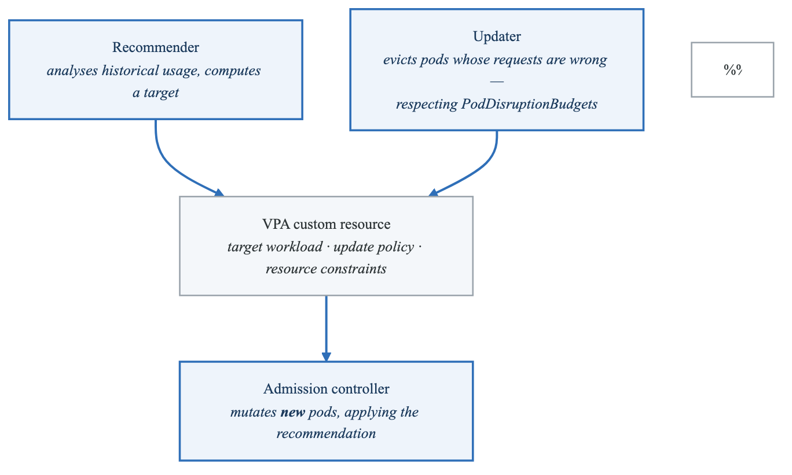
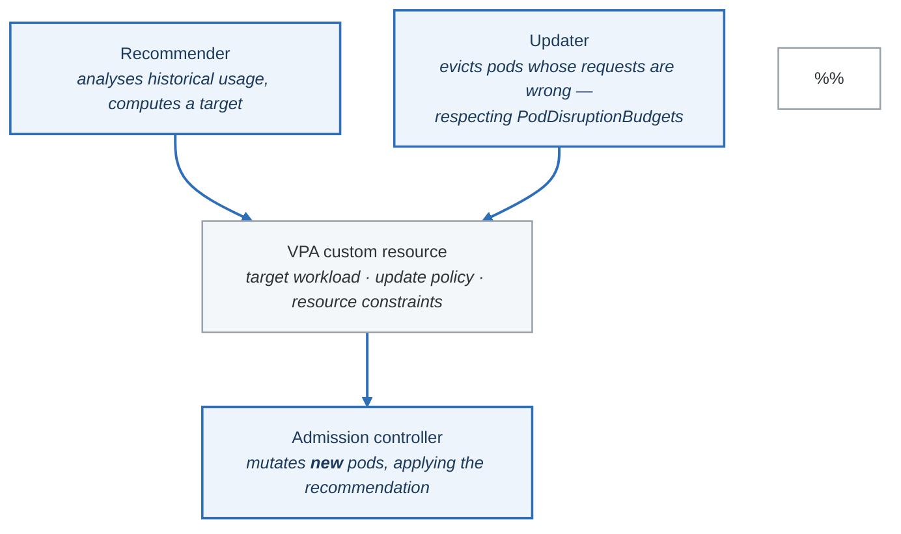

# Exercise 2: Vertical Pod Autoscaler (VPA)

## Objectives

- Deploy and configure Vertical Pod Autoscaler
- Understand VPA modes and recommendations
- Implement right-sizing strategies
- Combine VPA with HPA effectively

## Prerequisites

- Completed Exercise 1 (HPA)
- Metrics Server deployed
- Understanding of resource requests/limits

---

## Part 1: VPA Architecture

### 1.1 Component Overview

<!-- figure: generated from the Mermaid below by _shared/diagrams/embed-figures.py — do not edit the image -->


<details>
<summary>Diagram source (Mermaid)</summary>



</details>

---

## Part 2: VPA Installation

### 2.1 Install VPA Components

```bash
# Clone VPA repository
git clone https://github.com/kubernetes/autoscaler.git
cd autoscaler/vertical-pod-autoscaler

# Install VPA CRDs and components
./hack/vpa-up.sh

# Or install manually
kubectl apply -f https://raw.githubusercontent.com/kubernetes/autoscaler/master/vertical-pod-autoscaler/deploy/vpa-v1-crd-gen.yaml
kubectl apply -f https://raw.githubusercontent.com/kubernetes/autoscaler/master/vertical-pod-autoscaler/deploy/vpa-rbac.yaml
kubectl apply -f https://raw.githubusercontent.com/kubernetes/autoscaler/master/vertical-pod-autoscaler/deploy/recommender-deployment.yaml
kubectl apply -f https://raw.githubusercontent.com/kubernetes/autoscaler/master/vertical-pod-autoscaler/deploy/updater-deployment.yaml
kubectl apply -f https://raw.githubusercontent.com/kubernetes/autoscaler/master/vertical-pod-autoscaler/deploy/admission-controller-deployment.yaml
```

### 2.2 Verify Installation

```bash
# Check VPA components
kubectl get pods -n kube-system | grep vpa

# Verify CRDs
kubectl get crd | grep verticalpodautoscaler

# Check VPA admission webhook
kubectl get validatingwebhookconfigurations | grep vpa
kubectl get mutatingwebhookconfigurations | grep vpa
```

### 2.3 VPA with Helm

```bash
# Add Fairwinds helm repo
helm repo add fairwinds-stable https://charts.fairwinds.com/stable
helm repo update

# Install VPA
helm install vpa fairwinds-stable/vpa \
  --namespace vpa \
  --create-namespace \
  --set recommender.enabled=true \
  --set updater.enabled=true \
  --set admissionController.enabled=true
```

---

## Part 3: Basic VPA Configuration

### 3.1 Recommendation-Only Mode

```yaml
# vpa-recommendation-only.yaml
apiVersion: autoscaling.k8s.io/v1
kind: VerticalPodAutoscaler
metadata:
  name: api-vpa
  namespace: production
spec:
  targetRef:
    apiVersion: "apps/v1"
    kind: Deployment
    name: api-server
  updatePolicy:
    updateMode: "Off"  # Recommendations only, no automatic updates
```

### 3.2 Auto-Update Mode

```yaml
# vpa-auto-update.yaml
apiVersion: autoscaling.k8s.io/v1
kind: VerticalPodAutoscaler
metadata:
  name: worker-vpa
  namespace: production
spec:
  targetRef:
    apiVersion: "apps/v1"
    kind: Deployment
    name: worker
  updatePolicy:
    updateMode: "Auto"  # Automatically update pod resources
  resourcePolicy:
    containerPolicies:
      - containerName: "*"
        minAllowed:
          cpu: 100m
          memory: 128Mi
        maxAllowed:
          cpu: 4
          memory: 8Gi
        controlledResources: ["cpu", "memory"]
```

### 3.3 Initial-Only Mode

```yaml
# vpa-initial-only.yaml
apiVersion: autoscaling.k8s.io/v1
kind: VerticalPodAutoscaler
metadata:
  name: batch-vpa
  namespace: production
spec:
  targetRef:
    apiVersion: "apps/v1"
    kind: Deployment
    name: batch-processor
  updatePolicy:
    updateMode: "Initial"  # Only set resources on pod creation
  resourcePolicy:
    containerPolicies:
      - containerName: processor
        minAllowed:
          cpu: 250m
          memory: 256Mi
        maxAllowed:
          cpu: 2
          memory: 4Gi
```

---

## Part 4: Resource Policies

### 4.1 Per-Container Policies

```yaml
# vpa-container-policies.yaml
apiVersion: autoscaling.k8s.io/v1
kind: VerticalPodAutoscaler
metadata:
  name: multi-container-vpa
  namespace: production
spec:
  targetRef:
    apiVersion: "apps/v1"
    kind: Deployment
    name: multi-container-app
  updatePolicy:
    updateMode: "Auto"
  resourcePolicy:
    containerPolicies:
      # Main application container
      - containerName: app
        minAllowed:
          cpu: 100m
          memory: 128Mi
        maxAllowed:
          cpu: 2
          memory: 4Gi
        controlledResources: ["cpu", "memory"]
        controlledValues: RequestsAndLimits

      # Sidecar - only control memory
      - containerName: sidecar
        mode: "Auto"
        minAllowed:
          memory: 64Mi
        maxAllowed:
          memory: 512Mi
        controlledResources: ["memory"]

      # Exclude logging container from VPA
      - containerName: fluentbit
        mode: "Off"
```

### 4.2 Controlled Values

```yaml
# vpa-controlled-values.yaml
apiVersion: autoscaling.k8s.io/v1
kind: VerticalPodAutoscaler
metadata:
  name: requests-only-vpa
  namespace: production
spec:
  targetRef:
    apiVersion: "apps/v1"
    kind: Deployment
    name: api-server
  updatePolicy:
    updateMode: "Auto"
  resourcePolicy:
    containerPolicies:
      - containerName: "*"
        # Only control requests, not limits
        controlledValues: RequestsOnly
        minAllowed:
          cpu: 50m
          memory: 64Mi
        maxAllowed:
          cpu: 4
          memory: 8Gi
```

### 4.3 Scale Down Policy

```yaml
# vpa-scale-down-policy.yaml
apiVersion: autoscaling.k8s.io/v1
kind: VerticalPodAutoscaler
metadata:
  name: conservative-vpa
  namespace: production
  annotations:
    # Custom settings via recommender flags
    vpa-recommender.kubernetes.io/pod-recommendation-min-memory-mb: "128"
spec:
  targetRef:
    apiVersion: "apps/v1"
    kind: Deployment
    name: stable-service
  updatePolicy:
    updateMode: "Auto"
    # Eviction requirements
    minReplicas: 2  # Maintain minimum replicas during eviction
  resourcePolicy:
    containerPolicies:
      - containerName: "*"
        minAllowed:
          cpu: 100m
          memory: 256Mi
        maxAllowed:
          cpu: 2
          memory: 4Gi
```

---

## Part 5: Understanding Recommendations

### 5.1 View VPA Recommendations

```bash
# Get VPA status
kubectl get vpa -n production

# Detailed recommendations
kubectl describe vpa api-vpa -n production

# Get recommendations in JSON
kubectl get vpa api-vpa -n production -o jsonpath='{.status.recommendation}'
```

### 5.2 Recommendation Structure

```yaml
status:
  conditions:
    - lastTransitionTime: "2024-01-15T10:00:00Z"
      status: "True"
      type: RecommendationProvided
  recommendation:
    containerRecommendations:
      - containerName: app
        # Lower bound (safe minimum)
        lowerBound:
          cpu: 100m
          memory: 128Mi
        # Target (recommended value)
        target:
          cpu: 500m
          memory: 512Mi
        # Upper bound (safe maximum)
        upperBound:
          cpu: 2000m
          memory: 2Gi
        # Uncapped target (without policy limits)
        uncappedTarget:
          cpu: 800m
          memory: 768Mi
```

### 5.3 Recommendation Analysis Script

```bash
#!/bin/bash
# vpa-recommendations.sh

echo "=== VPA Recommendations Report ==="

for vpa in $(kubectl get vpa -A -o jsonpath='{range .items[*]}{.metadata.namespace}/{.metadata.name}{"\n"}{end}'); do
  namespace=$(echo $vpa | cut -d'/' -f1)
  name=$(echo $vpa | cut -d'/' -f2)

  echo -e "\n--- VPA: $namespace/$name ---"

  # Get target deployment
  target=$(kubectl get vpa $name -n $namespace -o jsonpath='{.spec.targetRef.name}')
  echo "Target: $target"

  # Get recommendations
  kubectl get vpa $name -n $namespace -o json | jq -r '
    .status.recommendation.containerRecommendations[]? |
    "Container: \(.containerName)
    Target CPU: \(.target.cpu // "N/A")
    Target Memory: \(.target.memory // "N/A")
    Lower Bound CPU: \(.lowerBound.cpu // "N/A")
    Upper Bound CPU: \(.upperBound.cpu // "N/A")"
  '
done
```

---

## Part 6: VPA with HPA

### 6.1 Complementary Configuration

```yaml
# vpa-hpa-complementary.yaml
---
# VPA controls memory only
apiVersion: autoscaling.k8s.io/v1
kind: VerticalPodAutoscaler
metadata:
  name: api-vpa
  namespace: production
spec:
  targetRef:
    apiVersion: "apps/v1"
    kind: Deployment
    name: api-server
  updatePolicy:
    updateMode: "Auto"
  resourcePolicy:
    containerPolicies:
      - containerName: "*"
        # Only control memory, let HPA handle CPU scaling
        controlledResources: ["memory"]
        minAllowed:
          memory: 256Mi
        maxAllowed:
          memory: 4Gi
---
# HPA scales based on CPU
apiVersion: autoscaling/v2
kind: HorizontalPodAutoscaler
metadata:
  name: api-hpa
  namespace: production
spec:
  scaleTargetRef:
    apiVersion: apps/v1
    kind: Deployment
    name: api-server
  minReplicas: 3
  maxReplicas: 20
  metrics:
    - type: Resource
      resource:
        name: cpu
        target:
          type: Utilization
          averageUtilization: 70
```

### 6.2 Multidimensional Pod Autoscaler (Alternative)

```yaml
# For clusters with Goldilocks or similar
# This provides unified VPA + HPA recommendations
apiVersion: autoscaling.k8s.io/v1alpha1
kind: MultidimPodAutoscaler
metadata:
  name: api-mpa
  namespace: production
spec:
  scaleTargetRef:
    apiVersion: apps/v1
    kind: Deployment
    name: api-server
  goals:
    metrics:
      - type: Resource
        resource:
          name: cpu
          target:
            type: Utilization
            averageUtilization: 70
  constraints:
    minReplicas: 2
    maxReplicas: 20
    container:
      - name: "*"
        requests:
          minAllowed:
            cpu: 100m
            memory: 128Mi
          maxAllowed:
            cpu: 2
            memory: 4Gi
```

---

## Part 7: Production Patterns

### 7.1 Goldilocks Dashboard

```yaml
# goldilocks-installation.yaml
# Goldilocks provides VPA recommendations dashboard
---
apiVersion: v1
kind: Namespace
metadata:
  name: goldilocks
  labels:
    goldilocks.fairwinds.com/enabled: "true"
---
# Install with Helm
# helm install goldilocks fairwinds-stable/goldilocks \
#   --namespace goldilocks \
#   --set dashboard.enabled=true
```

```bash
# Enable Goldilocks for a namespace
kubectl label namespace production goldilocks.fairwinds.com/enabled=true

# Access dashboard
kubectl port-forward svc/goldilocks-dashboard -n goldilocks 8080:80
```

### 7.2 VPA Recommendations as Code

```yaml
# vpa-generator.yaml
apiVersion: batch/v1
kind: CronJob
metadata:
  name: vpa-recommendations-exporter
  namespace: vpa
spec:
  schedule: "0 */6 * * *"  # Every 6 hours
  jobTemplate:
    spec:
      template:
        spec:
          serviceAccountName: vpa-exporter
          containers:
            - name: exporter
              image: bitnami/kubectl:latest
              command:
                - /bin/sh
                - -c
                - |
                  # Export VPA recommendations to ConfigMap
                  kubectl get vpa -A -o json | jq '
                    .items[] | {
                      namespace: .metadata.namespace,
                      name: .metadata.name,
                      target: .spec.targetRef.name,
                      recommendations: .status.recommendation.containerRecommendations
                    }
                  ' > /tmp/recommendations.json

                  kubectl create configmap vpa-recommendations \
                    --from-file=recommendations.json=/tmp/recommendations.json \
                    -n vpa --dry-run=client -o yaml | kubectl apply -f -
          restartPolicy: OnFailure
```

### 7.3 Safe Update Strategy

```yaml
# vpa-safe-update.yaml
apiVersion: autoscaling.k8s.io/v1
kind: VerticalPodAutoscaler
metadata:
  name: critical-service-vpa
  namespace: production
spec:
  targetRef:
    apiVersion: "apps/v1"
    kind: Deployment
    name: critical-service
  updatePolicy:
    updateMode: "Auto"
    minReplicas: 3  # Never go below 3 replicas during updates
  resourcePolicy:
    containerPolicies:
      - containerName: app
        minAllowed:
          cpu: 200m
          memory: 256Mi
        maxAllowed:
          cpu: 4
          memory: 8Gi
---
# Ensure PDB is in place
apiVersion: policy/v1
kind: PodDisruptionBudget
metadata:
  name: critical-service-pdb
  namespace: production
spec:
  minAvailable: 2
  selector:
    matchLabels:
      app: critical-service
```

---

## Part 8: Monitoring VPA

### 8.1 VPA Metrics

```yaml
# VPA exposes Prometheus metrics
# Key metrics:
# - vpa_recommender_recommendation_latency_seconds
# - vpa_recommender_aggregate_container_states
# - vpa_updater_evictions_total

# ServiceMonitor for VPA
apiVersion: monitoring.coreos.com/v1
kind: ServiceMonitor
metadata:
  name: vpa-metrics
  namespace: monitoring
spec:
  selector:
    matchLabels:
      app: vpa
  namespaceSelector:
    matchNames:
      - kube-system
  endpoints:
    - port: metrics
      interval: 30s
```

### 8.2 Alert Rules

```yaml
# vpa-alerts.yaml
apiVersion: monitoring.coreos.com/v1
kind: PrometheusRule
metadata:
  name: vpa-alerts
  namespace: monitoring
spec:
  groups:
    - name: vpa
      rules:
        - alert: VPARecommendationNotProvided
          expr: |
            vpa_status_recommendation{recommendation_provided="False"} == 1
          for: 1h
          labels:
            severity: warning
          annotations:
            summary: VPA not providing recommendations
            description: "VPA {{ $labels.vpa }} has not provided recommendations for 1 hour"

        - alert: VPAResourceMismatch
          expr: |
            abs(
              kube_pod_container_resource_requests{resource="memory"}
              - on(namespace, pod, container)
              vpa_container_recommendation_target{resource="memory"}
            ) / kube_pod_container_resource_requests{resource="memory"} > 0.5
          for: 30m
          labels:
            severity: info
          annotations:
            summary: Pod resources differ significantly from VPA recommendation
```

### 8.3 Grafana Dashboard

```json
{
  "dashboard": {
    "title": "VPA Recommendations",
    "panels": [
      {
        "title": "CPU Recommendations vs Current",
        "type": "timeseries",
        "targets": [
          {
            "expr": "vpa_container_recommendation_target{resource=\"cpu\"}",
            "legendFormat": "Recommended: {{namespace}}/{{vpa}}/{{container}}"
          },
          {
            "expr": "kube_pod_container_resource_requests{resource=\"cpu\"}",
            "legendFormat": "Current: {{namespace}}/{{pod}}/{{container}}"
          }
        ]
      },
      {
        "title": "Memory Recommendations vs Current",
        "type": "timeseries",
        "targets": [
          {
            "expr": "vpa_container_recommendation_target{resource=\"memory\"}",
            "legendFormat": "Recommended: {{namespace}}/{{vpa}}/{{container}}"
          },
          {
            "expr": "kube_pod_container_resource_requests{resource=\"memory\"}",
            "legendFormat": "Current: {{namespace}}/{{pod}}/{{container}}"
          }
        ]
      },
      {
        "title": "VPA Evictions",
        "type": "stat",
        "targets": [
          {
            "expr": "sum(increase(vpa_updater_evictions_total[24h]))",
            "legendFormat": "Evictions (24h)"
          }
        ]
      }
    ]
  }
}
```

---

## Part 9: Hands-on Challenges

### Challenge 1: Right-Sizing Exercise

Implement VPA for a test application:
1. Deploy without resource requests
2. Generate realistic load
3. Observe VPA recommendations
4. Apply optimal resources

### Challenge 2: Memory Leak Detection

Use VPA to identify memory issues:
1. Configure VPA in Off mode
2. Monitor recommendation trends
3. Identify containers with growing recommendations
4. Alert on unusual patterns

### Challenge 3: Cost Optimization

Optimize cluster costs with VPA:
1. Enable Goldilocks
2. Analyze all workloads
3. Identify over-provisioned deployments
4. Calculate potential savings

---

## Verification Tasks

1. [ ] Installed VPA components
2. [ ] Created VPA in recommendation-only mode
3. [ ] Configured auto-update VPA
4. [ ] Set resource policies
5. [ ] Combined VPA with HPA
6. [ ] Monitored VPA recommendations

---

## Key Takeaways

- VPA optimizes vertical resource allocation
- Use "Off" mode initially to understand recommendations
- Combine with HPA for comprehensive autoscaling
- Set min/max bounds to prevent extreme values
- Monitor evictions for production workloads
- Use PDBs to ensure availability during updates

---

## Next Steps

Continue to [Exercise 3: Cluster Autoscaler](03-scaling-performance-exercises-03-cluster-autoscaler.md)

<!-- feynman-check -->

---

## Feynman check

Close the file. Blank page, no notes. Explain each of these to a competent engineer who has never
used this tool — **under five minutes, no jargon you can't define on the spot:**

- VPA Architecture
- VPA Installation
- Basic VPA Configuration
- Resource Policies

**The gap is not what you forgot. It is where you used a word instead of a mechanism.**

| | |
|---|---|
| ✗ | *"Kubernetes schedules the pod."* |
| ✓ | *"The scheduler watches for pods with no `nodeName`, filters nodes by predicates, scores the survivors, and writes `nodeName` into the pod spec. The kubelet on that node is watching the API for pods bound to it, and starts the containers."* |

**Trace it:** `kubectl apply -f pod.yaml` → a running container. Name every component that acts, in order, and what each one writes.

Stop at the first component you cannot name. Reopen this file and read **only** that.

**Go deeper — only once the gap has a name:** [Kubernetes the Hard Way](https://github.com/kelseyhightower/kubernetes-the-hard-way) — one weekend, and "the control plane" stops being a word.
Full list per domain: [`SOURCES.md`](../../SOURCES.md#kubernetes)

→ Protocol, the three levels of knowing, and worked examples: [`MASTERY.md`](../../MASTERY.md)

<!-- /feynman-check -->
