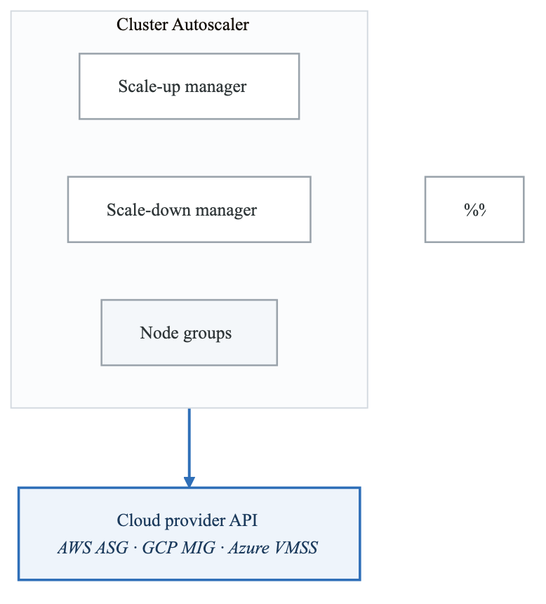
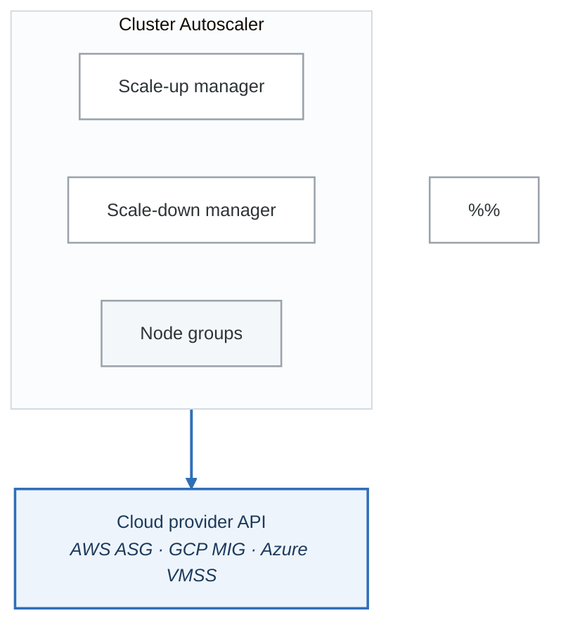
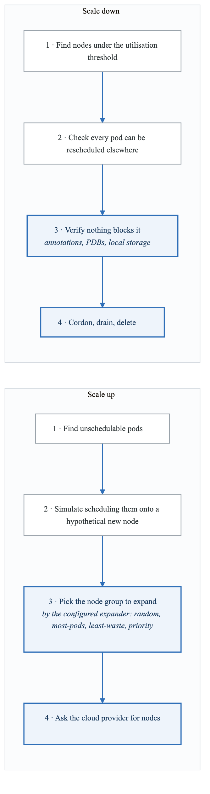
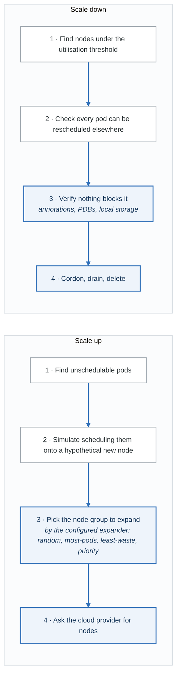

# Exercise 3: Cluster Autoscaler

## Objectives

- Deploy and configure Cluster Autoscaler
- Understand scaling triggers and algorithms
- Configure node pools and scaling policies
- Implement multi-zone and spot instance support

## Prerequisites

- Completed Exercises 1-2
- Cloud provider credentials (AWS/GCP/Azure)
- Understanding of node pools and instance types

---

## Part 1: Cluster Autoscaler Overview

### 1.1 Architecture

<!-- figure: generated from the Mermaid below by _shared/diagrams/embed-figures.py — do not edit the image -->


<details>
<summary>Diagram source (Mermaid)</summary>



</details>

### 1.2 Decision Flow

<!-- figure: generated from the Mermaid below by _shared/diagrams/embed-figures.py — do not edit the image -->


<details>
<summary>Diagram source (Mermaid)</summary>



</details>

---

## Part 2: AWS EKS Installation

### 2.1 IAM Policy for Cluster Autoscaler

```json
{
  "Version": "2012-10-17",
  "Statement": [
    {
      "Effect": "Allow",
      "Action": [
        "autoscaling:DescribeAutoScalingGroups",
        "autoscaling:DescribeAutoScalingInstances",
        "autoscaling:DescribeLaunchConfigurations",
        "autoscaling:DescribeScalingActivities",
        "autoscaling:DescribeTags",
        "ec2:DescribeImages",
        "ec2:DescribeInstanceTypes",
        "ec2:DescribeLaunchTemplateVersions",
        "ec2:GetInstanceTypesFromInstanceRequirements",
        "eks:DescribeNodegroup"
      ],
      "Resource": ["*"]
    },
    {
      "Effect": "Allow",
      "Action": [
        "autoscaling:SetDesiredCapacity",
        "autoscaling:TerminateInstanceInAutoScalingGroup"
      ],
      "Resource": ["*"],
      "Condition": {
        "StringEquals": {
          "aws:ResourceTag/k8s.io/cluster-autoscaler/my-cluster": "owned"
        }
      }
    }
  ]
}
```

### 2.2 Cluster Autoscaler Deployment (AWS)

```yaml
# cluster-autoscaler-aws.yaml
apiVersion: apps/v1
kind: Deployment
metadata:
  name: cluster-autoscaler
  namespace: kube-system
  labels:
    app: cluster-autoscaler
spec:
  replicas: 1
  selector:
    matchLabels:
      app: cluster-autoscaler
  template:
    metadata:
      labels:
        app: cluster-autoscaler
      annotations:
        prometheus.io/scrape: "true"
        prometheus.io/port: "8085"
    spec:
      serviceAccountName: cluster-autoscaler
      priorityClassName: system-cluster-critical
      securityContext:
        runAsNonRoot: true
        runAsUser: 65534
        fsGroup: 65534
      containers:
        - name: cluster-autoscaler
          image: registry.k8s.io/autoscaling/cluster-autoscaler:v1.28.0
          command:
            - ./cluster-autoscaler
            - --v=4
            - --stderrthreshold=info
            - --cloud-provider=aws
            - --skip-nodes-with-local-storage=false
            - --expander=least-waste
            - --node-group-auto-discovery=asg:tag=k8s.io/cluster-autoscaler/enabled,k8s.io/cluster-autoscaler/my-cluster
            - --balance-similar-node-groups
            - --skip-nodes-with-system-pods=false
            - --scale-down-enabled=true
            - --scale-down-delay-after-add=10m
            - --scale-down-unneeded-time=10m
            - --scale-down-utilization-threshold=0.5
          resources:
            limits:
              cpu: 100m
              memory: 600Mi
            requests:
              cpu: 100m
              memory: 600Mi
          volumeMounts:
            - name: ssl-certs
              mountPath: /etc/ssl/certs/ca-certificates.crt
              readOnly: true
      volumes:
        - name: ssl-certs
          hostPath:
            path: /etc/ssl/certs/ca-bundle.crt
```

### 2.3 Service Account with IRSA

```yaml
# cluster-autoscaler-sa.yaml
apiVersion: v1
kind: ServiceAccount
metadata:
  name: cluster-autoscaler
  namespace: kube-system
  annotations:
    eks.amazonaws.com/role-arn: arn:aws:iam::ACCOUNT_ID:role/ClusterAutoscalerRole
---
apiVersion: rbac.authorization.k8s.io/v1
kind: ClusterRole
metadata:
  name: cluster-autoscaler
rules:
  - apiGroups: [""]
    resources: ["events", "endpoints"]
    verbs: ["create", "patch"]
  - apiGroups: [""]
    resources: ["pods/eviction"]
    verbs: ["create"]
  - apiGroups: [""]
    resources: ["pods/status"]
    verbs: ["update"]
  - apiGroups: [""]
    resources: ["endpoints"]
    resourceNames: ["cluster-autoscaler"]
    verbs: ["get", "update"]
  - apiGroups: [""]
    resources: ["nodes"]
    verbs: ["watch", "list", "get", "update"]
  - apiGroups: [""]
    resources: ["namespaces", "pods", "services", "replicationcontrollers", "persistentvolumeclaims", "persistentvolumes"]
    verbs: ["watch", "list", "get"]
  - apiGroups: ["extensions", "apps"]
    resources: ["daemonsets", "replicasets", "statefulsets"]
    verbs: ["watch", "list", "get"]
  - apiGroups: ["policy"]
    resources: ["poddisruptionbudgets"]
    verbs: ["watch", "list"]
  - apiGroups: ["storage.k8s.io"]
    resources: ["storageclasses", "csinodes", "csidrivers", "csistoragecapacities"]
    verbs: ["watch", "list", "get"]
  - apiGroups: ["coordination.k8s.io"]
    resources: ["leases"]
    verbs: ["create"]
  - apiGroups: ["coordination.k8s.io"]
    resources: ["leases"]
    resourceNames: ["cluster-autoscaler"]
    verbs: ["get", "update"]
---
apiVersion: rbac.authorization.k8s.io/v1
kind: ClusterRoleBinding
metadata:
  name: cluster-autoscaler
roleRef:
  apiGroup: rbac.authorization.k8s.io
  kind: ClusterRole
  name: cluster-autoscaler
subjects:
  - kind: ServiceAccount
    name: cluster-autoscaler
    namespace: kube-system
```

---

## Part 3: GKE and AKS Installation

### 3.1 GKE Configuration

```bash
# GKE has built-in autoscaling, enable per node pool
gcloud container clusters update my-cluster \
  --enable-autoscaling \
  --min-nodes=1 \
  --max-nodes=10 \
  --zone=us-central1-a

# Enable for specific node pool
gcloud container node-pools update default-pool \
  --cluster=my-cluster \
  --enable-autoscaling \
  --min-nodes=2 \
  --max-nodes=20 \
  --zone=us-central1-a

# Configure autoscaling profile
gcloud container clusters update my-cluster \
  --autoscaling-profile=optimize-utilization
```

### 3.2 AKS Configuration

```bash
# Enable cluster autoscaler on AKS
az aks update \
  --resource-group myResourceGroup \
  --name myAKSCluster \
  --enable-cluster-autoscaler \
  --min-count 2 \
  --max-count 20

# Update existing node pool
az aks nodepool update \
  --resource-group myResourceGroup \
  --cluster-name myAKSCluster \
  --name nodepool1 \
  --enable-cluster-autoscaler \
  --min-count 1 \
  --max-count 10
```

### 3.3 Helm Installation (Any Cloud)

```bash
# Add autoscaler helm repo
helm repo add autoscaler https://kubernetes.github.io/autoscaler
helm repo update

# Install cluster autoscaler
helm install cluster-autoscaler autoscaler/cluster-autoscaler \
  --namespace kube-system \
  --set autoDiscovery.clusterName=my-cluster \
  --set awsRegion=us-west-2 \
  --set rbac.create=true \
  --set rbac.serviceAccount.create=true \
  --set rbac.serviceAccount.annotations."eks\.amazonaws\.com/role-arn"=arn:aws:iam::ACCOUNT_ID:role/ClusterAutoscalerRole
```

---

## Part 4: Node Group Configuration

### 4.1 Multiple Node Groups

```yaml
# AWS ASG Tags for auto-discovery
# Required tags on each Auto Scaling Group:
# k8s.io/cluster-autoscaler/enabled = true
# k8s.io/cluster-autoscaler/my-cluster = owned

# Optional tags for node group configuration:
# k8s.io/cluster-autoscaler/node-template/label/node.kubernetes.io/instance-type = m5.large
# k8s.io/cluster-autoscaler/node-template/taint/dedicated = gpu:NoSchedule
```

### 4.2 Mixed Instance Types

```yaml
# cluster-autoscaler-mixed.yaml
apiVersion: apps/v1
kind: Deployment
metadata:
  name: cluster-autoscaler
  namespace: kube-system
spec:
  template:
    spec:
      containers:
        - name: cluster-autoscaler
          command:
            - ./cluster-autoscaler
            - --cloud-provider=aws
            - --nodes=2:10:general-purpose-asg
            - --nodes=0:5:gpu-asg
            - --nodes=0:20:spot-asg
            - --expander=priority
            - --balance-similar-node-groups
```

### 4.3 Priority Expander

```yaml
# priority-expander-configmap.yaml
apiVersion: v1
kind: ConfigMap
metadata:
  name: cluster-autoscaler-priority-expander
  namespace: kube-system
data:
  priorities: |-
    10:
      - .*spot.*
    50:
      - .*on-demand-general.*
    100:
      - .*on-demand-compute.*
```

---

## Part 5: Scaling Policies

### 5.1 Scale Down Configuration

```yaml
# Cluster autoscaler configuration flags
command:
  - ./cluster-autoscaler
  # Scale down settings
  - --scale-down-enabled=true
  - --scale-down-delay-after-add=10m      # Wait after scale up
  - --scale-down-delay-after-delete=0s    # Wait after node deletion
  - --scale-down-delay-after-failure=3m   # Wait after failed scale down
  - --scale-down-unneeded-time=10m        # Node must be unneeded for this long
  - --scale-down-utilization-threshold=0.5 # Scale down if below 50% utilization
  - --scale-down-non-empty-candidates-count=30  # Max nodes to consider
  - --scale-down-candidates-pool-ratio=0.1      # % of nodes to consider
  - --scale-down-candidates-pool-min-count=50   # Min nodes to consider
```

### 5.2 Scale Up Configuration

```yaml
command:
  - ./cluster-autoscaler
  # Scale up settings
  - --max-node-provision-time=15m     # Max time to wait for node
  - --scale-up-from-zero=true         # Allow scaling from 0 nodes
  - --max-nodes-total=100             # Maximum cluster size
  - --cores-total=0:320               # Total CPU cores range
  - --memory-total=0:1280             # Total memory range (GB)
  - --max-graceful-termination-sec=600
```

### 5.3 Pod Annotations for Scale Down

```yaml
# Prevent pod from blocking scale down
apiVersion: v1
kind: Pod
metadata:
  name: safe-to-evict-pod
  annotations:
    # This pod is safe to evict
    "cluster-autoscaler.kubernetes.io/safe-to-evict": "true"
spec:
  containers:
    - name: app
      image: nginx
---
# Prevent node scale down while pod exists
apiVersion: v1
kind: Pod
metadata:
  name: blocking-pod
  annotations:
    # This pod blocks scale down
    "cluster-autoscaler.kubernetes.io/safe-to-evict": "false"
spec:
  containers:
    - name: critical-process
      image: critical-app:latest
```

---

## Part 6: Advanced Configurations

### 6.1 Node Taints and Labels

```yaml
# cluster-autoscaler with node templates
apiVersion: apps/v1
kind: Deployment
metadata:
  name: cluster-autoscaler
  namespace: kube-system
spec:
  template:
    spec:
      containers:
        - name: cluster-autoscaler
          command:
            - ./cluster-autoscaler
            - --cloud-provider=aws
            - --node-group-auto-discovery=asg:tag=k8s.io/cluster-autoscaler/enabled,k8s.io/cluster-autoscaler/my-cluster
          env:
            - name: AWS_REGION
              value: us-west-2
```

```yaml
# Node template via ASG tags
# k8s.io/cluster-autoscaler/node-template/label/workload-type = batch
# k8s.io/cluster-autoscaler/node-template/taint/dedicated = batch:NoSchedule
# k8s.io/cluster-autoscaler/node-template/resources/ephemeral-storage = 100Gi
```

### 6.2 Spot Instance Integration

```yaml
# spot-nodegroup.yaml (EKS)
apiVersion: eksctl.io/v1alpha5
kind: ClusterConfig
metadata:
  name: my-cluster
  region: us-west-2
nodeGroups:
  - name: spot-workers
    instancesDistribution:
      instanceTypes:
        - m5.large
        - m5.xlarge
        - m4.large
        - m4.xlarge
      onDemandBaseCapacity: 0
      onDemandPercentageAboveBaseCapacity: 0
      spotAllocationStrategy: capacity-optimized
    minSize: 0
    maxSize: 20
    desiredCapacity: 2
    labels:
      lifecycle: spot
    taints:
      - key: spot
        value: "true"
        effect: NoSchedule
    tags:
      k8s.io/cluster-autoscaler/enabled: "true"
      k8s.io/cluster-autoscaler/my-cluster: "owned"
```

### 6.3 Multi-Zone Balancing

```yaml
command:
  - ./cluster-autoscaler
  - --cloud-provider=aws
  - --balance-similar-node-groups=true
  # Groups with same instance type and labels are balanced
  - --node-group-auto-discovery=asg:tag=k8s.io/cluster-autoscaler/enabled,k8s.io/cluster-autoscaler/my-cluster
```

---

## Part 7: Monitoring and Troubleshooting

### 7.1 Cluster Autoscaler Metrics

```yaml
# ServiceMonitor for Cluster Autoscaler
apiVersion: monitoring.coreos.com/v1
kind: ServiceMonitor
metadata:
  name: cluster-autoscaler
  namespace: monitoring
spec:
  selector:
    matchLabels:
      app: cluster-autoscaler
  namespaceSelector:
    matchNames:
      - kube-system
  endpoints:
    - port: metrics
      interval: 30s
```

### 7.2 Key Metrics

```promql
# Pending pods
cluster_autoscaler_unschedulable_pods_count

# Scaled up nodes
cluster_autoscaler_scaled_up_nodes_total

# Scaled down nodes
cluster_autoscaler_scaled_down_nodes_total

# Node group size
cluster_autoscaler_nodes_count{node_group="my-asg"}

# Scale up/down errors
cluster_autoscaler_errors_total

# Function duration
cluster_autoscaler_function_duration_seconds
```

### 7.3 Alert Rules

```yaml
# cluster-autoscaler-alerts.yaml
apiVersion: monitoring.coreos.com/v1
kind: PrometheusRule
metadata:
  name: cluster-autoscaler-alerts
  namespace: monitoring
spec:
  groups:
    - name: cluster-autoscaler
      rules:
        - alert: ClusterAutoscalerUnschedulablePods
          expr: cluster_autoscaler_unschedulable_pods_count > 0
          for: 15m
          labels:
            severity: warning
          annotations:
            summary: Pods cannot be scheduled
            description: "{{ $value }} pods have been unschedulable for 15 minutes"

        - alert: ClusterAutoscalerScaleUpFailed
          expr: increase(cluster_autoscaler_failed_scale_ups_total[1h]) > 0
          labels:
            severity: warning
          annotations:
            summary: Cluster autoscaler scale up failed

        - alert: ClusterAutoscalerNotRunning
          expr: absent(up{job="cluster-autoscaler"})
          for: 5m
          labels:
            severity: critical
          annotations:
            summary: Cluster autoscaler is not running
```

### 7.4 Debugging Commands

```bash
# Check cluster autoscaler status
kubectl get configmap cluster-autoscaler-status -n kube-system -o yaml

# View autoscaler logs
kubectl logs -n kube-system -l app=cluster-autoscaler -f

# Check for unschedulable pods
kubectl get pods --all-namespaces --field-selector=status.phase=Pending

# Describe pending pod
kubectl describe pod <pending-pod> -n <namespace>

# Check node capacity
kubectl describe nodes | grep -A 5 "Allocated resources"

# View scaling events
kubectl get events -n kube-system | grep -i "cluster-autoscaler"
```

---

## Part 8: Production Best Practices

### 8.1 High Availability Setup

```yaml
# cluster-autoscaler-ha.yaml
apiVersion: apps/v1
kind: Deployment
metadata:
  name: cluster-autoscaler
  namespace: kube-system
spec:
  replicas: 2  # Multiple replicas for HA
  selector:
    matchLabels:
      app: cluster-autoscaler
  template:
    spec:
      affinity:
        podAntiAffinity:
          requiredDuringSchedulingIgnoredDuringExecution:
            - labelSelector:
                matchLabels:
                  app: cluster-autoscaler
              topologyKey: kubernetes.io/hostname
      containers:
        - name: cluster-autoscaler
          command:
            - ./cluster-autoscaler
            - --leader-elect=true  # Enable leader election
            - --leader-elect-lease-duration=15s
            - --leader-elect-renew-deadline=10s
            - --leader-elect-retry-period=2s
```

### 8.2 Resource Headroom

```yaml
# Pause pods for headroom
apiVersion: scheduling.k8s.io/v1
kind: PriorityClass
metadata:
  name: overprovisioning
value: -1  # Lowest priority
preemptionPolicy: Never
globalDefault: false
---
apiVersion: apps/v1
kind: Deployment
metadata:
  name: overprovisioning
  namespace: kube-system
spec:
  replicas: 3
  selector:
    matchLabels:
      run: overprovisioning
  template:
    metadata:
      labels:
        run: overprovisioning
    spec:
      priorityClassName: overprovisioning
      terminationGracePeriodSeconds: 0
      containers:
        - name: pause
          image: registry.k8s.io/pause:3.9
          resources:
            requests:
              cpu: "1"
              memory: 2Gi
```

---

## Part 9: Hands-on Challenges

### Challenge 1: Multi-Tier Scaling

Configure autoscaling for different workload tiers:
1. On-demand for critical workloads
2. Spot instances for batch jobs
3. GPU nodes for ML training
4. Appropriate priorities and taints

### Challenge 2: Cost Optimization

Implement cost-efficient scaling:
1. Use spot instances with fallback
2. Configure scale-down aggressively
3. Set appropriate utilization thresholds
4. Measure cost savings

### Challenge 3: Zero to Hero Scaling

Configure scale-from-zero:
1. Set up node pool with 0 minimum
2. Configure appropriate timeouts
3. Test cold-start scenarios
4. Optimize node provisioning time

---

## Verification Tasks

1. [ ] Deployed Cluster Autoscaler
2. [ ] Configured node group auto-discovery
3. [ ] Tested scale-up triggers
4. [ ] Tested scale-down behavior
5. [ ] Set up monitoring and alerts
6. [ ] Configured multiple node groups

---

## Key Takeaways

- Cluster Autoscaler manages node pool size
- Use node group auto-discovery for simplicity
- Balance similar node groups for availability
- Configure scale-down carefully in production
- Use priority expander for mixed instance types
- Monitor unschedulable pods for scaling issues

---

## Next Steps

Continue to [Exercise 4: Resource Optimization](03-scaling-performance-exercises-04-resource-optimization.md)

<!-- feynman-check -->

---

## Feynman check

Close the file. Blank page, no notes. Explain each of these to a competent engineer who has never
used this tool — **under five minutes, no jargon you can't define on the spot:**

- Cluster Autoscaler Overview
- AWS EKS Installation
- GKE and AKS Installation
- Node Group Configuration

**The gap is not what you forgot. It is where you used a word instead of a mechanism.**

| | |
|---|---|
| ✗ | *"Kubernetes schedules the pod."* |
| ✓ | *"The scheduler watches for pods with no `nodeName`, filters nodes by predicates, scores the survivors, and writes `nodeName` into the pod spec. The kubelet on that node is watching the API for pods bound to it, and starts the containers."* |

**Trace it:** `kubectl apply -f pod.yaml` → a running container. Name every component that acts, in order, and what each one writes.

Stop at the first component you cannot name. Reopen this file and read **only** that.

**Go deeper — only once the gap has a name:** [Kubernetes the Hard Way](https://github.com/kelseyhightower/kubernetes-the-hard-way) — one weekend, and "the control plane" stops being a word.
Full list per domain: [`SOURCES.md`](../../SOURCES.md#kubernetes)

→ Protocol, the three levels of knowing, and worked examples: [`MASTERY.md`](../../MASTERY.md)

<!-- /feynman-check -->
