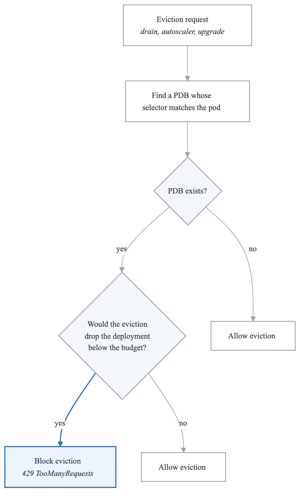
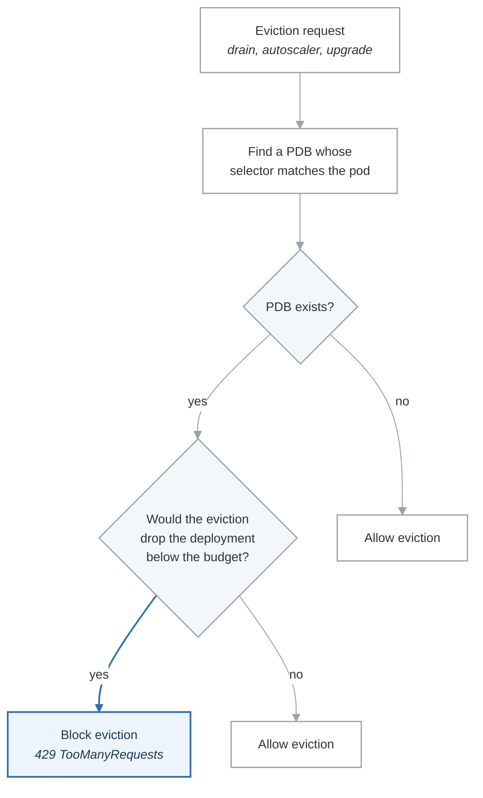

# Exercise 5: Pod Disruption Budgets

## Objectives

- Understand voluntary vs involuntary disruptions
- Configure Pod Disruption Budgets (PDBs)
- Implement safe rollout strategies
- Handle node maintenance safely

## Prerequisites

- Completed Exercises 1-4
- Understanding of Kubernetes deployments
- Familiarity with node operations

---

## Part 1: Understanding Disruptions

### 1.1 Disruption Types

**Pod Disruption Types**

**Involuntary Disruptions (PDBs cannot prevent):**

- Hardware failures
- Node kernel panic
- VM deletion by cloud provider
- OOM kills
- Network partitions

**Voluntary Disruptions (PDBs can limit):**

- Node drain (kubectl drain)
- Cluster autoscaler scale-down
- Node upgrades
- Deployment rollouts
- Direct pod deletion

PDB ensures minimum availability during voluntary disruptions


### 1.2 PDB Behavior

<!-- figure: generated from the Mermaid below by _shared/diagrams/embed-figures.py — do not edit the image -->


<details>
<summary>Diagram source (Mermaid)</summary>



</details>

---

## Part 2: Basic PDB Configuration

### 2.1 MinAvailable PDB

```yaml
# pdb-min-available.yaml
apiVersion: policy/v1
kind: PodDisruptionBudget
metadata:
  name: api-pdb
  namespace: production
spec:
  minAvailable: 2  # Always keep at least 2 pods running
  selector:
    matchLabels:
      app: api-server
```

### 2.2 MaxUnavailable PDB

```yaml
# pdb-max-unavailable.yaml
apiVersion: policy/v1
kind: PodDisruptionBudget
metadata:
  name: worker-pdb
  namespace: production
spec:
  maxUnavailable: 1  # Allow at most 1 pod to be unavailable
  selector:
    matchLabels:
      app: worker
```

### 2.3 Percentage-Based PDB

```yaml
# pdb-percentage.yaml
apiVersion: policy/v1
kind: PodDisruptionBudget
metadata:
  name: web-pdb
  namespace: production
spec:
  minAvailable: "75%"  # Keep at least 75% of pods running
  selector:
    matchLabels:
      app: web-frontend
---
apiVersion: policy/v1
kind: PodDisruptionBudget
metadata:
  name: batch-pdb
  namespace: production
spec:
  maxUnavailable: "50%"  # Allow up to 50% to be unavailable
  selector:
    matchLabels:
      app: batch-processor
```

---

## Part 3: PDB for Different Workloads

### 3.1 StatefulSet PDB

```yaml
# statefulset-pdb.yaml
apiVersion: apps/v1
kind: StatefulSet
metadata:
  name: database
  namespace: production
spec:
  replicas: 3
  serviceName: database
  selector:
    matchLabels:
      app: database
  template:
    metadata:
      labels:
        app: database
    spec:
      containers:
        - name: postgres
          image: postgres:15
          ports:
            - containerPort: 5432
---
apiVersion: policy/v1
kind: PodDisruptionBudget
metadata:
  name: database-pdb
  namespace: production
spec:
  # For a 3-node cluster, keep quorum (2 nodes)
  minAvailable: 2
  selector:
    matchLabels:
      app: database
```

### 3.2 DaemonSet PDB

```yaml
# daemonset-pdb.yaml
apiVersion: apps/v1
kind: DaemonSet
metadata:
  name: log-collector
  namespace: kube-system
spec:
  selector:
    matchLabels:
      app: log-collector
  template:
    metadata:
      labels:
        app: log-collector
    spec:
      containers:
        - name: fluentbit
          image: fluent/fluent-bit:latest
---
apiVersion: policy/v1
kind: PodDisruptionBudget
metadata:
  name: log-collector-pdb
  namespace: kube-system
spec:
  # Allow disruption on 20% of nodes at a time
  maxUnavailable: "20%"
  selector:
    matchLabels:
      app: log-collector
```

### 3.3 Critical Service PDB

```yaml
# critical-service-pdb.yaml
apiVersion: apps/v1
kind: Deployment
metadata:
  name: payment-service
  namespace: production
spec:
  replicas: 5
  selector:
    matchLabels:
      app: payment-service
  template:
    metadata:
      labels:
        app: payment-service
    spec:
      # Spread across zones
      topologySpreadConstraints:
        - maxSkew: 1
          topologyKey: topology.kubernetes.io/zone
          whenUnsatisfiable: DoNotSchedule
          labelSelector:
            matchLabels:
              app: payment-service
      containers:
        - name: payment
          image: payment-service:1.0
---
apiVersion: policy/v1
kind: PodDisruptionBudget
metadata:
  name: payment-service-pdb
  namespace: production
spec:
  minAvailable: 4  # Always keep at least 4 of 5 pods
  selector:
    matchLabels:
      app: payment-service
```

---

## Part 4: PDB with Deployment Strategies

### 4.1 Rolling Update with PDB

```yaml
# rolling-update-pdb.yaml
apiVersion: apps/v1
kind: Deployment
metadata:
  name: api-server
  namespace: production
spec:
  replicas: 6
  strategy:
    type: RollingUpdate
    rollingUpdate:
      maxSurge: 2        # Can exceed replicas by 2
      maxUnavailable: 1  # Only 1 pod unavailable during update
  selector:
    matchLabels:
      app: api-server
  template:
    metadata:
      labels:
        app: api-server
    spec:
      containers:
        - name: api
          image: api-server:1.0
          readinessProbe:
            httpGet:
              path: /health
              port: 8080
            initialDelaySeconds: 5
            periodSeconds: 5
---
apiVersion: policy/v1
kind: PodDisruptionBudget
metadata:
  name: api-server-pdb
  namespace: production
spec:
  # Coordinate with maxUnavailable in deployment
  maxUnavailable: 1
  selector:
    matchLabels:
      app: api-server
```

### 4.2 Blue-Green Deployment PDB

```yaml
# blue-green-pdb.yaml
# Blue deployment
apiVersion: apps/v1
kind: Deployment
metadata:
  name: app-blue
  namespace: production
  labels:
    app: myapp
    version: blue
spec:
  replicas: 3
  selector:
    matchLabels:
      app: myapp
      version: blue
  template:
    metadata:
      labels:
        app: myapp
        version: blue
    spec:
      containers:
        - name: app
          image: myapp:1.0
---
# PDB for blue
apiVersion: policy/v1
kind: PodDisruptionBudget
metadata:
  name: app-blue-pdb
  namespace: production
spec:
  minAvailable: 2
  selector:
    matchLabels:
      app: myapp
      version: blue
---
# Green deployment
apiVersion: apps/v1
kind: Deployment
metadata:
  name: app-green
  namespace: production
  labels:
    app: myapp
    version: green
spec:
  replicas: 3
  selector:
    matchLabels:
      app: myapp
      version: green
  template:
    metadata:
      labels:
        app: myapp
        version: green
    spec:
      containers:
        - name: app
          image: myapp:2.0
---
# PDB for green
apiVersion: policy/v1
kind: PodDisruptionBudget
metadata:
  name: app-green-pdb
  namespace: production
spec:
  minAvailable: 2
  selector:
    matchLabels:
      app: myapp
      version: green
```

---

## Part 5: Node Maintenance

### 5.1 Safe Node Drain

```bash
#!/bin/bash
# safe-node-drain.sh

NODE=$1

if [ -z "$NODE" ]; then
  echo "Usage: $0 <node-name>"
  exit 1
fi

echo "=== Starting safe drain of node: $NODE ==="

# Check PDBs that would be affected
echo -e "\n--- Checking PDBs ---"
kubectl get pdb -A

# Show pods on node
echo -e "\n--- Pods on node $NODE ---"
kubectl get pods -A --field-selector spec.nodeName=$NODE

# Cordon node first (prevent new pods)
echo -e "\n--- Cordoning node ---"
kubectl cordon $NODE

# Drain with PDB respect
echo -e "\n--- Draining node (respecting PDBs) ---"
kubectl drain $NODE \
  --ignore-daemonsets \
  --delete-emptydir-data \
  --force \
  --grace-period=60 \
  --timeout=300s

echo -e "\n--- Drain complete ---"
kubectl get nodes $NODE
```

### 5.2 Maintenance Window Script

```bash
#!/bin/bash
# maintenance-window.sh

NODES=$@
DRAIN_TIMEOUT=600
PARALLEL_DRAINS=1

echo "=== Cluster Maintenance Window ==="
echo "Nodes to maintain: $NODES"
echo "Drain timeout: ${DRAIN_TIMEOUT}s"
echo "Parallel drains: $PARALLEL_DRAINS"

# Function to drain a node
drain_node() {
  local node=$1
  echo "Starting drain of $node..."

  # Cordon
  kubectl cordon $node

  # Drain
  if kubectl drain $node \
    --ignore-daemonsets \
    --delete-emptydir-data \
    --force \
    --grace-period=60 \
    --timeout=${DRAIN_TIMEOUT}s 2>&1; then
    echo "Successfully drained $node"
    return 0
  else
    echo "Failed to drain $node"
    return 1
  fi
}

# Process nodes
for node in $NODES; do
  drain_node $node

  # Perform maintenance here
  echo "Performing maintenance on $node..."
  sleep 5  # Placeholder for actual maintenance

  # Uncordon
  echo "Uncordoning $node..."
  kubectl uncordon $node
done

echo "=== Maintenance Complete ==="
```

### 5.3 Eviction API Usage

```yaml
# eviction-request.yaml
apiVersion: policy/v1
kind: Eviction
metadata:
  name: target-pod
  namespace: production
deleteOptions:
  gracePeriodSeconds: 30
```

```bash
# Create eviction via API
kubectl create -f - <<EOF
apiVersion: policy/v1
kind: Eviction
metadata:
  name: my-pod
  namespace: production
EOF

# Or via kubectl
kubectl delete pod my-pod -n production --grace-period=30
```

---

## Part 6: Unhealthy Pod Eviction Policy

### 6.1 Unhealthy Pod Eviction (K8s 1.26+)

```yaml
# unhealthy-pod-eviction.yaml
apiVersion: policy/v1
kind: PodDisruptionBudget
metadata:
  name: api-pdb
  namespace: production
spec:
  minAvailable: 2
  selector:
    matchLabels:
      app: api-server
  # Allow eviction of unhealthy pods even if it violates PDB
  unhealthyPodEvictionPolicy: AlwaysAllow
  # Options:
  # - IfHealthyBudget: Only evict unhealthy if budget allows (default)
  # - AlwaysAllow: Always allow eviction of unhealthy pods
```

### 6.2 Handling Stuck Pods

```yaml
# pdb-with-unhealthy-eviction.yaml
apiVersion: apps/v1
kind: Deployment
metadata:
  name: problematic-app
  namespace: production
spec:
  replicas: 3
  selector:
    matchLabels:
      app: problematic-app
  template:
    metadata:
      labels:
        app: problematic-app
    spec:
      containers:
        - name: app
          image: app:1.0
          readinessProbe:
            httpGet:
              path: /ready
              port: 8080
            periodSeconds: 5
            failureThreshold: 3
          livenessProbe:
            httpGet:
              path: /health
              port: 8080
            periodSeconds: 10
            failureThreshold: 3
---
apiVersion: policy/v1
kind: PodDisruptionBudget
metadata:
  name: problematic-app-pdb
  namespace: production
spec:
  minAvailable: 1
  selector:
    matchLabels:
      app: problematic-app
  # Allow unhealthy pods to be evicted
  # Prevents stuck drains due to pods failing probes
  unhealthyPodEvictionPolicy: AlwaysAllow
```

---

## Part 7: Monitoring PDBs

### 7.1 PDB Status

```bash
# Check PDB status
kubectl get pdb -A

# Detailed PDB status
kubectl describe pdb api-pdb -n production

# PDB status in JSON
kubectl get pdb api-pdb -n production -o json | jq '.status'
```

### 7.2 PDB Metrics

```yaml
# PDB metrics exposed by kube-state-metrics
# kube_poddisruptionbudget_status_current_healthy
# kube_poddisruptionbudget_status_desired_healthy
# kube_poddisruptionbudget_status_pod_disruptions_allowed
# kube_poddisruptionbudget_status_expected_pods
# kube_poddisruptionbudget_status_observed_generation
```

### 7.3 Alert Rules

```yaml
# pdb-alerts.yaml
apiVersion: monitoring.coreos.com/v1
kind: PrometheusRule
metadata:
  name: pdb-alerts
  namespace: monitoring
spec:
  groups:
    - name: pdb
      rules:
        - alert: PDBDisruptionBlockedTooLong
          expr: |
            kube_poddisruptionbudget_status_pod_disruptions_allowed == 0
          for: 30m
          labels:
            severity: warning
          annotations:
            summary: PDB is blocking all disruptions
            description: "PDB {{ $labels.namespace }}/{{ $labels.poddisruptionbudget }} has been blocking disruptions for 30 minutes"

        - alert: PDBNotHealthy
          expr: |
            kube_poddisruptionbudget_status_current_healthy
            <
            kube_poddisruptionbudget_status_desired_healthy
          for: 15m
          labels:
            severity: warning
          annotations:
            summary: PDB has fewer healthy pods than desired
            description: "PDB {{ $labels.namespace }}/{{ $labels.poddisruptionbudget }} has {{ $value }} healthy pods, desired {{ $labels.desired_healthy }}"

        - alert: PDBMisconfigured
          expr: |
            kube_poddisruptionbudget_status_expected_pods == 0
          for: 10m
          labels:
            severity: warning
          annotations:
            summary: PDB has no matching pods
            description: "PDB {{ $labels.namespace }}/{{ $labels.poddisruptionbudget }} is not selecting any pods"
```

### 7.4 Grafana Dashboard

```json
{
  "dashboard": {
    "title": "Pod Disruption Budgets",
    "panels": [
      {
        "title": "PDB Status Overview",
        "type": "table",
        "targets": [
          {
            "expr": "kube_poddisruptionbudget_status_current_healthy",
            "legendFormat": "{{ namespace }}/{{ poddisruptionbudget }}"
          }
        ]
      },
      {
        "title": "Disruptions Allowed",
        "type": "timeseries",
        "targets": [
          {
            "expr": "kube_poddisruptionbudget_status_pod_disruptions_allowed",
            "legendFormat": "{{ namespace }}/{{ poddisruptionbudget }}"
          }
        ]
      },
      {
        "title": "PDBs Blocking Disruptions",
        "type": "stat",
        "targets": [
          {
            "expr": "count(kube_poddisruptionbudget_status_pod_disruptions_allowed == 0)",
            "legendFormat": "Blocking"
          }
        ]
      }
    ]
  }
}
```

---

## Part 8: Best Practices

### 8.1 PDB Guidelines

```yaml
# Best practice PDB configuration
apiVersion: policy/v1
kind: PodDisruptionBudget
metadata:
  name: production-app-pdb
  namespace: production
  labels:
    # Label PDB same as the application
    app: production-app
spec:
  # For replicas >= 3: use minAvailable or maxUnavailable
  # For replicas < 3: be careful, PDB might block all drains

  # Option 1: minAvailable (recommended for critical services)
  minAvailable: 2  # Or percentage like "66%"

  # Option 2: maxUnavailable (recommended for less critical)
  # maxUnavailable: 1  # Or percentage like "25%"

  selector:
    matchLabels:
      app: production-app

  # K8s 1.26+: Handle unhealthy pods
  unhealthyPodEvictionPolicy: AlwaysAllow
```

### 8.2 Common Patterns

```yaml
# Pattern 1: High Availability Web Service
# 6 replicas, allow 1 down at a time
apiVersion: policy/v1
kind: PodDisruptionBudget
metadata:
  name: ha-web-pdb
spec:
  maxUnavailable: 1
  selector:
    matchLabels:
      app: ha-web
---
# Pattern 2: Database Cluster (maintain quorum)
# 3 replicas, keep 2 for quorum
apiVersion: policy/v1
kind: PodDisruptionBudget
metadata:
  name: db-cluster-pdb
spec:
  minAvailable: 2
  selector:
    matchLabels:
      app: database
---
# Pattern 3: Batch Processing (flexible)
# Variable replicas, allow 50% down
apiVersion: policy/v1
kind: PodDisruptionBudget
metadata:
  name: batch-pdb
spec:
  maxUnavailable: "50%"
  selector:
    matchLabels:
      app: batch-processor
---
# Pattern 4: Single Replica (allow disruption)
# Cannot use minAvailable: 1 as it blocks all drains
apiVersion: policy/v1
kind: PodDisruptionBudget
metadata:
  name: singleton-pdb
spec:
  maxUnavailable: 1  # Allows the single pod to be evicted
  selector:
    matchLabels:
      app: singleton
```

---

## Part 9: Hands-on Challenges

### Challenge 1: Zero-Downtime Maintenance

Perform node maintenance with zero downtime:
1. Set up multi-replica deployment
2. Configure appropriate PDB
3. Drain nodes one at a time
4. Verify service availability throughout

### Challenge 2: PDB Troubleshooting

Debug a stuck drain:
1. Create PDB that blocks drain
2. Identify the blocking PDB
3. Resolve the issue
4. Complete the drain successfully

### Challenge 3: Multi-Zone PDB

Configure PDB for zone-aware deployment:
1. Deploy across multiple zones
2. Configure topology spread constraints
3. Create zone-aware PDB
4. Test zone failure scenario

---

## Verification Tasks

1. [ ] Created basic PDBs (minAvailable/maxUnavailable)
2. [ ] Configured percentage-based PDB
3. [ ] Set up PDB for StatefulSet
4. [ ] Performed safe node drain
5. [ ] Monitored PDB status
6. [ ] Created PDB alerts

---

## Key Takeaways

- PDBs protect against voluntary disruptions only
- Choose minAvailable or maxUnavailable based on use case
- Avoid minAvailable equal to replicas (blocks all drains)
- Use unhealthyPodEvictionPolicy for stuck pods
- Monitor PDBs to prevent blocked operations
- Coordinate PDB with deployment strategy

---

## Next Steps

Continue to [Exercise 6: Priority and Preemption](03-scaling-performance-exercises-06-priority-preemption.md)

<!-- feynman-check -->

---

## Feynman check

Close the file. Blank page, no notes. Explain each of these to a competent engineer who has never
used this tool — **under five minutes, no jargon you can't define on the spot:**

- Understanding Disruptions
- Basic PDB Configuration
- PDB for Different Workloads
- PDB with Deployment Strategies

**The gap is not what you forgot. It is where you used a word instead of a mechanism.**

| | |
|---|---|
| ✗ | *"Kubernetes schedules the pod."* |
| ✓ | *"The scheduler watches for pods with no `nodeName`, filters nodes by predicates, scores the survivors, and writes `nodeName` into the pod spec. The kubelet on that node is watching the API for pods bound to it, and starts the containers."* |

**Trace it:** `kubectl apply -f pod.yaml` → a running container. Name every component that acts, in order, and what each one writes.

Stop at the first component you cannot name. Reopen this file and read **only** that.

**Go deeper — only once the gap has a name:** [Kubernetes the Hard Way](https://github.com/kelseyhightower/kubernetes-the-hard-way) — one weekend, and "the control plane" stops being a word.
Full list per domain: [`SOURCES.md`](../../SOURCES.md#kubernetes)

→ Protocol, the three levels of knowing, and worked examples: [`MASTERY.md`](../../MASTERY.md)

<!-- /feynman-check -->
