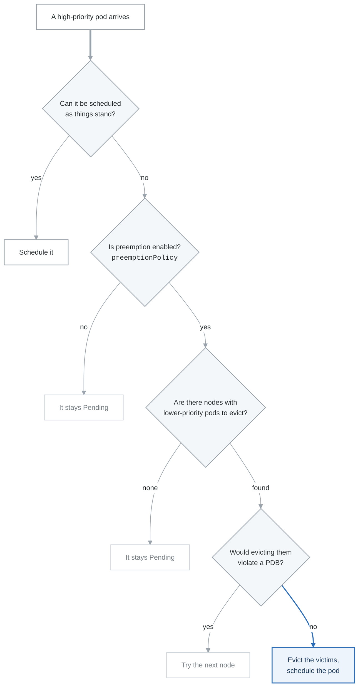

# Exercise 6: Priority and Preemption

## Objectives

- Configure PriorityClasses for workload scheduling
- Understand preemption behavior
- Implement fair scheduling strategies
- Optimize cluster resource allocation

## Prerequisites

- Completed Exercises 1-5
- Understanding of Kubernetes scheduling
- Cluster admin access

---

## Part 1: Priority and Preemption Overview

### 1.1 Concepts

**Priority and Preemption**

**PriorityClass:**

- Defines scheduling priority for pods
- Higher value = higher priority
- Range: -2147483648 to 1000000000
- System classes: > 1000000000 (reserved)

**Preemption:**

- Evicting lower-priority pods to schedule higher-priority
- Triggered when pod cannot be scheduled
- Respects PDBs (by default)
- Can be disabled per PriorityClass

Scheduling Order:
1. Pods sorted by priority (descending)
2. Within same priority: sorted by creation time
3. Higher priority pods scheduled first
4. Can preempt lower priority pods if needed


### 1.2 Preemption Flow

<!-- figure: generated from the Mermaid below by _shared/diagrams/embed-figures.py — do not edit the image -->


<details>
<summary>Diagram source (Mermaid)</summary>



</details>

---

## Part 2: PriorityClass Configuration

### 2.1 System PriorityClasses

```bash
# View built-in priority classes
kubectl get priorityclasses

# NAME                      VALUE        GLOBAL-DEFAULT   AGE
# system-cluster-critical   2000000000   false           30d
# system-node-critical      2000001000   false           30d
```

### 2.2 Custom PriorityClasses

```yaml
# priority-classes.yaml
---
# Critical production workloads
apiVersion: scheduling.k8s.io/v1
kind: PriorityClass
metadata:
  name: critical
value: 1000000
globalDefault: false
preemptionPolicy: PreemptLowerPriority
description: "Critical production workloads that must always run"
---
# Standard production workloads
apiVersion: scheduling.k8s.io/v1
kind: PriorityClass
metadata:
  name: high-priority
value: 100000
globalDefault: false
preemptionPolicy: PreemptLowerPriority
description: "High priority production workloads"
---
# Default workloads
apiVersion: scheduling.k8s.io/v1
kind: PriorityClass
metadata:
  name: default
value: 10000
globalDefault: true  # Default for pods without priorityClassName
preemptionPolicy: PreemptLowerPriority
description: "Default priority for standard workloads"
---
# Background/batch workloads
apiVersion: scheduling.k8s.io/v1
kind: PriorityClass
metadata:
  name: low-priority
value: 1000
globalDefault: false
preemptionPolicy: PreemptLowerPriority
description: "Low priority for batch and background jobs"
---
# Overprovisioning pods (can be preempted anytime)
apiVersion: scheduling.k8s.io/v1
kind: PriorityClass
metadata:
  name: overprovisioning
value: -1  # Lowest priority
globalDefault: false
preemptionPolicy: Never  # These pods cannot preempt others
description: "Placeholder pods for cluster headroom"
```

### 2.3 Non-Preempting PriorityClass

```yaml
# non-preempting-priority.yaml
apiVersion: scheduling.k8s.io/v1
kind: PriorityClass
metadata:
  name: high-priority-no-preempt
value: 100000
globalDefault: false
preemptionPolicy: Never  # Will not preempt lower priority pods
description: "High priority but will wait instead of preempting"
```

---

## Part 3: Using Priority in Workloads

### 3.1 Deployment with Priority

```yaml
# critical-deployment.yaml
apiVersion: apps/v1
kind: Deployment
metadata:
  name: payment-service
  namespace: production
spec:
  replicas: 3
  selector:
    matchLabels:
      app: payment-service
  template:
    metadata:
      labels:
        app: payment-service
    spec:
      priorityClassName: critical  # Use critical priority
      containers:
        - name: payment
          image: payment-service:1.0
          resources:
            requests:
              cpu: 500m
              memory: 512Mi
            limits:
              cpu: 1
              memory: 1Gi
```

### 3.2 Batch Job with Low Priority

```yaml
# batch-job.yaml
apiVersion: batch/v1
kind: Job
metadata:
  name: data-processing
  namespace: batch
spec:
  parallelism: 10
  completions: 100
  template:
    spec:
      priorityClassName: low-priority  # Can be preempted
      restartPolicy: OnFailure
      containers:
        - name: processor
          image: data-processor:1.0
          resources:
            requests:
              cpu: 1
              memory: 2Gi
```

### 3.3 CronJob with Priority

```yaml
# priority-cronjob.yaml
apiVersion: batch/v1
kind: CronJob
metadata:
  name: critical-report
  namespace: production
spec:
  schedule: "0 0 * * *"
  jobTemplate:
    spec:
      template:
        spec:
          priorityClassName: high-priority
          restartPolicy: OnFailure
          containers:
            - name: reporter
              image: report-generator:1.0
```

---

## Part 4: Preemption Scenarios

### 4.1 Simulating Preemption

```yaml
# preemption-demo.yaml
---
# Low priority pods (victims)
apiVersion: apps/v1
kind: Deployment
metadata:
  name: low-priority-app
  namespace: demo
spec:
  replicas: 10
  selector:
    matchLabels:
      app: low-priority-app
  template:
    metadata:
      labels:
        app: low-priority-app
    spec:
      priorityClassName: low-priority
      containers:
        - name: app
          image: nginx
          resources:
            requests:
              cpu: 500m
              memory: 256Mi
---
# High priority pod (preemptor)
apiVersion: v1
kind: Pod
metadata:
  name: high-priority-pod
  namespace: demo
spec:
  priorityClassName: critical
  containers:
    - name: app
      image: nginx
      resources:
        requests:
          cpu: 2
          memory: 2Gi
```

### 4.2 Observe Preemption

```bash
# Watch pods during preemption
kubectl get pods -n demo -w

# Check events for preemption
kubectl get events -n demo --sort-by='.lastTimestamp' | grep -i preempt

# Describe pod to see preemption
kubectl describe pod high-priority-pod -n demo
```

### 4.3 Preemption with PDB

```yaml
# preemption-pdb.yaml
---
apiVersion: policy/v1
kind: PodDisruptionBudget
metadata:
  name: low-priority-pdb
  namespace: demo
spec:
  minAvailable: 5  # Protect at least 5 pods
  selector:
    matchLabels:
      app: low-priority-app
```

---

## Part 5: Fair Scheduling

### 5.1 Namespace Quotas with Priority

```yaml
# priority-based-quotas.yaml
---
apiVersion: v1
kind: ResourceQuota
metadata:
  name: critical-quota
  namespace: production
spec:
  hard:
    pods: "20"
    requests.cpu: "40"
    requests.memory: 80Gi
  scopeSelector:
    matchExpressions:
      - operator: In
        scopeName: PriorityClass
        values:
          - critical
---
apiVersion: v1
kind: ResourceQuota
metadata:
  name: high-priority-quota
  namespace: production
spec:
  hard:
    pods: "50"
    requests.cpu: "100"
    requests.memory: 200Gi
  scopeSelector:
    matchExpressions:
      - operator: In
        scopeName: PriorityClass
        values:
          - high-priority
---
apiVersion: v1
kind: ResourceQuota
metadata:
  name: low-priority-quota
  namespace: production
spec:
  hard:
    pods: "100"
    requests.cpu: "50"
    requests.memory: 100Gi
  scopeSelector:
    matchExpressions:
      - operator: In
        scopeName: PriorityClass
        values:
          - low-priority
```

### 5.2 Limit Priority Class Usage

```yaml
# priority-limit-range.yaml
apiVersion: v1
kind: LimitRange
metadata:
  name: priority-limits
  namespace: team-a
spec:
  limits:
    - type: Pod
      # Only allow specific priority classes
      # This requires admission controller validation
```

```yaml
# OPA Gatekeeper constraint for priority
apiVersion: templates.gatekeeper.sh/v1
kind: ConstraintTemplate
metadata:
  name: k8sallowedpriorityclasses
spec:
  crd:
    spec:
      names:
        kind: K8sAllowedPriorityClasses
      validation:
        openAPIV3Schema:
          type: object
          properties:
            allowedPriorityClasses:
              type: array
              items:
                type: string
  targets:
    - target: admission.k8s.gatekeeper.sh
      rego: |
        package k8sallowedpriorityclasses

        violation[{"msg": msg}] {
          provided := input.review.object.spec.priorityClassName
          not allowed(provided)
          msg := sprintf("Priority class %v is not allowed. Allowed: %v", [provided, input.parameters.allowedPriorityClasses])
        }

        allowed(pc) {
          input.parameters.allowedPriorityClasses[_] == pc
        }

        allowed(pc) {
          pc == ""  # Allow default
        }
---
apiVersion: constraints.gatekeeper.sh/v1beta1
kind: K8sAllowedPriorityClasses
metadata:
  name: team-a-priority-restriction
spec:
  match:
    kinds:
      - apiGroups: [""]
        kinds: ["Pod"]
    namespaces:
      - team-a
  parameters:
    allowedPriorityClasses:
      - default
      - low-priority
      # team-a cannot use critical or high-priority
```

---

## Part 6: Cluster Headroom

### 6.1 Overprovisioning Pods

```yaml
# overprovisioning.yaml
apiVersion: scheduling.k8s.io/v1
kind: PriorityClass
metadata:
  name: overprovisioning
value: -1
preemptionPolicy: Never
globalDefault: false
description: "Placeholder pods for cluster headroom"
---
apiVersion: apps/v1
kind: Deployment
metadata:
  name: overprovisioning
  namespace: kube-system
spec:
  replicas: 3
  selector:
    matchLabels:
      run: overprovisioning
  template:
    metadata:
      labels:
        run: overprovisioning
    spec:
      priorityClassName: overprovisioning
      terminationGracePeriodSeconds: 0
      containers:
        - name: pause
          image: registry.k8s.io/pause:3.9
          resources:
            requests:
              cpu: "1"
              memory: 2Gi
```

### 6.2 Dynamic Headroom with HPA

```yaml
# dynamic-headroom.yaml
apiVersion: autoscaling/v2
kind: HorizontalPodAutoscaler
metadata:
  name: overprovisioning-hpa
  namespace: kube-system
spec:
  scaleTargetRef:
    apiVersion: apps/v1
    kind: Deployment
    name: overprovisioning
  minReplicas: 1
  maxReplicas: 10
  metrics:
    - type: External
      external:
        # Scale based on cluster utilization
        metric:
          name: cluster_cpu_utilization
        target:
          type: Value
          value: "70"  # Target 70% cluster utilization
```

---

## Part 7: Production Patterns

### 7.1 Multi-Tenant Priority Strategy

```yaml
# multi-tenant-priorities.yaml
---
# Tenant infrastructure (databases, caches)
apiVersion: scheduling.k8s.io/v1
kind: PriorityClass
metadata:
  name: tenant-infrastructure
value: 500000
preemptionPolicy: PreemptLowerPriority
description: "Tenant infrastructure components"
---
# Tenant production workloads
apiVersion: scheduling.k8s.io/v1
kind: PriorityClass
metadata:
  name: tenant-production
value: 100000
preemptionPolicy: PreemptLowerPriority
description: "Tenant production workloads"
---
# Tenant staging workloads
apiVersion: scheduling.k8s.io/v1
kind: PriorityClass
metadata:
  name: tenant-staging
value: 50000
preemptionPolicy: PreemptLowerPriority
description: "Tenant staging workloads"
---
# Tenant development workloads
apiVersion: scheduling.k8s.io/v1
kind: PriorityClass
metadata:
  name: tenant-development
value: 10000
preemptionPolicy: PreemptLowerPriority
description: "Tenant development workloads"
```

### 7.2 Workload Classification

```yaml
# workload-priorities.yaml
---
# Real-time/user-facing workloads
apiVersion: scheduling.k8s.io/v1
kind: PriorityClass
metadata:
  name: realtime
value: 900000
preemptionPolicy: PreemptLowerPriority
description: "Real-time user-facing workloads"
---
# API and backend services
apiVersion: scheduling.k8s.io/v1
kind: PriorityClass
metadata:
  name: backend-services
value: 700000
preemptionPolicy: PreemptLowerPriority
description: "Backend API services"
---
# Async workers and queues
apiVersion: scheduling.k8s.io/v1
kind: PriorityClass
metadata:
  name: async-workers
value: 500000
preemptionPolicy: PreemptLowerPriority
description: "Asynchronous workers"
---
# Batch jobs (can tolerate delays)
apiVersion: scheduling.k8s.io/v1
kind: PriorityClass
metadata:
  name: batch-jobs
value: 100000
preemptionPolicy: Never  # Don't preempt, just wait
description: "Batch processing jobs"
---
# Development and testing
apiVersion: scheduling.k8s.io/v1
kind: PriorityClass
metadata:
  name: development
value: 10000
preemptionPolicy: Never
description: "Development workloads"
```

---

## Part 8: Monitoring Priority

### 8.1 Priority Metrics

```promql
# Pods by priority class
count(kube_pod_info) by (priority_class)

# Pending pods by priority
sum(kube_pod_status_phase{phase="Pending"}) by (priority_class)

# Preemption events (requires custom metrics)
sum(kube_pod_preemption_victim_total) by (preemptor_priority_class, victim_priority_class)
```

### 8.2 Alert Rules

```yaml
# priority-alerts.yaml
apiVersion: monitoring.coreos.com/v1
kind: PrometheusRule
metadata:
  name: priority-alerts
  namespace: monitoring
spec:
  groups:
    - name: priority
      rules:
        - alert: CriticalPodsPending
          expr: |
            sum(kube_pod_status_phase{phase="Pending"} *
              on(pod, namespace) group_left(priority_class)
              (kube_pod_info{priority_class="critical"})
            ) > 0
          for: 5m
          labels:
            severity: critical
          annotations:
            summary: Critical priority pods are pending
            description: "{{ $value }} critical pods have been pending for 5 minutes"

        - alert: HighPreemptionRate
          expr: |
            sum(rate(kube_pod_preemption_victim_total[1h])) > 10
          labels:
            severity: warning
          annotations:
            summary: High pod preemption rate
            description: "More than 10 pods preempted in the last hour"

        - alert: LowPriorityPodsStarving
          expr: |
            sum(kube_pod_status_phase{phase="Pending"} *
              on(pod, namespace) group_left(priority_class)
              (kube_pod_info{priority_class="low-priority"})
            ) > 50
          for: 1h
          labels:
            severity: warning
          annotations:
            summary: Low priority pods cannot be scheduled
            description: "{{ $value }} low priority pods pending for over 1 hour"
```

### 8.3 Dashboard Panels

```json
{
  "dashboard": {
    "title": "Priority and Preemption",
    "panels": [
      {
        "title": "Pods by Priority Class",
        "type": "piechart",
        "targets": [
          {
            "expr": "count(kube_pod_info) by (priority_class)",
            "legendFormat": "{{ priority_class }}"
          }
        ]
      },
      {
        "title": "Pending Pods by Priority",
        "type": "bargauge",
        "targets": [
          {
            "expr": "sum(kube_pod_status_phase{phase=\"Pending\"}) by (priority_class)",
            "legendFormat": "{{ priority_class }}"
          }
        ]
      },
      {
        "title": "Priority Class Distribution Over Time",
        "type": "timeseries",
        "targets": [
          {
            "expr": "count(kube_pod_info) by (priority_class)",
            "legendFormat": "{{ priority_class }}"
          }
        ]
      }
    ]
  }
}
```

---

## Part 9: Hands-on Challenges

### Challenge 1: Priority Strategy Design

Design priority strategy for organization:
1. Identify workload categories
2. Assign appropriate priorities
3. Configure preemption policies
4. Test preemption scenarios

### Challenge 2: Resource Starvation Prevention

Prevent low-priority starvation:
1. Implement fair quotas per priority
2. Configure headroom pods
3. Set up alerts for pending pods
4. Balance cluster utilization

### Challenge 3: Multi-Tenant Priority

Implement tenant-based priority:
1. Create per-tenant priority classes
2. Restrict priority class usage
3. Configure resource quotas
4. Monitor tenant resource usage

---

## Verification Tasks

1. [ ] Created custom PriorityClasses
2. [ ] Deployed workloads with priorities
3. [ ] Tested preemption behavior
4. [ ] Configured non-preempting priority
5. [ ] Set up cluster headroom
6. [ ] Monitored priority distribution

---

## Key Takeaways

- PriorityClasses define scheduling order
- Higher priority pods can preempt lower ones
- Use preemptionPolicy: Never for batch jobs
- Combine with PDBs for safe preemption
- Implement headroom for faster scheduling
- Monitor pending pods by priority level

---

## Module Complete!

You've completed the Scaling & Performance module. Continue to:
- Platform Engineering Module

<!-- feynman-check -->

---

## Feynman check

Close the file. Blank page, no notes. Explain each of these to a competent engineer who has never
used this tool — **under five minutes, no jargon you can't define on the spot:**

- Priority and Preemption Overview
- PriorityClass Configuration
- Using Priority in Workloads
- Preemption Scenarios

**The gap is not what you forgot. It is where you used a word instead of a mechanism.**

| | |
|---|---|
| ✗ | *"Kubernetes schedules the pod."* |
| ✓ | *"The scheduler watches for pods with no `nodeName`, filters nodes by predicates, scores the survivors, and writes `nodeName` into the pod spec. The kubelet on that node is watching the API for pods bound to it, and starts the containers."* |

**Trace it:** `kubectl apply -f pod.yaml` → a running container. Name every component that acts, in order, and what each one writes.

Stop at the first component you cannot name. Reopen this file and read **only** that.

**Go deeper — only once the gap has a name:** [Kubernetes the Hard Way](https://github.com/kelseyhightower/kubernetes-the-hard-way) — one weekend, and "the control plane" stops being a word.
Full list per domain: [`SOURCES.md`](../../SOURCES.md#kubernetes)

→ Protocol, the three levels of knowing, and worked examples: [`MASTERY.md`](../../MASTERY.md)

<!-- /feynman-check -->
