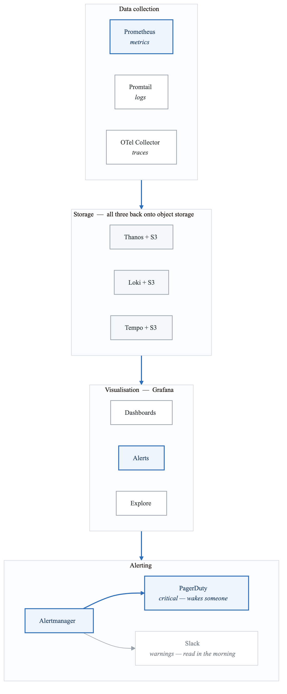
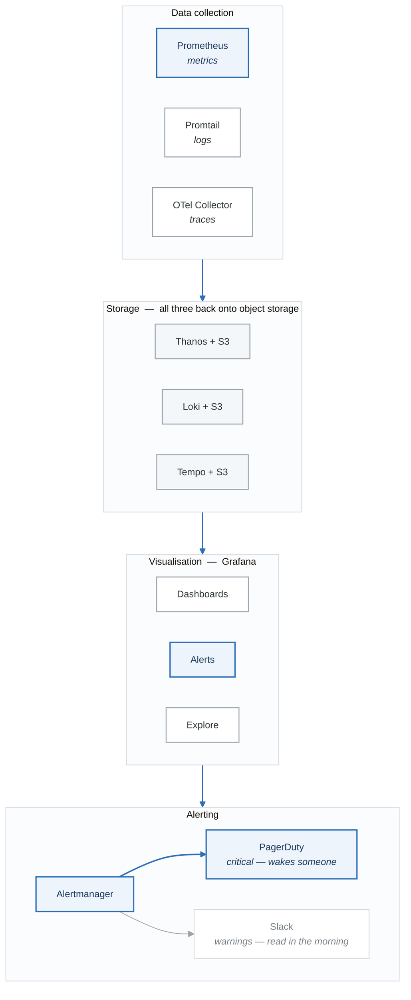

# Phase 3 Project: Production Monitoring Platform

Build an enterprise-grade observability platform with metrics, logs, traces, and alerting.

## Architecture

<!-- figure: generated from the Mermaid below by _shared/diagrams/embed-figures.py — do not edit the image -->


<details>
<summary>Diagram source (Mermaid)</summary>



</details>

## Components to Deploy

### 1. Prometheus with Thanos Sidecar

```yaml
# values-prometheus-thanos.yaml
prometheus:
  prometheusSpec:
    replicas: 2
    retention: 6h  # Short retention, Thanos stores long-term
    retentionSize: "10GB"

    # Thanos sidecar
    thanos:
      image: quay.io/thanos/thanos:v0.32.0
      objectStorageConfig:
        name: thanos-objstore-secret
        key: objstore.yaml

    # External labels for multi-cluster
    externalLabels:
      cluster: production-us-west-2
      environment: production
      region: us-west-2

    # Resource allocation
    resources:
      requests:
        cpu: 1
        memory: 4Gi
      limits:
        cpu: 4
        memory: 8Gi

    # Storage
    storageSpec:
      volumeClaimTemplate:
        spec:
          storageClassName: ebs-gp3
          accessModes: ["ReadWriteOnce"]
          resources:
            requests:
              storage: 50Gi

    # Pod anti-affinity for HA
    affinity:
      podAntiAffinity:
        requiredDuringSchedulingIgnoredDuringExecution:
        - labelSelector:
            matchLabels:
              app.kubernetes.io/name: prometheus
          topologyKey: kubernetes.io/hostname

    # Service monitors to watch
    serviceMonitorSelector: {}
    serviceMonitorNamespaceSelector: {}
    podMonitorSelector: {}
    podMonitorNamespaceSelector: {}

  service:
    type: ClusterIP
    port: 9090

# Thanos components
thanosRuler:
  enabled: true

thanosQuery:
  enabled: true
  replicaCount: 2
  stores:
  - dnssrv+_grpc._tcp.thanos-store.monitoring.svc

thanosCompactor:
  enabled: true
  retentionResolutionRaw: 30d
  retentionResolution5m: 120d
  retentionResolution1h: 365d
```

```yaml
# thanos-objstore-secret.yaml
apiVersion: v1
kind: Secret
metadata:
  name: thanos-objstore-secret
  namespace: monitoring
stringData:
  objstore.yaml: |
    type: S3
    config:
      bucket: my-thanos-metrics
      endpoint: s3.us-west-2.amazonaws.com
      region: us-west-2
```

### 2. Loki for Log Aggregation

```yaml
# values-loki.yaml
loki:
  auth_enabled: false

  server:
    http_listen_port: 3100
    grpc_listen_port: 9095

  common:
    replication_factor: 3
    ring:
      kvstore:
        store: memberlist

  storage:
    type: s3
    bucketNames:
      chunks: my-loki-chunks
      ruler: my-loki-ruler
    s3:
      region: us-west-2

  schema_config:
    configs:
    - from: 2024-01-01
      store: tsdb
      object_store: s3
      schema: v13
      index:
        prefix: index_
        period: 24h

  limits_config:
    retention_period: 30d
    ingestion_rate_mb: 20
    ingestion_burst_size_mb: 30
    max_query_series: 5000
    max_query_parallelism: 32
    max_entries_limit_per_query: 10000

  compactor:
    retention_enabled: true
    working_directory: /var/loki/compactor
    delete_request_store: s3

  querier:
    max_concurrent: 10

# Deployment configuration
write:
  replicas: 3
  resources:
    requests:
      cpu: 500m
      memory: 1Gi
  persistence:
    size: 50Gi
    storageClass: ebs-gp3

read:
  replicas: 3
  resources:
    requests:
      cpu: 500m
      memory: 1Gi

backend:
  replicas: 3
  resources:
    requests:
      cpu: 500m
      memory: 1Gi
  persistence:
    size: 50Gi
    storageClass: ebs-gp3

# Promtail for log collection
promtail:
  config:
    clients:
    - url: http://loki-gateway/loki/api/v1/push

    positions:
      filename: /run/promtail/positions.yaml

    scrape_configs:
    - job_name: kubernetes-pods
      kubernetes_sd_configs:
      - role: pod
      pipeline_stages:
      - cri: {}
      - json:
          expressions:
            level: level
            msg: message
            trace_id: trace_id
      - labels:
          level:
          trace_id:
      - timestamp:
          source: time
          format: RFC3339
      relabel_configs:
      - source_labels: [__meta_kubernetes_pod_label_app]
        target_label: app
      - source_labels: [__meta_kubernetes_namespace]
        target_label: namespace
      - source_labels: [__meta_kubernetes_pod_name]
        target_label: pod
```

### 3. Tempo for Distributed Tracing

```yaml
# values-tempo.yaml
tempo:
  storage:
    trace:
      backend: s3
      s3:
        bucket: my-tempo-traces
        endpoint: s3.us-west-2.amazonaws.com
        region: us-west-2

  receivers:
    jaeger:
      protocols:
        thrift_http:
          endpoint: 0.0.0.0:14268
        grpc:
          endpoint: 0.0.0.0:14250
    otlp:
      protocols:
        grpc:
          endpoint: 0.0.0.0:4317
        http:
          endpoint: 0.0.0.0:4318
    zipkin:
      endpoint: 0.0.0.0:9411

  # Tail-based sampling
  overrides:
    defaults:
      ingestion:
        rate_limit_bytes: 15000000
        burst_size_bytes: 20000000
      search:
        duration_slo: 5s

# Components
distributor:
  replicas: 2
  resources:
    requests:
      cpu: 500m
      memory: 512Mi

ingester:
  replicas: 3
  resources:
    requests:
      cpu: 500m
      memory: 1Gi
  persistence:
    enabled: true
    size: 10Gi
    storageClass: ebs-gp3

querier:
  replicas: 2
  resources:
    requests:
      cpu: 500m
      memory: 512Mi

queryFrontend:
  replicas: 2
  resources:
    requests:
      cpu: 500m
      memory: 512Mi

compactor:
  replicas: 1
  resources:
    requests:
      cpu: 500m
      memory: 1Gi
```

### 4. Grafana with Dashboards

```yaml
# values-grafana.yaml
replicas: 2

persistence:
  enabled: true
  size: 10Gi
  storageClass: ebs-gp3

# Admin credentials from secret
admin:
  existingSecret: grafana-admin-credentials
  userKey: admin-user
  passwordKey: admin-password

# Data sources
datasources:
  datasources.yaml:
    apiVersion: 1
    datasources:
    - name: Prometheus
      type: prometheus
      url: http://thanos-query:9090
      access: proxy
      isDefault: true
      jsonData:
        httpMethod: POST
        manageAlerts: true
        prometheusType: Thanos

    - name: Loki
      type: loki
      url: http://loki-gateway:80
      access: proxy
      jsonData:
        derivedFields:
        - name: TraceID
          matcherRegex: "trace_id=(\\w+)"
          url: "$${__value.raw}"
          datasourceUid: tempo

    - name: Tempo
      type: tempo
      url: http://tempo-query-frontend:3100
      access: proxy
      uid: tempo
      jsonData:
        httpMethod: GET
        tracesToLogs:
          datasourceUid: loki
          tags: ['job', 'instance', 'pod', 'namespace']
          mappedTags: [{ key: 'service.name', value: 'service' }]
          mapTagNamesEnabled: true
          spanStartTimeShift: '1h'
          spanEndTimeShift: '1h'
        tracesToMetrics:
          datasourceUid: prometheus
          tags: [{ key: 'service.name', value: 'service' }]
        serviceMap:
          datasourceUid: prometheus
        nodeGraph:
          enabled: true
        lokiSearch:
          datasourceUid: loki

# Dashboard providers
dashboardProviders:
  dashboardproviders.yaml:
    apiVersion: 1
    providers:
    - name: 'default'
      orgId: 1
      folder: ''
      type: file
      disableDeletion: false
      editable: true
      options:
        path: /var/lib/grafana/dashboards/default

# Pre-built dashboards
dashboards:
  default:
    kubernetes-cluster:
      gnetId: 7249
      revision: 1
      datasource: Prometheus
    node-exporter:
      gnetId: 1860
      revision: 31
      datasource: Prometheus
    nginx-ingress:
      gnetId: 9614
      revision: 1
      datasource: Prometheus

# Alerting
alerting:
  contactpoints.yaml:
    apiVersion: 1
    contactPoints:
    - orgId: 1
      name: slack-critical
      receivers:
      - uid: slack-critical
        type: slack
        settings:
          url: ${SLACK_WEBHOOK_URL}
          recipient: "#alerts-critical"
          title: |
            {{ template "default.title" . }}
          text: |
            {{ template "default.message" . }}

    - orgId: 1
      name: pagerduty
      receivers:
      - uid: pagerduty
        type: pagerduty
        settings:
          integrationKey: ${PAGERDUTY_KEY}
          severity: critical

  policies.yaml:
    apiVersion: 1
    policies:
    - orgId: 1
      receiver: slack-critical
      group_by: ['alertname', 'cluster', 'service']
      routes:
      - receiver: pagerduty
        matchers:
        - severity = critical
        continue: true
      - receiver: slack-critical
        matchers:
        - severity = warning

# Ingress
ingress:
  enabled: true
  ingressClassName: nginx
  annotations:
    cert-manager.io/cluster-issuer: letsencrypt-prod
  hosts:
  - grafana.example.com
  tls:
  - secretName: grafana-tls
    hosts:
    - grafana.example.com
```

### 5. AlertManager Configuration

```yaml
# alertmanager-config.yaml
apiVersion: monitoring.coreos.com/v1alpha1
kind: AlertmanagerConfig
metadata:
  name: production-alerts
  namespace: monitoring
spec:
  route:
    receiver: 'default'
    groupBy: ['alertname', 'cluster', 'service']
    groupWait: 30s
    groupInterval: 5m
    repeatInterval: 4h
    routes:
    # Critical → PagerDuty + Slack
    - receiver: 'pagerduty-critical'
      matchers:
      - name: severity
        value: critical
      continue: true

    - receiver: 'slack-critical'
      matchers:
      - name: severity
        value: critical

    # Warning → Slack only
    - receiver: 'slack-warnings'
      matchers:
      - name: severity
        value: warning

    # SLO alerts → dedicated channel
    - receiver: 'slack-slo'
      matchers:
      - name: type
        value: slo

  receivers:
  - name: 'default'
    slackConfigs:
    - apiURL:
        name: alertmanager-slack
        key: webhook-url
      channel: '#alerts-default'
      sendResolved: true

  - name: 'pagerduty-critical'
    pagerdutyConfigs:
    - serviceKey:
        name: alertmanager-pagerduty
        key: service-key
      severity: critical

  - name: 'slack-critical'
    slackConfigs:
    - apiURL:
        name: alertmanager-slack
        key: webhook-url
      channel: '#alerts-critical'
      sendResolved: true
      color: '{{ if eq .Status "firing" }}danger{{ else }}good{{ end }}'
      title: '{{ .CommonLabels.alertname }}'
      text: |
        *Cluster:* {{ .CommonLabels.cluster }}
        *Service:* {{ .CommonLabels.service }}
        *Description:* {{ .CommonAnnotations.description }}
        *Runbook:* {{ .CommonAnnotations.runbook_url }}

  - name: 'slack-warnings'
    slackConfigs:
    - apiURL:
        name: alertmanager-slack
        key: webhook-url
      channel: '#alerts-warnings'
      sendResolved: true

  - name: 'slack-slo'
    slackConfigs:
    - apiURL:
        name: alertmanager-slack
        key: webhook-url
      channel: '#slo-alerts'
      sendResolved: true

  inhibitRules:
  - sourceMatch:
    - name: severity
      value: critical
    targetMatch:
    - name: severity
      value: warning
    equal: ['alertname', 'cluster', 'service']
```

### 6. SLO Definitions

```yaml
# slo-definitions.yaml
apiVersion: sloth.slok.dev/v1
kind: PrometheusServiceLevel
metadata:
  name: api-slos
  namespace: monitoring
spec:
  service: "api-gateway"
  labels:
    team: platform
    tier: "1"

  slos:
  # Availability: 99.9%
  - name: "availability"
    objective: 99.9
    description: "99.9% of requests succeed"
    sli:
      events:
        errorQuery: |
          sum(rate(http_requests_total{service="api-gateway",status=~"5.."}[{{.window}}]))
        totalQuery: |
          sum(rate(http_requests_total{service="api-gateway"}[{{.window}}]))
    alerting:
      name: APIGatewayAvailability
      labels:
        type: slo
        team: platform
      annotations:
        summary: "API Gateway availability below SLO"
        runbook_url: "https://runbooks/api-availability"
      pageAlert:
        labels:
          severity: critical
      ticketAlert:
        labels:
          severity: warning

  # Latency: 99% < 500ms
  - name: "latency-p99"
    objective: 99
    description: "99% of requests complete in under 500ms"
    sli:
      events:
        errorQuery: |
          sum(rate(http_request_duration_seconds_bucket{service="api-gateway",le="0.5"}[{{.window}}]))
        totalQuery: |
          sum(rate(http_request_duration_seconds_count{service="api-gateway"}[{{.window}}]))
    alerting:
      name: APIGatewayLatency
      labels:
        type: slo
        team: platform
      annotations:
        summary: "API Gateway latency exceeds SLO"

---
# Generate Prometheus rules from SLO definitions
apiVersion: monitoring.coreos.com/v1
kind: PrometheusRule
metadata:
  name: slo-rules
  namespace: monitoring
spec:
  groups:
  - name: slo.rules
    rules:
    # Error budget remaining
    - record: slo:error_budget:ratio
      expr: |
        1 - (
          (
            1 - sum(rate(http_requests_total{status!~"5.."}[30d])) by (service)
                / sum(rate(http_requests_total[30d])) by (service)
          ) / (1 - 0.999)
        )
      labels:
        slo: availability

    # Burn rate (should be < 1)
    - record: slo:burn_rate:ratio
      expr: |
        (
          1 - sum(rate(http_requests_total{status!~"5.."}[1h])) by (service)
              / sum(rate(http_requests_total[1h])) by (service)
        ) / (1 - 0.999) * 720
      labels:
        window: 1h

    # Multi-window burn rate alerts
    - alert: SLOBurnRateCritical
      expr: |
        slo:burn_rate:ratio{window="1h"} > 14.4
        and
        slo:burn_rate:ratio{window="5m"} > 14.4
      for: 2m
      labels:
        severity: critical
        type: slo
      annotations:
        summary: "{{ $labels.service }} burning error budget 14x faster than sustainable"
```

## Deployment Commands

```bash
# Create monitoring namespace
kubectl create namespace monitoring

# Deploy secrets (use sealed secrets in production)
kubectl apply -f secrets/

# Deploy Prometheus with Thanos
helm upgrade --install prometheus prometheus-community/kube-prometheus-stack \
  -n monitoring -f values-prometheus-thanos.yaml

# Deploy Thanos components
helm upgrade --install thanos bitnami/thanos \
  -n monitoring -f values-thanos.yaml

# Deploy Loki
helm upgrade --install loki grafana/loki-stack \
  -n monitoring -f values-loki.yaml

# Deploy Tempo
helm upgrade --install tempo grafana/tempo-distributed \
  -n monitoring -f values-tempo.yaml

# Deploy Grafana
helm upgrade --install grafana grafana/grafana \
  -n monitoring -f values-grafana.yaml

# Deploy SLO generator
kubectl apply -f slo-definitions.yaml
```

## Validation Checklist

- [ ] Prometheus scraping all targets
- [ ] Thanos storing metrics in S3
- [ ] Thanos Query aggregating data
- [ ] Loki receiving logs from all pods
- [ ] Tempo receiving traces
- [ ] Grafana dashboards loading
- [ ] Data source connections verified
- [ ] Alert rules firing correctly
- [ ] AlertManager routing to PagerDuty/Slack
- [ ] SLO dashboards showing error budgets
- [ ] Cross-linking working (logs→traces→metrics)

## Sample Queries

```promql
# Cluster overview
sum(kube_pod_status_phase{phase="Running"}) by (namespace)

# Node resource utilization
100 - (avg by (instance) (irate(node_cpu_seconds_total{mode="idle"}[5m])) * 100)

# Pod memory usage percentage
sum(container_memory_usage_bytes{container!=""}) by (pod, namespace)
/ sum(container_spec_memory_limit_bytes{container!=""}) by (pod, namespace) * 100

# Request rate by service
sum(rate(http_requests_total[5m])) by (service)

# Error rate
sum(rate(http_requests_total{status=~"5.."}[5m])) by (service)
/ sum(rate(http_requests_total[5m])) by (service)

# P99 latency
histogram_quantile(0.99, sum(rate(http_request_duration_seconds_bucket[5m])) by (le, service))
```

```logql
# Recent errors
{namespace="production"} |= "error" | json | level="error" | line_format "{{.msg}}"

# Slow requests > 1s
{namespace="production", app="api"} | json | response_time > 1000

# Logs for specific trace
{namespace="production"} |= "trace_id=abc123"
```

<!-- feynman-check -->

---

## Feynman check

Close the file. Blank page, no notes. Explain each of these to a competent engineer who has never
used this tool — **under five minutes, no jargon you can't define on the spot:**

- Components to Deploy
- Deployment Commands
- Validation Checklist
- Sample Queries

**The gap is not what you forgot. It is where you used a word instead of a mechanism.**

| | |
|---|---|
| ✗ | *"Kubernetes schedules the pod."* |
| ✓ | *"The scheduler watches for pods with no `nodeName`, filters nodes by predicates, scores the survivors, and writes `nodeName` into the pod spec. The kubelet on that node is watching the API for pods bound to it, and starts the containers."* |

**Trace it:** `kubectl apply -f pod.yaml` → a running container. Name every component that acts, in order, and what each one writes.

Stop at the first component you cannot name. Reopen this file and read **only** that.

**Go deeper — only once the gap has a name:** [Kubernetes the Hard Way](https://github.com/kelseyhightower/kubernetes-the-hard-way) — one weekend, and "the control plane" stops being a word.
Full list per domain: [`SOURCES.md`](../../SOURCES.md#kubernetes)

→ Protocol, the three levels of knowing, and worked examples: [`MASTERY.md`](../../MASTERY.md)

<!-- /feynman-check -->
