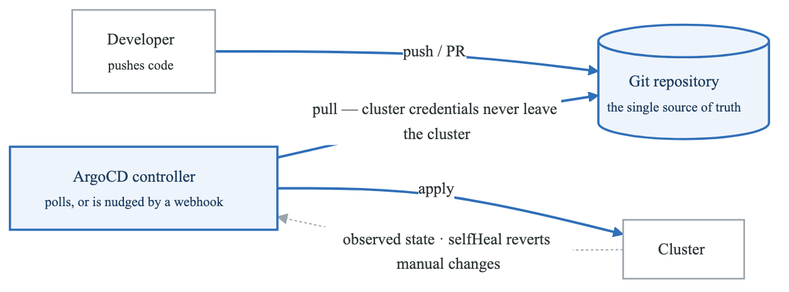
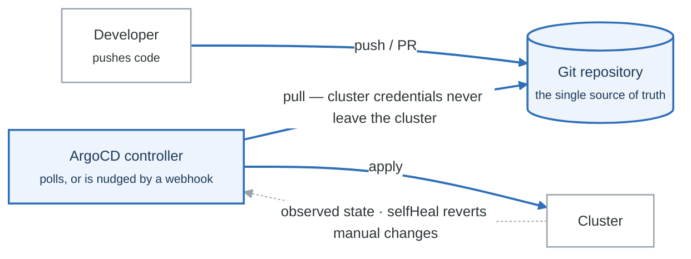
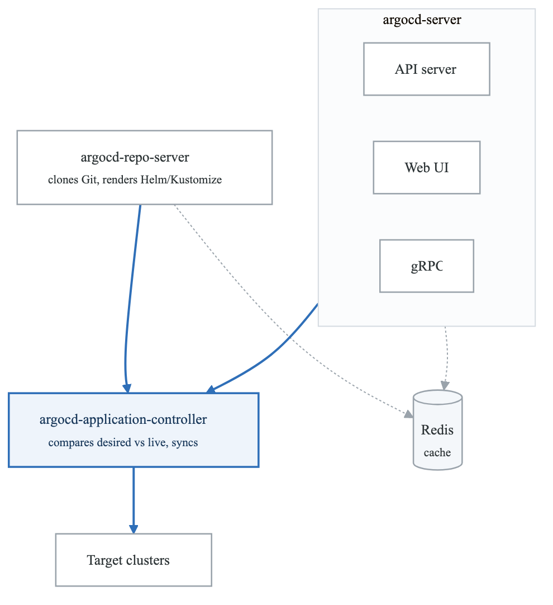
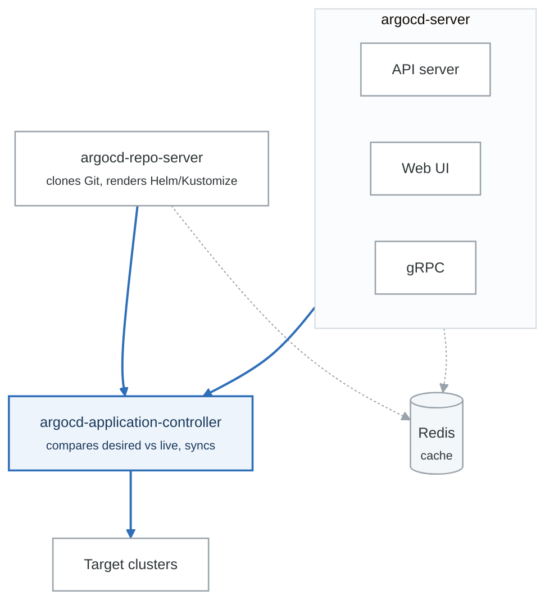

# GitOps & ArgoCD

Master GitOps principles and implement production-grade ArgoCD deployments.

## Learning Path

1. [GitOps Principles](#gitops-principles)
2. [ArgoCD Architecture](#argocd-architecture)
3. [Application Management](#application-management)
4. [Multi-Cluster Deployments](#multi-cluster-deployments)
5. [Argo Rollouts](#argo-rollouts)

---

## GitOps Principles

<!-- figure: generated from the Mermaid below by _shared/diagrams/embed-figures.py — do not edit the image -->


<details>
<summary>Diagram source (Mermaid)</summary>



</details>

### Repository Structure

- `apps/` — ArgoCD Applications
  - `production/`
    - `api.yaml`
    - `web.yaml`
    - `worker.yaml`
  - `staging/`
    - `api.yaml`
    - `web.yaml`
    - `worker.yaml`
- `clusters/` — Cluster-specific config
  - `production-us-west/`
    - `kustomization.yaml`
    - `values.yaml`
  - `staging/`
    - `kustomization.yaml`
    - `values.yaml`
- `base/` — Base manifests
  - `api/`
    - `deployment.yaml`
    - `service.yaml`
    - `ingress.yaml`
    - `kustomization.yaml`
  - `web/`
  - `worker/`
- `overlays/` — Environment overlays
  - `production/`
    - `kustomization.yaml`
    - `replicas-patch.yaml`
    - `resources-patch.yaml`
  - `staging/`
    - `kustomization.yaml`
    - `replicas-patch.yaml`
- `infrastructure/` — Platform components
  - `argocd/`
  - `prometheus/`
  - `cert-manager/`
  - `external-secrets/`


---

## ArgoCD Architecture

<!-- figure: generated from the Mermaid below by _shared/diagrams/embed-figures.py — do not edit the image -->


<details>
<summary>Diagram source (Mermaid)</summary>



</details>

### Installation

```bash
# Install ArgoCD
kubectl create namespace argocd
kubectl apply -n argocd -f https://raw.githubusercontent.com/argoproj/argo-cd/stable/manifests/ha/install.yaml

# Or via Helm
helm repo add argo https://argoproj.github.io/argo-helm
helm install argocd argo/argo-cd -n argocd --create-namespace -f values-argocd.yaml
```

```yaml
# values-argocd.yaml
global:
  domain: argocd.example.com

configs:
  cm:
    # Enable status badge
    statusbadge.enabled: "true"

    # Resource customizations
    resource.customizations.health.argoproj.io_Application: |
      hs = {}
      hs.status = "Progressing"
      hs.message = ""
      if obj.status ~= nil then
        if obj.status.health ~= nil then
          hs.status = obj.status.health.status
          if obj.status.health.message ~= nil then
            hs.message = obj.status.health.message
          end
        end
      end
      return hs

    # Kustomize build options
    kustomize.buildOptions: --load-restrictor LoadRestrictionsNone

  params:
    # Enable server-side diff
    server.diff.format: "structured"
    # Increase timeout for large apps
    timeout.reconciliation: 180s

  rbac:
    policy.default: role:readonly
    policy.csv: |
      p, role:admin, applications, *, */*, allow
      p, role:admin, clusters, *, *, allow
      p, role:admin, repositories, *, *, allow
      p, role:admin, projects, *, *, allow

      p, role:developer, applications, get, */*, allow
      p, role:developer, applications, sync, */*, allow
      p, role:developer, applications, action/*, */*, allow
      p, role:developer, logs, get, */*, allow

      g, admins, role:admin
      g, developers, role:developer

server:
  replicas: 2
  ingress:
    enabled: true
    ingressClassName: nginx
    annotations:
      cert-manager.io/cluster-issuer: letsencrypt-prod
    hosts:
    - argocd.example.com
    tls:
    - secretName: argocd-tls
      hosts:
      - argocd.example.com

  resources:
    requests:
      cpu: 100m
      memory: 256Mi

controller:
  replicas: 1
  resources:
    requests:
      cpu: 250m
      memory: 512Mi

repoServer:
  replicas: 2
  resources:
    requests:
      cpu: 250m
      memory: 256Mi

redis:
  enabled: true
  resources:
    requests:
      cpu: 100m
      memory: 128Mi

# Enable metrics
metrics:
  enabled: true
  serviceMonitor:
    enabled: true
```

---

## Application Management

### Basic Application

```yaml
apiVersion: argoproj.io/v1alpha1
kind: Application
metadata:
  name: api-production
  namespace: argocd
  finalizers:
  - resources-finalizer.argocd.argoproj.io
spec:
  project: production

  source:
    repoURL: https://github.com/myorg/k8s-manifests.git
    targetRevision: main
    path: overlays/production/api

  destination:
    server: https://kubernetes.default.svc
    namespace: production

  syncPolicy:
    automated:
      prune: true        # Delete resources not in Git
      selfHeal: true     # Revert manual changes
      allowEmpty: false  # Don't delete all resources

    syncOptions:
    - CreateNamespace=true
    - PrunePropagationPolicy=foreground
    - PruneLast=true

    retry:
      limit: 5
      backoff:
        duration: 5s
        factor: 2
        maxDuration: 3m

  # Ignore differences in certain fields
  ignoreDifferences:
  - group: apps
    kind: Deployment
    jsonPointers:
    - /spec/replicas  # Ignore replica count (managed by HPA)
  - kind: Secret
    jsonPointers:
    - /data  # Ignore secret data changes
```

### Helm Application

```yaml
apiVersion: argoproj.io/v1alpha1
kind: Application
metadata:
  name: prometheus
  namespace: argocd
spec:
  project: infrastructure

  source:
    repoURL: https://prometheus-community.github.io/helm-charts
    chart: kube-prometheus-stack
    targetRevision: 51.2.0
    helm:
      releaseName: prometheus
      valueFiles:
      - values.yaml

      # Inline values
      values: |
        prometheus:
          prometheusSpec:
            retention: 30d
        grafana:
          enabled: true

      # Values from Git repo
      fileParameters:
      - name: alertmanager.config
        path: ../alertmanager-config.yaml

  destination:
    server: https://kubernetes.default.svc
    namespace: monitoring

  syncPolicy:
    automated:
      prune: true
      selfHeal: true
```

### App of Apps Pattern

```yaml
# Root application that manages other applications
apiVersion: argoproj.io/v1alpha1
kind: Application
metadata:
  name: app-of-apps
  namespace: argocd
spec:
  project: default

  source:
    repoURL: https://github.com/myorg/k8s-manifests.git
    targetRevision: main
    path: apps/production

  destination:
    server: https://kubernetes.default.svc
    namespace: argocd

  syncPolicy:
    automated:
      prune: true
      selfHeal: true
```

```yaml
# apps/production/api.yaml
apiVersion: argoproj.io/v1alpha1
kind: Application
metadata:
  name: api
  namespace: argocd
  labels:
    app.kubernetes.io/part-of: production
spec:
  project: production
  source:
    repoURL: https://github.com/myorg/k8s-manifests.git
    targetRevision: main
    path: overlays/production/api
  destination:
    server: https://kubernetes.default.svc
    namespace: production
  syncPolicy:
    automated:
      prune: true
      selfHeal: true
```

### ApplicationSet for Multi-Environment

```yaml
apiVersion: argoproj.io/v1alpha1
kind: ApplicationSet
metadata:
  name: api-environments
  namespace: argocd
spec:
  generators:
  # Generate apps for each environment
  - list:
      elements:
      - env: staging
        cluster: in-cluster
        namespace: staging
        revision: develop
      - env: production
        cluster: production-us-west
        namespace: production
        revision: main

  template:
    metadata:
      name: 'api-{{env}}'
      namespace: argocd
      labels:
        environment: '{{env}}'
    spec:
      project: default
      source:
        repoURL: https://github.com/myorg/k8s-manifests.git
        targetRevision: '{{revision}}'
        path: 'overlays/{{env}}/api'
      destination:
        server: '{{cluster}}'
        namespace: '{{namespace}}'
      syncPolicy:
        automated:
          prune: true
          selfHeal: true

---
# Git generator for dynamic app discovery
apiVersion: argoproj.io/v1alpha1
kind: ApplicationSet
metadata:
  name: microservices
  namespace: argocd
spec:
  generators:
  - git:
      repoURL: https://github.com/myorg/k8s-manifests.git
      revision: main
      directories:
      - path: 'services/*'

  template:
    metadata:
      name: '{{path.basename}}'
    spec:
      project: default
      source:
        repoURL: https://github.com/myorg/k8s-manifests.git
        targetRevision: main
        path: '{{path}}'
      destination:
        server: https://kubernetes.default.svc
        namespace: production
```

---

## Multi-Cluster Deployments

### Cluster Registration

```bash
# Add external cluster
argocd cluster add production-us-west-2 --name production-us-west

# Or via declarative config
```

```yaml
apiVersion: v1
kind: Secret
metadata:
  name: production-us-west-cluster
  namespace: argocd
  labels:
    argocd.argoproj.io/secret-type: cluster
type: Opaque
stringData:
  name: production-us-west
  server: https://production-cluster.example.com
  config: |
    {
      "bearerToken": "<token>",
      "tlsClientConfig": {
        "insecure": false,
        "caData": "<base64-ca-cert>"
      }
    }
```

### Multi-Cluster ApplicationSet

```yaml
apiVersion: argoproj.io/v1alpha1
kind: ApplicationSet
metadata:
  name: global-apps
  namespace: argocd
spec:
  generators:
  - clusters:
      selector:
        matchLabels:
          env: production

  template:
    metadata:
      name: 'ingress-nginx-{{name}}'
    spec:
      project: infrastructure
      source:
        repoURL: https://kubernetes.github.io/ingress-nginx
        chart: ingress-nginx
        targetRevision: 4.8.0
        helm:
          values: |
            controller:
              replicaCount: 2
      destination:
        server: '{{server}}'
        namespace: ingress-nginx
      syncPolicy:
        automated:
          selfHeal: true
```

---

## Argo Rollouts

### Installation

```bash
kubectl create namespace argo-rollouts
kubectl apply -n argo-rollouts -f https://github.com/argoproj/argo-rollouts/releases/latest/download/install.yaml
```

### Canary Deployment

```yaml
apiVersion: argoproj.io/v1alpha1
kind: Rollout
metadata:
  name: api-rollout
  namespace: production
spec:
  replicas: 10
  selector:
    matchLabels:
      app: api
  template:
    metadata:
      labels:
        app: api
    spec:
      containers:
      - name: api
        image: myregistry/api:v2
        ports:
        - containerPort: 8080
        resources:
          requests:
            cpu: 100m
            memory: 128Mi

  strategy:
    canary:
      # Traffic management
      canaryService: api-canary
      stableService: api-stable
      trafficRouting:
        nginx:
          stableIngress: api-ingress
          annotationPrefix: nginx.ingress.kubernetes.io

      # Progressive rollout steps
      steps:
      - setWeight: 5
      - pause: {duration: 5m}
      - setWeight: 20
      - pause: {duration: 5m}
      - setWeight: 50
      - pause: {duration: 10m}
      - setWeight: 80
      - pause: {duration: 10m}

      # Automated analysis
      analysis:
        templates:
        - templateName: success-rate
        startingStep: 2
        args:
        - name: service-name
          value: api

      # Anti-affinity with stable pods
      antiAffinity:
        preferredDuringSchedulingIgnoredDuringExecution:
          weight: 100

---
# Services for traffic splitting
apiVersion: v1
kind: Service
metadata:
  name: api-stable
spec:
  selector:
    app: api
  ports:
  - port: 80
    targetPort: 8080

---
apiVersion: v1
kind: Service
metadata:
  name: api-canary
spec:
  selector:
    app: api
  ports:
  - port: 80
    targetPort: 8080
```

### Analysis Template

```yaml
apiVersion: argoproj.io/v1alpha1
kind: AnalysisTemplate
metadata:
  name: success-rate
  namespace: production
spec:
  args:
  - name: service-name
  metrics:
  - name: success-rate
    interval: 1m
    successCondition: result[0] >= 0.99
    failureLimit: 3
    provider:
      prometheus:
        address: http://prometheus:9090
        query: |
          sum(rate(http_requests_total{service="{{args.service-name}}",status!~"5.."}[5m]))
          /
          sum(rate(http_requests_total{service="{{args.service-name}}"}[5m]))

  - name: latency-p99
    interval: 1m
    successCondition: result[0] < 0.5
    failureLimit: 3
    provider:
      prometheus:
        address: http://prometheus:9090
        query: |
          histogram_quantile(0.99,
            sum(rate(http_request_duration_seconds_bucket{service="{{args.service-name}}"}[5m])) by (le)
          )

  - name: error-count
    interval: 1m
    successCondition: result[0] < 10
    failureLimit: 3
    provider:
      prometheus:
        address: http://prometheus:9090
        query: |
          sum(increase(http_requests_total{service="{{args.service-name}}",status=~"5.."}[5m]))
```

### Blue-Green Deployment

```yaml
apiVersion: argoproj.io/v1alpha1
kind: Rollout
metadata:
  name: api-blue-green
  namespace: production
spec:
  replicas: 5
  selector:
    matchLabels:
      app: api
  template:
    metadata:
      labels:
        app: api
    spec:
      containers:
      - name: api
        image: myregistry/api:v2

  strategy:
    blueGreen:
      activeService: api-active
      previewService: api-preview
      autoPromotionEnabled: false  # Require manual promotion
      scaleDownDelaySeconds: 30

      # Pre-promotion analysis
      prePromotionAnalysis:
        templates:
        - templateName: smoke-tests
        args:
        - name: service-url
          value: http://api-preview

      # Post-promotion analysis
      postPromotionAnalysis:
        templates:
        - templateName: success-rate
        args:
        - name: service-name
          value: api
```

---

## GitOps Secrets Management

### External Secrets Operator

```yaml
# ExternalSecret synced by ArgoCD
apiVersion: external-secrets.io/v1beta1
kind: ExternalSecret
metadata:
  name: api-secrets
  namespace: production
spec:
  refreshInterval: 1h
  secretStoreRef:
    kind: ClusterSecretStore
    name: aws-secrets-manager
  target:
    name: api-secrets
    creationPolicy: Owner
  data:
  - secretKey: DATABASE_URL
    remoteRef:
      key: production/api/database
      property: url
  - secretKey: API_KEY
    remoteRef:
      key: production/api/keys
      property: api_key
```

### Sealed Secrets

```yaml
# Sealed Secret (safe to commit)
apiVersion: bitnami.com/v1alpha1
kind: SealedSecret
metadata:
  name: api-secrets
  namespace: production
spec:
  encryptedData:
    DATABASE_URL: AgBy3i4OJSWK+...
    API_KEY: AgCtr48fVYZp...
  template:
    metadata:
      name: api-secrets
      namespace: production
```

---

## Exercises

1. **[Exercise 1: ArgoCD Setup](./exercises/01-argocd-setup.md)** - Deploy and configure ArgoCD
2. **[Exercise 2: App of Apps](./exercises/02-app-of-apps.md)** - Implement hierarchical apps
3. **[Exercise 3: ApplicationSets](./exercises/03-applicationsets.md)** - Dynamic app generation
4. **[Exercise 4: Multi-Cluster](./exercises/04-multi-cluster.md)** - Deploy across clusters
5. **[Exercise 5: Canary Rollouts](./exercises/05-canary-rollouts.md)** - Progressive delivery
6. **[Exercise 6: Analysis](./exercises/06-analysis.md)** - Automated rollout analysis
7. **[Exercise 7: Secrets](./exercises/07-gitops-secrets.md)** - Secrets in GitOps

---

## Next Section

[02-cicd-pipelines](../02-cicd-pipelines/) - CI/CD pipeline implementation

<!-- feynman-check -->

---

## Feynman check

Close the file. Blank page, no notes. Explain each of these to a competent engineer who has never
used this tool — **under five minutes, no jargon you can't define on the spot:**

- GitOps Principles
- ArgoCD Architecture
- Application Management
- Multi-Cluster Deployments

**The gap is not what you forgot. It is where you used a word instead of a mechanism.**

| | |
|---|---|
| ✗ | *"Kubernetes schedules the pod."* |
| ✓ | *"The scheduler watches for pods with no `nodeName`, filters nodes by predicates, scores the survivors, and writes `nodeName` into the pod spec. The kubelet on that node is watching the API for pods bound to it, and starts the containers."* |

**Trace it:** `kubectl apply -f pod.yaml` → a running container. Name every component that acts, in order, and what each one writes.

Stop at the first component you cannot name. Reopen this file and read **only** that.

**Go deeper — only once the gap has a name:** [Kubernetes the Hard Way](https://github.com/kelseyhightower/kubernetes-the-hard-way) — one weekend, and "the control plane" stops being a word.
Full list per domain: [`SOURCES.md`](../../SOURCES.md#kubernetes)

→ Protocol, the three levels of knowing, and worked examples: [`MASTERY.md`](../../MASTERY.md)

<!-- /feynman-check -->
