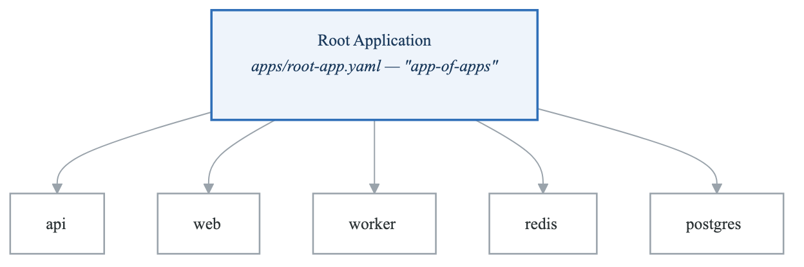
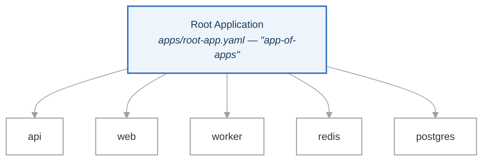

# Exercise 2: App of Apps Pattern

## Objective

Implement the App of Apps pattern to manage multiple applications through a single parent application, enabling hierarchical GitOps management.

## Prerequisites

- ArgoCD installed (Exercise 1)
- Git repository for manifests
- Understanding of Kustomize/Helm

## Concepts

<!-- figure: generated from the Mermaid below by _shared/diagrams/embed-figures.py — do not edit the image -->


<details>
<summary>Diagram source (Mermaid)</summary>



</details>

The root Application's source is a directory of Application manifests, so Argo CD
syncs *Applications* rather than workloads. Adding a service means adding one file
to that directory — no cluster access required.

- Single source of truth for what is deployed to the cluster
- One place to set sync policy, retry, and prune behaviour
- Environment promotion is a directory copy plus a values override
- Onboarding a team is a pull request, not a ticket

The cost: a broken root Application takes every child with it. Keep `prune: false`
on the root until you trust the generator.

## Tasks

### Task 1: Create Repository Structure

```bash
# Create directory structure
mkdir -p k8s-manifests/{apps,base,overlays}/{production,staging}
mkdir -p k8s-manifests/base/{api,web,worker,redis}
mkdir -p k8s-manifests/infrastructure/{argocd,cert-manager,ingress-nginx}

# Final structure
k8s-manifests/
├── apps/
│   ├── production/
│   │   ├── api.yaml
│   │   ├── web.yaml
│   │   ├── worker.yaml
│   │   ├── redis.yaml
│   │   └── kustomization.yaml
│   └── staging/
│       ├── api.yaml
│       ├── web.yaml
│       └── kustomization.yaml
├── base/
│   ├── api/
│   │   ├── deployment.yaml
│   │   ├── service.yaml
│   │   ├── ingress.yaml
│   │   └── kustomization.yaml
│   ├── web/
│   ├── worker/
│   └── redis/
├── overlays/
│   ├── production/
│   │   └── api/
│   │       ├── kustomization.yaml
│   │       └── patches/
│   └── staging/
│       └── api/
└── infrastructure/
    ├── argocd/
    ├── cert-manager/
    └── ingress-nginx/
```

### Task 2: Create Base Application Manifests

```yaml
# base/api/deployment.yaml
apiVersion: apps/v1
kind: Deployment
metadata:
  name: api
spec:
  replicas: 1
  selector:
    matchLabels:
      app: api
  template:
    metadata:
      labels:
        app: api
    spec:
      containers:
      - name: api
        image: myregistry/api:latest
        ports:
        - containerPort: 8080
        resources:
          requests:
            cpu: 100m
            memory: 128Mi
          limits:
            cpu: 500m
            memory: 256Mi
        readinessProbe:
          httpGet:
            path: /health
            port: 8080
          initialDelaySeconds: 5
          periodSeconds: 10
        livenessProbe:
          httpGet:
            path: /health
            port: 8080
          initialDelaySeconds: 15
          periodSeconds: 20
        env:
        - name: LOG_LEVEL
          value: info
---
# base/api/service.yaml
apiVersion: v1
kind: Service
metadata:
  name: api
spec:
  selector:
    app: api
  ports:
  - port: 80
    targetPort: 8080
---
# base/api/kustomization.yaml
apiVersion: kustomize.config.k8s.io/v1beta1
kind: Kustomization
resources:
- deployment.yaml
- service.yaml
commonLabels:
  app.kubernetes.io/name: api
  app.kubernetes.io/component: backend
```

### Task 3: Create Environment Overlays

```yaml
# overlays/production/api/kustomization.yaml
apiVersion: kustomize.config.k8s.io/v1beta1
kind: Kustomization

namespace: production

resources:
- ../../../base/api

replicas:
- name: api
  count: 3

images:
- name: myregistry/api
  newTag: v1.2.3

patches:
- path: patches/resources.yaml
- path: patches/hpa.yaml

configMapGenerator:
- name: api-config
  literals:
  - LOG_LEVEL=warn
  - ENV=production
---
# overlays/production/api/patches/resources.yaml
apiVersion: apps/v1
kind: Deployment
metadata:
  name: api
spec:
  template:
    spec:
      containers:
      - name: api
        resources:
          requests:
            cpu: 500m
            memory: 512Mi
          limits:
            cpu: 2000m
            memory: 1Gi
---
# overlays/production/api/patches/hpa.yaml
apiVersion: autoscaling/v2
kind: HorizontalPodAutoscaler
metadata:
  name: api-hpa
spec:
  scaleTargetRef:
    apiVersion: apps/v1
    kind: Deployment
    name: api
  minReplicas: 3
  maxReplicas: 10
  metrics:
  - type: Resource
    resource:
      name: cpu
      target:
        type: Utilization
        averageUtilization: 70
```

### Task 4: Create Child Application Manifests

```yaml
# apps/production/api.yaml
apiVersion: argoproj.io/v1alpha1
kind: Application
metadata:
  name: api-production
  namespace: argocd
  labels:
    app.kubernetes.io/part-of: production-apps
    environment: production
  finalizers:
  - resources-finalizer.argocd.argoproj.io
spec:
  project: production

  source:
    repoURL: https://github.com/myorg/k8s-manifests.git
    targetRevision: main
    path: overlays/production/api

  destination:
    server: https://kubernetes.default.svc
    namespace: production

  syncPolicy:
    automated:
      prune: true
      selfHeal: true
    syncOptions:
    - CreateNamespace=true
    - PrunePropagationPolicy=foreground

---
# apps/production/web.yaml
apiVersion: argoproj.io/v1alpha1
kind: Application
metadata:
  name: web-production
  namespace: argocd
  labels:
    app.kubernetes.io/part-of: production-apps
    environment: production
  finalizers:
  - resources-finalizer.argocd.argoproj.io
spec:
  project: production

  source:
    repoURL: https://github.com/myorg/k8s-manifests.git
    targetRevision: main
    path: overlays/production/web

  destination:
    server: https://kubernetes.default.svc
    namespace: production

  syncPolicy:
    automated:
      prune: true
      selfHeal: true

---
# apps/production/kustomization.yaml
apiVersion: kustomize.config.k8s.io/v1beta1
kind: Kustomization

resources:
- api.yaml
- web.yaml
- worker.yaml
- redis.yaml

commonLabels:
  managed-by: argocd
  environment: production
```

### Task 5: Create Root Application (App of Apps)

```yaml
# root-apps/production.yaml
apiVersion: argoproj.io/v1alpha1
kind: Application
metadata:
  name: production-apps
  namespace: argocd
  finalizers:
  - resources-finalizer.argocd.argoproj.io
spec:
  project: default

  source:
    repoURL: https://github.com/myorg/k8s-manifests.git
    targetRevision: main
    path: apps/production

  destination:
    server: https://kubernetes.default.svc
    namespace: argocd

  syncPolicy:
    automated:
      prune: true
      selfHeal: true
    syncOptions:
    - CreateNamespace=false
```

### Task 6: Create Infrastructure App of Apps

```yaml
# infrastructure/apps.yaml
apiVersion: argoproj.io/v1alpha1
kind: Application
metadata:
  name: infrastructure
  namespace: argocd
spec:
  project: default

  source:
    repoURL: https://github.com/myorg/k8s-manifests.git
    targetRevision: main
    path: infrastructure

  destination:
    server: https://kubernetes.default.svc
    namespace: argocd

  syncPolicy:
    automated:
      prune: true
      selfHeal: true

---
# infrastructure/cert-manager.yaml
apiVersion: argoproj.io/v1alpha1
kind: Application
metadata:
  name: cert-manager
  namespace: argocd
spec:
  project: infrastructure

  source:
    repoURL: https://charts.jetstack.io
    chart: cert-manager
    targetRevision: v1.13.0
    helm:
      values: |
        installCRDs: true
        replicaCount: 2
        prometheus:
          enabled: true

  destination:
    server: https://kubernetes.default.svc
    namespace: cert-manager

  syncPolicy:
    automated:
      selfHeal: true
    syncOptions:
    - CreateNamespace=true

---
# infrastructure/ingress-nginx.yaml
apiVersion: argoproj.io/v1alpha1
kind: Application
metadata:
  name: ingress-nginx
  namespace: argocd
spec:
  project: infrastructure

  source:
    repoURL: https://kubernetes.github.io/ingress-nginx
    chart: ingress-nginx
    targetRevision: 4.8.0
    helm:
      values: |
        controller:
          replicaCount: 2
          metrics:
            enabled: true

  destination:
    server: https://kubernetes.default.svc
    namespace: ingress-nginx

  syncPolicy:
    automated:
      selfHeal: true
    syncOptions:
    - CreateNamespace=true
```

### Task 7: Wave-Based Sync with Annotations

```yaml
# apps/production/database.yaml (Wave 1 - Deploy first)
apiVersion: argoproj.io/v1alpha1
kind: Application
metadata:
  name: database-production
  namespace: argocd
  annotations:
    argocd.argoproj.io/sync-wave: "1"
spec:
  project: production
  source:
    repoURL: https://github.com/myorg/k8s-manifests.git
    path: overlays/production/database
    targetRevision: main
  destination:
    server: https://kubernetes.default.svc
    namespace: production
  syncPolicy:
    automated:
      prune: true
      selfHeal: true

---
# apps/production/api.yaml (Wave 2 - Deploy after database)
apiVersion: argoproj.io/v1alpha1
kind: Application
metadata:
  name: api-production
  namespace: argocd
  annotations:
    argocd.argoproj.io/sync-wave: "2"
spec:
  project: production
  source:
    repoURL: https://github.com/myorg/k8s-manifests.git
    path: overlays/production/api
    targetRevision: main
  destination:
    server: https://kubernetes.default.svc
    namespace: production
  syncPolicy:
    automated:
      prune: true
      selfHeal: true

---
# apps/production/web.yaml (Wave 3 - Deploy after API)
apiVersion: argoproj.io/v1alpha1
kind: Application
metadata:
  name: web-production
  namespace: argocd
  annotations:
    argocd.argoproj.io/sync-wave: "3"
spec:
  project: production
  source:
    repoURL: https://github.com/myorg/k8s-manifests.git
    path: overlays/production/web
    targetRevision: main
  destination:
    server: https://kubernetes.default.svc
    namespace: production
```

## Validation

```bash
# Deploy root application
kubectl apply -f root-apps/production.yaml

# Watch applications being created
argocd app list
watch kubectl get applications -n argocd

# Check sync status of all apps
argocd app get production-apps
argocd app get api-production
argocd app get web-production

# Verify child resources
kubectl get all -n production

# Check sync waves
argocd app get production-apps --show-operation
```

## Success Criteria

- [ ] Root application creates child applications
- [ ] Child applications sync and deploy workloads
- [ ] Sync waves respected for dependencies
- [ ] All applications show Healthy and Synced
- [ ] Changes to git trigger cascading updates
- [ ] Infrastructure apps deployed before application apps

## Best Practices

1. **Separate repos** - Consider separate repos for apps vs infrastructure
2. **Use sync waves** - Ensure proper deployment order
3. **Project isolation** - Use ArgoCD projects for access control
4. **Health checks** - Define custom health checks for CRDs
5. **Prune carefully** - Test prune behavior in staging first

## Cleanup

```bash
# Delete root application (cascades to children)
argocd app delete production-apps --cascade

# Or delete without cascade (keeps children)
argocd app delete production-apps --cascade=false
```

## Next Exercise

Continue to [Exercise 3: ApplicationSets](01-gitops-argocd-exercises-03-applicationsets.md) for dynamic application generation.

<!-- feynman-check -->

---

## Feynman check

Close the file. Blank page, no notes. Explain each of these to a competent engineer who has never
used this tool — **under five minutes, no jargon you can't define on the spot:**

- Create Repository Structure
- Create Base Application Manifests
- Create Environment Overlays
- Create Child Application Manifests

**The gap is not what you forgot. It is where you used a word instead of a mechanism.**

| | |
|---|---|
| ✗ | *"Kubernetes schedules the pod."* |
| ✓ | *"The scheduler watches for pods with no `nodeName`, filters nodes by predicates, scores the survivors, and writes `nodeName` into the pod spec. The kubelet on that node is watching the API for pods bound to it, and starts the containers."* |

**Trace it:** `kubectl apply -f pod.yaml` → a running container. Name every component that acts, in order, and what each one writes.

Stop at the first component you cannot name. Reopen this file and read **only** that.

**Go deeper — only once the gap has a name:** [Kubernetes the Hard Way](https://github.com/kelseyhightower/kubernetes-the-hard-way) — one weekend, and "the control plane" stops being a word.
Full list per domain: [`SOURCES.md`](../../SOURCES.md#kubernetes)

→ Protocol, the three levels of knowing, and worked examples: [`MASTERY.md`](../../MASTERY.md)

<!-- /feynman-check -->
