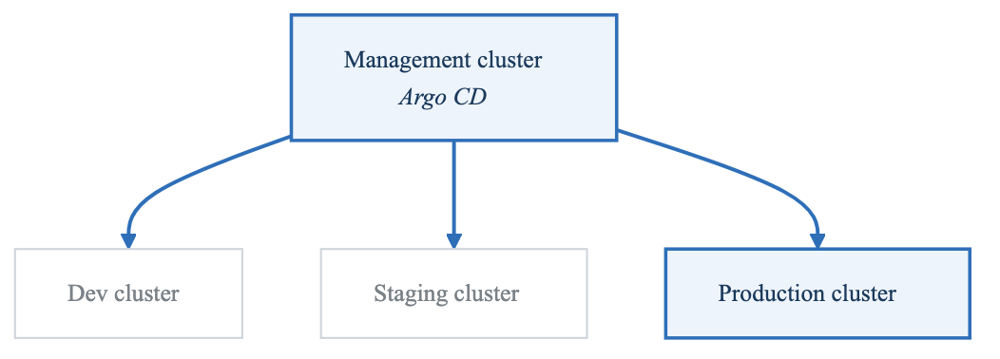
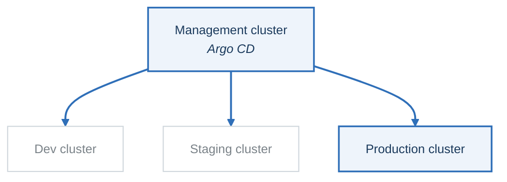
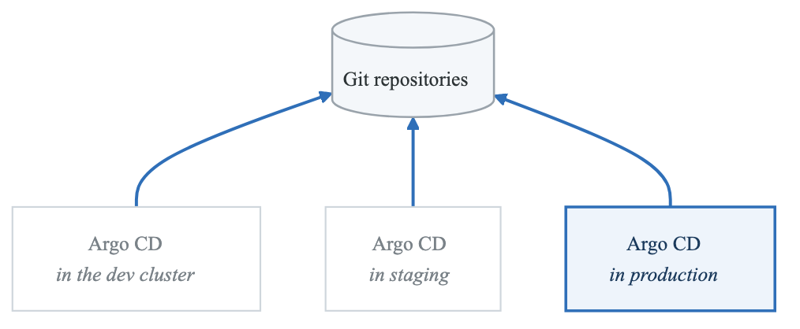
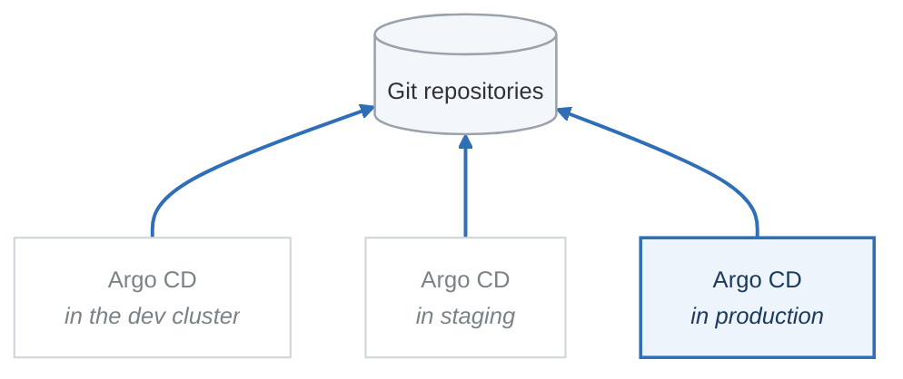

# Exercise 4: Multi-Cluster GitOps

## Objectives

- Configure ArgoCD for multi-cluster management
- Implement cluster registration and authentication
- Design multi-cluster deployment strategies
- Handle environment promotion across clusters

## Prerequisites

- Completed Exercises 1-3
- Access to multiple Kubernetes clusters
- ArgoCD deployed in management cluster

---

## Part 1: Multi-Cluster Architecture

### 1.1 Architecture Patterns

**Hub and spoke**

<!-- figure: generated from the Mermaid below by _shared/diagrams/embed-figures.py — do not edit the image -->


<details>
<summary>Diagram source (Mermaid)</summary>



</details>

**Decentralised**

<!-- figure: generated from the Mermaid below by _shared/diagrams/embed-figures.py — do not edit the image -->


<details>
<summary>Diagram source (Mermaid)</summary>



</details>

| | Hub and spoke | Decentralised |
|---|---|---|
| Places to look | One | One per cluster |
| Credentials | The hub holds credentials to every cluster | Each instance holds only its own |
| Blast radius | The hub is a single point of compromise **and** of failure | Contained to one cluster |
| Production deploys when the hub is down | Blocked | Unaffected |

Choose by answering one question: *is production allowed to stop deploying because a different
cluster is broken?* If the answer is no, the extra Argo CD instances are cheap.

---

## Part 2: Cluster Registration

### 2.1 Register Cluster via CLI

```bash
# Login to ArgoCD
argocd login argocd.example.com --username admin

# Add cluster using kubeconfig context
argocd cluster add staging-cluster --name staging

# Add cluster with specific kubeconfig
argocd cluster add production-cluster \
  --name production \
  --kubeconfig /path/to/prod-kubeconfig

# List registered clusters
argocd cluster list

# Get cluster details
argocd cluster get https://staging-cluster:6443
```

### 2.2 Register Cluster via Secret

```yaml
# cluster-secret.yaml
apiVersion: v1
kind: Secret
metadata:
  name: staging-cluster-secret
  namespace: argocd
  labels:
    argocd.argoproj.io/secret-type: cluster
type: Opaque
stringData:
  name: staging
  server: https://staging-cluster.example.com:6443
  config: |
    {
      "bearerToken": "<service-account-token>",
      "tlsClientConfig": {
        "insecure": false,
        "caData": "<base64-encoded-ca-cert>"
      }
    }
```

### 2.3 Cluster with AWS IAM

```yaml
# eks-cluster-secret.yaml
apiVersion: v1
kind: Secret
metadata:
  name: eks-production-cluster
  namespace: argocd
  labels:
    argocd.argoproj.io/secret-type: cluster
type: Opaque
stringData:
  name: eks-production
  server: https://CLUSTER_ID.gr7.us-west-2.eks.amazonaws.com
  config: |
    {
      "awsAuthConfig": {
        "clusterName": "production-eks",
        "roleARN": "arn:aws:iam::123456789012:role/ArgoCD-Cluster-Role"
      },
      "tlsClientConfig": {
        "insecure": false,
        "caData": "<base64-encoded-ca-cert>"
      }
    }
```

### 2.4 Service Account for Cluster Access

```yaml
# argocd-manager-sa.yaml (Apply to target cluster)
apiVersion: v1
kind: ServiceAccount
metadata:
  name: argocd-manager
  namespace: kube-system
---
apiVersion: rbac.authorization.k8s.io/v1
kind: ClusterRole
metadata:
  name: argocd-manager-role
rules:
  - apiGroups: ["*"]
    resources: ["*"]
    verbs: ["*"]
  - nonResourceURLs: ["*"]
    verbs: ["*"]
---
apiVersion: rbac.authorization.k8s.io/v1
kind: ClusterRoleBinding
metadata:
  name: argocd-manager-role-binding
roleRef:
  apiGroup: rbac.authorization.k8s.io
  kind: ClusterRole
  name: argocd-manager-role
subjects:
  - kind: ServiceAccount
    name: argocd-manager
    namespace: kube-system
---
apiVersion: v1
kind: Secret
metadata:
  name: argocd-manager-token
  namespace: kube-system
  annotations:
    kubernetes.io/service-account.name: argocd-manager
type: kubernetes.io/service-account-token
```

---

## Part 3: Multi-Cluster Applications

### 3.1 Cluster-Specific Application

```yaml
# app-staging.yaml
apiVersion: argoproj.io/v1alpha1
kind: Application
metadata:
  name: myapp-staging
  namespace: argocd
spec:
  project: default
  source:
    repoURL: https://github.com/org/myapp-config
    targetRevision: main
    path: overlays/staging
  destination:
    server: https://staging-cluster.example.com:6443
    namespace: myapp
  syncPolicy:
    automated:
      prune: true
      selfHeal: true
```

### 3.2 ApplicationSet for Multi-Cluster

```yaml
# multi-cluster-appset.yaml
apiVersion: argoproj.io/v1alpha1
kind: ApplicationSet
metadata:
  name: myapp-multi-cluster
  namespace: argocd
spec:
  generators:
    - clusters:
        selector:
          matchLabels:
            env: production
        values:
          revision: main
    - clusters:
        selector:
          matchLabels:
            env: staging
        values:
          revision: develop
  template:
    metadata:
      name: 'myapp-{{name}}'
    spec:
      project: default
      source:
        repoURL: https://github.com/org/myapp-config
        targetRevision: '{{values.revision}}'
        path: 'overlays/{{metadata.labels.env}}'
      destination:
        server: '{{server}}'
        namespace: myapp
      syncPolicy:
        automated:
          prune: true
          selfHeal: true
```

### 3.3 Cluster Labels Configuration

```yaml
# cluster-with-labels.yaml
apiVersion: v1
kind: Secret
metadata:
  name: production-us-west
  namespace: argocd
  labels:
    argocd.argoproj.io/secret-type: cluster
    env: production
    region: us-west
    tier: primary
type: Opaque
stringData:
  name: production-us-west
  server: https://prod-us-west.example.com:6443
  config: |
    {
      "bearerToken": "<token>"
    }
```

---

## Part 4: Environment Promotion

### 4.1 Git-Based Promotion

```yaml
# promotion-appset.yaml
apiVersion: argoproj.io/v1alpha1
kind: ApplicationSet
metadata:
  name: myapp-promotion
  namespace: argocd
spec:
  generators:
    - list:
        elements:
          - cluster: dev
            server: https://dev-cluster:6443
            branch: develop
            autoSync: "true"
          - cluster: staging
            server: https://staging-cluster:6443
            branch: release
            autoSync: "true"
          - cluster: production
            server: https://production-cluster:6443
            branch: main
            autoSync: "false"  # Manual sync for prod
  template:
    metadata:
      name: 'myapp-{{cluster}}'
    spec:
      project: default
      source:
        repoURL: https://github.com/org/myapp-config
        targetRevision: '{{branch}}'
        path: base
      destination:
        server: '{{server}}'
        namespace: myapp
      syncPolicy:
        automated:
          prune: '{{autoSync}}'
          selfHeal: '{{autoSync}}'
```

### 4.2 Image Tag Promotion

```yaml
# Directory structure
# gitops-repo/
# ├── base/
# │   └── deployment.yaml
# └── envs/
#     ├── dev/
#     │   └── kustomization.yaml  # image: app:dev-abc123
#     ├── staging/
#     │   └── kustomization.yaml  # image: app:v1.2.0-rc1
#     └── production/
#         └── kustomization.yaml  # image: app:v1.1.0

# envs/dev/kustomization.yaml
apiVersion: kustomize.config.k8s.io/v1beta1
kind: Kustomization
resources:
  - ../../base
images:
  - name: myapp
    newName: registry.example.com/myapp
    newTag: dev-abc123  # Updated by CI
```

### 4.3 Promotion Workflow

```yaml
# .github/workflows/promote.yaml
name: Promote to Staging
on:
  workflow_dispatch:
    inputs:
      image_tag:
        description: 'Image tag to promote'
        required: true

jobs:
  promote:
    runs-on: ubuntu-latest
    steps:
      - uses: actions/checkout@v4
        with:
          repository: org/myapp-config
          token: ${{ secrets.GITOPS_TOKEN }}

      - name: Update staging image
        run: |
          cd envs/staging
          kustomize edit set image myapp=registry.example.com/myapp:${{ inputs.image_tag }}

      - name: Commit and Push
        run: |
          git config user.name "GitHub Actions"
          git config user.email "actions@github.com"
          git add .
          git commit -m "Promote ${{ inputs.image_tag }} to staging"
          git push
```

---

## Part 5: Multi-Region Deployment

### 5.1 Region-Aware ApplicationSet

```yaml
# multi-region-appset.yaml
apiVersion: argoproj.io/v1alpha1
kind: ApplicationSet
metadata:
  name: myapp-multi-region
  namespace: argocd
spec:
  generators:
    - matrix:
        generators:
          - list:
              elements:
                - env: production
                  autoSync: "false"
          - clusters:
              selector:
                matchLabels:
                  env: production
              values:
                region: '{{metadata.labels.region}}'
  template:
    metadata:
      name: 'myapp-{{env}}-{{values.region}}'
      annotations:
        notifications.argoproj.io/subscribe.on-sync-succeeded.slack: production-deployments
    spec:
      project: production
      source:
        repoURL: https://github.com/org/myapp-config
        targetRevision: main
        path: 'overlays/{{env}}/{{values.region}}'
      destination:
        server: '{{server}}'
        namespace: myapp
      syncPolicy:
        syncOptions:
          - CreateNamespace=true
```

### 5.2 Cluster Topology

```yaml
# Regional cluster configuration
# production-us-east.yaml
apiVersion: v1
kind: Secret
metadata:
  name: production-us-east
  namespace: argocd
  labels:
    argocd.argoproj.io/secret-type: cluster
    env: production
    region: us-east
    cloud: aws
type: Opaque
stringData:
  name: production-us-east
  server: https://prod-us-east.example.com:6443
---
# production-eu-west.yaml
apiVersion: v1
kind: Secret
metadata:
  name: production-eu-west
  namespace: argocd
  labels:
    argocd.argoproj.io/secret-type: cluster
    env: production
    region: eu-west
    cloud: aws
type: Opaque
stringData:
  name: production-eu-west
  server: https://prod-eu-west.example.com:6443
```

---

## Part 6: Sync Waves and Ordering

### 6.1 Cross-Cluster Dependencies

```yaml
# sync-waves-multi-cluster.yaml
# Database in shared cluster (wave 1)
apiVersion: argoproj.io/v1alpha1
kind: Application
metadata:
  name: shared-database
  namespace: argocd
  annotations:
    argocd.argoproj.io/sync-wave: "1"
spec:
  project: infrastructure
  source:
    repoURL: https://github.com/org/infra-config
    path: database
  destination:
    server: https://shared-services-cluster:6443
    namespace: databases
---
# Application depends on database (wave 2)
apiVersion: argoproj.io/v1alpha1
kind: Application
metadata:
  name: myapp-production
  namespace: argocd
  annotations:
    argocd.argoproj.io/sync-wave: "2"
spec:
  project: default
  source:
    repoURL: https://github.com/org/myapp-config
    path: production
  destination:
    server: https://production-cluster:6443
    namespace: myapp
```

### 6.2 Progressive Multi-Cluster Rollout

```yaml
# progressive-rollout.yaml
apiVersion: argoproj.io/v1alpha1
kind: ApplicationSet
metadata:
  name: myapp-progressive
  namespace: argocd
spec:
  generators:
    - list:
        elements:
          - cluster: canary
            server: https://canary-cluster:6443
            wave: "1"
            percentage: "10"
          - cluster: production-us-east
            server: https://prod-us-east:6443
            wave: "2"
            percentage: "50"
          - cluster: production-us-west
            server: https://prod-us-west:6443
            wave: "3"
            percentage: "100"
  template:
    metadata:
      name: 'myapp-{{cluster}}'
      annotations:
        argocd.argoproj.io/sync-wave: '{{wave}}'
    spec:
      project: production
      source:
        repoURL: https://github.com/org/myapp-config
        targetRevision: main
        path: production
      destination:
        server: '{{server}}'
        namespace: myapp
```

---

## Part 7: Security and RBAC

### 7.1 Cluster-Specific Projects

```yaml
# cluster-projects.yaml
apiVersion: argoproj.io/v1alpha1
kind: AppProject
metadata:
  name: production-us-east
  namespace: argocd
spec:
  description: Production US-East cluster project
  sourceRepos:
    - 'https://github.com/org/production-configs'
  destinations:
    - namespace: '*'
      server: https://production-us-east.example.com:6443
  clusterResourceWhitelist:
    - group: ''
      kind: Namespace
    - group: networking.k8s.io
      kind: NetworkPolicy
  namespaceResourceBlacklist:
    - group: ''
      kind: Secret  # Manage secrets separately
```

### 7.2 RBAC for Multi-Cluster

```yaml
# argocd-rbac.yaml
apiVersion: v1
kind: ConfigMap
metadata:
  name: argocd-rbac-cm
  namespace: argocd
data:
  policy.csv: |
    # Dev team can manage dev cluster
    p, role:dev-team, applications, *, dev-cluster/*, allow
    p, role:dev-team, clusters, get, dev-cluster, allow

    # Platform team can manage all clusters
    p, role:platform-team, applications, *, */*, allow
    p, role:platform-team, clusters, *, *, allow

    # SRE can sync production
    p, role:sre-team, applications, sync, production-*/*, allow
    p, role:sre-team, applications, get, */*, allow
    p, role:sre-team, clusters, get, *, allow

    # Bind groups to roles
    g, dev-team@example.com, role:dev-team
    g, platform@example.com, role:platform-team
    g, sre@example.com, role:sre-team
```

---

## Part 8: Monitoring Multi-Cluster

### 8.1 Cluster Health Dashboard

```yaml
# cluster-health-app.yaml
apiVersion: argoproj.io/v1alpha1
kind: ApplicationSet
metadata:
  name: cluster-monitoring
  namespace: argocd
spec:
  generators:
    - clusters: {}
  template:
    metadata:
      name: 'monitoring-{{name}}'
    spec:
      project: monitoring
      source:
        repoURL: https://github.com/org/monitoring-config
        path: prometheus-stack
      destination:
        server: '{{server}}'
        namespace: monitoring
```

### 8.2 ArgoCD Metrics

```promql
# Applications out of sync by cluster
sum(argocd_app_info{sync_status!="Synced"}) by (dest_server)

# Application health by cluster
sum(argocd_app_info{health_status!="Healthy"}) by (dest_server)

# Sync operations per cluster
sum(rate(argocd_app_sync_total[1h])) by (dest_server)
```

---

## Part 9: Hands-on Challenges

### Challenge 1: Hub-Spoke Setup

Set up hub-spoke multi-cluster:
1. Deploy ArgoCD on management cluster
2. Register dev, staging, prod clusters
3. Deploy application to all clusters
4. Implement promotion workflow

### Challenge 2: Disaster Recovery

Implement multi-cluster DR:
1. Set up primary and secondary regions
2. Configure failover applications
3. Test regional failover
4. Automate recovery process

### Challenge 3: Fleet Management

Manage a fleet of clusters:
1. Configure 5+ clusters with labels
2. Use ApplicationSet for fleet-wide deployment
3. Implement cluster-specific customizations
4. Monitor fleet health

---

## Verification Tasks

1. [ ] Registered multiple clusters
2. [ ] Deployed apps to different clusters
3. [ ] Configured ApplicationSet for multi-cluster
4. [ ] Implemented environment promotion
5. [ ] Set up cluster-specific RBAC
6. [ ] Monitored multi-cluster deployments

---

## Key Takeaways

- Use hub cluster for centralized management
- Label clusters for flexible targeting
- ApplicationSets simplify multi-cluster deployments
- Implement proper RBAC per cluster
- Consider sync waves for dependencies
- Monitor all clusters from central location

---

## Next Steps

Continue to [Exercise 5: Progressive Delivery](01-gitops-argocd-exercises-05-progressive-delivery.md)

<!-- feynman-check -->

---

## Feynman check

Close the file. Blank page, no notes. Explain each of these to a competent engineer who has never
used this tool — **under five minutes, no jargon you can't define on the spot:**

- Multi-Cluster Architecture
- Cluster Registration
- Multi-Cluster Applications
- Environment Promotion

**The gap is not what you forgot. It is where you used a word instead of a mechanism.**

| | |
|---|---|
| ✗ | *"Kubernetes schedules the pod."* |
| ✓ | *"The scheduler watches for pods with no `nodeName`, filters nodes by predicates, scores the survivors, and writes `nodeName` into the pod spec. The kubelet on that node is watching the API for pods bound to it, and starts the containers."* |

**Trace it:** `kubectl apply -f pod.yaml` → a running container. Name every component that acts, in order, and what each one writes.

Stop at the first component you cannot name. Reopen this file and read **only** that.

**Go deeper — only once the gap has a name:** [Kubernetes the Hard Way](https://github.com/kelseyhightower/kubernetes-the-hard-way) — one weekend, and "the control plane" stops being a word.
Full list per domain: [`SOURCES.md`](../../SOURCES.md#kubernetes)

→ Protocol, the three levels of knowing, and worked examples: [`MASTERY.md`](../../MASTERY.md)

<!-- /feynman-check -->
