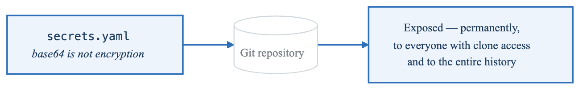
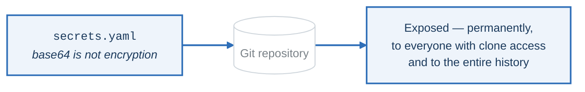
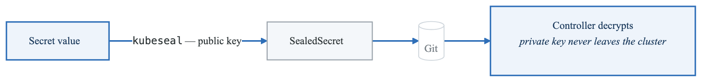
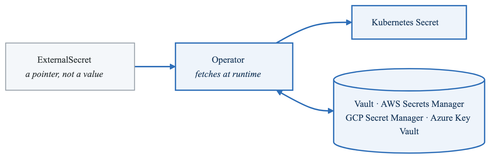
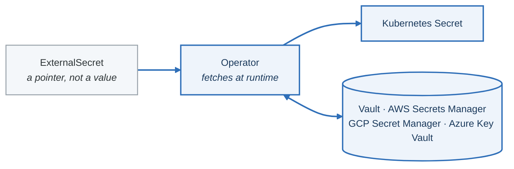

# Exercise 6: GitOps Secrets Management

## Objectives

- Implement secure secrets handling in GitOps
- Configure external secrets operators
- Use sealed secrets for Git storage
- Integrate with cloud secret managers

## Prerequisites

- Completed Exercises 1-5
- ArgoCD running and configured
- Access to secret management solution (Vault, AWS Secrets Manager, etc.)

---

## Part 1: Secrets in GitOps

### 1.1 The Secrets Challenge

**The problem**

<!-- figure: generated from the Mermaid below by _shared/diagrams/embed-figures.py — do not edit the image -->


<details>
<summary>Diagram source (Mermaid)</summary>



</details>

**Solution 1 — Sealed Secrets:** the ciphertext lives in Git

```mermaid
%%{init: {'theme':'base','themeVariables':{'fontFamily':'Helvetica, Arial, sans-serif','fontSize':'13px','primaryColor':'#ffffff','primaryTextColor':'#2d3436','primaryBorderColor':'#9aa3ab','lineColor':'#9aa3ab','textColor':'#2d3436','clusterBkg':'#fbfcfd','clusterBorder':'#d4dae0','edgeLabelBackground':'#ffffff','tertiaryColor':'#eef4fb'},'flowchart':{'curve':'basis','padding':14,'nodeSpacing':42,'rankSpacing':58}}}%%
flowchart LR
  classDef default fill:#ffffff,stroke:#9aa3ab,stroke-width:1.3px,color:#2d3436
  classDef n    fill:#ffffff,stroke:#9aa3ab,stroke-width:1.3px,color:#2d3436
  classDef crit fill:#eef4fb,stroke:#2f6fb8,stroke-width:1.8px,color:#1b3a5c
  classDef data fill:#f4f7fa,stroke:#9aa3ab,stroke-width:1.3px,color:#2d3436
  classDef mut  fill:#ffffff,stroke:#cfd6dc,stroke-width:1.1px,color:#7a8288
  classDef warn fill:#fdf0ec,stroke:#c0522d,stroke-width:1.6px,color:#8a3a1e
  V["Secret value"] ==>|"<code>kubeseal</code> — public key"| E["SealedSecret"] ==> G[("Git")] ==> C["Controller decrypts<br/><i>private key never leaves the cluster</i>"]
  class V crit
  class E data
  class G mut
  class C crit
  linkStyle 0,1,2 stroke:#2f6fb8,stroke-width:2px
```

<!-- figure: generated from the Mermaid below by _shared/diagrams/embed-figures.py — do not edit the image -->


<details>
<summary>Diagram source (Mermaid)</summary>



</details>

**Solution 2 — External Secrets:** only a *reference* lives in Git

<!-- figure: generated from the Mermaid below by _shared/diagrams/embed-figures.py — do not edit the image -->


<details>
<summary>Diagram source (Mermaid)</summary>



</details>

| | Sealed Secrets | External Secrets |
|---|---|---|
| What is in Git | Ciphertext | A reference |
| Rotation | Re-seal and commit | Change it in the backend; nothing in Git moves |
| External dependency | None | The secret store must be reachable |
| Disaster recovery | **Back up the controller's private key** or every secret must be re-sealed | Nothing to back up |

Rotation is what decides it in practice. If secrets rotate on a schedule, having to commit for each
rotation turns into either a bot with write access to your repository or a rotation policy nobody
follows.

---

## Part 2: Sealed Secrets

### 2.1 Install Sealed Secrets

```bash
# Install controller
helm repo add sealed-secrets https://bitnami-labs.github.io/sealed-secrets
helm install sealed-secrets sealed-secrets/sealed-secrets \
  --namespace kube-system \
  --set-string fullnameOverride=sealed-secrets-controller

# Install kubeseal CLI
KUBESEAL_VERSION=$(curl -s https://api.github.com/repos/bitnami-labs/sealed-secrets/releases/latest | jq -r '.tag_name' | cut -c 2-)
curl -OL "https://github.com/bitnami-labs/sealed-secrets/releases/download/v${KUBESEAL_VERSION}/kubeseal-${KUBESEAL_VERSION}-linux-amd64.tar.gz"
tar -xvzf kubeseal-${KUBESEAL_VERSION}-linux-amd64.tar.gz kubeseal
sudo install -m 755 kubeseal /usr/local/bin/kubeseal
```

### 2.2 Create Sealed Secret

```bash
# Create a regular secret
kubectl create secret generic my-secret \
  --from-literal=username=admin \
  --from-literal=password=secretpassword \
  --dry-run=client -o yaml > my-secret.yaml

# Seal the secret
kubeseal --format yaml < my-secret.yaml > my-sealed-secret.yaml

# The sealed secret can be safely stored in Git
cat my-sealed-secret.yaml
```

### 2.3 Sealed Secret Manifest

```yaml
# my-sealed-secret.yaml
apiVersion: bitnami.com/v1alpha1
kind: SealedSecret
metadata:
  name: my-secret
  namespace: production
spec:
  encryptedData:
    username: AgBy3i4OJSWK+PiTySYZZA9rO43cGDEq...
    password: AgBy3i4OJSWK+PiTySYZZA9rO43cGDEq...
  template:
    metadata:
      name: my-secret
      namespace: production
    type: Opaque
```

### 2.4 Scope Annotations

```yaml
# strict-scope-secret.yaml
apiVersion: bitnami.com/v1alpha1
kind: SealedSecret
metadata:
  name: my-secret
  namespace: production
  annotations:
    # strict: Only valid for this namespace and name
    sealedsecrets.bitnami.com/namespace-wide: "false"
    sealedsecrets.bitnami.com/cluster-wide: "false"
spec:
  encryptedData:
    key: AgBy3i4OJSWK+PiTySYZZA9rO43cGDEq...
---
# namespace-wide secret
apiVersion: bitnami.com/v1alpha1
kind: SealedSecret
metadata:
  name: my-secret
  namespace: production
  annotations:
    sealedsecrets.bitnami.com/namespace-wide: "true"
spec:
  encryptedData:
    key: AgBy3i4OJSWK+PiTySYZZA9rO43cGDEq...
```

### 2.5 Sealed Secrets Backup

```bash
# Backup the sealing key
kubectl get secret -n kube-system -l sealedsecrets.bitnami.com/sealed-secrets-key -o yaml > sealed-secrets-key-backup.yaml

# Restore the sealing key (in case of disaster recovery)
kubectl apply -f sealed-secrets-key-backup.yaml
kubectl delete pod -n kube-system -l name=sealed-secrets-controller
```

---

## Part 3: External Secrets Operator

### 3.1 Install External Secrets Operator

```bash
# Add helm repo
helm repo add external-secrets https://charts.external-secrets.io
helm repo update

# Install operator
helm install external-secrets external-secrets/external-secrets \
  --namespace external-secrets \
  --create-namespace \
  --set installCRDs=true
```

### 3.2 AWS Secrets Manager Integration

```yaml
# aws-secret-store.yaml
apiVersion: external-secrets.io/v1beta1
kind: ClusterSecretStore
metadata:
  name: aws-secrets-manager
spec:
  provider:
    aws:
      service: SecretsManager
      region: us-west-2
      auth:
        jwt:
          serviceAccountRef:
            name: external-secrets-sa
            namespace: external-secrets
---
# Service Account with IRSA
apiVersion: v1
kind: ServiceAccount
metadata:
  name: external-secrets-sa
  namespace: external-secrets
  annotations:
    eks.amazonaws.com/role-arn: arn:aws:iam::123456789012:role/ExternalSecretsRole
```

### 3.3 External Secret Definition

```yaml
# external-secret.yaml
apiVersion: external-secrets.io/v1beta1
kind: ExternalSecret
metadata:
  name: database-credentials
  namespace: production
spec:
  refreshInterval: 1h
  secretStoreRef:
    kind: ClusterSecretStore
    name: aws-secrets-manager
  target:
    name: database-credentials  # K8s secret name
    creationPolicy: Owner
  data:
    - secretKey: username
      remoteRef:
        key: production/database
        property: username
    - secretKey: password
      remoteRef:
        key: production/database
        property: password
```

### 3.4 Data From Template

```yaml
# external-secret-template.yaml
apiVersion: external-secrets.io/v1beta1
kind: ExternalSecret
metadata:
  name: app-config
  namespace: production
spec:
  refreshInterval: 30m
  secretStoreRef:
    kind: ClusterSecretStore
    name: aws-secrets-manager
  target:
    name: app-config
    template:
      type: Opaque
      data:
        config.yaml: |
          database:
            host: db.example.com
            port: 5432
            username: {{ .username }}
            password: {{ .password }}
          api:
            key: {{ .api_key }}
  dataFrom:
    - extract:
        key: production/app-secrets
```

---

## Part 4: HashiCorp Vault Integration

### 4.1 Vault SecretStore

```yaml
# vault-secret-store.yaml
apiVersion: external-secrets.io/v1beta1
kind: ClusterSecretStore
metadata:
  name: vault-backend
spec:
  provider:
    vault:
      server: https://vault.example.com
      path: secret
      version: v2
      auth:
        kubernetes:
          mountPath: kubernetes
          role: external-secrets
          serviceAccountRef:
            name: external-secrets-sa
            namespace: external-secrets
```

### 4.2 Vault External Secret

```yaml
# vault-external-secret.yaml
apiVersion: external-secrets.io/v1beta1
kind: ExternalSecret
metadata:
  name: vault-secret
  namespace: production
spec:
  refreshInterval: 15m
  secretStoreRef:
    kind: ClusterSecretStore
    name: vault-backend
  target:
    name: api-credentials
  data:
    - secretKey: api-key
      remoteRef:
        key: secret/data/production/api
        property: api_key
    - secretKey: api-secret
      remoteRef:
        key: secret/data/production/api
        property: api_secret
```

### 4.3 Vault with ArgoCD

```yaml
# argocd-vault-plugin.yaml
# ConfigManagementPlugin for Vault
apiVersion: v1
kind: ConfigMap
metadata:
  name: argocd-cmp-cm
  namespace: argocd
data:
  plugin.yaml: |
    apiVersion: argoproj.io/v1alpha1
    kind: ConfigManagementPlugin
    metadata:
      name: argocd-vault-plugin
    spec:
      allowConcurrency: true
      discover:
        find:
          command:
            - sh
            - "-c"
            - "find . -name '*.yaml' | xargs grep -l 'avp.kubernetes.io'"
      generate:
        command:
          - argocd-vault-plugin
          - generate
          - "."
      lockRepo: false
```

---

## Part 5: GCP and Azure Integration

### 5.1 GCP Secret Manager

```yaml
# gcp-secret-store.yaml
apiVersion: external-secrets.io/v1beta1
kind: ClusterSecretStore
metadata:
  name: gcp-secrets
spec:
  provider:
    gcpsm:
      projectID: my-project-id
      auth:
        workloadIdentity:
          clusterLocation: us-central1
          clusterName: my-cluster
          clusterProjectID: my-project-id
          serviceAccountRef:
            name: external-secrets-sa
            namespace: external-secrets
---
apiVersion: external-secrets.io/v1beta1
kind: ExternalSecret
metadata:
  name: gcp-secret
  namespace: production
spec:
  refreshInterval: 1h
  secretStoreRef:
    kind: ClusterSecretStore
    name: gcp-secrets
  target:
    name: app-secrets
  data:
    - secretKey: db-password
      remoteRef:
        key: production-db-password
        version: latest
```

### 5.2 Azure Key Vault

```yaml
# azure-secret-store.yaml
apiVersion: external-secrets.io/v1beta1
kind: ClusterSecretStore
metadata:
  name: azure-keyvault
spec:
  provider:
    azurekv:
      vaultUrl: https://my-vault.vault.azure.net
      authType: WorkloadIdentity
      serviceAccountRef:
        name: external-secrets-sa
        namespace: external-secrets
---
apiVersion: external-secrets.io/v1beta1
kind: ExternalSecret
metadata:
  name: azure-secret
  namespace: production
spec:
  refreshInterval: 1h
  secretStoreRef:
    kind: ClusterSecretStore
    name: azure-keyvault
  target:
    name: azure-secrets
  data:
    - secretKey: connection-string
      remoteRef:
        key: production-connection-string
```

---

## Part 6: Secrets in ArgoCD

### 6.1 External Secrets with ArgoCD

```yaml
# argocd-app-with-secrets.yaml
apiVersion: argoproj.io/v1alpha1
kind: Application
metadata:
  name: myapp
  namespace: argocd
spec:
  project: default
  source:
    repoURL: https://github.com/org/myapp-config
    targetRevision: main
    path: production
  destination:
    server: https://kubernetes.default.svc
    namespace: production
  syncPolicy:
    automated:
      prune: true
      selfHeal: true
    syncOptions:
      - CreateNamespace=true
      # Skip applying secrets (let ESO manage them)
      - SkipDryRunOnMissingResource=true
```

### 6.2 Repository Structure

**`myapp-config/`**

- `base/`
  - `deployment.yaml`
  - `service.yaml`
  - `kustomization.yaml`
- `production/`
  - `external-secret.yaml` — External secret reference
  - `sealed-secret.yaml` — Or sealed secret
  - `kustomization.yaml`
- `staging/`
  - `external-secret.yaml`
  - `kustomization.yaml`


### 6.3 Kustomize with Secrets

```yaml
# production/kustomization.yaml
apiVersion: kustomize.config.k8s.io/v1beta1
kind: Kustomization
resources:
  - ../base
  - external-secret.yaml

# Deployment references the secret created by ESO
patches:
  - patch: |
      - op: add
        path: /spec/template/spec/containers/0/envFrom
        value:
          - secretRef:
              name: database-credentials
    target:
      kind: Deployment
      name: myapp
```

---

## Part 7: Secret Rotation

### 7.1 Automatic Rotation with ESO

```yaml
# rotating-secret.yaml
apiVersion: external-secrets.io/v1beta1
kind: ExternalSecret
metadata:
  name: rotating-secret
  namespace: production
spec:
  # Frequent refresh for rotating secrets
  refreshInterval: 5m
  secretStoreRef:
    kind: ClusterSecretStore
    name: aws-secrets-manager
  target:
    name: api-keys
    # Recreate instead of merge
    creationPolicy: Owner
    deletionPolicy: Retain
  data:
    - secretKey: current-key
      remoteRef:
        key: production/api-key
        property: AWSCURRENT
    - secretKey: pending-key
      remoteRef:
        key: production/api-key
        property: AWSPENDING
```

### 7.2 Application Handling

```yaml
# deployment-with-rotation.yaml
apiVersion: apps/v1
kind: Deployment
metadata:
  name: myapp
  annotations:
    # Trigger rolling update when secret changes
    reloader.stakater.com/auto: "true"
spec:
  template:
    spec:
      containers:
        - name: myapp
          envFrom:
            - secretRef:
                name: api-keys
```

---

## Part 8: Security Best Practices

### 8.1 RBAC for Secrets

```yaml
# secrets-rbac.yaml
apiVersion: rbac.authorization.k8s.io/v1
kind: Role
metadata:
  name: secrets-reader
  namespace: production
rules:
  - apiGroups: [""]
    resources: ["secrets"]
    resourceNames: ["app-config", "database-credentials"]
    verbs: ["get"]
---
apiVersion: rbac.authorization.k8s.io/v1
kind: RoleBinding
metadata:
  name: app-secrets-reader
  namespace: production
roleRef:
  apiGroup: rbac.authorization.k8s.io
  kind: Role
  name: secrets-reader
subjects:
  - kind: ServiceAccount
    name: myapp
    namespace: production
```

### 8.2 Network Policies

```yaml
# secrets-network-policy.yaml
apiVersion: networking.k8s.io/v1
kind: NetworkPolicy
metadata:
  name: external-secrets-policy
  namespace: external-secrets
spec:
  podSelector:
    matchLabels:
      app.kubernetes.io/name: external-secrets
  policyTypes:
    - Egress
  egress:
    # Allow access to cloud provider secrets
    - to:
        - ipBlock:
            cidr: 0.0.0.0/0
      ports:
        - port: 443
          protocol: TCP
    # Allow DNS
    - to:
        - namespaceSelector: {}
      ports:
        - port: 53
          protocol: UDP
```

### 8.3 Audit Logging

```yaml
# audit-policy.yaml
apiVersion: audit.k8s.io/v1
kind: Policy
rules:
  # Log all secret access
  - level: RequestResponse
    resources:
      - group: ""
        resources: ["secrets"]
    verbs: ["get", "list", "watch", "create", "update", "patch", "delete"]
  # Log external secret operations
  - level: Metadata
    resources:
      - group: "external-secrets.io"
        resources: ["externalsecrets", "clustersecretstores", "secretstores"]
```

---

## Part 9: Hands-on Challenges

### Challenge 1: Multi-Source Secrets

Configure secrets from multiple providers:
1. Set up AWS Secrets Manager
2. Set up Vault
3. Create application using both
4. Implement failover strategy

### Challenge 2: Secret Rotation Pipeline

Implement automatic rotation:
1. Configure rotating secret in AWS
2. Set up frequent refresh in ESO
3. Configure application restart
4. Test rotation process

### Challenge 3: Sealed Secrets Migration

Migrate from sealed secrets to ESO:
1. Audit existing sealed secrets
2. Create corresponding external secrets
3. Update applications
4. Remove sealed secrets

---

## Verification Tasks

1. [ ] Installed Sealed Secrets
2. [ ] Created and deployed sealed secret
3. [ ] Installed External Secrets Operator
4. [ ] Configured cloud secret store
5. [ ] Deployed external secret
6. [ ] Integrated with ArgoCD workflow

---

## Key Takeaways

- Never store plain secrets in Git
- Sealed Secrets for simple use cases
- External Secrets for enterprise secrets management
- Implement secret rotation strategies
- Monitor secret access with audit logging
- Use RBAC to limit secret access

---

## Next Steps

Continue to [Exercise 7: Infrastructure as Code](01-gitops-argocd-exercises-07-infrastructure-as-code.md)

<!-- feynman-check -->

---

## Feynman check

Close the file. Blank page, no notes. Explain each of these to a competent engineer who has never
used this tool — **under five minutes, no jargon you can't define on the spot:**

- Secrets in GitOps
- Sealed Secrets
- External Secrets Operator
- HashiCorp Vault Integration

**The gap is not what you forgot. It is where you used a word instead of a mechanism.**

| | |
|---|---|
| ✗ | *"Kubernetes schedules the pod."* |
| ✓ | *"The scheduler watches for pods with no `nodeName`, filters nodes by predicates, scores the survivors, and writes `nodeName` into the pod spec. The kubelet on that node is watching the API for pods bound to it, and starts the containers."* |

**Trace it:** `kubectl apply -f pod.yaml` → a running container. Name every component that acts, in order, and what each one writes.

Stop at the first component you cannot name. Reopen this file and read **only** that.

**Go deeper — only once the gap has a name:** [Kubernetes the Hard Way](https://github.com/kelseyhightower/kubernetes-the-hard-way) — one weekend, and "the control plane" stops being a word.
Full list per domain: [`SOURCES.md`](../../SOURCES.md#kubernetes)

→ Protocol, the three levels of knowing, and worked examples: [`MASTERY.md`](../../MASTERY.md)

<!-- /feynman-check -->
