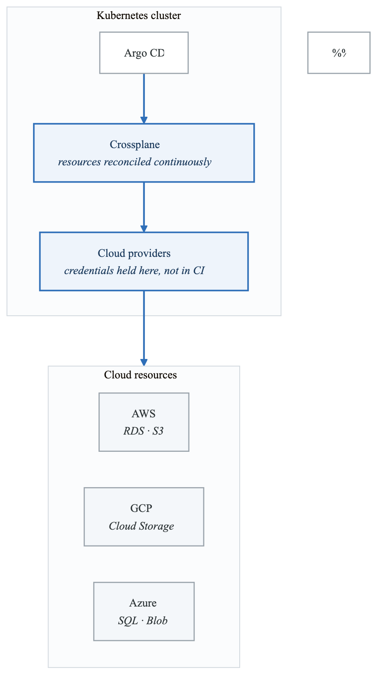
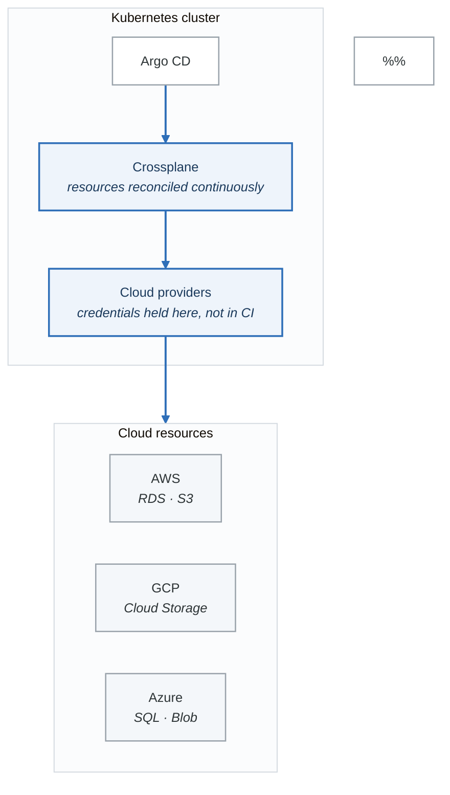

# Exercise 7: Infrastructure as Code with Crossplane

## Objectives

- Deploy and configure Crossplane
- Provision cloud infrastructure via GitOps
- Create composite resource definitions
- Implement infrastructure abstraction

## Prerequisites

- Completed Exercises 1-6
- ArgoCD running and configured
- Cloud provider credentials (AWS/GCP/Azure)

---

## Part 1: Crossplane Overview

### 1.1 Architecture

<!-- figure: generated from the Mermaid below by _shared/diagrams/embed-figures.py — do not edit the image -->


<details>
<summary>Diagram source (Mermaid)</summary>



</details>

---

## Part 2: Crossplane Installation

### 2.1 Install Crossplane

```bash
# Create namespace
kubectl create namespace crossplane-system

# Add Helm repo
helm repo add crossplane-stable https://charts.crossplane.io/stable
helm repo update

# Install Crossplane
helm install crossplane crossplane-stable/crossplane \
  --namespace crossplane-system \
  --set args='{"--enable-composition-functions"}' \
  --wait

# Verify installation
kubectl get pods -n crossplane-system
```

### 2.2 Install AWS Provider

```bash
# Install AWS provider
cat <<EOF | kubectl apply -f -
apiVersion: pkg.crossplane.io/v1
kind: Provider
metadata:
  name: provider-aws
spec:
  package: xpkg.upbound.io/upbound/provider-aws:v0.47.0
EOF

# Wait for provider to be healthy
kubectl wait --for=condition=healthy provider/provider-aws --timeout=300s
```

### 2.3 Configure Provider Credentials

```yaml
# aws-provider-config.yaml
apiVersion: v1
kind: Secret
metadata:
  name: aws-creds
  namespace: crossplane-system
type: Opaque
stringData:
  credentials: |
    [default]
    aws_access_key_id = <your-access-key>
    aws_secret_access_key = <your-secret-key>
---
apiVersion: aws.upbound.io/v1beta1
kind: ProviderConfig
metadata:
  name: default
spec:
  credentials:
    source: Secret
    secretRef:
      namespace: crossplane-system
      name: aws-creds
      key: credentials
```

### 2.4 IRSA Configuration (Recommended)

```yaml
# aws-irsa-config.yaml
apiVersion: aws.upbound.io/v1beta1
kind: ProviderConfig
metadata:
  name: default
spec:
  credentials:
    source: IRSA
---
# Create ServiceAccount with IAM role
apiVersion: v1
kind: ServiceAccount
metadata:
  name: provider-aws
  namespace: crossplane-system
  annotations:
    eks.amazonaws.com/role-arn: arn:aws:iam::123456789012:role/CrossplaneProviderRole
```

---

## Part 3: Managed Resources

### 3.1 S3 Bucket

```yaml
# s3-bucket.yaml
apiVersion: s3.aws.upbound.io/v1beta1
kind: Bucket
metadata:
  name: my-crossplane-bucket
spec:
  forProvider:
    region: us-west-2
    tags:
      Environment: production
      ManagedBy: crossplane
  providerConfigRef:
    name: default
```

### 3.2 RDS Database

```yaml
# rds-instance.yaml
apiVersion: rds.aws.upbound.io/v1beta1
kind: Instance
metadata:
  name: my-database
spec:
  forProvider:
    region: us-west-2
    allocatedStorage: 20
    engine: postgres
    engineVersion: "15"
    instanceClass: db.t3.micro
    dbName: mydb
    username: admin
    passwordSecretRef:
      name: db-password
      namespace: crossplane-system
      key: password
    skipFinalSnapshot: true
    publiclyAccessible: false
    vpcSecurityGroupIdRefs:
      - name: db-security-group
    dbSubnetGroupNameRef:
      name: db-subnet-group
  writeConnectionSecretToRef:
    name: db-connection
    namespace: production
```

### 3.3 VPC Infrastructure

```yaml
# vpc.yaml
apiVersion: ec2.aws.upbound.io/v1beta1
kind: VPC
metadata:
  name: production-vpc
spec:
  forProvider:
    region: us-west-2
    cidrBlock: 10.0.0.0/16
    enableDnsHostnames: true
    enableDnsSupport: true
    tags:
      Name: production-vpc
---
apiVersion: ec2.aws.upbound.io/v1beta1
kind: Subnet
metadata:
  name: production-subnet-a
spec:
  forProvider:
    region: us-west-2
    vpcIdRef:
      name: production-vpc
    cidrBlock: 10.0.1.0/24
    availabilityZone: us-west-2a
    mapPublicIpOnLaunch: false
    tags:
      Name: production-subnet-a
```

---

## Part 4: Composite Resources

### 4.1 Composite Resource Definition (XRD)

```yaml
# database-xrd.yaml
apiVersion: apiextensions.crossplane.io/v1
kind: CompositeResourceDefinition
metadata:
  name: xdatabases.example.org
spec:
  group: example.org
  names:
    kind: XDatabase
    plural: xdatabases
  claimNames:
    kind: Database
    plural: databases
  versions:
    - name: v1alpha1
      served: true
      referenceable: true
      schema:
        openAPIV3Schema:
          type: object
          properties:
            spec:
              type: object
              properties:
                parameters:
                  type: object
                  properties:
                    size:
                      type: string
                      enum: ["small", "medium", "large"]
                      description: "Database size"
                    engine:
                      type: string
                      enum: ["postgres", "mysql"]
                      default: "postgres"
                    version:
                      type: string
                      default: "15"
                  required:
                    - size
              required:
                - parameters
            status:
              type: object
              properties:
                endpoint:
                  type: string
                port:
                  type: integer
```

### 4.2 Composition

```yaml
# database-composition.yaml
apiVersion: apiextensions.crossplane.io/v1
kind: Composition
metadata:
  name: database-aws
  labels:
    provider: aws
    engine: postgres
spec:
  compositeTypeRef:
    apiVersion: example.org/v1alpha1
    kind: XDatabase
  writeConnectionSecretsToNamespace: crossplane-system
  patchSets:
    - name: common-parameters
      patches:
        - type: FromCompositeFieldPath
          fromFieldPath: metadata.labels
          toFieldPath: metadata.labels
  resources:
    # RDS Instance
    - name: rds-instance
      base:
        apiVersion: rds.aws.upbound.io/v1beta1
        kind: Instance
        spec:
          forProvider:
            region: us-west-2
            engine: postgres
            skipFinalSnapshot: true
            publiclyAccessible: false
          writeConnectionSecretToRef:
            namespace: crossplane-system
      patches:
        # Size mapping
        - type: FromCompositeFieldPath
          fromFieldPath: spec.parameters.size
          toFieldPath: spec.forProvider.instanceClass
          transforms:
            - type: map
              map:
                small: db.t3.micro
                medium: db.t3.small
                large: db.t3.medium
        - type: FromCompositeFieldPath
          fromFieldPath: spec.parameters.size
          toFieldPath: spec.forProvider.allocatedStorage
          transforms:
            - type: map
              map:
                small: "20"
                medium: "50"
                large: "100"
        - type: FromCompositeFieldPath
          fromFieldPath: spec.parameters.version
          toFieldPath: spec.forProvider.engineVersion
        # Connection secret
        - type: FromCompositeFieldPath
          fromFieldPath: metadata.uid
          toFieldPath: spec.writeConnectionSecretToRef.name
          transforms:
            - type: string
              string:
                fmt: "%s-db-connection"
      connectionDetails:
        - name: endpoint
          fromFieldPath: status.atProvider.endpoint
        - name: port
          fromFieldPath: status.atProvider.port
        - name: username
          fromFieldPath: spec.forProvider.username
        - name: password
          fromConnectionSecretKey: password
```

### 4.3 Claim

```yaml
# database-claim.yaml
apiVersion: example.org/v1alpha1
kind: Database
metadata:
  name: my-app-database
  namespace: production
spec:
  parameters:
    size: medium
    engine: postgres
    version: "15"
  compositionSelector:
    matchLabels:
      provider: aws
      engine: postgres
  writeConnectionSecretToRef:
    name: my-app-db-connection
```

---

## Part 5: GitOps with Crossplane

### 5.1 ArgoCD Application for Infrastructure

```yaml
# argocd-infra-app.yaml
apiVersion: argoproj.io/v1alpha1
kind: Application
metadata:
  name: infrastructure
  namespace: argocd
spec:
  project: infrastructure
  source:
    repoURL: https://github.com/org/infrastructure-config
    targetRevision: main
    path: aws/production
  destination:
    server: https://kubernetes.default.svc
  syncPolicy:
    automated:
      prune: true
      selfHeal: true
    syncOptions:
      - CreateNamespace=true
```

### 5.2 Repository Structure

**`infrastructure-config/`**

- `crossplane/`
  - `providers/`
    - `aws-provider.yaml`
    - `gcp-provider.yaml`
  - `xrds/`
    - `database-xrd.yaml`
    - `storage-xrd.yaml`
  - `compositions/`
    - `database-aws.yaml`
    - `database-gcp.yaml`
    - `storage-aws.yaml`
- `aws/`
  - `production/`
    - `vpc.yaml`
    - `databases/`
      - `main-db.yaml`
    - `kustomization.yaml`
  - `staging/`
    - `databases/`
      - `test-db.yaml`
- `claims/`
  - `production/`
    - `database-claim.yaml`
    - `storage-claim.yaml`


### 5.3 Environment-Specific Claims

```yaml
# claims/production/database-claim.yaml
apiVersion: example.org/v1alpha1
kind: Database
metadata:
  name: api-database
  namespace: production
spec:
  parameters:
    size: large
    engine: postgres
    version: "15"
  compositionSelector:
    matchLabels:
      provider: aws
      environment: production
  writeConnectionSecretToRef:
    name: api-db-connection
---
# claims/staging/database-claim.yaml
apiVersion: example.org/v1alpha1
kind: Database
metadata:
  name: api-database
  namespace: staging
spec:
  parameters:
    size: small
    engine: postgres
    version: "15"
  compositionSelector:
    matchLabels:
      provider: aws
      environment: staging
  writeConnectionSecretToRef:
    name: api-db-connection
```

---

## Part 6: Advanced Compositions

### 6.1 Full Application Stack

```yaml
# app-stack-xrd.yaml
apiVersion: apiextensions.crossplane.io/v1
kind: CompositeResourceDefinition
metadata:
  name: xappstacks.example.org
spec:
  group: example.org
  names:
    kind: XAppStack
    plural: xappstacks
  claimNames:
    kind: AppStack
    plural: appstacks
  versions:
    - name: v1alpha1
      served: true
      referenceable: true
      schema:
        openAPIV3Schema:
          type: object
          properties:
            spec:
              type: object
              properties:
                parameters:
                  type: object
                  properties:
                    appName:
                      type: string
                    environment:
                      type: string
                      enum: ["dev", "staging", "production"]
                    databaseSize:
                      type: string
                      enum: ["small", "medium", "large"]
                    cacheEnabled:
                      type: boolean
                      default: true
                    storageSize:
                      type: string
                      default: "10Gi"
```

### 6.2 Multi-Resource Composition

```yaml
# app-stack-composition.yaml
apiVersion: apiextensions.crossplane.io/v1
kind: Composition
metadata:
  name: app-stack-aws
spec:
  compositeTypeRef:
    apiVersion: example.org/v1alpha1
    kind: XAppStack
  resources:
    # Database
    - name: database
      base:
        apiVersion: rds.aws.upbound.io/v1beta1
        kind: Instance
        spec:
          forProvider:
            region: us-west-2
            engine: postgres
            engineVersion: "15"
      patches:
        - fromFieldPath: spec.parameters.databaseSize
          toFieldPath: spec.forProvider.instanceClass
          transforms:
            - type: map
              map:
                small: db.t3.micro
                medium: db.t3.small
                large: db.t3.medium

    # ElastiCache (if enabled)
    - name: cache
      base:
        apiVersion: elasticache.aws.upbound.io/v1beta1
        kind: Cluster
        spec:
          forProvider:
            region: us-west-2
            engine: redis
            nodeType: cache.t3.micro
            numCacheNodes: 1
      patches:
        - type: FromCompositeFieldPath
          fromFieldPath: spec.parameters.cacheEnabled
          toFieldPath: spec.forProvider.apply
          transforms:
            - type: convert
              convert:
                toType: string

    # S3 Bucket for assets
    - name: storage
      base:
        apiVersion: s3.aws.upbound.io/v1beta1
        kind: Bucket
        spec:
          forProvider:
            region: us-west-2
      patches:
        - fromFieldPath: spec.parameters.appName
          toFieldPath: metadata.name
          transforms:
            - type: string
              string:
                fmt: "%s-assets"
```

---

## Part 7: Monitoring Crossplane

### 7.1 Resource Status

```bash
# Check managed resources
kubectl get managed

# Check composite resources
kubectl get composite

# Check claims
kubectl get claim -A

# Detailed status
kubectl describe database.example.org my-app-database -n production
```

### 7.2 Crossplane Metrics

```yaml
# ServiceMonitor for Crossplane
apiVersion: monitoring.coreos.com/v1
kind: ServiceMonitor
metadata:
  name: crossplane
  namespace: monitoring
spec:
  selector:
    matchLabels:
      app: crossplane
  namespaceSelector:
    matchNames:
      - crossplane-system
  endpoints:
    - port: metrics
      interval: 30s
```

### 7.3 Alert Rules

```yaml
# crossplane-alerts.yaml
apiVersion: monitoring.coreos.com/v1
kind: PrometheusRule
metadata:
  name: crossplane-alerts
  namespace: monitoring
spec:
  groups:
    - name: crossplane
      rules:
        - alert: CrossplaneManagedResourceNotReady
          expr: |
            crossplane_managed_resource_ready{status="False"} == 1
          for: 15m
          labels:
            severity: warning
          annotations:
            summary: Managed resource not ready
            description: "{{ $labels.name }} has been not ready for 15 minutes"

        - alert: CrossplaneClaimNotBound
          expr: |
            crossplane_resource_claim_phase{phase!="Bound"} == 1
          for: 10m
          labels:
            severity: warning
          annotations:
            summary: Resource claim not bound
```

---

## Part 8: Best Practices

### 8.1 Composition Design

```yaml
# Use composition functions for complex logic
apiVersion: apiextensions.crossplane.io/v1
kind: Composition
metadata:
  name: database-with-functions
spec:
  compositeTypeRef:
    apiVersion: example.org/v1alpha1
    kind: XDatabase
  mode: Pipeline
  pipeline:
    - step: patch-and-transform
      functionRef:
        name: function-patch-and-transform
      input:
        apiVersion: pt.fn.crossplane.io/v1beta1
        kind: Resources
        resources:
          - name: rds-instance
            base:
              apiVersion: rds.aws.upbound.io/v1beta1
              kind: Instance
            patches:
              - type: FromCompositeFieldPath
                fromFieldPath: spec.parameters.size
                toFieldPath: spec.forProvider.instanceClass
```

### 8.2 RBAC Configuration

```yaml
# crossplane-rbac.yaml
apiVersion: rbac.authorization.k8s.io/v1
kind: ClusterRole
metadata:
  name: database-claim-user
rules:
  - apiGroups: ["example.org"]
    resources: ["databases"]
    verbs: ["get", "list", "watch", "create", "update", "patch", "delete"]
---
apiVersion: rbac.authorization.k8s.io/v1
kind: RoleBinding
metadata:
  name: dev-team-databases
  namespace: development
roleRef:
  apiGroup: rbac.authorization.k8s.io
  kind: ClusterRole
  name: database-claim-user
subjects:
  - kind: Group
    name: dev-team
    apiGroup: rbac.authorization.k8s.io
```

---

## Part 9: Hands-on Challenges

### Challenge 1: Self-Service Database

Create self-service database platform:
1. Define XRD for databases
2. Create compositions for dev/prod
3. Enable team to create databases via claims
4. Integrate with ArgoCD

### Challenge 2: Full Environment

Provision complete environment:
1. VPC with subnets
2. RDS database
3. ElastiCache cluster
4. S3 buckets
5. All via single claim

### Challenge 3: Multi-Cloud

Abstract across clouds:
1. Create cloud-agnostic XRD
2. AWS and GCP compositions
3. Switch provider via labels
4. Maintain same interface

---

## Verification Tasks

1. [ ] Installed Crossplane
2. [ ] Configured cloud provider
3. [ ] Created managed resources
4. [ ] Defined XRD and Composition
5. [ ] Used claims for provisioning
6. [ ] Integrated with ArgoCD

---

## Key Takeaways

- Crossplane extends Kubernetes to manage cloud resources
- Compositions abstract infrastructure complexity
- Claims provide namespace-scoped self-service
- GitOps workflow applies to infrastructure
- XRDs create platform-specific APIs
- Monitor managed resources for drift

---

## Module Complete!

You've completed the GitOps & ArgoCD module. Continue to:
- [CI/CD Pipelines Module](../02-cicd-pipelines/README.md)

<!-- feynman-check -->

---

## Feynman check

Close the file. Blank page, no notes. Explain each of these to a competent engineer who has never
used this tool — **under five minutes, no jargon you can't define on the spot:**

- Crossplane Overview
- Crossplane Installation
- Managed Resources
- Composite Resources

**The gap is not what you forgot. It is where you used a word instead of a mechanism.**

| | |
|---|---|
| ✗ | *"Kubernetes schedules the pod."* |
| ✓ | *"The scheduler watches for pods with no `nodeName`, filters nodes by predicates, scores the survivors, and writes `nodeName` into the pod spec. The kubelet on that node is watching the API for pods bound to it, and starts the containers."* |

**Trace it:** `kubectl apply -f pod.yaml` → a running container. Name every component that acts, in order, and what each one writes.

Stop at the first component you cannot name. Reopen this file and read **only** that.

**Go deeper — only once the gap has a name:** [Kubernetes the Hard Way](https://github.com/kelseyhightower/kubernetes-the-hard-way) — one weekend, and "the control plane" stops being a word.
Full list per domain: [`SOURCES.md`](../../SOURCES.md#kubernetes)

→ Protocol, the three levels of knowing, and worked examples: [`MASTERY.md`](../../MASTERY.md)

<!-- /feynman-check -->
