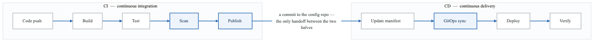

# CI/CD Pipelines

Build production-grade CI/CD pipelines for Kubernetes deployments.

## Learning Path

1. [Pipeline Architecture](#pipeline-architecture)
2. [Tekton Pipelines](#tekton-pipelines)
3. [GitHub Actions](#github-actions)
4. [Container Builds](#container-builds)
5. [Security Scanning](#security-scanning)

---

## Pipeline Architecture

```mermaid
%%{init: {'theme':'base','themeVariables':{'fontFamily':'Helvetica, Arial, sans-serif','fontSize':'13px','primaryColor':'#ffffff','primaryTextColor':'#2d3436','primaryBorderColor':'#9aa3ab','lineColor':'#9aa3ab','textColor':'#2d3436','clusterBkg':'#fbfcfd','clusterBorder':'#d4dae0','edgeLabelBackground':'#ffffff','tertiaryColor':'#eef4fb'},'flowchart':{'curve':'basis','padding':14,'nodeSpacing':42,'rankSpacing':58}}}%%
flowchart LR
  classDef default fill:#ffffff,stroke:#9aa3ab,stroke-width:1.3px,color:#2d3436
  classDef n    fill:#ffffff,stroke:#9aa3ab,stroke-width:1.3px,color:#2d3436
  classDef crit fill:#eef4fb,stroke:#2f6fb8,stroke-width:1.8px,color:#1b3a5c
  classDef data fill:#f4f7fa,stroke:#9aa3ab,stroke-width:1.3px,color:#2d3436
  classDef mut  fill:#ffffff,stroke:#cfd6dc,stroke-width:1.1px,color:#7a8288
  classDef warn fill:#fdf0ec,stroke:#c0522d,stroke-width:1.6px,color:#8a3a1e
  subgraph CI["CI &nbsp;—&nbsp; continuous integration"]
    direction LR
    C["Code push"]
    B["Build"]
    T["Test"]
    S["Scan"]
    P["Publish"]
    C ==> B ==> T ==> S ==> P
  end
  subgraph CD["CD &nbsp;—&nbsp; continuous delivery"]
    direction LR
    U["Update manifest"]
    G["GitOps sync"]
    D["Deploy"]
    V["Verify"]
    U ==> G ==> D ==> V
  end
  P ==>|"a commit to the config repo —<br/>the only handoff between the two halves"| U
  class C,B,T n
  class S crit
  class P crit
  class U n
  class G crit
  class D,V n
  linkStyle 0,1,2,3,4,5,6,7 stroke:#2f6fb8,stroke-width:2px

%% The join is a commit, not an API call. CI never touches the cluster and does
%% not hold credentials to it; it writes a new image tag into a repository, and
%% the GitOps controller inside the cluster does the rest.
```

<!-- figure: generated from the Mermaid below by _shared/diagrams/embed-figures.py — do not edit the image -->


<details>
<summary>Diagram source (Mermaid)</summary>



</details>

### Pipeline Stages

| Stage | Purpose | Tools |
|-------|---------|-------|
| Build | Compile, create artifacts | Kaniko, BuildKit, Podman |
| Test | Unit, integration, e2e | Jest, PyTest, Go test |
| Scan | Security, compliance | Trivy, Grype, Snyk |
| Publish | Push images, artifacts | Container registries |
| Deploy | Update manifests | Kustomize, Helm |
| Verify | Smoke tests, rollback | Argo Rollouts, Flagger |

---

## Tekton Pipelines

### Installation

```bash
# Install Tekton Pipelines
kubectl apply -f https://storage.googleapis.com/tekton-releases/pipeline/latest/release.yaml

# Install Tekton Triggers
kubectl apply -f https://storage.googleapis.com/tekton-releases/triggers/latest/release.yaml

# Install Tekton Dashboard
kubectl apply -f https://storage.googleapis.com/tekton-releases/dashboard/latest/release.yaml
```

### Reusable Tasks

```yaml
# Task: Git Clone
apiVersion: tekton.dev/v1beta1
kind: Task
metadata:
  name: git-clone
spec:
  params:
  - name: url
    type: string
  - name: revision
    type: string
    default: main
  workspaces:
  - name: output
  results:
  - name: commit
    description: The commit SHA
  steps:
  - name: clone
    image: gcr.io/tekton-releases/github.com/tektoncd/pipeline/cmd/git-init:latest
    script: |
      git clone $(params.url) $(workspaces.output.path)/source
      cd $(workspaces.output.path)/source
      git checkout $(params.revision)
      git rev-parse HEAD | tr -d '\n' > $(results.commit.path)

---
# Task: Build with Kaniko
apiVersion: tekton.dev/v1beta1
kind: Task
metadata:
  name: kaniko-build
spec:
  params:
  - name: IMAGE
    type: string
  - name: DOCKERFILE
    type: string
    default: Dockerfile
  - name: CONTEXT
    type: string
    default: .
  workspaces:
  - name: source
  - name: dockerconfig
    optional: true
  results:
  - name: IMAGE_DIGEST
    description: Digest of the built image
  - name: IMAGE_URL
    description: URL of the built image
  steps:
  - name: build-push
    image: gcr.io/kaniko-project/executor:latest
    env:
    - name: DOCKER_CONFIG
      value: $(workspaces.dockerconfig.path)
    args:
    - --dockerfile=$(params.DOCKERFILE)
    - --context=$(workspaces.source.path)/source/$(params.CONTEXT)
    - --destination=$(params.IMAGE)
    - --digest-file=$(results.IMAGE_DIGEST.path)
    securityContext:
      runAsUser: 0

  - name: write-url
    image: bash:5
    script: |
      echo -n "$(params.IMAGE)" > $(results.IMAGE_URL.path)

---
# Task: Trivy Scan
apiVersion: tekton.dev/v1beta1
kind: Task
metadata:
  name: trivy-scan
spec:
  params:
  - name: IMAGE
    type: string
  - name: SEVERITY
    type: string
    default: "CRITICAL,HIGH"
  workspaces:
  - name: dockerconfig
    optional: true
  steps:
  - name: scan
    image: aquasec/trivy:latest
    env:
    - name: DOCKER_CONFIG
      value: $(workspaces.dockerconfig.path)
    script: |
      trivy image \
        --severity $(params.SEVERITY) \
        --exit-code 1 \
        --ignore-unfixed \
        --format table \
        $(params.IMAGE)

---
# Task: Update Manifests
apiVersion: tekton.dev/v1beta1
kind: Task
metadata:
  name: update-manifest
spec:
  params:
  - name: MANIFEST_REPO
    type: string
  - name: IMAGE
    type: string
  - name: APP_NAME
    type: string
  - name: ENVIRONMENT
    type: string
    default: staging
  workspaces:
  - name: ssh-credentials
  steps:
  - name: update
    image: alpine/git:latest
    script: |
      # Configure git
      git config --global user.email "ci@example.com"
      git config --global user.name "CI Bot"

      # Clone manifests repo
      mkdir -p ~/.ssh
      cp $(workspaces.ssh-credentials.path)/id_rsa ~/.ssh/
      chmod 600 ~/.ssh/id_rsa
      ssh-keyscan github.com >> ~/.ssh/known_hosts

      git clone $(params.MANIFEST_REPO) manifests
      cd manifests

      # Update image tag using kustomize
      cd overlays/$(params.ENVIRONMENT)/$(params.APP_NAME)
      kustomize edit set image $(params.APP_NAME)=$(params.IMAGE)

      # Commit and push
      git add .
      git commit -m "Update $(params.APP_NAME) to $(params.IMAGE)"
      git push origin main
```

### Pipeline Definition

```yaml
apiVersion: tekton.dev/v1beta1
kind: Pipeline
metadata:
  name: build-deploy-pipeline
spec:
  params:
  - name: git-url
    type: string
  - name: git-revision
    type: string
    default: main
  - name: image-name
    type: string
  - name: app-name
    type: string
  - name: manifest-repo
    type: string
  - name: environment
    type: string
    default: staging

  workspaces:
  - name: shared-workspace
  - name: docker-credentials
  - name: ssh-credentials

  tasks:
  # Clone source code
  - name: clone
    taskRef:
      name: git-clone
    params:
    - name: url
      value: $(params.git-url)
    - name: revision
      value: $(params.git-revision)
    workspaces:
    - name: output
      workspace: shared-workspace

  # Run tests
  - name: test
    taskRef:
      name: npm-test  # Custom task for running tests
    runAfter: [clone]
    workspaces:
    - name: source
      workspace: shared-workspace

  # Build container image
  - name: build
    taskRef:
      name: kaniko-build
    runAfter: [test]
    params:
    - name: IMAGE
      value: $(params.image-name):$(tasks.clone.results.commit)
    workspaces:
    - name: source
      workspace: shared-workspace
    - name: dockerconfig
      workspace: docker-credentials

  # Scan for vulnerabilities
  - name: scan
    taskRef:
      name: trivy-scan
    runAfter: [build]
    params:
    - name: IMAGE
      value: $(params.image-name):$(tasks.clone.results.commit)
    workspaces:
    - name: dockerconfig
      workspace: docker-credentials

  # Update manifests for GitOps
  - name: update-manifest
    taskRef:
      name: update-manifest
    runAfter: [scan]
    params:
    - name: MANIFEST_REPO
      value: $(params.manifest-repo)
    - name: IMAGE
      value: $(params.image-name):$(tasks.clone.results.commit)
    - name: APP_NAME
      value: $(params.app-name)
    - name: ENVIRONMENT
      value: $(params.environment)
    workspaces:
    - name: ssh-credentials
      workspace: ssh-credentials

  finally:
  # Send notification
  - name: notify
    taskRef:
      name: slack-notify
    params:
    - name: message
      value: "Pipeline $(context.pipelineRun.name) completed"
```

### Triggers

```yaml
# EventListener for webhooks
apiVersion: triggers.tekton.dev/v1beta1
kind: EventListener
metadata:
  name: github-listener
spec:
  serviceAccountName: tekton-triggers-sa
  triggers:
  - name: github-push
    interceptors:
    - ref:
        name: github
      params:
      - name: secretRef
        value:
          secretName: github-webhook-secret
          secretKey: secret
      - name: eventTypes
        value: ["push"]
    bindings:
    - ref: github-push-binding
    template:
      ref: build-deploy-template

---
# TriggerBinding
apiVersion: triggers.tekton.dev/v1beta1
kind: TriggerBinding
metadata:
  name: github-push-binding
spec:
  params:
  - name: git-url
    value: $(body.repository.clone_url)
  - name: git-revision
    value: $(body.after)
  - name: app-name
    value: $(body.repository.name)

---
# TriggerTemplate
apiVersion: triggers.tekton.dev/v1beta1
kind: TriggerTemplate
metadata:
  name: build-deploy-template
spec:
  params:
  - name: git-url
  - name: git-revision
  - name: app-name
  resourcetemplates:
  - apiVersion: tekton.dev/v1beta1
    kind: PipelineRun
    metadata:
      generateName: build-deploy-
    spec:
      pipelineRef:
        name: build-deploy-pipeline
      params:
      - name: git-url
        value: $(tt.params.git-url)
      - name: git-revision
        value: $(tt.params.git-revision)
      - name: app-name
        value: $(tt.params.app-name)
      - name: image-name
        value: myregistry.com/$(tt.params.app-name)
      - name: manifest-repo
        value: git@github.com:myorg/k8s-manifests.git
      workspaces:
      - name: shared-workspace
        volumeClaimTemplate:
          spec:
            accessModes: ["ReadWriteOnce"]
            resources:
              requests:
                storage: 1Gi
      - name: docker-credentials
        secret:
          secretName: docker-credentials
      - name: ssh-credentials
        secret:
          secretName: git-ssh-key
```

---

## GitHub Actions

### Complete Workflow

```yaml
# .github/workflows/ci-cd.yaml
name: CI/CD Pipeline

on:
  push:
    branches: [main, develop]
  pull_request:
    branches: [main]

env:
  REGISTRY: ghcr.io
  IMAGE_NAME: ${{ github.repository }}

jobs:
  test:
    runs-on: ubuntu-latest
    steps:
    - uses: actions/checkout@v4

    - name: Set up Go
      uses: actions/setup-go@v5
      with:
        go-version: '1.21'

    - name: Run tests
      run: go test -v -race -coverprofile=coverage.out ./...

    - name: Upload coverage
      uses: codecov/codecov-action@v3
      with:
        files: ./coverage.out

  build:
    needs: test
    runs-on: ubuntu-latest
    permissions:
      contents: read
      packages: write
    outputs:
      image-tag: ${{ steps.meta.outputs.tags }}
      image-digest: ${{ steps.build.outputs.digest }}

    steps:
    - uses: actions/checkout@v4

    - name: Set up Docker Buildx
      uses: docker/setup-buildx-action@v3

    - name: Log in to registry
      uses: docker/login-action@v3
      with:
        registry: ${{ env.REGISTRY }}
        username: ${{ github.actor }}
        password: ${{ secrets.GITHUB_TOKEN }}

    - name: Extract metadata
      id: meta
      uses: docker/metadata-action@v5
      with:
        images: ${{ env.REGISTRY }}/${{ env.IMAGE_NAME }}
        tags: |
          type=sha,prefix=
          type=ref,event=branch
          type=ref,event=pr

    - name: Build and push
      id: build
      uses: docker/build-push-action@v5
      with:
        context: .
        push: true
        tags: ${{ steps.meta.outputs.tags }}
        labels: ${{ steps.meta.outputs.labels }}
        cache-from: type=gha
        cache-to: type=gha,mode=max
        platforms: linux/amd64,linux/arm64

  scan:
    needs: build
    runs-on: ubuntu-latest
    steps:
    - name: Run Trivy vulnerability scanner
      uses: aquasecurity/trivy-action@master
      with:
        image-ref: ${{ env.REGISTRY }}/${{ env.IMAGE_NAME }}:${{ github.sha }}
        format: 'sarif'
        output: 'trivy-results.sarif'
        severity: 'CRITICAL,HIGH'

    - name: Upload scan results
      uses: github/codeql-action/upload-sarif@v2
      with:
        sarif_file: 'trivy-results.sarif'

  deploy-staging:
    needs: [build, scan]
    runs-on: ubuntu-latest
    if: github.ref == 'refs/heads/develop'
    environment: staging

    steps:
    - uses: actions/checkout@v4
      with:
        repository: myorg/k8s-manifests
        token: ${{ secrets.MANIFEST_REPO_TOKEN }}

    - name: Update manifest
      run: |
        cd overlays/staging/api
        kustomize edit set image api=${{ env.REGISTRY }}/${{ env.IMAGE_NAME }}@${{ needs.build.outputs.image-digest }}

    - name: Commit and push
      run: |
        git config user.name "GitHub Actions"
        git config user.email "actions@github.com"
        git add .
        git commit -m "Update api to ${{ github.sha }}"
        git push

  deploy-production:
    needs: [build, scan]
    runs-on: ubuntu-latest
    if: github.ref == 'refs/heads/main'
    environment:
      name: production
      url: https://api.example.com

    steps:
    - uses: actions/checkout@v4
      with:
        repository: myorg/k8s-manifests
        token: ${{ secrets.MANIFEST_REPO_TOKEN }}

    - name: Update manifest
      run: |
        cd overlays/production/api
        kustomize edit set image api=${{ env.REGISTRY }}/${{ env.IMAGE_NAME }}@${{ needs.build.outputs.image-digest }}

    - name: Create PR for production
      uses: peter-evans/create-pull-request@v5
      with:
        token: ${{ secrets.MANIFEST_REPO_TOKEN }}
        commit-message: "Release api ${{ github.sha }} to production"
        title: "Release api ${{ github.sha }}"
        body: |
          Automated release triggered by commit ${{ github.sha }}

          ## Changes
          - Image: `${{ env.REGISTRY }}/${{ env.IMAGE_NAME }}@${{ needs.build.outputs.image-digest }}`

          ## Pre-deployment checklist
          - [ ] Staging tests passed
          - [ ] Security scan passed
          - [ ] Changelog reviewed
        branch: release/api-${{ github.sha }}
```

### Reusable Workflow

```yaml
# .github/workflows/reusable-build.yaml
name: Reusable Build

on:
  workflow_call:
    inputs:
      image-name:
        required: true
        type: string
      dockerfile:
        required: false
        type: string
        default: Dockerfile
      context:
        required: false
        type: string
        default: .
    outputs:
      image-digest:
        description: Image digest
        value: ${{ jobs.build.outputs.digest }}
    secrets:
      registry-username:
        required: true
      registry-password:
        required: true

jobs:
  build:
    runs-on: ubuntu-latest
    outputs:
      digest: ${{ steps.build.outputs.digest }}

    steps:
    - uses: actions/checkout@v4

    - name: Set up Docker Buildx
      uses: docker/setup-buildx-action@v3

    - name: Log in to registry
      uses: docker/login-action@v3
      with:
        username: ${{ secrets.registry-username }}
        password: ${{ secrets.registry-password }}

    - name: Build and push
      id: build
      uses: docker/build-push-action@v5
      with:
        context: ${{ inputs.context }}
        file: ${{ inputs.dockerfile }}
        push: true
        tags: ${{ inputs.image-name }}:${{ github.sha }}
        cache-from: type=gha
        cache-to: type=gha,mode=max
```

---

## Container Builds

### Multi-Stage Dockerfile

```dockerfile
# Build stage
FROM golang:1.21-alpine AS builder

WORKDIR /app

# Cache dependencies
COPY go.mod go.sum ./
RUN go mod download

# Build
COPY . .
RUN CGO_ENABLED=0 GOOS=linux go build -ldflags="-s -w" -o /app/server ./cmd/server

# Runtime stage
FROM gcr.io/distroless/static-debian11:nonroot

COPY --from=builder /app/server /server
COPY --from=builder /app/configs /configs

USER nonroot:nonroot

EXPOSE 8080
ENTRYPOINT ["/server"]
```

### BuildKit with Cache

```yaml
# Tekton task using BuildKit
apiVersion: tekton.dev/v1beta1
kind: Task
metadata:
  name: buildkit-build
spec:
  params:
  - name: IMAGE
    type: string
  - name: CACHE_REPO
    type: string
  workspaces:
  - name: source
  sidecars:
  - name: buildkitd
    image: moby/buildkit:latest
    securityContext:
      privileged: true
    volumeMounts:
    - name: buildkit-socket
      mountPath: /run/buildkit

  steps:
  - name: build
    image: moby/buildkit:latest
    env:
    - name: BUILDKIT_HOST
      value: unix:///run/buildkit/buildkitd.sock
    script: |
      buildctl build \
        --frontend=dockerfile.v0 \
        --local context=$(workspaces.source.path) \
        --local dockerfile=$(workspaces.source.path) \
        --output type=image,name=$(params.IMAGE),push=true \
        --export-cache type=registry,ref=$(params.CACHE_REPO):cache \
        --import-cache type=registry,ref=$(params.CACHE_REPO):cache
    volumeMounts:
    - name: buildkit-socket
      mountPath: /run/buildkit

  volumes:
  - name: buildkit-socket
    emptyDir: {}
```

---

## Security Scanning

### Comprehensive Scan Pipeline

```yaml
apiVersion: tekton.dev/v1beta1
kind: Pipeline
metadata:
  name: security-scan-pipeline
spec:
  params:
  - name: IMAGE
    type: string
  - name: source-url
    type: string

  workspaces:
  - name: shared

  tasks:
  # SAST - Static Application Security Testing
  - name: sast-scan
    taskRef:
      name: semgrep-scan
    params:
    - name: SOURCE_URL
      value: $(params.source-url)
    workspaces:
    - name: source
      workspace: shared

  # SCA - Software Composition Analysis
  - name: sca-scan
    taskRef:
      name: grype-scan
    params:
    - name: IMAGE
      value: $(params.IMAGE)

  # Container image scan
  - name: image-scan
    taskRef:
      name: trivy-scan
    params:
    - name: IMAGE
      value: $(params.IMAGE)
    - name: SEVERITY
      value: "CRITICAL,HIGH"

  # Secret detection
  - name: secret-scan
    taskRef:
      name: gitleaks-scan
    workspaces:
    - name: source
      workspace: shared

  # SBOM generation
  - name: generate-sbom
    taskRef:
      name: syft-sbom
    params:
    - name: IMAGE
      value: $(params.IMAGE)
```

```yaml
# Grype scan task
apiVersion: tekton.dev/v1beta1
kind: Task
metadata:
  name: grype-scan
spec:
  params:
  - name: IMAGE
    type: string
  - name: FAIL_ON
    type: string
    default: "high"
  steps:
  - name: scan
    image: anchore/grype:latest
    script: |
      grype $(params.IMAGE) \
        --fail-on $(params.FAIL_ON) \
        --output table

---
# Syft SBOM generation
apiVersion: tekton.dev/v1beta1
kind: Task
metadata:
  name: syft-sbom
spec:
  params:
  - name: IMAGE
    type: string
  results:
  - name: SBOM
    description: Path to SBOM file
  steps:
  - name: generate
    image: anchore/syft:latest
    script: |
      syft $(params.IMAGE) \
        --output spdx-json=/workspace/sbom.json
      echo -n "/workspace/sbom.json" > $(results.SBOM.path)
```

---

## Exercises

1. **[Exercise 1: Tekton Setup](./exercises/01-tekton-setup.md)** - Install and configure Tekton
2. **[Exercise 2: Build Pipeline](./exercises/02-build-pipeline.md)** - Create build pipeline
3. **[Exercise 3: Triggers](./exercises/03-triggers.md)** - Configure webhooks
4. **[Exercise 4: GitHub Actions](./exercises/04-github-actions.md)** - GitHub workflow
5. **[Exercise 5: Security Scanning](./exercises/05-security-scanning.md)** - Integrate security
6. **[Exercise 6: Promotion](./exercises/06-promotion.md)** - Environment promotion

---

## Next Section

[03-developer-platform](../03-developer-platform/) - Building self-service platforms

<!-- feynman-check -->

---

## Feynman check

Close the file. Blank page, no notes. Explain each of these to a competent engineer who has never
used this tool — **under five minutes, no jargon you can't define on the spot:**

- Pipeline Architecture
- Tekton Pipelines
- GitHub Actions
- Container Builds

**The gap is not what you forgot. It is where you used a word instead of a mechanism.**

| | |
|---|---|
| ✗ | *"Kubernetes schedules the pod."* |
| ✓ | *"The scheduler watches for pods with no `nodeName`, filters nodes by predicates, scores the survivors, and writes `nodeName` into the pod spec. The kubelet on that node is watching the API for pods bound to it, and starts the containers."* |

**Trace it:** `kubectl apply -f pod.yaml` → a running container. Name every component that acts, in order, and what each one writes.

Stop at the first component you cannot name. Reopen this file and read **only** that.

**Go deeper — only once the gap has a name:** [Kubernetes the Hard Way](https://github.com/kelseyhightower/kubernetes-the-hard-way) — one weekend, and "the control plane" stops being a word.
Full list per domain: [`SOURCES.md`](../../SOURCES.md#kubernetes)

→ Protocol, the three levels of knowing, and worked examples: [`MASTERY.md`](../../MASTERY.md)

<!-- /feynman-check -->
