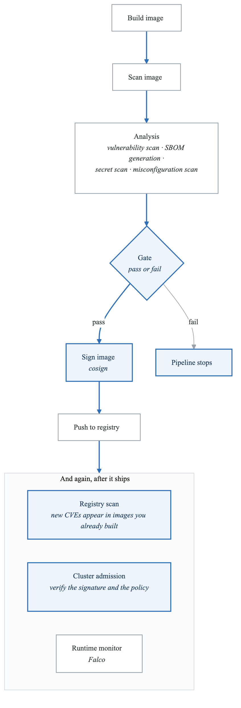
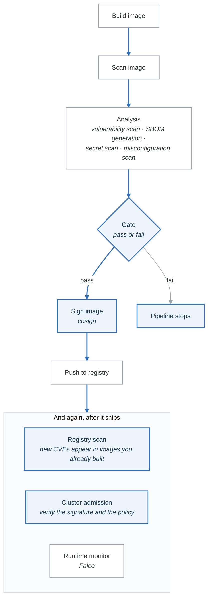

# Exercise 4: Image Scanning and Security

## Objectives

- Implement container image vulnerability scanning
- Configure scanning in CI/CD pipelines
- Set up admission control based on scan results
- Manage vulnerabilities and exceptions

## Prerequisites

- Completed Exercises 1-3
- Container registry configured
- Understanding of CVE databases

---

## Part 1: Scanning Overview

### 1.1 Security Scanning Pipeline

<!-- figure: generated from the Mermaid below by _shared/diagrams/embed-figures.py — do not edit the image -->


<details>
<summary>Diagram source (Mermaid)</summary>



</details>

---

## Part 2: Trivy Scanning

### 2.1 Trivy Task

```yaml
# trivy-scan-task.yaml
apiVersion: tekton.dev/v1beta1
kind: Task
metadata:
  name: trivy-scan
spec:
  params:
    - name: IMAGE
      description: Image to scan
    - name: SEVERITY
      default: HIGH,CRITICAL
    - name: EXIT_CODE
      default: "1"
      description: "Exit code on vulnerabilities found"
  results:
    - name: SCAN_RESULT
    - name: VULN_COUNT
  workspaces:
    - name: output
  steps:
    - name: scan
      image: aquasec/trivy:latest
      script: |
        #!/bin/sh
        set +e

        # Scan image
        trivy image \
          --severity $(params.SEVERITY) \
          --format json \
          --output $(workspaces.output.path)/trivy-results.json \
          $(params.IMAGE)

        # Generate SARIF for GitHub
        trivy image \
          --severity $(params.SEVERITY) \
          --format sarif \
          --output $(workspaces.output.path)/trivy-results.sarif \
          $(params.IMAGE)

        # Count vulnerabilities
        CRITICAL=$(cat $(workspaces.output.path)/trivy-results.json | jq '[.Results[].Vulnerabilities[]? | select(.Severity=="CRITICAL")] | length')
        HIGH=$(cat $(workspaces.output.path)/trivy-results.json | jq '[.Results[].Vulnerabilities[]? | select(.Severity=="HIGH")] | length')

        echo "$CRITICAL critical, $HIGH high vulnerabilities found"

        # Store results
        echo "{\"critical\": $CRITICAL, \"high\": $HIGH}" > $(results.VULN_COUNT.path)

        if [ "$CRITICAL" -gt 0 ]; then
          echo "CRITICAL" > $(results.SCAN_RESULT.path)
          exit $(params.EXIT_CODE)
        elif [ "$HIGH" -gt 0 ]; then
          echo "HIGH" > $(results.SCAN_RESULT.path)
          exit $(params.EXIT_CODE)
        else
          echo "PASS" > $(results.SCAN_RESULT.path)
        fi
```

### 2.2 Trivy Config Scanning

```yaml
# trivy-config-scan.yaml
apiVersion: tekton.dev/v1beta1
kind: Task
metadata:
  name: trivy-config-scan
spec:
  params:
    - name: CONFIG_PATH
      default: "."
  workspaces:
    - name: source
    - name: output
  steps:
    - name: scan-configs
      image: aquasec/trivy:latest
      script: |
        #!/bin/sh
        trivy config \
          --severity HIGH,CRITICAL \
          --format json \
          --output $(workspaces.output.path)/config-scan.json \
          $(workspaces.source.path)/$(params.CONFIG_PATH)

        # Check for misconfigurations
        trivy config \
          --severity HIGH,CRITICAL \
          --exit-code 1 \
          $(workspaces.source.path)/$(params.CONFIG_PATH)
```

### 2.3 Trivy Filesystem Scan

```yaml
# trivy-fs-scan.yaml
apiVersion: tekton.dev/v1beta1
kind: Task
metadata:
  name: trivy-fs-scan
spec:
  workspaces:
    - name: source
  steps:
    - name: scan-dependencies
      image: aquasec/trivy:latest
      script: |
        #!/bin/sh
        # Scan for vulnerable dependencies
        trivy fs \
          --severity HIGH,CRITICAL \
          --security-checks vuln,secret \
          --exit-code 1 \
          $(workspaces.source.path)
```

---

## Part 3: Grype Scanning

### 3.1 Grype Task

```yaml
# grype-scan-task.yaml
apiVersion: tekton.dev/v1beta1
kind: Task
metadata:
  name: grype-scan
spec:
  params:
    - name: IMAGE
    - name: FAIL_ON
      default: high
  workspaces:
    - name: output
  results:
    - name: SCAN_RESULT
  steps:
    - name: scan
      image: anchore/grype:latest
      script: |
        #!/bin/sh
        grype $(params.IMAGE) \
          --fail-on $(params.FAIL_ON) \
          --output json \
          > $(workspaces.output.path)/grype-results.json

        if [ $? -eq 0 ]; then
          echo "PASS" > $(results.SCAN_RESULT.path)
        else
          echo "FAIL" > $(results.SCAN_RESULT.path)
          exit 1
        fi
```

### 3.2 Grype with SBOM

```yaml
# grype-sbom-scan.yaml
apiVersion: tekton.dev/v1beta1
kind: Task
metadata:
  name: grype-sbom-scan
spec:
  params:
    - name: IMAGE
  workspaces:
    - name: output
  steps:
    - name: generate-sbom
      image: anchore/syft:latest
      script: |
        syft $(params.IMAGE) \
          -o spdx-json \
          > $(workspaces.output.path)/sbom.json

    - name: scan-sbom
      image: anchore/grype:latest
      script: |
        grype sbom:$(workspaces.output.path)/sbom.json \
          --fail-on high \
          --output json \
          > $(workspaces.output.path)/vulnerability-report.json
```

---

## Part 4: Snyk Integration

### 4.1 Snyk Container Scan

```yaml
# snyk-scan-task.yaml
apiVersion: tekton.dev/v1beta1
kind: Task
metadata:
  name: snyk-container-scan
spec:
  params:
    - name: IMAGE
    - name: SEVERITY_THRESHOLD
      default: high
  workspaces:
    - name: output
  steps:
    - name: scan
      image: snyk/snyk:docker
      env:
        - name: SNYK_TOKEN
          valueFrom:
            secretKeyRef:
              name: snyk-credentials
              key: token
      script: |
        #!/bin/sh
        snyk container test $(params.IMAGE) \
          --severity-threshold=$(params.SEVERITY_THRESHOLD) \
          --json \
          > $(workspaces.output.path)/snyk-results.json || true

        # Monitor in Snyk dashboard
        snyk container monitor $(params.IMAGE) \
          --org=my-org \
          --project-name=$(params.IMAGE)
```

### 4.2 Snyk Code Scanning

```yaml
# snyk-code-task.yaml
apiVersion: tekton.dev/v1beta1
kind: Task
metadata:
  name: snyk-code-scan
spec:
  workspaces:
    - name: source
  steps:
    - name: scan-code
      image: snyk/snyk:docker
      workingDir: $(workspaces.source.path)
      env:
        - name: SNYK_TOKEN
          valueFrom:
            secretKeyRef:
              name: snyk-credentials
              key: token
      script: |
        #!/bin/sh
        # Scan dependencies
        snyk test --severity-threshold=high

        # Scan code for security issues
        snyk code test --severity-threshold=high
```

---

## Part 5: GitHub Actions Integration

### 5.1 Comprehensive Security Scan

```yaml
# .github/workflows/security-scan.yaml
name: Security Scan

on:
  push:
    branches: [main]
  pull_request:
    branches: [main]

jobs:
  trivy-scan:
    runs-on: ubuntu-latest
    steps:
      - uses: actions/checkout@v4

      - name: Build Image
        run: docker build -t myapp:${{ github.sha }} .

      - name: Run Trivy vulnerability scanner
        uses: aquasecurity/trivy-action@master
        with:
          image-ref: 'myapp:${{ github.sha }}'
          format: 'sarif'
          output: 'trivy-results.sarif'
          severity: 'CRITICAL,HIGH'

      - name: Upload Trivy scan results
        uses: github/codeql-action/upload-sarif@v3
        with:
          sarif_file: 'trivy-results.sarif'

  snyk-scan:
    runs-on: ubuntu-latest
    steps:
      - uses: actions/checkout@v4

      - name: Run Snyk
        uses: snyk/actions/docker@master
        env:
          SNYK_TOKEN: ${{ secrets.SNYK_TOKEN }}
        with:
          image: myapp:${{ github.sha }}
          args: --severity-threshold=high

  grype-scan:
    runs-on: ubuntu-latest
    steps:
      - uses: actions/checkout@v4

      - name: Build Image
        run: docker build -t myapp:${{ github.sha }} .

      - name: Scan with Grype
        uses: anchore/scan-action@v3
        with:
          image: 'myapp:${{ github.sha }}'
          fail-build: true
          severity-cutoff: high
```

### 5.2 SBOM and Attestation

```yaml
# .github/workflows/sbom.yaml
name: Generate SBOM

on:
  push:
    tags: ['v*']

jobs:
  sbom:
    runs-on: ubuntu-latest
    permissions:
      contents: write
      packages: write
      id-token: write

    steps:
      - uses: actions/checkout@v4

      - name: Set up Docker Buildx
        uses: docker/setup-buildx-action@v3

      - name: Build and Push
        uses: docker/build-push-action@v5
        with:
          push: true
          tags: ghcr.io/${{ github.repository }}:${{ github.ref_name }}

      - name: Generate SBOM
        uses: anchore/sbom-action@v0
        with:
          image: ghcr.io/${{ github.repository }}:${{ github.ref_name }}
          format: spdx-json
          output-file: sbom.spdx.json

      - name: Install Cosign
        uses: sigstore/cosign-installer@v3

      - name: Attest SBOM
        run: |
          cosign attest \
            --predicate sbom.spdx.json \
            --type spdx \
            ghcr.io/${{ github.repository }}:${{ github.ref_name }}
        env:
          COSIGN_EXPERIMENTAL: "1"
```

---

## Part 6: Admission Control

### 6.1 Kyverno Image Verification

```yaml
# kyverno-image-verification.yaml
apiVersion: kyverno.io/v1
kind: ClusterPolicy
metadata:
  name: verify-image-signature
spec:
  validationFailureAction: Enforce
  background: false
  rules:
    - name: verify-signature
      match:
        any:
          - resources:
              kinds:
                - Pod
      verifyImages:
        - imageReferences:
            - "ghcr.io/myorg/*"
          attestors:
            - count: 1
              entries:
                - keyless:
                    subject: "*@myorg.com"
                    issuer: "https://accounts.google.com"
```

### 6.2 OPA Gatekeeper Scan Policy

```yaml
# scan-required-constraint.yaml
apiVersion: templates.gatekeeper.sh/v1
kind: ConstraintTemplate
metadata:
  name: k8simagescanrequired
spec:
  crd:
    spec:
      names:
        kind: K8sImageScanRequired
      validation:
        openAPIV3Schema:
          type: object
          properties:
            allowedRegistries:
              type: array
              items:
                type: string
  targets:
    - target: admission.k8s.gatekeeper.sh
      rego: |
        package k8simagescanrequired

        violation[{"msg": msg}] {
          container := input.review.object.spec.containers[_]
          not image_allowed(container.image)
          msg := sprintf("Image %v must be from an allowed registry with scan results", [container.image])
        }

        image_allowed(image) {
          startswith(image, input.parameters.allowedRegistries[_])
        }
---
apiVersion: constraints.gatekeeper.sh/v1beta1
kind: K8sImageScanRequired
metadata:
  name: require-scanned-images
spec:
  match:
    kinds:
      - apiGroups: [""]
        kinds: ["Pod"]
    namespaces:
      - production
  parameters:
    allowedRegistries:
      - "ghcr.io/myorg/"
      - "registry.example.com/scanned/"
```

### 6.3 Trivy Operator

```bash
# Install Trivy Operator
helm repo add aqua https://aquasecurity.github.io/helm-charts/
helm repo update
helm install trivy-operator aqua/trivy-operator \
  --namespace trivy-system \
  --create-namespace \
  --set trivy.severity="HIGH,CRITICAL"
```

```yaml
# View vulnerability reports
kubectl get vulnerabilityreports -A

# Example VulnerabilityReport
apiVersion: aquasecurity.github.io/v1alpha1
kind: VulnerabilityReport
metadata:
  name: deployment-myapp-mycontainer
  namespace: production
  labels:
    trivy-operator.resource.name: myapp
    trivy-operator.resource.kind: Deployment
report:
  scanner:
    name: Trivy
    version: 0.45.0
  summary:
    criticalCount: 0
    highCount: 2
    mediumCount: 5
    lowCount: 10
  vulnerabilities:
    - vulnerabilityID: CVE-2023-1234
      severity: HIGH
      resource: libssl
      installedVersion: 1.1.1k
      fixedVersion: 1.1.1l
```

---

## Part 7: Vulnerability Management

### 7.1 Exception Management

```yaml
# trivy-ignore.yaml
# .trivyignore file
# Ignore specific CVEs
CVE-2023-12345
CVE-2023-67890

# Ignore with expiry
CVE-2023-11111 exp:2024-03-01
```

```yaml
# vulnerability-exception.yaml
apiVersion: aquasecurity.github.io/v1alpha1
kind: VulnerabilityExemption
metadata:
  name: accepted-vulnerabilities
  namespace: production
spec:
  exemptions:
    - vulnerabilityID: CVE-2023-12345
      reason: "False positive - not exploitable in our configuration"
      expiryDate: "2024-06-01"
      approvedBy: security-team
    - vulnerabilityID: CVE-2023-67890
      reason: "Mitigation in place via network policy"
      expiryDate: "2024-03-15"
```

### 7.2 Vulnerability Dashboard

```yaml
# vulnerability-dashboard.yaml
apiVersion: monitoring.coreos.com/v1
kind: PrometheusRule
metadata:
  name: vulnerability-alerts
  namespace: monitoring
spec:
  groups:
    - name: vulnerabilities
      rules:
        - alert: CriticalVulnerabilityFound
          expr: |
            sum(trivy_vulnerability_count{severity="CRITICAL"}) by (namespace, resource_name) > 0
          for: 5m
          labels:
            severity: critical
          annotations:
            summary: Critical vulnerability in container
            description: "{{ $labels.resource_name }} in {{ $labels.namespace }} has critical vulnerabilities"

        - alert: HighVulnerabilityCount
          expr: |
            sum(trivy_vulnerability_count{severity="HIGH"}) by (namespace, resource_name) > 5
          for: 15m
          labels:
            severity: warning
          annotations:
            summary: High vulnerability count
```

---

## Part 8: Complete Pipeline

### 8.1 Security-First Pipeline

```yaml
# security-pipeline.yaml
apiVersion: tekton.dev/v1beta1
kind: Pipeline
metadata:
  name: secure-build-pipeline
spec:
  params:
    - name: GIT_URL
    - name: IMAGE
    - name: SEVERITY_THRESHOLD
      default: HIGH
  workspaces:
    - name: source
    - name: scan-results
    - name: dockerconfig
  tasks:
    - name: clone
      taskRef:
        name: git-clone
      params:
        - name: url
          value: $(params.GIT_URL)
      workspaces:
        - name: output
          workspace: source

    - name: scan-source
      runAfter: [clone]
      taskRef:
        name: trivy-fs-scan
      workspaces:
        - name: source
          workspace: source

    - name: build
      runAfter: [scan-source]
      taskRef:
        name: kaniko-build
      params:
        - name: IMAGE
          value: $(params.IMAGE)
      workspaces:
        - name: source
          workspace: source
        - name: dockerconfig
          workspace: dockerconfig

    - name: scan-image
      runAfter: [build]
      taskRef:
        name: trivy-scan
      params:
        - name: IMAGE
          value: $(params.IMAGE)
        - name: SEVERITY
          value: $(params.SEVERITY_THRESHOLD),CRITICAL
      workspaces:
        - name: output
          workspace: scan-results

    - name: generate-sbom
      runAfter: [scan-image]
      taskRef:
        name: generate-sbom
      params:
        - name: IMAGE
          value: $(params.IMAGE)
      workspaces:
        - name: output
          workspace: scan-results

    - name: sign-image
      runAfter: [generate-sbom]
      taskRef:
        name: sign-image
      params:
        - name: IMAGE
          value: $(params.IMAGE)
        - name: DIGEST
          value: $(tasks.build.results.IMAGE_DIGEST)
```

---

## Part 9: Hands-on Challenges

### Challenge 1: Zero-Trust Pipeline

Implement zero-trust image pipeline:
1. Scan at build time
2. Sign after scan passes
3. Verify at admission
4. Continuous runtime scanning

### Challenge 2: Vulnerability SLA

Create vulnerability management process:
1. Define severity SLAs
2. Automate exception workflow
3. Generate compliance reports
4. Alert on SLA violations

### Challenge 3: Multi-Scanner Setup

Deploy multiple scanners:
1. Configure Trivy and Grype
2. Aggregate results
3. Deduplicate findings
4. Create unified dashboard

---

## Verification Tasks

1. [ ] Configured Trivy scanning
2. [ ] Integrated with CI/CD pipeline
3. [ ] Set up admission control
4. [ ] Deployed Trivy Operator
5. [ ] Created vulnerability dashboard
6. [ ] Implemented exception process

---

## Key Takeaways

- Scan early and often in the pipeline
- Use multiple scanners for coverage
- Block vulnerable images at admission
- Implement exception process for false positives
- Monitor runtime for new vulnerabilities
- Generate SBOM for transparency

---

## Next Steps

Continue to [Exercise 5: Artifact Management](02-cicd-pipelines-exercises-05-artifact-management.md)

<!-- feynman-check -->

---

## Feynman check

Close the file. Blank page, no notes. Explain each of these to a competent engineer who has never
used this tool — **under five minutes, no jargon you can't define on the spot:**

- Scanning Overview
- Trivy Scanning
- Grype Scanning
- Snyk Integration

**The gap is not what you forgot. It is where you used a word instead of a mechanism.**

| | |
|---|---|
| ✗ | *"Kubernetes schedules the pod."* |
| ✓ | *"The scheduler watches for pods with no `nodeName`, filters nodes by predicates, scores the survivors, and writes `nodeName` into the pod spec. The kubelet on that node is watching the API for pods bound to it, and starts the containers."* |

**Trace it:** `kubectl apply -f pod.yaml` → a running container. Name every component that acts, in order, and what each one writes.

Stop at the first component you cannot name. Reopen this file and read **only** that.

**Go deeper — only once the gap has a name:** [Kubernetes the Hard Way](https://github.com/kelseyhightower/kubernetes-the-hard-way) — one weekend, and "the control plane" stops being a word.
Full list per domain: [`SOURCES.md`](../../SOURCES.md#kubernetes)

→ Protocol, the three levels of knowing, and worked examples: [`MASTERY.md`](../../MASTERY.md)

<!-- /feynman-check -->
