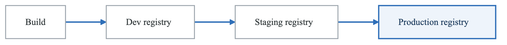

# Exercise 5: Artifact Management

## Objectives

- Set up container registry management
- Configure artifact retention policies
- Implement image promotion workflows
- Manage Helm charts and OCI artifacts

## Prerequisites

- Completed Exercises 1-4
- Container registry access
- Understanding of artifact types

---

## Part 1: Registry Architecture

### 1.1 Multi-Registry Strategy

```mermaid
%%{init: {'theme':'base','themeVariables':{'fontFamily':'Helvetica, Arial, sans-serif','fontSize':'13px','primaryColor':'#ffffff','primaryTextColor':'#2d3436','primaryBorderColor':'#9aa3ab','lineColor':'#9aa3ab','textColor':'#2d3436','clusterBkg':'#fbfcfd','clusterBorder':'#d4dae0','edgeLabelBackground':'#ffffff','tertiaryColor':'#eef4fb'},'flowchart':{'curve':'basis','padding':14,'nodeSpacing':42,'rankSpacing':58}}}%%
flowchart LR
  classDef default fill:#ffffff,stroke:#9aa3ab,stroke-width:1.3px,color:#2d3436
  classDef n    fill:#ffffff,stroke:#9aa3ab,stroke-width:1.3px,color:#2d3436
  classDef crit fill:#eef4fb,stroke:#2f6fb8,stroke-width:1.8px,color:#1b3a5c
  classDef data fill:#f4f7fa,stroke:#9aa3ab,stroke-width:1.3px,color:#2d3436
  classDef mut  fill:#ffffff,stroke:#cfd6dc,stroke-width:1.1px,color:#7a8288
  classDef warn fill:#fdf0ec,stroke:#c0522d,stroke-width:1.6px,color:#8a3a1e
  B["Build"] ==> D["Dev registry"] ==> S["Staging registry"] ==> P["Production registry"]
  class B n
  class D,S n
  class P crit
  linkStyle 0,1,2 stroke:#2f6fb8,stroke-width:2px
```

<!-- figure: generated from the Mermaid below by _shared/diagrams/embed-figures.py — do not edit the image -->


<details>
<summary>Diagram source (Mermaid)</summary>



</details>

**Registries, and why more than one**

| Registry | Holds | Retention |
|---|---|---|
| Development | Every build, including the broken ones | Short — days |
| Staging | Images that passed their tests | Medium — weeks |
| Production | Promoted images only | Long — a year or more, for forensics |
| Cache | A pull-through proxy for public registries | Whatever fits |

**What goes in beside the image**

- Container images
- Helm charts (as OCI artifacts)
- SBOM attestations
- Signatures
- Provenance records

The cache registry earns its place the first time Docker Hub rate-limits your build fleet on a
Monday morning. The rest of the list is what turns a registry into a supply-chain record: the image
alone cannot tell you what is inside it or who built it.

---

## Part 2: Harbor Registry

### 2.1 Harbor Installation

```bash
# Add Harbor Helm repo
helm repo add harbor https://helm.goharbor.io
helm repo update

# Install Harbor
helm install harbor harbor/harbor \
  --namespace harbor \
  --create-namespace \
  --set expose.type=ingress \
  --set expose.ingress.hosts.core=registry.example.com \
  --set expose.tls.certSource=secret \
  --set expose.tls.secret.secretName=harbor-tls \
  --set persistence.persistentVolumeClaim.registry.size=100Gi \
  --set persistence.persistentVolumeClaim.chartmuseum.size=10Gi \
  --set trivy.enabled=true \
  --set notary.enabled=true
```

### 2.2 Harbor Projects Configuration

```yaml
# harbor-projects.yaml
# Use Harbor API or UI to create projects
projects:
  - name: development
    public: false
    storage_limit: 50Gi
    severity: none  # No blocking
    auto_scan: true

  - name: staging
    public: false
    storage_limit: 30Gi
    severity: high  # Block high+ vulnerabilities
    auto_scan: true

  - name: production
    public: false
    storage_limit: 100Gi
    severity: critical  # Block critical only
    auto_scan: true
    immutable_tags: true  # Prevent tag overwrites
```

### 2.3 Harbor Replication Rules

```yaml
# harbor-replication.yaml
# Replicate from staging to production
apiVersion: goharbor.io/v1beta1
kind: HarborReplicationRule
metadata:
  name: staging-to-production
spec:
  name: staging-to-production
  src_registry_id: 0  # Local
  dest_registry_id: 1  # Production registry
  src_namespaces:
    - staging
  dest_namespace: production
  trigger:
    type: manual  # Or scheduled/event_based
  filters:
    - type: tag
      value: "v*"  # Only version tags
    - type: label
      value: "approved=true"
  override: false  # Don't overwrite existing
  enabled: true
```

---

## Part 3: Image Promotion

### 3.1 Promotion Pipeline

```yaml
# promotion-pipeline.yaml
apiVersion: tekton.dev/v1beta1
kind: Pipeline
metadata:
  name: image-promotion
spec:
  params:
    - name: SOURCE_IMAGE
    - name: TARGET_IMAGE
    - name: REQUIRE_SCAN
      default: "true"
  workspaces:
    - name: dockerconfig
  tasks:
    - name: verify-scan
      when:
        - input: $(params.REQUIRE_SCAN)
          operator: in
          values: ["true"]
      taskRef:
        name: verify-scan-status
      params:
        - name: IMAGE
          value: $(params.SOURCE_IMAGE)

    - name: verify-signature
      runAfter: [verify-scan]
      taskRef:
        name: cosign-verify
      params:
        - name: IMAGE
          value: $(params.SOURCE_IMAGE)

    - name: retag-and-push
      runAfter: [verify-signature]
      taskRef:
        name: skopeo-copy
      params:
        - name: SOURCE
          value: docker://$(params.SOURCE_IMAGE)
        - name: DESTINATION
          value: docker://$(params.TARGET_IMAGE)
      workspaces:
        - name: dockerconfig
          workspace: dockerconfig

    - name: sign-promoted
      runAfter: [retag-and-push]
      taskRef:
        name: cosign-sign
      params:
        - name: IMAGE
          value: $(params.TARGET_IMAGE)
```

### 3.2 Skopeo Copy Task

```yaml
# skopeo-copy-task.yaml
apiVersion: tekton.dev/v1beta1
kind: Task
metadata:
  name: skopeo-copy
spec:
  params:
    - name: SOURCE
    - name: DESTINATION
    - name: PRESERVE_DIGESTS
      default: "true"
  workspaces:
    - name: dockerconfig
  steps:
    - name: copy
      image: quay.io/skopeo/stable:latest
      env:
        - name: DOCKER_CONFIG
          value: $(workspaces.dockerconfig.path)
      script: |
        #!/bin/sh
        ARGS=""
        if [ "$(params.PRESERVE_DIGESTS)" = "true" ]; then
          ARGS="--preserve-digests"
        fi

        skopeo copy \
          --all \
          $ARGS \
          $(params.SOURCE) \
          $(params.DESTINATION)
```

### 3.3 GitHub Actions Promotion

```yaml
# .github/workflows/promote.yaml
name: Promote Image

on:
  workflow_dispatch:
    inputs:
      source_tag:
        description: 'Source image tag'
        required: true
      target_env:
        description: 'Target environment'
        required: true
        type: choice
        options:
          - staging
          - production

jobs:
  promote:
    runs-on: ubuntu-latest
    steps:
      - name: Install Cosign
        uses: sigstore/cosign-installer@v3

      - name: Install Skopeo
        run: |
          sudo apt-get update
          sudo apt-get install -y skopeo

      - name: Login to Source Registry
        uses: docker/login-action@v3
        with:
          registry: ghcr.io
          username: ${{ github.actor }}
          password: ${{ secrets.GITHUB_TOKEN }}

      - name: Verify Image Signature
        run: |
          cosign verify \
            --certificate-identity-regexp='.*@myorg\.com' \
            --certificate-oidc-issuer='https://token.actions.githubusercontent.com' \
            ghcr.io/${{ github.repository }}:${{ inputs.source_tag }}

      - name: Promote Image
        run: |
          skopeo copy \
            --all \
            docker://ghcr.io/${{ github.repository }}:${{ inputs.source_tag }} \
            docker://ghcr.io/${{ github.repository }}:${{ inputs.target_env }}-latest

      - name: Sign Promoted Image
        run: |
          cosign sign \
            --yes \
            ghcr.io/${{ github.repository }}:${{ inputs.target_env }}-latest
        env:
          COSIGN_EXPERIMENTAL: "1"
```

---

## Part 4: Retention Policies

### 4.1 Harbor Retention

```yaml
# harbor-retention-policy.yaml
# Configure via Harbor API
retention_policy:
  rules:
    # Keep all tagged releases
    - action: retain
      template: latestPushedK
      params:
        k: 1000  # Keep all
      tag_selectors:
        - kind: doublestar
          pattern: "v*"
      scope:
        level: project
        ref: 0

    # Keep last 10 development builds
    - action: retain
      template: latestPushedK
      params:
        k: 10
      tag_selectors:
        - kind: doublestar
          pattern: "dev-*"
      scope:
        level: project
        ref: 0

    # Keep nothing older than 30 days for untagged
    - action: retain
      template: nDaysSinceLastPush
      params:
        n: 30
      tag_selectors:
        - kind: doublestar
          pattern: "**"
          untagged: true
      scope:
        level: project
        ref: 0
```

### 4.2 GCR/GAR Retention

```bash
# Google Artifact Registry lifecycle policy
gcloud artifacts repositories set-cleanup-policies \
  myrepo \
  --location=us-central1 \
  --policy=cleanup-policy.json
```

```json
// cleanup-policy.json
{
  "cleanupPolicies": [
    {
      "id": "delete-untagged",
      "action": {"type": "Delete"},
      "condition": {
        "tagState": "UNTAGGED",
        "olderThan": "604800s"
      }
    },
    {
      "id": "keep-releases",
      "action": {"type": "Keep"},
      "condition": {
        "tagPrefixes": ["v", "release-"],
        "packageNamePrefixes": ["myapp"]
      }
    },
    {
      "id": "delete-old-dev",
      "action": {"type": "Delete"},
      "condition": {
        "tagPrefixes": ["dev-", "pr-"],
        "olderThan": "1209600s"
      }
    }
  ]
}
```

### 4.3 ECR Lifecycle Policy

```json
{
  "rules": [
    {
      "rulePriority": 1,
      "description": "Keep all release images",
      "selection": {
        "tagStatus": "tagged",
        "tagPrefixList": ["v", "release-"],
        "countType": "imageCountMoreThan",
        "countNumber": 9999
      },
      "action": {
        "type": "expire"
      }
    },
    {
      "rulePriority": 2,
      "description": "Keep last 10 dev images",
      "selection": {
        "tagStatus": "tagged",
        "tagPrefixList": ["dev-"],
        "countType": "imageCountMoreThan",
        "countNumber": 10
      },
      "action": {
        "type": "expire"
      }
    },
    {
      "rulePriority": 3,
      "description": "Delete untagged images older than 7 days",
      "selection": {
        "tagStatus": "untagged",
        "countType": "sinceImagePushed",
        "countUnit": "days",
        "countNumber": 7
      },
      "action": {
        "type": "expire"
      }
    }
  ]
}
```

---

## Part 5: Helm Charts as OCI

### 5.1 Push Helm Chart to OCI Registry

```bash
# Package Helm chart
helm package ./mychart

# Login to OCI registry
helm registry login registry.example.com

# Push to OCI registry
helm push mychart-1.0.0.tgz oci://registry.example.com/charts

# Pull from OCI registry
helm pull oci://registry.example.com/charts/mychart --version 1.0.0

# Install from OCI
helm install myrelease oci://registry.example.com/charts/mychart --version 1.0.0
```

### 5.2 Helm Chart Pipeline

```yaml
# helm-publish-pipeline.yaml
apiVersion: tekton.dev/v1beta1
kind: Pipeline
metadata:
  name: helm-chart-publish
spec:
  params:
    - name: CHART_PATH
    - name: REGISTRY
    - name: VERSION
  workspaces:
    - name: source
    - name: helmconfig
  tasks:
    - name: clone
      taskRef:
        name: git-clone
      workspaces:
        - name: output
          workspace: source

    - name: lint
      runAfter: [clone]
      taskRef:
        name: helm-lint
      params:
        - name: CHART_PATH
          value: $(params.CHART_PATH)
      workspaces:
        - name: source
          workspace: source

    - name: package
      runAfter: [lint]
      taskRef:
        name: helm-package
      params:
        - name: CHART_PATH
          value: $(params.CHART_PATH)
        - name: VERSION
          value: $(params.VERSION)
      workspaces:
        - name: source
          workspace: source

    - name: push
      runAfter: [package]
      taskRef:
        name: helm-push-oci
      params:
        - name: CHART
          value: $(tasks.package.results.CHART_FILE)
        - name: REGISTRY
          value: $(params.REGISTRY)
      workspaces:
        - name: source
          workspace: source
        - name: helmconfig
          workspace: helmconfig
```

### 5.3 Helm Push Task

```yaml
# helm-push-task.yaml
apiVersion: tekton.dev/v1beta1
kind: Task
metadata:
  name: helm-push-oci
spec:
  params:
    - name: CHART
    - name: REGISTRY
  workspaces:
    - name: source
    - name: helmconfig
  steps:
    - name: push
      image: alpine/helm:latest
      workingDir: $(workspaces.source.path)
      env:
        - name: HELM_REGISTRY_CONFIG
          value: $(workspaces.helmconfig.path)/config.json
      script: |
        #!/bin/sh
        helm push $(params.CHART) oci://$(params.REGISTRY)
```

---

## Part 6: Registry Proxy/Cache

### 6.1 Harbor as Proxy

```yaml
# harbor-proxy-config.yaml
# Configure Harbor as pull-through cache
registry_endpoints:
  - name: docker-hub
    endpoint_url: https://registry-1.docker.io
    type: docker-hub
    credential:
      type: basic
      access_key: <username>
      access_secret: <password>

  - name: gcr
    endpoint_url: https://gcr.io
    type: google-gcr
    credential:
      type: basic
      access_key: _json_key
      access_secret: <service-account-json>

  - name: quay
    endpoint_url: https://quay.io
    type: quay
```

### 6.2 Kubernetes ImagePullSecrets

```yaml
# registry-credentials.yaml
apiVersion: v1
kind: Secret
metadata:
  name: registry-credentials
  namespace: production
type: kubernetes.io/dockerconfigjson
data:
  .dockerconfigjson: <base64-encoded-config>
---
# Patch default service account
apiVersion: v1
kind: ServiceAccount
metadata:
  name: default
  namespace: production
imagePullSecrets:
  - name: registry-credentials
```

### 6.3 Registry Mirror Configuration

```yaml
# containerd-config.toml
[plugins."io.containerd.grpc.v1.cri".registry.mirrors]
  [plugins."io.containerd.grpc.v1.cri".registry.mirrors."docker.io"]
    endpoint = ["https://harbor.example.com/v2/dockerhub-cache"]
  [plugins."io.containerd.grpc.v1.cri".registry.mirrors."gcr.io"]
    endpoint = ["https://harbor.example.com/v2/gcr-cache"]
```

---

## Part 7: SBOM and Attestations

### 7.1 Store SBOM as OCI Artifact

```yaml
# sbom-store-task.yaml
apiVersion: tekton.dev/v1beta1
kind: Task
metadata:
  name: store-sbom
spec:
  params:
    - name: IMAGE
    - name: SBOM_FILE
  workspaces:
    - name: sbom
  steps:
    - name: attach-sbom
      image: gcr.io/go-containerregistry/crane:latest
      script: |
        #!/bin/sh
        # Attach SBOM as referrer
        crane mutate \
          --annotation "org.opencontainers.image.source=https://github.com/org/repo" \
          --new-tag $(params.IMAGE).sbom \
          $(workspaces.sbom.path)/$(params.SBOM_FILE)

    - name: attest-sbom
      image: gcr.io/projectsigstore/cosign:latest
      script: |
        cosign attest \
          --predicate $(workspaces.sbom.path)/$(params.SBOM_FILE) \
          --type spdxjson \
          $(params.IMAGE)
```

### 7.2 Verify Attestations

```yaml
# verify-attestation-task.yaml
apiVersion: tekton.dev/v1beta1
kind: Task
metadata:
  name: verify-attestations
spec:
  params:
    - name: IMAGE
    - name: ATTESTATION_TYPE
      default: spdxjson
  steps:
    - name: verify
      image: gcr.io/projectsigstore/cosign:latest
      script: |
        #!/bin/sh
        cosign verify-attestation \
          --type $(params.ATTESTATION_TYPE) \
          --certificate-identity-regexp='.*' \
          --certificate-oidc-issuer-regexp='.*' \
          $(params.IMAGE)
```

---

## Part 8: Monitoring and Metrics

### 8.1 Registry Metrics

```yaml
# registry-metrics.yaml
apiVersion: monitoring.coreos.com/v1
kind: ServiceMonitor
metadata:
  name: harbor
  namespace: monitoring
spec:
  selector:
    matchLabels:
      app: harbor
  endpoints:
    - port: metrics
      interval: 30s
```

### 8.2 Storage Alerts

```yaml
# registry-alerts.yaml
apiVersion: monitoring.coreos.com/v1
kind: PrometheusRule
metadata:
  name: registry-alerts
  namespace: monitoring
spec:
  groups:
    - name: registry
      rules:
        - alert: RegistryStorageHigh
          expr: |
            harbor_project_quota_usage_byte / harbor_project_quota_byte > 0.8
          for: 15m
          labels:
            severity: warning
          annotations:
            summary: Registry storage quota nearly exhausted

        - alert: RegistryReplicationFailed
          expr: |
            harbor_replication_tasks_failed_total > 0
          for: 5m
          labels:
            severity: warning
          annotations:
            summary: Registry replication task failed
```

---

## Part 9: Hands-on Challenges

### Challenge 1: Multi-Tier Registry

Set up registry hierarchy:
1. Development registry (all builds)
2. Staging registry (tested images)
3. Production registry (approved only)
4. Implement promotion workflow

### Challenge 2: Retention Automation

Implement retention policies:
1. Keep all release tags forever
2. Keep last 20 dev builds
3. Delete untagged after 7 days
4. Generate cleanup reports

### Challenge 3: OCI Artifact Repository

Manage all artifacts as OCI:
1. Container images
2. Helm charts
3. SBOMs
4. Signatures and attestations

---

## Verification Tasks

1. [ ] Deployed Harbor registry
2. [ ] Configured image promotion
3. [ ] Set up retention policies
4. [ ] Published Helm charts as OCI
5. [ ] Configured registry proxy
6. [ ] Stored SBOM attestations

---

## Key Takeaways

- Use tiered registries for environments
- Implement automated image promotion
- Configure retention to manage storage
- Store all artifacts as OCI when possible
- Proxy external registries for caching
- Track SBOM and attestations with images

---

## Next Steps

Continue to [Exercise 6: Deployment Promotion](02-cicd-pipelines-exercises-06-deployment-promotion.md)

<!-- feynman-check -->

---

## Feynman check

Close the file. Blank page, no notes. Explain each of these to a competent engineer who has never
used this tool — **under five minutes, no jargon you can't define on the spot:**

- Registry Architecture
- Harbor Registry
- Image Promotion
- Retention Policies

**The gap is not what you forgot. It is where you used a word instead of a mechanism.**

| | |
|---|---|
| ✗ | *"Kubernetes schedules the pod."* |
| ✓ | *"The scheduler watches for pods with no `nodeName`, filters nodes by predicates, scores the survivors, and writes `nodeName` into the pod spec. The kubelet on that node is watching the API for pods bound to it, and starts the containers."* |

**Trace it:** `kubectl apply -f pod.yaml` → a running container. Name every component that acts, in order, and what each one writes.

Stop at the first component you cannot name. Reopen this file and read **only** that.

**Go deeper — only once the gap has a name:** [Kubernetes the Hard Way](https://github.com/kelseyhightower/kubernetes-the-hard-way) — one weekend, and "the control plane" stops being a word.
Full list per domain: [`SOURCES.md`](../../SOURCES.md#kubernetes)

→ Protocol, the three levels of knowing, and worked examples: [`MASTERY.md`](../../MASTERY.md)

<!-- /feynman-check -->
