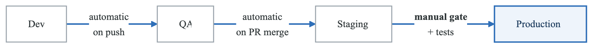

# Exercise 6: Deployment Promotion Strategies

## Objectives

- Implement multi-environment deployment pipelines
- Configure approval gates and policies
- Automate environment promotion
- Integrate with GitOps workflows

## Prerequisites

- Completed Exercises 1-5
- ArgoCD or Flux deployed
- Multiple environments configured

---

## Part 1: Promotion Strategies

### 1.1 Environment Hierarchy

```mermaid
%%{init: {'theme':'base','themeVariables':{'fontFamily':'Helvetica, Arial, sans-serif','fontSize':'13px','primaryColor':'#ffffff','primaryTextColor':'#2d3436','primaryBorderColor':'#9aa3ab','lineColor':'#9aa3ab','textColor':'#2d3436','clusterBkg':'#fbfcfd','clusterBorder':'#d4dae0','edgeLabelBackground':'#ffffff','tertiaryColor':'#eef4fb'},'flowchart':{'curve':'basis','padding':14,'nodeSpacing':42,'rankSpacing':58}}}%%
flowchart LR
  classDef default fill:#ffffff,stroke:#9aa3ab,stroke-width:1.3px,color:#2d3436
  classDef n    fill:#ffffff,stroke:#9aa3ab,stroke-width:1.3px,color:#2d3436
  classDef crit fill:#eef4fb,stroke:#2f6fb8,stroke-width:1.8px,color:#1b3a5c
  classDef data fill:#f4f7fa,stroke:#9aa3ab,stroke-width:1.3px,color:#2d3436
  classDef mut  fill:#ffffff,stroke:#cfd6dc,stroke-width:1.1px,color:#7a8288
  classDef warn fill:#fdf0ec,stroke:#c0522d,stroke-width:1.6px,color:#8a3a1e
  D["Dev"] ==>|"automatic<br/>on push"| Q["QA"] ==>|"automatic<br/>on PR merge"| S["Staging"] ==>|"<b>manual gate</b><br/>+ tests"| P["Production"]
  class D,Q n
  class S n
  class P crit
  linkStyle 0,1,2 stroke:#2f6fb8,stroke-width:2px
```

<!-- figure: generated from the Mermaid below by _shared/diagrams/embed-figures.py — do not edit the image -->


<details>
<summary>Diagram source (Mermaid)</summary>



</details>

**Promotion types**

| Type | Trigger |
|---|---|
| Automatic | A CI event — push, merge |
| Semi-automatic | Tests pass, then promote without asking |
| Manual | Explicit human approval |
| Scheduled | A release window |

**Gate types**

| Gate | Asks |
|---|---|
| Quality | Did the tests and scans pass? |
| Approval | Does a human agree? |
| Time | Are we inside a maintenance window? |
| Policy | Does this satisfy the compliance rules? |

Time gates are the one people add late and wish they had added early. "No production deploys after
16:00 on a Friday" is a policy every team says out loud and almost none of them encode — and a rule
that lives only in the culture stops applying the week the culture is busy.

---

## Part 2: Git-Based Promotion

### 2.1 Repository Structure

**`gitops-config/`**

- `base/`
  - `deployment.yaml`
  - `service.yaml`
  - `kustomization.yaml`
- `environments/`
  - `dev/`
    - `kustomization.yaml`
    - `values.yaml`
  - `staging/`
    - `kustomization.yaml`
    - `values.yaml`
  - `production/`
    - `kustomization.yaml`
    - `values.yaml`
- `promotion/`
  - `promote.sh`


### 2.2 Environment Kustomization

```yaml
# environments/dev/kustomization.yaml
apiVersion: kustomize.config.k8s.io/v1beta1
kind: Kustomization
namespace: myapp-dev
resources:
  - ../../base
images:
  - name: myapp
    newTag: dev-abc123  # Updated by CI
patches:
  - patch: |
      - op: replace
        path: /spec/replicas
        value: 1
    target:
      kind: Deployment
      name: myapp
---
# environments/production/kustomization.yaml
apiVersion: kustomize.config.k8s.io/v1beta1
kind: Kustomization
namespace: myapp-production
resources:
  - ../../base
images:
  - name: myapp
    newTag: v1.2.3  # Promoted from staging
patches:
  - patch: |
      - op: replace
        path: /spec/replicas
        value: 5
    target:
      kind: Deployment
      name: myapp
```

### 2.3 Promotion Script

```bash
#!/bin/bash
# promotion/promote.sh

SOURCE_ENV=$1
TARGET_ENV=$2

if [ -z "$SOURCE_ENV" ] || [ -z "$TARGET_ENV" ]; then
  echo "Usage: $0 <source-env> <target-env>"
  exit 1
fi

# Get current image tag from source
SOURCE_TAG=$(yq e '.images[0].newTag' environments/$SOURCE_ENV/kustomization.yaml)

echo "Promoting $SOURCE_TAG from $SOURCE_ENV to $TARGET_ENV"

# Update target environment
cd environments/$TARGET_ENV
kustomize edit set image myapp=myapp:$SOURCE_TAG

# Commit and push
git add kustomization.yaml
git commit -m "Promote $SOURCE_TAG to $TARGET_ENV"
git push origin main
```

---

## Part 3: Tekton Promotion Pipeline

### 3.1 Complete Promotion Pipeline

```yaml
# promotion-pipeline.yaml
apiVersion: tekton.dev/v1beta1
kind: Pipeline
metadata:
  name: environment-promotion
spec:
  params:
    - name: SOURCE_ENV
    - name: TARGET_ENV
    - name: GITOPS_REPO
    - name: REQUIRE_APPROVAL
      default: "true"
  workspaces:
    - name: gitops
    - name: git-credentials
  tasks:
    # Clone GitOps repo
    - name: clone-gitops
      taskRef:
        name: git-clone
      params:
        - name: url
          value: $(params.GITOPS_REPO)
      workspaces:
        - name: output
          workspace: gitops

    # Get source image tag
    - name: get-source-tag
      runAfter: [clone-gitops]
      taskRef:
        name: yq-extract
      params:
        - name: FILE
          value: environments/$(params.SOURCE_ENV)/kustomization.yaml
        - name: EXPRESSION
          value: .images[0].newTag
      workspaces:
        - name: source
          workspace: gitops

    # Run pre-promotion tests
    - name: integration-tests
      runAfter: [get-source-tag]
      taskRef:
        name: run-integration-tests
      params:
        - name: ENVIRONMENT
          value: $(params.SOURCE_ENV)

    # Verify image scans passed
    - name: verify-scan
      runAfter: [integration-tests]
      taskRef:
        name: verify-scan-status
      params:
        - name: IMAGE_TAG
          value: $(tasks.get-source-tag.results.value)

    # Wait for approval (if required)
    - name: approval-gate
      when:
        - input: $(params.REQUIRE_APPROVAL)
          operator: in
          values: ["true"]
      runAfter: [verify-scan]
      taskRef:
        name: approval-gate
      params:
        - name: APPROVERS
          value: "platform-team,sre-team"
        - name: MESSAGE
          value: "Approve promotion of $(tasks.get-source-tag.results.value) to $(params.TARGET_ENV)?"

    # Update target environment
    - name: update-target
      runAfter: [approval-gate]
      taskRef:
        name: kustomize-set-image
      params:
        - name: ENVIRONMENT
          value: $(params.TARGET_ENV)
        - name: IMAGE_TAG
          value: $(tasks.get-source-tag.results.value)
      workspaces:
        - name: source
          workspace: gitops

    # Commit and push changes
    - name: commit-push
      runAfter: [update-target]
      taskRef:
        name: git-commit-push
      params:
        - name: MESSAGE
          value: "Promote $(tasks.get-source-tag.results.value) to $(params.TARGET_ENV)"
      workspaces:
        - name: source
          workspace: gitops
        - name: git-credentials
          workspace: git-credentials

    # Wait for ArgoCD sync
    - name: wait-for-sync
      runAfter: [commit-push]
      taskRef:
        name: argocd-sync-wait
      params:
        - name: APPLICATION
          value: myapp-$(params.TARGET_ENV)
        - name: TIMEOUT
          value: "300"

    # Run smoke tests
    - name: smoke-tests
      runAfter: [wait-for-sync]
      taskRef:
        name: run-smoke-tests
      params:
        - name: ENVIRONMENT
          value: $(params.TARGET_ENV)
```

### 3.2 Approval Gate Task

```yaml
# approval-gate-task.yaml
apiVersion: tekton.dev/v1beta1
kind: Task
metadata:
  name: approval-gate
spec:
  params:
    - name: APPROVERS
    - name: MESSAGE
    - name: TIMEOUT
      default: "3600"
  results:
    - name: APPROVED_BY
    - name: APPROVAL_TIME
  steps:
    - name: create-approval-request
      image: bitnami/kubectl:latest
      script: |
        #!/bin/sh
        # Create approval custom resource
        cat <<EOF | kubectl apply -f -
        apiVersion: tekton.dev/v1alpha1
        kind: ApprovalRequest
        metadata:
          name: approval-$(context.taskRun.name)
          namespace: $(context.taskRun.namespace)
        spec:
          approvers: $(params.APPROVERS)
          message: "$(params.MESSAGE)"
          timeout: $(params.TIMEOUT)s
        EOF

    - name: wait-for-approval
      image: bitnami/kubectl:latest
      timeout: $(params.TIMEOUT)s
      script: |
        #!/bin/sh
        while true; do
          STATUS=$(kubectl get approvalrequest approval-$(context.taskRun.name) -o jsonpath='{.status.decision}')
          if [ "$STATUS" = "approved" ]; then
            APPROVER=$(kubectl get approvalrequest approval-$(context.taskRun.name) -o jsonpath='{.status.approvedBy}')
            echo "$APPROVER" > $(results.APPROVED_BY.path)
            date -u > $(results.APPROVAL_TIME.path)
            exit 0
          elif [ "$STATUS" = "rejected" ]; then
            echo "Approval rejected"
            exit 1
          fi
          sleep 10
        done
```

---

## Part 4: GitHub Actions Promotion

### 4.1 Promotion Workflow

```yaml
# .github/workflows/promote.yaml
name: Environment Promotion

on:
  workflow_dispatch:
    inputs:
      source_env:
        description: 'Source environment'
        required: true
        type: choice
        options:
          - dev
          - staging
      target_env:
        description: 'Target environment'
        required: true
        type: choice
        options:
          - staging
          - production
      skip_approval:
        description: 'Skip approval (for dev->staging only)'
        type: boolean
        default: false

jobs:
  validate:
    runs-on: ubuntu-latest
    outputs:
      image_tag: ${{ steps.get-tag.outputs.tag }}
    steps:
      - uses: actions/checkout@v4

      - name: Get source image tag
        id: get-tag
        run: |
          TAG=$(yq e '.images[0].newTag' environments/${{ inputs.source_env }}/kustomization.yaml)
          echo "tag=$TAG" >> $GITHUB_OUTPUT

      - name: Validate promotion path
        run: |
          if [ "${{ inputs.source_env }}" = "dev" ] && [ "${{ inputs.target_env }}" = "production" ]; then
            echo "Cannot promote directly from dev to production"
            exit 1
          fi

  integration-tests:
    needs: validate
    runs-on: ubuntu-latest
    steps:
      - name: Run integration tests
        run: |
          echo "Running tests against ${{ inputs.source_env }}"
          # Add actual test commands

  security-scan:
    needs: validate
    runs-on: ubuntu-latest
    steps:
      - name: Verify scan status
        run: |
          echo "Verifying scan for ${{ needs.validate.outputs.image_tag }}"
          # Query registry for scan results

  approval:
    needs: [integration-tests, security-scan]
    if: ${{ inputs.target_env == 'production' && !inputs.skip_approval }}
    runs-on: ubuntu-latest
    environment: production
    steps:
      - name: Approval checkpoint
        run: echo "Approved for production deployment"

  promote:
    needs: [validate, approval]
    if: always() && (needs.approval.result == 'success' || needs.approval.result == 'skipped')
    runs-on: ubuntu-latest
    steps:
      - uses: actions/checkout@v4
        with:
          token: ${{ secrets.GITOPS_TOKEN }}

      - name: Update target environment
        run: |
          cd environments/${{ inputs.target_env }}
          kustomize edit set image myapp=myapp:${{ needs.validate.outputs.image_tag }}

      - name: Commit and push
        run: |
          git config user.name "GitHub Actions"
          git config user.email "actions@github.com"
          git add .
          git commit -m "Promote ${{ needs.validate.outputs.image_tag }} to ${{ inputs.target_env }}"
          git push

  verify:
    needs: promote
    runs-on: ubuntu-latest
    steps:
      - name: Wait for ArgoCD sync
        run: |
          # Wait for sync
          sleep 60

      - name: Run smoke tests
        run: |
          echo "Running smoke tests against ${{ inputs.target_env }}"
```

---

## Part 5: ArgoCD Sync Waves

### 5.1 Ordered Deployment

```yaml
# app-of-apps-promotion.yaml
apiVersion: argoproj.io/v1alpha1
kind: Application
metadata:
  name: myapp-production
  namespace: argocd
  annotations:
    argocd.argoproj.io/sync-wave: "0"
spec:
  project: production
  source:
    repoURL: https://github.com/org/gitops-config
    targetRevision: main
    path: environments/production
  destination:
    server: https://production-cluster:6443
    namespace: myapp
  syncPolicy:
    automated:
      prune: false  # Manual prune in production
      selfHeal: true
    syncOptions:
      - CreateNamespace=true
      - PrunePropagationPolicy=foreground
---
# Pre-deployment checks
apiVersion: argoproj.io/v1alpha1
kind: Application
metadata:
  name: production-preflight
  namespace: argocd
  annotations:
    argocd.argoproj.io/sync-wave: "-1"
spec:
  project: production
  source:
    repoURL: https://github.com/org/gitops-config
    path: environments/production/preflight
  destination:
    server: https://production-cluster:6443
    namespace: myapp
```

### 5.2 Post-Sync Verification

```yaml
# post-sync-hook.yaml
apiVersion: batch/v1
kind: Job
metadata:
  name: post-deploy-verification
  annotations:
    argocd.argoproj.io/hook: PostSync
    argocd.argoproj.io/hook-delete-policy: HookSucceeded
spec:
  template:
    spec:
      containers:
        - name: verify
          image: curlimages/curl:latest
          command:
            - /bin/sh
            - -c
            - |
              # Wait for service to be ready
              sleep 30

              # Health check
              curl -f http://myapp:8080/health || exit 1

              # API smoke test
              curl -f http://myapp:8080/api/v1/status || exit 1

              echo "Verification passed"
      restartPolicy: Never
  backoffLimit: 3
```

---

## Part 6: Rollback Strategies

### 6.1 Automated Rollback Pipeline

```yaml
# rollback-pipeline.yaml
apiVersion: tekton.dev/v1beta1
kind: Pipeline
metadata:
  name: automatic-rollback
spec:
  params:
    - name: ENVIRONMENT
    - name: REASON
  workspaces:
    - name: gitops
  tasks:
    - name: get-previous-tag
      taskRef:
        name: git-get-previous-tag
      params:
        - name: ENVIRONMENT
          value: $(params.ENVIRONMENT)
      workspaces:
        - name: source
          workspace: gitops

    - name: rollback
      runAfter: [get-previous-tag]
      taskRef:
        name: kustomize-set-image
      params:
        - name: ENVIRONMENT
          value: $(params.ENVIRONMENT)
        - name: IMAGE_TAG
          value: $(tasks.get-previous-tag.results.PREVIOUS_TAG)

    - name: commit
      runAfter: [rollback]
      taskRef:
        name: git-commit-push
      params:
        - name: MESSAGE
          value: "ROLLBACK: $(params.REASON)"

    - name: notify
      runAfter: [commit]
      taskRef:
        name: send-notification
      params:
        - name: CHANNEL
          value: "#production-alerts"
        - name: MESSAGE
          value: "Rollback initiated for $(params.ENVIRONMENT): $(params.REASON)"
```

### 6.2 ArgoCD Rollback

```bash
# Manual rollback via ArgoCD CLI
argocd app rollback myapp-production

# Rollback to specific revision
argocd app rollback myapp-production 5

# Get history
argocd app history myapp-production
```

---

## Part 7: Canary Promotions

### 7.1 Canary to Full Promotion

```yaml
# canary-promotion-pipeline.yaml
apiVersion: tekton.dev/v1beta1
kind: Pipeline
metadata:
  name: canary-promotion
spec:
  params:
    - name: IMAGE_TAG
    - name: CANARY_WEIGHT
      default: "10"
  tasks:
    - name: deploy-canary
      taskRef:
        name: update-rollout
      params:
        - name: IMAGE_TAG
          value: $(params.IMAGE_TAG)
        - name: WEIGHT
          value: $(params.CANARY_WEIGHT)

    - name: monitor-canary
      runAfter: [deploy-canary]
      taskRef:
        name: prometheus-query
      params:
        - name: QUERY
          value: "sum(rate(http_requests_total{status=~'5.*',version='canary'}[5m])) / sum(rate(http_requests_total{version='canary'}[5m]))"
        - name: THRESHOLD
          value: "0.01"  # 1% error rate
        - name: DURATION
          value: "10m"

    - name: promote-full
      runAfter: [monitor-canary]
      when:
        - input: $(tasks.monitor-canary.results.PASSED)
          operator: in
          values: ["true"]
      taskRef:
        name: promote-rollout
      params:
        - name: ROLLOUT_NAME
          value: myapp
```

---

## Part 8: Compliance and Audit

### 8.1 Promotion Audit Trail

```yaml
# audit-configmap.yaml
apiVersion: v1
kind: ConfigMap
metadata:
  name: promotion-audit
  namespace: platform
data:
  record.sh: |
    #!/bin/bash
    # Record promotion event
    cat <<EOF | kubectl apply -f -
    apiVersion: audit.platform.io/v1
    kind: PromotionRecord
    metadata:
      name: promotion-$(date +%s)
      namespace: platform
    spec:
      timestamp: $(date -u +"%Y-%m-%dT%H:%M:%SZ")
      sourceEnvironment: $1
      targetEnvironment: $2
      imageTag: $3
      promotedBy: $4
      approvedBy: $5
      pipelineRun: $6
      gitCommit: $7
    EOF
```

### 8.2 Compliance Gate

```yaml
# compliance-task.yaml
apiVersion: tekton.dev/v1beta1
kind: Task
metadata:
  name: compliance-check
spec:
  params:
    - name: IMAGE_TAG
    - name: TARGET_ENV
  results:
    - name: COMPLIANT
  steps:
    - name: check-compliance
      image: policy-checker:latest
      script: |
        #!/bin/sh
        # Check various compliance requirements

        # 1. Image signed
        cosign verify $(params.IMAGE_TAG) || exit 1

        # 2. Vulnerability scan passed
        check-scan-status $(params.IMAGE_TAG) || exit 1

        # 3. Required approvals obtained
        if [ "$(params.TARGET_ENV)" = "production" ]; then
          check-approvals $(params.IMAGE_TAG) || exit 1
        fi

        # 4. Change window compliance
        check-change-window $(params.TARGET_ENV) || exit 1

        echo "true" > $(results.COMPLIANT.path)
```

---

## Part 9: Hands-on Challenges

### Challenge 1: Full Promotion Pipeline

Build complete promotion workflow:
1. Dev → Staging (automatic)
2. Staging → Production (approval required)
3. Rollback capability
4. Audit trail

### Challenge 2: Blue-Green Promotion

Implement blue-green promotion:
1. Deploy to inactive environment
2. Run verification tests
3. Switch traffic
4. Keep old version for rollback

### Challenge 3: Multi-Region Promotion

Promote across regions:
1. Deploy to canary region
2. Monitor metrics
3. Promote to remaining regions
4. Handle region-specific failures

---

## Verification Tasks

1. [ ] Created multi-environment GitOps structure
2. [ ] Implemented promotion pipeline
3. [ ] Configured approval gates
4. [ ] Set up automated testing
5. [ ] Implemented rollback workflow
6. [ ] Created audit trail

---

## Key Takeaways

- GitOps enables auditable promotions
- Approval gates enforce process compliance
- Automated testing prevents bad deployments
- Rollback capability is essential
- Canary promotions reduce risk
- Audit trails support compliance

---

## Module Complete!

You've completed the CI/CD Pipelines module. Continue to:
- [Developer Platform Module](../03-developer-platform/README.md)

<!-- feynman-check -->

---

## Feynman check

Close the file. Blank page, no notes. Explain each of these to a competent engineer who has never
used this tool — **under five minutes, no jargon you can't define on the spot:**

- Promotion Strategies
- Git-Based Promotion
- Tekton Promotion Pipeline
- GitHub Actions Promotion

**The gap is not what you forgot. It is where you used a word instead of a mechanism.**

| | |
|---|---|
| ✗ | *"Kubernetes schedules the pod."* |
| ✓ | *"The scheduler watches for pods with no `nodeName`, filters nodes by predicates, scores the survivors, and writes `nodeName` into the pod spec. The kubelet on that node is watching the API for pods bound to it, and starts the containers."* |

**Trace it:** `kubectl apply -f pod.yaml` → a running container. Name every component that acts, in order, and what each one writes.

Stop at the first component you cannot name. Reopen this file and read **only** that.

**Go deeper — only once the gap has a name:** [Kubernetes the Hard Way](https://github.com/kelseyhightower/kubernetes-the-hard-way) — one weekend, and "the control plane" stops being a word.
Full list per domain: [`SOURCES.md`](../../SOURCES.md#kubernetes)

→ Protocol, the three levels of knowing, and worked examples: [`MASTERY.md`](../../MASTERY.md)

<!-- /feynman-check -->
