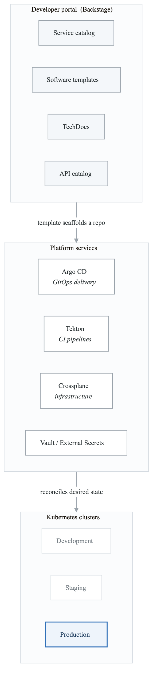
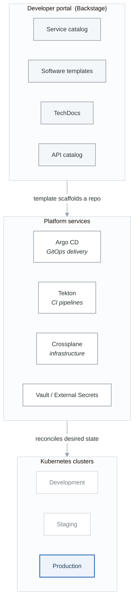

# Developer Platform

Build self-service internal developer platforms for Kubernetes.

## Learning Path

1. [Platform Engineering](#platform-engineering)
2. [Backstage Service Catalog](#backstage-service-catalog)
3. [Crossplane Infrastructure](#crossplane-infrastructure)
4. [Self-Service Workflows](#self-service-workflows)
5. [Cost Management](#cost-management)

---

## Platform Engineering

<!-- figure: generated from the Mermaid below by _shared/diagrams/embed-figures.py — do not edit the image -->


<details>
<summary>Diagram source (Mermaid)</summary>



</details>

### Platform Capabilities Matrix

| Capability | Tool | Purpose |
|------------|------|---------|
| Service Catalog | Backstage | Discover and manage services |
| Infrastructure | Crossplane | Self-service cloud resources |
| Deployments | ArgoCD | GitOps continuous delivery |
| CI/CD | Tekton/GitHub Actions | Build and test automation |
| Secrets | Vault/External Secrets | Secure credentials |
| Observability | Grafana Stack | Metrics, logs, traces |
| Cost | Kubecost/OpenCost | Resource cost tracking |

---

## Backstage Service Catalog

### Installation

```bash
# Create Backstage app
npx @backstage/create-app@latest

# Build and deploy
yarn build
docker build -t backstage:latest .
```

### Kubernetes Deployment

```yaml
apiVersion: apps/v1
kind: Deployment
metadata:
  name: backstage
  namespace: backstage
spec:
  replicas: 2
  selector:
    matchLabels:
      app: backstage
  template:
    metadata:
      labels:
        app: backstage
    spec:
      serviceAccountName: backstage
      containers:
      - name: backstage
        image: backstage:latest
        ports:
        - containerPort: 7007
        env:
        - name: POSTGRES_HOST
          valueFrom:
            secretKeyRef:
              name: backstage-db
              key: host
        - name: POSTGRES_USER
          valueFrom:
            secretKeyRef:
              name: backstage-db
              key: username
        - name: POSTGRES_PASSWORD
          valueFrom:
            secretKeyRef:
              name: backstage-db
              key: password
        - name: GITHUB_TOKEN
          valueFrom:
            secretKeyRef:
              name: backstage-github
              key: token
        resources:
          requests:
            cpu: 500m
            memory: 1Gi
        readinessProbe:
          httpGet:
            path: /healthcheck
            port: 7007
```

### Software Templates

```yaml
# catalog-info.yaml - Service template
apiVersion: scaffolder.backstage.io/v1beta3
kind: Template
metadata:
  name: microservice-template
  title: Create Microservice
  description: Create a new microservice with CI/CD and Kubernetes deployment
  tags:
  - recommended
  - microservice
spec:
  owner: platform-team
  type: service

  parameters:
  - title: Service Information
    required:
    - name
    - owner
    properties:
      name:
        title: Service Name
        type: string
        description: Unique name for the service
        pattern: '^[a-z][a-z0-9-]*$'
      description:
        title: Description
        type: string
      owner:
        title: Owner
        type: string
        ui:field: OwnerPicker
        ui:options:
          catalogFilter:
            kind: Group

  - title: Technical Details
    required:
    - language
    - database
    properties:
      language:
        title: Programming Language
        type: string
        enum:
        - go
        - nodejs
        - python
        - java
        enumNames:
        - Go
        - Node.js
        - Python
        - Java
      database:
        title: Database
        type: string
        enum:
        - postgres
        - mysql
        - mongodb
        - none
      includeGithubActions:
        title: Include GitHub Actions
        type: boolean
        default: true

  - title: Deployment
    required:
    - environment
    properties:
      environment:
        title: Initial Environment
        type: string
        enum:
        - development
        - staging
        default: development
      replicas:
        title: Replicas
        type: integer
        default: 2
        minimum: 1
        maximum: 10

  steps:
  # Fetch skeleton
  - id: fetch-skeleton
    name: Fetch Skeleton
    action: fetch:template
    input:
      url: ./skeleton
      values:
        name: ${{ parameters.name }}
        description: ${{ parameters.description }}
        owner: ${{ parameters.owner }}
        language: ${{ parameters.language }}

  # Fetch language-specific template
  - id: fetch-language
    name: Fetch Language Template
    action: fetch:template
    input:
      url: ./languages/${{ parameters.language }}
      targetPath: ./src
      values:
        name: ${{ parameters.name }}

  # Generate Kubernetes manifests
  - id: generate-k8s
    name: Generate Kubernetes Manifests
    action: fetch:template
    input:
      url: ./k8s-templates
      targetPath: ./k8s
      values:
        name: ${{ parameters.name }}
        replicas: ${{ parameters.replicas }}
        environment: ${{ parameters.environment }}

  # Create GitHub repo
  - id: publish
    name: Publish to GitHub
    action: publish:github
    input:
      repoUrl: github.com?owner=myorg&repo=${{ parameters.name }}
      repoVisibility: internal
      defaultBranch: main

  # Register in catalog
  - id: register
    name: Register in Catalog
    action: catalog:register
    input:
      repoContentsUrl: ${{ steps.publish.output.repoContentsUrl }}
      catalogInfoPath: /catalog-info.yaml

  # Create ArgoCD application
  - id: create-argocd-app
    name: Create ArgoCD Application
    action: argocd:create-resources
    input:
      appName: ${{ parameters.name }}
      projectName: default
      namespace: ${{ parameters.environment }}
      repoUrl: ${{ steps.publish.output.remoteUrl }}
      path: k8s/overlays/${{ parameters.environment }}

  output:
    links:
    - title: Repository
      url: ${{ steps.publish.output.remoteUrl }}
    - title: Open in catalog
      icon: catalog
      entityRef: ${{ steps.register.output.entityRef }}
```

### Component Catalog Entry

```yaml
# catalog-info.yaml - For existing services
apiVersion: backstage.io/v1alpha1
kind: Component
metadata:
  name: api-gateway
  description: Main API gateway service
  annotations:
    backstage.io/kubernetes-id: api-gateway
    backstage.io/kubernetes-namespace: production
    argocd/app-name: api-gateway
    github.com/project-slug: myorg/api-gateway
    prometheus.io/rule: |
      - alert: APIGatewayHighLatency
        expr: histogram_quantile(0.99, rate(http_request_duration_seconds_bucket[5m])) > 1
  tags:
  - api
  - gateway
  links:
  - url: https://api.example.com
    title: Production
  - url: https://grafana.example.com/d/api-gateway
    title: Grafana Dashboard
spec:
  type: service
  lifecycle: production
  owner: platform-team
  system: ecommerce
  dependsOn:
  - component:user-service
  - component:order-service
  providesApis:
  - api-gateway-api
```

---

## Crossplane Infrastructure

### Installation

```bash
helm repo add crossplane-stable https://charts.crossplane.io/stable
helm install crossplane crossplane-stable/crossplane \
  --namespace crossplane-system --create-namespace
```

### AWS Provider

```yaml
apiVersion: pkg.crossplane.io/v1
kind: Provider
metadata:
  name: provider-aws
spec:
  package: xpkg.upbound.io/upbound/provider-aws:v0.40.0

---
apiVersion: aws.upbound.io/v1beta1
kind: ProviderConfig
metadata:
  name: default
spec:
  credentials:
    source: IRSA  # Use IRSA for authentication
```

### Composite Resources (XRDs)

```yaml
# Define a Database composite resource
apiVersion: apiextensions.crossplane.io/v1
kind: CompositeResourceDefinition
metadata:
  name: xdatabases.platform.example.com
spec:
  group: platform.example.com
  names:
    kind: XDatabase
    plural: xdatabases
  claimNames:
    kind: Database
    plural: databases

  versions:
  - name: v1alpha1
    served: true
    referenceable: true
    schema:
      openAPIV3Schema:
        type: object
        properties:
          spec:
            type: object
            properties:
              parameters:
                type: object
                properties:
                  engine:
                    type: string
                    enum: [postgres, mysql]
                    default: postgres
                  size:
                    type: string
                    enum: [small, medium, large]
                    default: small
                  version:
                    type: string
                    default: "15"
                required:
                - engine
            required:
            - parameters
          status:
            type: object
            properties:
              endpoint:
                type: string
              port:
                type: integer

---
# Composition - How to create the database
apiVersion: apiextensions.crossplane.io/v1
kind: Composition
metadata:
  name: database-aws
  labels:
    provider: aws
spec:
  compositeTypeRef:
    apiVersion: platform.example.com/v1alpha1
    kind: XDatabase

  patchSets:
  - name: common
    patches:
    - type: FromCompositeFieldPath
      fromFieldPath: metadata.labels
      toFieldPath: metadata.labels

  resources:
  # Security Group
  - name: security-group
    base:
      apiVersion: ec2.aws.upbound.io/v1beta1
      kind: SecurityGroup
      spec:
        forProvider:
          region: us-west-2
          vpcIdSelector:
            matchLabels:
              type: main-vpc
          description: Database security group
    patches:
    - type: PatchSet
      patchSetName: common
    - type: ToCompositeFieldPath
      fromFieldPath: status.atProvider.id
      toFieldPath: status.securityGroupId

  # Security Group Rule
  - name: security-group-rule
    base:
      apiVersion: ec2.aws.upbound.io/v1beta1
      kind: SecurityGroupRule
      spec:
        forProvider:
          region: us-west-2
          type: ingress
          fromPort: 5432
          toPort: 5432
          protocol: tcp
          cidrBlocks:
          - 10.0.0.0/8
    patches:
    - type: FromCompositeFieldPath
      fromFieldPath: status.securityGroupId
      toFieldPath: spec.forProvider.securityGroupId

  # RDS Instance
  - name: rds-instance
    base:
      apiVersion: rds.aws.upbound.io/v1beta1
      kind: Instance
      spec:
        forProvider:
          region: us-west-2
          allocatedStorage: 20
          autoMinorVersionUpgrade: true
          backupRetentionPeriod: 7
          dbSubnetGroupNameSelector:
            matchLabels:
              type: main-db-subnet
          publiclyAccessible: false
          skipFinalSnapshot: true
          storageEncrypted: true
          storageType: gp3
          passwordSecretRef:
            namespace: crossplane-system
            key: password
    patches:
    - type: PatchSet
      patchSetName: common

    # Engine and version
    - type: FromCompositeFieldPath
      fromFieldPath: spec.parameters.engine
      toFieldPath: spec.forProvider.engine
    - type: FromCompositeFieldPath
      fromFieldPath: spec.parameters.version
      toFieldPath: spec.forProvider.engineVersion

    # Instance class based on size
    - type: FromCompositeFieldPath
      fromFieldPath: spec.parameters.size
      toFieldPath: spec.forProvider.instanceClass
      transforms:
      - type: map
        map:
          small: db.t3.micro
          medium: db.t3.medium
          large: db.r5.large

    # Security group
    - type: FromCompositeFieldPath
      fromFieldPath: status.securityGroupId
      toFieldPath: spec.forProvider.vpcSecurityGroupIds[0]

    # Output endpoint
    - type: ToCompositeFieldPath
      fromFieldPath: status.atProvider.endpoint
      toFieldPath: status.endpoint
    - type: ToCompositeFieldPath
      fromFieldPath: status.atProvider.port
      toFieldPath: status.port

  # Connection secret
  - name: connection-secret
    base:
      apiVersion: kubernetes.crossplane.io/v1alpha1
      kind: Object
      spec:
        forProvider:
          manifest:
            apiVersion: v1
            kind: Secret
            metadata:
              namespace: ""
            type: Opaque
    patches:
    - type: FromCompositeFieldPath
      fromFieldPath: metadata.labels["crossplane.io/claim-namespace"]
      toFieldPath: spec.forProvider.manifest.metadata.namespace
    - type: CombineFromComposite
      toFieldPath: spec.forProvider.manifest.stringData.DATABASE_URL
      combine:
        variables:
        - fromFieldPath: spec.parameters.engine
        - fromFieldPath: status.endpoint
        - fromFieldPath: status.port
        strategy: string
        string:
          fmt: "%s://user:password@%s:%d/mydb"
```

### Using Crossplane in Backstage

```yaml
# Backstage template step for Crossplane
steps:
- id: create-database
  name: Provision Database
  action: kubernetes:apply
  input:
    namespaced: true
    manifest:
      apiVersion: platform.example.com/v1alpha1
      kind: Database
      metadata:
        name: ${{ parameters.name }}-db
        namespace: ${{ parameters.namespace }}
      spec:
        parameters:
          engine: postgres
          size: ${{ parameters.databaseSize }}
          version: "15"
```

---

## Self-Service Workflows

### Environment on PR

```yaml
# ArgoCD ApplicationSet for PR environments
apiVersion: argoproj.io/v1alpha1
kind: ApplicationSet
metadata:
  name: pr-environments
  namespace: argocd
spec:
  generators:
  - pullRequest:
      github:
        owner: myorg
        repo: myapp
        tokenRef:
          secretName: github-token
          key: token
      requeueAfterSeconds: 60

  template:
    metadata:
      name: 'pr-{{number}}-{{branch_slug}}'
      annotations:
        # Auto-delete after PR closes
        argocd.argoproj.io/sync-options: PrunePropagationPolicy=background
    spec:
      project: pr-environments
      source:
        repoURL: https://github.com/myorg/myapp.git
        targetRevision: '{{head_sha}}'
        path: k8s/overlays/pr
        kustomize:
          nameSuffix: '-pr-{{number}}'
          images:
          - myapp=myregistry/myapp:pr-{{number}}
      destination:
        server: https://kubernetes.default.svc
        namespace: 'pr-{{number}}'
      syncPolicy:
        automated:
          prune: true
          selfHeal: true
        syncOptions:
        - CreateNamespace=true

---
# Resource quota for PR namespaces
apiVersion: v1
kind: ResourceQuota
metadata:
  name: pr-environment-quota
spec:
  hard:
    requests.cpu: "2"
    requests.memory: 4Gi
    limits.cpu: "4"
    limits.memory: 8Gi
    pods: "20"
```

### Namespace Self-Service

```yaml
# Custom Resource for team namespace
apiVersion: apiextensions.k8s.io/v1
kind: CustomResourceDefinition
metadata:
  name: teamnamespaces.platform.example.com
spec:
  group: platform.example.com
  names:
    kind: TeamNamespace
    plural: teamnamespaces
  scope: Cluster
  versions:
  - name: v1alpha1
    served: true
    storage: true
    schema:
      openAPIV3Schema:
        type: object
        properties:
          spec:
            type: object
            properties:
              team:
                type: string
              environment:
                type: string
                enum: [dev, staging, prod]
              resourceQuota:
                type: string
                enum: [small, medium, large]
                default: small

---
# Controller (simplified - use Kubebuilder/Operator SDK)
apiVersion: apps/v1
kind: Deployment
metadata:
  name: namespace-controller
spec:
  template:
    spec:
      containers:
      - name: controller
        image: namespace-controller:latest
        # Controller creates:
        # - Namespace with labels
        # - ResourceQuota
        # - LimitRange
        # - NetworkPolicy (default deny)
        # - RoleBinding for team
        # - ServiceAccount
```

---

## Cost Management

### Kubecost Integration

```yaml
# Install Kubecost
helm repo add kubecost https://kubecost.github.io/cost-analyzer/
helm install kubecost kubecost/cost-analyzer \
  --namespace kubecost --create-namespace \
  --set kubecostToken="your-token"

---
# Cost allocation labels
apiVersion: apps/v1
kind: Deployment
metadata:
  name: api-service
  labels:
    # Required for cost allocation
    app.kubernetes.io/name: api-service
    app.kubernetes.io/team: platform
    app.kubernetes.io/cost-center: engineering
    app.kubernetes.io/environment: production
```

### OpenCost

```yaml
# Install OpenCost
helm repo add opencost https://opencost.github.io/opencost-helm-chart
helm install opencost opencost/opencost \
  --namespace opencost --create-namespace \
  -f values-opencost.yaml

---
# values-opencost.yaml
opencost:
  prometheus:
    internal:
      enabled: true
      serviceName: prometheus-server
      namespaceName: monitoring

  ui:
    enabled: true
    ingress:
      enabled: true
      hosts:
      - host: cost.example.com
        paths:
        - /

  exporter:
    defaultClusterId: production-us-west
    extraEnv:
      CLOUD_PROVIDER: AWS
```

### Cost Alerts

```yaml
apiVersion: monitoring.coreos.com/v1
kind: PrometheusRule
metadata:
  name: cost-alerts
  namespace: monitoring
spec:
  groups:
  - name: cost.rules
    rules:
    - alert: NamespaceCostSpike
      expr: |
        (
          sum by (namespace) (
            rate(container_cpu_usage_seconds_total[24h])
          ) * 0.031611  # CPU cost per second
          +
          sum by (namespace) (
            avg_over_time(container_memory_usage_bytes[24h])
          ) / 1024 / 1024 / 1024 * 0.004048  # Memory cost per GB-hour
        ) > 100  # $100/day threshold
      for: 1h
      labels:
        severity: warning
      annotations:
        summary: "Namespace {{ $labels.namespace }} cost spike"
        description: "Daily cost exceeds $100"

    - alert: UnusedPersistentVolumes
      expr: |
        kube_persistentvolume_status_phase{phase="Available"} == 1
      for: 7d
      labels:
        severity: info
      annotations:
        summary: "Unused PV {{ $labels.persistentvolume }}"
        description: "PV has been available (unused) for 7 days"
```

---

## Exercises

1. **Exercise 1: Backstage Setup** - Deploy Backstage
2. **Exercise 2: Service Templates** - Create software templates
3. **Exercise 3: Crossplane** - Self-service infrastructure
4. **Exercise 4: PR Environments** - Ephemeral environments
5. **Exercise 5: Cost Tracking** - Implement cost management

---

## Next Section

[project-self-service-platform](project-self-service-platform-README.md) - Build the complete platform

<!-- feynman-check -->

---

## Feynman check

Close the file. Blank page, no notes. Explain each of these to a competent engineer who has never
used this tool — **under five minutes, no jargon you can't define on the spot:**

- Platform Engineering
- Backstage Service Catalog
- Crossplane Infrastructure
- Self-Service Workflows

**The gap is not what you forgot. It is where you used a word instead of a mechanism.**

| | |
|---|---|
| ✗ | *"Kubernetes schedules the pod."* |
| ✓ | *"The scheduler watches for pods with no `nodeName`, filters nodes by predicates, scores the survivors, and writes `nodeName` into the pod spec. The kubelet on that node is watching the API for pods bound to it, and starts the containers."* |

**Trace it:** `kubectl apply -f pod.yaml` → a running container. Name every component that acts, in order, and what each one writes.

Stop at the first component you cannot name. Reopen this file and read **only** that.

**Go deeper — only once the gap has a name:** [Kubernetes the Hard Way](https://github.com/kelseyhightower/kubernetes-the-hard-way) — one weekend, and "the control plane" stops being a word.
Full list per domain: [`SOURCES.md`](../../SOURCES.md#kubernetes)

→ Protocol, the three levels of knowing, and worked examples: [`MASTERY.md`](../../MASTERY.md)

<!-- /feynman-check -->
