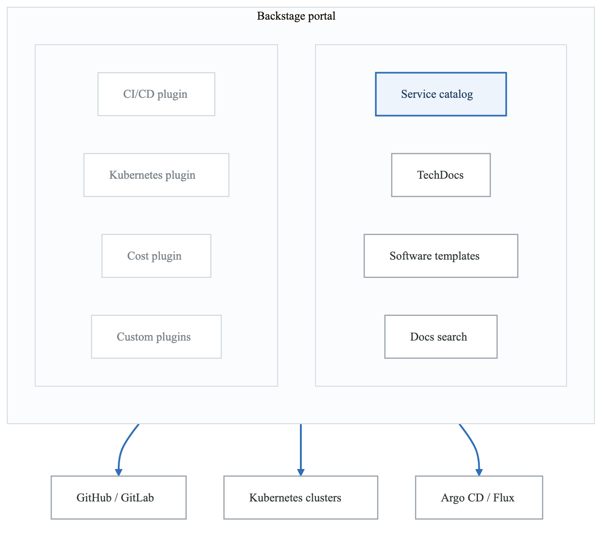
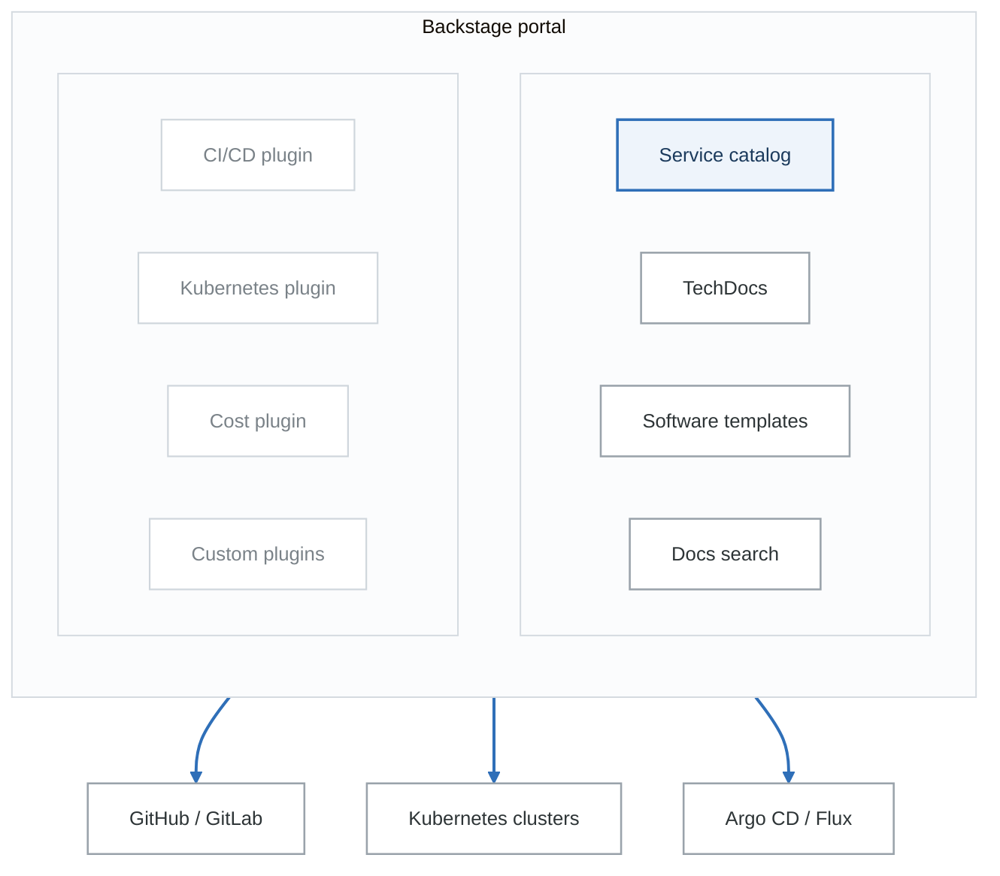

# Exercise 1: Backstage Service Catalog

## Objectives

- Deploy Backstage developer portal
- Configure service catalog
- Create software templates
- Integrate with existing infrastructure

## Prerequisites

- Completed GitOps and CI/CD modules
- PostgreSQL database available
- GitHub/GitLab integration credentials

---

## Part 1: Backstage Overview

### 1.1 Platform Architecture

<!-- figure: generated from the Mermaid below by _shared/diagrams/embed-figures.py — do not edit the image -->


<details>
<summary>Diagram source (Mermaid)</summary>



</details>

---

## Part 2: Backstage Installation

### 2.1 Create Backstage App

```bash
# Create new Backstage app
npx @backstage/create-app@latest

# Navigate to app directory
cd my-backstage-app

# Install dependencies
yarn install

# Start development server
yarn dev
```

### 2.2 Dockerfile for Production

```dockerfile
# Dockerfile
FROM node:18-bookworm-slim AS build

WORKDIR /app

COPY package.json yarn.lock ./
COPY packages/backend/package.json packages/backend/
COPY packages/app/package.json packages/app/

RUN yarn install --frozen-lockfile

COPY . .
RUN yarn tsc
RUN yarn build:backend

FROM node:18-bookworm-slim

WORKDIR /app

COPY --from=build /app/packages/backend/dist ./packages/backend/dist
COPY --from=build /app/node_modules ./node_modules
COPY --from=build /app/package.json ./

ENV NODE_ENV=production

CMD ["node", "packages/backend", "--config", "app-config.yaml", "--config", "app-config.production.yaml"]
```

### 2.3 Kubernetes Deployment

```yaml
# backstage-deployment.yaml
apiVersion: apps/v1
kind: Deployment
metadata:
  name: backstage
  namespace: backstage
spec:
  replicas: 2
  selector:
    matchLabels:
      app: backstage
  template:
    metadata:
      labels:
        app: backstage
    spec:
      containers:
        - name: backstage
          image: backstage:latest
          ports:
            - containerPort: 7007
          env:
            - name: POSTGRES_HOST
              valueFrom:
                secretKeyRef:
                  name: backstage-secrets
                  key: POSTGRES_HOST
            - name: POSTGRES_USER
              valueFrom:
                secretKeyRef:
                  name: backstage-secrets
                  key: POSTGRES_USER
            - name: POSTGRES_PASSWORD
              valueFrom:
                secretKeyRef:
                  name: backstage-secrets
                  key: POSTGRES_PASSWORD
            - name: GITHUB_TOKEN
              valueFrom:
                secretKeyRef:
                  name: backstage-secrets
                  key: GITHUB_TOKEN
          resources:
            requests:
              cpu: 500m
              memory: 512Mi
            limits:
              cpu: 2
              memory: 2Gi
          readinessProbe:
            httpGet:
              path: /healthcheck
              port: 7007
            initialDelaySeconds: 30
            periodSeconds: 10
---
apiVersion: v1
kind: Service
metadata:
  name: backstage
  namespace: backstage
spec:
  selector:
    app: backstage
  ports:
    - port: 80
      targetPort: 7007
---
apiVersion: networking.k8s.io/v1
kind: Ingress
metadata:
  name: backstage
  namespace: backstage
  annotations:
    cert-manager.io/cluster-issuer: letsencrypt-prod
spec:
  ingressClassName: nginx
  tls:
    - hosts:
        - backstage.example.com
      secretName: backstage-tls
  rules:
    - host: backstage.example.com
      http:
        paths:
          - path: /
            pathType: Prefix
            backend:
              service:
                name: backstage
                port:
                  number: 80
```

---

## Part 3: App Configuration

### 3.1 Base Configuration

```yaml
# app-config.yaml
app:
  title: My Platform
  baseUrl: http://localhost:3000

organization:
  name: My Company

backend:
  baseUrl: http://localhost:7007
  listen:
    port: 7007
  csp:
    connect-src: ["'self'", 'http:', 'https:']
  cors:
    origin: http://localhost:3000
    methods: [GET, HEAD, PATCH, POST, PUT, DELETE]
    credentials: true
  database:
    client: pg
    connection:
      host: ${POSTGRES_HOST}
      port: ${POSTGRES_PORT}
      user: ${POSTGRES_USER}
      password: ${POSTGRES_PASSWORD}

integrations:
  github:
    - host: github.com
      token: ${GITHUB_TOKEN}

catalog:
  import:
    entityFilename: catalog-info.yaml
    pullRequestBranchName: backstage-integration
  rules:
    - allow: [Component, System, API, Resource, Location, Template]
  locations:
    - type: file
      target: ../catalog/*.yaml
    - type: url
      target: https://github.com/org/software-templates/blob/main/catalog-info.yaml
```

### 3.2 Production Configuration

```yaml
# app-config.production.yaml
app:
  baseUrl: https://backstage.example.com

backend:
  baseUrl: https://backstage.example.com
  cors:
    origin: https://backstage.example.com

auth:
  environment: production
  providers:
    github:
      production:
        clientId: ${GITHUB_CLIENT_ID}
        clientSecret: ${GITHUB_CLIENT_SECRET}
```

---

## Part 4: Service Catalog

### 4.1 Component Definition

```yaml
# catalog-info.yaml
apiVersion: backstage.io/v1alpha1
kind: Component
metadata:
  name: api-gateway
  description: Main API gateway service
  annotations:
    github.com/project-slug: org/api-gateway
    backstage.io/techdocs-ref: dir:.
    argocd/app-name: api-gateway-production
    prometheus.io/rule: api_gateway_*
  tags:
    - api
    - gateway
    - golang
  links:
    - url: https://grafana.example.com/d/api-gateway
      title: Grafana Dashboard
    - url: https://api.example.com/docs
      title: API Documentation
spec:
  type: service
  lifecycle: production
  owner: team-platform
  system: core-platform
  providesApis:
    - gateway-api
  dependsOn:
    - component:user-service
    - component:auth-service
    - resource:redis-cache
```

### 4.2 System Definition

```yaml
# system.yaml
apiVersion: backstage.io/v1alpha1
kind: System
metadata:
  name: core-platform
  description: Core platform services
  annotations:
    backstage.io/techdocs-ref: dir:.
  tags:
    - core
    - infrastructure
spec:
  owner: team-platform
  domain: platform
---
apiVersion: backstage.io/v1alpha1
kind: Domain
metadata:
  name: platform
  description: Platform Engineering domain
spec:
  owner: team-platform
```

### 4.3 API Definition

```yaml
# api.yaml
apiVersion: backstage.io/v1alpha1
kind: API
metadata:
  name: gateway-api
  description: Gateway API for external clients
  annotations:
    backstage.io/techdocs-ref: url:https://github.com/org/api-gateway/tree/main/docs
spec:
  type: openapi
  lifecycle: production
  owner: team-platform
  system: core-platform
  definition:
    $text: https://raw.githubusercontent.com/org/api-gateway/main/openapi.yaml
```

### 4.4 Resource Definition

```yaml
# resources.yaml
apiVersion: backstage.io/v1alpha1
kind: Resource
metadata:
  name: production-database
  description: PostgreSQL production database
  annotations:
    backstage.io/managed-by-location: url:https://github.com/org/infrastructure/blob/main/databases/production.yaml
spec:
  type: database
  owner: team-platform
  system: core-platform
---
apiVersion: backstage.io/v1alpha1
kind: Resource
metadata:
  name: redis-cache
  description: Redis cache cluster
spec:
  type: cache
  owner: team-platform
  system: core-platform
```

---

## Part 5: Software Templates

### 5.1 Service Template

```yaml
# templates/service-template/template.yaml
apiVersion: scaffolder.backstage.io/v1beta3
kind: Template
metadata:
  name: microservice-template
  title: Microservice Template
  description: Create a new microservice with CI/CD
  tags:
    - recommended
    - microservice
    - golang
spec:
  owner: team-platform
  type: service

  parameters:
    - title: Service Information
      required:
        - name
        - description
        - owner
      properties:
        name:
          title: Service Name
          type: string
          description: Name of the service
          pattern: '^[a-z0-9-]+$'
        description:
          title: Description
          type: string
          description: Brief description of the service
        owner:
          title: Owner
          type: string
          description: Owner team
          ui:field: OwnerPicker
          ui:options:
            catalogFilter:
              kind: Group

    - title: Technical Options
      properties:
        language:
          title: Language
          type: string
          default: golang
          enum:
            - golang
            - python
            - nodejs
          enumNames:
            - Go
            - Python
            - Node.js
        database:
          title: Database
          type: string
          enum:
            - none
            - postgresql
            - mysql
          default: none
        cache:
          title: Enable Redis Cache
          type: boolean
          default: false

    - title: Repository Information
      required:
        - repoUrl
      properties:
        repoUrl:
          title: Repository Location
          type: string
          ui:field: RepoUrlPicker
          ui:options:
            allowedHosts:
              - github.com

  steps:
    - id: fetch-base
      name: Fetch Base Template
      action: fetch:template
      input:
        url: ./skeleton/${{ parameters.language }}
        values:
          name: ${{ parameters.name }}
          description: ${{ parameters.description }}
          owner: ${{ parameters.owner }}
          database: ${{ parameters.database }}
          cache: ${{ parameters.cache }}

    - id: fetch-gitops
      name: Add GitOps Config
      action: fetch:template
      input:
        url: ./gitops
        targetPath: ./gitops
        values:
          name: ${{ parameters.name }}
          namespace: ${{ parameters.name }}

    - id: publish
      name: Publish Repository
      action: publish:github
      input:
        allowedHosts: ['github.com']
        description: ${{ parameters.description }}
        repoUrl: ${{ parameters.repoUrl }}
        defaultBranch: main
        protectDefaultBranch: true
        requireCodeOwnerReviews: true

    - id: register
      name: Register in Catalog
      action: catalog:register
      input:
        repoContentsUrl: ${{ steps.publish.output.repoContentsUrl }}
        catalogInfoPath: '/catalog-info.yaml'

    - id: create-argocd-app
      name: Create ArgoCD Application
      action: argocd:create-resources
      input:
        appName: ${{ parameters.name }}
        argoInstance: production
        namespace: ${{ parameters.name }}
        repoUrl: ${{ steps.publish.output.remoteUrl }}
        path: gitops

  output:
    links:
      - title: Repository
        url: ${{ steps.publish.output.remoteUrl }}
      - title: Open in Catalog
        icon: catalog
        entityRef: ${{ steps.register.output.entityRef }}
```

### 5.2 Template Skeleton (Go)

**`templates/service-template/skeleton/golang/`**

- `cmd/`
  - `main.go`
- `internal/`
  - `handler/`
    - `handler.go`
  - `config/`
    - `config.go`
- Dockerfile
- `go.mod`
- `go.sum`
- Makefile
- `README.md`
- `catalog-info.yaml`


```go
// templates/service-template/skeleton/golang/cmd/main.go
package main

import (
	"log"
	"net/http"
	"os"

	"${{ values.name }}/internal/handler"
)

func main() {
	port := os.Getenv("PORT")
	if port == "" {
		port = "8080"
	}

	h := handler.New()

	log.Printf("Starting ${{ values.name }} on port %s", port)
	if err := http.ListenAndServe(":"+port, h); err != nil {
		log.Fatal(err)
	}
}
```

```yaml
# templates/service-template/skeleton/golang/catalog-info.yaml
apiVersion: backstage.io/v1alpha1
kind: Component
metadata:
  name: ${{ values.name }}
  description: ${{ values.description }}
  annotations:
    github.com/project-slug: ${{ values.destination.owner }}/${{ values.destination.repo }}
    backstage.io/techdocs-ref: dir:.
    argocd/app-name: ${{ values.name }}-production
  tags:
    - microservice
    - ${{ values.language }}
spec:
  type: service
  lifecycle: experimental
  owner: ${{ values.owner }}
```

---

## Part 6: Plugins

### 6.1 Kubernetes Plugin

```typescript
// packages/app/src/components/catalog/EntityPage.tsx
import { EntityKubernetesContent } from '@backstage/plugin-kubernetes';

const serviceEntityPage = (
  <EntityLayout>
    <EntityLayout.Route path="/" title="Overview">
      <EntityOverviewContent />
    </EntityLayout.Route>
    <EntityLayout.Route path="/kubernetes" title="Kubernetes">
      <EntityKubernetesContent />
    </EntityLayout.Route>
  </EntityLayout>
);
```

```yaml
# app-config.yaml addition
kubernetes:
  serviceLocatorMethod:
    type: multiTenant
  clusterLocatorMethods:
    - type: config
      clusters:
        - url: https://production-cluster:6443
          name: production
          authProvider: serviceAccount
          serviceAccountToken: ${K8S_PRODUCTION_TOKEN}
          caData: ${K8S_PRODUCTION_CA}
        - url: https://staging-cluster:6443
          name: staging
          authProvider: serviceAccount
          serviceAccountToken: ${K8S_STAGING_TOKEN}
```

### 6.2 ArgoCD Plugin

```yaml
# app-config.yaml addition
argocd:
  appLocatorMethods:
    - type: config
      instances:
        - name: production
          url: https://argocd.example.com
          token: ${ARGOCD_TOKEN}
```

### 6.3 TechDocs Plugin

```yaml
# app-config.yaml addition
techdocs:
  builder: external
  publisher:
    type: awsS3
    awsS3:
      bucketName: techdocs-bucket
      region: us-west-2
      credentials:
        roleArn: arn:aws:iam::123456789012:role/TechDocsRole
```

---

## Part 7: Authentication

### 7.1 GitHub OAuth

```yaml
# app-config.yaml
auth:
  environment: development
  providers:
    github:
      development:
        clientId: ${GITHUB_CLIENT_ID}
        clientSecret: ${GITHUB_CLIENT_SECRET}
        signIn:
          resolvers:
            - resolver: usernameMatchingUserEntityName
```

### 7.2 OIDC Provider

```yaml
# app-config.yaml
auth:
  providers:
    oidc:
      development:
        metadataUrl: https://accounts.google.com/.well-known/openid-configuration
        clientId: ${OIDC_CLIENT_ID}
        clientSecret: ${OIDC_CLIENT_SECRET}
        prompt: auto
        signIn:
          resolvers:
            - resolver: emailMatchingUserEntityProfileEmail
```

---

## Part 8: Catalog Discovery

### 8.1 GitHub Discovery

```yaml
# app-config.yaml
catalog:
  providers:
    github:
      myOrg:
        organization: 'my-org'
        catalogPath: '/catalog-info.yaml'
        filters:
          branch: 'main'
          repository: '.*'
        schedule:
          frequency: { minutes: 30 }
          timeout: { minutes: 3 }
```

### 8.2 Custom Processor

```typescript
// packages/backend/src/plugins/catalog.ts
import { CatalogBuilder } from '@backstage/plugin-catalog-backend';
import { ScaffolderEntitiesProcessor } from '@backstage/plugin-scaffolder-backend';

export default async function createPlugin(env) {
  const builder = await CatalogBuilder.create(env);

  builder.addProcessor(new ScaffolderEntitiesProcessor());

  // Add custom processors
  builder.addProcessor(new MyCustomProcessor());

  const { processingEngine, router } = await builder.build();
  await processingEngine.start();
  return router;
}
```

---

## Part 9: Hands-on Challenges

### Challenge 1: Complete Portal Setup

Set up production-ready Backstage:
1. Deploy with PostgreSQL
2. Configure GitHub integration
3. Set up authentication
4. Add Kubernetes plugin

### Challenge 2: Service Templates

Create comprehensive templates:
1. Microservice template
2. Frontend application template
3. Infrastructure template
4. Include CI/CD automation

### Challenge 3: Custom Plugin

Develop custom plugin:
1. Create plugin scaffolding
2. Add custom component
3. Integrate with internal API
4. Deploy to production

---

## Verification Tasks

1. [ ] Deployed Backstage
2. [ ] Configured authentication
3. [ ] Set up service catalog
4. [ ] Created software templates
5. [ ] Enabled Kubernetes plugin
6. [ ] Configured GitHub discovery

---

## Key Takeaways

- Backstage centralizes developer experience
- Service catalog provides discoverability
- Templates standardize new projects
- Plugins extend functionality
- TechDocs enables documentation
- Authentication integrates with existing IdP

---

## Next Steps

Continue to [Exercise 2: Crossplane Self-Service](03-developer-platform-exercises-02-crossplane-self-service.md)

<!-- feynman-check -->

---

## Feynman check

Close the file. Blank page, no notes. Explain each of these to a competent engineer who has never
used this tool — **under five minutes, no jargon you can't define on the spot:**

- Backstage Overview
- Backstage Installation
- App Configuration
- Service Catalog

**The gap is not what you forgot. It is where you used a word instead of a mechanism.**

| | |
|---|---|
| ✗ | *"Kubernetes schedules the pod."* |
| ✓ | *"The scheduler watches for pods with no `nodeName`, filters nodes by predicates, scores the survivors, and writes `nodeName` into the pod spec. The kubelet on that node is watching the API for pods bound to it, and starts the containers."* |

**Trace it:** `kubectl apply -f pod.yaml` → a running container. Name every component that acts, in order, and what each one writes.

Stop at the first component you cannot name. Reopen this file and read **only** that.

**Go deeper — only once the gap has a name:** [Kubernetes the Hard Way](https://github.com/kelseyhightower/kubernetes-the-hard-way) — one weekend, and "the control plane" stops being a word.
Full list per domain: [`SOURCES.md`](../../SOURCES.md#kubernetes)

→ Protocol, the three levels of knowing, and worked examples: [`MASTERY.md`](../../MASTERY.md)

<!-- /feynman-check -->
