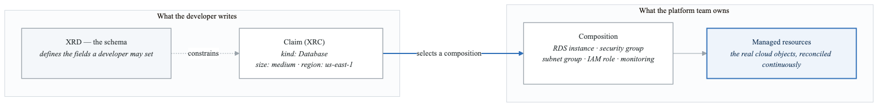

# Exercise 2: Self-Service Infrastructure with Crossplane

## Objectives
- Enable developers to provision infrastructure through Kubernetes APIs
- Create custom Composite Resource Definitions (XRDs)
- Build reusable Compositions for common infrastructure patterns
- Implement self-service workflows with Claims

## Prerequisites
- Kubernetes cluster with admin access
- Crossplane installed (from GitOps exercise 07)
- kubectl configured
- Cloud provider credentials (AWS/GCP/Azure)

## Introduction

Crossplane enables platform teams to build self-service infrastructure abstractions that developers can consume through standard Kubernetes APIs. This exercise covers building a complete self-service platform.

```mermaid
%%{init: {'theme':'base','themeVariables':{'fontFamily':'Helvetica, Arial, sans-serif','fontSize':'13px','primaryColor':'#ffffff','primaryTextColor':'#2d3436','primaryBorderColor':'#9aa3ab','lineColor':'#9aa3ab','textColor':'#2d3436','clusterBkg':'#fbfcfd','clusterBorder':'#d4dae0','edgeLabelBackground':'#ffffff','tertiaryColor':'#eef4fb'},'flowchart':{'curve':'basis','padding':14,'nodeSpacing':42,'rankSpacing':58}}}%%
flowchart LR
  classDef default fill:#ffffff,stroke:#9aa3ab,stroke-width:1.3px,color:#2d3436
  classDef n    fill:#ffffff,stroke:#9aa3ab,stroke-width:1.3px,color:#2d3436
  classDef crit fill:#eef4fb,stroke:#2f6fb8,stroke-width:1.8px,color:#1b3a5c
  classDef data fill:#f4f7fa,stroke:#9aa3ab,stroke-width:1.3px,color:#2d3436
  classDef mut  fill:#ffffff,stroke:#cfd6dc,stroke-width:1.1px,color:#7a8288
  classDef warn fill:#fdf0ec,stroke:#c0522d,stroke-width:1.6px,color:#8a3a1e
  subgraph DX["What the developer writes"]
    direction TB
    XRD["XRD — the schema<br/><i>defines the fields a developer may set</i>"]
    CLAIM["Claim (XRC)<br/><i>kind: Database<br/>size: medium · region: us-east-1</i>"]
    XRD -.->|"constrains"| CLAIM
  end
  subgraph PA["What the platform team owns"]
    direction TB
    COMP["Composition<br/><i>RDS instance · security group<br/>subnet group · IAM role · monitoring</i>"]
    MR["Managed resources<br/><i>the real cloud objects, reconciled continuously</i>"]
    COMP --> MR
  end
  CLAIM ==>|"selects a composition"| COMP
  class XRD data
  class CLAIM n
  class COMP n
  class MR crit
  linkStyle 2 stroke:#2f6fb8,stroke-width:2px
```

<!-- figure: generated from the Mermaid below by _shared/diagrams/embed-figures.py — do not edit the image -->


<details>
<summary>Diagram source (Mermaid)</summary>



</details>

## Part 1: Database Self-Service

### Step 1: Create XRD for PostgreSQL Database

```yaml
# postgresql-xrd.yaml
apiVersion: apiextensions.crossplane.io/v1
kind: CompositeResourceDefinition
metadata:
  name: xpostgresqldatabases.database.platform.io
spec:
  group: database.platform.io
  names:
    kind: XPostgreSQLDatabase
    plural: xpostgresqldatabases
  claimNames:
    kind: PostgreSQLDatabase
    plural: postgresqldatabases

  versions:
    - name: v1alpha1
      served: true
      referenceable: true
      schema:
        openAPIV3Schema:
          type: object
          properties:
            spec:
              type: object
              properties:
                # Developer-facing parameters (simplified)
                size:
                  type: string
                  description: "Database size: small, medium, large"
                  enum:
                    - small
                    - medium
                    - large
                  default: small

                version:
                  type: string
                  description: "PostgreSQL version"
                  enum:
                    - "13"
                    - "14"
                    - "15"
                    - "16"
                  default: "15"

                highAvailability:
                  type: boolean
                  description: "Enable Multi-AZ deployment"
                  default: false

                backup:
                  type: object
                  properties:
                    enabled:
                      type: boolean
                      default: true
                    retentionDays:
                      type: integer
                      minimum: 1
                      maximum: 35
                      default: 7

                environment:
                  type: string
                  description: "Target environment"
                  enum:
                    - development
                    - staging
                    - production
                  default: development

              required:
                - size
                - environment

            status:
              type: object
              properties:
                endpoint:
                  type: string
                port:
                  type: integer
                secretName:
                  type: string
                status:
                  type: string

      additionalPrinterColumns:
        - name: Size
          type: string
          jsonPath: ".spec.size"
        - name: Version
          type: string
          jsonPath: ".spec.version"
        - name: HA
          type: boolean
          jsonPath: ".spec.highAvailability"
        - name: Status
          type: string
          jsonPath: ".status.status"
        - name: Endpoint
          type: string
          jsonPath: ".status.endpoint"
```

### Step 2: Create Composition for AWS RDS

```yaml
# postgresql-composition-aws.yaml
apiVersion: apiextensions.crossplane.io/v1
kind: Composition
metadata:
  name: postgresql-aws
  labels:
    provider: aws
    database: postgresql
spec:
  compositeTypeRef:
    apiVersion: database.platform.io/v1alpha1
    kind: XPostgreSQLDatabase

  patchSets:
    - name: common-tags
      patches:
        - type: FromCompositeFieldPath
          fromFieldPath: metadata.labels[team]
          toFieldPath: spec.forProvider.tags[Team]
        - type: FromCompositeFieldPath
          fromFieldPath: spec.environment
          toFieldPath: spec.forProvider.tags[Environment]
        - type: FromCompositeFieldPath
          fromFieldPath: metadata.name
          toFieldPath: spec.forProvider.tags[Name]

  resources:
    # Security Group for RDS
    - name: security-group
      base:
        apiVersion: ec2.aws.crossplane.io/v1beta1
        kind: SecurityGroup
        spec:
          forProvider:
            region: us-west-2
            vpcId: vpc-xxxxxxxx  # Reference your VPC
            description: "Security group for PostgreSQL database"
            ingress:
              - fromPort: 5432
                toPort: 5432
                ipProtocol: tcp
                ipRanges:
                  - cidrIp: 10.0.0.0/8
                    description: "Internal access"
            egress:
              - fromPort: 0
                toPort: 0
                ipProtocol: "-1"
                ipRanges:
                  - cidrIp: 0.0.0.0/0
          providerConfigRef:
            name: aws-provider
      patches:
        - type: PatchSet
          patchSetName: common-tags
        - type: ToCompositeFieldPath
          fromFieldPath: status.atProvider.securityGroupID
          toFieldPath: status.securityGroupId

    # DB Subnet Group
    - name: subnet-group
      base:
        apiVersion: rds.aws.crossplane.io/v1beta1
        kind: DBSubnetGroup
        spec:
          forProvider:
            region: us-west-2
            description: "Subnet group for PostgreSQL"
            subnetIds:
              - subnet-xxxxxxxx  # Private subnet 1
              - subnet-yyyyyyyy  # Private subnet 2
          providerConfigRef:
            name: aws-provider
      patches:
        - type: PatchSet
          patchSetName: common-tags

    # RDS Instance
    - name: rds-instance
      base:
        apiVersion: rds.aws.crossplane.io/v1beta1
        kind: RDSInstance
        spec:
          forProvider:
            region: us-west-2
            engine: postgres
            dbInstanceClass: db.t3.micro  # Default, will be patched
            allocatedStorage: 20
            masterUsername: postgres
            skipFinalSnapshot: true
            publiclyAccessible: false
            storageEncrypted: true
            storageType: gp3
            backupRetentionPeriod: 7
            deletionProtection: false
            autoMinorVersionUpgrade: true
          providerConfigRef:
            name: aws-provider
          writeConnectionSecretToRef:
            namespace: crossplane-system
      patches:
        - type: PatchSet
          patchSetName: common-tags

        # Size mapping
        - type: FromCompositeFieldPath
          fromFieldPath: spec.size
          toFieldPath: spec.forProvider.dbInstanceClass
          transforms:
            - type: map
              map:
                small: db.t3.micro
                medium: db.t3.medium
                large: db.r6g.large

        - type: FromCompositeFieldPath
          fromFieldPath: spec.size
          toFieldPath: spec.forProvider.allocatedStorage
          transforms:
            - type: map
              map:
                small: 20
                medium: 100
                large: 500

        # Version
        - type: FromCompositeFieldPath
          fromFieldPath: spec.version
          toFieldPath: spec.forProvider.engineVersion

        # High Availability
        - type: FromCompositeFieldPath
          fromFieldPath: spec.highAvailability
          toFieldPath: spec.forProvider.multiAZ

        # Backup retention
        - type: FromCompositeFieldPath
          fromFieldPath: spec.backup.retentionDays
          toFieldPath: spec.forProvider.backupRetentionPeriod

        # Environment-specific settings
        - type: FromCompositeFieldPath
          fromFieldPath: spec.environment
          toFieldPath: spec.forProvider.deletionProtection
          transforms:
            - type: map
              map:
                development: false
                staging: false
                production: true

        # Connection secret name
        - type: FromCompositeFieldPath
          fromFieldPath: metadata.uid
          toFieldPath: spec.writeConnectionSecretToRef.name
          transforms:
            - type: string
              string:
                fmt: "%s-postgresql-conn"

        # Security group reference
        - type: FromCompositeFieldPath
          fromFieldPath: status.securityGroupId
          toFieldPath: spec.forProvider.vpcSecurityGroupIds[0]

        # Status patches
        - type: ToCompositeFieldPath
          fromFieldPath: status.atProvider.endpoint.address
          toFieldPath: status.endpoint
        - type: ToCompositeFieldPath
          fromFieldPath: status.atProvider.endpoint.port
          toFieldPath: status.port
        - type: ToCompositeFieldPath
          fromFieldPath: status.conditions[0].reason
          toFieldPath: status.status

    # Connection Secret
    - name: connection-secret
      base:
        apiVersion: kubernetes.crossplane.io/v1alpha1
        kind: Object
        spec:
          forProvider:
            manifest:
              apiVersion: v1
              kind: Secret
              metadata:
                namespace: ""  # Patched
              type: Opaque
          providerConfigRef:
            name: kubernetes-provider
      patches:
        - type: FromCompositeFieldPath
          fromFieldPath: metadata.labels[crossplane.io/claim-namespace]
          toFieldPath: spec.forProvider.manifest.metadata.namespace
        - type: FromCompositeFieldPath
          fromFieldPath: metadata.labels[crossplane.io/claim-name]
          toFieldPath: spec.forProvider.manifest.metadata.name
          transforms:
            - type: string
              string:
                fmt: "%s-postgresql"
```

### Step 3: Developer Claims Database

```yaml
# developer-database-claim.yaml
apiVersion: database.platform.io/v1alpha1
kind: PostgreSQLDatabase
metadata:
  name: orders-db
  namespace: orders-service
  labels:
    team: orders
spec:
  size: medium
  version: "15"
  highAvailability: true
  backup:
    enabled: true
    retentionDays: 14
  environment: production
```

## Part 2: Kubernetes Cluster Self-Service

### Step 1: Create XRD for EKS Cluster

```yaml
# eks-cluster-xrd.yaml
apiVersion: apiextensions.crossplane.io/v1
kind: CompositeResourceDefinition
metadata:
  name: xeksclusters.compute.platform.io
spec:
  group: compute.platform.io
  names:
    kind: XEKSCluster
    plural: xeksclusters
  claimNames:
    kind: EKSCluster
    plural: eksclusters

  versions:
    - name: v1alpha1
      served: true
      referenceable: true
      schema:
        openAPIV3Schema:
          type: object
          properties:
            spec:
              type: object
              properties:
                # Simplified developer interface
                tier:
                  type: string
                  description: "Cluster tier determines size and features"
                  enum:
                    - development    # Small, single AZ, no HA
                    - staging        # Medium, multi-AZ
                    - production     # Large, multi-AZ, HA, monitoring
                  default: development

                kubernetesVersion:
                  type: string
                  enum:
                    - "1.28"
                    - "1.29"
                    - "1.30"
                  default: "1.29"

                nodeGroups:
                  type: array
                  items:
                    type: object
                    properties:
                      name:
                        type: string
                      size:
                        type: string
                        enum:
                          - small    # t3.medium
                          - medium   # m6i.large
                          - large    # m6i.xlarge
                          - xlarge   # m6i.2xlarge
                      minNodes:
                        type: integer
                        minimum: 1
                        maximum: 100
                      maxNodes:
                        type: integer
                        minimum: 1
                        maximum: 100
                      spotInstances:
                        type: boolean
                        default: false
                    required:
                      - name
                      - size
                      - minNodes
                      - maxNodes

                addons:
                  type: object
                  properties:
                    monitoring:
                      type: boolean
                      default: true
                    logging:
                      type: boolean
                      default: true
                    ingress:
                      type: boolean
                      default: true
                    serviceMesh:
                      type: boolean
                      default: false

                networking:
                  type: object
                  properties:
                    vpcCidr:
                      type: string
                      default: "10.0.0.0/16"
                    privateSubnets:
                      type: array
                      items:
                        type: string
                    publicSubnets:
                      type: array
                      items:
                        type: string

              required:
                - tier
                - nodeGroups

            status:
              type: object
              properties:
                clusterName:
                  type: string
                endpoint:
                  type: string
                certificateAuthority:
                  type: string
                oidcIssuer:
                  type: string
                status:
                  type: string
```

### Step 2: Create EKS Composition

```yaml
# eks-composition.yaml
apiVersion: apiextensions.crossplane.io/v1
kind: Composition
metadata:
  name: eks-cluster-aws
  labels:
    provider: aws
spec:
  compositeTypeRef:
    apiVersion: compute.platform.io/v1alpha1
    kind: XEKSCluster

  patchSets:
    - name: common-tags
      patches:
        - type: FromCompositeFieldPath
          fromFieldPath: metadata.labels[team]
          toFieldPath: spec.forProvider.tags[Team]
        - type: FromCompositeFieldPath
          fromFieldPath: spec.tier
          toFieldPath: spec.forProvider.tags[Tier]

  resources:
    # VPC
    - name: vpc
      base:
        apiVersion: ec2.aws.crossplane.io/v1beta1
        kind: VPC
        spec:
          forProvider:
            region: us-west-2
            cidrBlock: "10.0.0.0/16"
            enableDnsSupport: true
            enableDnsHostnames: true
          providerConfigRef:
            name: aws-provider
      patches:
        - type: PatchSet
          patchSetName: common-tags
        - type: FromCompositeFieldPath
          fromFieldPath: spec.networking.vpcCidr
          toFieldPath: spec.forProvider.cidrBlock
        - type: ToCompositeFieldPath
          fromFieldPath: status.atProvider.vpcId
          toFieldPath: status.vpcId

    # Internet Gateway
    - name: igw
      base:
        apiVersion: ec2.aws.crossplane.io/v1beta1
        kind: InternetGateway
        spec:
          forProvider:
            region: us-west-2
          providerConfigRef:
            name: aws-provider
      patches:
        - type: PatchSet
          patchSetName: common-tags
        - type: FromCompositeFieldPath
          fromFieldPath: status.vpcId
          toFieldPath: spec.forProvider.vpcId

    # Private Subnets (for EKS nodes)
    - name: private-subnet-1
      base:
        apiVersion: ec2.aws.crossplane.io/v1beta1
        kind: Subnet
        metadata:
          labels:
            type: private
            zone: a
        spec:
          forProvider:
            region: us-west-2
            availabilityZone: us-west-2a
            cidrBlock: "10.0.1.0/24"
            mapPublicIpOnLaunch: false
            tags:
              - key: kubernetes.io/role/internal-elb
                value: "1"
          providerConfigRef:
            name: aws-provider
      patches:
        - type: FromCompositeFieldPath
          fromFieldPath: status.vpcId
          toFieldPath: spec.forProvider.vpcId

    - name: private-subnet-2
      base:
        apiVersion: ec2.aws.crossplane.io/v1beta1
        kind: Subnet
        metadata:
          labels:
            type: private
            zone: b
        spec:
          forProvider:
            region: us-west-2
            availabilityZone: us-west-2b
            cidrBlock: "10.0.2.0/24"
            mapPublicIpOnLaunch: false
            tags:
              - key: kubernetes.io/role/internal-elb
                value: "1"
          providerConfigRef:
            name: aws-provider
      patches:
        - type: FromCompositeFieldPath
          fromFieldPath: status.vpcId
          toFieldPath: spec.forProvider.vpcId

    # Public Subnets (for load balancers)
    - name: public-subnet-1
      base:
        apiVersion: ec2.aws.crossplane.io/v1beta1
        kind: Subnet
        metadata:
          labels:
            type: public
            zone: a
        spec:
          forProvider:
            region: us-west-2
            availabilityZone: us-west-2a
            cidrBlock: "10.0.101.0/24"
            mapPublicIpOnLaunch: true
            tags:
              - key: kubernetes.io/role/elb
                value: "1"
          providerConfigRef:
            name: aws-provider
      patches:
        - type: FromCompositeFieldPath
          fromFieldPath: status.vpcId
          toFieldPath: spec.forProvider.vpcId

    - name: public-subnet-2
      base:
        apiVersion: ec2.aws.crossplane.io/v1beta1
        kind: Subnet
        metadata:
          labels:
            type: public
            zone: b
        spec:
          forProvider:
            region: us-west-2
            availabilityZone: us-west-2b
            cidrBlock: "10.0.102.0/24"
            mapPublicIpOnLaunch: true
            tags:
              - key: kubernetes.io/role/elb
                value: "1"
          providerConfigRef:
            name: aws-provider
      patches:
        - type: FromCompositeFieldPath
          fromFieldPath: status.vpcId
          toFieldPath: spec.forProvider.vpcId

    # EKS Cluster
    - name: eks-cluster
      base:
        apiVersion: eks.aws.crossplane.io/v1beta1
        kind: Cluster
        spec:
          forProvider:
            region: us-west-2
            version: "1.29"
            roleArnSelector:
              matchControllerRef: true
              matchLabels:
                role: controlplane
            resourcesVpcConfig:
              endpointPrivateAccess: true
              endpointPublicAccess: true
          providerConfigRef:
            name: aws-provider
          writeConnectionSecretToRef:
            namespace: crossplane-system
      patches:
        - type: PatchSet
          patchSetName: common-tags
        - type: FromCompositeFieldPath
          fromFieldPath: spec.kubernetesVersion
          toFieldPath: spec.forProvider.version
        - type: FromCompositeFieldPath
          fromFieldPath: metadata.uid
          toFieldPath: spec.writeConnectionSecretToRef.name
          transforms:
            - type: string
              string:
                fmt: "%s-kubeconfig"
        - type: ToCompositeFieldPath
          fromFieldPath: status.atProvider.identity.oidc.issuer
          toFieldPath: status.oidcIssuer
        - type: ToCompositeFieldPath
          fromFieldPath: status.atProvider.endpoint
          toFieldPath: status.endpoint

    # EKS Cluster IAM Role
    - name: cluster-role
      base:
        apiVersion: iam.aws.crossplane.io/v1beta1
        kind: Role
        metadata:
          labels:
            role: controlplane
        spec:
          forProvider:
            assumeRolePolicyDocument: |
              {
                "Version": "2012-10-17",
                "Statement": [{
                  "Effect": "Allow",
                  "Principal": {"Service": "eks.amazonaws.com"},
                  "Action": "sts:AssumeRole"
                }]
              }
          providerConfigRef:
            name: aws-provider

    # Attach EKS cluster policy
    - name: cluster-policy
      base:
        apiVersion: iam.aws.crossplane.io/v1beta1
        kind: RolePolicyAttachment
        spec:
          forProvider:
            policyArn: arn:aws:iam::aws:policy/AmazonEKSClusterPolicy
            roleNameSelector:
              matchControllerRef: true
              matchLabels:
                role: controlplane
          providerConfigRef:
            name: aws-provider
```

### Step 3: Developer Claims Cluster

```yaml
# developer-cluster-claim.yaml
apiVersion: compute.platform.io/v1alpha1
kind: EKSCluster
metadata:
  name: team-alpha-dev
  namespace: team-alpha
  labels:
    team: alpha
spec:
  tier: development
  kubernetesVersion: "1.29"
  nodeGroups:
    - name: general
      size: medium
      minNodes: 2
      maxNodes: 5
      spotInstances: true
  addons:
    monitoring: true
    logging: true
    ingress: true
    serviceMesh: false
```

## Part 3: Application Environment Self-Service

### Step 1: Create Application Environment XRD

```yaml
# app-environment-xrd.yaml
apiVersion: apiextensions.crossplane.io/v1
kind: CompositeResourceDefinition
metadata:
  name: xappenvironments.apps.platform.io
spec:
  group: apps.platform.io
  names:
    kind: XAppEnvironment
    plural: xappenvironments
  claimNames:
    kind: AppEnvironment
    plural: appenvironments

  versions:
    - name: v1alpha1
      served: true
      referenceable: true
      schema:
        openAPIV3Schema:
          type: object
          properties:
            spec:
              type: object
              properties:
                # Application identity
                appName:
                  type: string
                  description: "Application name"

                team:
                  type: string
                  description: "Team owning this environment"

                environment:
                  type: string
                  enum:
                    - development
                    - staging
                    - production

                # Components to provision
                components:
                  type: object
                  properties:
                    namespace:
                      type: boolean
                      default: true
                    database:
                      type: object
                      properties:
                        enabled:
                          type: boolean
                          default: false
                        type:
                          type: string
                          enum:
                            - postgresql
                            - mysql
                          default: postgresql
                        size:
                          type: string
                          enum:
                            - small
                            - medium
                            - large
                          default: small
                    cache:
                      type: object
                      properties:
                        enabled:
                          type: boolean
                          default: false
                        type:
                          type: string
                          enum:
                            - redis
                            - memcached
                          default: redis
                        size:
                          type: string
                          enum:
                            - small
                            - medium
                          default: small
                    messageQueue:
                      type: object
                      properties:
                        enabled:
                          type: boolean
                          default: false
                        type:
                          type: string
                          enum:
                            - rabbitmq
                            - sqs
                          default: rabbitmq
                    storage:
                      type: object
                      properties:
                        enabled:
                          type: boolean
                          default: false
                        type:
                          type: string
                          enum:
                            - s3
                            - gcs
                          default: s3
                        bucketName:
                          type: string

                # Resource quotas
                quotas:
                  type: object
                  properties:
                    cpu:
                      type: string
                      default: "4"
                    memory:
                      type: string
                      default: "8Gi"
                    pods:
                      type: integer
                      default: 20

              required:
                - appName
                - team
                - environment

            status:
              type: object
              properties:
                namespace:
                  type: string
                databaseEndpoint:
                  type: string
                cacheEndpoint:
                  type: string
                storageEndpoint:
                  type: string
                ready:
                  type: boolean
```

### Step 2: Create Application Environment Composition

```yaml
# app-environment-composition.yaml
apiVersion: apiextensions.crossplane.io/v1
kind: Composition
metadata:
  name: app-environment
spec:
  compositeTypeRef:
    apiVersion: apps.platform.io/v1alpha1
    kind: XAppEnvironment

  resources:
    # Namespace
    - name: namespace
      base:
        apiVersion: kubernetes.crossplane.io/v1alpha1
        kind: Object
        spec:
          forProvider:
            manifest:
              apiVersion: v1
              kind: Namespace
              metadata:
                labels:
                  istio-injection: enabled
          providerConfigRef:
            name: kubernetes-provider
      patches:
        - type: CombineFromComposite
          combine:
            variables:
              - fromFieldPath: spec.appName
              - fromFieldPath: spec.environment
            strategy: string
            string:
              fmt: "%s-%s"
          toFieldPath: spec.forProvider.manifest.metadata.name
        - type: FromCompositeFieldPath
          fromFieldPath: spec.team
          toFieldPath: spec.forProvider.manifest.metadata.labels[team]
        - type: CombineFromComposite
          combine:
            variables:
              - fromFieldPath: spec.appName
              - fromFieldPath: spec.environment
            strategy: string
            string:
              fmt: "%s-%s"
          toFieldPath: status.namespace
          policy:
            fromFieldPath: Required

    # ResourceQuota
    - name: resource-quota
      base:
        apiVersion: kubernetes.crossplane.io/v1alpha1
        kind: Object
        spec:
          forProvider:
            manifest:
              apiVersion: v1
              kind: ResourceQuota
              spec:
                hard:
                  requests.cpu: "4"
                  requests.memory: "8Gi"
                  limits.cpu: "8"
                  limits.memory: "16Gi"
                  pods: "20"
          providerConfigRef:
            name: kubernetes-provider
      patches:
        - type: CombineFromComposite
          combine:
            variables:
              - fromFieldPath: spec.appName
              - fromFieldPath: spec.environment
            strategy: string
            string:
              fmt: "%s-%s"
          toFieldPath: spec.forProvider.manifest.metadata.namespace
        - type: FromCompositeFieldPath
          fromFieldPath: spec.quotas.cpu
          toFieldPath: spec.forProvider.manifest.spec.hard[requests.cpu]
        - type: FromCompositeFieldPath
          fromFieldPath: spec.quotas.memory
          toFieldPath: spec.forProvider.manifest.spec.hard[requests.memory]
        - type: FromCompositeFieldPath
          fromFieldPath: spec.quotas.pods
          toFieldPath: spec.forProvider.manifest.spec.hard.pods

    # LimitRange
    - name: limit-range
      base:
        apiVersion: kubernetes.crossplane.io/v1alpha1
        kind: Object
        spec:
          forProvider:
            manifest:
              apiVersion: v1
              kind: LimitRange
              metadata:
                name: default-limits
              spec:
                limits:
                  - type: Container
                    default:
                      cpu: "500m"
                      memory: "512Mi"
                    defaultRequest:
                      cpu: "100m"
                      memory: "128Mi"
                    max:
                      cpu: "2"
                      memory: "4Gi"
                    min:
                      cpu: "50m"
                      memory: "64Mi"
          providerConfigRef:
            name: kubernetes-provider
      patches:
        - type: CombineFromComposite
          combine:
            variables:
              - fromFieldPath: spec.appName
              - fromFieldPath: spec.environment
            strategy: string
            string:
              fmt: "%s-%s"
          toFieldPath: spec.forProvider.manifest.metadata.namespace

    # NetworkPolicy - default deny
    - name: network-policy-deny
      base:
        apiVersion: kubernetes.crossplane.io/v1alpha1
        kind: Object
        spec:
          forProvider:
            manifest:
              apiVersion: networking.k8s.io/v1
              kind: NetworkPolicy
              metadata:
                name: default-deny
              spec:
                podSelector: {}
                policyTypes:
                  - Ingress
                  - Egress
          providerConfigRef:
            name: kubernetes-provider
      patches:
        - type: CombineFromComposite
          combine:
            variables:
              - fromFieldPath: spec.appName
              - fromFieldPath: spec.environment
            strategy: string
            string:
              fmt: "%s-%s"
          toFieldPath: spec.forProvider.manifest.metadata.namespace

    # NetworkPolicy - allow same namespace
    - name: network-policy-allow-same-ns
      base:
        apiVersion: kubernetes.crossplane.io/v1alpha1
        kind: Object
        spec:
          forProvider:
            manifest:
              apiVersion: networking.k8s.io/v1
              kind: NetworkPolicy
              metadata:
                name: allow-same-namespace
              spec:
                podSelector: {}
                policyTypes:
                  - Ingress
                  - Egress
                ingress:
                  - from:
                      - podSelector: {}
                egress:
                  - to:
                      - podSelector: {}
                  - to:  # Allow DNS
                      - namespaceSelector: {}
                        podSelector:
                          matchLabels:
                            k8s-app: kube-dns
                    ports:
                      - port: 53
                        protocol: UDP
          providerConfigRef:
            name: kubernetes-provider
      patches:
        - type: CombineFromComposite
          combine:
            variables:
              - fromFieldPath: spec.appName
              - fromFieldPath: spec.environment
            strategy: string
            string:
              fmt: "%s-%s"
          toFieldPath: spec.forProvider.manifest.metadata.namespace

    # Service Account
    - name: service-account
      base:
        apiVersion: kubernetes.crossplane.io/v1alpha1
        kind: Object
        spec:
          forProvider:
            manifest:
              apiVersion: v1
              kind: ServiceAccount
              metadata:
                name: app-service-account
                annotations:
                  # For IRSA/Workload Identity
                  eks.amazonaws.com/role-arn: ""
          providerConfigRef:
            name: kubernetes-provider
      patches:
        - type: CombineFromComposite
          combine:
            variables:
              - fromFieldPath: spec.appName
              - fromFieldPath: spec.environment
            strategy: string
            string:
              fmt: "%s-%s"
          toFieldPath: spec.forProvider.manifest.metadata.namespace
```

### Step 3: Developer Claims Environment

```yaml
# developer-environment-claim.yaml
apiVersion: apps.platform.io/v1alpha1
kind: AppEnvironment
metadata:
  name: orders-service
  namespace: team-orders
  labels:
    team: orders
spec:
  appName: orders-service
  team: orders
  environment: staging

  components:
    namespace: true
    database:
      enabled: true
      type: postgresql
      size: medium
    cache:
      enabled: true
      type: redis
      size: small
    messageQueue:
      enabled: true
      type: rabbitmq
    storage:
      enabled: true
      type: s3
      bucketName: orders-service-assets

  quotas:
    cpu: "8"
    memory: "16Gi"
    pods: 30
```

## Part 4: Self-Service Portal Integration

### Step 1: Create Backstage Template for Infrastructure

```yaml
# backstage-infra-template.yaml
apiVersion: scaffolder.backstage.io/v1beta3
kind: Template
metadata:
  name: app-environment
  title: Application Environment
  description: Provision a complete application environment with databases, cache, and more
  tags:
    - infrastructure
    - crossplane
    - recommended
spec:
  owner: platform-team
  type: infrastructure

  parameters:
    - title: Application Information
      required:
        - appName
        - team
      properties:
        appName:
          title: Application Name
          type: string
          description: Name of your application
          pattern: '^[a-z][a-z0-9-]*$'
        team:
          title: Team
          type: string
          description: Team owning this application
          ui:field: OwnerPicker
          ui:options:
            catalogFilter:
              kind: Group

    - title: Environment Configuration
      required:
        - environment
      properties:
        environment:
          title: Environment
          type: string
          description: Target environment
          enum:
            - development
            - staging
            - production
          enumNames:
            - Development (shared resources, lower cost)
            - Staging (production-like, isolated)
            - Production (full HA, dedicated resources)

    - title: Components
      properties:
        enableDatabase:
          title: Enable Database
          type: boolean
          default: false
        databaseType:
          title: Database Type
          type: string
          enum:
            - postgresql
            - mysql
          default: postgresql
          ui:options:
            hidden: '{{!parameters.enableDatabase}}'
        databaseSize:
          title: Database Size
          type: string
          enum:
            - small
            - medium
            - large
          default: small
          ui:options:
            hidden: '{{!parameters.enableDatabase}}'
        enableCache:
          title: Enable Cache
          type: boolean
          default: false
        enableMessageQueue:
          title: Enable Message Queue
          type: boolean
          default: false
        enableStorage:
          title: Enable Object Storage
          type: boolean
          default: false

  steps:
    - id: generate-claim
      name: Generate Crossplane Claim
      action: fetch:template
      input:
        url: ./templates/app-environment
        values:
          appName: ${{ parameters.appName }}
          team: ${{ parameters.team }}
          environment: ${{ parameters.environment }}
          database:
            enabled: ${{ parameters.enableDatabase }}
            type: ${{ parameters.databaseType }}
            size: ${{ parameters.databaseSize }}
          cache:
            enabled: ${{ parameters.enableCache }}
          messageQueue:
            enabled: ${{ parameters.enableMessageQueue }}
          storage:
            enabled: ${{ parameters.enableStorage }}

    - id: publish
      name: Publish to GitOps Repository
      action: publish:github:pull-request
      input:
        repoUrl: github.com?repo=infrastructure-gitops&owner=myorg
        branchName: infra/${{ parameters.appName }}-${{ parameters.environment }}
        title: 'feat: Add ${{ parameters.appName }} ${{ parameters.environment }} environment'
        description: |
          ## New Application Environment Request

          **Application:** ${{ parameters.appName }}
          **Team:** ${{ parameters.team }}
          **Environment:** ${{ parameters.environment }}

          ### Components
          - Database: ${{ parameters.enableDatabase }}
          - Cache: ${{ parameters.enableCache }}
          - Message Queue: ${{ parameters.enableMessageQueue }}
          - Object Storage: ${{ parameters.enableStorage }}

    - id: register
      name: Register in Catalog
      action: catalog:register
      input:
        catalogInfoUrl: ${{ steps.publish.output.remoteUrl }}/catalog-info.yaml

  output:
    links:
      - title: Pull Request
        url: ${{ steps.publish.output.remoteUrl }}
      - title: View in Catalog
        icon: catalog
        entityRef: ${{ steps.register.output.entityRef }}
```

### Step 2: Create Self-Service API

```yaml
# self-service-api.yaml
apiVersion: apps/v1
kind: Deployment
metadata:
  name: self-service-api
  namespace: platform
spec:
  replicas: 2
  selector:
    matchLabels:
      app: self-service-api
  template:
    metadata:
      labels:
        app: self-service-api
    spec:
      serviceAccountName: self-service-api
      containers:
        - name: api
          image: platform/self-service-api:v1.0.0
          ports:
            - containerPort: 8080
          env:
            - name: KUBERNETES_NAMESPACE
              valueFrom:
                fieldRef:
                  fieldPath: metadata.namespace
          resources:
            requests:
              cpu: 100m
              memory: 128Mi
            limits:
              cpu: 500m
              memory: 512Mi
---
apiVersion: v1
kind: ServiceAccount
metadata:
  name: self-service-api
  namespace: platform
---
apiVersion: rbac.authorization.k8s.io/v1
kind: ClusterRole
metadata:
  name: self-service-api
rules:
  # Allow creating claims
  - apiGroups:
      - database.platform.io
      - compute.platform.io
      - apps.platform.io
    resources:
      - postgresqldatabases
      - eksclusters
      - appenvironments
    verbs:
      - get
      - list
      - watch
      - create
      - update
      - delete
  # Allow reading composite resources status
  - apiGroups:
      - database.platform.io
      - compute.platform.io
      - apps.platform.io
    resources:
      - xpostgresqldatabases
      - xeksclusters
      - xappenvironments
    verbs:
      - get
      - list
      - watch
---
apiVersion: rbac.authorization.k8s.io/v1
kind: ClusterRoleBinding
metadata:
  name: self-service-api
roleRef:
  apiGroup: rbac.authorization.k8s.io
  kind: ClusterRole
  name: self-service-api
subjects:
  - kind: ServiceAccount
    name: self-service-api
    namespace: platform
```

## Verification Tasks

1. Create a PostgreSQL database claim and verify RDS instance creation:
```bash
kubectl apply -f developer-database-claim.yaml
kubectl get postgresqldatabase orders-db -n orders-service -w
kubectl describe xpostgresqldatabase -l crossplane.io/claim-name=orders-db
```

2. Verify connection secret is created:
```bash
kubectl get secret orders-db-postgresql -n orders-service
kubectl get secret orders-db-postgresql -n orders-service -o jsonpath='{.data}' | jq
```

3. Create application environment and verify all components:
```bash
kubectl apply -f developer-environment-claim.yaml
kubectl get appenvironment orders-service -n team-orders -w
kubectl get ns orders-service-staging
kubectl get resourcequota -n orders-service-staging
kubectl get networkpolicy -n orders-service-staging
```

## Challenges

1. **Multi-Cloud Database**: Create an XRD that supports both AWS RDS and GCP Cloud SQL with the same developer interface

2. **Environment Promotion**: Build a composition that automatically creates dev, staging, and production environments with appropriate sizing

3. **Cost Controls**: Add validation to prevent production-sized resources in development environments

## Key Takeaways

- XRDs define the developer-facing API schema
- Compositions implement the platform-specific resource creation
- Claims are the developer's interface to request infrastructure
- Platform teams abstract complexity while maintaining control
- GitOps integration ensures infrastructure changes are auditable

## Next Steps

- Proceed to Exercise 3: Cost Management
- Learn about implementing cost controls and showback
- Explore FinOps practices for Kubernetes

<!-- feynman-check -->

---

## Feynman check

Close the file. Blank page, no notes. Explain each of these to a competent engineer who has never
used this tool — **under five minutes, no jargon you can't define on the spot:**

- Database Self-Service
- Kubernetes Cluster Self-Service
- Application Environment Self-Service
- Self-Service Portal Integration

**The gap is not what you forgot. It is where you used a word instead of a mechanism.**

| | |
|---|---|
| ✗ | *"Kubernetes schedules the pod."* |
| ✓ | *"The scheduler watches for pods with no `nodeName`, filters nodes by predicates, scores the survivors, and writes `nodeName` into the pod spec. The kubelet on that node is watching the API for pods bound to it, and starts the containers."* |

**Trace it:** `kubectl apply -f pod.yaml` → a running container. Name every component that acts, in order, and what each one writes.

Stop at the first component you cannot name. Reopen this file and read **only** that.

**Go deeper — only once the gap has a name:** [Kubernetes the Hard Way](https://github.com/kelseyhightower/kubernetes-the-hard-way) — one weekend, and "the control plane" stops being a word.
Full list per domain: [`SOURCES.md`](../../SOURCES.md#kubernetes)

→ Protocol, the three levels of knowing, and worked examples: [`MASTERY.md`](../../MASTERY.md)

<!-- /feynman-check -->
