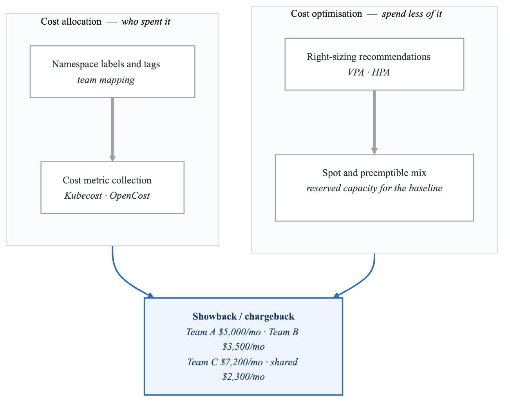
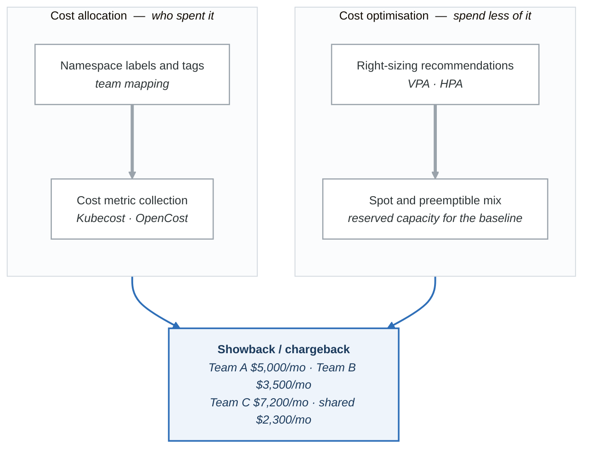

# Exercise 3: Kubernetes Cost Management and FinOps

## Objectives
- Implement cost visibility and allocation in Kubernetes
- Configure resource quotas and limit ranges for cost control
- Set up cost monitoring with Kubecost and OpenCost
- Implement showback and chargeback mechanisms

## Prerequisites
- Kubernetes cluster with admin access
- Prometheus installed
- kubectl configured
- Cloud provider billing APIs access

## Introduction

FinOps (Financial Operations) brings financial accountability to cloud spending. This exercise covers implementing comprehensive cost management for Kubernetes workloads.

<!-- figure: generated from the Mermaid below by _shared/diagrams/embed-figures.py — do not edit the image -->


<details>
<summary>Diagram source (Mermaid)</summary>



</details>

## Part 1: Cost Visibility with OpenCost

### Step 1: Install OpenCost

```bash
# Add Prometheus Community Helm repo (OpenCost uses Prometheus)
helm repo add prometheus-community https://prometheus-community.github.io/helm-charts
helm repo update

# Install Prometheus (if not already installed)
helm install prometheus prometheus-community/prometheus \
  --namespace monitoring \
  --create-namespace \
  --set server.persistentVolume.enabled=false \
  --set alertmanager.enabled=false

# Install OpenCost
kubectl apply -f https://raw.githubusercontent.com/opencost/opencost/develop/kubernetes/opencost.yaml
```

### Step 2: Configure OpenCost Custom Pricing

```yaml
# opencost-config.yaml
apiVersion: v1
kind: ConfigMap
metadata:
  name: opencost-config
  namespace: opencost
data:
  default.json: |
    {
      "provider": "custom",
      "description": "Custom pricing for on-prem or specific rates",
      "CPU": "0.031611",
      "spotCPU": "0.012",
      "RAM": "0.004237",
      "spotRAM": "0.0016",
      "GPU": "0.95",
      "spotGPU": "0.35",
      "storage": "0.00005479452",
      "zoneNetworkEgress": "0.01",
      "regionNetworkEgress": "0.01",
      "internetNetworkEgress": "0.12"
    }
---
# AWS-specific pricing configuration
apiVersion: v1
kind: ConfigMap
metadata:
  name: cloud-integration
  namespace: opencost
data:
  cloud-integration.json: |
    {
      "aws": {
        "athena": [
          {
            "bucket": "s3://your-cur-bucket",
            "region": "us-east-1",
            "database": "athenacurcfn_your_cur_database",
            "table": "your_cur_table",
            "workgroup": "primary"
          }
        ]
      }
    }
```

### Step 3: Deploy OpenCost with Cloud Integration

```yaml
# opencost-deployment.yaml
apiVersion: apps/v1
kind: Deployment
metadata:
  name: opencost
  namespace: opencost
spec:
  replicas: 1
  selector:
    matchLabels:
      app: opencost
  template:
    metadata:
      labels:
        app: opencost
    spec:
      serviceAccountName: opencost
      containers:
        - name: opencost
          image: quay.io/kubecost1/kubecost-cost-model:latest
          ports:
            - containerPort: 9003
          env:
            - name: PROMETHEUS_SERVER_ENDPOINT
              value: "http://prometheus-server.monitoring.svc:80"
            - name: CLOUD_PROVIDER_API_KEY
              valueFrom:
                secretKeyRef:
                  name: cloud-provider-key
                  key: api-key
                  optional: true
            - name: CLUSTER_ID
              value: "production-cluster"
            - name: EMIT_KSM_V1_METRICS
              value: "false"
            - name: EMIT_KSM_V1_METRICS_ONLY
              value: "true"
          resources:
            requests:
              cpu: 100m
              memory: 256Mi
            limits:
              cpu: 500m
              memory: 1Gi
        - name: opencost-ui
          image: quay.io/kubecost1/opencost-ui:latest
          ports:
            - containerPort: 9090
          resources:
            requests:
              cpu: 10m
              memory: 32Mi
            limits:
              cpu: 100m
              memory: 64Mi
---
apiVersion: v1
kind: Service
metadata:
  name: opencost
  namespace: opencost
spec:
  type: ClusterIP
  ports:
    - port: 9003
      targetPort: 9003
      name: api
    - port: 9090
      targetPort: 9090
      name: ui
  selector:
    app: opencost
```

## Part 2: Cost Allocation Labels

### Step 1: Define Cost Allocation Labels Strategy

```yaml
# cost-labels-policy.yaml
# Using Kyverno to enforce cost allocation labels
apiVersion: kyverno.io/v1
kind: ClusterPolicy
metadata:
  name: require-cost-labels
spec:
  validationFailureAction: Enforce
  background: true
  rules:
    - name: require-cost-labels-deployments
      match:
        any:
          - resources:
              kinds:
                - Deployment
                - StatefulSet
                - DaemonSet
      validate:
        message: "Cost allocation labels (team, cost-center, environment) are required"
        pattern:
          metadata:
            labels:
              team: "?*"
              cost-center: "?*"
              environment: "?*"

    - name: require-cost-labels-pods
      match:
        any:
          - resources:
              kinds:
                - Pod
      exclude:
        any:
          - resources:
              namespaces:
                - kube-system
                - monitoring
                - opencost
      validate:
        message: "Cost allocation labels (team, cost-center) are required"
        pattern:
          metadata:
            labels:
              team: "?*"
              cost-center: "?*"
```

### Step 2: Team Cost Allocation Mapping

```yaml
# cost-center-mapping.yaml
apiVersion: v1
kind: ConfigMap
metadata:
  name: cost-center-mapping
  namespace: opencost
data:
  mapping.yaml: |
    # Team to Cost Center mapping
    teams:
      platform:
        cost-center: "CC-001"
        budget: 10000
        alert-threshold: 80
      orders:
        cost-center: "CC-002"
        budget: 15000
        alert-threshold: 85
      users:
        cost-center: "CC-003"
        budget: 8000
        alert-threshold: 80
      data-engineering:
        cost-center: "CC-004"
        budget: 25000
        alert-threshold: 75

    # Shared infrastructure allocation
    shared:
      namespaces:
        - monitoring
        - istio-system
        - cert-manager
        - ingress-nginx
      allocation-method: proportional  # or fixed-percentage
      percentages:
        platform: 20
        orders: 30
        users: 25
        data-engineering: 25
```

### Step 3: Namespace Budget Controller

```yaml
# namespace-budget-controller.yaml
apiVersion: v1
kind: ConfigMap
metadata:
  name: budget-config
  namespace: platform
data:
  budgets.yaml: |
    namespaces:
      team-orders-dev:
        monthly-budget: 500
        cpu-limit: 20
        memory-limit: 40Gi

      team-orders-staging:
        monthly-budget: 1500
        cpu-limit: 50
        memory-limit: 100Gi

      team-orders-prod:
        monthly-budget: 5000
        cpu-limit: 200
        memory-limit: 400Gi
---
apiVersion: apps/v1
kind: Deployment
metadata:
  name: budget-controller
  namespace: platform
spec:
  replicas: 1
  selector:
    matchLabels:
      app: budget-controller
  template:
    metadata:
      labels:
        app: budget-controller
    spec:
      serviceAccountName: budget-controller
      containers:
        - name: controller
          image: platform/budget-controller:v1.0.0
          env:
            - name: OPENCOST_API
              value: "http://opencost.opencost.svc:9003"
            - name: SLACK_WEBHOOK
              valueFrom:
                secretKeyRef:
                  name: slack-webhook
                  key: url
          volumeMounts:
            - name: config
              mountPath: /etc/budget
      volumes:
        - name: config
          configMap:
            name: budget-config
```

## Part 3: Resource Quotas for Cost Control

### Step 1: Tiered Resource Quotas

```yaml
# development-quota.yaml
apiVersion: v1
kind: ResourceQuota
metadata:
  name: development-quota
  namespace: team-orders-dev
spec:
  hard:
    requests.cpu: "4"
    requests.memory: "8Gi"
    limits.cpu: "8"
    limits.memory: "16Gi"
    persistentvolumeclaims: "5"
    requests.storage: "50Gi"
    pods: "20"
    services: "10"
    services.loadbalancers: "0"  # No LBs in dev
    services.nodeports: "0"       # No NodePorts in dev
---
# staging-quota.yaml
apiVersion: v1
kind: ResourceQuota
metadata:
  name: staging-quota
  namespace: team-orders-staging
spec:
  hard:
    requests.cpu: "16"
    requests.memory: "32Gi"
    limits.cpu: "32"
    limits.memory: "64Gi"
    persistentvolumeclaims: "10"
    requests.storage: "200Gi"
    pods: "50"
    services: "20"
    services.loadbalancers: "1"  # 1 LB in staging
    services.nodeports: "2"
---
# production-quota.yaml
apiVersion: v1
kind: ResourceQuota
metadata:
  name: production-quota
  namespace: team-orders-prod
spec:
  hard:
    requests.cpu: "64"
    requests.memory: "128Gi"
    limits.cpu: "128"
    limits.memory: "256Gi"
    persistentvolumeclaims: "20"
    requests.storage: "1Ti"
    pods: "200"
    services: "50"
    services.loadbalancers: "5"
    services.nodeports: "5"
  scopeSelector:
    matchExpressions:
      - operator: In
        scopeName: PriorityClass
        values:
          - high-priority
          - critical
```

### Step 2: GPU Quota Management

```yaml
# gpu-quota.yaml
apiVersion: v1
kind: ResourceQuota
metadata:
  name: gpu-quota
  namespace: ml-training
spec:
  hard:
    requests.nvidia.com/gpu: "4"
    limits.nvidia.com/gpu: "8"
---
# GPU time-based quota (using Kyverno)
apiVersion: kyverno.io/v1
kind: ClusterPolicy
metadata:
  name: gpu-time-limit
spec:
  validationFailureAction: Enforce
  rules:
    - name: limit-gpu-job-duration
      match:
        any:
          - resources:
              kinds:
                - Job
                - Pod
      preconditions:
        all:
          - key: "{{ request.object.spec.containers[].resources.requests.nvidia.com/gpu || '0' }}"
            operator: GreaterThan
            value: "0"
      validate:
        message: "GPU jobs must have activeDeadlineSeconds <= 86400 (24 hours)"
        pattern:
          spec:
            activeDeadlineSeconds: "<=86400"
```

### Step 3: Cost-Based Admission Control

```yaml
# cost-admission-webhook.yaml
apiVersion: admissionregistration.k8s.io/v1
kind: ValidatingWebhookConfiguration
metadata:
  name: cost-validation
webhooks:
  - name: cost.platform.io
    clientConfig:
      service:
        name: cost-validator
        namespace: platform
        path: /validate
      caBundle: ${CA_BUNDLE}
    rules:
      - operations: ["CREATE", "UPDATE"]
        apiGroups: ["apps"]
        apiVersions: ["v1"]
        resources: ["deployments", "statefulsets"]
    namespaceSelector:
      matchExpressions:
        - key: cost-validation
          operator: In
          values: ["enabled"]
    failurePolicy: Fail
    sideEffects: None
    admissionReviewVersions: ["v1"]
---
# Cost validator service
apiVersion: v1
kind: ConfigMap
metadata:
  name: cost-validator-config
  namespace: platform
data:
  config.yaml: |
    # Maximum hourly cost per deployment
    max-hourly-cost:
      development: 1.00
      staging: 5.00
      production: 50.00

    # Cost calculation rates (hourly)
    rates:
      cpu: 0.031611
      memory-gb: 0.004237
      gpu: 0.95

    # Require approval for high-cost deployments
    approval-threshold: 10.00
```

## Part 4: Cost Reporting and Alerts

### Step 1: Prometheus Cost Metrics

```yaml
# cost-recording-rules.yaml
apiVersion: monitoring.coreos.com/v1
kind: PrometheusRule
metadata:
  name: cost-recording-rules
  namespace: monitoring
spec:
  groups:
    - name: cost-allocation
      interval: 1h
      rules:
        # CPU cost per namespace
        - record: namespace:cpu_cost:hourly
          expr: |
            sum by (namespace) (
              sum_over_time(
                container_cpu_usage_seconds_total{container!="POD",container!=""}[1h]
              )
            ) * 0.031611 / 3600

        # Memory cost per namespace
        - record: namespace:memory_cost:hourly
          expr: |
            sum by (namespace) (
              avg_over_time(
                container_memory_working_set_bytes{container!="POD",container!=""}[1h]
              )
            ) / 1024 / 1024 / 1024 * 0.004237

        # Total cost per namespace
        - record: namespace:total_cost:hourly
          expr: |
            namespace:cpu_cost:hourly + namespace:memory_cost:hourly

        # Cost by team label
        - record: team:total_cost:hourly
          expr: |
            sum by (label_team) (
              (
                sum by (namespace, label_team) (
                  kube_pod_labels{label_team!=""}
                ) * 0 +
                on(namespace) group_left()
                namespace:total_cost:hourly
              )
            )

        # Daily aggregation
        - record: namespace:total_cost:daily
          expr: |
            sum_over_time(namespace:total_cost:hourly[24h])

        # Monthly projection
        - record: namespace:total_cost:monthly_projection
          expr: |
            avg_over_time(namespace:total_cost:daily[7d]) * 30
```

### Step 2: Cost Alerting Rules

```yaml
# cost-alerts.yaml
apiVersion: monitoring.coreos.com/v1
kind: PrometheusRule
metadata:
  name: cost-alerts
  namespace: monitoring
spec:
  groups:
    - name: cost-alerts
      rules:
        # Namespace approaching budget
        - alert: NamespaceCostBudgetWarning
          expr: |
            namespace:total_cost:monthly_projection >
            (kube_namespace_annotations{annotation_budget!=""} * 0.8)
          for: 1h
          labels:
            severity: warning
          annotations:
            summary: "Namespace {{ $labels.namespace }} approaching cost budget"
            description: |
              Namespace {{ $labels.namespace }} is projected to spend
              ${{ $value | printf "%.2f" }} this month, exceeding 80% of budget.

        # Namespace exceeded budget
        - alert: NamespaceCostBudgetExceeded
          expr: |
            namespace:total_cost:monthly_projection >
            kube_namespace_annotations{annotation_budget!=""}
          for: 1h
          labels:
            severity: critical
          annotations:
            summary: "Namespace {{ $labels.namespace }} exceeded cost budget"
            description: |
              Namespace {{ $labels.namespace }} projected monthly cost
              ${{ $value | printf "%.2f" }} exceeds budget.

        # Sudden cost spike
        - alert: CostSpikeDetected
          expr: |
            (
              namespace:total_cost:hourly -
              namespace:total_cost:hourly offset 1d
            ) / namespace:total_cost:hourly offset 1d > 0.5
          for: 2h
          labels:
            severity: warning
          annotations:
            summary: "Cost spike detected in {{ $labels.namespace }}"
            description: |
              Namespace {{ $labels.namespace }} costs increased by
              {{ $value | humanizePercentage }} compared to yesterday.

        # Idle resources (low utilization, high cost)
        - alert: IdleResourcesDetected
          expr: |
            (
              sum by (namespace) (
                kube_pod_container_resource_requests{resource="cpu"}
              ) -
              sum by (namespace) (
                rate(container_cpu_usage_seconds_total[1h])
              )
            ) / sum by (namespace) (
              kube_pod_container_resource_requests{resource="cpu"}
            ) > 0.7
            and
            namespace:total_cost:hourly > 1
          for: 6h
          labels:
            severity: info
          annotations:
            summary: "Idle resources in {{ $labels.namespace }}"
            description: |
              Namespace {{ $labels.namespace }} has 70%+ idle CPU capacity
              while spending ${{ $value | printf "%.2f" }}/hour.
```

### Step 3: Grafana Cost Dashboard

```yaml
# cost-dashboard-configmap.yaml
apiVersion: v1
kind: ConfigMap
metadata:
  name: grafana-cost-dashboard
  namespace: monitoring
  labels:
    grafana_dashboard: "1"
data:
  cost-dashboard.json: |
    {
      "title": "Kubernetes Cost Dashboard",
      "uid": "kubernetes-cost",
      "panels": [
        {
          "title": "Total Cluster Cost (Monthly)",
          "type": "stat",
          "gridPos": {"h": 4, "w": 6, "x": 0, "y": 0},
          "targets": [
            {
              "expr": "sum(namespace:total_cost:monthly_projection)",
              "legendFormat": "Total"
            }
          ],
          "options": {
            "colorMode": "value",
            "graphMode": "area"
          },
          "fieldConfig": {
            "defaults": {
              "unit": "currencyUSD",
              "thresholds": {
                "mode": "absolute",
                "steps": [
                  {"color": "green", "value": null},
                  {"color": "yellow", "value": 50000},
                  {"color": "red", "value": 100000}
                ]
              }
            }
          }
        },
        {
          "title": "Cost by Namespace",
          "type": "piechart",
          "gridPos": {"h": 8, "w": 12, "x": 6, "y": 0},
          "targets": [
            {
              "expr": "topk(10, namespace:total_cost:monthly_projection)",
              "legendFormat": "{{ namespace }}"
            }
          ]
        },
        {
          "title": "Cost by Team",
          "type": "bargauge",
          "gridPos": {"h": 8, "w": 6, "x": 18, "y": 0},
          "targets": [
            {
              "expr": "team:total_cost:hourly * 730",
              "legendFormat": "{{ label_team }}"
            }
          ],
          "fieldConfig": {
            "defaults": {
              "unit": "currencyUSD"
            }
          }
        },
        {
          "title": "Cost Trend (30 days)",
          "type": "timeseries",
          "gridPos": {"h": 8, "w": 24, "x": 0, "y": 8},
          "targets": [
            {
              "expr": "sum(namespace:total_cost:daily)",
              "legendFormat": "Total Daily Cost"
            }
          ],
          "fieldConfig": {
            "defaults": {
              "unit": "currencyUSD"
            }
          }
        },
        {
          "title": "Cost vs Budget by Namespace",
          "type": "table",
          "gridPos": {"h": 8, "w": 12, "x": 0, "y": 16},
          "targets": [
            {
              "expr": "namespace:total_cost:monthly_projection",
              "legendFormat": "Projected",
              "instant": true
            }
          ],
          "transformations": [
            {
              "id": "organize",
              "options": {
                "excludeByName": {},
                "indexByName": {},
                "renameByName": {
                  "namespace": "Namespace",
                  "Value": "Projected Cost"
                }
              }
            }
          ]
        },
        {
          "title": "Top Resource Consumers",
          "type": "table",
          "gridPos": {"h": 8, "w": 12, "x": 12, "y": 16},
          "targets": [
            {
              "expr": "topk(10, sum by (namespace, pod) (container_memory_working_set_bytes) / 1024 / 1024 / 1024 * 0.004237)",
              "legendFormat": "{{ namespace }}/{{ pod }}",
              "instant": true
            }
          ]
        }
      ]
    }
```

## Part 5: Right-Sizing Recommendations

### Step 1: VPA for Automatic Right-Sizing

```yaml
# vpa-recommendations.yaml
apiVersion: autoscaling.k8s.io/v1
kind: VerticalPodAutoscaler
metadata:
  name: orders-api-vpa
  namespace: orders
spec:
  targetRef:
    apiVersion: apps/v1
    kind: Deployment
    name: orders-api
  updatePolicy:
    updateMode: "Off"  # Recommendation only, no automatic updates
  resourcePolicy:
    containerPolicies:
      - containerName: "*"
        minAllowed:
          cpu: "50m"
          memory: "64Mi"
        maxAllowed:
          cpu: "4"
          memory: "8Gi"
        controlledResources:
          - cpu
          - memory
```

### Step 2: Cost Optimization Recommendations Job

```yaml
# optimization-recommendations.yaml
apiVersion: batch/v1
kind: CronJob
metadata:
  name: cost-recommendations
  namespace: platform
spec:
  schedule: "0 8 * * 1"  # Weekly on Monday at 8 AM
  jobTemplate:
    spec:
      template:
        spec:
          serviceAccountName: cost-analyzer
          containers:
            - name: analyzer
              image: platform/cost-analyzer:v1.0.0
              env:
                - name: PROMETHEUS_URL
                  value: "http://prometheus-server.monitoring.svc:80"
                - name: OPENCOST_URL
                  value: "http://opencost.opencost.svc:9003"
                - name: SLACK_WEBHOOK
                  valueFrom:
                    secretKeyRef:
                      name: slack-webhook
                      key: url
              command:
                - /bin/sh
                - -c
                - |
                  # Generate recommendations report
                  /app/analyze \
                    --output-format=markdown \
                    --min-savings=10 \
                    --lookback=7d \
                    > /tmp/report.md

                  # Send to Slack
                  curl -X POST $SLACK_WEBHOOK \
                    -H 'Content-type: application/json' \
                    --data "{\"text\": \"$(cat /tmp/report.md)\"}"
          restartPolicy: OnFailure
---
apiVersion: v1
kind: ServiceAccount
metadata:
  name: cost-analyzer
  namespace: platform
---
apiVersion: rbac.authorization.k8s.io/v1
kind: ClusterRole
metadata:
  name: cost-analyzer
rules:
  - apiGroups: [""]
    resources: ["pods", "namespaces", "nodes"]
    verbs: ["get", "list"]
  - apiGroups: ["apps"]
    resources: ["deployments", "statefulsets", "daemonsets"]
    verbs: ["get", "list"]
  - apiGroups: ["autoscaling.k8s.io"]
    resources: ["verticalpodautoscalers"]
    verbs: ["get", "list"]
```

### Step 3: Spot Instance Integration

```yaml
# spot-node-pool.yaml
# AWS Karpenter configuration for spot instances
apiVersion: karpenter.sh/v1alpha5
kind: Provisioner
metadata:
  name: spot-provisioner
spec:
  requirements:
    - key: karpenter.sh/capacity-type
      operator: In
      values:
        - spot
        - on-demand
    - key: node.kubernetes.io/instance-type
      operator: In
      values:
        - m6i.large
        - m6i.xlarge
        - m5.large
        - m5.xlarge
        - c6i.large
        - c6i.xlarge
    - key: topology.kubernetes.io/zone
      operator: In
      values:
        - us-west-2a
        - us-west-2b
        - us-west-2c
  limits:
    resources:
      cpu: 1000
      memory: 2000Gi
  providerRef:
    name: default
  ttlSecondsAfterEmpty: 30
  ttlSecondsUntilExpired: 604800  # 7 days
  # Consolidation for cost optimization
  consolidation:
    enabled: true
---
# Pod configuration for spot tolerance
apiVersion: apps/v1
kind: Deployment
metadata:
  name: batch-processor
  namespace: batch
spec:
  replicas: 5
  selector:
    matchLabels:
      app: batch-processor
  template:
    metadata:
      labels:
        app: batch-processor
    spec:
      # Tolerate spot interruption
      tolerations:
        - key: karpenter.sh/capacity-type
          operator: Equal
          value: spot
          effect: NoSchedule
      # Prefer spot instances
      affinity:
        nodeAffinity:
          preferredDuringSchedulingIgnoredDuringExecution:
            - weight: 100
              preference:
                matchExpressions:
                  - key: karpenter.sh/capacity-type
                    operator: In
                    values:
                      - spot
      # Handle spot interruption gracefully
      terminationGracePeriodSeconds: 120
      containers:
        - name: processor
          image: batch/processor:v1.0.0
          resources:
            requests:
              cpu: 500m
              memory: 512Mi
            limits:
              cpu: "2"
              memory: 2Gi
          lifecycle:
            preStop:
              exec:
                command:
                  - /bin/sh
                  - -c
                  - |
                    # Checkpoint current work
                    /app/checkpoint --save-state
                    # Wait for graceful drain
                    sleep 30
```

## Verification Tasks

1. Query OpenCost API for namespace costs:
```bash
curl -s "http://localhost:9003/allocation/compute?window=24h&aggregate=namespace" | jq
```

2. Check cost recording rules:
```bash
kubectl exec -it prometheus-server-0 -n monitoring -- \
  promtool query instant http://localhost:9090 'namespace:total_cost:hourly'
```

3. Verify resource quotas:
```bash
kubectl describe quota -n team-orders-dev
kubectl get resourcequota -A -o custom-columns='NAMESPACE:.metadata.namespace,NAME:.metadata.name,CPU:.status.hard.requests\.cpu,MEMORY:.status.hard.requests\.memory'
```

4. Check VPA recommendations:
```bash
kubectl get vpa -A -o custom-columns='NAMESPACE:.metadata.namespace,NAME:.metadata.name,MODE:.spec.updatePolicy.updateMode,CPU:.status.recommendation.containerRecommendations[0].target.cpu,MEMORY:.status.recommendation.containerRecommendations[0].target.memory'
```

## Challenges

1. **Multi-Cloud Cost Aggregation**: Extend OpenCost to aggregate costs across AWS, GCP, and Azure clusters

2. **Automated Cost Anomaly Detection**: Implement ML-based anomaly detection for unusual spending patterns

3. **Team Budget Automation**: Create a controller that automatically scales down resources when budget is exceeded

## Key Takeaways

- Cost visibility is the foundation of FinOps
- Labels enable accurate cost allocation to teams
- Resource quotas provide hard limits for cost control
- Automated right-sizing reduces waste
- Spot instances can significantly reduce compute costs
- Regular reporting drives cost accountability

## Next Steps

- Proceed to Exercise 4: Platform Guardrails
- Learn about policy enforcement for platform governance
- Explore OPA Gatekeeper and Kyverno for policy management

<!-- feynman-check -->

---

## Feynman check

Close the file. Blank page, no notes. Explain each of these to a competent engineer who has never
used this tool — **under five minutes, no jargon you can't define on the spot:**

- Cost Visibility with OpenCost
- Cost Allocation Labels
- Resource Quotas for Cost Control
- Cost Reporting and Alerts

**The gap is not what you forgot. It is where you used a word instead of a mechanism.**

| | |
|---|---|
| ✗ | *"Kubernetes schedules the pod."* |
| ✓ | *"The scheduler watches for pods with no `nodeName`, filters nodes by predicates, scores the survivors, and writes `nodeName` into the pod spec. The kubelet on that node is watching the API for pods bound to it, and starts the containers."* |

**Trace it:** `kubectl apply -f pod.yaml` → a running container. Name every component that acts, in order, and what each one writes.

Stop at the first component you cannot name. Reopen this file and read **only** that.

**Go deeper — only once the gap has a name:** [Kubernetes the Hard Way](https://github.com/kelseyhightower/kubernetes-the-hard-way) — one weekend, and "the control plane" stops being a word.
Full list per domain: [`SOURCES.md`](../../SOURCES.md#kubernetes)

→ Protocol, the three levels of knowing, and worked examples: [`MASTERY.md`](../../MASTERY.md)

<!-- /feynman-check -->
