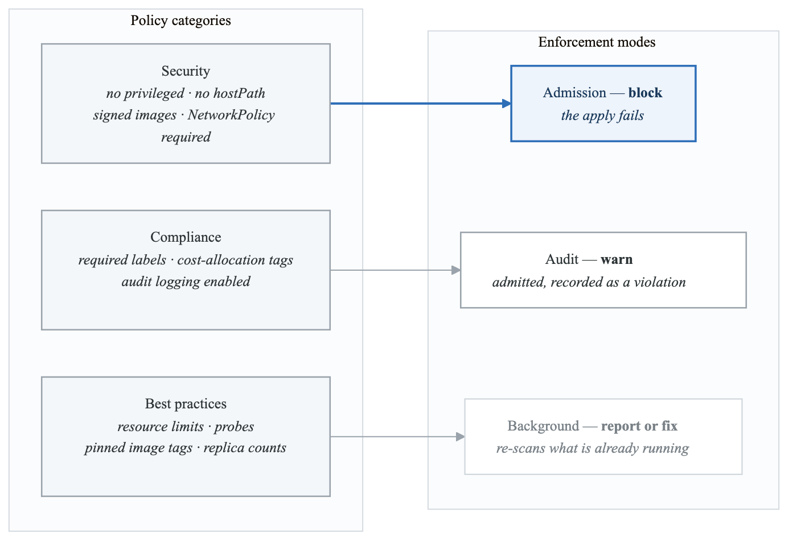
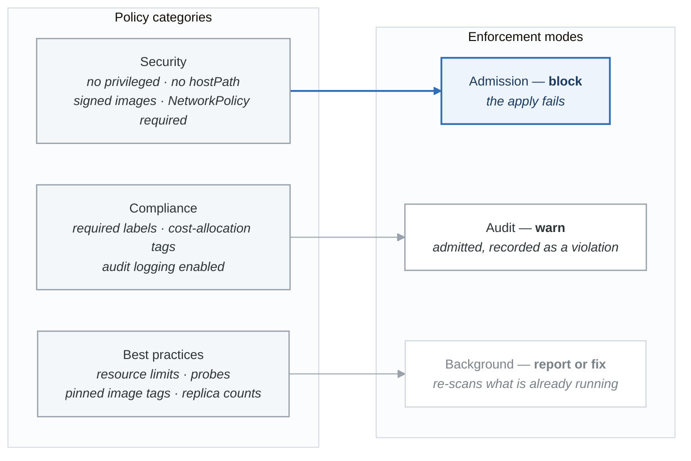

# Exercise 4: Platform Guardrails and Policy Enforcement

## Objectives
- Implement policy-as-code with OPA Gatekeeper and Kyverno
- Create guardrails for security, compliance, and best practices
- Build a multi-layer policy enforcement strategy
- Enable self-service within safe boundaries

## Prerequisites
- Kubernetes cluster with admin access
- kubectl configured
- Basic understanding of admission controllers

## Introduction

Platform guardrails enable developers to move fast while staying within safe boundaries. This exercise covers implementing comprehensive policy enforcement using modern policy engines.

<!-- figure: generated from the Mermaid below by _shared/diagrams/embed-figures.py — do not edit the image -->


<details>
<summary>Diagram source (Mermaid)</summary>



</details>

The category does not fix the mode — the *confidence* does. A new policy ships in
background/report mode, graduates to audit once the violation count stops moving,
and only then becomes an admission block:

`Background (report)` → `Audit (warn)` → `Admission (block)`

Going straight to `block` on a cluster you have not measured is how a platform team
earns a reputation for breaking deploys on a Friday.

## Part 1: OPA Gatekeeper Setup

### Step 1: Install Gatekeeper

```bash
# Install Gatekeeper
kubectl apply -f https://raw.githubusercontent.com/open-policy-agent/gatekeeper/v3.14.0/deploy/gatekeeper.yaml

# Verify installation
kubectl get pods -n gatekeeper-system
kubectl get crd | grep gatekeeper
```

### Step 2: Configure Gatekeeper

```yaml
# gatekeeper-config.yaml
apiVersion: config.gatekeeper.sh/v1alpha1
kind: Config
metadata:
  name: config
  namespace: gatekeeper-system
spec:
  sync:
    syncOnly:
      - group: ""
        version: "v1"
        kind: "Namespace"
      - group: ""
        version: "v1"
        kind: "Pod"
      - group: "networking.k8s.io"
        version: "v1"
        kind: "NetworkPolicy"
  # Exempt system namespaces from policies
  match:
    - excludedNamespaces:
        - kube-system
        - gatekeeper-system
      processes:
        - "*"
  validation:
    traces:
      - user: "*"
        kind:
          group: ""
          version: "v1"
          kind: "Pod"
```

### Step 3: Create Constraint Templates

```yaml
# template-required-labels.yaml
apiVersion: templates.gatekeeper.sh/v1
kind: ConstraintTemplate
metadata:
  name: k8srequiredlabels
spec:
  crd:
    spec:
      names:
        kind: K8sRequiredLabels
      validation:
        openAPIV3Schema:
          type: object
          properties:
            labels:
              type: array
              description: List of required labels
              items:
                type: object
                properties:
                  key:
                    type: string
                  allowedRegex:
                    type: string
                required:
                  - key
  targets:
    - target: admission.k8s.gatekeeper.sh
      rego: |
        package k8srequiredlabels

        violation[{"msg": msg, "details": {"missing_labels": missing}}] {
          provided := {label | input.review.object.metadata.labels[label]}
          required := {label | label := input.parameters.labels[_].key}
          missing := required - provided
          count(missing) > 0
          msg := sprintf("Missing required labels: %v", [missing])
        }

        violation[{"msg": msg, "details": {"invalid_value": key}}] {
          value := input.review.object.metadata.labels[key]
          expected := input.parameters.labels[_]
          expected.key == key
          expected.allowedRegex != ""
          not re_match(expected.allowedRegex, value)
          msg := sprintf("Label %v has invalid value %v, must match regex: %v", [key, value, expected.allowedRegex])
        }
---
# template-container-limits.yaml
apiVersion: templates.gatekeeper.sh/v1
kind: ConstraintTemplate
metadata:
  name: k8scontainerlimits
spec:
  crd:
    spec:
      names:
        kind: K8sContainerLimits
      validation:
        openAPIV3Schema:
          type: object
          properties:
            cpu:
              type: string
            memory:
              type: string
            exemptImages:
              type: array
              items:
                type: string
  targets:
    - target: admission.k8s.gatekeeper.sh
      rego: |
        package k8scontainerlimits

        violation[{"msg": msg}] {
          container := input.review.object.spec.containers[_]
          not is_exempt(container.image)
          not container.resources.limits.cpu
          msg := sprintf("Container %v must have CPU limit", [container.name])
        }

        violation[{"msg": msg}] {
          container := input.review.object.spec.containers[_]
          not is_exempt(container.image)
          not container.resources.limits.memory
          msg := sprintf("Container %v must have memory limit", [container.name])
        }

        violation[{"msg": msg}] {
          container := input.review.object.spec.containers[_]
          not is_exempt(container.image)
          cpu_limit := container.resources.limits.cpu
          max_cpu := input.parameters.cpu
          not cpu_within_limit(cpu_limit, max_cpu)
          msg := sprintf("Container %v CPU limit %v exceeds maximum %v", [container.name, cpu_limit, max_cpu])
        }

        is_exempt(image) {
          exempt := input.parameters.exemptImages[_]
          startswith(image, exempt)
        }

        cpu_within_limit(limit, max) {
          limit_value := parse_cpu(limit)
          max_value := parse_cpu(max)
          limit_value <= max_value
        }

        parse_cpu(cpu) = result {
          endswith(cpu, "m")
          result := to_number(trim_suffix(cpu, "m"))
        }

        parse_cpu(cpu) = result {
          not endswith(cpu, "m")
          result := to_number(cpu) * 1000
        }
---
# template-allowed-repos.yaml
apiVersion: templates.gatekeeper.sh/v1
kind: ConstraintTemplate
metadata:
  name: k8sallowedrepos
spec:
  crd:
    spec:
      names:
        kind: K8sAllowedRepos
      validation:
        openAPIV3Schema:
          type: object
          properties:
            repos:
              type: array
              items:
                type: string
  targets:
    - target: admission.k8s.gatekeeper.sh
      rego: |
        package k8sallowedrepos

        violation[{"msg": msg}] {
          container := input.review.object.spec.containers[_]
          not image_allowed(container.image)
          msg := sprintf("Container %v uses image %v from disallowed registry", [container.name, container.image])
        }

        violation[{"msg": msg}] {
          container := input.review.object.spec.initContainers[_]
          not image_allowed(container.image)
          msg := sprintf("Init container %v uses image %v from disallowed registry", [container.name, container.image])
        }

        image_allowed(image) {
          repo := input.parameters.repos[_]
          startswith(image, repo)
        }
```

### Step 4: Create Constraints

```yaml
# constraint-required-labels.yaml
apiVersion: constraints.gatekeeper.sh/v1beta1
kind: K8sRequiredLabels
metadata:
  name: workload-must-have-labels
spec:
  enforcementAction: deny
  match:
    kinds:
      - apiGroups: ["apps"]
        kinds: ["Deployment", "StatefulSet", "DaemonSet"]
    excludedNamespaces:
      - kube-system
      - gatekeeper-system
      - monitoring
  parameters:
    labels:
      - key: "app"
      - key: "team"
        allowedRegex: "^[a-z]+-team$"
      - key: "environment"
        allowedRegex: "^(development|staging|production)$"
---
# constraint-container-limits.yaml
apiVersion: constraints.gatekeeper.sh/v1beta1
kind: K8sContainerLimits
metadata:
  name: container-must-have-limits
spec:
  enforcementAction: deny
  match:
    kinds:
      - apiGroups: [""]
        kinds: ["Pod"]
    excludedNamespaces:
      - kube-system
      - gatekeeper-system
  parameters:
    cpu: "4"
    memory: "8Gi"
    exemptImages:
      - "gcr.io/kubebuilder/"
      - "registry.k8s.io/pause"
---
# constraint-allowed-repos.yaml
apiVersion: constraints.gatekeeper.sh/v1beta1
kind: K8sAllowedRepos
metadata:
  name: allowed-registries
spec:
  enforcementAction: deny
  match:
    kinds:
      - apiGroups: [""]
        kinds: ["Pod"]
    excludedNamespaces:
      - kube-system
  parameters:
    repos:
      - "gcr.io/my-company/"
      - "my-company.azurecr.io/"
      - "123456789.dkr.ecr.us-west-2.amazonaws.com/"
      - "registry.k8s.io/"
      - "quay.io/prometheus/"
```

## Part 2: Kyverno Policy Engine

### Step 1: Install Kyverno

```bash
# Install Kyverno
helm repo add kyverno https://kyverno.github.io/kyverno/
helm repo update

helm install kyverno kyverno/kyverno \
  --namespace kyverno \
  --create-namespace \
  --set replicaCount=3 \
  --set resources.limits.memory=512Mi

# Verify installation
kubectl get pods -n kyverno
```

### Step 2: Validation Policies

```yaml
# kyverno-security-policies.yaml
apiVersion: kyverno.io/v1
kind: ClusterPolicy
metadata:
  name: disallow-privileged-containers
  annotations:
    policies.kyverno.io/title: Disallow Privileged Containers
    policies.kyverno.io/category: Pod Security
    policies.kyverno.io/severity: high
spec:
  validationFailureAction: Enforce
  background: true
  rules:
    - name: privileged-containers
      match:
        any:
          - resources:
              kinds:
                - Pod
      validate:
        message: "Privileged containers are not allowed"
        pattern:
          spec:
            containers:
              - securityContext:
                  privileged: "false"
            =(initContainers):
              - securityContext:
                  privileged: "false"
---
apiVersion: kyverno.io/v1
kind: ClusterPolicy
metadata:
  name: disallow-host-namespaces
  annotations:
    policies.kyverno.io/title: Disallow Host Namespaces
    policies.kyverno.io/category: Pod Security
    policies.kyverno.io/severity: high
spec:
  validationFailureAction: Enforce
  background: true
  rules:
    - name: host-namespaces
      match:
        any:
          - resources:
              kinds:
                - Pod
      validate:
        message: "Host namespaces (hostNetwork, hostIPC, hostPID) are not allowed"
        pattern:
          spec:
            =(hostNetwork): false
            =(hostIPC): false
            =(hostPID): false
---
apiVersion: kyverno.io/v1
kind: ClusterPolicy
metadata:
  name: disallow-host-path
  annotations:
    policies.kyverno.io/title: Disallow hostPath Volumes
    policies.kyverno.io/category: Pod Security
    policies.kyverno.io/severity: high
spec:
  validationFailureAction: Enforce
  background: true
  rules:
    - name: host-path
      match:
        any:
          - resources:
              kinds:
                - Pod
      validate:
        message: "hostPath volumes are not allowed"
        pattern:
          spec:
            =(volumes):
              - X(hostPath): "null"
---
apiVersion: kyverno.io/v1
kind: ClusterPolicy
metadata:
  name: require-ro-rootfs
  annotations:
    policies.kyverno.io/title: Require Read-Only Root Filesystem
    policies.kyverno.io/category: Pod Security
    policies.kyverno.io/severity: medium
spec:
  validationFailureAction: Audit  # Start with audit mode
  background: true
  rules:
    - name: readonly-rootfs
      match:
        any:
          - resources:
              kinds:
                - Pod
      exclude:
        any:
          - resources:
              namespaces:
                - kube-system
      validate:
        message: "Root filesystem must be read-only"
        pattern:
          spec:
            containers:
              - securityContext:
                  readOnlyRootFilesystem: true
```

### Step 3: Mutation Policies

```yaml
# kyverno-mutation-policies.yaml
apiVersion: kyverno.io/v1
kind: ClusterPolicy
metadata:
  name: add-default-resources
  annotations:
    policies.kyverno.io/title: Add Default Resources
    policies.kyverno.io/category: Best Practices
spec:
  rules:
    - name: add-default-requests
      match:
        any:
          - resources:
              kinds:
                - Pod
      mutate:
        patchStrategicMerge:
          spec:
            containers:
              - (name): "*"
                resources:
                  requests:
                    +(memory): "128Mi"
                    +(cpu): "100m"
                  limits:
                    +(memory): "512Mi"
                    +(cpu): "500m"
---
apiVersion: kyverno.io/v1
kind: ClusterPolicy
metadata:
  name: add-security-context
  annotations:
    policies.kyverno.io/title: Add Default Security Context
    policies.kyverno.io/category: Pod Security
spec:
  rules:
    - name: add-pod-security-context
      match:
        any:
          - resources:
              kinds:
                - Pod
      mutate:
        patchStrategicMerge:
          spec:
            securityContext:
              +(runAsNonRoot): true
              +(seccompProfile):
                +(type): RuntimeDefault
            containers:
              - (name): "*"
                securityContext:
                  +(allowPrivilegeEscalation): false
                  +(capabilities):
                    +(drop):
                      - ALL
---
apiVersion: kyverno.io/v1
kind: ClusterPolicy
metadata:
  name: add-network-policy
  annotations:
    policies.kyverno.io/title: Add Default Network Policy
    policies.kyverno.io/category: Network Security
spec:
  rules:
    - name: generate-default-network-policy
      match:
        any:
          - resources:
              kinds:
                - Namespace
      exclude:
        any:
          - resources:
              namespaces:
                - kube-system
                - kube-public
                - default
      generate:
        synchronize: true
        apiVersion: networking.k8s.io/v1
        kind: NetworkPolicy
        name: default-deny-ingress
        namespace: "{{request.object.metadata.name}}"
        data:
          spec:
            podSelector: {}
            policyTypes:
              - Ingress
---
apiVersion: kyverno.io/v1
kind: ClusterPolicy
metadata:
  name: add-image-pull-secret
  annotations:
    policies.kyverno.io/title: Add Image Pull Secret
    policies.kyverno.io/category: Configuration
spec:
  rules:
    - name: add-imagepullsecret
      match:
        any:
          - resources:
              kinds:
                - Pod
      mutate:
        patchStrategicMerge:
          spec:
            imagePullSecrets:
              - name: registry-credentials
```

### Step 4: Generation Policies

```yaml
# kyverno-generate-policies.yaml
apiVersion: kyverno.io/v1
kind: ClusterPolicy
metadata:
  name: generate-resource-quota
  annotations:
    policies.kyverno.io/title: Generate Resource Quota
    policies.kyverno.io/category: Resource Management
spec:
  rules:
    - name: generate-quota
      match:
        any:
          - resources:
              kinds:
                - Namespace
              selector:
                matchLabels:
                  quota-tier: standard
      generate:
        synchronize: true
        apiVersion: v1
        kind: ResourceQuota
        name: standard-quota
        namespace: "{{request.object.metadata.name}}"
        data:
          spec:
            hard:
              requests.cpu: "4"
              requests.memory: "8Gi"
              limits.cpu: "8"
              limits.memory: "16Gi"
              pods: "20"
---
apiVersion: kyverno.io/v1
kind: ClusterPolicy
metadata:
  name: generate-limit-range
  annotations:
    policies.kyverno.io/title: Generate Limit Range
    policies.kyverno.io/category: Resource Management
spec:
  rules:
    - name: generate-limitrange
      match:
        any:
          - resources:
              kinds:
                - Namespace
      exclude:
        any:
          - resources:
              namespaces:
                - kube-system
                - kube-public
      generate:
        synchronize: true
        apiVersion: v1
        kind: LimitRange
        name: default-limits
        namespace: "{{request.object.metadata.name}}"
        data:
          spec:
            limits:
              - type: Container
                default:
                  cpu: "500m"
                  memory: "512Mi"
                defaultRequest:
                  cpu: "100m"
                  memory: "128Mi"
                max:
                  cpu: "4"
                  memory: "8Gi"
                min:
                  cpu: "50m"
                  memory: "64Mi"
---
apiVersion: kyverno.io/v1
kind: ClusterPolicy
metadata:
  name: sync-secrets
  annotations:
    policies.kyverno.io/title: Sync Registry Secrets
    policies.kyverno.io/category: Configuration
spec:
  rules:
    - name: sync-registry-secret
      match:
        any:
          - resources:
              kinds:
                - Namespace
      generate:
        synchronize: true
        apiVersion: v1
        kind: Secret
        name: registry-credentials
        namespace: "{{request.object.metadata.name}}"
        clone:
          namespace: platform
          name: registry-credentials-template
```

## Part 3: Multi-Tenancy Policies

### Step 1: Namespace Isolation

```yaml
# namespace-isolation-policy.yaml
apiVersion: kyverno.io/v1
kind: ClusterPolicy
metadata:
  name: namespace-isolation
  annotations:
    policies.kyverno.io/title: Namespace Isolation
    policies.kyverno.io/category: Multi-Tenancy
spec:
  validationFailureAction: Enforce
  background: true
  rules:
    # Prevent cross-namespace service references
    - name: restrict-external-names
      match:
        any:
          - resources:
              kinds:
                - Service
      preconditions:
        all:
          - key: "{{request.object.spec.type}}"
            operator: Equals
            value: ExternalName
      validate:
        message: "ExternalName services are not allowed"
        deny: {}

    # Restrict node selectors
    - name: restrict-node-selector
      match:
        any:
          - resources:
              kinds:
                - Pod
      exclude:
        any:
          - resources:
              namespaces:
                - kube-system
      validate:
        message: "Node selectors are restricted"
        deny:
          conditions:
            any:
              - key: "{{request.object.spec.nodeSelector}}"
                operator: AnyNotIn
                value:
                  - ""
                  - "null"
---
# tenant-resource-boundaries.yaml
apiVersion: kyverno.io/v1
kind: ClusterPolicy
metadata:
  name: tenant-resource-boundaries
  annotations:
    policies.kyverno.io/title: Tenant Resource Boundaries
    policies.kyverno.io/category: Multi-Tenancy
spec:
  validationFailureAction: Enforce
  background: true
  rules:
    # Prevent service account token automounting
    - name: restrict-sa-token-mount
      match:
        any:
          - resources:
              kinds:
                - Pod
      validate:
        message: "Service account token automounting must be explicitly set"
        pattern:
          spec:
            automountServiceAccountToken: "false"

    # Restrict cluster-scoped resources creation
    - name: prevent-cluster-admin-binding
      match:
        any:
          - resources:
              kinds:
                - ClusterRoleBinding
      validate:
        message: "Cannot create bindings to cluster-admin role"
        deny:
          conditions:
            all:
              - key: "{{request.object.roleRef.name}}"
                operator: Equals
                value: "cluster-admin"
```

### Step 2: Team Namespace Policies

```yaml
# team-namespace-policies.yaml
apiVersion: kyverno.io/v1
kind: Policy
metadata:
  name: team-orders-policies
  namespace: team-orders
spec:
  validationFailureAction: Enforce
  background: true
  rules:
    # Team-specific image restrictions
    - name: team-allowed-images
      match:
        any:
          - resources:
              kinds:
                - Pod
      validate:
        message: "Images must be from team-approved registries"
        pattern:
          spec:
            containers:
              - image: "gcr.io/my-company/orders-* | gcr.io/my-company/shared-*"

    # Team resource limits
    - name: team-max-replicas
      match:
        any:
          - resources:
              kinds:
                - Deployment
      validate:
        message: "Maximum 10 replicas allowed in this namespace"
        pattern:
          spec:
            replicas: "<=10"
---
# production-namespace-policies.yaml
apiVersion: kyverno.io/v1
kind: Policy
metadata:
  name: production-policies
  namespace: production
spec:
  validationFailureAction: Enforce
  background: true
  rules:
    # Require multiple replicas in production
    - name: require-multiple-replicas
      match:
        any:
          - resources:
              kinds:
                - Deployment
      validate:
        message: "Production deployments must have at least 2 replicas"
        pattern:
          spec:
            replicas: ">=2"

    # Require PDB in production
    - name: require-pdb
      match:
        any:
          - resources:
              kinds:
                - Deployment
      preconditions:
        all:
          - key: "{{request.object.spec.replicas}}"
            operator: GreaterThan
            value: 1
      validate:
        message: "Deployments with >1 replica must have a PodDisruptionBudget"
        deny:
          conditions:
            all:
              - key: "{{request.object.metadata.name}}"
                operator: AnyNotIn
                value: "{{ podDisruptionBudgets }}"
        context:
          - name: podDisruptionBudgets
            apiCall:
              urlPath: "/apis/policy/v1/namespaces/{{request.namespace}}/poddisruptionbudgets"
              jmesPath: "items[].spec.selector.matchLabels.app"

    # Require probes in production
    - name: require-probes
      match:
        any:
          - resources:
              kinds:
                - Pod
      validate:
        message: "Production pods must have liveness and readiness probes"
        pattern:
          spec:
            containers:
              - livenessProbe:
                  httpGet:
                    path: "?*"
                    port: "?*"
                readinessProbe:
                  httpGet:
                    path: "?*"
                    port: "?*"
```

## Part 4: Policy Exceptions and Escalation

### Step 1: Exception Framework

```yaml
# policy-exception.yaml
apiVersion: kyverno.io/v2alpha1
kind: PolicyException
metadata:
  name: allow-privileged-for-cni
  namespace: kube-system
spec:
  exceptions:
    - policyName: disallow-privileged-containers
      ruleNames:
        - privileged-containers
  match:
    any:
      - resources:
          kinds:
            - Pod
          namespaces:
            - kube-system
          names:
            - "calico-node-*"
            - "cilium-*"
---
apiVersion: kyverno.io/v2alpha1
kind: PolicyException
metadata:
  name: allow-hostpath-for-logging
  namespace: monitoring
spec:
  exceptions:
    - policyName: disallow-host-path
      ruleNames:
        - host-path
  match:
    any:
      - resources:
          kinds:
            - Pod
          namespaces:
            - monitoring
          selector:
            matchLabels:
              app: fluent-bit
  conditions:
    any:
      - key: "{{request.object.metadata.annotations.approved-by}}"
        operator: NotEquals
        value: ""
```

### Step 2: Approval Workflow

```yaml
# approval-required-policy.yaml
apiVersion: kyverno.io/v1
kind: ClusterPolicy
metadata:
  name: require-approval-annotation
  annotations:
    policies.kyverno.io/title: Require Approval for Exceptions
    policies.kyverno.io/category: Governance
spec:
  validationFailureAction: Enforce
  background: false
  rules:
    - name: check-privileged-approval
      match:
        any:
          - resources:
              kinds:
                - Pod
      preconditions:
        all:
          - key: "{{request.object.spec.containers[].securityContext.privileged || 'false'}}"
            operator: AnyIn
            value:
              - "true"
      validate:
        message: |
          Privileged containers require approval.
          Add annotation: platform.io/privileged-approval: <ticket-number>
        pattern:
          metadata:
            annotations:
              platform.io/privileged-approval: "?*"
---
# approval-validation-policy.yaml
apiVersion: kyverno.io/v1
kind: ClusterPolicy
metadata:
  name: validate-approval-ticket
  annotations:
    policies.kyverno.io/title: Validate Approval Ticket
    policies.kyverno.io/category: Governance
spec:
  validationFailureAction: Enforce
  background: false
  rules:
    - name: validate-ticket-format
      match:
        any:
          - resources:
              kinds:
                - Pod
      preconditions:
        all:
          - key: "{{request.object.metadata.annotations.platform.io/privileged-approval || ''}}"
            operator: NotEquals
            value: ""
      validate:
        message: "Approval ticket must match format: PLAT-XXXX"
        pattern:
          metadata:
            annotations:
              platform.io/privileged-approval: "PLAT-[0-9]{4}"
```

### Step 3: Audit and Compliance Reporting

```yaml
# policy-report-aggregator.yaml
apiVersion: apps/v1
kind: Deployment
metadata:
  name: policy-reporter
  namespace: kyverno
spec:
  replicas: 1
  selector:
    matchLabels:
      app: policy-reporter
  template:
    metadata:
      labels:
        app: policy-reporter
    spec:
      serviceAccountName: policy-reporter
      containers:
        - name: policy-reporter
          image: ghcr.io/kyverno/policy-reporter:latest
          ports:
            - containerPort: 8080
          env:
            - name: KYVERNO_PLUGIN
              value: "true"
          resources:
            requests:
              cpu: 100m
              memory: 128Mi
            limits:
              cpu: 200m
              memory: 256Mi
---
apiVersion: v1
kind: ServiceAccount
metadata:
  name: policy-reporter
  namespace: kyverno
---
apiVersion: rbac.authorization.k8s.io/v1
kind: ClusterRole
metadata:
  name: policy-reporter
rules:
  - apiGroups:
      - wgpolicyk8s.io
    resources:
      - policyreports
      - clusterpolicyreports
    verbs:
      - get
      - list
      - watch
  - apiGroups:
      - ""
    resources:
      - namespaces
    verbs:
      - get
      - list
      - watch
---
apiVersion: rbac.authorization.k8s.io/v1
kind: ClusterRoleBinding
metadata:
  name: policy-reporter
roleRef:
  apiGroup: rbac.authorization.k8s.io
  kind: ClusterRole
  name: policy-reporter
subjects:
  - kind: ServiceAccount
    name: policy-reporter
    namespace: kyverno
---
apiVersion: v1
kind: Service
metadata:
  name: policy-reporter
  namespace: kyverno
spec:
  ports:
    - port: 8080
      targetPort: 8080
  selector:
    app: policy-reporter
```

### Step 4: Compliance Dashboard ConfigMap

```yaml
# compliance-dashboard.yaml
apiVersion: v1
kind: ConfigMap
metadata:
  name: grafana-policy-dashboard
  namespace: monitoring
  labels:
    grafana_dashboard: "1"
data:
  policy-compliance.json: |
    {
      "title": "Policy Compliance Dashboard",
      "uid": "policy-compliance",
      "panels": [
        {
          "title": "Policy Violations by Namespace",
          "type": "piechart",
          "gridPos": {"h": 8, "w": 12, "x": 0, "y": 0},
          "targets": [
            {
              "expr": "sum by (namespace) (kyverno_policy_results_total{result=\"fail\"})",
              "legendFormat": "{{ namespace }}"
            }
          ]
        },
        {
          "title": "Policy Violations by Policy",
          "type": "bargauge",
          "gridPos": {"h": 8, "w": 12, "x": 12, "y": 0},
          "targets": [
            {
              "expr": "topk(10, sum by (policy) (kyverno_policy_results_total{result=\"fail\"}))",
              "legendFormat": "{{ policy }}"
            }
          ]
        },
        {
          "title": "Compliance Trend",
          "type": "timeseries",
          "gridPos": {"h": 8, "w": 24, "x": 0, "y": 8},
          "targets": [
            {
              "expr": "sum(kyverno_policy_results_total{result=\"pass\"}) / sum(kyverno_policy_results_total) * 100",
              "legendFormat": "Compliance %"
            }
          ],
          "fieldConfig": {
            "defaults": {
              "unit": "percent",
              "min": 0,
              "max": 100
            }
          }
        },
        {
          "title": "Recent Violations",
          "type": "table",
          "gridPos": {"h": 8, "w": 24, "x": 0, "y": 16},
          "targets": [
            {
              "expr": "kyverno_policy_results_total{result=\"fail\"}",
              "instant": true
            }
          ]
        }
      ]
    }
```

## Part 5: Policy Testing and CI/CD Integration

### Step 1: Policy Unit Tests

```yaml
# kyverno-test.yaml
# Run with: kyverno test .
apiVersion: cli.kyverno.io/v1alpha1
kind: Test
metadata:
  name: test-disallow-privileged
policies:
  - disallow-privileged-containers.yaml
resources:
  - test-resources.yaml
results:
  - policy: disallow-privileged-containers
    rule: privileged-containers
    resource: privileged-pod
    kind: Pod
    result: fail
  - policy: disallow-privileged-containers
    rule: privileged-containers
    resource: unprivileged-pod
    kind: Pod
    result: pass
---
# test-resources.yaml
apiVersion: v1
kind: Pod
metadata:
  name: privileged-pod
spec:
  containers:
    - name: nginx
      image: nginx
      securityContext:
        privileged: true
---
apiVersion: v1
kind: Pod
metadata:
  name: unprivileged-pod
spec:
  containers:
    - name: nginx
      image: nginx
      securityContext:
        privileged: false
```

### Step 2: CI Pipeline for Policy Testing

```yaml
# .github/workflows/policy-test.yaml
name: Policy Tests

on:
  pull_request:
    paths:
      - 'policies/**'

jobs:
  test-policies:
    runs-on: ubuntu-latest
    steps:
      - uses: actions/checkout@v4

      - name: Install Kyverno CLI
        run: |
          curl -LO https://github.com/kyverno/kyverno/releases/latest/download/kyverno-cli_v*_linux_amd64.tar.gz
          tar -xvf kyverno-cli_*.tar.gz
          sudo mv kyverno /usr/local/bin/

      - name: Validate Policies
        run: |
          kyverno validate policies/

      - name: Run Policy Tests
        run: |
          kyverno test policies/tests/

      - name: Test Against Sample Workloads
        run: |
          for manifest in sample-workloads/*.yaml; do
            echo "Testing $manifest..."
            kyverno apply policies/ --resource "$manifest" --detailed-results
          done
```

## Verification Tasks

1. Test Gatekeeper constraints:
```bash
# Try to create pod without required labels
kubectl run test-pod --image=nginx
# Should fail with label validation error

# Check constraint status
kubectl get constraints
kubectl describe k8srequiredlabels workload-must-have-labels
```

2. Test Kyverno policies:
```bash
# Test mutation
kubectl run test-pod --image=nginx --dry-run=server -o yaml | grep -A 10 resources

# Check policy reports
kubectl get policyreport -A
kubectl get clusterpolicyreport
```

3. Verify policy exceptions:
```bash
# Check exceptions
kubectl get policyexceptions -A
kubectl describe policyexception allow-privileged-for-cni -n kube-system
```

4. View compliance dashboard:
```bash
kubectl port-forward svc/policy-reporter 8080:8080 -n kyverno
# Open http://localhost:8080
```

## Challenges

1. **Custom Compliance Framework**: Create policies that enforce PCI-DSS or SOC2 requirements

2. **Dynamic Policy Generation**: Build a system that generates team-specific policies from a central configuration

3. **Policy Drift Detection**: Implement a controller that detects and alerts on policy violations in existing resources

## Key Takeaways

- Guardrails enable safe self-service by preventing misconfigurations
- Use validation policies to block bad configurations
- Use mutation policies to automatically fix common issues
- Exceptions allow controlled policy bypasses with audit trails
- Policy testing in CI prevents broken policies from reaching production
- Compliance reporting provides visibility into policy effectiveness

## Next Steps

- Proceed to Exercise 5: Developer Experience
- Learn about creating great developer workflows
- Explore internal developer portals and documentation

<!-- feynman-check -->

---

## Feynman check

Close the file. Blank page, no notes. Explain each of these to a competent engineer who has never
used this tool — **under five minutes, no jargon you can't define on the spot:**

- OPA Gatekeeper Setup
- Kyverno Policy Engine
- Multi-Tenancy Policies
- Policy Exceptions and Escalation

**The gap is not what you forgot. It is where you used a word instead of a mechanism.**

| | |
|---|---|
| ✗ | *"Kubernetes schedules the pod."* |
| ✓ | *"The scheduler watches for pods with no `nodeName`, filters nodes by predicates, scores the survivors, and writes `nodeName` into the pod spec. The kubelet on that node is watching the API for pods bound to it, and starts the containers."* |

**Trace it:** `kubectl apply -f pod.yaml` → a running container. Name every component that acts, in order, and what each one writes.

Stop at the first component you cannot name. Reopen this file and read **only** that.

**Go deeper — only once the gap has a name:** [Kubernetes the Hard Way](https://github.com/kelseyhightower/kubernetes-the-hard-way) — one weekend, and "the control plane" stops being a word.
Full list per domain: [`SOURCES.md`](../../SOURCES.md#kubernetes)

→ Protocol, the three levels of knowing, and worked examples: [`MASTERY.md`](../../MASTERY.md)

<!-- /feynman-check -->
