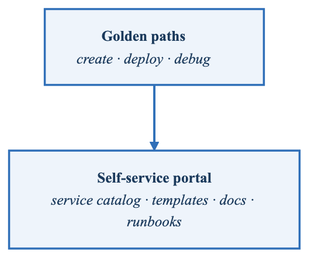
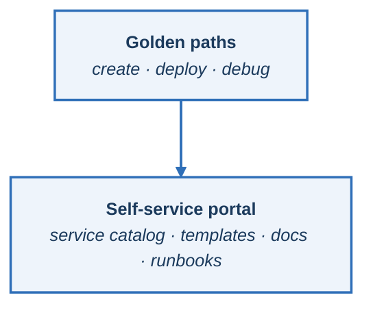

# Exercise 5: Developer Experience and Golden Paths

## Objectives
- Design and implement golden paths for common development workflows
- Create self-service templates for new services
- Build developer documentation and onboarding automation
- Implement inner loop development tools for Kubernetes

## Prerequisites
- Kubernetes cluster with admin access
- Backstage installed (from Exercise 1)
- GitOps tooling configured
- kubectl configured

## Introduction

Developer Experience (DevEx) is about reducing friction and cognitive load so developers can focus on building features. This exercise covers building a comprehensive developer platform that provides golden paths - opinionated, well-supported ways to accomplish common tasks.

**Golden paths** — the three journeys that matter

| Create a service | Deploy a service | Debug a service |
|---|---|---|
| 1. Use a template | 1. Push to Git | 1. `kubectl logs` |
| 2. CI/CD wired automatically | 2. Argo CD syncs | 2. Port-forward |
| 3. Monitoring already on | 3. Promote through environments | 3. Telepresence for a local loop |

<!-- figure: generated from the Mermaid below by _shared/diagrams/embed-figures.py — do not edit the image -->


<details>
<summary>Diagram source (Mermaid)</summary>



</details>

The third column is the one platforms forget. Creating and deploying are demoed; **debugging** is
what a developer does at 11pm when something is wrong, and if the paved road stops at "it deployed,"
they will learn the underlying system anyway — which is the cognitive load the platform existed to
remove.

## Part 1: Service Templates

### Step 1: Comprehensive Microservice Template

```yaml
# backstage/templates/microservice/template.yaml
apiVersion: scaffolder.backstage.io/v1beta3
kind: Template
metadata:
  name: production-microservice
  title: Production-Ready Microservice
  description: |
    Creates a new microservice with CI/CD, monitoring,
    documentation, and Kubernetes manifests
  tags:
    - recommended
    - microservice
    - go
    - python
    - nodejs
spec:
  owner: platform-team
  type: service

  parameters:
    - title: Service Information
      required:
        - name
        - description
        - owner
      properties:
        name:
          title: Service Name
          type: string
          description: Name of the service (lowercase, alphanumeric, hyphens)
          pattern: '^[a-z][a-z0-9-]*$'
          ui:autofocus: true
        description:
          title: Description
          type: string
          description: A brief description of what this service does
        owner:
          title: Owner
          type: string
          description: Team that owns this service
          ui:field: OwnerPicker
          ui:options:
            catalogFilter:
              kind: Group

    - title: Technical Configuration
      required:
        - language
      properties:
        language:
          title: Programming Language
          type: string
          enum:
            - go
            - python
            - nodejs
            - java
          enumNames:
            - Go 1.21
            - Python 3.11
            - Node.js 20 LTS
            - Java 21
        httpFramework:
          title: HTTP Framework
          type: string
          ui:options:
            hidden: '{{parameters.language !== "go"}}'
          enum:
            - gin
            - chi
            - echo
          default: gin
        database:
          title: Database
          type: string
          enum:
            - none
            - postgresql
            - mysql
            - mongodb
          default: none
        messageQueue:
          title: Message Queue
          type: string
          enum:
            - none
            - rabbitmq
            - kafka
          default: none

    - title: Deployment Configuration
      required:
        - environments
      properties:
        environments:
          title: Environments
          type: array
          items:
            type: string
            enum:
              - development
              - staging
              - production
          default:
            - development
            - staging
            - production
          uniqueItems: true
        replicaCount:
          title: Default Replicas
          type: integer
          default: 2
          minimum: 1
          maximum: 10
        enableHPA:
          title: Enable Horizontal Pod Autoscaling
          type: boolean
          default: true
        enablePDB:
          title: Enable Pod Disruption Budget
          type: boolean
          default: true

    - title: Repository Settings
      required:
        - repoUrl
      properties:
        repoUrl:
          title: Repository Location
          type: string
          ui:field: RepoUrlPicker
          ui:options:
            allowedHosts:
              - github.com

  steps:
    # Generate service code
    - id: fetch-base
      name: Fetch Base Template
      action: fetch:template
      input:
        url: ./skeleton/${{ parameters.language }}
        values:
          name: ${{ parameters.name }}
          description: ${{ parameters.description }}
          owner: ${{ parameters.owner }}
          httpFramework: ${{ parameters.httpFramework }}
          database: ${{ parameters.database }}
          messageQueue: ${{ parameters.messageQueue }}

    # Generate Kubernetes manifests
    - id: fetch-k8s
      name: Generate Kubernetes Manifests
      action: fetch:template
      input:
        url: ./skeleton/kubernetes
        targetPath: ./deploy
        values:
          name: ${{ parameters.name }}
          environments: ${{ parameters.environments }}
          replicaCount: ${{ parameters.replicaCount }}
          enableHPA: ${{ parameters.enableHPA }}
          enablePDB: ${{ parameters.enablePDB }}

    # Generate CI/CD pipelines
    - id: fetch-cicd
      name: Generate CI/CD Configuration
      action: fetch:template
      input:
        url: ./skeleton/cicd
        values:
          name: ${{ parameters.name }}
          language: ${{ parameters.language }}
          environments: ${{ parameters.environments }}

    # Generate documentation
    - id: fetch-docs
      name: Generate Documentation
      action: fetch:template
      input:
        url: ./skeleton/docs
        targetPath: ./docs
        values:
          name: ${{ parameters.name }}
          description: ${{ parameters.description }}
          owner: ${{ parameters.owner }}
          database: ${{ parameters.database }}
          messageQueue: ${{ parameters.messageQueue }}

    # Create repository
    - id: publish
      name: Publish to GitHub
      action: publish:github
      input:
        allowedHosts:
          - github.com
        repoUrl: ${{ parameters.repoUrl }}
        description: ${{ parameters.description }}
        defaultBranch: main
        protectDefaultBranch: true
        requireCodeOwnerReviews: true

    # Register in Backstage catalog
    - id: register
      name: Register in Catalog
      action: catalog:register
      input:
        repoContentsUrl: ${{ steps.publish.output.repoContentsUrl }}
        catalogInfoPath: /catalog-info.yaml

    # Create ArgoCD application
    - id: create-argocd-app
      name: Create ArgoCD Application
      action: argocd:create-resources
      input:
        appName: ${{ parameters.name }}
        argoInstance: main
        namespace: argocd
        repoUrl: ${{ steps.publish.output.remoteUrl }}
        path: deploy/overlays/development

    # Notify team
    - id: notify
      name: Notify Team
      action: slack:send-message
      input:
        channelId: ${{ parameters.owner }}-alerts
        message: |
          :rocket: New service *${{ parameters.name }}* created!
          Repository: ${{ steps.publish.output.remoteUrl }}
          Owner: ${{ parameters.owner }}

  output:
    links:
      - title: Repository
        url: ${{ steps.publish.output.remoteUrl }}
      - title: Open in Catalog
        icon: catalog
        entityRef: ${{ steps.register.output.entityRef }}
      - title: ArgoCD Application
        url: https://argocd.example.com/applications/${{ parameters.name }}
```

### Step 2: Kubernetes Manifest Templates

```yaml
# backstage/templates/microservice/skeleton/kubernetes/base/deployment.yaml
apiVersion: apps/v1
kind: Deployment
metadata:
  name: ${{ values.name }}
  labels:
    app: ${{ values.name }}
    app.kubernetes.io/name: ${{ values.name }}
    app.kubernetes.io/component: server
spec:
  replicas: ${{ values.replicaCount }}
  selector:
    matchLabels:
      app: ${{ values.name }}
  template:
    metadata:
      labels:
        app: ${{ values.name }}
      annotations:
        prometheus.io/scrape: "true"
        prometheus.io/port: "8080"
        prometheus.io/path: "/metrics"
    spec:
      serviceAccountName: ${{ values.name }}
      securityContext:
        runAsNonRoot: true
        seccompProfile:
          type: RuntimeDefault
      containers:
        - name: ${{ values.name }}
          image: gcr.io/my-company/${{ values.name }}:latest
          imagePullPolicy: Always
          ports:
            - name: http
              containerPort: 8080
              protocol: TCP
            - name: metrics
              containerPort: 9090
              protocol: TCP
          env:
            - name: SERVICE_NAME
              value: ${{ values.name }}
            - name: ENVIRONMENT
              valueFrom:
                fieldRef:
                  fieldPath: metadata.labels['environment']
            - name: POD_NAME
              valueFrom:
                fieldRef:
                  fieldPath: metadata.name
            - name: POD_NAMESPACE
              valueFrom:
                fieldRef:
                  fieldPath: metadata.namespace
          resources:
            requests:
              cpu: 100m
              memory: 128Mi
            limits:
              cpu: 500m
              memory: 512Mi
          livenessProbe:
            httpGet:
              path: /healthz
              port: http
            initialDelaySeconds: 15
            periodSeconds: 20
            timeoutSeconds: 5
            failureThreshold: 3
          readinessProbe:
            httpGet:
              path: /ready
              port: http
            initialDelaySeconds: 5
            periodSeconds: 10
            timeoutSeconds: 5
            failureThreshold: 3
          securityContext:
            allowPrivilegeEscalation: false
            readOnlyRootFilesystem: true
            capabilities:
              drop:
                - ALL
          volumeMounts:
            - name: tmp
              mountPath: /tmp
      volumes:
        - name: tmp
          emptyDir: {}
---
# backstage/templates/microservice/skeleton/kubernetes/base/service.yaml
apiVersion: v1
kind: Service
metadata:
  name: ${{ values.name }}
  labels:
    app: ${{ values.name }}
spec:
  type: ClusterIP
  ports:
    - port: 80
      targetPort: http
      protocol: TCP
      name: http
    - port: 9090
      targetPort: metrics
      protocol: TCP
      name: metrics
  selector:
    app: ${{ values.name }}
---
# backstage/templates/microservice/skeleton/kubernetes/base/serviceaccount.yaml
apiVersion: v1
kind: ServiceAccount
metadata:
  name: ${{ values.name }}
  labels:
    app: ${{ values.name }}
automountServiceAccountToken: false
---
# backstage/templates/microservice/skeleton/kubernetes/base/hpa.yaml

apiVersion: autoscaling/v2
kind: HorizontalPodAutoscaler
metadata:
  name: ${{ values.name }}
spec:
  scaleTargetRef:
    apiVersion: apps/v1
    kind: Deployment
    name: ${{ values.name }}
  minReplicas: 2
  maxReplicas: 10
  metrics:
    - type: Resource
      resource:
        name: cpu
        target:
          type: Utilization
          averageUtilization: 70
    - type: Resource
      resource:
        name: memory
        target:
          type: Utilization
          averageUtilization: 80
  behavior:
    scaleDown:
      stabilizationWindowSeconds: 300
      policies:
        - type: Percent
          value: 10
          periodSeconds: 60
    scaleUp:
      stabilizationWindowSeconds: 0
      policies:
        - type: Percent
          value: 100
          periodSeconds: 15
        - type: Pods
          value: 4
          periodSeconds: 15
      selectPolicy: Max

---
# backstage/templates/microservice/skeleton/kubernetes/base/pdb.yaml

apiVersion: policy/v1
kind: PodDisruptionBudget
metadata:
  name: ${{ values.name }}
spec:
  minAvailable: 1
  selector:
    matchLabels:
      app: ${{ values.name }}

```

### Step 3: Environment Overlays

```yaml
# backstage/templates/microservice/skeleton/kubernetes/overlays/development/kustomization.yaml
apiVersion: kustomize.config.k8s.io/v1beta1
kind: Kustomization

namespace: ${{ values.name }}-dev

resources:
  - ../../base

commonLabels:
  environment: development

replicas:
  - name: ${{ values.name }}
    count: 1

patches:
  - patch: |-
      - op: replace
        path: /spec/template/spec/containers/0/resources/requests/cpu
        value: 50m
      - op: replace
        path: /spec/template/spec/containers/0/resources/requests/memory
        value: 64Mi
      - op: replace
        path: /spec/template/spec/containers/0/resources/limits/cpu
        value: 200m
      - op: replace
        path: /spec/template/spec/containers/0/resources/limits/memory
        value: 256Mi
    target:
      kind: Deployment
      name: ${{ values.name }}
---
# backstage/templates/microservice/skeleton/kubernetes/overlays/staging/kustomization.yaml
apiVersion: kustomize.config.k8s.io/v1beta1
kind: Kustomization

namespace: ${{ values.name }}-staging

resources:
  - ../../base

commonLabels:
  environment: staging

replicas:
  - name: ${{ values.name }}
    count: 2
---
# backstage/templates/microservice/skeleton/kubernetes/overlays/production/kustomization.yaml
apiVersion: kustomize.config.k8s.io/v1beta1
kind: Kustomization

namespace: ${{ values.name }}-prod

resources:
  - ../../base

commonLabels:
  environment: production

replicas:
  - name: ${{ values.name }}
    count: 3

patches:
  - patch: |-
      - op: replace
        path: /spec/template/spec/containers/0/resources/requests/cpu
        value: 200m
      - op: replace
        path: /spec/template/spec/containers/0/resources/requests/memory
        value: 256Mi
      - op: replace
        path: /spec/template/spec/containers/0/resources/limits/cpu
        value: "1"
      - op: replace
        path: /spec/template/spec/containers/0/resources/limits/memory
        value: 1Gi
    target:
      kind: Deployment
      name: ${{ values.name }}
  - patch: |-
      - op: replace
        path: /spec/minReplicas
        value: 3
      - op: replace
        path: /spec/maxReplicas
        value: 20
    target:
      kind: HorizontalPodAutoscaler
      name: ${{ values.name }}
```

## Part 2: Inner Loop Development

### Step 1: Local Development with Tilt

```python
# Tiltfile
# Tilt configuration for local Kubernetes development

# Configuration
config.define_bool("live-reload")
cfg = config.parse()

# Build the service
docker_build(
    'my-service',
    '.',
    dockerfile='Dockerfile',
    live_update=[
        # Sync source files
        sync('.', '/app'),
        # Restart on specific file changes
        run('go build -o /app/server ./cmd/server', trigger=['./cmd/', './internal/', './pkg/']),
    ] if cfg.get("live-reload") else [],
)

# Deploy to Kubernetes
k8s_yaml(kustomize('./deploy/overlays/development'))

# Configure port forwards
k8s_resource(
    'my-service',
    port_forwards=[
        '8080:8080',  # HTTP
        '9090:9090',  # Metrics
        '2345:2345',  # Delve debugger
    ],
    labels=['app']
)

# Add dependencies
k8s_yaml('./deploy/dependencies/postgresql.yaml')
k8s_resource(
    'postgresql',
    port_forwards=['5432:5432'],
    labels=['deps']
)

# Resource grouping in Tilt UI
config.set_enabled_resources([
    'my-service',
    'postgresql'
])
```

### Step 2: Telepresence Integration

```yaml
# telepresence-config.yaml
# Configure Telepresence for seamless local development
apiVersion: telepresence.io/v1alpha1
kind: Intercept
metadata:
  name: orders-service-intercept
spec:
  serviceName: orders-service
  namespace: orders-dev
  port: 8080
  localPort: 8080
  previewURL:
    enabled: true
    ambassador:
      enabled: true
  environment:
    - name: DATABASE_URL
      value: "postgresql://localhost:5432/orders"
  mount:
    enabled: true
    remote: /var/run/secrets
```

```bash
#!/bin/bash
# scripts/dev-connect.sh
# Connect to remote cluster for development

set -e

SERVICE_NAME=$1
NAMESPACE=${2:-"development"}

echo "Connecting to $SERVICE_NAME in $NAMESPACE..."

# Start Telepresence daemon if not running
telepresence connect

# Create intercept
telepresence intercept $SERVICE_NAME \
  --namespace $NAMESPACE \
  --port 8080:http \
  --env-file .env.telepresence \
  --mount=true

echo "
Connected! Your local service is now receiving traffic from the cluster.
Environment variables saved to .env.telepresence

To disconnect, run: telepresence leave $SERVICE_NAME
"
```

### Step 3: Skaffold Configuration

```yaml
# skaffold.yaml
apiVersion: skaffold/v4beta5
kind: Config
metadata:
  name: my-service

build:
  artifacts:
    - image: my-service
      context: .
      docker:
        dockerfile: Dockerfile
      sync:
        manual:
          - src: "**/*.go"
            dest: /app
  local:
    push: false
    useBuildkit: true

deploy:
  kustomize:
    paths:
      - deploy/overlays/development

portForward:
  - resourceType: service
    resourceName: my-service
    port: 8080
    localPort: 8080
  - resourceType: service
    resourceName: my-service
    port: 9090
    localPort: 9090

profiles:
  - name: dev
    activation:
      - command: dev
    build:
      local:
        push: false
    deploy:
      kustomize:
        paths:
          - deploy/overlays/development

  - name: staging
    build:
      local:
        push: true
    deploy:
      kustomize:
        paths:
          - deploy/overlays/staging

  - name: debug
    activation:
      - command: debug
    patches:
      - op: add
        path: /build/artifacts/0/docker/buildArgs
        value:
          GCFLAGS: "all=-N -l"
    portForward:
      - resourceType: deployment
        resourceName: my-service
        port: 2345
        localPort: 2345

verify:
  - name: integration-tests
    container:
      name: integration-tests
      image: my-service-tests
      command: ["go", "test", "-v", "./tests/integration/..."]
```

## Part 3: Developer Documentation

### Step 1: TechDocs Configuration

```yaml
# catalog-info.yaml
apiVersion: backstage.io/v1alpha1
kind: Component
metadata:
  name: orders-service
  description: Order processing microservice
  annotations:
    backstage.io/techdocs-ref: dir:.
    github.com/project-slug: myorg/orders-service
    argocd/app-name: orders-service
    prometheus.io/alert: orders-service
  tags:
    - go
    - grpc
    - postgresql
  links:
    - url: https://grafana.example.com/d/orders
      title: Grafana Dashboard
      icon: dashboard
    - url: https://argocd.example.com/applications/orders-service
      title: ArgoCD
      icon: cloud
spec:
  type: service
  lifecycle: production
  owner: orders-team
  system: ecommerce
  providesApis:
    - orders-api
  consumesApis:
    - inventory-api
    - payment-api
  dependsOn:
    - resource:orders-database
    - resource:orders-cache
---
# mkdocs.yml
site_name: Orders Service
site_description: Documentation for the Orders Service
repo_url: https://github.com/myorg/orders-service

nav:
  - Home: index.md
  - Getting Started:
      - Prerequisites: getting-started/prerequisites.md
      - Local Development: getting-started/local-dev.md
      - First Deployment: getting-started/first-deployment.md
  - Architecture:
      - Overview: architecture/overview.md
      - Data Model: architecture/data-model.md
      - API Design: architecture/api-design.md
  - Operations:
      - Deployment: operations/deployment.md
      - Monitoring: operations/monitoring.md
      - Troubleshooting: operations/troubleshooting.md
  - API Reference:
      - REST API: api/rest.md
      - gRPC API: api/grpc.md
  - Runbooks:
      - High Latency: runbooks/high-latency.md
      - Database Issues: runbooks/database.md
      - Scaling: runbooks/scaling.md

plugins:
  - techdocs-core
  - search

markdown_extensions:
  - admonition
  - codehilite
  - pymdownx.superfences
  - pymdownx.tabbed
```

### Step 2: Runbook Template

````markdown
# docs/runbooks/high-latency.md
# Runbook: High Latency

## Overview
This runbook covers diagnosing and resolving high latency issues in the Orders Service.

## Alert Conditions
- `OrdersServiceHighLatency`: P99 latency > 500ms for 5 minutes
- `OrdersServiceSLOBreach`: Error budget consumption > 50%

## Quick Actions

### 1. Check Current Status
```bash
# Get pod status
kubectl get pods -n orders -l app=orders-service

# Check recent logs
kubectl logs -n orders -l app=orders-service --tail=100

# View metrics
curl -s http://orders-service:9090/metrics | grep http_request_duration
```

### 2. Common Causes and Solutions

#### Database Connection Pool Exhaustion
**Symptoms**:
- Increasing connection wait times
- "connection pool exhausted" in logs

**Resolution**:
```bash
# Check current connections
kubectl exec -n orders deploy/orders-service -- \
  curl -s localhost:9090/metrics | grep db_connections

# Scale up if needed
kubectl scale deploy/orders-service -n orders --replicas=5
```

#### Memory Pressure
**Symptoms**:
- Increasing GC pause times
- OOMKilled pods

**Resolution**:
```bash
# Check memory usage
kubectl top pods -n orders -l app=orders-service

# Increase limits if needed
kubectl patch deploy orders-service -n orders -p \
  '{"spec":{"template":{"spec":{"containers":[{"name":"orders-service","resources":{"limits":{"memory":"2Gi"}}}]}}}}'
```

#### Downstream Service Latency
**Symptoms**:
- High latency on specific endpoints
- Increased timeout errors

**Resolution**:
```bash
# Check downstream dependencies
kubectl exec -n orders deploy/orders-service -- \
  curl -s localhost:9090/metrics | grep downstream

# Check inventory service status
kubectl get pods -n inventory -l app=inventory-service
```

## Escalation Path
1. **L1**: On-call SRE - Check dashboards, apply quick fixes
2. **L2**: Orders Team - Deep investigation, code changes
3. **L3**: Platform Team - Infrastructure issues

## Related Links
- [Grafana Dashboard](https://grafana.example.com/d/orders)
- [Architecture Docs](../architecture/overview.md)
- [SLO Definition](../operations/slo.md)
````

### Step 3: API Documentation Generator

```yaml
# api-docs-generator.yaml
apiVersion: batch/v1
kind: CronJob
metadata:
  name: api-docs-generator
  namespace: platform
spec:
  schedule: "0 */6 * * *"  # Every 6 hours
  jobTemplate:
    spec:
      template:
        spec:
          containers:
            - name: generator
              image: platform/api-docs-generator:v1.0.0
              env:
                - name: SERVICES
                  value: "orders-service,inventory-service,users-service"
                - name: OUTPUT_BUCKET
                  value: "s3://docs-bucket/api"
              command:
                - /bin/sh
                - -c
                - |
                  for service in $(echo $SERVICES | tr ',' ' '); do
                    # Fetch OpenAPI spec
                    kubectl exec -n ${service%-*} deploy/$service -- \
                      curl -s localhost:8080/openapi.json > /tmp/$service.json

                    # Generate HTML docs
                    redoc-cli bundle /tmp/$service.json \
                      -o /tmp/$service.html \
                      --title "$service API"

                    # Upload to S3
                    aws s3 cp /tmp/$service.html $OUTPUT_BUCKET/$service/index.html
                  done
          restartPolicy: OnFailure
```

## Part 4: Developer CLI Tools

### Step 1: Platform CLI

```go
// cmd/platform/main.go
package main

import (
    "fmt"
    "os"

    "github.com/spf13/cobra"
)

func main() {
    rootCmd := &cobra.Command{
        Use:   "platform",
        Short: "Platform engineering CLI for developers",
    }

    // Create new service
    rootCmd.AddCommand(&cobra.Command{
        Use:   "create [service-name]",
        Short: "Create a new service from template",
        Args:  cobra.ExactArgs(1),
        Run: func(cmd *cobra.Command, args []string) {
            createService(args[0])
        },
    })

    // Deploy service
    rootCmd.AddCommand(&cobra.Command{
        Use:   "deploy [environment]",
        Short: "Deploy service to environment",
        Args:  cobra.ExactArgs(1),
        Run: func(cmd *cobra.Command, args []string) {
            deployService(args[0])
        },
    })

    // Get logs
    rootCmd.AddCommand(&cobra.Command{
        Use:   "logs [service-name]",
        Short: "Stream logs from service",
        Args:  cobra.ExactArgs(1),
        Run: func(cmd *cobra.Command, args []string) {
            streamLogs(args[0])
        },
    })

    // Port forward
    rootCmd.AddCommand(&cobra.Command{
        Use:   "connect [service-name]",
        Short: "Connect to service (port-forward)",
        Args:  cobra.ExactArgs(1),
        Run: func(cmd *cobra.Command, args []string) {
            connectService(args[0])
        },
    })

    // Debug
    rootCmd.AddCommand(&cobra.Command{
        Use:   "debug [service-name]",
        Short: "Start debug session",
        Args:  cobra.ExactArgs(1),
        Run: func(cmd *cobra.Command, args []string) {
            debugService(args[0])
        },
    })

    // Status
    rootCmd.AddCommand(&cobra.Command{
        Use:   "status",
        Short: "Show status of all services",
        Run: func(cmd *cobra.Command, args []string) {
            showStatus()
        },
    })

    if err := rootCmd.Execute(); err != nil {
        fmt.Fprintln(os.Stderr, err)
        os.Exit(1)
    }
}
```

### Step 2: Developer Portal Integration

```yaml
# developer-portal-api.yaml
apiVersion: apps/v1
kind: Deployment
metadata:
  name: developer-portal-api
  namespace: platform
spec:
  replicas: 2
  selector:
    matchLabels:
      app: developer-portal-api
  template:
    metadata:
      labels:
        app: developer-portal-api
    spec:
      containers:
        - name: api
          image: platform/developer-portal-api:v1.0.0
          ports:
            - containerPort: 8080
          env:
            - name: KUBERNETES_NAMESPACE
              valueFrom:
                fieldRef:
                  fieldPath: metadata.namespace
            - name: BACKSTAGE_URL
              value: "http://backstage.backstage.svc:7007"
            - name: ARGOCD_URL
              value: "http://argocd-server.argocd.svc:443"
            - name: GRAFANA_URL
              value: "http://grafana.monitoring.svc:3000"
          resources:
            requests:
              cpu: 100m
              memory: 128Mi
            limits:
              cpu: 500m
              memory: 512Mi
---
apiVersion: v1
kind: Service
metadata:
  name: developer-portal-api
  namespace: platform
spec:
  ports:
    - port: 8080
      targetPort: 8080
  selector:
    app: developer-portal-api
```

### Step 3: VS Code Extension Configuration

```json
// .vscode/extensions.json
{
  "recommendations": [
    "ms-kubernetes-tools.vscode-kubernetes-tools",
    "redhat.vscode-yaml",
    "golang.go",
    "ms-vscode.live-server",
    "humao.rest-client"
  ]
}
```

```json
// .vscode/settings.json
{
  "kubernetes.namespace": "${env:KUBE_NAMESPACE}",
  "yaml.schemas": {
    "https://json.schemastore.org/kustomization": "kustomization.yaml",
    "kubernetes": "deploy/**/*.yaml"
  },
  "go.testFlags": ["-v", "-race"],
  "go.coverOnSave": true,
  "editor.formatOnSave": true,
  "[go]": {
    "editor.codeActionsOnSave": {
      "source.organizeImports": true
    }
  }
}
```

```json
// .vscode/launch.json
{
  "version": "0.2.0",
  "configurations": [
    {
      "name": "Debug Local",
      "type": "go",
      "request": "launch",
      "mode": "debug",
      "program": "${workspaceFolder}/cmd/server",
      "env": {
        "DATABASE_URL": "postgresql://localhost:5432/mydb",
        "LOG_LEVEL": "debug"
      }
    },
    {
      "name": "Debug in Kubernetes",
      "type": "go",
      "request": "attach",
      "mode": "remote",
      "remotePath": "/app",
      "port": 2345,
      "host": "127.0.0.1"
    }
  ]
}
```

## Part 5: Onboarding Automation

### Step 1: New Developer Onboarding

```yaml
# onboarding-workflow.yaml
apiVersion: argoproj.io/v1alpha1
kind: Workflow
metadata:
  name: developer-onboarding
  namespace: platform
spec:
  entrypoint: onboard-developer
  arguments:
    parameters:
      - name: developer-email
      - name: developer-name
      - name: team

  templates:
    - name: onboard-developer
      steps:
        - - name: create-namespace
            template: create-developer-namespace
        - - name: setup-rbac
            template: setup-developer-rbac
        - - name: create-registry-access
            template: create-registry-credentials
        - - name: setup-argocd-project
            template: setup-argocd-project
        - - name: send-welcome-email
            template: send-welcome

    - name: create-developer-namespace
      container:
        image: bitnami/kubectl:latest
        command: ["/bin/sh", "-c"]
        args:
          - |
            cat <<EOF | kubectl apply -f -
            apiVersion: v1
            kind: Namespace
            metadata:
              name: dev-{{workflow.parameters.developer-name}}
              labels:
                team: {{workflow.parameters.team}}
                owner: {{workflow.parameters.developer-email}}
                quota-tier: developer
            EOF

    - name: setup-developer-rbac
      container:
        image: bitnami/kubectl:latest
        command: ["/bin/sh", "-c"]
        args:
          - |
            cat <<EOF | kubectl apply -f -
            apiVersion: rbac.authorization.k8s.io/v1
            kind: RoleBinding
            metadata:
              name: developer-admin
              namespace: dev-{{workflow.parameters.developer-name}}
            roleRef:
              apiGroup: rbac.authorization.k8s.io
              kind: ClusterRole
              name: admin
            subjects:
              - kind: User
                name: {{workflow.parameters.developer-email}}
                apiGroup: rbac.authorization.k8s.io
            EOF

    - name: create-registry-credentials
      container:
        image: bitnami/kubectl:latest
        command: ["/bin/sh", "-c"]
        args:
          - |
            kubectl get secret registry-credentials -n platform -o yaml | \
              sed 's/namespace: platform/namespace: dev-{{workflow.parameters.developer-name}}/' | \
              kubectl apply -f -

    - name: setup-argocd-project
      container:
        image: argoproj/argocd:latest
        command: ["/bin/sh", "-c"]
        args:
          - |
            argocd proj create dev-{{workflow.parameters.developer-name}} \
              --description "Developer project for {{workflow.parameters.developer-name}}" \
              --dest https://kubernetes.default.svc,dev-{{workflow.parameters.developer-name}} \
              --src '*' \
              --allow-cluster-resource '*/*'

    - name: send-welcome
      container:
        image: curlimages/curl:latest
        command: ["/bin/sh", "-c"]
        args:
          - |
            curl -X POST $SLACK_WEBHOOK \
              -H 'Content-type: application/json' \
              --data '{
                "channel": "{{workflow.parameters.team}}-team",
                "text": ":wave: Welcome {{workflow.parameters.developer-name}}! Your development environment is ready.\n\nNamespace: `dev-{{workflow.parameters.developer-name}}`\nDocs: https://backstage.example.com/docs/onboarding\nSupport: #platform-support"
              }'
        env:
          - name: SLACK_WEBHOOK
            valueFrom:
              secretKeyRef:
                name: slack-webhook
                key: url
```

### Step 2: Team Onboarding Checklist

```yaml
# team-onboarding-template.yaml
apiVersion: scaffolder.backstage.io/v1beta3
kind: Template
metadata:
  name: team-onboarding
  title: Onboard New Team
  description: Complete onboarding for a new team to the platform
spec:
  owner: platform-team
  type: onboarding

  parameters:
    - title: Team Information
      required:
        - teamName
        - teamLead
        - costCenter
      properties:
        teamName:
          title: Team Name
          type: string
          pattern: '^[a-z][a-z0-9-]*$'
        teamLead:
          title: Team Lead Email
          type: string
          format: email
        costCenter:
          title: Cost Center
          type: string
        environments:
          title: Environments Needed
          type: array
          items:
            type: string
            enum:
              - development
              - staging
              - production
          default:
            - development
            - staging

  steps:
    - id: create-team-group
      name: Create Team Group in Backstage
      action: catalog:register
      input:
        catalogInfoUrl: ./team-${{ parameters.teamName }}.yaml

    - id: create-namespaces
      name: Create Team Namespaces
      action: kubernetes:apply
      each: ${{ parameters.environments }}
      input:
        manifest: |
          apiVersion: v1
          kind: Namespace
          metadata:
            name: team-${{ parameters.teamName }}-${{ each.value }}
            labels:
              team: ${{ parameters.teamName }}
              environment: ${{ each.value }}
              cost-center: ${{ parameters.costCenter }}
              quota-tier: team

    - id: setup-rbac
      name: Setup Team RBAC
      action: kubernetes:apply
      input:
        manifest: |
          apiVersion: rbac.authorization.k8s.io/v1
          kind: ClusterRoleBinding
          metadata:
            name: team-${{ parameters.teamName }}-viewer
          roleRef:
            apiGroup: rbac.authorization.k8s.io
            kind: ClusterRole
            name: view
          subjects:
            - kind: Group
              name: team-${{ parameters.teamName }}
              apiGroup: rbac.authorization.k8s.io

    - id: create-argocd-project
      name: Create ArgoCD Project
      action: argocd:create-project
      input:
        name: team-${{ parameters.teamName }}
        description: ArgoCD project for team ${{ parameters.teamName }}
        sourceRepos:
          - https://github.com/myorg/*
        destinations:
          - namespace: team-${{ parameters.teamName }}-*
            server: https://kubernetes.default.svc

    - id: send-welcome
      name: Send Welcome Message
      action: slack:send-message
      input:
        channelId: platform-announcements
        message: |
          :tada: Welcome team *${{ parameters.teamName }}*!

          Your namespaces are ready:
          ${{ parameters.environments.map(env => `- team-${{ parameters.teamName }}-${env}`).join('\n') }}

          Get started: https://backstage.example.com/docs/getting-started

  output:
    links:
      - title: Team Page
        url: https://backstage.example.com/catalog/default/group/team-${{ parameters.teamName }}
```

## Verification Tasks

1. Test service template:
```bash
# Create service from template via Backstage API
curl -X POST https://backstage.example.com/api/scaffolder/v2/tasks \
  -H "Content-Type: application/json" \
  -d '{
    "templateRef": "template:default/production-microservice",
    "values": {
      "name": "test-service",
      "description": "Test service",
      "owner": "platform-team",
      "language": "go"
    }
  }'
```

2. Verify local development setup:
```bash
# Start Tilt
tilt up

# Or use Skaffold
skaffold dev --profile=dev
```

3. Test developer CLI:
```bash
platform create my-new-service
platform status
platform logs my-service
platform connect my-service
```

4. Verify documentation generation:
```bash
# Build TechDocs locally
npx @techdocs/cli generate --source-dir . --output-dir ./site

# Preview
npx @techdocs/cli serve
```

## Challenges

1. **Custom IDE Plugin**: Create a VS Code extension that integrates with your platform CLI

2. **Automated Dependency Updates**: Build a system that automatically updates service dependencies and creates PRs

3. **Developer Metrics Dashboard**: Create a dashboard showing developer productivity metrics (deployment frequency, lead time, etc.)

## Key Takeaways

- Golden paths reduce cognitive load by providing opinionated defaults
- Templates ensure consistency across services
- Inner loop tools (Tilt, Telepresence, Skaffold) accelerate local development
- Documentation should be generated and kept close to code
- CLI tools provide quick access to common operations
- Onboarding automation reduces time-to-productivity

## Next Steps

- Review Phase 4 concepts and complete project challenges
- Proceed to Phase 5: Enterprise Multi-Cloud
- Explore service mesh and advanced networking

<!-- feynman-check -->

---

## Feynman check

Close the file. Blank page, no notes. Explain each of these to a competent engineer who has never
used this tool — **under five minutes, no jargon you can't define on the spot:**

- Service Templates
- Inner Loop Development
- Developer Documentation
- Alert Conditions

**The gap is not what you forgot. It is where you used a word instead of a mechanism.**

| | |
|---|---|
| ✗ | *"Kubernetes schedules the pod."* |
| ✓ | *"The scheduler watches for pods with no `nodeName`, filters nodes by predicates, scores the survivors, and writes `nodeName` into the pod spec. The kubelet on that node is watching the API for pods bound to it, and starts the containers."* |

**Trace it:** `kubectl apply -f pod.yaml` → a running container. Name every component that acts, in order, and what each one writes.

Stop at the first component you cannot name. Reopen this file and read **only** that.

**Go deeper — only once the gap has a name:** [Kubernetes the Hard Way](https://github.com/kelseyhightower/kubernetes-the-hard-way) — one weekend, and "the control plane" stops being a word.
Full list per domain: [`SOURCES.md`](../../SOURCES.md#kubernetes)

→ Protocol, the three levels of knowing, and worked examples: [`MASTERY.md`](../../MASTERY.md)

<!-- /feynman-check -->
