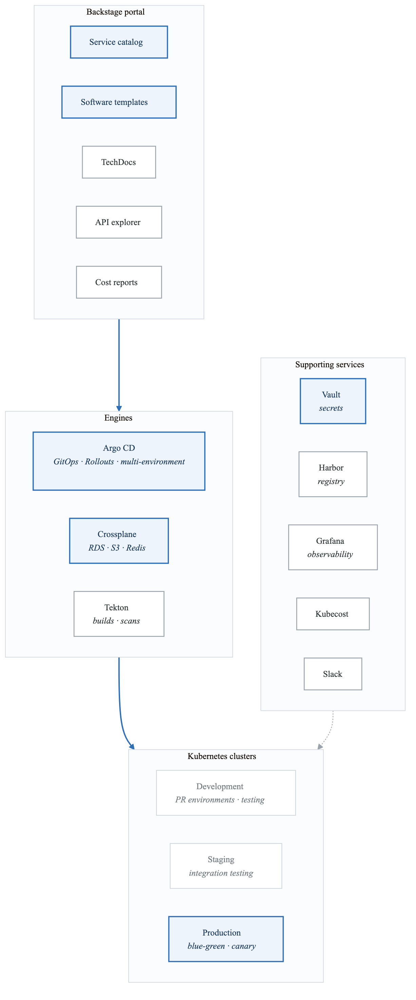
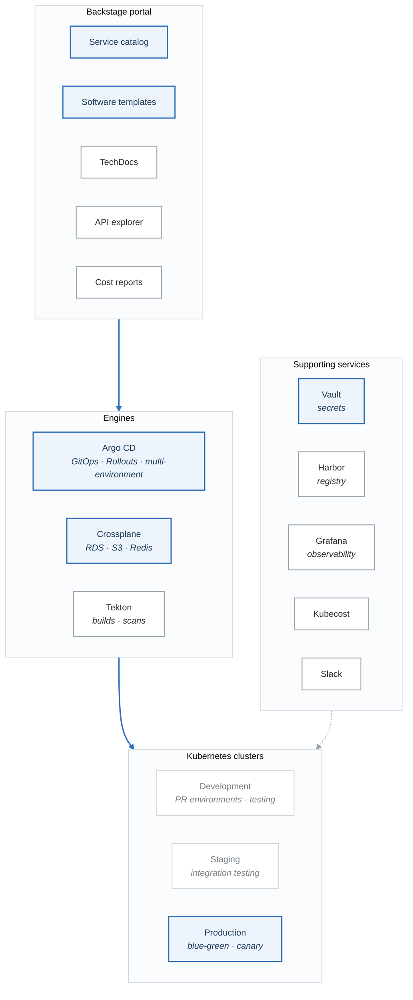

# Phase 4 Project: Self-Service Platform

Build a complete internal developer platform with service catalog, GitOps, and self-service infrastructure.

## Architecture

<!-- figure: generated from the Mermaid below by _shared/diagrams/embed-figures.py — do not edit the image -->


<details>
<summary>Diagram source (Mermaid)</summary>



</details>

## Components to Deploy

### 1. Backstage Portal

```yaml
# backstage-app-config.yaml
app:
  title: Developer Portal
  baseUrl: https://backstage.example.com

organization:
  name: My Company

backend:
  baseUrl: https://backstage.example.com
  database:
    client: pg
    connection:
      host: ${POSTGRES_HOST}
      port: ${POSTGRES_PORT}
      user: ${POSTGRES_USER}
      password: ${POSTGRES_PASSWORD}

integrations:
  github:
  - host: github.com
    token: ${GITHUB_TOKEN}

catalog:
  import:
    entityFilename: catalog-info.yaml
    pullRequestBranchName: backstage-integration
  rules:
  - allow: [Component, System, API, Resource, Location, Template]
  locations:
  # Service catalog
  - type: url
    target: https://github.com/myorg/service-catalog/blob/main/all.yaml
  # Software templates
  - type: url
    target: https://github.com/myorg/software-templates/blob/main/all.yaml

kubernetes:
  serviceLocatorMethod:
    type: multiTenant
  clusterLocatorMethods:
  - type: config
    clusters:
    - url: https://production.k8s.example.com
      name: production
      authProvider: serviceAccount
      serviceAccountToken: ${K8S_PROD_TOKEN}
      skipTLSVerify: true
    - url: https://staging.k8s.example.com
      name: staging
      authProvider: serviceAccount
      serviceAccountToken: ${K8S_STAGING_TOKEN}

argocd:
  baseUrl: https://argocd.example.com
  username: ${ARGOCD_USERNAME}
  password: ${ARGOCD_PASSWORD}
  appLocatorMethods:
  - type: config
    instances:
    - name: main
      url: https://argocd.example.com
      token: ${ARGOCD_TOKEN}

techdocs:
  builder: external
  generator:
    runIn: local
  publisher:
    type: awsS3
    awsS3:
      bucketName: techdocs-bucket
      region: us-west-2
```

```yaml
# backstage-deployment.yaml
apiVersion: apps/v1
kind: Deployment
metadata:
  name: backstage
  namespace: backstage
spec:
  replicas: 2
  selector:
    matchLabels:
      app: backstage
  template:
    metadata:
      labels:
        app: backstage
    spec:
      serviceAccountName: backstage
      containers:
      - name: backstage
        image: myregistry/backstage:latest
        ports:
        - containerPort: 7007
        envFrom:
        - secretRef:
            name: backstage-secrets
        - configMapRef:
            name: backstage-config
        resources:
          requests:
            cpu: 500m
            memory: 1Gi
          limits:
            cpu: 2
            memory: 2Gi
        volumeMounts:
        - name: app-config
          mountPath: /app/app-config.production.yaml
          subPath: app-config.production.yaml
      volumes:
      - name: app-config
        configMap:
          name: backstage-app-config

---
apiVersion: v1
kind: Service
metadata:
  name: backstage
  namespace: backstage
spec:
  selector:
    app: backstage
  ports:
  - port: 80
    targetPort: 7007

---
apiVersion: networking.k8s.io/v1
kind: Ingress
metadata:
  name: backstage
  namespace: backstage
  annotations:
    cert-manager.io/cluster-issuer: letsencrypt-prod
spec:
  ingressClassName: nginx
  tls:
  - hosts:
    - backstage.example.com
    secretName: backstage-tls
  rules:
  - host: backstage.example.com
    http:
      paths:
      - path: /
        pathType: Prefix
        backend:
          service:
            name: backstage
            port:
              number: 80
```

### 2. Software Templates

```yaml
# templates/microservice/template.yaml
apiVersion: scaffolder.backstage.io/v1beta3
kind: Template
metadata:
  name: microservice-go
  title: Go Microservice
  description: Create a production-ready Go microservice
  tags:
  - recommended
  - go
  - microservice
spec:
  owner: platform-team
  type: service

  parameters:
  - title: Service Details
    required: [name, owner, system]
    properties:
      name:
        title: Name
        type: string
        pattern: '^[a-z][a-z0-9-]*$'
      description:
        title: Description
        type: string
      owner:
        title: Owner
        type: string
        ui:field: OwnerPicker
        ui:options:
          catalogFilter:
            kind: Group
      system:
        title: System
        type: string
        ui:field: EntityPicker
        ui:options:
          catalogFilter:
            kind: System

  - title: Infrastructure
    properties:
      database:
        title: Database
        type: string
        enum: [postgres, mysql, none]
        default: none
      cache:
        title: Cache
        type: string
        enum: [redis, memcached, none]
        default: none
      messageQueue:
        title: Message Queue
        type: string
        enum: [rabbitmq, kafka, sqs, none]
        default: none

  - title: Deployment
    properties:
      initialEnvironment:
        title: Initial Environment
        type: string
        enum: [development, staging]
        default: development
      replicas:
        title: Replicas
        type: integer
        default: 2
      resources:
        title: Resource Size
        type: string
        enum: [small, medium, large]
        default: small

  steps:
  # Generate service code
  - id: fetch-base
    name: Fetch Base Template
    action: fetch:template
    input:
      url: ./skeleton
      values:
        name: ${{ parameters.name }}
        description: ${{ parameters.description }}
        owner: ${{ parameters.owner }}

  # Add database configuration
  - id: add-database
    name: Add Database Config
    if: ${{ parameters.database != 'none' }}
    action: fetch:template
    input:
      url: ./database/${{ parameters.database }}
      targetPath: ./infra
      values:
        name: ${{ parameters.name }}
        database: ${{ parameters.database }}

  # Generate Kubernetes manifests
  - id: generate-k8s
    name: Generate K8s Manifests
    action: fetch:template
    input:
      url: ./k8s
      targetPath: ./deploy
      values:
        name: ${{ parameters.name }}
        replicas: ${{ parameters.replicas }}
        resources: ${{ parameters.resources }}
        database: ${{ parameters.database }}
        cache: ${{ parameters.cache }}

  # Create GitHub repository
  - id: publish
    name: Create Repository
    action: publish:github
    input:
      repoUrl: github.com?owner=myorg&repo=${{ parameters.name }}
      repoVisibility: internal
      defaultBranch: main
      protectDefaultBranch: true
      requireCodeOwnerReviews: true

  # Provision infrastructure with Crossplane
  - id: provision-infra
    name: Provision Infrastructure
    if: ${{ parameters.database != 'none' }}
    action: kubernetes:apply
    input:
      namespaced: true
      manifest:
        apiVersion: platform.example.com/v1alpha1
        kind: Database
        metadata:
          name: ${{ parameters.name }}-db
          namespace: ${{ parameters.initialEnvironment }}
        spec:
          parameters:
            engine: ${{ parameters.database }}
            size: ${{ parameters.resources }}

  # Create ArgoCD application
  - id: create-argocd
    name: Create ArgoCD App
    action: argocd:create-resources
    input:
      appName: ${{ parameters.name }}-${{ parameters.initialEnvironment }}
      projectName: ${{ parameters.owner }}
      namespace: ${{ parameters.initialEnvironment }}
      repoUrl: ${{ steps.publish.output.remoteUrl }}
      path: deploy/overlays/${{ parameters.initialEnvironment }}

  # Register in catalog
  - id: register
    name: Register Component
    action: catalog:register
    input:
      repoContentsUrl: ${{ steps.publish.output.repoContentsUrl }}
      catalogInfoPath: /catalog-info.yaml

  output:
    links:
    - title: Repository
      url: ${{ steps.publish.output.remoteUrl }}
    - title: View in Catalog
      icon: catalog
      entityRef: ${{ steps.register.output.entityRef }}
    - title: ArgoCD Application
      url: https://argocd.example.com/applications/${{ parameters.name }}
```

### 3. Crossplane Compositions

```yaml
# Database Composition
apiVersion: apiextensions.crossplane.io/v1
kind: CompositeResourceDefinition
metadata:
  name: xdatabases.platform.example.com
spec:
  group: platform.example.com
  names:
    kind: XDatabase
    plural: xdatabases
  claimNames:
    kind: Database
    plural: databases
  versions:
  - name: v1alpha1
    served: true
    referenceable: true
    schema:
      openAPIV3Schema:
        type: object
        properties:
          spec:
            type: object
            properties:
              parameters:
                type: object
                properties:
                  engine:
                    type: string
                    enum: [postgres, mysql]
                  size:
                    type: string
                    enum: [small, medium, large]
                  version:
                    type: string
                required: [engine, size]
          status:
            type: object
            properties:
              connectionSecret:
                type: string
              endpoint:
                type: string

---
apiVersion: apiextensions.crossplane.io/v1
kind: Composition
metadata:
  name: database-aws-rds
  labels:
    crossplane.io/xrd: xdatabases.platform.example.com
    provider: aws
spec:
  writeConnectionSecretsToNamespace: crossplane-system
  compositeTypeRef:
    apiVersion: platform.example.com/v1alpha1
    kind: XDatabase

  resources:
  # Subnet Group
  - name: db-subnet-group
    base:
      apiVersion: rds.aws.upbound.io/v1beta1
      kind: SubnetGroup
      spec:
        forProvider:
          region: us-west-2
          subnetIdSelector:
            matchLabels:
              access: private
          description: Database subnet group

  # Parameter Group
  - name: parameter-group
    base:
      apiVersion: rds.aws.upbound.io/v1beta1
      kind: ParameterGroup
      spec:
        forProvider:
          region: us-west-2
          description: Custom parameter group
    patches:
    - type: FromCompositeFieldPath
      fromFieldPath: spec.parameters.engine
      toFieldPath: spec.forProvider.family
      transforms:
      - type: map
        map:
          postgres: postgres15
          mysql: mysql8.0

  # RDS Instance
  - name: rds-instance
    base:
      apiVersion: rds.aws.upbound.io/v1beta1
      kind: Instance
      spec:
        forProvider:
          region: us-west-2
          allocatedStorage: 20
          autoMinorVersionUpgrade: true
          backupRetentionPeriod: 7
          copyTagsToSnapshot: true
          deletionProtection: false
          publiclyAccessible: false
          skipFinalSnapshot: true
          storageEncrypted: true
          storageType: gp3
          username: admin
          passwordSecretRef:
            namespace: crossplane-system
            key: password
        writeConnectionSecretToRef:
          namespace: crossplane-system
    patches:
    # Engine
    - type: FromCompositeFieldPath
      fromFieldPath: spec.parameters.engine
      toFieldPath: spec.forProvider.engine
    - type: FromCompositeFieldPath
      fromFieldPath: spec.parameters.version
      toFieldPath: spec.forProvider.engineVersion

    # Size mapping
    - type: FromCompositeFieldPath
      fromFieldPath: spec.parameters.size
      toFieldPath: spec.forProvider.instanceClass
      transforms:
      - type: map
        map:
          small: db.t3.micro
          medium: db.t3.medium
          large: db.r5.large
    - type: FromCompositeFieldPath
      fromFieldPath: spec.parameters.size
      toFieldPath: spec.forProvider.allocatedStorage
      transforms:
      - type: map
        map:
          small: 20
          medium: 100
          large: 500

    # Connection secret name
    - type: FromCompositeFieldPath
      fromFieldPath: metadata.name
      toFieldPath: spec.writeConnectionSecretToRef.name
      transforms:
      - type: string
        string:
          fmt: "%s-connection"

    # Status
    - type: ToCompositeFieldPath
      fromFieldPath: status.atProvider.endpoint
      toFieldPath: status.endpoint

    connectionDetails:
    - type: FromConnectionSecretKey
      name: username
      key: username
    - type: FromConnectionSecretKey
      name: password
      key: password
    - type: FromConnectionSecretKey
      name: endpoint
      key: endpoint
    - type: FromConnectionSecretKey
      name: port
      key: port
```

### 4. ArgoCD Multi-Environment Setup

```yaml
# ArgoCD Project per team
apiVersion: argoproj.io/v1alpha1
kind: AppProject
metadata:
  name: platform-team
  namespace: argocd
spec:
  description: Platform team applications
  sourceRepos:
  - 'https://github.com/myorg/*'
  destinations:
  - namespace: '*'
    server: https://kubernetes.default.svc
  - namespace: '*'
    server: https://staging.k8s.example.com
  - namespace: '*'
    server: https://production.k8s.example.com

  clusterResourceWhitelist:
  - group: ''
    kind: Namespace
  - group: networking.k8s.io
    kind: Ingress

  namespaceResourceWhitelist:
  - group: '*'
    kind: '*'

  roles:
  - name: developers
    policies:
    - p, proj:platform-team:developers, applications, get, platform-team/*, allow
    - p, proj:platform-team:developers, applications, sync, platform-team/*, allow
    groups:
    - platform-developers

  - name: leads
    policies:
    - p, proj:platform-team:leads, applications, *, platform-team/*, allow
    groups:
    - platform-leads

---
# ApplicationSet for all microservices
apiVersion: argoproj.io/v1alpha1
kind: ApplicationSet
metadata:
  name: microservices
  namespace: argocd
spec:
  generators:
  - matrix:
      generators:
      # Services from Git
      - git:
          repoURL: https://github.com/myorg/service-catalog.git
          revision: main
          files:
          - path: "services/*/config.yaml"
      # Environments
      - list:
          elements:
          - environment: staging
            cluster: https://staging.k8s.example.com
            autoSync: true
          - environment: production
            cluster: https://production.k8s.example.com
            autoSync: false

  template:
    metadata:
      name: '{{service.name}}-{{environment}}'
      labels:
        service: '{{service.name}}'
        team: '{{service.team}}'
        environment: '{{environment}}'
    spec:
      project: '{{service.team}}'
      source:
        repoURL: '{{service.repoUrl}}'
        targetRevision: '{{#if (eq environment "production")}}{{service.productionRevision}}{{else}}main{{/if}}'
        path: 'deploy/overlays/{{environment}}'
      destination:
        server: '{{cluster}}'
        namespace: '{{service.namespace}}'
      syncPolicy:
        automated:
          prune: '{{autoSync}}'
          selfHeal: '{{autoSync}}'
        syncOptions:
        - CreateNamespace=true
```

### 5. CI/CD Integration

```yaml
# Tekton Pipeline for platform services
apiVersion: tekton.dev/v1beta1
kind: Pipeline
metadata:
  name: platform-pipeline
spec:
  params:
  - name: git-url
  - name: git-revision
  - name: image-name
  - name: service-name

  workspaces:
  - name: source
  - name: docker-config
  - name: gitops-repo

  tasks:
  - name: clone
    taskRef:
      name: git-clone
    params:
    - name: url
      value: $(params.git-url)
    - name: revision
      value: $(params.git-revision)
    workspaces:
    - name: output
      workspace: source

  - name: test
    taskRef:
      name: go-test
    runAfter: [clone]
    workspaces:
    - name: source
      workspace: source

  - name: lint
    taskRef:
      name: golangci-lint
    runAfter: [clone]
    workspaces:
    - name: source
      workspace: source

  - name: build
    taskRef:
      name: kaniko
    runAfter: [test, lint]
    params:
    - name: IMAGE
      value: $(params.image-name):$(tasks.clone.results.commit)
    workspaces:
    - name: source
      workspace: source
    - name: dockerconfig
      workspace: docker-config

  - name: scan
    taskRef:
      name: trivy-scan
    runAfter: [build]
    params:
    - name: IMAGE
      value: $(params.image-name):$(tasks.clone.results.commit)

  - name: sbom
    taskRef:
      name: syft-sbom
    runAfter: [build]
    params:
    - name: IMAGE
      value: $(params.image-name):$(tasks.clone.results.commit)

  - name: sign
    taskRef:
      name: cosign-sign
    runAfter: [scan]
    params:
    - name: IMAGE
      value: $(params.image-name):$(tasks.clone.results.commit)

  - name: update-staging
    taskRef:
      name: kustomize-update
    runAfter: [sign]
    params:
    - name: MANIFEST_REPO
      value: git@github.com:myorg/gitops.git
    - name: SERVICE_NAME
      value: $(params.service-name)
    - name: IMAGE
      value: $(params.image-name):$(tasks.clone.results.commit)
    - name: ENVIRONMENT
      value: staging
    workspaces:
    - name: gitops
      workspace: gitops-repo

  finally:
  - name: notify
    taskRef:
      name: slack-notify
    params:
    - name: message
      value: |
        Pipeline $(context.pipelineRun.name) completed
        Service: $(params.service-name)
        Image: $(params.image-name):$(tasks.clone.results.commit)
```

## Validation Checklist

- [ ] Backstage portal accessible and authenticated
- [ ] Software templates creating new services
- [ ] Crossplane provisioning databases
- [ ] ArgoCD syncing applications
- [ ] Tekton pipelines running builds
- [ ] PR environments auto-created
- [ ] Cost tracking enabled
- [ ] RBAC properly configured
- [ ] SSO integrated
- [ ] Documentation in TechDocs

## Developer Workflow

1. **Create Service**: Use Backstage template
2. **Develop**: Push code to generated repo
3. **Build**: Tekton pipeline runs automatically
4. **Deploy Staging**: ArgoCD auto-syncs
5. **Test**: PR environments for testing
6. **Promote**: Create release for production
7. **Monitor**: View in Backstage + Grafana
8. **Iterate**: Continuous improvement

## Deployment Commands

```bash
# Deploy Backstage
kubectl apply -k backstage/

# Deploy Crossplane
helm upgrade --install crossplane crossplane-stable/crossplane \
  -n crossplane-system --create-namespace

# Install AWS Provider
kubectl apply -f crossplane/provider-aws.yaml

# Deploy compositions
kubectl apply -f crossplane/compositions/

# Configure ArgoCD
kubectl apply -f argocd/projects/
kubectl apply -f argocd/applicationsets/

# Deploy Tekton
kubectl apply -f tekton/pipelines/
kubectl apply -f tekton/triggers/
```

<!-- feynman-check -->

---

## Feynman check

Close the file. Blank page, no notes. Explain each of these to a competent engineer who has never
used this tool — **under five minutes, no jargon you can't define on the spot:**

- Components to Deploy
- Validation Checklist
- Developer Workflow
- Deployment Commands

**The gap is not what you forgot. It is where you used a word instead of a mechanism.**

| | |
|---|---|
| ✗ | *"Kubernetes schedules the pod."* |
| ✓ | *"The scheduler watches for pods with no `nodeName`, filters nodes by predicates, scores the survivors, and writes `nodeName` into the pod spec. The kubelet on that node is watching the API for pods bound to it, and starts the containers."* |

**Trace it:** `kubectl apply -f pod.yaml` → a running container. Name every component that acts, in order, and what each one writes.

Stop at the first component you cannot name. Reopen this file and read **only** that.

**Go deeper — only once the gap has a name:** [Kubernetes the Hard Way](https://github.com/kelseyhightower/kubernetes-the-hard-way) — one weekend, and "the control plane" stops being a word.
Full list per domain: [`SOURCES.md`](../../SOURCES.md#kubernetes)

→ Protocol, the three levels of knowing, and worked examples: [`MASTERY.md`](../../MASTERY.md)

<!-- /feynman-check -->
