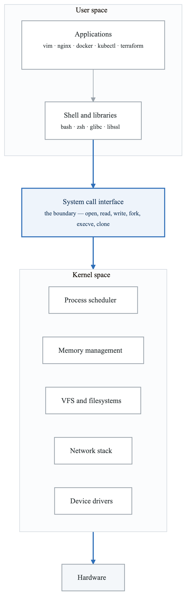
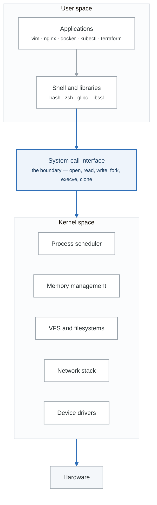

# Linux Fundamentals

## Introduction

Linux powers the modern internet. Understanding Linux is non-negotiable for DevOps engineers. This module covers the essential concepts and commands you'll use every day.

## Why Linux for DevOps?

**LINUX IN THE DEVOPS ECOSYSTEM**

SERVERS
• 96.3% of top 1 million web servers run Linux
• All major cloud providers default to Linux
• Most containers are Linux-based
CONTAINERS
• Docker runs on Linux kernel
• Kubernetes nodes are typically Linux
• Container images are Linux distributions
CLOUD
• AWS, GCP, Azure - Linux is the primary OS
• Serverless functions run on Linux
• Managed services built on Linux
TOOLS
• Most DevOps tools are Linux-native
• CI/CD pipelines run on Linux
• Scripting assumes Linux environment


## Linux Architecture

<!-- figure: generated from the Mermaid below by _shared/diagrams/embed-figures.py — do not edit the image -->


<details>
<summary>Diagram source (Mermaid)</summary>



</details>

## Linux Distributions

### Distribution Families

**The three distribution families you will actually meet**

| Family | Lineage | Package manager | Notes |
|---|---|---|---|
| **Debian** | Debian → Ubuntu → Mint, Pop!_OS | `apt` / `dpkg` | Ubuntu LTS is the default in most clouds and in this curriculum |
| **Red Hat** | Fedora → RHEL → Rocky, Alma, **Amazon Linux** | `dnf` / `rpm` | Amazon Linux 2023 is the AWS default AMI |
| **SUSE** | openSUSE → SLES | `zypper` / `rpm` | Common in European enterprise |

Config lives in `/etc` on all of them. The differences that bite you in practice are the package
manager, the service names (`ssh` vs `sshd`), and the default firewall (`ufw` vs `firewalld`).

### Choosing a Distribution

| Use Case | Recommended | Why |
|----------|-------------|-----|
| **Cloud servers** | Ubuntu LTS, Amazon Linux | Wide support, good documentation |
| **Containers** | Alpine, Debian slim | Small image size |
| **Enterprise** | RHEL, Ubuntu Pro | Support contracts, compliance |
| **Learning** | Ubuntu | Beginner-friendly, large community |
| **Minimal/Embedded** | Alpine, Buildroot | Tiny footprint |

## The Command Line

### Anatomy of a Command

```bash
command [options] [arguments]

# Example:
ls -la /var/log
│   │   └── argument (directory to list)
│   └── options (-l = long format, -a = all files)
└── command (list directory contents)
```

### Getting Help

```bash
# Manual pages
man ls
man -k search_term   # Search for commands

# Built-in help
command --help
command -h

# Quick reference
tldr ls              # Install: apt install tldr

# Info pages (more detailed)
info coreutils
```

## Essential Commands

### Navigation

```bash
# Print working directory
pwd
# Output: /home/devops

# Change directory
cd /var/log          # Absolute path
cd ../               # Parent directory
cd ~                 # Home directory
cd -                 # Previous directory

# List directory contents
ls                   # Basic listing
ls -l                # Long format (permissions, owner, size, date)
ls -la               # Include hidden files (start with .)
ls -lh               # Human-readable sizes
ls -lt               # Sort by modification time
ls -lS               # Sort by size
```

### Understanding `ls -l` Output

**Reading `ls -l`**

```text
-rw-r--r--  1  devops  devops  4096  Jan 15 10:30  config.yaml
└────┬───┘  │  └──┬─┘  └──┬─┘  └─┬┘  └────┬────┘  └────┬────┘
     │      │     │       │      │        │            └── name
     │      │     │       │      │        └── last modification
     │      │     │       │      └── size in bytes
     │      │     │       └── group owner
     │      │     └── user owner
     │      └── hard-link count
     └── type and permissions
```

| Field | Example | Meaning |
|---|---|---|
| Type | `-` | `-` file · `d` directory · `l` symlink · `b` block device · `c` character device |
| Owner | `rw-` | read, write, no execute |
| Group | `r--` | read only |
| Other | `r--` | read only |
| Links | `1` | how many directory entries point at this inode |
| User | `devops` | owning user |
| Group | `devops` | owning group |
| Size | `4096` | bytes |
| Time | `Jan 15 10:30` | last modification (`mtime`) |

The link count is the field people ignore and then need: a regular file with a count above 1 has hard
links elsewhere on the filesystem, and deleting this name will not free the space.

### File Operations

```bash
# Create files
touch newfile.txt               # Create empty file
echo "content" > file.txt       # Create with content
cat > file.txt << EOF           # Here document
line 1
line 2
EOF

# Create directories
mkdir mydir                     # Create directory
mkdir -p path/to/nested/dir     # Create parent directories

# Copy
cp source.txt dest.txt          # Copy file
cp -r sourcedir/ destdir/       # Copy directory recursively
cp -p source.txt dest.txt       # Preserve permissions

# Move/Rename
mv oldname.txt newname.txt      # Rename
mv file.txt /new/location/      # Move

# Delete
rm file.txt                     # Remove file
rm -r directory/                # Remove directory
rm -rf directory/               # Force remove (CAREFUL!)
rmdir emptydir/                 # Remove empty directory only
```

### Viewing File Contents

```bash
# View entire file
cat file.txt                    # Print entire file
cat -n file.txt                 # With line numbers

# View large files
less file.txt                   # Paginated view (q to quit)
more file.txt                   # Simple pagination

# View parts of files
head file.txt                   # First 10 lines
head -n 20 file.txt             # First 20 lines
tail file.txt                   # Last 10 lines
tail -n 20 file.txt             # Last 20 lines
tail -f /var/log/syslog         # Follow (real-time updates)

# View file with formatting
column -t file.csv              # Tabular format
```

### Finding Files

```bash
# Find by name
find /var -name "*.log"         # Find all .log files
find . -name "config*"          # Find files starting with config
find /home -iname "readme*"     # Case-insensitive

# Find by type
find . -type f                  # Files only
find . -type d                  # Directories only
find . -type l                  # Symbolic links

# Find by size
find . -size +100M              # Larger than 100MB
find . -size -1k                # Smaller than 1KB

# Find by time
find . -mtime -7                # Modified in last 7 days
find . -mtime +30               # Modified more than 30 days ago
find . -mmin -60                # Modified in last 60 minutes

# Find and act
find . -name "*.tmp" -delete    # Find and delete
find . -name "*.sh" -exec chmod +x {} \;  # Find and execute

# Locate (faster, uses database)
locate nginx.conf               # Find by name (fast)
updatedb                        # Update locate database
```

### Text Processing

```bash
# grep - search text
grep "error" logfile.txt        # Find lines with "error"
grep -i "error" logfile.txt     # Case-insensitive
grep -r "TODO" ./               # Recursive search
grep -n "error" logfile.txt     # Show line numbers
grep -v "debug" logfile.txt     # Invert match (exclude)
grep -c "error" logfile.txt     # Count matches
grep -E "error|warning" file    # Extended regex (OR)

# sed - stream editor
sed 's/old/new/' file.txt       # Replace first occurrence
sed 's/old/new/g' file.txt      # Replace all occurrences
sed -i 's/old/new/g' file.txt   # In-place edit
sed '5d' file.txt               # Delete line 5
sed '/pattern/d' file.txt       # Delete lines matching pattern

# awk - pattern processing
awk '{print $1}' file.txt       # Print first column
awk '{print $NF}' file.txt      # Print last column
awk -F: '{print $1}' /etc/passwd # Custom delimiter
awk '/error/ {print}' log.txt   # Print lines with "error"
awk '{sum+=$1} END {print sum}' # Sum first column

# sort
sort file.txt                   # Alphabetical sort
sort -n file.txt                # Numeric sort
sort -r file.txt                # Reverse sort
sort -k2 file.txt               # Sort by second column
sort -u file.txt                # Unique sort

# uniq (requires sorted input)
sort file.txt | uniq            # Remove duplicates
sort file.txt | uniq -c         # Count occurrences
sort file.txt | uniq -d         # Show only duplicates

# wc - word count
wc file.txt                     # Lines, words, characters
wc -l file.txt                  # Line count only
wc -w file.txt                  # Word count only

# cut
cut -d: -f1 /etc/passwd         # First field, colon delimiter
cut -c1-10 file.txt             # Characters 1-10

# tr - translate characters
cat file | tr 'a-z' 'A-Z'       # Lowercase to uppercase
cat file | tr -d '\n'           # Delete newlines
cat file | tr -s ' '            # Squeeze repeated spaces
```

### Piping and Redirection

```bash
# Redirection
command > file.txt              # Redirect stdout (overwrite)
command >> file.txt             # Redirect stdout (append)
command 2> error.txt            # Redirect stderr
command &> all.txt              # Redirect both stdout and stderr
command < input.txt             # Redirect stdin

# Piping
command1 | command2             # Pipe stdout to stdin

# Examples
cat /var/log/syslog | grep error | wc -l
ps aux | grep nginx | awk '{print $2}'
find . -name "*.log" | xargs rm
ls -la | tee listing.txt        # Display and save
```

### File Permissions

```bash
# View permissions
ls -l file.txt

# Change permissions (symbolic)
chmod u+x file.sh               # Add execute for owner
chmod g-w file.txt              # Remove write for group
chmod o=r file.txt              # Set others to read only
chmod a+r file.txt              # Add read for all

# Change permissions (numeric)
chmod 755 file.sh               # rwxr-xr-x
chmod 644 file.txt              # rw-r--r--
chmod 600 secret.key            # rw-------

# Permission reference
# 4 = read (r)
# 2 = write (w)
# 1 = execute (x)
# Sum for each: owner, group, others

# Change ownership
chown user:group file.txt       # Change owner and group
chown -R user:group directory/  # Recursive
chgrp group file.txt            # Change group only
```

### Working with Archives

```bash
# tar (tape archive)
tar -cvf archive.tar files/     # Create archive
tar -xvf archive.tar            # Extract archive
tar -tvf archive.tar            # List contents
tar -czvf archive.tar.gz files/ # Create gzipped
tar -xzvf archive.tar.gz        # Extract gzipped
tar -cjvf archive.tar.bz2 files/ # Create bzip2

# Options:
# c = create
# x = extract
# v = verbose
# f = file
# z = gzip
# j = bzip2

# zip
zip archive.zip files           # Create zip
zip -r archive.zip directory/   # Recursive
unzip archive.zip               # Extract
unzip -l archive.zip            # List contents

# gzip
gzip file.txt                   # Compress (creates file.txt.gz)
gunzip file.txt.gz              # Decompress
zcat file.txt.gz                # View without decompressing
```

## System Information

```bash
# System info
uname -a                        # Kernel information
cat /etc/os-release             # Distribution info
hostnamectl                     # Hostname and OS info

# Hardware
lscpu                           # CPU information
free -h                         # Memory usage
df -h                           # Disk usage
lsblk                           # Block devices
lspci                           # PCI devices
lsusb                           # USB devices

# Processes
ps aux                          # All processes
top                             # Interactive process viewer
htop                            # Better interactive viewer
pgrep nginx                     # Find process by name
pidof nginx                     # Get PID by name

# Network
ip addr                         # IP addresses
ip route                        # Routing table
ss -tulpn                       # Open ports
netstat -tulpn                  # Open ports (legacy)

# Uptime and load
uptime                          # System uptime and load
w                               # Who is logged in
```

## Environment Variables

```bash
# View variables
env                             # All environment variables
echo $PATH                      # Specific variable
printenv HOME                   # Another way

# Set variables
export MYVAR="value"            # Set for current session
MYVAR="value"                   # Set for current shell only

# Persist variables
# Add to ~/.bashrc or ~/.bash_profile:
export MYVAR="value"

# Common variables
$HOME                           # Home directory
$USER                           # Current user
$PATH                           # Command search path
$PWD                            # Current directory
$SHELL                          # Current shell
$?                              # Exit status of last command
```

## Practical Exercises

### Exercise 1: File System Exploration

```bash
# Navigate to /var and explore
cd /var
ls -la
# What directories do you see? What is each for?

# Find all log files modified today
find /var/log -type f -mtime 0

# Count lines in syslog
wc -l /var/log/syslog
```

### Exercise 2: Text Processing Pipeline

```bash
# Create a sample log file
cat > sample.log << 'EOF'
2024-01-15 10:00:00 INFO Starting application
2024-01-15 10:00:01 DEBUG Loading config
2024-01-15 10:00:02 ERROR Failed to connect to database
2024-01-15 10:00:03 WARN Retrying connection
2024-01-15 10:00:04 INFO Connection established
2024-01-15 10:00:05 ERROR Query timeout
2024-01-15 10:00:06 INFO Request completed
EOF

# Find all errors
grep ERROR sample.log

# Count log levels
awk '{print $3}' sample.log | sort | uniq -c

# Extract timestamps of errors
grep ERROR sample.log | awk '{print $1, $2}'
```

### Exercise 3: File Permissions

```bash
# Create a script
echo '#!/bin/bash
echo "Hello World"' > myscript.sh

# Try to run it (will fail)
./myscript.sh

# Make it executable
chmod +x myscript.sh

# Run it
./myscript.sh

# Check permissions
ls -l myscript.sh
```

## Common Gotchas

### Spaces in Filenames

```bash
# BAD
cp my file.txt /dest/           # Tries to copy "my" and "file.txt"

# GOOD
cp "my file.txt" /dest/         # Quotes handle spaces
cp my\ file.txt /dest/          # Escape the space
```

### Hidden Files

```bash
# Hidden files start with .
ls                              # Won't show hidden
ls -a                           # Shows all including hidden

# Dotfiles are configuration
~/.bashrc                       # Bash configuration
~/.ssh/                         # SSH configuration
```

### Case Sensitivity

```bash
# Linux is case-sensitive
File.txt ≠ file.txt ≠ FILE.TXT

# Be consistent with naming conventions
```

## Key Takeaways

1. **Everything is a file** - Devices, processes, sockets are files
2. **Pipes connect commands** - Output of one becomes input of another
3. **Permissions matter** - Security depends on proper permissions
4. **Read the manual** - `man` pages are your friend
5. **Practice daily** - Muscle memory comes from repetition

## Further Reading

### Official Documentation
- [GNU Coreutils Manual](https://www.gnu.org/software/coreutils/manual/)
- [Bash Reference Manual](https://www.gnu.org/software/bash/manual/)
- [Linux man pages online](https://man7.org/linux/man-pages/)

### Books
- "The Linux Command Line" by William Shotts (free online)
- "Linux Pocket Guide" by Daniel Barrett

---

**Next:** [File System Deep Dive](./02-filesystem-deep-dive.md)

<!-- feynman-check -->

---

## Feynman check

Close the file. Blank page, no notes. Explain each of these to a competent engineer who has never
used this tool — **under five minutes, no jargon you can't define on the spot:**

- Why Linux for DevOps?
- Linux Architecture
- Linux Distributions
- The Command Line

**The gap is not what you forgot. It is where you used a word instead of a mechanism.**

| | |
|---|---|
| ✗ | *"The kernel manages processes."* |
| ✓ | *"A process is an entry in the kernel's task table with its own memory map and file-descriptor table. `fork()` copies it, `exec()` replaces the program inside it, and the parent must call `wait()` or the entry stays behind as a zombie."* |

**Trace it:** `ls -l /etc` → characters on your terminal. Name every syscall and every kernel structure between the keypress and the output.

Stop at the first component you cannot name. Reopen this file and read **only** that.

**Go deeper — only once the gap has a name:** [`man 7 namespaces`](https://man7.org/linux/man-pages/man7/namespaces.7.html) and the [LWN namespaces series](https://lwn.net/Articles/531114/) — the primary sources, not summaries of them.
Full list per domain: [`SOURCES.md`](../SOURCES.md#linux-networking)

→ Protocol, the three levels of knowing, and worked examples: [`MASTERY.md`](../MASTERY.md)

<!-- /feynman-check -->
