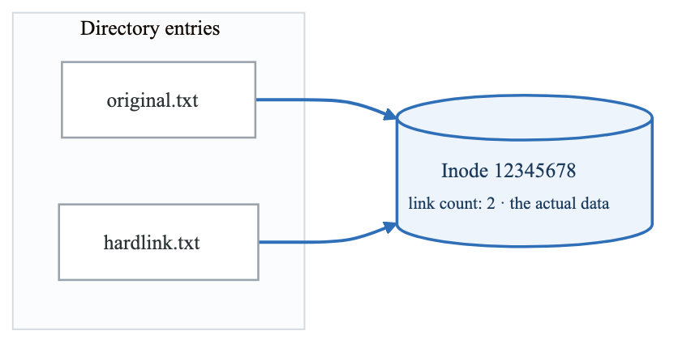
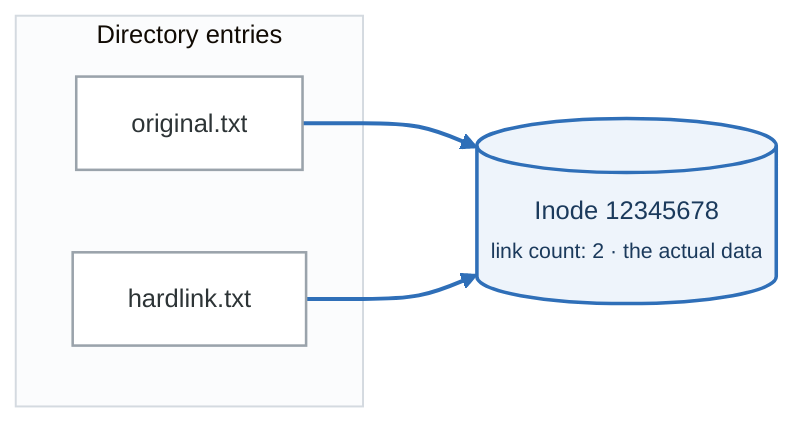
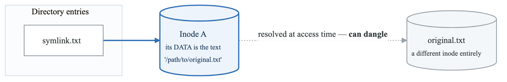
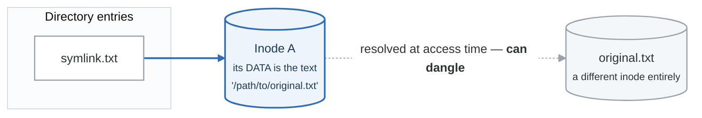
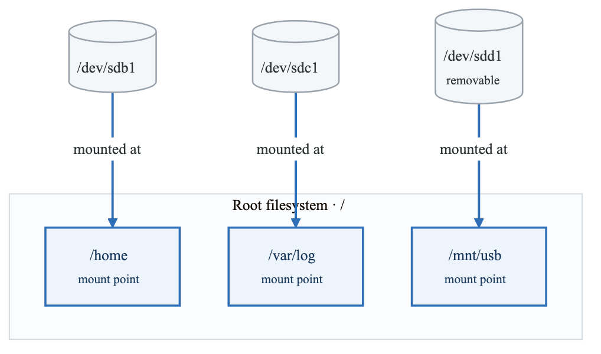
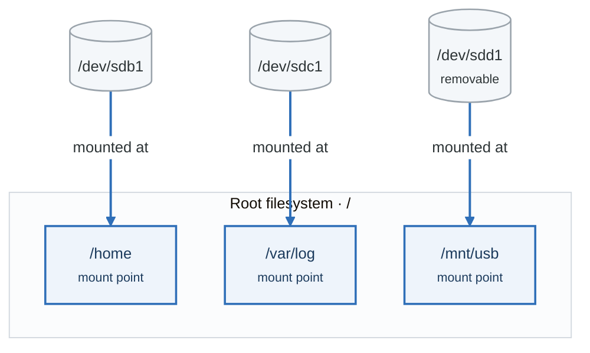

# File System Deep Dive

## Overview

Understanding the Linux file system is crucial for DevOps engineers. This module explores the Filesystem Hierarchy Standard (FHS), inodes, links, mounting, and advanced file system concepts.

## Learning Objectives

By the end of this module, you will be able to:
- Navigate and understand the FHS directory structure
- Explain inodes and file system internals
- Create and manage hard and symbolic links
- Mount and unmount file systems
- Monitor disk usage and troubleshoot space issues

---

## Filesystem Hierarchy Standard (FHS)

### Directory Structure

**`/`**

- `bin/` — Essential user binaries
- `boot/` — Boot loader files
- `dev/` — Device files
- `etc/` — System configuration
- `home/` — User home directories
- `lib/` — Essential shared libraries
- `media/` — Removable media mount points
- `mnt/` — Temporary mount points
- `opt/` — Optional application software
- `proc/` — Process and kernel info (virtual)
- `root/` — Root user's home directory
- `run/` — Runtime variable data
- `sbin/` — Essential system binaries
- `srv/` — Service data
- `sys/` — Kernel and device info (virtual)
- `tmp/` — Temporary files
- `usr/` — User utilities and applications
  - `bin/` — User binaries
  - `lib/` — Libraries
  - `local/` — Locally installed software
  - `share/` — Shared data
- `var/` — Variable data (logs, spool, etc.)
  - `log/` — Log files
  - `cache/` — Application cache
  - `lib/` — State information


### Key Directories Explained

#### /etc - Configuration Files

```bash
# Important configuration files
/etc/passwd       # User account information
/etc/shadow       # Encrypted passwords
/etc/group        # Group information
/etc/hosts        # Static hostname mapping
/etc/hostname     # System hostname
/etc/fstab        # Filesystem mount table
/etc/ssh/         # SSH configuration
/etc/nginx/       # Nginx configuration
/etc/systemd/     # Systemd configuration

# List all configuration files for a service
ls -la /etc/nginx/

# View system hostname
cat /etc/hostname

# Check mount configuration
cat /etc/fstab
```

#### /var - Variable Data

```bash
# Important variable directories
/var/log/         # System and application logs
/var/lib/         # State information
/var/cache/       # Application cache data
/var/spool/       # Spool directories (mail, cron)
/var/tmp/         # Temporary files (preserved between reboots)
/var/run/         # Runtime data (symlink to /run)

# Common log files
/var/log/syslog       # System log (Debian/Ubuntu)
/var/log/messages     # System log (RHEL/CentOS)
/var/log/auth.log     # Authentication log
/var/log/kern.log     # Kernel log
/var/log/nginx/       # Nginx access and error logs

# Check log size
du -sh /var/log/*
```

#### /proc - Process Information

```bash
# Virtual filesystem with kernel/process info
/proc/cpuinfo     # CPU information
/proc/meminfo     # Memory information
/proc/loadavg     # System load average
/proc/uptime      # System uptime
/proc/version     # Kernel version
/proc/[pid]/      # Process-specific information

# View CPU info
cat /proc/cpuinfo | grep "model name"

# View memory info
cat /proc/meminfo | head -10

# View process info
cat /proc/self/status
```

---

## Inodes and File System Internals

### What is an Inode?

**Inode Structure:**

```
                     INODE
  Inode Number: 12345
  File Type: regular file
  Permissions: 0644 (-rw-r--r--)
  Owner UID: 1000
  Owner GID: 1000
  Size: 4096 bytes
  Timestamps:
    - atime (access time)
    - mtime (modify time)
    - ctime (change time)
  Link Count: 1
  Block Pointers:
    - Direct: blocks 100-111
    - Indirect: block 200
    - Double Indirect: block 300

Note: The inode does NOT contain the filename!
Filenames are stored in directory entries.
```


### Viewing Inode Information

```bash
# View inode number
ls -i filename

# Detailed inode info
stat filename

# Example output:
#   File: example.txt
#   Size: 1234      Blocks: 8          IO Block: 4096   regular file
# Device: 801h/2049d  Inode: 12345678    Links: 1
# Access: (0644/-rw-r--r--)  Uid: ( 1000/   user)   Gid: ( 1000/   user)
# Access: 2024-01-15 10:00:00.000000000 -0500
# Modify: 2024-01-14 15:30:00.000000000 -0500
# Change: 2024-01-14 15:30:00.000000000 -0500
#  Birth: 2024-01-10 09:00:00.000000000 -0500

# Check inode usage
df -i

# Find files by inode number
find / -inum 12345678 2>/dev/null
```

### How Directories Work

**A directory is a file that maps names to inode numbers**

That is all it is. The contents of a directory file look like this:

| Inode | Name |
|---|---|
| 100 | `.` (this directory) |
| 50 | `..` (parent) |
| 101 | `file1.txt` |
| 102 | `file2.txt` |
| 103 | `subdir` |

The *name* lives in the directory; everything else about the file — size, owner, permissions,
timestamps, and the pointers to the data blocks — lives in the inode. Two consequences follow
immediately: a hard link is just a second row in some directory pointing at the same inode, and
renaming a file within a filesystem touches no file data at all.

---

## Links: Hard Links and Symbolic Links

### Hard Links

```bash
# Create a hard link
ln original.txt hardlink.txt

# Verify same inode
ls -li original.txt hardlink.txt
# 12345678 -rw-r--r-- 2 user user 100 Jan 15 10:00 hardlink.txt
# 12345678 -rw-r--r-- 2 user user 100 Jan 15 10:00 original.txt

# Note: Link count is now 2
```

<!-- figure: generated from the Mermaid below by _shared/diagrams/embed-figures.py — do not edit the image -->


<details>
<summary>Diagram source (Mermaid)</summary>



</details>

**Hard Link Rules:**
- Cannot span file systems
- Cannot link to directories (usually)
- Both names are equally "real"
- File exists until link count = 0

### Symbolic (Soft) Links

```bash
# Create a symbolic link
ln -s /path/to/original.txt symlink.txt

# View symbolic link
ls -l symlink.txt
# lrwxrwxrwx 1 user user 21 Jan 15 10:00 symlink.txt -> /path/to/original.txt

# Follow the link
readlink symlink.txt
readlink -f symlink.txt  # Canonical path
```

<!-- figure: generated from the Mermaid below by _shared/diagrams/embed-figures.py — do not edit the image -->


<details>
<summary>Diagram source (Mermaid)</summary>



</details>

**Symbolic Link Characteristics:**
- Can span file systems
- Can link to directories
- Can become "broken" if target is deleted
- Target path stored as file content

### Comparison

| Feature | Hard Link | Symbolic Link |
|---|---|---|
| Same inode | Yes | No |
| Cross filesystem | No | Yes |
| Link to dir | No (usually) | Yes |
| Broken link | Impossible | Possible |
| Size | Same as original | Length of path |
| Permissions | Same as original | Always 777 |


---

## Mounting File Systems

### Understanding Mounts

<!-- figure: generated from the Mermaid below by _shared/diagrams/embed-figures.py — do not edit the image -->


<details>
<summary>Diagram source (Mermaid)</summary>



</details>

### Mount Commands

```bash
# View current mounts
mount
df -h
lsblk

# Mount a filesystem
sudo mount /dev/sdb1 /mnt/data

# Mount with specific filesystem type
sudo mount -t ext4 /dev/sdb1 /mnt/data

# Mount read-only
sudo mount -o ro /dev/sdb1 /mnt/data

# Mount with options
sudo mount -o rw,noexec,nosuid /dev/sdb1 /mnt/data

# Unmount
sudo umount /mnt/data
# or
sudo umount /dev/sdb1

# Force unmount (if busy)
sudo umount -l /mnt/data  # Lazy unmount
sudo umount -f /mnt/data  # Force unmount
```

### /etc/fstab - Persistent Mounts

```bash
# View fstab
cat /etc/fstab

# fstab format:
# <device>          <mount point>  <type>  <options>        <dump> <pass>
/dev/sda1           /              ext4    defaults         1      1
/dev/sdb1           /home          ext4    defaults         1      2
UUID=abc123         /data          xfs     defaults,noatime 0      2
192.168.1.100:/nfs  /mnt/nfs       nfs     defaults         0      0
```

**fstab Fields:**
1. **Device**: Device name, UUID, or LABEL
2. **Mount point**: Where to mount
3. **Type**: Filesystem type (ext4, xfs, nfs, etc.)
4. **Options**: Mount options
5. **Dump**: Backup flag (0=no, 1=yes)
6. **Pass**: fsck order (0=skip, 1=root, 2=other)

### Finding Device Information

```bash
# List block devices
lsblk

# Show UUIDs
blkid

# Example output:
# /dev/sda1: UUID="abc123" TYPE="ext4" PARTUUID="xyz789"

# View partition table
sudo fdisk -l /dev/sda

# Check filesystem
sudo file -s /dev/sda1
```

---

## Disk Usage and Space Management

### Checking Disk Usage

```bash
# Disk free space
df -h
df -h /home

# Directory size
du -sh /var/log
du -sh /var/log/*

# Top 10 largest directories
du -h /var | sort -rh | head -10

# Top 10 largest files
find / -type f -exec du -h {} + 2>/dev/null | sort -rh | head -10

# ncdu - interactive disk usage viewer
sudo apt install ncdu
ncdu /var
```

### Finding Large Files

```bash
# Find files larger than 100MB
find / -type f -size +100M 2>/dev/null

# Find files larger than 1GB with details
find / -type f -size +1G -exec ls -lh {} \; 2>/dev/null

# Find and list by size
find /var -type f -exec du -h {} + 2>/dev/null | sort -rh | head -20
```

### Managing Disk Space

```bash
# Clear package cache (Debian/Ubuntu)
sudo apt clean
sudo apt autoclean
sudo apt autoremove

# Clear package cache (RHEL/CentOS)
sudo yum clean all
sudo dnf clean all

# Find and remove old logs
sudo find /var/log -name "*.gz" -mtime +30 -delete

# Truncate large log files
sudo truncate -s 0 /var/log/syslog

# Clear systemd journal
sudo journalctl --vacuum-time=7d
sudo journalctl --vacuum-size=100M
```

### Handling "No Space Left on Device"

```bash
# Check what's using space
df -h
df -i  # Check inodes too!

# Find large files
du -h / 2>/dev/null | sort -rh | head -20

# Check for deleted files still held open
sudo lsof +L1

# Find process holding deleted file
sudo lsof | grep deleted

# Common culprits:
# - /var/log files
# - /tmp not being cleaned
# - Docker images and containers
# - Package cache
```

---

## File System Types

### Common Linux Filesystems

| Filesystem | Description |
|---|---|
| ext4 | Default Linux filesystem, journaling, stable |
| xfs | High-performance, default for RHEL/CentOS |
| btrfs | Copy-on-write, snapshots, modern features |
| zfs | Enterprise features, checksums, snapshots |
| tmpfs | RAM-based temporary filesystem |
| nfs | Network File System for sharing |
| cifs/smb | Windows file sharing |
| overlay | Layered filesystem (Docker uses this) |


### Creating Filesystems

```bash
# Create ext4 filesystem
sudo mkfs.ext4 /dev/sdb1

# Create xfs filesystem
sudo mkfs.xfs /dev/sdb1

# Create with label
sudo mkfs.ext4 -L mydata /dev/sdb1

# Check filesystem
sudo fsck /dev/sdb1
sudo e2fsck -f /dev/sdb1  # For ext filesystems
```

---

## Special Filesystems

### tmpfs - RAM Disk

```bash
# Create a tmpfs mount
sudo mount -t tmpfs -o size=512M tmpfs /mnt/ramdisk

# Verify
df -h /mnt/ramdisk

# Add to fstab for persistence
# tmpfs /mnt/ramdisk tmpfs defaults,size=512M 0 0

# Common tmpfs locations
# /tmp         - Temporary files
# /run         - Runtime data
# /dev/shm     - Shared memory
```

### /proc and /sys

```bash
# /proc - Process and kernel information
cat /proc/cpuinfo
cat /proc/meminfo
cat /proc/loadavg
cat /proc/uptime

# /sys - Kernel objects and device info
ls /sys/class/net/
cat /sys/class/net/eth0/address
cat /sys/block/sda/size

# Modify kernel parameters via /proc
# (temporary, lost on reboot)
echo 1 > /proc/sys/net/ipv4/ip_forward
```

---

## Practical Exercises

### Exercise 1: Explore the FHS

```bash
# 1. List top-level directories
ls -la /

# 2. Find the largest directories
du -sh /* 2>/dev/null | sort -rh

# 3. Explore /etc configuration
ls /etc/*.conf

# 4. Check log files
ls -lh /var/log/

# 5. View process information
ls /proc/
cat /proc/self/status
```

### Exercise 2: Work with Links

```bash
# 1. Create a test directory
mkdir ~/link-test && cd ~/link-test

# 2. Create a file
echo "Original content" > original.txt

# 3. Create a hard link
ln original.txt hardlink.txt

# 4. Create a symbolic link
ln -s original.txt symlink.txt

# 5. Compare inodes
ls -li

# 6. Modify through hard link
echo "Modified" >> hardlink.txt
cat original.txt

# 7. Delete original
rm original.txt
cat hardlink.txt   # Still works!
cat symlink.txt    # Broken link!
```

### Exercise 3: Disk Space Management

```bash
# 1. Check overall disk usage
df -h

# 2. Find largest directories in /var
sudo du -sh /var/* | sort -rh | head -10

# 3. Check inode usage
df -i

# 4. Find files larger than 10MB in /var/log
sudo find /var/log -type f -size +10M -ls

# 5. Check for deleted but open files
sudo lsof +L1 | head
```

---

## Key Takeaways

1. **FHS provides consistency** - Know where to find things on any Linux system
2. **Inodes are the real files** - Filenames are just pointers
3. **Hard links share inodes** - Both names are equally valid
4. **Symbolic links are paths** - Can break if target moves
5. **Mount points overlay** - New filesystem hides existing content
6. **Monitor disk space** - Both blocks and inodes can run out
7. **/proc and /sys are virtual** - Live kernel information

---

## Next Module

[Users and Permissions](./03-users-permissions.md)

<!-- feynman-check -->

---

## Feynman check

Close the file. Blank page, no notes. Explain each of these to a competent engineer who has never
used this tool — **under five minutes, no jargon you can't define on the spot:**

- Filesystem Hierarchy Standard (FHS)
- Inodes and File System Internals
- Links: Hard Links and Symbolic Links
- Mounting File Systems

**The gap is not what you forgot. It is where you used a word instead of a mechanism.**

| | |
|---|---|
| ✗ | *"The kernel manages processes."* |
| ✓ | *"A process is an entry in the kernel's task table with its own memory map and file-descriptor table. `fork()` copies it, `exec()` replaces the program inside it, and the parent must call `wait()` or the entry stays behind as a zombie."* |

**Trace it:** `ls -l /etc` → characters on your terminal. Name every syscall and every kernel structure between the keypress and the output.

Stop at the first component you cannot name. Reopen this file and read **only** that.

**Go deeper — only once the gap has a name:** [`man 7 namespaces`](https://man7.org/linux/man-pages/man7/namespaces.7.html) and the [LWN namespaces series](https://lwn.net/Articles/531114/) — the primary sources, not summaries of them.
Full list per domain: [`SOURCES.md`](../SOURCES.md#linux-networking)

→ Protocol, the three levels of knowing, and worked examples: [`MASTERY.md`](../MASTERY.md)

<!-- /feynman-check -->
