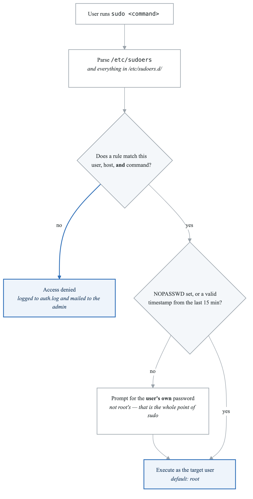
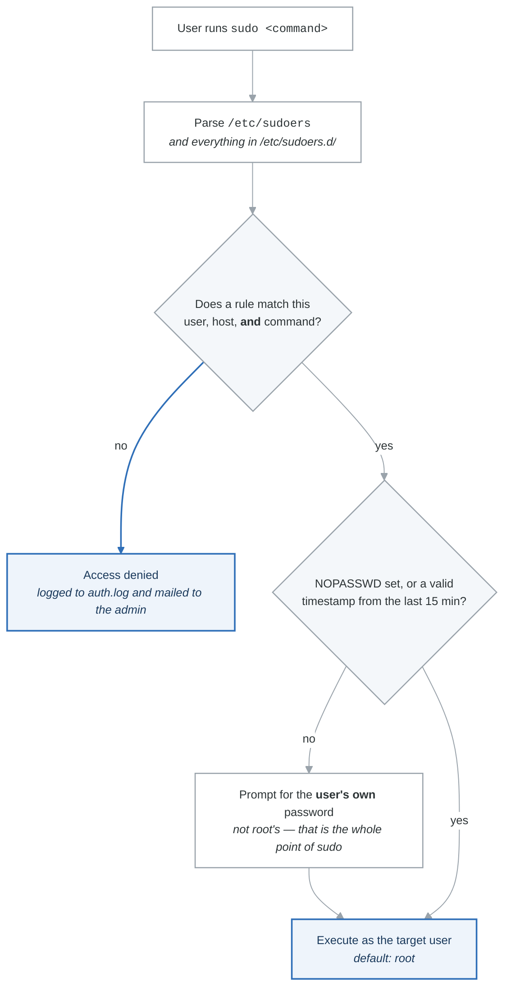

# Users and Permissions

## Overview

User and permission management is fundamental to Linux security and system administration. This module covers user accounts, groups, file permissions, ACLs, and sudo configuration.

## Learning Objectives

By the end of this module, you will be able to:
- Create and manage user accounts
- Understand and configure group membership
- Set and interpret file permissions
- Configure Access Control Lists (ACLs)
- Set up and secure sudo access

---

## User Accounts

### Understanding Users

**User Information Sources:**

```
  /etc/passwd    - User account information
  /etc/shadow    - Encrypted passwords
  /etc/group     - Group information
  /etc/gshadow   - Group passwords (rarely used)
```


### /etc/passwd Format

```bash
# View passwd file
cat /etc/passwd

# Format:
# username:password:UID:GID:GECOS:home:shell
# root:x:0:0:root:/root:/bin/bash
# ubuntu:x:1000:1000:Ubuntu:/home/ubuntu:/bin/bash
# nginx:x:33:33:nginx user:/var/www:/usr/sbin/nologin

# Fields:
# 1. username   - Login name
# 2. password   - 'x' means password in /etc/shadow
# 3. UID        - User ID (0=root, 1-999=system, 1000+=regular)
# 4. GID        - Primary group ID
# 5. GECOS      - Full name and info
# 6. home       - Home directory path
# 7. shell      - Login shell
```

### /etc/shadow Format

```bash
# View shadow file (requires root)
sudo cat /etc/shadow

# Format:
# username:password:lastchange:min:max:warn:inactive:expire:reserved
# ubuntu:$6$rounds=4096$salt$hash:19000:0:99999:7:::

# Password field formats:
# $6$...      - SHA-512 hash
# $5$...      - SHA-256 hash
# $1$...      - MD5 hash (deprecated)
# !           - Account locked
# *           - No password login allowed
# !!          - Password not set
```

### User Management Commands

```bash
# Add a new user
sudo useradd -m -s /bin/bash -c "John Smith" john
# -m: Create home directory
# -s: Set shell
# -c: Comment (full name)

# Set password
sudo passwd john

# Create user with specific UID
sudo useradd -u 1500 -m appuser

# Modify user
sudo usermod -aG docker john  # Add to docker group
sudo usermod -L john          # Lock account
sudo usermod -U john          # Unlock account
sudo usermod -s /bin/zsh john # Change shell

# Delete user
sudo userdel john             # Delete user, keep home
sudo userdel -r john          # Delete user and home directory

# View user info
id john
getent passwd john
finger john  # If installed
```

### Interactive User Creation

```bash
# adduser (Debian/Ubuntu) - interactive
sudo adduser newuser

# This will:
# 1. Create user
# 2. Create home directory
# 3. Copy skeleton files
# 4. Prompt for password
# 5. Prompt for user info
```

---

## Groups

### Understanding Groups

**Group Types:**

 Primary Group
 - Every user has one
 - Stored in /etc/passwd (GID field)
 - New files get this group by default
 Secondary/Supplementary Groups
 - User can belong to many
 - Stored in /etc/group
 - Provide additional permissions


### /etc/group Format

```bash
# View groups
cat /etc/group

# Format:
# groupname:password:GID:members
# docker:x:999:ubuntu,john
# sudo:x:27:ubuntu
# www-data:x:33:

# Fields:
# 1. groupname - Group name
# 2. password  - Usually 'x' or empty
# 3. GID       - Group ID
# 4. members   - Comma-separated list of members
```

### Group Management Commands

```bash
# Create group
sudo groupadd developers

# Create with specific GID
sudo groupadd -g 2000 devops

# Add user to group
sudo usermod -aG developers john
# Note: -a is crucial! Without it, user loses other groups

# Alternative way
sudo gpasswd -a john developers

# Remove user from group
sudo gpasswd -d john developers

# Delete group
sudo groupdel developers

# View group members
getent group developers
members developers  # If installed

# View user's groups
groups john
id john
```

### Special System Groups

```bash
# Common system groups and their purposes:
sudo     - Can run sudo commands
wheel    - Can run sudo (RHEL/CentOS)
docker   - Can run docker commands
www-data - Web server processes
adm      - Can read log files
```

---

## File Permissions

### Understanding Permission Bits

**Permission breakdown**

```text
-rwxr-xr--  1  owner  group  size  date  filename
│└┬┘└┬┘└┬┘
│ │  │  └── other:  r--   read only
│ │  └───── group:  r-x   read, execute
│ └──────── owner:  rwx   read, write, execute
└────────── type
```

| Type character | Meaning |
|---|---|
| `-` | Regular file |
| `d` | Directory |
| `l` | Symbolic link |
| `b` | Block device |
| `c` | Character device |
| `s` | Socket |
| `p` | Named pipe (FIFO) |

### Permission Values

**Symbolic and octal permissions**

Each triplet is three bits: read = 4, write = 2, execute = 1, added together.

| Symbolic | Octal | Meaning |
|---|---|---|
| `r--` | 4 | Read only |
| `-w-` | 2 | Write only |
| `--x` | 1 | Execute only |
| `rw-` | 6 | Read + write |
| `r-x` | 5 | Read + execute |
| `-wx` | 3 | Write + execute |
| `rwx` | 7 | Everything |
| `---` | 0 | Nothing |

**Combinations you will actually type**

| Octal | Symbolic | Use for |
|---|---|---|
| `755` | `rwxr-xr-x` | Directories and executables |
| `644` | `rw-r--r--` | Regular files |
| `700` | `rwx------` | Private directories |
| `600` | `rw-------` | Private files — SSH keys, credentials |
| `777` | `rwxrwxrwx` | **Nothing.** If `777` fixed it, the real problem was ownership |

### chmod - Change Permissions

```bash
# Symbolic mode
chmod u+x file.sh          # Add execute for owner
chmod g-w file.txt         # Remove write for group
chmod o=r file.txt         # Set others to read only
chmod a+r file.txt         # Add read for all
chmod u+rwx,g+rx,o-rwx file.sh

# Numeric mode
chmod 755 script.sh        # rwxr-xr-x
chmod 644 config.txt       # rw-r--r--
chmod 600 secret.key       # rw-------

# Recursive
chmod -R 755 directory/
chmod -R u+rwX,go+rX dir/  # X = execute only if directory

# Reference another file
chmod --reference=file1 file2
```

### chown - Change Ownership

```bash
# Change owner
sudo chown john file.txt

# Change owner and group
sudo chown john:developers file.txt

# Change group only
chown :developers file.txt
# or
chgrp developers file.txt

# Recursive
sudo chown -R john:developers /var/www/

# Preserve root (safety for symlinks)
sudo chown -R --no-dereference john:developers dir/
```

### Directory Permissions

**What the permission bits mean on a directory**

They do not mean what they mean on a file.

| Permission | Effect on a directory |
|---|---|
| `r` (read) | List the directory's contents (`ls`) |
| `w` (write) | Create and delete entries inside it |
| `x` (execute) | Enter it (`cd`), and reach the files inside by name |

| Mode | What you can actually do |
|---|---|
| `--x` | `cd` in and open a file *if you already know its name* — but not list |
| `r--` | List the names, but not open any of them, and not `cd` |
| `r-x` | List and open — the normal read-only directory |
| `rwx` | Everything, including creating and deleting |

**`w` on a directory is what lets you delete a file, not `w` on the file.** A read-only file in a
writable directory can still be removed. And to reach anything at all you need `x` on **every**
parent directory in the path — one missing `x` high up denies the whole subtree.

---

## Special Permissions

### SetUID, SetGID, and Sticky Bit

**The special permission bits**

| Bit | Symbol | Octal | Effect |
|---|---|---|---|
| SetUID | `s` / `S` | 4 | Executes as the file's **owner**, not the caller |
| SetGID | `s` / `S` | 2 | On a file: executes as the file's group. On a directory: new entries inherit the directory's group |
| Sticky | `t` / `T` | 1 | In a shared writable directory, only the owner of a file may delete it |

The capital letter is the trap: a lowercase `s` or `t` means the underlying execute bit is **set**,
an uppercase `S` or `T` means it is **not**. `rwsr-xr-x` works; `rwSr-xr-x` is a SetUID bit on a file
nobody can execute, which is almost always a mistake.

`/tmp` is the canonical sticky directory — everyone can write, nobody can delete someone else's
files. A SetUID root binary is the canonical privilege-escalation target, which is why
`find / -perm -4000` is the first thing an auditor runs.

### SetUID Examples

```bash
# passwd command has setuid
ls -l /usr/bin/passwd
# -rwsr-xr-x 1 root root 68208 Nov 24 2022 /usr/bin/passwd

# When user runs passwd, it executes as root
# This allows users to change their own password

# Set setuid
chmod u+s executable
chmod 4755 executable

# Remove setuid
chmod u-s executable
```

### SetGID Examples

```bash
# SetGID on directory
mkdir /shared/team
chgrp developers /shared/team
chmod g+s /shared/team

# Now all files created in /shared/team inherit
# the 'developers' group instead of user's primary group

# Verify
ls -ld /shared/team
# drwxrwsr-x 2 root developers 4096 Jan 15 10:00 /shared/team

# Set setgid
chmod g+s directory
chmod 2755 directory
```

### Sticky Bit Examples

```bash
# /tmp has sticky bit set
ls -ld /tmp
# drwxrwxrwt 10 root root 4096 Jan 15 10:00 /tmp

# Users can create files but only delete their own files
# Even though everyone has write permission

# Set sticky bit
chmod +t directory
chmod 1777 directory

# Common use: shared directories where users shouldn't
# delete each other's files
```

---

## Access Control Lists (ACLs)

### Why ACLs?

**Traditional Permissions Limitation:**

```
  Traditional: owner - group - others
  Problem: What if you need to give access to:
    - Two different groups?
    - A specific user not in the file's group?
    - Different permissions for multiple users?
  Solution: ACLs allow fine-grained per-user/group
            permissions beyond the basic model
```


### Viewing ACLs

```bash
# Check if file has ACL (+ in permissions)
ls -l file.txt
# -rw-rw-r--+ 1 user user 100 Jan 15 10:00 file.txt

# View ACL
getfacl file.txt

# Output example:
# # file: file.txt
# # owner: user
# # group: user
# user::rw-
# user:john:r--
# group::rw-
# group:developers:rw-
# mask::rw-
# other::r--
```

### Setting ACLs

```bash
# Give user read access
setfacl -m u:john:r file.txt

# Give user read/write access
setfacl -m u:john:rw file.txt

# Give group read/execute access
setfacl -m g:developers:rx directory/

# Multiple rules at once
setfacl -m u:john:rw,g:ops:r file.txt

# Recursive
setfacl -R -m u:john:rx directory/

# Remove specific ACL
setfacl -x u:john file.txt

# Remove all ACLs
setfacl -b file.txt

# Set default ACL for new files in directory
setfacl -d -m u:john:rw directory/
setfacl -d -m g:developers:rx directory/
```

### ACL Mask

```bash
# The mask limits maximum effective permissions
# for named users and groups

# View mask
getfacl file.txt | grep mask
# mask::r--

# Even if user:john:rw, effective is r-- due to mask

# Set mask
setfacl -m m::rwx file.txt

# Calculate effective permissions
# effective = ACL entry & mask
```

---

## Sudo Configuration

### Understanding Sudo

<!-- figure: generated from the Mermaid below by _shared/diagrams/embed-figures.py — do not edit the image -->


<details>
<summary>Diagram source (Mermaid)</summary>



</details>

### /etc/sudoers File

```bash
# ALWAYS edit with visudo!
sudo visudo

# Sudoers format:
# user/group  host=(run_as_user:run_as_group)  commands

# Examples:
root    ALL=(ALL:ALL) ALL        # Root can do everything
%sudo   ALL=(ALL:ALL) ALL        # sudo group can do everything
%wheel  ALL=(ALL:ALL) ALL        # wheel group (RHEL)

# Specific permissions
john    ALL=(ALL) /usr/bin/apt   # john can run apt as root
mary    ALL=(ALL) NOPASSWD: ALL  # mary doesn't need password
ops     ALL=(ALL) /usr/bin/systemctl restart nginx

# Host restrictions
john    webserver=(ALL) ALL      # Only on host 'webserver'

# Command aliases
Cmnd_Alias SERVICES = /usr/bin/systemctl start, /usr/bin/systemctl stop
john    ALL=(ALL) SERVICES
```

### Sudoers Best Practices

```bash
# 1. Always use visudo
sudo visudo

# 2. Use sudoers.d directory for modular config
sudo visudo -f /etc/sudoers.d/developers

# 3. Example: /etc/sudoers.d/developers
# Allow developers to restart services
%developers ALL=(ALL) NOPASSWD: /usr/bin/systemctl restart *

# 4. Check syntax
sudo visudo -c
sudo visudo -c -f /etc/sudoers.d/developers

# 5. Require password for sensitive operations
Defaults    timestamp_timeout=5  # Re-ask after 5 minutes
Defaults    passwd_tries=3        # 3 attempts only
```

### Common Sudo Patterns

```bash
# Run command as another user
sudo -u postgres psql

# Run command as another group
sudo -g developers command

# Preserve environment
sudo -E command

# Run shell as root
sudo -i           # Login shell
sudo -s           # Non-login shell

# Edit file with sudo
sudoedit /etc/hosts  # Safer than sudo vim

# List user's sudo permissions
sudo -l
sudo -l -U john

# Run command without password (if configured)
# User must be configured with NOPASSWD
```

---

## Security Best Practices

### User Account Security

```bash
# 1. Set password expiration
sudo chage -M 90 john    # Password expires in 90 days
sudo chage -l john       # View password policy

# 2. Lock inactive accounts
sudo chage -E 2024-12-31 contractor  # Account expires

# 3. Enforce strong passwords
# Edit /etc/security/pwquality.conf
minlen = 12
dcredit = -1
ucredit = -1
lcredit = -1
ocredit = -1

# 4. Disable root login
sudo passwd -l root  # Lock root password

# 5. Use SSH keys instead of passwords
```

### File Permission Security

```bash
# 1. Secure home directories
chmod 700 /home/*

# 2. Secure sensitive files
chmod 600 ~/.ssh/id_rsa
chmod 644 ~/.ssh/id_rsa.pub
chmod 600 ~/.bashrc

# 3. Find world-writable files
find / -type f -perm -002 -ls 2>/dev/null

# 4. Find SUID/SGID files
find / -type f \( -perm -4000 -o -perm -2000 \) -ls 2>/dev/null

# 5. Set proper umask
# Edit ~/.bashrc or /etc/profile
umask 027  # New files: 640, directories: 750
```

---

## Practical Exercises

### Exercise 1: User Management

```bash
# 1. Create a developer user
sudo useradd -m -s /bin/bash -c "Developer" dev1

# 2. Set password
sudo passwd dev1

# 3. Create developers group
sudo groupadd developers

# 4. Add user to group
sudo usermod -aG developers dev1

# 5. Verify
id dev1
groups dev1
```

### Exercise 2: Permission Setup

```bash
# 1. Create project directory
sudo mkdir -p /opt/project
sudo chown root:developers /opt/project
sudo chmod 2775 /opt/project

# 2. Verify SGID is set
ls -ld /opt/project

# 3. Create file as dev1
sudo -u dev1 touch /opt/project/test.txt

# 4. Check file group
ls -l /opt/project/test.txt
# Should be 'developers' group due to SGID
```

### Exercise 3: ACL Configuration

```bash
# 1. Create shared directory
sudo mkdir /shared
sudo chgrp developers /shared

# 2. Set ACLs
sudo setfacl -m g:developers:rwx /shared
sudo setfacl -m g:ops:rx /shared
sudo setfacl -d -m g:developers:rwx /shared

# 3. Verify
getfacl /shared
```

---

## Key Takeaways

1. **Users have UIDs** - System uses numbers, not names internally
2. **Groups enable shared access** - Add users to groups rather than changing file ownership
3. **Permissions have meaning** - Know the difference between file and directory permissions
4. **Special bits have power** - SetUID/SGID can be security risks if misused
5. **ACLs provide flexibility** - Use when traditional permissions aren't enough
6. **Sudo over su** - Provides accountability and can be restricted
7. **Least privilege** - Give minimum necessary permissions

---

## Next Module

[Process Management](./04-process-management.md)

<!-- feynman-check -->

---

## Feynman check

Close the file. Blank page, no notes. Explain each of these to a competent engineer who has never
used this tool — **under five minutes, no jargon you can't define on the spot:**

- User Accounts
- Groups
- File Permissions
- Special Permissions

**The gap is not what you forgot. It is where you used a word instead of a mechanism.**

| | |
|---|---|
| ✗ | *"The kernel manages processes."* |
| ✓ | *"A process is an entry in the kernel's task table with its own memory map and file-descriptor table. `fork()` copies it, `exec()` replaces the program inside it, and the parent must call `wait()` or the entry stays behind as a zombie."* |

**Trace it:** `ls -l /etc` → characters on your terminal. Name every syscall and every kernel structure between the keypress and the output.

Stop at the first component you cannot name. Reopen this file and read **only** that.

**Go deeper — only once the gap has a name:** [`man 7 namespaces`](https://man7.org/linux/man-pages/man7/namespaces.7.html) and the [LWN namespaces series](https://lwn.net/Articles/531114/) — the primary sources, not summaries of them.
Full list per domain: [`SOURCES.md`](../SOURCES.md#linux-networking)

→ Protocol, the three levels of knowing, and worked examples: [`MASTERY.md`](../MASTERY.md)

<!-- /feynman-check -->
