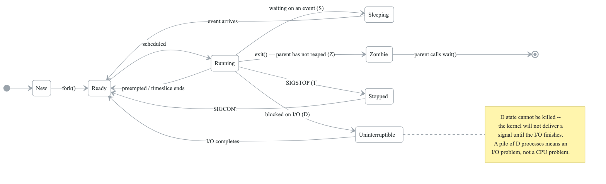
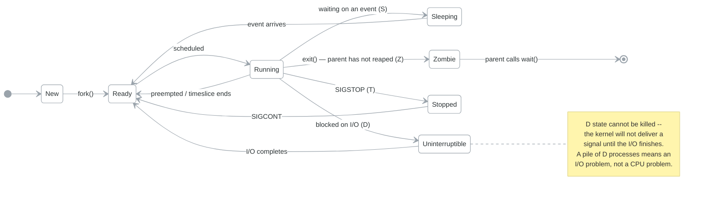

# Process Management

## Overview

Understanding how to manage processes is essential for system administration and troubleshooting. This module covers process concepts, signals, job control, and systemd service management.

## Learning Objectives

By the end of this module, you will be able to:
- Understand process hierarchy and states
- Monitor and manage running processes
- Use signals to control processes
- Manage background jobs
- Create and manage systemd services

---

## Process Fundamentals

### What is a Process?

**Process = Running instance of a program**

```
Process Components:
                      PROCESS
  PID (Process ID)        - Unique identifier
  PPID (Parent PID)       - Parent process ID
  UID/GID                 - User/Group running process
  State                   - Running, sleeping, etc.
  Priority/Nice           - Scheduling priority
  Memory                  - Virtual/resident memory
  File Descriptors        - Open files, sockets
  Environment Variables   - Inherited from parent
  Command Line            - Arguments passed
```


### Process Hierarchy

**Process tree**

- `systemd` (PID 1)
  - `sshd`
    - `sshd` (session)
      - `bash`
        - `vim`
        - `python script.py`
  - `nginx`
    - `nginx` (worker)
    - `nginx` (worker)
  - `dockerd`
    - `containerd`
  - `cron`

Every process except PID 1 has a parent. When a parent exits first its children become **orphans**,
and PID 1 adopts them — which is why a process whose `PPID` is 1 when you did not expect it is
evidence that something above it died.

A **zombie** is the opposite problem: the child has exited but the parent has not called `wait()` to
collect its exit status, so the entry stays in the table. You cannot kill a zombie; you fix the
parent.

### Process States

<!-- figure: generated from the Mermaid below by _shared/diagrams/embed-figures.py — do not edit the image -->


<details>
<summary>Diagram source (Mermaid)</summary>



</details>

---

## Viewing Processes

### ps Command

```bash
# Basic process list
ps

# All processes (BSD style)
ps aux

# All processes (Unix style)
ps -ef

# Custom format
ps -eo pid,ppid,user,%cpu,%mem,stat,cmd

# Process tree
ps auxf
ps -ejH

# Find specific process
ps aux | grep nginx
ps -C nginx -o pid,ppid,cmd

# Sort by memory
ps aux --sort=-%mem | head

# Sort by CPU
ps aux --sort=-%cpu | head
```

### Understanding ps Output

```
ps aux output:
USER       PID %CPU %MEM    VSZ   RSS TTY      STAT START   TIME COMMAND
root         1  0.0  0.1 169420 11524 ?        Ss   Jan14   0:05 /sbin/init
www-data  1234  0.5  2.0 456789 20480 ?        Sl   10:00   0:30 nginx: worker

Fields:
- USER: Process owner
- PID: Process ID
- %CPU: CPU usage percentage
- %MEM: Memory usage percentage
- VSZ: Virtual memory size (KB)
- RSS: Resident set size (actual RAM, KB)
- TTY: Terminal (? = no terminal)
- STAT: Process state
- START: Start time
- TIME: CPU time used
- COMMAND: Command with arguments

STAT codes:
S  = Sleeping
R  = Running
D  = Uninterruptible sleep
T  = Stopped
Z  = Zombie
s  = Session leader
l  = Multi-threaded
+  = Foreground process
<  = High priority
N  = Low priority
```

### top Command

```bash
# Interactive process viewer
top

# Batch mode (for scripts)
top -b -n 1

# Filter by user
top -u nginx

# Key commands in top:
# h     - Help
# q     - Quit
# k     - Kill process (enter PID)
# r     - Renice process
# M     - Sort by memory
# P     - Sort by CPU
# c     - Show full command
# 1     - Show individual CPUs
# f     - Choose fields
# z     - Color mode
# x     - Highlight sort column
```

### htop Command

```bash
# Install htop
sudo apt install htop
# or
sudo yum install htop

# Run htop
htop

# Features over top:
# - Color output
# - Mouse support
# - Horizontal and vertical scrolling
# - Process tree view
# - Search and filter
# - Easy kill/renice
# - CPU/Memory bars

# Key commands:
# F1    - Help
# F2    - Setup
# F3    - Search
# F4    - Filter
# F5    - Tree view
# F6    - Sort by
# F9    - Kill
# F10   - Quit
```

---

## Process Control

### Signals

| Signal | Number | Description |
|---|---|---|
| SIGHUP | 1 | Hangup (often: reload config) |
| SIGINT | 2 | Interrupt (Ctrl+C) |
| SIGQUIT | 3 | Quit with core dump |
| SIGKILL | 9 | Force kill (cannot be caught) |
| SIGTERM | 15 | Graceful termination (default) |
| SIGSTOP | 19 | Stop process (cannot be caught) |
| SIGCONT | 18 | Continue stopped process |
| SIGUSR1 | 10 | User-defined signal 1 |
| SIGUSR2 | 12 | User-defined signal 2 |


### kill Command

```bash
# Send signal to process
kill PID              # Send SIGTERM (15) - graceful
kill -15 PID          # Explicit SIGTERM
kill -9 PID           # SIGKILL - force kill
kill -HUP PID         # SIGHUP - often reloads config

# Kill by name
killall nginx         # Kill all nginx processes
pkill -f "python app" # Kill by pattern

# Kill process group
kill -TERM -PID       # Negative PID = process group

# List signals
kill -l

# Examples
kill 1234             # Gracefully stop PID 1234
kill -9 1234          # Force kill PID 1234
killall -9 python     # Force kill all python processes
pkill -u john         # Kill all processes owned by john
```

### Best Practices for Killing Processes

```bash
# 1. Always try SIGTERM first
kill PID
sleep 5

# 2. Check if process stopped
ps -p PID

# 3. If still running, try SIGKILL
kill -9 PID

# Why this order?
# SIGTERM allows:
# - Graceful shutdown
# - Cleanup of temporary files
# - Closing database connections
# - Saving state

# SIGKILL:
# - Immediate termination
# - No cleanup possible
# - May leave resources in bad state
```

---

## Job Control

### Background and Foreground

```bash
# Run command in background
command &
sleep 100 &

# View jobs
jobs
jobs -l   # With PIDs

# Bring to foreground
fg %1     # Job number 1
fg        # Most recent job

# Send to background
# First: Ctrl+Z to stop
# Then:
bg %1     # Continue in background
bg        # Most recent job

# Example workflow
$ vim file.txt
# Press Ctrl+Z
[1]+  Stopped                 vim file.txt

$ jobs
[1]+  Stopped                 vim file.txt

$ bg %1
[1]+ vim file.txt &

$ fg %1
# Back in vim
```

### nohup and disown

```bash
# Run command immune to hangups
nohup long-running-command &
# Output goes to nohup.out

# Redirect output
nohup command > output.log 2>&1 &

# disown a running job
command &
disown %1
# Now command survives terminal close

# disown all jobs
disown -a

# Alternative: screen or tmux (covered later)
```

---

## Systemd Service Management

### Understanding Systemd

**Systemd is the init system for modern Linux:**

```
                      SYSTEMD
  Init System       - PID 1, starts all services
  Service Manager   - Start/stop/restart services
  Logging          - journald for centralized logs
  Timers           - Replacement for cron
  Targets          - Group of units (like runlevels)
  Sockets          - Socket-based activation
```


### systemctl Commands

```bash
# Service management
systemctl start nginx      # Start service
systemctl stop nginx       # Stop service
systemctl restart nginx    # Restart service
systemctl reload nginx     # Reload config (if supported)
systemctl status nginx     # View status

# Enable/disable at boot
systemctl enable nginx     # Start at boot
systemctl disable nginx    # Don't start at boot
systemctl is-enabled nginx # Check if enabled

# View all services
systemctl list-units --type=service
systemctl list-units --type=service --state=running
systemctl list-units --type=service --state=failed

# View unit file
systemctl cat nginx

# Edit unit file (override)
systemctl edit nginx

# Reload systemd after changes
systemctl daemon-reload
```

### Unit File Structure

```ini
# Location: /etc/systemd/system/myapp.service

[Unit]
Description=My Application
Documentation=https://myapp.example.com/docs
After=network.target
Wants=redis.service
Requires=postgresql.service

[Service]
Type=simple
User=appuser
Group=appgroup
WorkingDirectory=/opt/myapp
Environment=NODE_ENV=production
EnvironmentFile=/etc/myapp/env
ExecStartPre=/opt/myapp/pre-start.sh
ExecStart=/opt/myapp/bin/server
ExecReload=/bin/kill -HUP $MAINPID
ExecStop=/bin/kill -TERM $MAINPID
Restart=on-failure
RestartSec=5
TimeoutStartSec=30
TimeoutStopSec=30

[Install]
WantedBy=multi-user.target
```

### Service Types

| Type | Description |
|---|---|
| simple | Default. Process started is main process |
| forking | Parent exits, child becomes main process |
| oneshot | Process exits after task (like scripts) |
| notify | Process sends notification when ready |
| dbus | Process acquires D-Bus name when ready |
| idle | Start after all jobs dispatched |


### Creating a Custom Service

```bash
# 1. Create the service file
sudo vim /etc/systemd/system/myapp.service

# 2. Add content:
[Unit]
Description=My Application Service
After=network.target

[Service]
Type=simple
User=www-data
WorkingDirectory=/var/www/myapp
ExecStart=/usr/bin/python3 /var/www/myapp/app.py
Restart=always
RestartSec=3

[Install]
WantedBy=multi-user.target

# 3. Reload systemd
sudo systemctl daemon-reload

# 4. Enable and start
sudo systemctl enable myapp
sudo systemctl start myapp

# 5. Verify
sudo systemctl status myapp
```

---

## Process Priority

### Nice Values

**Nice values: −20 to +19**

| Value | Meaning |
|---|---|
| **−20** | highest priority — runs most often |
| **0** | the default |
| **+19** | lowest priority — runs least often |

Regular users can only **increase** niceness (0 → 19); root can set any value. The name is the right
mnemonic: a "nicer" process yields more CPU to others.

```bash
nice -n 10 ./batch-job.sh      # start it deprioritised
renice -n 19 -p 12345          # deprioritise something already running
```

### Setting Priority

```bash
# Start process with nice value
nice -n 10 command           # Lower priority
nice -n -10 command          # Higher priority (root only)

# Change running process priority
renice 10 -p PID             # Set nice to 10
renice -10 -p PID            # Set nice to -10 (root only)

# Renice by user
renice 5 -u username

# View nice values
ps -eo pid,ni,comm
top  # NI column
```

---

## Monitoring and Troubleshooting

### Finding Resource Hogs

```bash
# CPU-intensive processes
ps aux --sort=-%cpu | head -10
top -o %CPU

# Memory-intensive processes
ps aux --sort=-%mem | head -10
top -o %MEM

# Processes with most open files
lsof | awk '{print $1}' | sort | uniq -c | sort -rn | head

# Processes with most threads
ps -eo nlwp,pid,comm | sort -rn | head

# Find zombie processes
ps aux | grep 'Z'
ps -eo stat,ppid,pid,comm | grep -w defunct
```

### Process Debugging

```bash
# Trace system calls
strace -p PID
strace -f command          # Follow forks
strace -e open command     # Only trace open() calls
strace -c command          # Summary statistics

# Trace library calls
ltrace command

# View open files
lsof -p PID

# View file descriptors
ls -l /proc/PID/fd

# View process maps
cat /proc/PID/maps

# View process limits
cat /proc/PID/limits
```

### Common Issues and Solutions

```bash
# 1. Zombie processes
# Zombies are waiting for parent to read exit status
# Fix: Kill or fix parent process
ps -eo stat,ppid,pid,comm | grep -w defunct
kill -CHLD PPID  # Signal parent to reap zombies

# 2. Process stuck in D state
# Uninterruptible sleep, usually waiting for I/O
# Can't be killed with SIGKILL
# Fix: Wait for I/O or reboot

# 3. Out of memory
# Check what's using memory
ps aux --sort=-%mem | head
# Check for memory leaks over time
watch -n 60 'ps aux --sort=-%mem | head'

# 4. Too many processes
# Check process limits
ulimit -u
# Count processes
ps aux | wc -l
```

---

## Practical Exercises

### Exercise 1: Process Monitoring

```bash
# 1. Start a background process
sleep 1000 &
echo $!  # Note the PID

# 2. Find it with ps
ps aux | grep sleep

# 3. View in top/htop
top -p $(pgrep sleep)

# 4. Check its details
cat /proc/$(pgrep sleep)/status

# 5. Kill it
kill $(pgrep sleep)
```

### Exercise 2: Signal Handling

```bash
# 1. Create a script that handles signals
cat > signal_test.sh << 'EOF'
#!/bin/bash
trap "echo 'Received SIGINT'; exit 0" SIGINT
trap "echo 'Received SIGTERM'; exit 0" SIGTERM
trap "echo 'Received SIGHUP'" SIGHUP

echo "PID: $$"
echo "Send me signals! (Ctrl+C to exit)"
while true; do
    sleep 1
done
EOF

chmod +x signal_test.sh

# 2. Run it
./signal_test.sh &

# 3. Send signals
kill -HUP $(pgrep signal_test)
kill -TERM $(pgrep signal_test)
```

### Exercise 3: Create a Systemd Service

```bash
# 1. Create a simple server script
sudo mkdir -p /opt/simpleserver
sudo cat > /opt/simpleserver/server.sh << 'EOF'
#!/bin/bash
while true; do
    echo "$(date): Server running" >> /var/log/simpleserver.log
    sleep 60
done
EOF
sudo chmod +x /opt/simpleserver/server.sh

# 2. Create service file
sudo cat > /etc/systemd/system/simpleserver.service << 'EOF'
[Unit]
Description=Simple Server
After=network.target

[Service]
Type=simple
ExecStart=/opt/simpleserver/server.sh
Restart=always

[Install]
WantedBy=multi-user.target
EOF

# 3. Enable and start
sudo systemctl daemon-reload
sudo systemctl enable simpleserver
sudo systemctl start simpleserver

# 4. Verify
sudo systemctl status simpleserver
tail -f /var/log/simpleserver.log
```

---

## Key Takeaways

1. **Every process has a parent** - Orphans get adopted by PID 1
2. **SIGTERM before SIGKILL** - Allow graceful shutdown when possible
3. **Systemd is central** - Modern service management depends on it
4. **Monitor regularly** - Know normal behavior to spot problems
5. **Nice controls sharing** - Higher nice = more willing to share CPU
6. **Zombies need parent attention** - The parent must reap them

---

## Next Module

[Shell Scripting Basics](./05-shell-scripting-basics.md)

<!-- feynman-check -->

---

## Feynman check

Close the file. Blank page, no notes. Explain each of these to a competent engineer who has never
used this tool — **under five minutes, no jargon you can't define on the spot:**

- Process Fundamentals
- Viewing Processes
- Process Control
- Job Control

**The gap is not what you forgot. It is where you used a word instead of a mechanism.**

| | |
|---|---|
| ✗ | *"The kernel manages processes."* |
| ✓ | *"A process is an entry in the kernel's task table with its own memory map and file-descriptor table. `fork()` copies it, `exec()` replaces the program inside it, and the parent must call `wait()` or the entry stays behind as a zombie."* |

**Trace it:** `ls -l /etc` → characters on your terminal. Name every syscall and every kernel structure between the keypress and the output.

Stop at the first component you cannot name. Reopen this file and read **only** that.

**Go deeper — only once the gap has a name:** [`man 7 namespaces`](https://man7.org/linux/man-pages/man7/namespaces.7.html) and the [LWN namespaces series](https://lwn.net/Articles/531114/) — the primary sources, not summaries of them.
Full list per domain: [`SOURCES.md`](../SOURCES.md#linux-networking)

→ Protocol, the three levels of knowing, and worked examples: [`MASTERY.md`](../MASTERY.md)

<!-- /feynman-check -->
