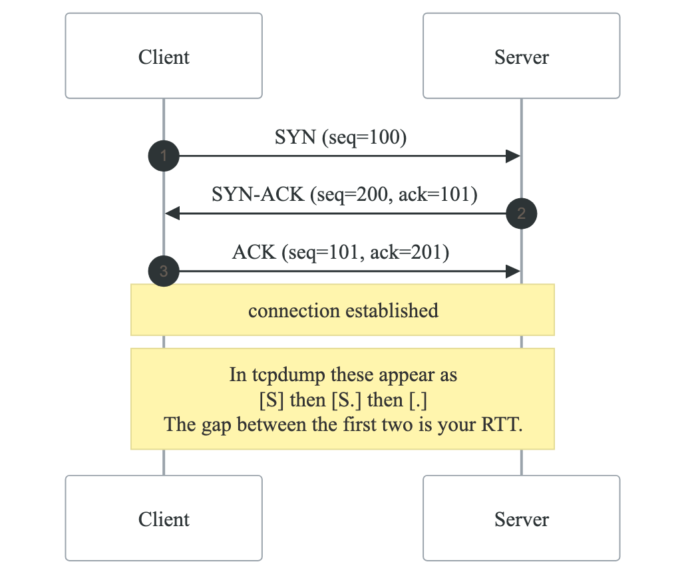
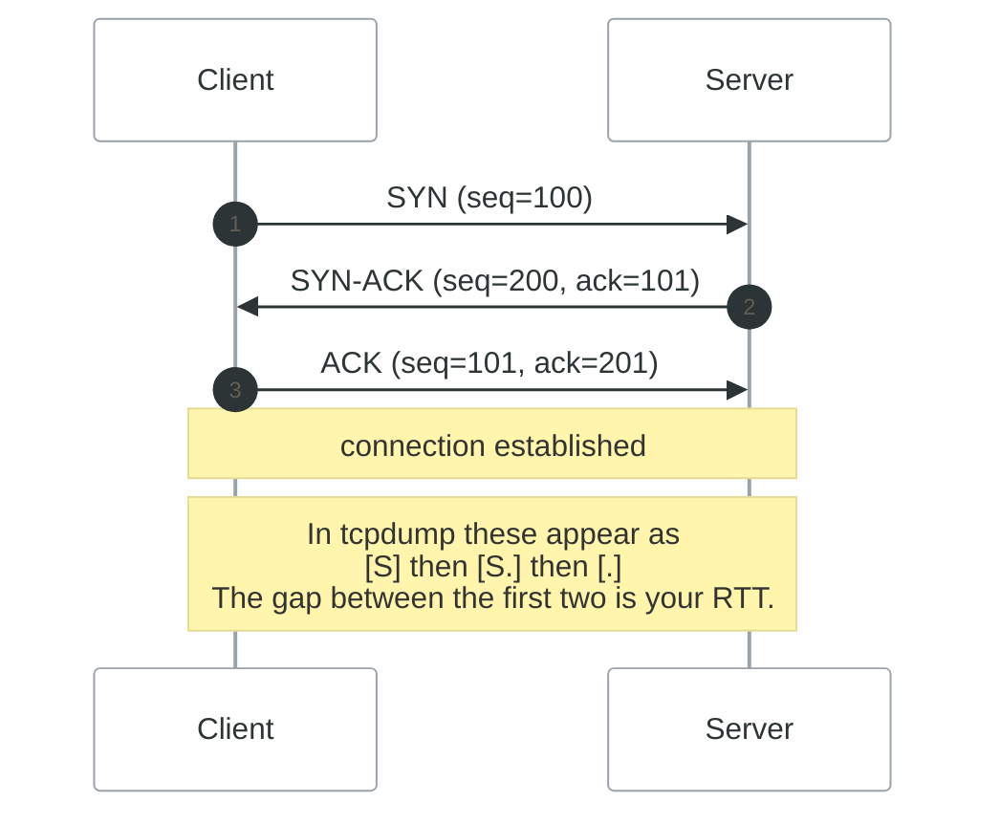
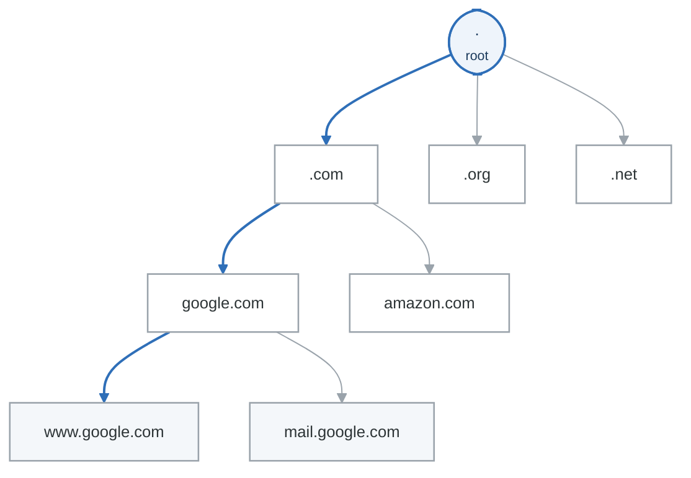
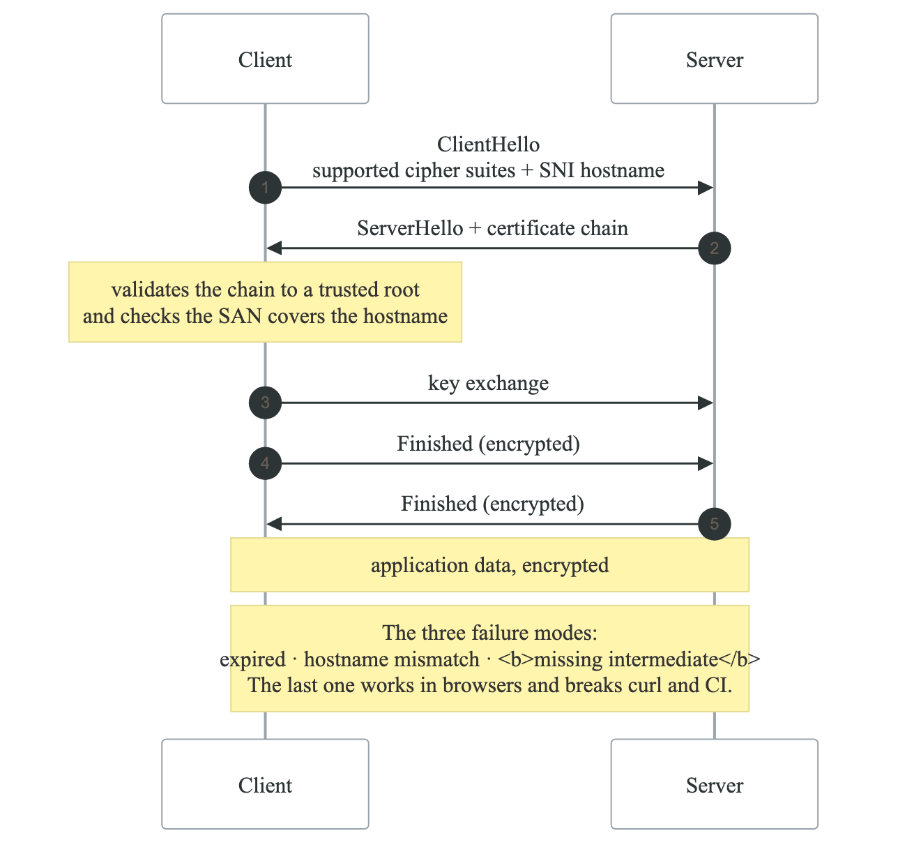
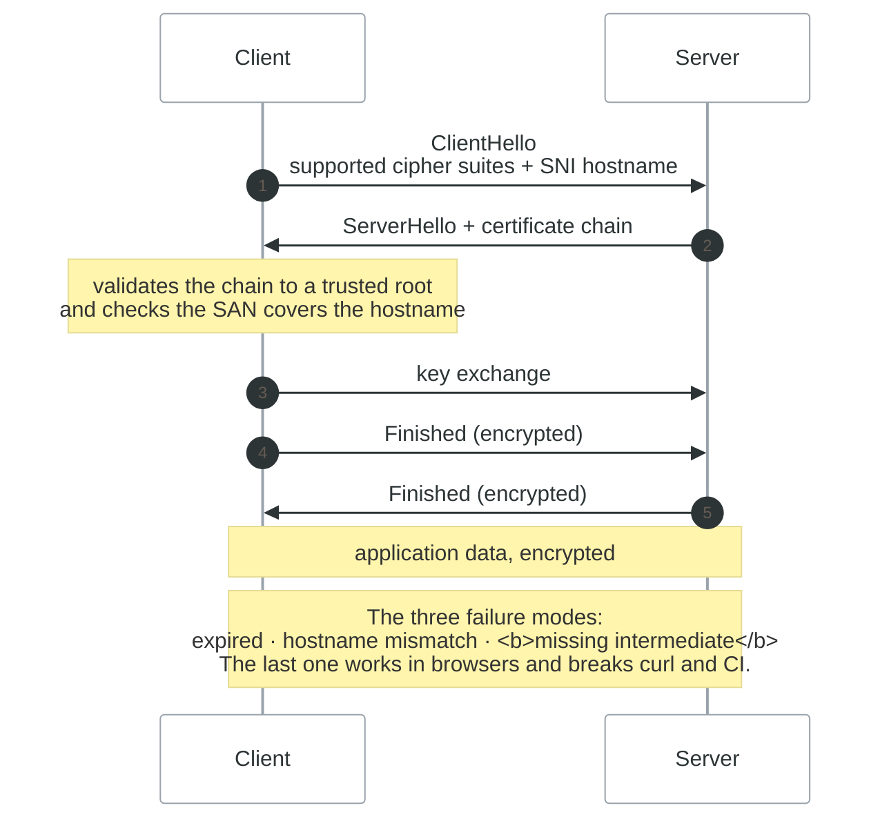

# Networking Fundamentals

## Overview

Understanding networking is essential for DevOps engineers. This module covers the TCP/IP model, DNS, HTTP/HTTPS, and network troubleshooting tools.

## Learning Objectives

By the end of this module, you will be able to:
- Explain the TCP/IP and OSI network models
- Understand IP addressing and subnetting
- Configure and troubleshoot DNS
- Analyze HTTP/HTTPS traffic
- Use network diagnostic tools

---

## Network Models

### OSI vs TCP/IP Model

| OSI Model | TCP/IP Model |
|---|---|
| 7. Application  (HTTP, SSH) |  |
| 6. Presentation (SSL, TLS) | Application |
| 5. Session      (Sockets) | (HTTP, SSH, DNS, FTP) |
| 4. Transport    (TCP, UDP) | Transport (TCP, UDP) |
| 3. Network      (IP, ICMP) | Internet (IP, ICMP) |
| 2. Data Link    (Ethernet, WiFi) |  |
| 1. Physical     (Cables, Radio) | Network Access |


### Data Encapsulation

**Encapsulation, layer by layer**

| Layer | What the packet looks like |
|---|---|
| Application | `[ DATA ]` |
| Transport | `[ TCP/UDP header ][ DATA ]` |
| Network | `[ IP header ][ TCP/UDP header ][ DATA ]` |
| Data link | `[ ETH header ][ IP header ][ TCP/UDP header ][ DATA ][ FCS ]` |
| Physical | Bits on the wire |

Each layer treats everything above it as opaque payload and prepends its own header. Reading a packet
capture is doing this in reverse — and it is why `tcpdump` can show you an IP address on a packet
whose payload it cannot decode.

---

## IP Addressing

### IPv4 Addresses

**IPv4 address structure**

```text
192 . 168 .  1  . 100
 │     │     │     └── fourth octet
 │     │     └── third octet
 │     └── second octet
 └── first octet
```

Four octets, 8 bits each, **32 bits total** — 4,294,967,296 possible addresses. Each octet is 0–255.

Which part is "network" and which is "host" is **not** fixed by the dots — it is decided by the
subnet mask. In `192.168.1.100/24` the first three octets are the network and the last is the host;
in `/26` the split falls in the middle of the fourth octet. Reading an address without its mask tells
you almost nothing.

### IP Address Classes

**IPv4 address classes** (historical — CIDR replaced this, but the vocabulary persists)

| Class | Range | Default mask | Purpose |
|---|---|---|---|
| A | 1.0.0.0 – 126.0.0.0 | 255.0.0.0 (`/8`) | Large networks |
| B | 128.0.0.0 – 191.255.0.0 | 255.255.0.0 (`/16`) | Medium networks |
| C | 192.0.0.0 – 223.255.255.0 | 255.255.255.0 (`/24`) | Small networks |
| D | 224.0.0.0 – 239.255.255.255 | n/a | Multicast |
| E | 240.0.0.0 – 255.255.255.255 | n/a | Reserved |

**Private ranges (RFC 1918)** — memorize these three

| Range | CIDR | Addresses |
|---|---|---|
| 10.0.0.0 – 10.255.255.255 | `10.0.0.0/8` | ~16M |
| 172.16.0.0 – 172.31.255.255 | `172.16.0.0/12` | ~1M |
| 192.168.0.0 – 192.168.255.255 | `192.168.0.0/16` | ~65K |

**Special addresses**

| Address | Meaning |
|---|---|
| `127.0.0.0/8` | Loopback |
| `169.254.0.0/16` | Link-local (APIPA) — **and the AWS instance metadata service lives at 169.254.169.254** |
| `0.0.0.0` | Default route, or "any address" |
| `255.255.255.255` | Broadcast |

### Subnetting

**CIDR notation**

`192.168.1.0/24` means the network `192.168.1.0` with the mask `255.255.255.0` — the `/24` is simply
"the first 24 bits are the network."

| CIDR | Subnet mask | Addresses | Usable hosts |
|---|---|---|---|
| `/8` | 255.0.0.0 | 16,777,216 | 16,777,214 |
| `/16` | 255.255.0.0 | 65,536 | 65,534 |
| `/24` | 255.255.255.0 | 256 | 254 |
| `/25` | 255.255.255.128 | 128 | 126 |
| `/26` | 255.255.255.192 | 64 | 62 |
| `/27` | 255.255.255.224 | 32 | 30 |
| `/28` | 255.255.255.240 | 16 | 14 |
| `/29` | 255.255.255.248 | 8 | 6 |
| `/30` | 255.255.255.252 | 4 | 2 |
| `/32` | 255.255.255.255 | 1 | 1 (a single host) |

Two addresses in every subnet are spoken for — the network address and the broadcast address — which
is why "usable" is always two fewer. `/31` is the exception, reserved for point-to-point links.

**Worked example — `192.168.1.0/26`**

| | |
|---|---|
| Network | 192.168.1.0 |
| First host | 192.168.1.1 |
| Last host | 192.168.1.62 |
| Broadcast | 192.168.1.63 |
| Usable | 62 hosts |

### IPv6 Basics

**IPv6 Address Structure:**

  2001:0db8:85a3:0000:0000:8a2e:0370:7334
  - 128 bits (8 groups of 4 hex digits)
  - Can abbreviate: 2001:db8:85a3::8a2e:370:7334
  - :: represents consecutive zero groups
  Special addresses:
  ::1              - Loopback (localhost)
  fe80::/10        - Link-local
  fc00::/7         - Unique local (private)
  2000::/3         - Global unicast


---

## TCP and UDP

### TCP (Transmission Control Protocol)

<!-- figure: generated from the Mermaid below by _shared/diagrams/embed-figures.py — do not edit the image -->


<details>
<summary>Diagram source (Mermaid)</summary>



</details>

### UDP (User Datagram Protocol)

**UDP Characteristics:**

```
- Connectionless
- Unreliable (no guarantee)
- Unordered
- No flow control
- Low overhead
- Used by: DNS, DHCP, VoIP, Streaming

UDP Packet:
 Source Port │ Destination Port
 Length      │ Checksum
           Data
```


### Common Ports

| Port | Service | Protocol |
|---|---|---|
| 20,21 | FTP | TCP |
| 22 | SSH | TCP |
| 23 | Telnet | TCP |
| 25 | SMTP | TCP |
| 53 | DNS | TCP/UDP |
| 67,68 | DHCP | UDP |
| 80 | HTTP | TCP |
| 443 | HTTPS | TCP |
| 110 | POP3 | TCP |
| 143 | IMAP | TCP |
| 3306 | MySQL | TCP |
| 5432 | PostgreSQL | TCP |
| 6379 | Redis | TCP |
| 27017 | MongoDB | TCP |


---

## DNS (Domain Name System)

### DNS Hierarchy

<!-- figure: generated from the Mermaid below by _shared/diagrams/embed-figures.py — do not edit the image -->


<details>
<summary>Diagram source (Mermaid)</summary>



</details>

### DNS Record Types

**DNS record types**

| Record | Purpose |
|---|---|
| `A` | Maps a hostname to an IPv4 address |
| `AAAA` | Maps a hostname to an IPv6 address |
| `CNAME` | Alias to another hostname |
| `MX` | Mail exchange server |
| `TXT` | Free text — SPF, DKIM, domain verification |
| `NS` | Name server for the domain |
| `SOA` | Start of authority — the zone's primary and its timers |
| `PTR` | Reverse DNS, address to hostname |
| `SRV` | Service location — host and port for a named service |
| `CAA` | Which certificate authorities may issue for this domain |

**Example zone entries**

```dns
example.com.     IN  A      93.184.216.34
www.example.com. IN  CNAME  example.com.
example.com.     IN  MX     10 mail.example.com.
example.com.     IN  TXT    "v=spf1 include:_spf.google.com ~all"
```

A `CNAME` cannot coexist with any other record for the same name, which is why you cannot put one at
the zone apex — the apex must carry `SOA` and `NS`. That is the reason cloud providers invented
alias records (Route 53 alias, Cloudflare CNAME flattening).

### DNS Commands

```bash
# Query DNS
nslookup example.com
nslookup -type=MX example.com

# Detailed DNS queries
dig example.com
dig example.com MX
dig example.com +short
dig @8.8.8.8 example.com  # Specific DNS server
dig +trace example.com     # Show resolution path

# Reverse DNS
dig -x 93.184.216.34

# host command
host example.com
host -t MX example.com

# Check DNS configuration
cat /etc/resolv.conf

# Clear DNS cache (systemd-resolved)
sudo systemd-resolve --flush-caches
# or
sudo resolvectl flush-caches
```

### DNS Configuration

```bash
# /etc/resolv.conf
nameserver 8.8.8.8
nameserver 8.8.4.4
search example.com

# /etc/hosts (local override)
127.0.0.1   localhost
192.168.1.100   myserver.local myserver

# /etc/nsswitch.conf (resolution order)
hosts: files dns
# Checks /etc/hosts first, then DNS
```

---

## HTTP and HTTPS

### HTTP Request/Response

**An HTTP/1.1 exchange, in full**

Request:

```http
GET /path/to/resource HTTP/1.1
Host: example.com
User-Agent: Mozilla/5.0
Accept: text/html
Accept-Language: en-US
Connection: keep-alive

[body, for POST and PUT]
```

Response:

```http
HTTP/1.1 200 OK
Content-Type: text/html; charset=utf-8
Content-Length: 1234
Cache-Control: max-age=3600
Connection: keep-alive

<!doctype html>…
```

`Host:` is what makes name-based virtual hosting work — and it is why `curl` against an IP returns
the wrong site unless you pass `-H 'Host: …'`.

### HTTP Methods

| Method | Purpose |
|---|---|
| GET | Retrieve resource |
| POST | Create new resource |
| PUT | Update/replace resource |
| PATCH | Partial update |
| DELETE | Delete resource |
| HEAD | GET without body (headers only) |
| OPTIONS | Supported methods |


### HTTP Status Codes

| Code | Meaning |
|---|---|
| 1xx | Informational |
| 2xx | Success |
| 200 | OK |
| 201 | Created |
| 204 | No Content |
| 3xx | Redirection |
| 301 | Moved Permanently |
| 302 | Found (Temporary Redirect) |
| 304 | Not Modified |
| 4xx | Client Error |
| 400 | Bad Request |
| 401 | Unauthorized |
| 403 | Forbidden |
| 404 | Not Found |
| 429 | Too Many Requests |
| 5xx | Server Error |
| 500 | Internal Server Error |
| 502 | Bad Gateway |
| 503 | Service Unavailable |
| 504 | Gateway Timeout |


### HTTPS and TLS

<!-- figure: generated from the Mermaid below by _shared/diagrams/embed-figures.py — do not edit the image -->


<details>
<summary>Diagram source (Mermaid)</summary>



</details>

### HTTP Testing with curl

```bash
# Simple GET
curl https://example.com

# Show headers
curl -I https://example.com
curl -i https://example.com    # Headers + body

# Verbose output
curl -v https://example.com

# POST request
curl -X POST https://api.example.com/data \
     -H "Content-Type: application/json" \
     -d '{"key": "value"}'

# With authentication
curl -u username:password https://api.example.com
curl -H "Authorization: Bearer TOKEN" https://api.example.com

# Follow redirects
curl -L https://example.com

# Download file
curl -O https://example.com/file.zip
curl -o output.zip https://example.com/file.zip

# Timing information
curl -w "@curl-format.txt" -o /dev/null -s https://example.com

# curl-format.txt:
#    time_namelookup:  %{time_namelookup}\n
#       time_connect:  %{time_connect}\n
#    time_appconnect:  %{time_appconnect}\n
#   time_pretransfer:  %{time_pretransfer}\n
#      time_redirect:  %{time_redirect}\n
# time_starttransfer:  %{time_starttransfer}\n
#                     ----------\n
#         time_total:  %{time_total}\n
```

---

## Network Troubleshooting

### Connectivity Testing

```bash
# Ping (ICMP)
ping -c 4 example.com
ping -c 4 8.8.8.8

# Traceroute
traceroute example.com
traceroute -n example.com    # No DNS lookup
mtr example.com              # Continuous traceroute

# Test TCP port
nc -zv example.com 443
telnet example.com 80
timeout 5 bash -c '</dev/tcp/example.com/80 && echo open'
```

### Network Statistics

```bash
# ss (socket statistics)
ss -tuln              # TCP/UDP listening ports
ss -tulnp             # With process names
ss -t state established   # Established connections
ss -s                 # Summary statistics

# netstat (legacy but common)
netstat -tuln
netstat -tulnp
netstat -an | grep LISTEN

# Connection counts
ss -t | awk '{print $1}' | sort | uniq -c
netstat -ant | awk '{print $6}' | sort | uniq -c
```

### Packet Capture

```bash
# tcpdump
sudo tcpdump -i eth0
sudo tcpdump -i eth0 port 80
sudo tcpdump -i eth0 host 192.168.1.100
sudo tcpdump -i eth0 -w capture.pcap
sudo tcpdump -r capture.pcap

# Common filters
sudo tcpdump -i eth0 'port 80 or port 443'
sudo tcpdump -i eth0 'src host 10.0.0.1'
sudo tcpdump -i eth0 'tcp[tcpflags] & (tcp-syn) != 0'

# Wireshark (GUI) for pcap analysis
wireshark capture.pcap
```

---

## Practical Exercises

### Exercise 1: DNS Investigation

```bash
#!/bin/bash
# DNS investigation script

DOMAIN=${1:-example.com}

echo "=== DNS Investigation for $DOMAIN ==="

echo -e "\n--- A Records ---"
dig +short $DOMAIN A

echo -e "\n--- AAAA Records ---"
dig +short $DOMAIN AAAA

echo -e "\n--- MX Records ---"
dig +short $DOMAIN MX

echo -e "\n--- NS Records ---"
dig +short $DOMAIN NS

echo -e "\n--- TXT Records ---"
dig +short $DOMAIN TXT

echo -e "\n--- DNS Trace ---"
dig +trace +nodnssec $DOMAIN | tail -20
```

### Exercise 2: Port Scanner

```bash
#!/bin/bash
# Simple port scanner

HOST=${1:-localhost}
PORTS=${2:-"22 80 443 3306 5432"}

echo "Scanning $HOST..."

for PORT in $PORTS; do
    timeout 1 bash -c "</dev/tcp/$HOST/$PORT" 2>/dev/null
    if [ $? -eq 0 ]; then
        echo "Port $PORT: OPEN"
    else
        echo "Port $PORT: closed"
    fi
done
```

### Exercise 3: HTTP Health Check

```bash
#!/bin/bash
# HTTP endpoint health check

ENDPOINTS=(
    "https://google.com"
    "https://github.com"
    "https://example.com"
)

for URL in "${ENDPOINTS[@]}"; do
    START=$(date +%s%N)
    STATUS=$(curl -s -o /dev/null -w "%{http_code}" "$URL")
    END=$(date +%s%N)
    DURATION=$(( (END - START) / 1000000 ))

    if [ "$STATUS" -eq 200 ]; then
        echo "✓ $URL - ${DURATION}ms"
    else
        echo "✗ $URL - Status: $STATUS"
    fi
done
```

---

## Key Takeaways

1. **Know the models** - TCP/IP layers help troubleshoot issues
2. **Subnetting matters** - Understand CIDR for cloud networking
3. **DNS is critical** - Many issues start with DNS
4. **TCP vs UDP** - Know when each is used
5. **HTTP status codes** - Essential for API troubleshooting
6. **Use the right tools** - ping, dig, curl, ss, tcpdump

---

## Next Module

[Linux Networking](./09-linux-networking.md)

<!-- feynman-check -->

---

## Feynman check

Close the file. Blank page, no notes. Explain each of these to a competent engineer who has never
used this tool — **under five minutes, no jargon you can't define on the spot:**

- Network Models
- IP Addressing
- TCP and UDP
- DNS (Domain Name System)

**The gap is not what you forgot. It is where you used a word instead of a mechanism.**

| | |
|---|---|
| ✗ | *"The kernel manages processes."* |
| ✓ | *"A process is an entry in the kernel's task table with its own memory map and file-descriptor table. `fork()` copies it, `exec()` replaces the program inside it, and the parent must call `wait()` or the entry stays behind as a zombie."* |

**Trace it:** `ls -l /etc` → characters on your terminal. Name every syscall and every kernel structure between the keypress and the output.

Stop at the first component you cannot name. Reopen this file and read **only** that.

**Go deeper — only once the gap has a name:** [`man 7 namespaces`](https://man7.org/linux/man-pages/man7/namespaces.7.html) and the [LWN namespaces series](https://lwn.net/Articles/531114/) — the primary sources, not summaries of them.
Full list per domain: [`SOURCES.md`](../SOURCES.md#linux-networking)

→ Protocol, the three levels of knowing, and worked examples: [`MASTERY.md`](../MASTERY.md)

<!-- /feynman-check -->
