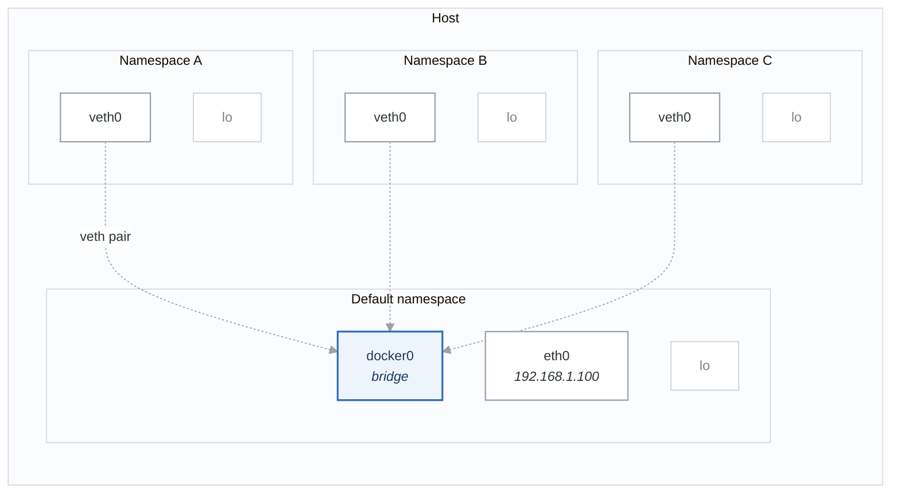

# Linux Networking

## Overview

This module covers Linux-specific networking configuration including network interfaces, routing, iptables/nftables firewalls, and network namespaces.

## Learning Objectives

By the end of this module, you will be able to:
- Configure network interfaces
- Manage routing tables
- Configure iptables and nftables firewalls
- Work with network namespaces
- Troubleshoot network issues

---

## Network Interfaces

### Viewing Interface Information

```bash
# Modern command (ip)
ip addr                   # All interfaces
ip addr show eth0         # Specific interface
ip link show              # Link layer info
ip -s link                # With statistics

# Legacy commands (still useful)
ifconfig                  # All interfaces
ifconfig eth0             # Specific interface

# Interface naming conventions
eth0, eth1       # Traditional Ethernet
ens33, ens192    # Predictable network interface names
enp0s3           # PCI-based naming
wlan0            # Wireless
lo               # Loopback
docker0          # Docker bridge
virbr0           # Libvirt bridge
```

### Interface Configuration

```bash
# Bring interface up/down
sudo ip link set eth0 up
sudo ip link set eth0 down

# Assign IP address
sudo ip addr add 192.168.1.100/24 dev eth0
sudo ip addr del 192.168.1.100/24 dev eth0

# Set MTU
sudo ip link set eth0 mtu 9000

# View/change MAC address
ip link show eth0 | grep ether
sudo ip link set eth0 address 00:11:22:33:44:55
```

### Persistent Configuration

#### Netplan (Ubuntu 18.04+)

```yaml
# /etc/netplan/01-netcfg.yaml
network:
  version: 2
  renderer: networkd
  ethernets:
    eth0:
      dhcp4: true

    eth1:
      addresses:
        - 192.168.1.100/24
      gateway4: 192.168.1.1
      nameservers:
        addresses:
          - 8.8.8.8
          - 8.8.4.4
```

```bash
# Apply configuration
sudo netplan apply
sudo netplan try  # Apply with automatic rollback
```

#### NetworkManager (RHEL/CentOS)

```bash
# Using nmcli
nmcli device status
nmcli connection show
nmcli connection show "Wired connection 1"

# Configure static IP
nmcli connection modify "Wired connection 1" \
    ipv4.addresses "192.168.1.100/24" \
    ipv4.gateway "192.168.1.1" \
    ipv4.dns "8.8.8.8,8.8.4.4" \
    ipv4.method "manual"

nmcli connection up "Wired connection 1"

# Configure DHCP
nmcli connection modify "Wired connection 1" \
    ipv4.method "auto"
```

#### /etc/network/interfaces (Debian)

```bash
# /etc/network/interfaces
auto lo
iface lo inet loopback

auto eth0
iface eth0 inet dhcp

auto eth1
iface eth1 inet static
    address 192.168.1.100
    netmask 255.255.255.0
    gateway 192.168.1.1
    dns-nameservers 8.8.8.8 8.8.4.4
```

```bash
# Apply changes
sudo systemctl restart networking
# or
sudo ifdown eth1 && sudo ifup eth1
```

---

## Routing

### Viewing Routes

```bash
# View routing table
ip route
ip route show
ip -6 route          # IPv6 routes
route -n             # Legacy command

# Example output:
# default via 192.168.1.1 dev eth0 proto dhcp metric 100
# 192.168.1.0/24 dev eth0 proto kernel scope link src 192.168.1.100
# 172.17.0.0/16 dev docker0 proto kernel scope link src 172.17.0.1
```

### Managing Routes

```bash
# Add route
sudo ip route add 10.0.0.0/8 via 192.168.1.1
sudo ip route add 10.0.0.0/8 via 192.168.1.1 dev eth0

# Delete route
sudo ip route del 10.0.0.0/8

# Change default gateway
sudo ip route del default
sudo ip route add default via 192.168.1.1

# Add route to specific host
sudo ip route add 10.10.10.10/32 via 192.168.1.1
```

### Enable IP Forwarding

```bash
# Check current setting
cat /proc/sys/net/ipv4/ip_forward

# Enable temporarily
sudo sysctl -w net.ipv4.ip_forward=1

# Enable permanently
# Add to /etc/sysctl.conf:
net.ipv4.ip_forward = 1

# Apply
sudo sysctl -p
```

### Policy-Based Routing

```bash
# Create routing table
echo "100 custom" >> /etc/iproute2/rt_tables

# Add rule to use custom table
sudo ip rule add from 192.168.2.0/24 table custom
sudo ip route add default via 192.168.2.1 table custom

# View rules
ip rule list
```

---

## iptables Firewall

### iptables Basics

**iptables: tables, chains, targets**

Three nouns, and they nest. A **table** decides what kind of work is being done, a **chain** decides
*when* in the packet's journey the rules run, and a **target** decides what happens to a packet that
matches.

| Table | What it is for | Chains it has |
|---|---|---|
| `filter` | Allow or block. The default table — `iptables -A INPUT ...` means this one. | `INPUT`, `FORWARD`, `OUTPUT` |
| `nat` | Rewrite addresses and ports | `PREROUTING`, `POSTROUTING`, `OUTPUT` |
| `mangle` | Alter packet fields (TOS, TTL, marks) | all five |

| Chain | Sees | Runs |
|---|---|---|
| `PREROUTING` | Every arriving packet | Before the routing decision |
| `INPUT` | Packets addressed to this host | After routing says "local" |
| `FORWARD` | Packets routed *through* this host | After routing says "elsewhere" |
| `OUTPUT` | Packets this host generates | Before the routing decision |
| `POSTROUTING` | Every departing packet | After routing, on the way out |

| Target | Effect |
|---|---|
| `ACCEPT` | Let the packet through |
| `DROP` | Discard silently — the sender sees a timeout |
| `REJECT` | Discard and send an ICMP error — the sender sees a refusal immediately |
| `LOG` | Write to the kernel log and **keep evaluating** — it is not a decision |
| `SNAT` / `MASQUERADE` | Rewrite the source address (`MASQUERADE` picks it from the interface) |
| `DNAT` | Rewrite the destination address — this is port forwarding |

The difference between `DROP` and `REJECT` is an operational one: `DROP` makes a port scan slow and
makes your own debugging slow in exactly the same way.

### Basic iptables Commands

```bash
# View rules
sudo iptables -L                    # List all rules
sudo iptables -L -n -v              # Numeric, verbose
sudo iptables -L INPUT -n --line-numbers

# View NAT rules
sudo iptables -t nat -L -n -v

# Add rules
sudo iptables -A INPUT -p tcp --dport 22 -j ACCEPT
sudo iptables -A INPUT -p tcp --dport 80 -j ACCEPT
sudo iptables -A INPUT -p tcp --dport 443 -j ACCEPT

# Insert rule at position
sudo iptables -I INPUT 1 -p tcp --dport 22 -j ACCEPT

# Delete rule
sudo iptables -D INPUT -p tcp --dport 80 -j ACCEPT
sudo iptables -D INPUT 3    # By line number

# Flush all rules
sudo iptables -F
sudo iptables -t nat -F
```

### Common iptables Rules

```bash
# Allow established connections
sudo iptables -A INPUT -m state --state ESTABLISHED,RELATED -j ACCEPT

# Allow loopback
sudo iptables -A INPUT -i lo -j ACCEPT
sudo iptables -A OUTPUT -o lo -j ACCEPT

# Allow SSH
sudo iptables -A INPUT -p tcp --dport 22 -j ACCEPT

# Allow HTTP/HTTPS
sudo iptables -A INPUT -p tcp --dport 80 -j ACCEPT
sudo iptables -A INPUT -p tcp --dport 443 -j ACCEPT

# Allow ping
sudo iptables -A INPUT -p icmp --icmp-type echo-request -j ACCEPT

# Log dropped packets
sudo iptables -A INPUT -j LOG --log-prefix "iptables dropped: "

# Default policy
sudo iptables -P INPUT DROP
sudo iptables -P FORWARD DROP
sudo iptables -P OUTPUT ACCEPT

# Rate limiting
sudo iptables -A INPUT -p tcp --dport 22 -m limit --limit 3/min -j ACCEPT
```

### NAT with iptables

```bash
# Source NAT (Masquerading)
# For internet sharing through gateway
sudo iptables -t nat -A POSTROUTING -o eth0 -j MASQUERADE

# Destination NAT (Port forwarding)
# Forward port 8080 to internal server
sudo iptables -t nat -A PREROUTING -i eth0 -p tcp --dport 8080 \
    -j DNAT --to-destination 192.168.1.100:80
sudo iptables -A FORWARD -p tcp -d 192.168.1.100 --dport 80 -j ACCEPT
```

### Saving and Restoring Rules

```bash
# Save rules
sudo iptables-save > /etc/iptables/rules.v4
sudo ip6tables-save > /etc/iptables/rules.v6

# Restore rules
sudo iptables-restore < /etc/iptables/rules.v4

# Persistent on Ubuntu/Debian
sudo apt install iptables-persistent
sudo netfilter-persistent save
sudo netfilter-persistent reload

# Persistent on RHEL/CentOS
sudo service iptables save
# or use firewalld
```

---

## nftables (Modern Replacement)

### nftables Basics

```bash
# nftables is the replacement for iptables
# Uses a unified syntax

# View current rules
sudo nft list ruleset

# View specific table
sudo nft list table inet filter

# Flush all rules
sudo nft flush ruleset
```

### nftables Configuration

```bash
# /etc/nftables.conf
#!/usr/sbin/nft -f

flush ruleset

table inet filter {
    chain input {
        type filter hook input priority 0; policy drop;

        # Allow established connections
        ct state established,related accept

        # Allow loopback
        iif lo accept

        # Allow SSH
        tcp dport 22 accept

        # Allow HTTP/HTTPS
        tcp dport { 80, 443 } accept

        # Allow ICMP
        ip protocol icmp accept
        ip6 nexthdr icmpv6 accept

        # Log dropped
        log prefix "nftables dropped: " drop
    }

    chain forward {
        type filter hook forward priority 0; policy drop;
    }

    chain output {
        type filter hook output priority 0; policy accept;
    }
}
```

```bash
# Apply configuration
sudo nft -f /etc/nftables.conf

# Enable on boot
sudo systemctl enable nftables
```

### nftables NAT

```bash
table ip nat {
    chain prerouting {
        type nat hook prerouting priority -100;
        # Port forward 8080 -> 192.168.1.100:80
        tcp dport 8080 dnat to 192.168.1.100:80
    }

    chain postrouting {
        type nat hook postrouting priority 100;
        # Masquerade for outbound NAT
        oifname "eth0" masquerade
    }
}
```

---

## Network Namespaces

### Understanding Namespaces

<!-- figure: generated from the Mermaid below by _shared/diagrams/embed-figures.py — do not edit the image -->


<details>
<summary>Diagram source (Mermaid)</summary>



</details>

### Managing Namespaces

```bash
# Create namespace
sudo ip netns add ns1
sudo ip netns add ns2

# List namespaces
ip netns list

# Run command in namespace
sudo ip netns exec ns1 ip addr
sudo ip netns exec ns1 bash

# Delete namespace
sudo ip netns del ns1
```

### Connecting Namespaces

```bash
# Create veth pair
sudo ip link add veth0 type veth peer name veth1

# Move interfaces to namespaces
sudo ip link set veth0 netns ns1
sudo ip link set veth1 netns ns2

# Configure interfaces
sudo ip netns exec ns1 ip addr add 10.0.0.1/24 dev veth0
sudo ip netns exec ns1 ip link set veth0 up
sudo ip netns exec ns1 ip link set lo up

sudo ip netns exec ns2 ip addr add 10.0.0.2/24 dev veth1
sudo ip netns exec ns2 ip link set veth1 up
sudo ip netns exec ns2 ip link set lo up

# Test connectivity
sudo ip netns exec ns1 ping 10.0.0.2
```

### Bridge Between Namespaces and Host

```bash
# Create bridge
sudo ip link add br0 type bridge
sudo ip link set br0 up
sudo ip addr add 10.0.0.254/24 dev br0

# Create veth pair
sudo ip link add veth-ns1 type veth peer name veth-br1

# Connect to namespace
sudo ip link set veth-ns1 netns ns1
sudo ip link set veth-br1 master br0

# Configure
sudo ip netns exec ns1 ip addr add 10.0.0.1/24 dev veth-ns1
sudo ip netns exec ns1 ip link set veth-ns1 up
sudo ip netns exec ns1 ip route add default via 10.0.0.254

sudo ip link set veth-br1 up

# Now ns1 can reach host network via bridge
```

---

## Network Troubleshooting

### Diagnostic Commands

```bash
# Check interface status
ip link show
ip addr show

# Check routing
ip route show
ip route get 8.8.8.8

# Check connectivity
ping -c 4 8.8.8.8
traceroute 8.8.8.8
mtr 8.8.8.8

# Check DNS
dig example.com
nslookup example.com
host example.com

# Check listening ports
ss -tuln
netstat -tuln

# Check connections
ss -tunp
netstat -tunp

# Check firewall
sudo iptables -L -n -v
sudo nft list ruleset
```

### Common Issues and Solutions

```bash
# 1. Interface not getting IP
# Check DHCP client
sudo dhclient -v eth0

# 2. Cannot reach gateway
# Check ARP table
ip neigh show
# Clear and retry
ip neigh flush dev eth0

# 3. DNS not working
# Check /etc/resolv.conf
cat /etc/resolv.conf
# Test with specific server
dig @8.8.8.8 example.com

# 4. Firewall blocking
# Temporarily disable
sudo iptables -P INPUT ACCEPT
sudo iptables -F
# Then test

# 5. MTU issues (especially with VPN/tunnels)
ping -c 4 -M do -s 1472 target.com
# Reduce until it works

# 6. Check for packet loss
mtr --report target.com
```

---

## Practical Exercises

### Exercise 1: Network Namespace Lab

```bash
#!/bin/bash
# Create isolated network with two namespaces

# Create namespaces
sudo ip netns add client
sudo ip netns add server

# Create veth pairs
sudo ip link add veth-client type veth peer name veth-server

# Move to namespaces
sudo ip link set veth-client netns client
sudo ip link set veth-server netns server

# Configure client
sudo ip netns exec client ip addr add 10.0.0.1/24 dev veth-client
sudo ip netns exec client ip link set veth-client up
sudo ip netns exec client ip link set lo up

# Configure server
sudo ip netns exec server ip addr add 10.0.0.2/24 dev veth-server
sudo ip netns exec server ip link set veth-server up
sudo ip netns exec server ip link set lo up

# Start simple server
sudo ip netns exec server python3 -m http.server 8080 &

# Test from client
sudo ip netns exec client curl http://10.0.0.2:8080

# Cleanup
sudo ip netns del client
sudo ip netns del server
```

### Exercise 2: Firewall Configuration

```bash
#!/bin/bash
# Configure basic firewall

# Flush existing rules
sudo iptables -F
sudo iptables -t nat -F

# Default policies
sudo iptables -P INPUT DROP
sudo iptables -P FORWARD DROP
sudo iptables -P OUTPUT ACCEPT

# Allow loopback
sudo iptables -A INPUT -i lo -j ACCEPT

# Allow established
sudo iptables -A INPUT -m state --state ESTABLISHED,RELATED -j ACCEPT

# Allow SSH (from specific network)
sudo iptables -A INPUT -s 192.168.1.0/24 -p tcp --dport 22 -j ACCEPT

# Allow HTTP/HTTPS
sudo iptables -A INPUT -p tcp --dport 80 -j ACCEPT
sudo iptables -A INPUT -p tcp --dport 443 -j ACCEPT

# Allow ping
sudo iptables -A INPUT -p icmp --icmp-type echo-request -j ACCEPT

# Log dropped packets
sudo iptables -A INPUT -j LOG --log-prefix "iptables-dropped: "
sudo iptables -A INPUT -j DROP

# Save rules
sudo iptables-save | sudo tee /etc/iptables.rules
echo "Firewall configured!"
```

---

## Key Takeaways

1. **ip command is modern** - Prefer ip over ifconfig/route
2. **Netplan/NetworkManager** - Know your distro's config method
3. **Routing is fundamental** - Understand default routes and metrics
4. **iptables chains** - INPUT, OUTPUT, FORWARD for different traffic
5. **nftables is the future** - Modern replacement for iptables
6. **Namespaces enable isolation** - Foundation for containers

---

## Next Module

[SSH and Remote Access](./10-ssh-remote-access.md)

<!-- feynman-check -->

---

## Feynman check

Close the file. Blank page, no notes. Explain each of these to a competent engineer who has never
used this tool — **under five minutes, no jargon you can't define on the spot:**

- Network Interfaces
- Routing
- iptables Firewall
- nftables (Modern Replacement)

**The gap is not what you forgot. It is where you used a word instead of a mechanism.**

| | |
|---|---|
| ✗ | *"The kernel manages processes."* |
| ✓ | *"A process is an entry in the kernel's task table with its own memory map and file-descriptor table. `fork()` copies it, `exec()` replaces the program inside it, and the parent must call `wait()` or the entry stays behind as a zombie."* |

**Trace it:** `ls -l /etc` → characters on your terminal. Name every syscall and every kernel structure between the keypress and the output.

Stop at the first component you cannot name. Reopen this file and read **only** that.

**Go deeper — only once the gap has a name:** [`man 7 namespaces`](https://man7.org/linux/man-pages/man7/namespaces.7.html) and the [LWN namespaces series](https://lwn.net/Articles/531114/) — the primary sources, not summaries of them.
Full list per domain: [`SOURCES.md`](../SOURCES.md#linux-networking)

→ Protocol, the three levels of knowing, and worked examples: [`MASTERY.md`](../MASTERY.md)

<!-- /feynman-check -->
