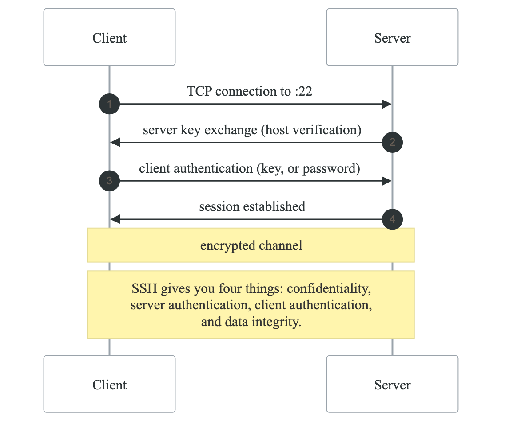
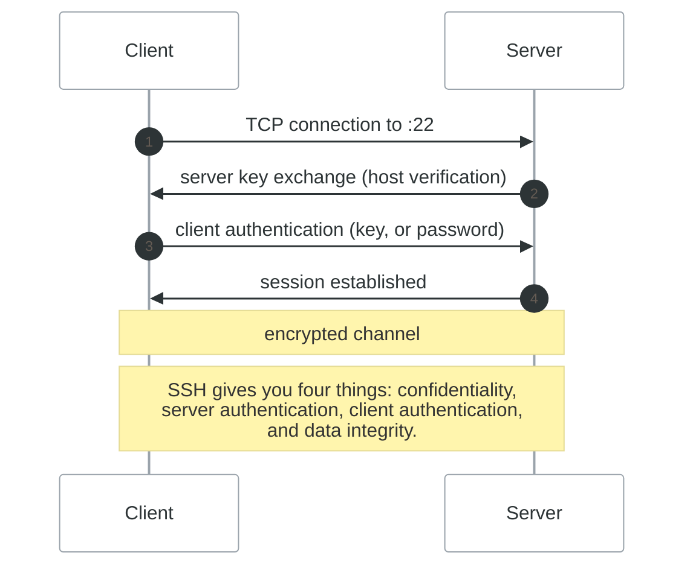
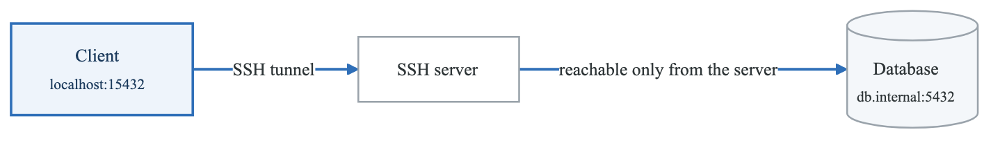
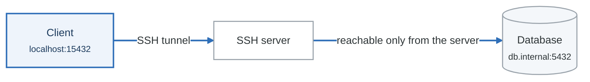
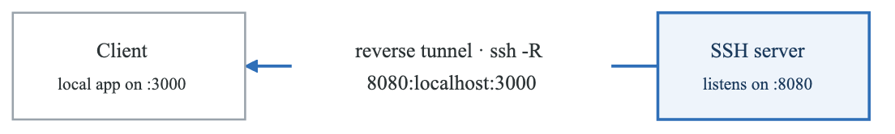
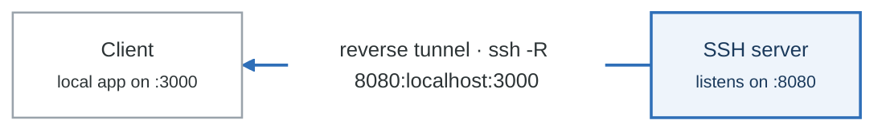
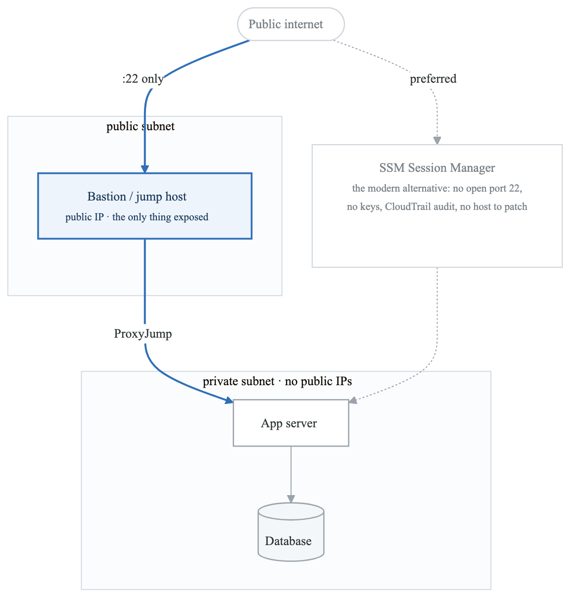
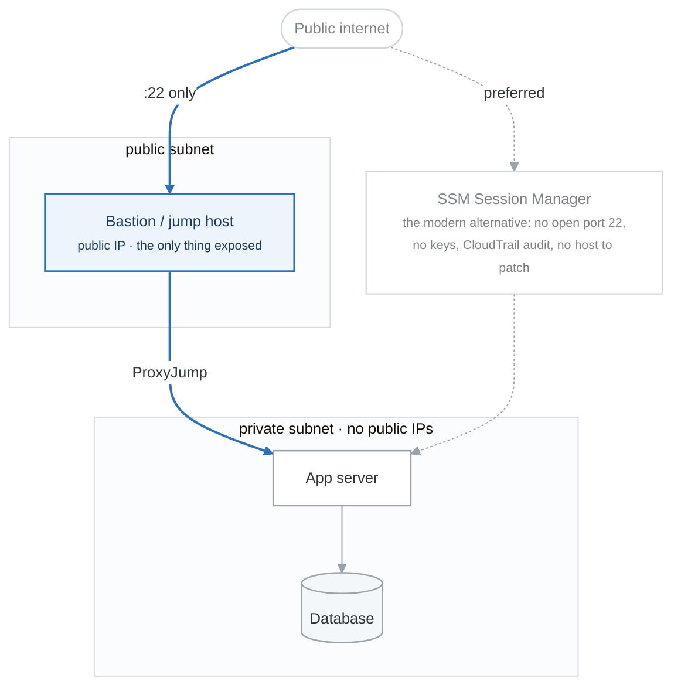

# SSH and Remote Access

## Overview

SSH (Secure Shell) is the primary method for secure remote access to Linux systems. This module covers SSH configuration, key management, tunneling, and bastion hosts.

## Learning Objectives

By the end of this module, you will be able to:
- Configure SSH client and server
- Manage SSH keys securely
- Create SSH tunnels for secure access
- Set up bastion/jump hosts
- Troubleshoot SSH connection issues

---

## SSH Fundamentals

### How SSH Works

<!-- figure: generated from the Mermaid below by _shared/diagrams/embed-figures.py — do not edit the image -->


<details>
<summary>Diagram source (Mermaid)</summary>



</details>

### Basic SSH Usage

```bash
# Connect to remote host
ssh user@hostname
ssh -p 2222 user@hostname    # Different port
ssh user@192.168.1.100

# Run command remotely
ssh user@hostname "ls -la"
ssh user@hostname "df -h && free -m"

# Verbose output for debugging
ssh -v user@hostname         # Verbose
ssh -vv user@hostname        # More verbose
ssh -vvv user@hostname       # Maximum verbosity
```

---

## SSH Keys

### Key Generation

```bash
# Generate RSA key (4096 bits recommended)
ssh-keygen -t rsa -b 4096 -C "your_email@example.com"

# Generate Ed25519 key (recommended, more secure)
ssh-keygen -t ed25519 -C "your_email@example.com"

# Key files created:
# ~/.ssh/id_ed25519       (private key - KEEP SECRET!)
# ~/.ssh/id_ed25519.pub   (public key - share this)

# Generate with specific filename
ssh-keygen -t ed25519 -f ~/.ssh/aws_key -C "aws-access"

# Generate without passphrase (for automation)
ssh-keygen -t ed25519 -f ~/.ssh/automation_key -N "" -C "automation"
```

### Key Management

```bash
# View public key
cat ~/.ssh/id_ed25519.pub

# Copy public key to server
ssh-copy-id user@hostname
ssh-copy-id -i ~/.ssh/mykey.pub user@hostname

# Manual copy (if ssh-copy-id unavailable)
cat ~/.ssh/id_ed25519.pub | ssh user@hostname \
    "mkdir -p ~/.ssh && cat >> ~/.ssh/authorized_keys"

# Verify permissions
chmod 700 ~/.ssh
chmod 600 ~/.ssh/id_ed25519
chmod 644 ~/.ssh/id_ed25519.pub
chmod 600 ~/.ssh/authorized_keys
```

### SSH Agent

```bash
# Start SSH agent
eval $(ssh-agent -s)

# Add key to agent
ssh-add ~/.ssh/id_ed25519
ssh-add ~/.ssh/aws_key

# List loaded keys
ssh-add -l

# Remove all keys
ssh-add -D

# Agent forwarding
ssh -A user@hostname
# Allows using local keys on remote host
```

---

## SSH Client Configuration

### ~/.ssh/config

```bash
# ~/.ssh/config

# Default settings for all hosts
Host *
    ServerAliveInterval 60
    ServerAliveCountMax 3
    AddKeysToAgent yes
    IdentitiesOnly yes

# Specific host configuration
Host webserver
    HostName web.example.com
    User deploy
    Port 22
    IdentityFile ~/.ssh/deploy_key

Host db
    HostName 10.0.0.100
    User admin
    ProxyJump bastion

# Jump host / bastion
Host bastion
    HostName bastion.example.com
    User ec2-user
    IdentityFile ~/.ssh/aws_key

# AWS instances via bastion
Host aws-*
    User ec2-user
    IdentityFile ~/.ssh/aws_key
    ProxyJump bastion

Host aws-web
    HostName 10.0.1.10

Host aws-app
    HostName 10.0.1.20

# Wildcard patterns
Host *.prod.example.com
    User produser
    IdentityFile ~/.ssh/prod_key

Host *.dev.example.com
    User devuser
    IdentityFile ~/.ssh/dev_key
```

```bash
# Usage with config
ssh webserver           # Instead of: ssh deploy@web.example.com
ssh db                  # Automatically uses bastion as jump host
ssh aws-web             # Uses config for HostName and ProxyJump
```

### Common Client Options

```bash
# Disable host key checking (NOT for production!)
ssh -o StrictHostKeyChecking=no user@host

# Specify identity file
ssh -i ~/.ssh/mykey user@host

# Force password authentication
ssh -o PreferredAuthentications=password user@host

# Connection timeout
ssh -o ConnectTimeout=10 user@host

# Keep alive
ssh -o ServerAliveInterval=60 -o ServerAliveCountMax=3 user@host

# X11 forwarding
ssh -X user@host

# Compression (for slow connections)
ssh -C user@host
```

---

## SSH Server Configuration

### /etc/ssh/sshd_config

```bash
# /etc/ssh/sshd_config

# Network settings
Port 22
#Port 2222                    # Alternative port
ListenAddress 0.0.0.0
AddressFamily any

# Authentication
PermitRootLogin no           # Disable root login
PasswordAuthentication no    # Disable password auth
PubkeyAuthentication yes     # Enable key auth
AuthorizedKeysFile .ssh/authorized_keys

# Security
PermitEmptyPasswords no
MaxAuthTries 3
MaxSessions 10
LoginGraceTime 60

# Allow specific users/groups
AllowUsers deploy admin
#AllowGroups sshusers

# Deny specific users
#DenyUsers baduser

# Idle timeout
ClientAliveInterval 300
ClientAliveCountMax 2

# Logging
LogLevel VERBOSE
SyslogFacility AUTH

# Other security
X11Forwarding no
AllowAgentForwarding yes
AllowTcpForwarding yes

# Subsystems
Subsystem sftp /usr/lib/openssh/sftp-server
```

```bash
# Validate configuration
sudo sshd -t

# Restart SSH service
sudo systemctl restart sshd

# View SSH logs
sudo journalctl -u sshd -f
sudo tail -f /var/log/auth.log
```

### Security Best Practices

```bash
# 1. Disable root login
PermitRootLogin no

# 2. Use key-only authentication
PasswordAuthentication no
PubkeyAuthentication yes

# 3. Use strong ciphers (add to sshd_config)
Ciphers aes256-gcm@openssh.com,chacha20-poly1305@openssh.com,aes256-ctr
MACs hmac-sha2-512-etm@openssh.com,hmac-sha2-256-etm@openssh.com
KexAlgorithms curve25519-sha256,curve25519-sha256@libssh.org

# 4. Limit users
AllowUsers deploy admin

# 5. Change default port (security through obscurity)
Port 2222

# 6. Fail2ban integration
sudo apt install fail2ban
sudo systemctl enable fail2ban
```

---

## SSH Tunneling

### Local Port Forwarding

<!-- figure: generated from the Mermaid below by _shared/diagrams/embed-figures.py — do not edit the image -->


<details>
<summary>Diagram source (Mermaid)</summary>



</details>

```bash
# Access remote database locally
ssh -L 15432:localhost:5432 user@dbserver
# Now connect to localhost:15432

# Access internal service through jump host
ssh -L 8080:internal-web:80 user@bastion
# Now browse http://localhost:8080

# Multiple tunnels
ssh -L 5432:db:5432 -L 6379:redis:6379 user@server
```

### Remote Port Forwarding

<!-- figure: generated from the Mermaid below by _shared/diagrams/embed-figures.py — do not edit the image -->


<details>
<summary>Diagram source (Mermaid)</summary>



</details>

```bash
# Expose local web app on remote server
ssh -R 8080:localhost:3000 user@server
# Remote users can access server:8080

# Expose to all interfaces on remote
ssh -R 0.0.0.0:8080:localhost:3000 user@server
# Requires GatewayPorts yes in sshd_config
```

### Dynamic Port Forwarding (SOCKS Proxy)

<!-- figure: generated from the Mermaid below by _shared/diagrams/embed-figures.py — do not edit the image -->


<details>
<summary>Diagram source (Mermaid)</summary>


</details>

```bash
# Create SOCKS proxy
ssh -D 1080 user@server

# Configure browser or application to use:
# SOCKS5 proxy: localhost:1080

# curl with SOCKS proxy
curl --socks5 localhost:1080 https://example.com

# All traffic through proxy
export ALL_PROXY=socks5://localhost:1080
```

### Persistent Tunnels

```bash
# Keep tunnel alive
ssh -N -L 5432:localhost:5432 user@server &

# With autossh (auto-reconnect)
autossh -M 0 -f -N -L 5432:localhost:5432 user@server

# SystemD service for persistent tunnel
# /etc/systemd/system/ssh-tunnel.service
[Unit]
Description=SSH Tunnel to Database
After=network.target

[Service]
User=ubuntu
ExecStart=/usr/bin/ssh -N -L 5432:localhost:5432 user@server
Restart=always
RestartSec=10

[Install]
WantedBy=multi-user.target
```

---

## Bastion/Jump Hosts

### Architecture

<!-- figure: generated from the Mermaid below by _shared/diagrams/embed-figures.py — do not edit the image -->


<details>
<summary>Diagram source (Mermaid)</summary>



</details>

### Jump Host Configuration

```bash
# ~/.ssh/config for jump host
Host bastion
    HostName bastion.example.com
    User ec2-user
    IdentityFile ~/.ssh/bastion_key

# Method 1: ProxyJump (OpenSSH 7.3+)
Host internal-server
    HostName 10.0.1.100
    User admin
    ProxyJump bastion

# Method 2: ProxyCommand (older systems)
Host internal-server
    HostName 10.0.1.100
    User admin
    ProxyCommand ssh -W %h:%p bastion
```

```bash
# Direct jump command
ssh -J bastion user@internal-server
ssh -J user1@bastion1,user2@bastion2 user@target  # Multiple jumps

# Usage with config
ssh internal-server  # Automatically jumps through bastion
```

### SCP and SFTP through Bastion

```bash
# SCP through jump host
scp -J bastion localfile user@internal:/path/

# SFTP through jump host
sftp -J bastion user@internal

# rsync through jump host
rsync -e "ssh -J bastion" file user@internal:/path/
```

---

## File Transfer

### SCP (Secure Copy)

```bash
# Copy file to remote
scp file.txt user@host:/path/to/destination/
scp -P 2222 file.txt user@host:/path/   # Different port

# Copy file from remote
scp user@host:/path/to/file.txt ./

# Copy directory
scp -r directory/ user@host:/path/

# Preserve attributes
scp -p file.txt user@host:/path/

# With identity file
scp -i ~/.ssh/mykey file.txt user@host:/path/
```

### SFTP (SSH File Transfer Protocol)

```bash
# Interactive session
sftp user@host

# Common commands:
# pwd, lpwd     - remote/local working directory
# ls, lls       - remote/local listing
# cd, lcd       - change remote/local directory
# get file      - download file
# put file      - upload file
# mget *.txt    - download multiple files
# mput *.txt    - upload multiple files
# mkdir, rmdir  - create/remove directory
# rm            - remove file
# exit, quit    - exit sftp

# Non-interactive
sftp user@host <<EOF
cd /var/log
get syslog
exit
EOF
```

### rsync (Recommended for Large Transfers)

```bash
# Sync directory
rsync -avz source/ user@host:/destination/

# Common options:
# -a  Archive mode (preserves permissions, timestamps, etc.)
# -v  Verbose
# -z  Compress during transfer
# -P  Progress and partial (resume interrupted transfers)
# --delete  Delete files in destination not in source

# Sync with progress
rsync -avzP source/ user@host:/destination/

# Dry run (preview)
rsync -avzn source/ user@host:/destination/

# Exclude files
rsync -avz --exclude='*.log' --exclude='.git' source/ user@host:/dest/

# Using SSH with different port
rsync -avz -e "ssh -p 2222" source/ user@host:/dest/

# Bandwidth limit (KB/s)
rsync -avz --bwlimit=1000 source/ user@host:/dest/
```

---

## Troubleshooting SSH

### Common Issues

```bash
# 1. Permission denied (publickey)
# Check permissions
ls -la ~/.ssh/
chmod 700 ~/.ssh
chmod 600 ~/.ssh/id_*
chmod 644 ~/.ssh/*.pub
chmod 600 ~/.ssh/authorized_keys

# Check if key is offered
ssh -v user@host 2>&1 | grep "Offering"

# 2. Host key verification failed
# View known hosts
cat ~/.ssh/known_hosts

# Remove old host key
ssh-keygen -R hostname

# 3. Connection refused
# Check if SSH is running
sudo systemctl status sshd
sudo netstat -tlnp | grep 22

# Check firewall
sudo iptables -L -n | grep 22

# 4. Connection timeout
# Check network connectivity
ping hostname
telnet hostname 22

# 5. Too many authentication failures
ssh -o IdentitiesOnly=yes -i ~/.ssh/specific_key user@host
```

### Debug Mode

```bash
# Client debug
ssh -vvv user@host

# Server debug (check logs)
sudo journalctl -u sshd -f
sudo tail -f /var/log/auth.log

# Test sshd configuration
sudo sshd -T

# Run sshd in debug mode
sudo /usr/sbin/sshd -d -p 2222
```

---

## Practical Exercises

### Exercise 1: Key-Based Authentication

```bash
#!/bin/bash
# Set up key-based authentication

# 1. Generate key pair
ssh-keygen -t ed25519 -f ~/.ssh/lab_key -N "" -C "lab-exercise"

# 2. Copy to server (replace with your server)
ssh-copy-id -i ~/.ssh/lab_key.pub user@server

# 3. Test connection
ssh -i ~/.ssh/lab_key user@server "echo 'Key auth working!'"

# 4. Add to ssh config
cat >> ~/.ssh/config << EOF

Host labserver
    HostName server
    User user
    IdentityFile ~/.ssh/lab_key
EOF

# 5. Test with config
ssh labserver "hostname"
```

### Exercise 2: SSH Tunnel

```bash
#!/bin/bash
# Create database tunnel

# Assume database is on 10.0.0.100:5432
# Accessible only from bastion

# Create tunnel
ssh -f -N -L 15432:10.0.0.100:5432 user@bastion

# Verify tunnel
ss -tlnp | grep 15432

# Test connection (requires psql)
# psql -h localhost -p 15432 -U dbuser dbname

# Kill tunnel
pkill -f "ssh.*15432"
```

### Exercise 3: Hardened SSH Configuration

```bash
#!/bin/bash
# Harden SSH server

sudo cp /etc/ssh/sshd_config /etc/ssh/sshd_config.bak

sudo tee /etc/ssh/sshd_config.d/hardening.conf << 'EOF'
# Hardened SSH Configuration

# Disable root login
PermitRootLogin no

# Disable password authentication
PasswordAuthentication no

# Enable public key authentication
PubkeyAuthentication yes

# Limit authentication attempts
MaxAuthTries 3

# Idle timeout (5 minutes)
ClientAliveInterval 300
ClientAliveCountMax 0

# Disable X11 forwarding
X11Forwarding no

# Use strong algorithms
Ciphers aes256-gcm@openssh.com,chacha20-poly1305@openssh.com
MACs hmac-sha2-512-etm@openssh.com,hmac-sha2-256-etm@openssh.com

# Logging
LogLevel VERBOSE
EOF

# Validate
sudo sshd -t && echo "Configuration valid"

# Restart (ensure you have console access first!)
# sudo systemctl restart sshd
```

---

## Key Takeaways

1. **Keys over passwords** - Always prefer SSH keys
2. **Protect private keys** - chmod 600, use passphrases
3. **Use SSH config** - Simplifies complex setups
4. **Bastion hosts** - Secure access to private networks
5. **Tunneling is powerful** - Secure access to any TCP service
6. **Audit regularly** - Check authorized_keys and logs

---

## Next Module

[System Monitoring](./11-system-monitoring.md)

<!-- feynman-check -->

---

## Feynman check

Close the file. Blank page, no notes. Explain each of these to a competent engineer who has never
used this tool — **under five minutes, no jargon you can't define on the spot:**

- SSH Fundamentals
- SSH Keys
- SSH Client Configuration
- SSH Server Configuration

**The gap is not what you forgot. It is where you used a word instead of a mechanism.**

| | |
|---|---|
| ✗ | *"The kernel manages processes."* |
| ✓ | *"A process is an entry in the kernel's task table with its own memory map and file-descriptor table. `fork()` copies it, `exec()` replaces the program inside it, and the parent must call `wait()` or the entry stays behind as a zombie."* |

**Trace it:** `ls -l /etc` → characters on your terminal. Name every syscall and every kernel structure between the keypress and the output.

Stop at the first component you cannot name. Reopen this file and read **only** that.

**Go deeper — only once the gap has a name:** [`man 7 namespaces`](https://man7.org/linux/man-pages/man7/namespaces.7.html) and the [LWN namespaces series](https://lwn.net/Articles/531114/) — the primary sources, not summaries of them.
Full list per domain: [`SOURCES.md`](../SOURCES.md#linux-networking)

→ Protocol, the three levels of knowing, and worked examples: [`MASTERY.md`](../MASTERY.md)

<!-- /feynman-check -->
