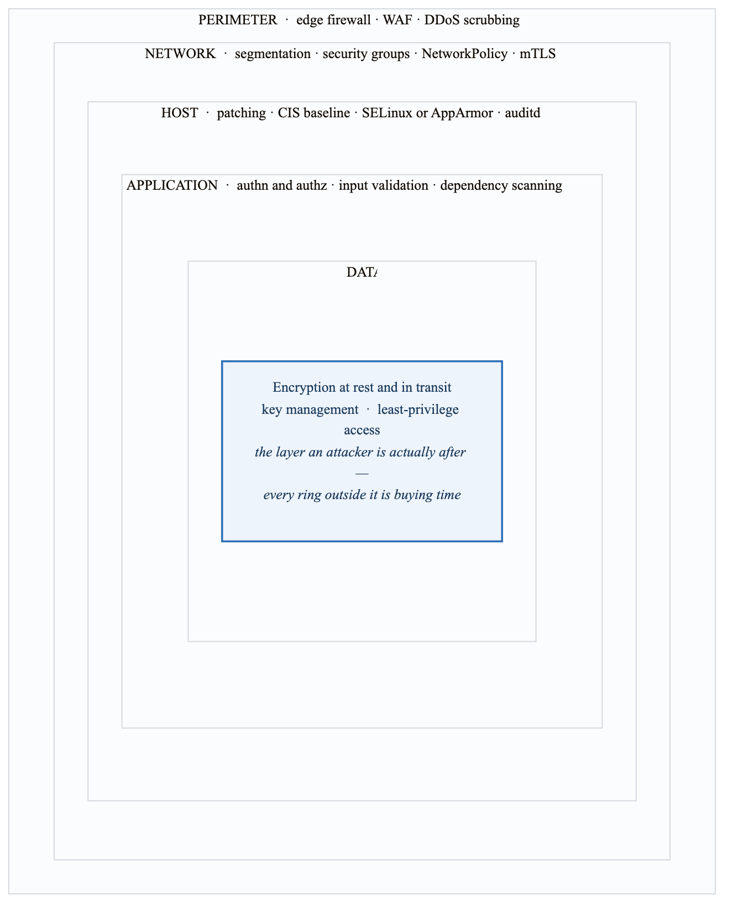
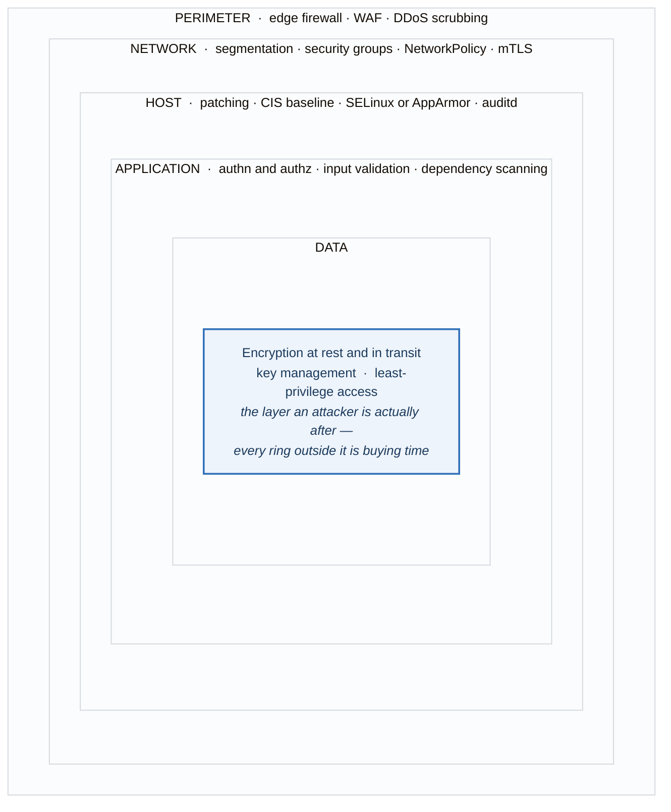

# Security Hardening

## Overview

Security hardening is the process of reducing the attack surface of a system by removing unnecessary software, configuring secure defaults, and implementing security controls. This module covers essential hardening practices for Linux systems.

## Learning Objectives

By the end of this module, you will be able to:
- Implement user and access security
- Configure system hardening
- Set up firewall rules
- Enable auditing and logging
- Apply CIS benchmark recommendations

---

## Security Principles

### Defense in Depth

<!-- figure: generated from the Mermaid below by _shared/diagrams/embed-figures.py — do not edit the image -->


<details>
<summary>Diagram source (Mermaid)</summary>



</details>

### Least Privilege

```
Principle: Give users and processes only the minimum
           permissions they need to function.

Examples:
- Users shouldn't have sudo unless required
- Services run as non-root dedicated users
- File permissions restrict access to owners
- Network access limited to necessary ports
```

---

## User Security

### Password Policies

```bash
# /etc/login.defs - Password aging
PASS_MAX_DAYS   90     # Maximum password age
PASS_MIN_DAYS   7      # Minimum days between changes
PASS_MIN_LEN    12     # Minimum password length
PASS_WARN_AGE   14     # Warning days before expiry

# Apply to existing user
sudo chage -M 90 -m 7 -W 14 username

# /etc/security/pwquality.conf - Password complexity
minlen = 12            # Minimum length
dcredit = -1           # At least 1 digit
ucredit = -1           # At least 1 uppercase
lcredit = -1           # At least 1 lowercase
ocredit = -1           # At least 1 special character
difok = 5              # Different characters from old password
maxrepeat = 3          # Max consecutive same characters
```

### User Account Management

```bash
# Lock inactive accounts
sudo chage -E $(date -d "+30 days" +%Y-%m-%d) tempuser

# Disable unused accounts
sudo usermod -L username              # Lock account
sudo usermod -s /usr/sbin/nologin username  # No shell

# Find users with no password
sudo awk -F: '($2 == "" ) { print $1 }' /etc/shadow

# Find users with UID 0 (root privileges)
awk -F: '($3 == "0") { print $1 }' /etc/passwd

# Remove unnecessary users
sudo userdel -r unnecessaryuser

# Check sudo access
sudo grep -v '^#' /etc/sudoers | grep -v '^$'
getent group sudo
getent group wheel
```

### SSH Security

```bash
# /etc/ssh/sshd_config
PermitRootLogin no
PasswordAuthentication no
PubkeyAuthentication yes
PermitEmptyPasswords no
MaxAuthTries 3
AllowUsers deploy admin
Protocol 2
X11Forwarding no
AllowTcpForwarding no
ClientAliveInterval 300
ClientAliveCountMax 2
Banner /etc/issue.net

# Apply changes
sudo systemctl restart sshd
```

---

## File System Security

### Secure Mount Options

```bash
# /etc/fstab secure options
/dev/sdb1  /home    ext4  defaults,nodev,nosuid    0 2
/dev/sdc1  /tmp     ext4  defaults,nodev,nosuid,noexec  0 2
/dev/sdd1  /var/tmp ext4  defaults,nodev,nosuid,noexec  0 2

# Options explained:
# nodev   - Don't interpret block devices
# nosuid  - Don't allow setuid/setgid
# noexec  - Don't allow execution

# Remount immediately
sudo mount -o remount,nodev,nosuid,noexec /tmp
```

### File Permissions

```bash
# Secure sensitive files
sudo chmod 600 /etc/shadow
sudo chmod 600 /etc/gshadow
sudo chmod 644 /etc/passwd
sudo chmod 644 /etc/group
sudo chmod 700 /root

# Find world-writable files
sudo find / -type f -perm -002 -ls 2>/dev/null

# Find world-writable directories
sudo find / -type d -perm -002 -ls 2>/dev/null

# Find SUID/SGID files
sudo find / -type f \( -perm -4000 -o -perm -2000 \) -ls 2>/dev/null

# Find files with no owner
sudo find / -nouser -o -nogroup 2>/dev/null

# Remove unnecessary SUID bits
sudo chmod u-s /path/to/file
```

### Secure Temporary Directories

```bash
# Separate /tmp filesystem
# Add to /etc/fstab:
tmpfs /tmp tmpfs defaults,nodev,nosuid,noexec,size=2G 0 0

# Bind mount /var/tmp to /tmp
/tmp /var/tmp none bind 0 0

# Clean tmp on boot (systemd)
# Already handled by systemd-tmpfiles-clean.timer
```

---

## Network Security

### Firewall Configuration

```bash
# iptables basic setup
#!/bin/bash
# Flush existing rules
iptables -F
iptables -X

# Default policies
iptables -P INPUT DROP
iptables -P FORWARD DROP
iptables -P OUTPUT ACCEPT

# Allow loopback
iptables -A INPUT -i lo -j ACCEPT
iptables -A OUTPUT -o lo -j ACCEPT

# Allow established connections
iptables -A INPUT -m state --state ESTABLISHED,RELATED -j ACCEPT

# Allow SSH (rate limited)
iptables -A INPUT -p tcp --dport 22 -m limit --limit 3/min -j ACCEPT

# Allow HTTP/HTTPS
iptables -A INPUT -p tcp --dport 80 -j ACCEPT
iptables -A INPUT -p tcp --dport 443 -j ACCEPT

# Log dropped packets
iptables -A INPUT -j LOG --log-prefix "iptables-dropped: "

# Save rules
iptables-save > /etc/iptables.rules
```

### Disable Unnecessary Services

```bash
# List running services
systemctl list-units --type=service --state=running

# Disable unnecessary services
sudo systemctl disable --now cups
sudo systemctl disable --now avahi-daemon
sudo systemctl disable --now bluetooth
sudo systemctl disable --now telnet.socket
sudo systemctl disable --now rsh.socket

# Check for listening services
ss -tuln
netstat -tuln

# Remove unnecessary packages
sudo apt purge telnet rsh-client ftp
```

### Network Kernel Parameters

```bash
# /etc/sysctl.d/99-security.conf

# Disable IP forwarding (unless router/NAT)
net.ipv4.ip_forward = 0
net.ipv6.conf.all.forwarding = 0

# Ignore ICMP redirects
net.ipv4.conf.all.accept_redirects = 0
net.ipv6.conf.all.accept_redirects = 0
net.ipv4.conf.all.send_redirects = 0

# Ignore source-routed packets
net.ipv4.conf.all.accept_source_route = 0
net.ipv6.conf.all.accept_source_route = 0

# Enable SYN cookies (DoS protection)
net.ipv4.tcp_syncookies = 1

# Log martian packets
net.ipv4.conf.all.log_martians = 1

# Ignore broadcast ICMP (smurf attack protection)
net.ipv4.icmp_echo_ignore_broadcasts = 1

# Apply
sudo sysctl -p /etc/sysctl.d/99-security.conf
```

---

## Auditing and Logging

### auditd Configuration

```bash
# Install auditd
sudo apt install auditd audispd-plugins

# Start and enable
sudo systemctl enable --now auditd

# /etc/audit/rules.d/audit.rules
# Log all commands run as root
-a always,exit -F arch=b64 -F euid=0 -S execve -k root-commands

# Monitor authentication files
-w /etc/passwd -p wa -k identity
-w /etc/shadow -p wa -k identity
-w /etc/group -p wa -k identity
-w /etc/sudoers -p wa -k sudoers

# Monitor SSH
-w /etc/ssh/sshd_config -p wa -k sshd

# Monitor network configuration
-w /etc/hosts -p wa -k hosts
-w /etc/network/ -p wa -k network

# Log file changes
-w /var/log/ -p wa -k logs

# Make rules immutable
-e 2
```

```bash
# Reload audit rules
sudo augenrules --load

# View audit logs
sudo ausearch -k identity
sudo ausearch -k sudoers -i
sudo aureport -au     # Authentication report
sudo aureport -x      # Executable report
```

### Log Rotation

```bash
# /etc/logrotate.d/custom
/var/log/myapp/*.log {
    daily
    missingok
    rotate 30
    compress
    delaycompress
    notifempty
    create 0640 root adm
    sharedscripts
    postrotate
        systemctl reload myapp 2>/dev/null || true
    endscript
}

# Test configuration
logrotate -d /etc/logrotate.conf
```

### Centralized Logging

```bash
# rsyslog - send logs to central server
# /etc/rsyslog.d/50-central.conf
*.* @logserver.example.com:514    # UDP
*.* @@logserver.example.com:514   # TCP

# Restart rsyslog
sudo systemctl restart rsyslog
```

---

## System Hardening

### GRUB Security

```bash
# Set GRUB password
grub-mkpasswd-pbkdf2
# Enter password, get hash

# /etc/grub.d/40_custom
set superusers="admin"
password_pbkdf2 admin grub.pbkdf2.sha512.10000.HASH

# Update GRUB
sudo update-grub
```

### Kernel Hardening

```bash
# /etc/sysctl.d/99-kernel-hardening.conf

# Restrict kernel pointer access
kernel.kptr_restrict = 2

# Restrict dmesg access
kernel.dmesg_restrict = 1

# Enable ASLR
kernel.randomize_va_space = 2

# Restrict ptrace
kernel.yama.ptrace_scope = 1

# Disable magic SysRq key
kernel.sysrq = 0

# Core dump restrictions
fs.suid_dumpable = 0

# Apply
sudo sysctl -p /etc/sysctl.d/99-kernel-hardening.conf
```

### Remove Unnecessary Software

```bash
# List installed packages
dpkg -l | wc -l

# Remove development tools from production
sudo apt remove gcc make

# Remove unnecessary services
sudo apt remove telnetd xinetd

# Auto-remove unused dependencies
sudo apt autoremove
```

---

## CIS Benchmarks

### Overview

**CIS (Center for Internet Security) Benchmarks:**

  Level 1: Basic security, minimal performance impact
  Level 2: Enhanced security, may affect functionality
  Categories:
  1. Initial Setup (filesystem, updates)
  2. Services (disable unnecessary)
  3. Network Configuration
  4. Logging and Auditing
  5. Access, Authentication, Authorization
  6. System Maintenance


### Key CIS Recommendations

```bash
# 1.1 Filesystem Configuration
# Separate partitions for /tmp, /var, /var/log, /home
# Mount with nodev, nosuid, noexec where appropriate

# 2.2 Disable unused services
for svc in cups avahi-daemon isc-dhcp-server slapd nfs rpcbind; do
    systemctl is-enabled $svc 2>/dev/null && \
    systemctl disable --now $svc
done

# 3.2 Network Parameters
sysctl -w net.ipv4.ip_forward=0
sysctl -w net.ipv4.conf.all.send_redirects=0

# 4.1 Configure Logging
# Ensure rsyslog/journald is installed and configured
systemctl is-enabled rsyslog

# 5.2 SSH Configuration
# See SSH Security section above

# 5.3 Configure PAM
# Ensure password complexity is configured

# 6.1 System File Permissions
# Audit and correct permissions on critical files
```

### Automated Compliance Scanning

```bash
# Install Lynis
sudo apt install lynis

# Run audit
sudo lynis audit system

# Generate report
sudo lynis audit system --report-file /tmp/lynis-report.txt

# OpenSCAP for CIS compliance
sudo apt install openscap-scanner scap-security-guide

# Run CIS scan
sudo oscap xccdf eval \
    --profile cis_level1_server \
    --results results.xml \
    /usr/share/xml/scap/ssg/content/ssg-ubuntu2204-ds.xml
```

---

## Security Monitoring

### Fail2Ban

```bash
# Install Fail2Ban
sudo apt install fail2ban

# /etc/fail2ban/jail.local
[DEFAULT]
bantime = 3600
findtime = 600
maxretry = 5

[sshd]
enabled = true
port = ssh
filter = sshd
logpath = /var/log/auth.log
maxretry = 3
bantime = 86400

# Enable and start
sudo systemctl enable --now fail2ban

# View status
sudo fail2ban-client status
sudo fail2ban-client status sshd

# Unban IP
sudo fail2ban-client set sshd unbanip 192.168.1.100
```

### AIDE (File Integrity)

```bash
# Install AIDE
sudo apt install aide

# Initialize database
sudo aideinit

# Move database
sudo cp /var/lib/aide/aide.db.new /var/lib/aide/aide.db

# Check for changes
sudo aide --check

# Update database after changes
sudo aide --update
```

### Rootkit Detection

```bash
# Install rkhunter
sudo apt install rkhunter

# Update database
sudo rkhunter --update

# Run check
sudo rkhunter --check

# Check for updates
sudo rkhunter --checkall

# Install chkrootkit
sudo apt install chkrootkit

# Run check
sudo chkrootkit
```

---

## Practical Exercises

### Exercise 1: Hardening Checklist

```bash
#!/bin/bash
# Security hardening checklist script

echo "=== Security Hardening Check ==="

echo -e "\n--- User Security ---"
# Check for empty passwords
echo "Empty passwords:"
sudo awk -F: '($2 == "" ) { print $1 }' /etc/shadow

# Check for UID 0
echo "UID 0 users:"
awk -F: '($3 == "0") { print $1 }' /etc/passwd

echo -e "\n--- SSH Security ---"
grep -E "^PermitRootLogin|^PasswordAuthentication" /etc/ssh/sshd_config

echo -e "\n--- Firewall Status ---"
sudo iptables -L -n | head -20

echo -e "\n--- Listening Services ---"
ss -tuln | grep LISTEN

echo -e "\n--- SUID Files ---"
find /usr -type f -perm -4000 -ls 2>/dev/null | wc -l
echo "SUID files found"

echo -e "\n--- World Writable Files ---"
find /etc -type f -perm -002 -ls 2>/dev/null

echo -e "\n--- Password Policy ---"
grep -E "^PASS_MAX_DAYS|^PASS_MIN_DAYS|^PASS_MIN_LEN" /etc/login.defs
```

### Exercise 2: Implement Security Controls

```bash
#!/bin/bash
# Implement basic security controls

# Backup original configs
sudo cp /etc/ssh/sshd_config /etc/ssh/sshd_config.bak
sudo cp /etc/sysctl.conf /etc/sysctl.conf.bak

# SSH hardening
sudo tee /etc/ssh/sshd_config.d/hardening.conf << 'EOF'
PermitRootLogin no
PasswordAuthentication no
MaxAuthTries 3
X11Forwarding no
AllowTcpForwarding no
ClientAliveInterval 300
ClientAliveCountMax 2
EOF

# Kernel hardening
sudo tee /etc/sysctl.d/99-hardening.conf << 'EOF'
net.ipv4.ip_forward = 0
net.ipv4.conf.all.accept_redirects = 0
net.ipv4.conf.all.send_redirects = 0
net.ipv4.tcp_syncookies = 1
kernel.randomize_va_space = 2
EOF

sudo sysctl -p /etc/sysctl.d/99-hardening.conf

# Apply changes
sudo sshd -t && sudo systemctl reload sshd

echo "Security controls applied!"
```

### Exercise 3: Security Audit

```bash
#!/bin/bash
# Comprehensive security audit

REPORT="/tmp/security-audit-$(date +%Y%m%d).txt"

{
    echo "Security Audit Report"
    echo "Date: $(date)"
    echo "Host: $(hostname)"
    echo ""

    echo "=== System Information ==="
    uname -a
    cat /etc/os-release | head -5

    echo ""
    echo "=== User Accounts ==="
    echo "Total users: $(wc -l < /etc/passwd)"
    echo "Users with shell: $(grep -v nologin /etc/passwd | grep -v /bin/false | wc -l)"
    echo "Sudo users: $(getent group sudo | cut -d: -f4)"

    echo ""
    echo "=== Failed Logins (Last 24h) ==="
    journalctl --since "24 hours ago" | grep -i "failed\|failure" | wc -l

    echo ""
    echo "=== Open Ports ==="
    ss -tuln | grep LISTEN

    echo ""
    echo "=== Firewall Rules ==="
    sudo iptables -L -n --line-numbers | head -30

    echo ""
    echo "=== Recent Package Changes ==="
    grep -E "install|upgrade|remove" /var/log/dpkg.log | tail -20

    echo ""
    echo "=== Suspicious Files ==="
    echo "SUID files: $(find / -type f -perm -4000 2>/dev/null | wc -l)"
    echo "World writable: $(find /etc -type f -perm -002 2>/dev/null | wc -l)"

} | tee "$REPORT"

echo ""
echo "Report saved to: $REPORT"
```

---

## Key Takeaways

1. **Defense in depth** - Multiple layers of security
2. **Least privilege** - Minimum necessary access
3. **Keep systems updated** - Security patches are critical
4. **Monitor continuously** - Detection is as important as prevention
5. **Document everything** - Know your baseline and changes
6. **Automate compliance** - Use tools like Lynis and OpenSCAP

---

## Summary

Phase 1 has covered the essential Linux and networking skills needed for DevOps:
- Linux fundamentals and file system management
- User and permission management
- Process and service management
- Shell scripting for automation
- Networking fundamentals and configuration
- SSH and remote access
- System monitoring
- Security hardening

These skills form the foundation for all subsequent phases in your DevOps journey.

---

**Previous Module:** [System Monitoring](./11-system-monitoring.md)

**Next Phase:** [Phase 2: Containers & Orchestration](../../phase-2-containers-orchestration/)

<!-- feynman-check -->

---

## Feynman check

Close the file. Blank page, no notes. Explain each of these to a competent engineer who has never
used this tool — **under five minutes, no jargon you can't define on the spot:**

- Security Principles
- User Security
- File System Security
- Network Security

**The gap is not what you forgot. It is where you used a word instead of a mechanism.**

| | |
|---|---|
| ✗ | *"The kernel manages processes."* |
| ✓ | *"A process is an entry in the kernel's task table with its own memory map and file-descriptor table. `fork()` copies it, `exec()` replaces the program inside it, and the parent must call `wait()` or the entry stays behind as a zombie."* |

**Trace it:** `ls -l /etc` → characters on your terminal. Name every syscall and every kernel structure between the keypress and the output.

Stop at the first component you cannot name. Reopen this file and read **only** that.

**Go deeper — only once the gap has a name:** [`man 7 namespaces`](https://man7.org/linux/man-pages/man7/namespaces.7.html) and the [LWN namespaces series](https://lwn.net/Articles/531114/) — the primary sources, not summaries of them.
Full list per domain: [`SOURCES.md`](../SOURCES.md#linux-networking)

→ Protocol, the three levels of knowing, and worked examples: [`MASTERY.md`](../MASTERY.md)

<!-- /feynman-check -->
