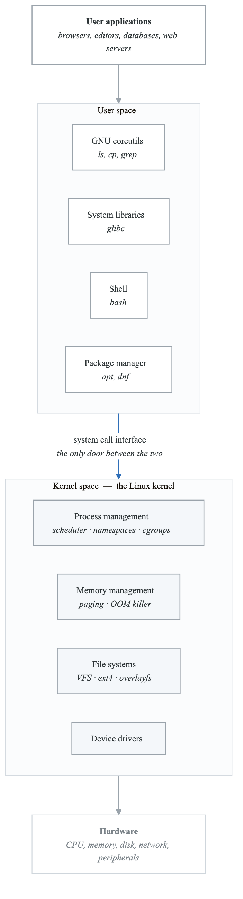
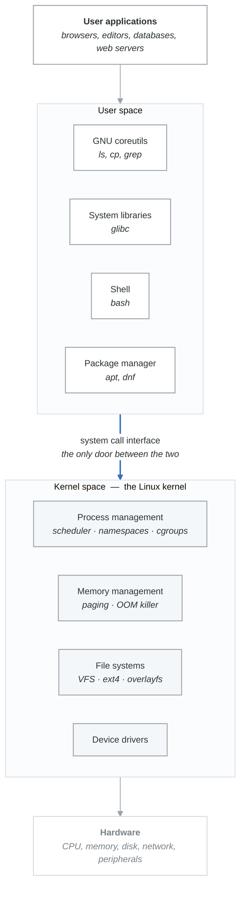
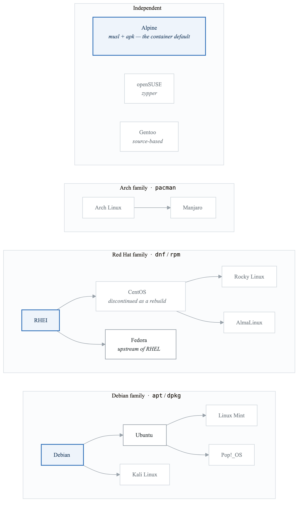
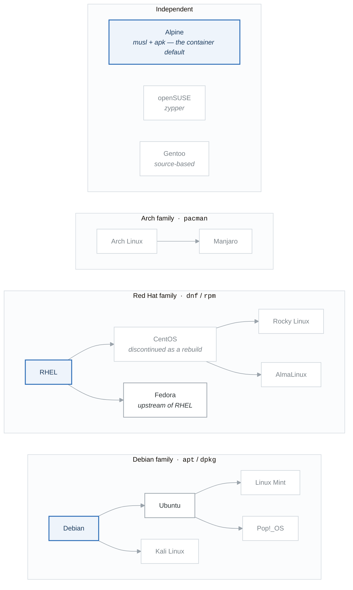

# Module 1: Introduction to Linux

## Introduction

Linux is the dominant operating system for servers, cloud infrastructure, containers, and DevOps tooling. Understanding Linux is not optional for DevOps practitioners—it's fundamental. This module introduces Linux concepts, history, and the ecosystem.

## Learning Objectives

After completing this module, you will be able to:
- Explain what Linux is and its role in modern infrastructure
- Describe the Linux kernel and user space
- Compare Linux distributions
- Choose an appropriate distribution for different use cases
- Set up a Linux learning environment

## What is Linux?

### Linux Defined

```yaml
linux_definition:
  kernel:
    definition: "Core of the operating system"
    created_by: "Linus Torvalds (1991)"
    type: "Monolithic, Unix-like"
    license: "GPL v2 (open source)"

  operating_system:
    definition: "Kernel + user space tools"
    components:
      - Linux kernel
      - GNU utilities
      - System libraries
      - Package manager
      - Desktop environment (optional)
```

### Why Linux Matters for DevOps

**Where Linux actually runs**

| Domain | Position |
|---|---|
| **Public cloud** | 90%+ of cloud workloads · AWS, GCP and Azure all default to Linux · containers *require* a Linux kernel |
| **Web servers** | ~70% of web servers · nginx and Apache are Linux-native · most stacks are tuned for it |
| **DevOps tooling** | Docker is a Linux-kernel feature set · Kubernetes nodes run Linux · CI/CD and automation are Linux-first |
| **Databases** | Most production databases — PostgreSQL, MySQL, MongoDB — are tuned for Linux |

This is the argument for learning it first rather than eventually: every other tool in this
curriculum assumes it.

## Linux Architecture

### Kernel vs User Space

<!-- figure: generated from the Mermaid below by _shared/diagrams/embed-figures.py — do not edit the image -->


<details>
<summary>Diagram source (Mermaid)</summary>



</details>

### The Linux Kernel

The kernel is responsible for:

```yaml
kernel_responsibilities:
  process_management:
    - Creating and terminating processes
    - Scheduling CPU time
    - Inter-process communication

  memory_management:
    - Virtual memory
    - Memory allocation
    - Swap management

  file_systems:
    - File system support (ext4, xfs, btrfs)
    - File operations
    - Virtual File System (VFS)

  device_drivers:
    - Hardware abstraction
    - Device I/O
    - Interrupt handling

  networking:
    - Network stack (TCP/IP)
    - Socket interface
    - Packet filtering (iptables/nftables)
```

## Linux Distributions

A distribution (distro) packages the Linux kernel with:
- Package manager
- Default software
- Configuration tools
- Support/updates

### Major Distribution Families

**Distribution family tree**

<!-- figure: generated from the Mermaid below by _shared/diagrams/embed-figures.py — do not edit the image -->


<details>
<summary>Diagram source (Mermaid)</summary>



</details>

For work, the choice reduces to two: something in the Debian family for most cloud images, and
something in the Red Hat family where an enterprise support contract is involved. **Alpine** is the
outlier worth knowing — it uses musl instead of glibc, which is why a Python wheel that installs
everywhere else sometimes will not install there.

### Distribution Comparison

```yaml
distribution_comparison:
  ubuntu:
    base: Debian
    package_manager: apt
    release_cycle: "LTS every 2 years (5-year support)"
    best_for: "Beginners, cloud, general purpose"
    enterprise: "Ubuntu Pro"

  debian:
    base: Original
    package_manager: apt
    release_cycle: "~2 years (5-year support)"
    best_for: "Stability, servers"
    enterprise: "Debian LTS"

  rhel:
    base: Fedora
    package_manager: dnf
    release_cycle: "~3 years (10-year support)"
    best_for: "Enterprise, regulated industries"
    enterprise: "Red Hat subscription"

  rocky_linux:
    base: RHEL (source)
    package_manager: dnf
    release_cycle: "Follows RHEL"
    best_for: "RHEL compatibility without cost"
    enterprise: "Community supported"

  alpine:
    base: Independent
    package_manager: apk
    size: "~5MB base image"
    best_for: "Containers, minimal footprint"
    notes: "Uses musl instead of glibc"

  amazon_linux:
    base: RHEL/Fedora
    package_manager: dnf
    best_for: "AWS workloads"
    notes: "Optimized for EC2"
```

### Choosing a Distribution

```yaml
choose_distro:
  learning_devops:
    recommendation: "Ubuntu Server LTS"
    reasons:
      - Most common in cloud environments
      - Excellent documentation
      - Large community
      - Similar to production environments

  production_servers:
    options:
      - "Ubuntu Server LTS"
      - "RHEL/Rocky Linux"
      - "Amazon Linux (AWS)"
    factors:
      - Support requirements
      - Compliance needs
      - Team expertise

  containers:
    recommendation: "Alpine Linux"
    reasons:
      - Minimal size
      - Fast builds
      - Security focused
    alternative: "Distroless images"

  desktop_development:
    options:
      - "Ubuntu Desktop"
      - "Fedora Workstation"
      - "Pop!_OS"
```

## Linux History

### Timeline

**Timeline**

| Year | Event |
|---|---|
| 1969 | Unix created at AT&T Bell Labs |
| 1983 | GNU Project started by Richard Stallman |
| 1991 | Linus Torvalds announces the Linux kernel — *"I'm doing a (free) operating system (just a hobby…)"* |
| 1992 | The kernel is relicensed under the GPL |
| 1993 | Debian and Slackware |
| 1994 | Linux 1.0; Red Hat founded |
| 1996 | Linux 2.0 — SMP support |
| 2004 | First Ubuntu release |
| 2008 | Android ships, Linux-based |
| 2011 | Linux 3.0 |
| 2013 | Docker — built on kernel features that already existed |
| 2014 | Kubernetes announced |
| 2015 | Linux 4.0; Windows Subsystem for Linux announced |
| 2020 | WSL 2, with a real Linux kernel |
| 2024 | 90%+ of cloud workloads; 100% of the TOP500 supercomputers |

The 1983 and 1991 entries are the pair that matters: GNU had the userland and no kernel, Linux had a
kernel and no userland. "GNU/Linux" is a description of that accident, not a slogan.

### Why Unix/Linux Design Matters

```yaml
unix_philosophy:
  principles:
    - "Do one thing and do it well"
    - "Write programs to work together"
    - "Write programs to handle text streams"
    - "Everything is a file"

  relevance_to_devops:
    pipes_and_composition:
      example: "cat log.txt | grep ERROR | wc -l"
      principle: "Chain simple tools together"

    text_as_interface:
      example: "Configuration files are text"
      principle: "Human-readable, version controllable"

    small_tools:
      example: "ls, grep, awk, sed"
      principle: "Combine to build complex workflows"
```

## Setting Up Your Environment

### Option 1: Virtual Machine (VirtualBox)

```yaml
virtualbox_setup:
  download:
    - "VirtualBox from virtualbox.org"
    - "Ubuntu Server ISO from ubuntu.com"

  vm_settings:
    cpu: 2 cores
    memory: 2-4 GB
    disk: 20-40 GB
    network: "Bridged or NAT"

  installation:
    - Boot from ISO
    - Follow Ubuntu installer
    - Install OpenSSH server
    - Update system after install
```

### Option 2: WSL 2 (Windows)

```powershell
# Check WSL status
wsl --status

# Install WSL 2
wsl --install

# Install Ubuntu
wsl --install -d Ubuntu

# Launch Ubuntu
wsl

# Update system
sudo apt update && sudo apt upgrade -y
```

### Option 3: Cloud Instance

```yaml
cloud_setup:
  aws:
    instance_type: "t2.micro (free tier)"
    ami: "Ubuntu Server 22.04 LTS"
    connect: "ssh -i key.pem ubuntu@<ip>"

  gcp:
    machine_type: "e2-micro"
    image: "ubuntu-2204-lts"
    connect: "gcloud compute ssh <instance>"

  digitalocean:
    droplet: "$4/month"
    image: "Ubuntu 22.04"
    connect: "ssh root@<ip>"
```

### Verify Your Setup

```bash
# Check Linux version
cat /etc/os-release

# Check kernel version
uname -r

# Check available resources
free -h
df -h

# Update system
sudo apt update && sudo apt upgrade -y  # Debian/Ubuntu
# or
sudo dnf update -y  # RHEL/Fedora
```

## Summary

Linux is essential for DevOps:

1. **Dominant in infrastructure** - Cloud, servers, containers all run Linux
2. **Open source** - Free to use, modify, and learn
3. **Unix philosophy** - Composable tools, text interfaces
4. **Multiple distributions** - Choose based on use case
5. **Active development** - Continuously improving

## Knowledge Check

1. What is the Linux kernel and what does it do?
2. What is the difference between the kernel and a distribution?
3. Name three major Linux distribution families.
4. What is the Unix philosophy and why does it matter?
5. Which distribution would you choose for learning DevOps? Why?

## Next Module

Continue to [Module 2: Command Line Essentials](./02-command-line-essentials.md) to learn essential Linux commands.

<!-- feynman-check -->

---

## Feynman check

Close the file. Blank page, no notes. Explain each of these to a competent engineer who has never
used this tool — **under five minutes, no jargon you can't define on the spot:**

- What is Linux?
- Linux Architecture
- Linux Distributions
- Linux History

**The gap is not what you forgot. It is where you used a word instead of a mechanism.**

| | |
|---|---|
| ✗ | *"The kernel manages processes."* |
| ✓ | *"A process is an entry in the kernel's task table with its own memory map and file-descriptor table. `fork()` copies it, `exec()` replaces the program inside it, and the parent must call `wait()` or the entry stays behind as a zombie."* |

**Trace it:** `ls -l /etc` → characters on your terminal. Name every syscall and every kernel structure between the keypress and the output.

Stop at the first component you cannot name. Reopen this file and read **only** that.

**Go deeper — only once the gap has a name:** [`man 7 namespaces`](https://man7.org/linux/man-pages/man7/namespaces.7.html) and the [LWN namespaces series](https://lwn.net/Articles/531114/) — the primary sources, not summaries of them.
Full list per domain: [`SOURCES.md`](../../SOURCES.md#linux-networking)

→ Protocol, the three levels of knowing, and worked examples: [`MASTERY.md`](../../MASTERY.md)

<!-- /feynman-check -->
