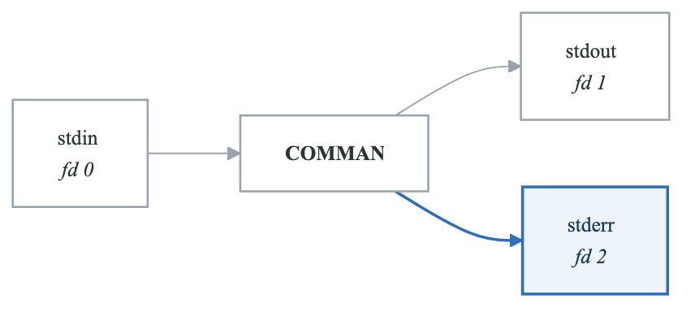
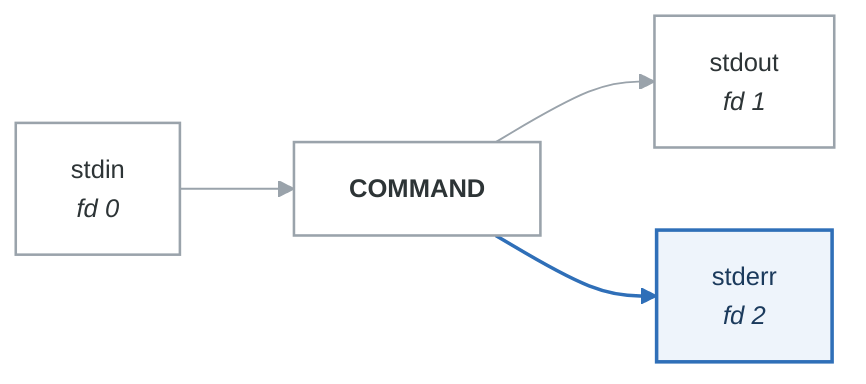

# Module 2: Command Line Essentials

## Introduction

The command line is where DevOps work happens. While GUIs exist, the command line is faster, scriptable, and works over SSH. This module builds your command line fluency with essential commands and concepts.

## Learning Objectives

After completing this module, you will be able to:
- Navigate the terminal confidently
- Understand command structure and syntax
- Use essential Linux commands
- Redirect input/output and use pipes
- Work with environment variables
- Use command history and shortcuts

## The Terminal

### Understanding the Shell

```yaml
shell_concepts:
  terminal:
    definition: "Application that provides text input/output"
    examples: ["GNOME Terminal", "iTerm2", "Windows Terminal"]

  shell:
    definition: "Command interpreter that processes commands"
    examples: ["bash", "zsh", "fish", "sh"]
    default: "bash (Bourne Again Shell)"

  prompt:
    definition: "Text indicating shell is ready for input"
    example: "user@hostname:~$ "
    components:
      - username
      - hostname
      - current directory
      - privilege indicator ($ for user, # for root)
```

### The Command Prompt

**Anatomy of a prompt**

```text
user@hostname:~$
  │      │     │└── privilege: $ = ordinary user, # = root
  │      │     └─── current directory (~ = your home)
  │      └───────── hostname
  └──────────────── username
```

| Part | Tells you |
|---|---|
| `user` | Who you are — check this before anything destructive |
| `hostname` | **Which machine** — the field that prevents the worst mistakes |
| `~` | Where you are; `~` is your home directory |
| `$` / `#` | `#` means you are root and nothing will stop you |

The prompt is configurable through `PS1`. Making production hosts render their hostname in red is
the cheapest safety control in this entire curriculum.

## Command Structure

### Basic Syntax

**Anatomy of a command**

```text
command [options] [arguments]
   │        │          │
   │        │          └── what to operate on — files, text, a hostname
   │        └── how to change the behaviour
   └── the program to run
```

| Part | Purpose | Example |
|---|---|---|
| Command | The program | `ls` |
| Options | Modify behaviour — short (`-l`) or long (`--long`) | `-la` |
| Arguments | What it operates on | `/etc` |

Options that take a value are where the shell surprises people: `ls -l /etc` has one option and one
argument, but `grep -e pattern file` has an option *whose value is `pattern`* and one argument. When
a command behaves unexpectedly, check whether the shell split it the way you assumed.

### Options and Arguments

```bash
# Command only
pwd

# Command with argument
cd /var/log

# Command with option
ls -l

# Command with option and argument
ls -la /var/log

# Long options (--option)
ls --all --human-readable

# Options can be combined
ls -lah

# Options with values
grep -n "error" logfile.txt
grep --line-number "error" logfile.txt
```

## Essential Commands

### Getting Help

```bash
# Manual pages
man ls
man grep

# Navigate man pages:
# Space = next page
# b = previous page
# / = search
# q = quit

# Quick help (not all commands)
ls --help
grep --help

# Search for commands
apropos "copy files"
man -k "network"

# Type of command
type ls      # builtin or external
which grep   # path to command
```

### Navigation Commands

```bash
# Print working directory
pwd

# Change directory
cd /var/log      # Absolute path
cd log           # Relative path
cd ..            # Parent directory
cd ~             # Home directory
cd -             # Previous directory
cd               # Home directory (shortcut)

# List directory contents
ls               # Basic listing
ls -l            # Long format
ls -a            # Show hidden files (start with .)
ls -la           # Long format + hidden
ls -lh           # Human-readable sizes
ls -lt           # Sort by time
ls -lS           # Sort by size
ls -R            # Recursive

# Tree view (may need to install)
tree
tree -L 2        # Limit depth
```

### File Operations

```bash
# Create files
touch newfile.txt           # Create empty file
touch -a file.txt           # Update access time

# Create directories
mkdir mydir                 # Create directory
mkdir -p path/to/dir        # Create parent dirs too

# Copy
cp source.txt dest.txt      # Copy file
cp -r srcdir destdir        # Copy directory recursively
cp -i source.txt dest.txt   # Interactive (confirm overwrite)

# Move/rename
mv oldname.txt newname.txt  # Rename
mv file.txt /path/to/       # Move
mv -i source dest           # Interactive

# Remove
rm file.txt                 # Delete file
rm -r directory             # Delete directory recursively
rm -f file.txt              # Force (no confirmation)
rm -rf directory            # Force recursive (DANGEROUS)
rmdir emptydir              # Remove empty directory

# Links
ln file.txt hardlink        # Hard link
ln -s file.txt symlink      # Symbolic link
```

### Viewing File Contents

```bash
# Display entire file
cat file.txt
cat -n file.txt            # With line numbers

# Page through file
less file.txt
more file.txt

# less navigation:
# Space = next page
# b = previous page
# / = search forward
# ? = search backward
# n = next match
# g = beginning
# G = end
# q = quit

# View beginning/end
head file.txt              # First 10 lines
head -n 20 file.txt        # First 20 lines
tail file.txt              # Last 10 lines
tail -n 20 file.txt        # Last 20 lines
tail -f file.txt           # Follow (watch for new lines)
```

### File Information

```bash
# File type
file document.pdf
file script.sh

# Word/line/character count
wc file.txt                # lines, words, characters
wc -l file.txt             # Lines only
wc -w file.txt             # Words only

# Disk usage
du -h file.txt             # File size
du -sh directory           # Directory total size
du -h --max-depth=1        # One level deep

# Disk free space
df -h                      # All filesystems
df -h /home                # Specific mount
```

## Text Processing

### grep - Search Text

```bash
# Basic search
grep "error" logfile.txt

# Case insensitive
grep -i "error" logfile.txt

# With line numbers
grep -n "error" logfile.txt

# Recursive search
grep -r "TODO" ./src/

# Invert match (lines NOT containing)
grep -v "debug" logfile.txt

# Count matches
grep -c "error" logfile.txt

# Show context
grep -B 2 "error" logfile.txt    # 2 lines before
grep -A 2 "error" logfile.txt    # 2 lines after
grep -C 2 "error" logfile.txt    # 2 lines before and after

# Regular expressions
grep -E "error|warning" logfile.txt    # Extended regex
grep "^Start" file.txt                 # Lines starting with
grep "end$" file.txt                   # Lines ending with
```

### Other Text Tools

```bash
# Sort
sort file.txt              # Alphabetical
sort -n file.txt           # Numerical
sort -r file.txt           # Reverse
sort -u file.txt           # Unique only

# Unique
uniq file.txt              # Remove adjacent duplicates
uniq -c file.txt           # Count occurrences
sort file.txt | uniq       # Remove all duplicates

# Cut (extract columns)
cut -d',' -f1 data.csv     # First field, comma delimiter
cut -d':' -f1,3 /etc/passwd  # Fields 1 and 3

# tr (translate characters)
echo "HELLO" | tr 'A-Z' 'a-z'    # Lowercase
cat file.txt | tr -d '\r'        # Remove carriage returns

# sed (stream editor)
sed 's/old/new/' file.txt        # Replace first occurrence
sed 's/old/new/g' file.txt       # Replace all occurrences
sed -i 's/old/new/g' file.txt    # Edit in place

# awk (pattern scanning)
awk '{print $1}' file.txt        # Print first column
awk -F',' '{print $2}' data.csv  # CSV second column
awk '/error/ {print}' log.txt    # Lines matching pattern
```

## Input/Output Redirection

### Standard Streams

<!-- figure: generated from the Mermaid below by _shared/diagrams/embed-figures.py — do not edit the image -->


<details>
<summary>Diagram source (Mermaid)</summary>



</details>

### Redirection Operators

```bash
# Output redirection
ls > files.txt              # Redirect stdout (overwrite)
ls >> files.txt             # Redirect stdout (append)

# Error redirection
cmd 2> errors.txt           # Redirect stderr
cmd 2>> errors.txt          # Append stderr

# Both stdout and stderr
cmd > output.txt 2>&1       # Both to same file
cmd &> output.txt           # Shorthand (bash)

# Input redirection
sort < unsorted.txt         # Read from file
mysql < script.sql          # Feed file to command

# Discard output
cmd > /dev/null             # Discard stdout
cmd 2> /dev/null            # Discard stderr
cmd &> /dev/null            # Discard both
```

### Pipes

Pipes connect stdout of one command to stdin of another:

```bash
# Basic pipe
ls -la | less

# Chain multiple commands
cat access.log | grep "404" | wc -l

# Find largest files
du -h /var | sort -rh | head -10

# Process log file
cat app.log | grep "ERROR" | cut -d' ' -f4 | sort | uniq -c | sort -rn

# Search and count
grep -r "TODO" ./src | wc -l
```

### Here Documents

```bash
# Multiline input
cat << EOF
This is line 1
This is line 2
This is line 3
EOF

# Write to file
cat > config.txt << EOF
setting1=value1
setting2=value2
EOF
```

## Environment Variables

### Working with Variables

```bash
# View all variables
env
printenv

# View specific variable
echo $HOME
echo $PATH
echo $USER

# Set variable (current session)
MY_VAR="hello"
echo $MY_VAR

# Export variable (available to child processes)
export MY_VAR="hello"

# Set for single command
MY_VAR="test" ./script.sh

# Common variables
$HOME        # Home directory
$USER        # Current username
$PATH        # Command search path
$PWD         # Current directory
$SHELL       # Current shell
$EDITOR      # Default editor
```

### PATH Variable

```bash
# View PATH
echo $PATH

# PATH is searched left to right
/usr/local/bin:/usr/bin:/bin:/usr/local/games:/usr/games

# Add to PATH (current session)
export PATH="$PATH:/new/path"

# Persist in ~/.bashrc or ~/.bash_profile
echo 'export PATH="$PATH:$HOME/bin"' >> ~/.bashrc
source ~/.bashrc
```

## Command History

### Using History

```bash
# View history
history
history 20           # Last 20 commands

# Execute from history
!42                  # Run command #42
!!                   # Run last command
!grep                # Run last command starting with 'grep'

# Search history
Ctrl+r               # Reverse search
# Type to search, Ctrl+r for next match
# Enter to execute, Ctrl+g to cancel

# Clear history
history -c
```

### Keyboard Shortcuts

```yaml
navigation:
  Ctrl+a: "Move to beginning of line"
  Ctrl+e: "Move to end of line"
  Alt+b: "Move back one word"
  Alt+f: "Move forward one word"

editing:
  Ctrl+u: "Delete from cursor to beginning"
  Ctrl+k: "Delete from cursor to end"
  Ctrl+w: "Delete word before cursor"
  Alt+d: "Delete word after cursor"
  Ctrl+y: "Paste deleted text"

control:
  Ctrl+c: "Cancel current command"
  Ctrl+d: "Exit shell (or delete char)"
  Ctrl+l: "Clear screen"
  Ctrl+z: "Suspend process"

history:
  Ctrl+r: "Search history"
  Ctrl+p: "Previous command (or Up arrow)"
  Ctrl+n: "Next command (or Down arrow)"
```

## Practical Examples

### Log Analysis

```bash
# Count errors in log
grep -c "ERROR" /var/log/app.log

# Find top 10 IPs in access log
cat access.log | awk '{print $1}' | sort | uniq -c | sort -rn | head -10

# Errors in last hour (if timestamps)
grep "$(date '+%Y-%m-%d %H')" app.log | grep ERROR
```

### File Management

```bash
# Find large files
find /home -size +100M -type f

# Find files modified today
find . -mtime 0 -type f

# Delete old log files
find /var/log -name "*.log" -mtime +30 -delete

# Archive directory
tar -czvf backup.tar.gz /path/to/dir
```

## Summary

Master these command line skills:

1. **Navigation** - Move through filesystem efficiently
2. **File operations** - Create, copy, move, delete
3. **Text processing** - grep, sed, awk, sort
4. **Redirection** - Control input/output flow
5. **Environment** - Variables and PATH
6. **History** - Reuse and search commands

## Knowledge Check

1. What is the difference between `>` and `>>`?
2. How do you search command history?
3. What does `grep -r "pattern" .` do?
4. How do you add a directory to PATH?
5. What does `cmd 2>&1` accomplish?

## Next Module

Continue to [Module 3: File System Navigation](./03-file-system-navigation.md) to understand the Linux file system structure.

<!-- feynman-check -->

---

## Feynman check

Close the file. Blank page, no notes. Explain each of these to a competent engineer who has never
used this tool — **under five minutes, no jargon you can't define on the spot:**

- The Terminal
- Command Structure
- Essential Commands
- Text Processing

**The gap is not what you forgot. It is where you used a word instead of a mechanism.**

| | |
|---|---|
| ✗ | *"The kernel manages processes."* |
| ✓ | *"A process is an entry in the kernel's task table with its own memory map and file-descriptor table. `fork()` copies it, `exec()` replaces the program inside it, and the parent must call `wait()` or the entry stays behind as a zombie."* |

**Trace it:** `ls -l /etc` → characters on your terminal. Name every syscall and every kernel structure between the keypress and the output.

Stop at the first component you cannot name. Reopen this file and read **only** that.

**Go deeper — only once the gap has a name:** [`man 7 namespaces`](https://man7.org/linux/man-pages/man7/namespaces.7.html) and the [LWN namespaces series](https://lwn.net/Articles/531114/) — the primary sources, not summaries of them.
Full list per domain: [`SOURCES.md`](../../SOURCES.md#linux-networking)

→ Protocol, the three levels of knowing, and worked examples: [`MASTERY.md`](../../MASTERY.md)

<!-- /feynman-check -->
