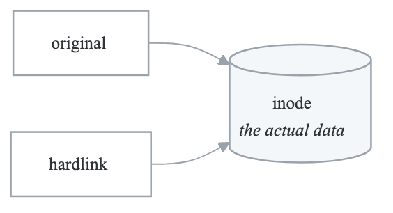
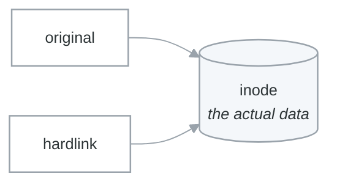
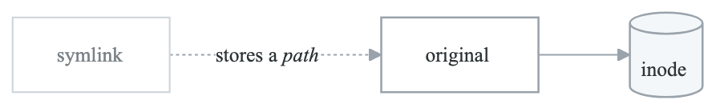
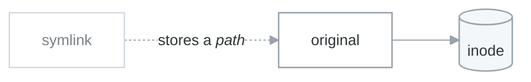

# Module 3: File System Navigation

## Introduction

The Linux file system has a well-defined structure that differs significantly from Windows. Understanding this hierarchy is essential for system administration, troubleshooting, and automation.

## Learning Objectives

After completing this module, you will be able to:
- Explain the Linux Filesystem Hierarchy Standard (FHS)
- Navigate important system directories
- Understand file types in Linux
- Work with absolute and relative paths
- Use find and locate commands effectively

## The Filesystem Hierarchy

### Root Directory Structure

**Linux filesystem hierarchy**

| Path | Holds |
|---|---|
| `/` | The root of everything — there is no second root, and no drive letters |
| `/bin/` | Essential user binaries |
| `/boot/` | Kernel and boot loader files |
| `/dev/` | Device files |
| `/etc/` | System configuration — text, editable, and the first place to look |
| `/home/` | User home directories (`/home/alice`, `/home/bob`) |
| `/lib/` | Shared libraries |
| `/media/` | Mount points for removable media |
| `/mnt/` | Temporary mount points |
| `/opt/` | Optional and third-party software |
| `/proc/` | A virtual filesystem: process and kernel state, as files |
| `/root/` | The root user's home — *not* `/` |
| `/run/` | Runtime state since boot |
| `/sbin/` | System binaries |
| `/srv/` | Data served by this machine |
| `/sys/` | A virtual filesystem: kernel and device attributes |
| `/tmp/` | Temporary files, often cleared on reboot |
| `/usr/` | User programs and data — `bin/`, `lib/`, `local/`, `share/` |
| `/var/` | Variable data — `log/`, `cache/`, `www/` |

Two of these are not files on a disk at all. `/proc` and `/sys` are generated by the kernel on
demand, which is why `cat /proc/meminfo` is a system call wearing a filename, and why you cannot back
them up.

The pair that catches people is `/usr/local` versus `/opt`: `/usr/local` is for things you compiled
yourself into the standard layout, `/opt` is for self-contained vendor packages that keep their own
directory tree.

### Directory Purposes

```yaml
important_directories:
  /etc:
    purpose: "System configuration files"
    examples:
      - "/etc/passwd - User accounts"
      - "/etc/hosts - Static hostname mapping"
      - "/etc/ssh/sshd_config - SSH server config"
      - "/etc/nginx/nginx.conf - Nginx config"
    note: "Most config files are here"

  /var:
    purpose: "Variable data that changes during operation"
    subdirectories:
      /var/log: "System and application logs"
      /var/cache: "Application caches"
      /var/lib: "Application state data"
      /var/www: "Web content (commonly)"
      /var/spool: "Print/mail queues"

  /home:
    purpose: "User home directories"
    structure: "/home/<username>"
    note: "Users have read/write access here"

  /tmp:
    purpose: "Temporary files"
    notes:
      - "Usually cleared on reboot"
      - "World-writable (with sticky bit)"
      - "Don't store important data here"

  /opt:
    purpose: "Optional third-party software"
    examples:
      - "/opt/google/chrome"
      - "/opt/lampp"
    note: "Self-contained applications"

  /proc:
    purpose: "Virtual filesystem for process info"
    examples:
      - "/proc/cpuinfo - CPU information"
      - "/proc/meminfo - Memory information"
      - "/proc/<pid> - Per-process info"
    note: "Not real files; generated dynamically"

  /dev:
    purpose: "Device files"
    examples:
      - "/dev/sda - First hard disk"
      - "/dev/null - Null device (discard)"
      - "/dev/random - Random number generator"
      - "/dev/tty - Current terminal"
```

## Paths

### Absolute vs Relative Paths

**Absolute and relative paths**

| | Absolute | Relative |
|---|---|---|
| Starts with | `/` | anything else |
| Example | `/home/alice/documents/report.txt` | `documents/report.txt` |
| Resolved from | The root of the filesystem | Your current directory |
| Ambiguity | None — means the same thing everywhere | Depends entirely on where you are |
| Typing | Long | Short |

```text
documents/report.txt     from /home/alice
../bob/notes.txt         up one level, then into bob
./script.sh              explicitly "in this directory"
```

`./` is not decoration. `script.sh` searches `$PATH`; `./script.sh` runs the file in front of you.
That distinction is why `.` is not on `$PATH` by default — if it were, a file named `ls` dropped in a
directory you `cd` into would run instead of the real one.

### Special Path Notations

```bash
# Current directory
./script.sh              # Run script in current dir
cp ./file.txt /tmp/      # Explicit current directory

# Parent directory
cd ..                    # Go up one level
ls ../../               # List grandparent directory
cp ../file.txt .        # Copy from parent to here

# Home directory
cd ~                    # Go to home
ls ~/documents          # List documents in home
~alice                  # Alice's home directory

# Previous directory
cd -                    # Go to previous directory
```

## File Types

### Linux File Types

```yaml
file_types:
  regular_file:
    symbol: "-"
    description: "Normal files (text, binary, etc.)"
    example: "-rw-r--r-- 1 user group 1234 file.txt"

  directory:
    symbol: "d"
    description: "Container for files and directories"
    example: "drwxr-xr-x 2 user group 4096 mydir/"

  symbolic_link:
    symbol: "l"
    description: "Pointer to another file"
    example: "lrwxrwxrwx 1 user group 11 link -> target"

  block_device:
    symbol: "b"
    description: "Block storage devices (disks)"
    example: "brw-rw---- 1 root disk 8, 0 /dev/sda"

  character_device:
    symbol: "c"
    description: "Character devices (terminals)"
    example: "crw-rw-rw- 1 root tty 5, 0 /dev/tty"

  socket:
    symbol: "s"
    description: "Inter-process communication"
    example: "srwxrwxrwx 1 mysql mysql 0 mysql.sock"

  named_pipe:
    symbol: "p"
    description: "FIFO for process communication"
    example: "prw-r--r-- 1 user group 0 mypipe"
```

### Identifying File Types

```bash
# Using ls -l (first character)
ls -l
# -rw-r--r--  regular file
# drwxr-xr-x  directory
# lrwxrwxrwx  symbolic link

# Using file command
file document.pdf
# document.pdf: PDF document, version 1.4

file script.sh
# script.sh: Bourne-Again shell script, ASCII text

file /dev/sda
# /dev/sda: block special (8/0)

# Using stat
stat file.txt
```

## Links

### Hard Links vs Symbolic Links

**Hard link**

<!-- figure: generated from the Mermaid below by _shared/diagrams/embed-figures.py — do not edit the image -->


<details>
<summary>Diagram source (Mermaid)</summary>



</details>

Both names point at the *same inode*. There is no original — only two names with equal standing, and
the data survives until the last one is removed.

- Same inode number (`ls -i` proves it)
- Must live on the same filesystem
- Deleting either name leaves the other working
- Cannot be made to a directory

**Symbolic link**

<!-- figure: generated from the Mermaid below by _shared/diagrams/embed-figures.py — do not edit the image -->


<details>
<summary>Diagram source (Mermaid)</summary>



</details>

A symlink stores a *path*, not an inode. It is resolved every time it is followed, which is what makes
it both more flexible and more fragile.

- Points at a path or name, resolved on each access
- Can cross filesystems
- Can point at a directory
- Becomes a dangling link the moment the target is removed or renamed

### Working with Links

```bash
# Create hard link
ln original.txt hardlink.txt
ls -li     # Same inode number

# Create symbolic link
ln -s original.txt symlink.txt
ln -s /var/log/syslog ~/logs

# View link target
readlink symlink.txt
ls -l symlink.txt

# Find broken symlinks
find /path -xtype l

# Common symlink uses
ln -s /etc/nginx/sites-available/mysite /etc/nginx/sites-enabled/
```

## Finding Files

### find Command

```bash
# Find by name
find /home -name "*.txt"
find . -name "config.yml"
find / -name "nginx.conf" 2>/dev/null

# Case insensitive
find . -iname "readme*"

# Find by type
find /var -type f              # Regular files
find /etc -type d              # Directories
find /usr -type l              # Symbolic links

# Find by size
find /home -size +100M         # Larger than 100MB
find /tmp -size -1k            # Smaller than 1KB

# Find by time
find /var/log -mtime -1        # Modified in last day
find . -mmin -60               # Modified in last hour
find . -atime +30              # Accessed more than 30 days ago

# Find by permissions
find /home -perm 777           # Exact permissions
find . -perm -u=x              # User has execute

# Find by owner
find /home -user alice
find /var -group www-data

# Execute command on results
find . -name "*.log" -exec rm {} \;
find . -name "*.sh" -exec chmod +x {} \;
find . -type f -name "*.txt" -exec grep "pattern" {} +

# Multiple criteria
find /var -type f -name "*.log" -size +10M -mtime +7
```

### locate Command

```bash
# Install (if not present)
sudo apt install mlocate

# Update database
sudo updatedb

# Search
locate nginx.conf
locate -i readme        # Case insensitive
locate -c "*.py"        # Count results

# Note: locate uses a database, faster but may be outdated
# Use find for real-time searches
```

### which and whereis

```bash
# Find executable in PATH
which python
which -a python         # All matches

# Find binary, source, manual
whereis nginx
whereis -b python       # Binary only
whereis -m grep         # Manual only
```

## Practical Navigation

### Efficient Navigation

```bash
# Use tab completion
cd /etc/ng<TAB>         # Completes to nginx/

# Use wildcards
ls /etc/*.conf
cp *.txt backup/

# Use brace expansion
mkdir -p project/{src,tests,docs}
cp file.txt{,.bak}      # Create backup

# Navigate quickly
cd -                    # Previous directory
pushd /var/log          # Push to stack, go there
popd                    # Return to previous
dirs                    # View directory stack

# Alias common directories
alias logs='cd /var/log'
alias proj='cd ~/projects'
```

### Finding Configuration Files

```bash
# Common patterns
/etc/SERVICE/           # Service config directory
/etc/SERVICE.conf       # Single config file
/etc/SERVICE.d/         # Config fragments

# Examples
ls /etc/nginx/          # Nginx
ls /etc/ssh/            # SSH
cat /etc/hosts          # Host file
```

## Summary

Key points about the Linux filesystem:

1. **Single root** - Everything under `/`
2. **Standard hierarchy** - Predictable locations
3. **Everything is a file** - Even devices
4. **Symbolic links** - Flexible references
5. **find command** - Powerful file searching

## Knowledge Check

1. What is stored in `/etc`?
2. What's the difference between `/bin` and `/usr/bin`?
3. How do hard links differ from symbolic links?
4. How would you find all `.log` files larger than 100MB?
5. What is `/proc` and what type of filesystem is it?

## Next Module

Continue to [Module 4: Users & Permissions](./04-users-permissions.md) to learn about Linux security model.

<!-- feynman-check -->

---

## Feynman check

Close the file. Blank page, no notes. Explain each of these to a competent engineer who has never
used this tool — **under five minutes, no jargon you can't define on the spot:**

- The Filesystem Hierarchy
- Paths
- File Types
- Links

**The gap is not what you forgot. It is where you used a word instead of a mechanism.**

| | |
|---|---|
| ✗ | *"The kernel manages processes."* |
| ✓ | *"A process is an entry in the kernel's task table with its own memory map and file-descriptor table. `fork()` copies it, `exec()` replaces the program inside it, and the parent must call `wait()` or the entry stays behind as a zombie."* |

**Trace it:** `ls -l /etc` → characters on your terminal. Name every syscall and every kernel structure between the keypress and the output.

Stop at the first component you cannot name. Reopen this file and read **only** that.

**Go deeper — only once the gap has a name:** [`man 7 namespaces`](https://man7.org/linux/man-pages/man7/namespaces.7.html) and the [LWN namespaces series](https://lwn.net/Articles/531114/) — the primary sources, not summaries of them.
Full list per domain: [`SOURCES.md`](../../SOURCES.md#linux-networking)

→ Protocol, the three levels of knowing, and worked examples: [`MASTERY.md`](../../MASTERY.md)

<!-- /feynman-check -->
