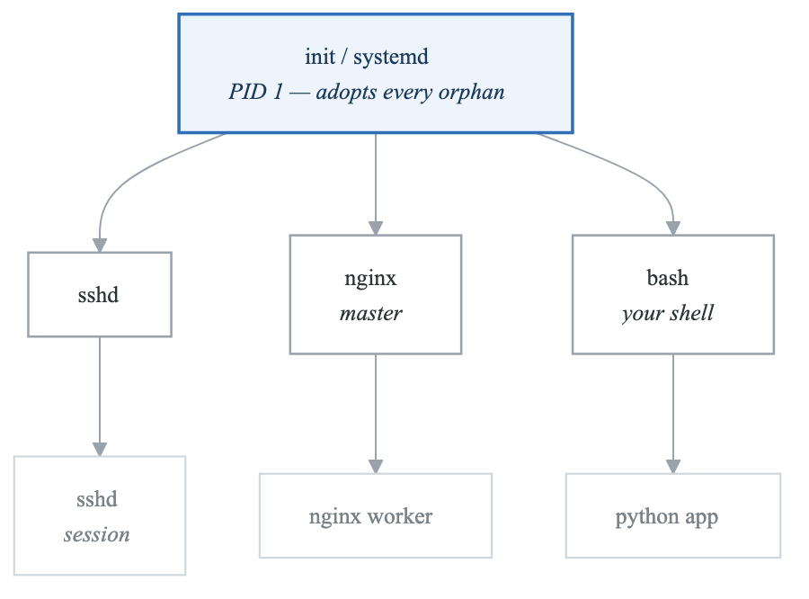
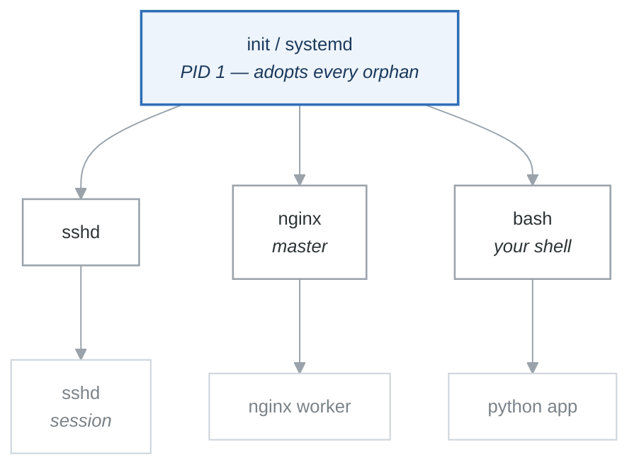

# Module 5: Process Management

## Introduction

Every program running on Linux is a process. Understanding how to view, manage, and control processes is essential for system administration, debugging, and performance optimization. This module covers process fundamentals and management tools.

## Learning Objectives

After completing this module, you will be able to:
- Understand process concepts and states
- Monitor running processes
- Manage process priorities
- Control processes with signals
- Work with systemd services

## Process Fundamentals

### What is a Process?

A process is a running instance of a program, plus the bookkeeping the kernel keeps about it:

| Attribute | What it is |
|---|---|
| Process ID (PID) | Unique identifier |
| Parent PID (PPID) | The PID of the process that started this one |
| User ID (UID) | Owner of the process — decides what it may touch |
| State | Running, sleeping, uninterruptible, stopped, zombie |
| Priority / nice | Scheduling priority, −20 (greediest) to 19 (most polite) |
| Memory | Virtual and resident usage |
| CPU time | Cumulative, across all threads |
| File descriptors | Open files, sockets, pipes |

**Process hierarchy**

<!-- figure: generated from the Mermaid below by _shared/diagrams/embed-figures.py — do not edit the image -->


<details>
<summary>Diagram source (Mermaid)</summary>



</details>

Every process except PID 1 has a parent. When a parent dies first, its children are re-parented to
PID 1 — which is why `systemd` ends up owning the leftovers, and why a process whose PPID is 1 when
you did not expect it is a sign that something above it exited.

### Process States

```bash
# Process states shown in ps output
PROCESS STATES
═══════════════════════════════════════════════════════════════════════════════

R - Running       # Currently executing or ready to run
S - Sleeping      # Waiting for event (interruptible)
D - Disk Sleep    # Waiting for I/O (uninterruptible)
T - Stopped       # Stopped by signal (Ctrl+Z)
Z - Zombie        # Terminated but not reaped by parent
I - Idle          # Kernel thread waiting

Additional characters:
< - High priority (not nice to others)
N - Low priority (nice to others)
L - Pages locked in memory
s - Session leader
l - Multi-threaded
+ - Foreground process group
```

## Viewing Processes

### The ps Command

```bash
# Basic process list
ps

# All processes
ps aux

# All processes with full format
ps -ef

# Process tree
ps axjf

# Custom output
ps -eo pid,ppid,user,%cpu,%mem,stat,cmd

# Filter by user
ps -u username

# Filter by name
ps aux | grep nginx

# Show threads
ps -eLf
```

### Understanding ps Output

```bash
# ps aux columns
USER       # Process owner
PID        # Process ID
%CPU       # CPU usage percentage
%MEM       # Memory usage percentage
VSZ        # Virtual memory size (KB)
RSS        # Resident set size - physical memory (KB)
TTY        # Terminal
STAT       # Process state
START      # Start time
TIME       # CPU time consumed
COMMAND    # Command with arguments

# Example output
$ ps aux | head
USER       PID %CPU %MEM    VSZ   RSS TTY   STAT START   TIME COMMAND
root         1  0.0  0.1 168936 11792 ?     Ss   08:00   0:02 /sbin/init
root         2  0.0  0.0      0     0 ?     S    08:00   0:00 [kthreadd]
```

### The top Command

```bash
# Interactive process monitor
top

# Top keyboard shortcuts:
# h - Help
# q - Quit
# k - Kill process
# r - Renice process
# M - Sort by memory
# P - Sort by CPU
# c - Show full command
# 1 - Show individual CPUs
# u - Filter by user
# f - Add/remove fields

# Run top in batch mode
top -b -n 1 > process_snapshot.txt

# Show specific user
top -u username
```

### htop - Enhanced Process Viewer

```bash
# Install htop
sudo apt install htop  # Debian/Ubuntu
sudo yum install htop  # RHEL/CentOS

# Run htop
htop

# htop features:
# - Color-coded output
# - Mouse support
# - Horizontal and vertical scrolling
# - Tree view
# - Search and filter
# - Easy process killing

# Keyboard shortcuts:
# F1 - Help
# F2 - Setup
# F3 - Search
# F4 - Filter
# F5 - Tree view
# F6 - Sort by
# F9 - Kill
# F10 - Quit
```

## Process Control

### Foreground and Background

```bash
# Run in foreground (default)
./long_running_script.sh

# Run in background
./long_running_script.sh &

# Suspend foreground process
# Press Ctrl+Z

# Resume in background
bg

# Resume in foreground
fg

# List background jobs
jobs
jobs -l  # With PIDs

# Bring specific job to foreground
fg %1    # Job number 1
fg %+    # Current job
fg %-    # Previous job
```

### Process Signals

```bash
# Common signals
SIGNAL     NUMBER  ACTION
═══════════════════════════════════════════════════════════════════════════════
SIGHUP     1       Hangup - reload configuration
SIGINT     2       Interrupt (Ctrl+C)
SIGQUIT    3       Quit with core dump (Ctrl+\)
SIGKILL    9       Force kill (cannot be caught)
SIGTERM    15      Graceful termination (default)
SIGSTOP    19      Stop (cannot be caught)
SIGCONT    18      Continue if stopped
SIGUSR1    10      User-defined signal 1
SIGUSR2    12      User-defined signal 2

# Send signals
kill PID              # Send SIGTERM
kill -9 PID           # Send SIGKILL
kill -HUP PID         # Send SIGHUP
kill -STOP PID        # Suspend process
kill -CONT PID        # Resume process

# Kill by name
killall processname
pkill processname

# Kill with pattern
pkill -f "python script.py"
```

### Process Priority (Nice)

```bash
# Nice values: -20 (highest) to 19 (lowest)
# Default: 0

# Start process with nice value
nice -n 10 ./cpu_intensive_script.sh

# Change priority of running process
renice 10 -p PID
renice -5 -p PID      # Requires root for negative

# View nice values
ps -eo pid,ni,comm

# Run with highest priority (root only)
sudo nice -n -20 ./important_process
```

## Process Information

### /proc Filesystem

```bash
# Each process has a directory in /proc
ls /proc/PID/

# Important files
/proc/PID/cmdline    # Command line arguments
/proc/PID/environ    # Environment variables
/proc/PID/fd/        # File descriptors
/proc/PID/status     # Process status
/proc/PID/maps       # Memory maps
/proc/PID/cwd        # Current working directory
/proc/PID/exe        # Executable path

# Read process info
cat /proc/PID/status
cat /proc/PID/cmdline | tr '\0' ' '

# List open files
ls -l /proc/PID/fd/
```

### lsof - List Open Files

```bash
# List all open files
lsof

# Files opened by process
lsof -p PID

# Files opened by user
lsof -u username

# Network connections
lsof -i
lsof -i :80
lsof -i tcp
lsof -i udp

# Files in a directory
lsof +D /var/log

# Find process using file
lsof /var/log/syslog

# Find process using port
lsof -i :8080
```

## Systemd Service Management

### Systemd Basics

```bash
# Check service status
systemctl status nginx

# Start/stop services
sudo systemctl start nginx
sudo systemctl stop nginx

# Enable/disable at boot
sudo systemctl enable nginx
sudo systemctl disable nginx

# Restart and reload
sudo systemctl restart nginx
sudo systemctl reload nginx

# List services
systemctl list-units --type=service
systemctl list-units --type=service --state=running

# Check if enabled
systemctl is-enabled nginx
systemctl is-active nginx
```

### Viewing Service Logs

```bash
# View service logs with journalctl
journalctl -u nginx

# Follow logs in real-time
journalctl -u nginx -f

# Logs since boot
journalctl -u nginx -b

# Logs since time
journalctl -u nginx --since "2024-01-01"
journalctl -u nginx --since "1 hour ago"

# Last N lines
journalctl -u nginx -n 50
```

### Creating Systemd Services

```bash
# Create service file
sudo nano /etc/systemd/system/myapp.service

# Service file content:
[Unit]
Description=My Application
After=network.target

[Service]
Type=simple
User=appuser
WorkingDirectory=/opt/myapp
ExecStart=/opt/myapp/run.sh
ExecStop=/opt/myapp/stop.sh
Restart=always
RestartSec=10
StandardOutput=journal
StandardError=journal

[Install]
WantedBy=multi-user.target

# Reload systemd and start service
sudo systemctl daemon-reload
sudo systemctl enable myapp
sudo systemctl start myapp
```

### Service Types

```yaml
service_types:
  simple:
    description: "Default. Process started by ExecStart is main process"
    use_case: "Most applications"

  forking:
    description: "Process forks and parent exits"
    use_case: "Traditional daemons"
    requires: "PIDFile="

  oneshot:
    description: "Process expected to exit"
    use_case: "Initialization scripts"

  notify:
    description: "Like simple, but sends notification when ready"
    use_case: "Applications supporting sd_notify"

  idle:
    description: "Like simple, but delayed until other jobs done"
    use_case: "Console output ordering"
```

## Process Monitoring Scripts

### CPU/Memory Monitor

```bash
#!/bin/bash
# monitor-process.sh

PROCESS_NAME=${1:-nginx}
LOG_FILE="/var/log/process-monitor.log"

while true; do
    TIMESTAMP=$(date '+%Y-%m-%d %H:%M:%S')

    # Get process stats
    STATS=$(ps aux | grep -v grep | grep "$PROCESS_NAME" | \
            awk '{cpu+=$3; mem+=$4; count++} END {
                print "processes="count, "cpu="cpu, "mem="mem
            }')

    echo "$TIMESTAMP $PROCESS_NAME $STATS" >> "$LOG_FILE"

    sleep 60
done
```

### Watchdog Script

```bash
#!/bin/bash
# watchdog.sh - Restart service if not running

SERVICE_NAME=${1:-nginx}
MAX_RESTARTS=3
RESTART_COUNT=0

check_service() {
    systemctl is-active --quiet "$SERVICE_NAME"
}

while true; do
    if ! check_service; then
        echo "$(date): $SERVICE_NAME is not running"

        if [ $RESTART_COUNT -lt $MAX_RESTARTS ]; then
            echo "Attempting restart..."
            sudo systemctl restart "$SERVICE_NAME"
            ((RESTART_COUNT++))
            sleep 10

            if check_service; then
                echo "$SERVICE_NAME restarted successfully"
            else
                echo "Failed to restart $SERVICE_NAME"
            fi
        else
            echo "Max restarts reached. Manual intervention required."
            # Send alert here
            exit 1
        fi
    else
        RESTART_COUNT=0  # Reset counter if running
    fi

    sleep 30
done
```

## Troubleshooting

### Finding Resource-Heavy Processes

```bash
# Top 10 CPU consumers
ps aux --sort=-%cpu | head -11

# Top 10 memory consumers
ps aux --sort=-%mem | head -11

# Find zombie processes
ps aux | awk '$8 == "Z"'

# Find processes by memory usage
ps -eo pid,ppid,cmd,%mem,%cpu --sort=-%mem | head

# Monitor in real-time
watch -n 1 'ps aux --sort=-%cpu | head -10'
```

### Dealing with Zombie Processes

```bash
# Find zombies
ps aux | grep 'Z'

# Find parent of zombie
ps -eo pid,ppid,stat,cmd | grep 'Z'

# The parent should reap the zombie
# If parent is stuck, restart or kill parent
kill -CHLD PPID    # Ask parent to reap
kill PPID          # Terminate parent
```

## Summary

Key process management concepts:

1. **ps, top, htop** for viewing processes
2. **Signals** control process behavior
3. **Nice values** manage priority
4. **Background/foreground** for job control
5. **Systemd** manages services

## Knowledge Check

1. What is the difference between SIGTERM and SIGKILL?
2. How do you run a process in the background?
3. What does a zombie process indicate?
4. How do you change the priority of a running process?
5. How do you create a systemd service?

## Next Module

Continue to [Module 6: Package Management](./06-package-management.md) for managing software packages.

<!-- feynman-check -->

---

## Feynman check

Close the file. Blank page, no notes. Explain each of these to a competent engineer who has never
used this tool — **under five minutes, no jargon you can't define on the spot:**

- Process Fundamentals
- Viewing Processes
- Process Control
- Process Information

**The gap is not what you forgot. It is where you used a word instead of a mechanism.**

| | |
|---|---|
| ✗ | *"The kernel manages processes."* |
| ✓ | *"A process is an entry in the kernel's task table with its own memory map and file-descriptor table. `fork()` copies it, `exec()` replaces the program inside it, and the parent must call `wait()` or the entry stays behind as a zombie."* |

**Trace it:** `ls -l /etc` → characters on your terminal. Name every syscall and every kernel structure between the keypress and the output.

Stop at the first component you cannot name. Reopen this file and read **only** that.

**Go deeper — only once the gap has a name:** [`man 7 namespaces`](https://man7.org/linux/man-pages/man7/namespaces.7.html) and the [LWN namespaces series](https://lwn.net/Articles/531114/) — the primary sources, not summaries of them.
Full list per domain: [`SOURCES.md`](../../SOURCES.md#linux-networking)

→ Protocol, the three levels of knowing, and worked examples: [`MASTERY.md`](../../MASTERY.md)

<!-- /feynman-check -->
