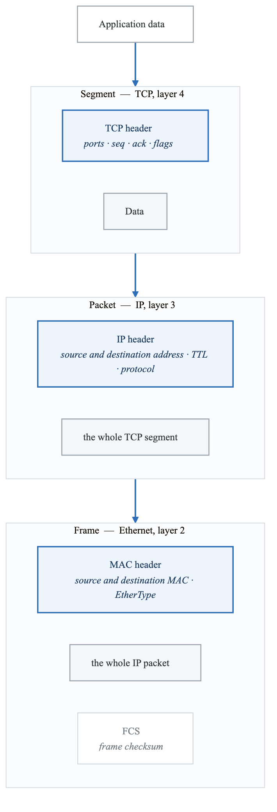
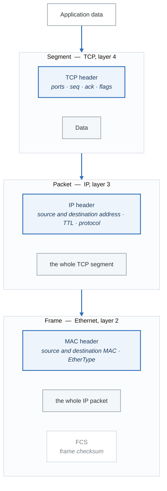
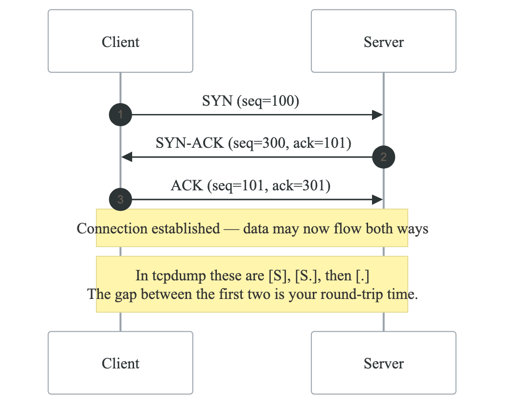
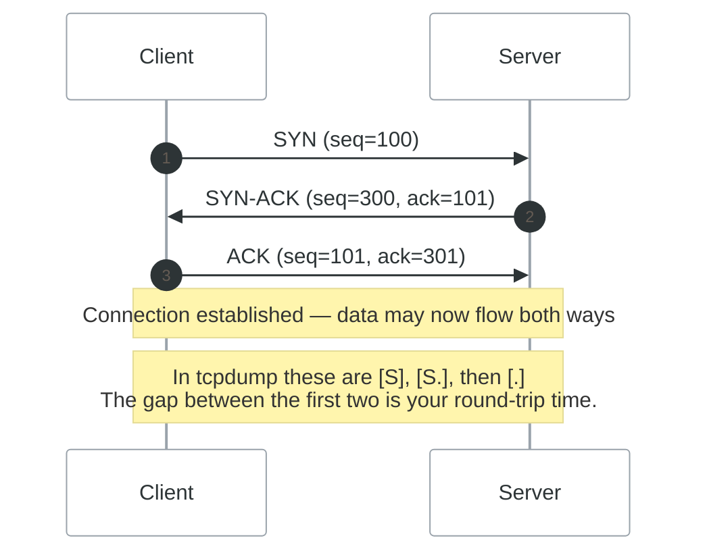
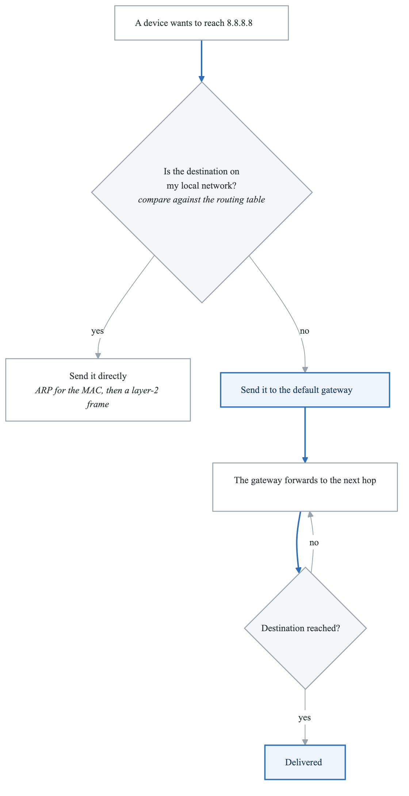
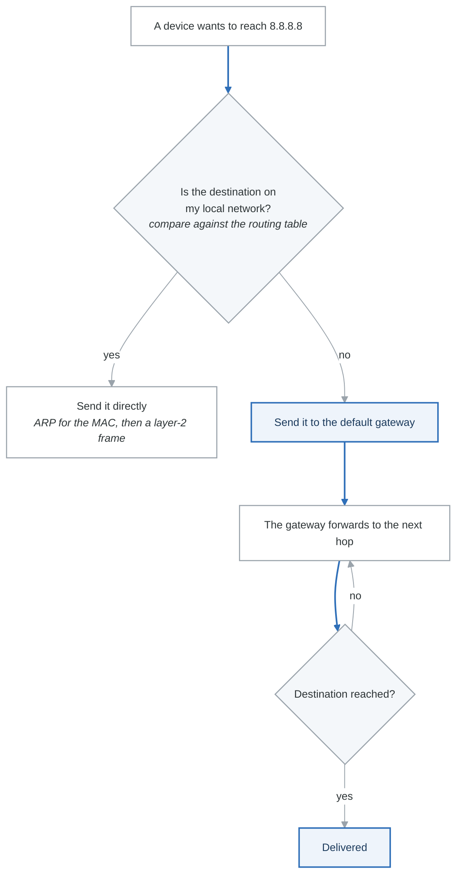
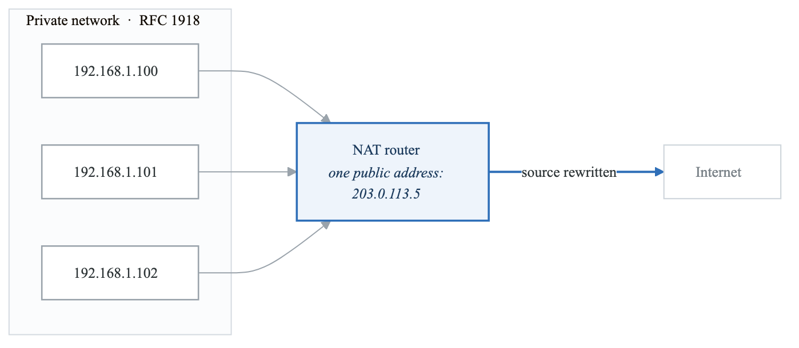
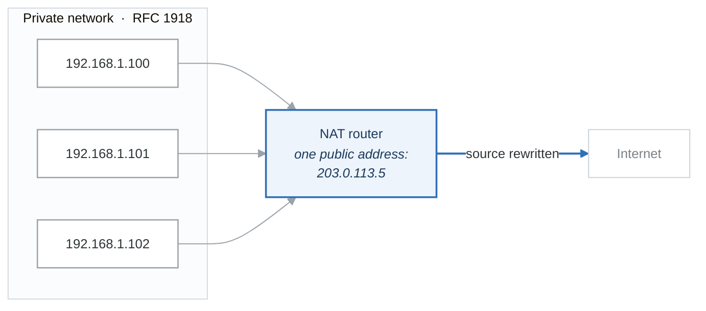

# Module 8: Networking Fundamentals

## Introduction

Understanding networking is critical for DevOps. From debugging connectivity issues to configuring cloud infrastructure, networking knowledge is used daily. This module covers the fundamentals of how networks operate.

## Learning Objectives

After completing this module, you will be able to:
- Explain the OSI and TCP/IP models
- Understand IP addressing and subnetting
- Describe how TCP and UDP work
- Explain routing and NAT
- Use common networking commands

## Network Models

### OSI Model

**The OSI model**

| Layer | Name | Function | Examples |
|---|---|---|---|
| 7 | Application | User-facing services | HTTP, FTP, SMTP, SSH |
| 6 | Presentation | Format and encryption | TLS, JPEG, character encodings |
| 5 | Session | Connection management | RPC, NetBIOS |
| 4 | Transport | End-to-end delivery | TCP, UDP |
| 3 | Network | Routing and addressing | IP, ICMP, ARP |
| 2 | Data link | Addressing on the local segment | Ethernet, MAC |
| 1 | Physical | Bits on a wire or radio | Cables, optics, Wi-Fi |

Mnemonic, bottom to top: *"Please Do Not Throw Sausage Pizza Away."*

In practice you will say "layer 4" and "layer 7" constantly — a network load balancer is L4, an
application load balancer is L7 — and almost never mention 5 or 6.

### TCP/IP Model

**The TCP/IP model** — what is actually implemented

| Layer | OSI equivalent | Protocols | Function |
|---|---|---|---|
| Application | 5, 6, 7 | HTTP, SSH, DNS | Application services |
| Transport | 4 | TCP, UDP | End-to-end delivery |
| Internet | 3 | IP, ICMP | Routing and addressing |
| Network access | 1, 2 | Ethernet, Wi-Fi | Getting a frame onto the medium |

OSI is the teaching model; TCP/IP is the one your kernel implements. When the two disagree, the
four-layer model is the one describing reality.

### Data Encapsulation

<!-- figure: generated from the Mermaid below by _shared/diagrams/embed-figures.py — do not edit the image -->


<details>
<summary>Diagram source (Mermaid)</summary>



</details>

## IP Addressing

### IPv4 Addresses

```yaml
ipv4_structure:
  format: "32-bit number in dotted decimal"
  example: "192.168.1.100"

  components:
    network_portion: "Identifies the network"
    host_portion: "Identifies the device"

  classes:
    A:
      range: "1.0.0.0 - 126.255.255.255"
      default_mask: "255.0.0.0 (/8)"
      networks: "128"
      hosts_per_network: "16,777,214"

    B:
      range: "128.0.0.0 - 191.255.255.255"
      default_mask: "255.255.0.0 (/16)"
      networks: "16,384"
      hosts_per_network: "65,534"

    C:
      range: "192.0.0.0 - 223.255.255.255"
      default_mask: "255.255.255.0 (/24)"
      networks: "2,097,152"
      hosts_per_network: "254"
```

### Private IP Ranges

```yaml
private_ranges:
  class_A:
    range: "10.0.0.0 - 10.255.255.255"
    cidr: "10.0.0.0/8"
    use: "Large organizations"

  class_B:
    range: "172.16.0.0 - 172.31.255.255"
    cidr: "172.16.0.0/12"
    use: "Medium organizations"

  class_C:
    range: "192.168.0.0 - 192.168.255.255"
    cidr: "192.168.0.0/16"
    use: "Home networks, small offices"

  special:
    loopback: "127.0.0.0/8 (localhost)"
    link_local: "169.254.0.0/16 (APIPA)"
```

### Subnetting

**Subnet masks and CIDR**

| CIDR | Subnet mask | Usable hosts |
|---|---|---|
| `/24` | 255.255.255.0 | 254 |
| `/25` | 255.255.255.128 | 126 |
| `/26` | 255.255.255.192 | 62 |
| `/27` | 255.255.255.224 | 30 |
| `/28` | 255.255.255.240 | 14 |
| `/29` | 255.255.255.248 | 6 |
| `/30` | 255.255.255.252 | 2 |

**Worked example — `192.168.1.0/24`**

| | |
|---|---|
| Network address | 192.168.1.0 |
| First host | 192.168.1.1 |
| Last host | 192.168.1.254 |
| Broadcast | 192.168.1.255 |
| Usable hosts | 254 |

Every subnet loses two addresses — the network address and the broadcast address — which is why the
count is always two below the power of two. Cloud providers take more: AWS reserves five addresses
in every subnet, so a `/28` there gives you 11 usable, not 14.

### IPv6 Basics

```yaml
ipv6:
  format: "128-bit address in hexadecimal"
  example: "2001:0db8:85a3:0000:0000:8a2e:0370:7334"
  shortened: "2001:db8:85a3::8a2e:370:7334"

  benefits:
    - Larger address space (340 undecillion)
    - Simplified header
    - No NAT required
    - Built-in IPsec

  special_addresses:
    loopback: "::1"
    link_local: "fe80::/10"
    unique_local: "fc00::/7"
```

## TCP and UDP

### TCP (Transmission Control Protocol)

```yaml
tcp_characteristics:
  type: "Connection-oriented"
  reliability: "Guaranteed delivery"
  ordering: "Maintains packet order"
  flow_control: "Yes (sliding window)"
  error_checking: "Yes (checksums, retransmission)"

  use_cases:
    - Web browsing (HTTP/HTTPS)
    - Email (SMTP, IMAP, POP3)
    - File transfer (FTP, SFTP)
    - Remote access (SSH)
    - Database connections
```

### TCP Three-Way Handshake

<!-- figure: generated from the Mermaid below by _shared/diagrams/embed-figures.py — do not edit the image -->


<details>
<summary>Diagram source (Mermaid)</summary>



</details>

### UDP (User Datagram Protocol)

```yaml
udp_characteristics:
  type: "Connectionless"
  reliability: "No guarantee"
  ordering: "No ordering"
  flow_control: "No"
  overhead: "Low (8-byte header)"

  use_cases:
    - DNS queries
    - Video streaming
    - Voice over IP (VoIP)
    - Online gaming
    - Time synchronization (NTP)
```

### TCP vs UDP

**TCP and UDP**

| | TCP | UDP |
|---|---|---|
| Connection | Three-way handshake before any data | None |
| Reliability | Guaranteed — retransmits what is lost | Best effort |
| Ordering | Preserved | Not guaranteed |
| Speed | Slower — acknowledgements and congestion control | Faster |
| Header | 20+ bytes | 8 bytes |
| Choose when | Correctness matters more than latency | Latency matters more than correctness |
| Examples | HTTP, email, SSH | DNS, video streaming, games, QUIC |

UDP is not "unreliable TCP" — it is the absence of a policy. Anything that needs reliability on top
of UDP implements its own, which is exactly what QUIC (and therefore HTTP/3) does, to escape TCP's
head-of-line blocking.

## Common Ports

```yaml
well_known_ports:
  20:  "FTP Data"
  21:  "FTP Control"
  22:  "SSH"
  23:  "Telnet"
  25:  "SMTP"
  53:  "DNS"
  67:  "DHCP Server"
  68:  "DHCP Client"
  80:  "HTTP"
  110: "POP3"
  123: "NTP"
  143: "IMAP"
  443: "HTTPS"
  465: "SMTPS"
  993: "IMAPS"
  995: "POP3S"
  3306: "MySQL"
  3389: "RDP"
  5432: "PostgreSQL"
  6379: "Redis"
  8080: "HTTP Alternate"
  27017: "MongoDB"
```

## Routing

### How Routing Works

**How a packet gets routed**

<!-- figure: generated from the Mermaid below by _shared/diagrams/embed-figures.py — do not edit the image -->


<details>
<summary>Diagram source (Mermaid)</summary>



</details>

Every router repeats exactly this decision. The TTL field is what stops the loop when the routing
table is wrong — each hop decrements it, and at zero the packet is dropped and an ICMP
*time exceeded* is returned. That reply is what `traceroute` reads.

### Routing Table

```bash
# View routing table
ip route
# or
route -n
# or
netstat -rn

# Example output:
# Destination     Gateway         Genmask         Flags Metric Iface
# 0.0.0.0         192.168.1.1     0.0.0.0         UG    100    eth0
# 192.168.1.0     0.0.0.0         255.255.255.0   U     100    eth0
```

```yaml
routing_table_explained:
  default_route:
    destination: "0.0.0.0/0"
    meaning: "Route for all unknown destinations"
    gateway: "Your router/default gateway"

  local_network:
    destination: "192.168.1.0/24"
    gateway: "0.0.0.0 (direct connection)"
    meaning: "Send directly on this interface"
```

## NAT (Network Address Translation)

### How NAT Works

<!-- figure: generated from the Mermaid below by _shared/diagrams/embed-figures.py — do not edit the image -->


<details>
<summary>Diagram source (Mermaid)</summary>



</details>

The router keeps a translation table so it knows which reply belongs to which host. The *port* is
what makes one public address serve many hosts:

| Internal IP:port | External IP:port | Destination |
|---|---|---|
| 192.168.1.100:34521 | 203.0.113.5:10001 | 8.8.8.8:53 |
| 192.168.1.101:45632 | 203.0.113.5:10002 | 1.1.1.1:443 |

This table is also why an inbound connection cannot simply arrive: with no entry to match, the router
has no idea which internal host it belongs to. Port forwarding is a hand-written row.

### NAT Types

```yaml
nat_types:
  snat:
    name: "Source NAT"
    use: "Outbound traffic from private network"
    example: "Home router sharing one public IP"

  dnat:
    name: "Destination NAT"
    use: "Inbound traffic to private servers"
    example: "Port forwarding to internal server"

  pat:
    name: "Port Address Translation"
    use: "Many-to-one translation using ports"
    alias: "NAT Overload, NAPT"
```

## Networking Commands

### IP Command (Modern)

```bash
# View all interfaces
ip addr
ip a

# View specific interface
ip addr show eth0

# View routing table
ip route

# Add IP address
sudo ip addr add 192.168.1.100/24 dev eth0

# Remove IP address
sudo ip addr del 192.168.1.100/24 dev eth0

# Bring interface up/down
sudo ip link set eth0 up
sudo ip link set eth0 down

# Add route
sudo ip route add 10.0.0.0/8 via 192.168.1.1

# View ARP cache
ip neigh
```

### Classic Commands

```bash
# Interface configuration (deprecated but common)
ifconfig
ifconfig eth0

# Routing (deprecated)
route -n

# ARP cache
arp -a
```

### Connectivity Testing

```bash
# Ping
ping 8.8.8.8
ping -c 4 google.com    # 4 packets only

# Traceroute
traceroute google.com
tracepath google.com

# MTR (combines ping and traceroute)
mtr google.com

# Test port connectivity
nc -zv host 80
telnet host 80
```

### Socket Information

```bash
# ss (modern, preferred)
ss -tuln                # TCP/UDP listening ports
ss -tulnp               # Include process name
ss -s                   # Summary statistics

# netstat (older)
netstat -tuln           # Listening ports
netstat -anp            # All connections with PIDs
```

## Summary

Key networking concepts:

1. **OSI/TCP-IP models** - Layered communication
2. **IP addressing** - Identification and routing
3. **Subnetting** - Network segmentation
4. **TCP vs UDP** - Reliability vs speed
5. **Routing** - Path determination
6. **NAT** - Address translation

## Knowledge Check

1. What are the four layers of the TCP/IP model?
2. What is the purpose of subnetting?
3. Explain the TCP three-way handshake.
4. When would you use UDP instead of TCP?
5. What does NAT do and why is it needed?

## Next Module

Continue to [Module 9: DNS and HTTP](./09-dns-and-http.md) to learn about application protocols.

<!-- feynman-check -->

---

## Feynman check

Close the file. Blank page, no notes. Explain each of these to a competent engineer who has never
used this tool — **under five minutes, no jargon you can't define on the spot:**

- Network Models
- IP Addressing
- TCP and UDP
- Common Ports

**The gap is not what you forgot. It is where you used a word instead of a mechanism.**

| | |
|---|---|
| ✗ | *"The kernel manages processes."* |
| ✓ | *"A process is an entry in the kernel's task table with its own memory map and file-descriptor table. `fork()` copies it, `exec()` replaces the program inside it, and the parent must call `wait()` or the entry stays behind as a zombie."* |

**Trace it:** `ls -l /etc` → characters on your terminal. Name every syscall and every kernel structure between the keypress and the output.

Stop at the first component you cannot name. Reopen this file and read **only** that.

**Go deeper — only once the gap has a name:** [`man 7 namespaces`](https://man7.org/linux/man-pages/man7/namespaces.7.html) and the [LWN namespaces series](https://lwn.net/Articles/531114/) — the primary sources, not summaries of them.
Full list per domain: [`SOURCES.md`](../../SOURCES.md#linux-networking)

→ Protocol, the three levels of knowing, and worked examples: [`MASTERY.md`](../../MASTERY.md)

<!-- /feynman-check -->
