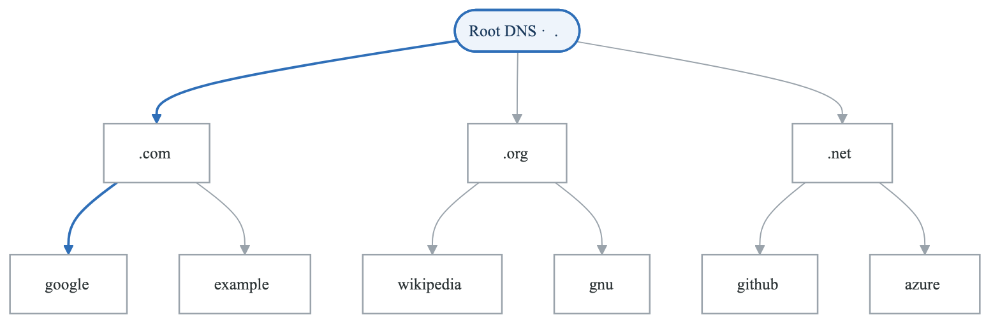
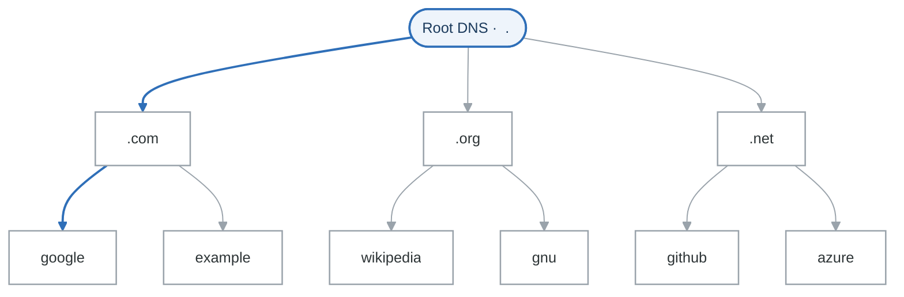
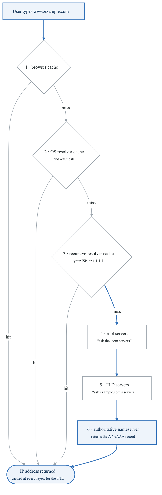
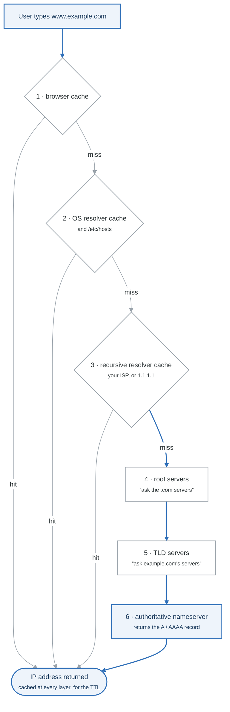
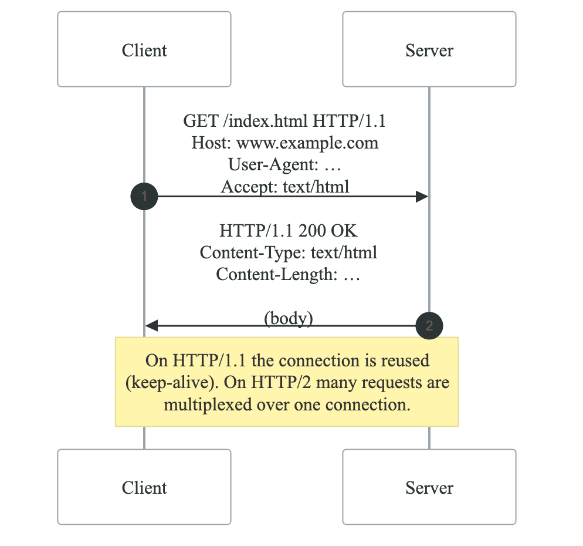
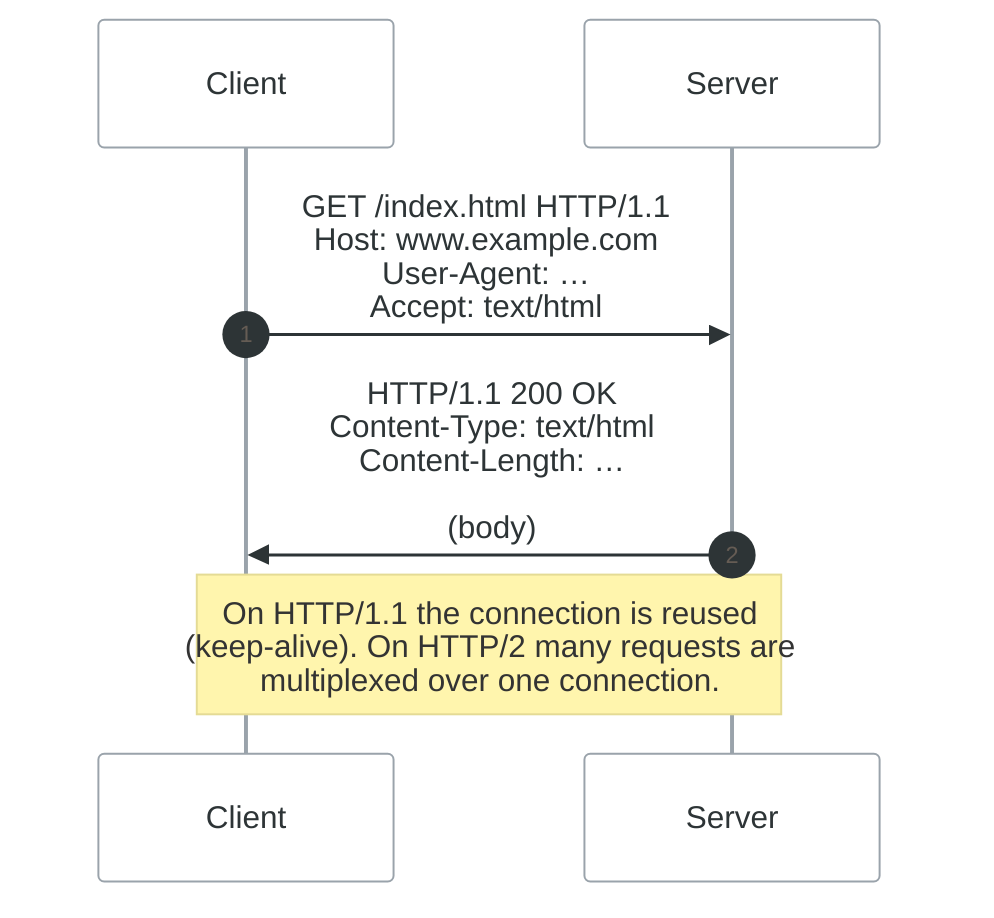
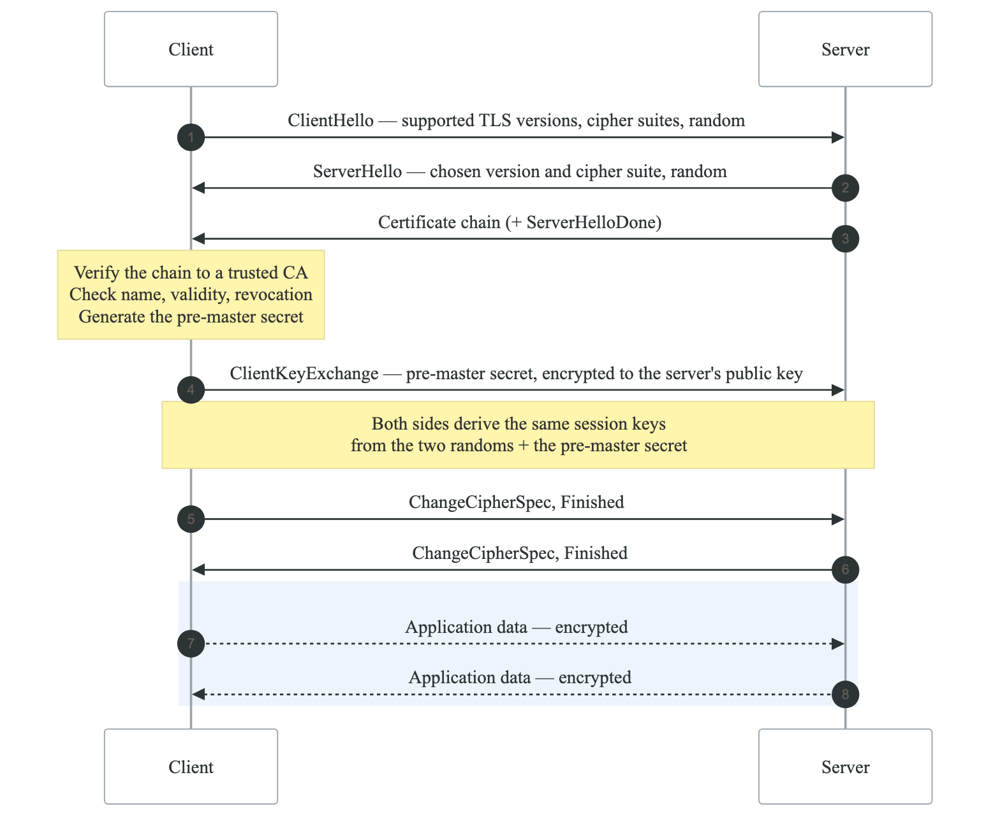
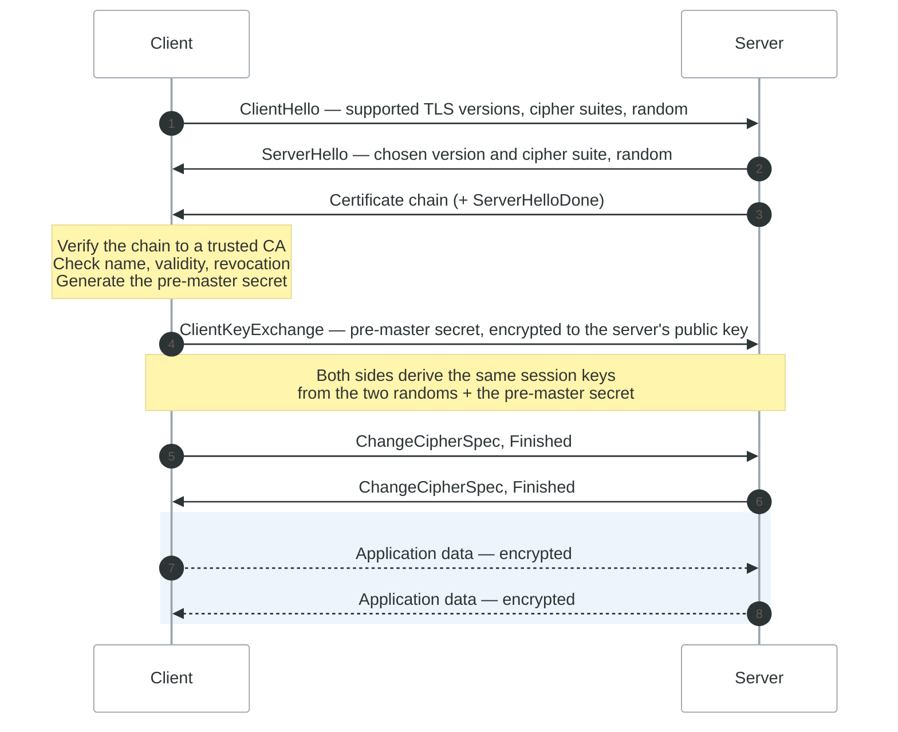

# Module 9: DNS and HTTP

## Introduction

DNS (Domain Name System) and HTTP (Hypertext Transfer Protocol) are fundamental protocols that power the modern internet. Understanding these protocols is essential for DevOps engineers who deploy, troubleshoot, and secure web applications. This module covers DNS resolution and HTTP communication.

## Learning Objectives

After completing this module, you will be able to:
- Understand DNS hierarchy and resolution
- Configure DNS clients and servers
- Explain HTTP/HTTPS communication
- Debug DNS and HTTP issues

## DNS Fundamentals

### DNS Hierarchy

<!-- figure: generated from the Mermaid below by _shared/diagrams/embed-figures.py — do not edit the image -->


<details>
<summary>Diagram source (Mermaid)</summary>



</details>

### DNS Resolution Process

<!-- figure: generated from the Mermaid below by _shared/diagrams/embed-figures.py — do not edit the image -->


<details>
<summary>Diagram source (Mermaid)</summary>



</details>

### DNS Configuration Files

```bash
# Resolver configuration
/etc/resolv.conf

# Example content
nameserver 8.8.8.8
nameserver 8.8.4.4
search example.com internal.example.com
options timeout:2 attempts:3

# Static hostname resolution
/etc/hosts

# Example content
127.0.0.1       localhost
127.0.1.1       myhost.example.com myhost
192.168.1.10    db.local database
10.0.0.50       api.local

# Name service switch configuration
/etc/nsswitch.conf

# hosts line determines resolution order
hosts: files dns mDNS4_minimal [NOTFOUND=return] dns
```

### DNS Query Tools

```bash
# dig - DNS lookup utility
dig example.com
dig example.com A
dig example.com MX
dig example.com TXT
dig +short example.com
dig @8.8.8.8 example.com  # Query specific server
dig +trace example.com     # Show resolution path
dig -x 192.168.1.1        # Reverse lookup

# nslookup - Legacy tool
nslookup example.com
nslookup -type=mx example.com
nslookup example.com 8.8.8.8

# host - Simple lookup
host example.com
host -t MX example.com
host -a example.com

# getent - Query name service
getent hosts example.com
getent ahosts example.com
```

### Understanding dig Output

```bash
$ dig example.com

; <<>> DiG 9.16.1 <<>> example.com
;; global options: +cmd
;; Got answer:
;; ->>HEADER<<- opcode: QUERY, status: NOERROR, id: 12345
;; flags: qr rd ra; QUERY: 1, ANSWER: 1, AUTHORITY: 0, ADDITIONAL: 1

;; QUESTION SECTION:
;example.com.                   IN      A

;; ANSWER SECTION:
example.com.            86400   IN      A       93.184.216.34

;; Query time: 45 msec
;; SERVER: 8.8.8.8#53(8.8.8.8)
;; WHEN: Mon Jan 15 10:00:00 UTC 2024
;; MSG SIZE  rcvd: 56

# Key fields:
# status: NOERROR = success, NXDOMAIN = not found
# flags: qr=query response, rd=recursion desired, ra=recursion available
# 86400 = TTL in seconds
```

## HTTP/HTTPS Fundamentals

### HTTP Protocol Overview

<!-- figure: generated from the Mermaid below by _shared/diagrams/embed-figures.py — do not edit the image -->


<details>
<summary>Diagram source (Mermaid)</summary>



</details>

### HTTP Status Codes

```yaml
status_codes:
  1xx_informational:
    100: Continue
    101: Switching Protocols

  2xx_success:
    200: OK
    201: Created
    204: No Content
    206: Partial Content

  3xx_redirection:
    301: Moved Permanently
    302: Found (Temporary Redirect)
    304: Not Modified
    307: Temporary Redirect
    308: Permanent Redirect

  4xx_client_error:
    400: Bad Request
    401: Unauthorized
    403: Forbidden
    404: Not Found
    405: Method Not Allowed
    408: Request Timeout
    429: Too Many Requests

  5xx_server_error:
    500: Internal Server Error
    502: Bad Gateway
    503: Service Unavailable
    504: Gateway Timeout
```

### HTTP Headers

```bash
# Common Request Headers
Host: www.example.com
User-Agent: Mozilla/5.0 (X11; Linux x86_64)
Accept: text/html,application/json
Accept-Language: en-US,en
Accept-Encoding: gzip, deflate, br
Authorization: Bearer eyJhbGc...
Cookie: session=abc123
Cache-Control: no-cache
Content-Type: application/json
Content-Length: 256

# Common Response Headers
Content-Type: text/html; charset=utf-8
Content-Length: 1234
Content-Encoding: gzip
Cache-Control: max-age=3600
ETag: "abc123"
Last-Modified: Mon, 15 Jan 2024 10:00:00 GMT
Set-Cookie: session=xyz789; HttpOnly; Secure
X-Frame-Options: DENY
Strict-Transport-Security: max-age=31536000
```

### Using curl for HTTP

```bash
# Basic GET request
curl https://example.com

# Show headers
curl -I https://example.com         # Headers only
curl -i https://example.com         # Headers + body

# Verbose output
curl -v https://example.com

# POST request with data
curl -X POST -d "name=value" https://api.example.com/data

# POST JSON
curl -X POST \
  -H "Content-Type: application/json" \
  -d '{"key": "value"}' \
  https://api.example.com/data

# Authentication
curl -u username:password https://api.example.com
curl -H "Authorization: Bearer TOKEN" https://api.example.com

# Follow redirects
curl -L https://example.com

# Save output
curl -o file.html https://example.com
curl -O https://example.com/file.zip

# Custom headers
curl -H "X-Custom-Header: value" https://example.com

# Upload file
curl -F "file=@localfile.txt" https://example.com/upload
```

### HTTPS and TLS

<!-- figure: generated from the Mermaid below by _shared/diagrams/embed-figures.py — do not edit the image -->


<details>
<summary>Diagram source (Mermaid)</summary>



</details>

That is the **TLS 1.2** handshake: two round trips before a single byte of
application data moves, which is why a TLS connection to a distant server feels
slow on first use and fast afterwards (session resumption skips most of it).

**TLS 1.3** collapses this to *one* round trip. It drops RSA key exchange entirely
— the pre-master secret step above disappears — and requires ephemeral (EC)DHE, so
every session gets forward secrecy: stealing the server's private key later does
not decrypt traffic captured earlier. It also encrypts the certificate. If you are
configuring a server today, offer 1.3 and 1.2, and nothing below it:

```
ssl_protocols TLSv1.2 TLSv1.3;
```

### Inspecting Certificates

```bash
# View certificate details
openssl s_client -connect example.com:443 -showcerts

# Get certificate expiration
echo | openssl s_client -connect example.com:443 2>/dev/null | \
  openssl x509 -noout -dates

# Check certificate chain
curl -vI https://example.com 2>&1 | grep -A 10 'Server certificate'

# Test specific TLS version
openssl s_client -connect example.com:443 -tls1_2
openssl s_client -connect example.com:443 -tls1_3

# View certificate with openssl
openssl x509 -in cert.pem -text -noout
```

## HTTP/2 and HTTP/3

```yaml
http_versions:
  http1_1:
    features:
      - Text-based protocol
      - One request per connection (without keep-alive)
      - Header compression: None
    limitations:
      - Head-of-line blocking
      - Multiple connections needed for parallelism

  http2:
    features:
      - Binary protocol
      - Multiplexed streams over single connection
      - Header compression (HPACK)
      - Server push
      - Stream prioritization
    benefits:
      - Reduced latency
      - Better resource utilization

  http3:
    features:
      - Built on QUIC (UDP-based)
      - 0-RTT connection setup
      - Improved multiplexing
      - Built-in encryption
    benefits:
      - No head-of-line blocking
      - Faster connection establishment
```

## Practical Examples

### DNS Troubleshooting Script

```bash
#!/bin/bash
# dns-check.sh - Comprehensive DNS check

DOMAIN=${1:-example.com}

echo "=== DNS Check for $DOMAIN ==="

echo -e "\n--- A Records ---"
dig +short $DOMAIN A

echo -e "\n--- AAAA Records ---"
dig +short $DOMAIN AAAA

echo -e "\n--- MX Records ---"
dig +short $DOMAIN MX

echo -e "\n--- NS Records ---"
dig +short $DOMAIN NS

echo -e "\n--- TXT Records ---"
dig +short $DOMAIN TXT

echo -e "\n--- SOA Record ---"
dig +short $DOMAIN SOA

echo -e "\n--- Resolution Path ---"
dig +trace $DOMAIN | grep -E "^[a-z]|IN\s+A"
```

### HTTP Health Check Script

```bash
#!/bin/bash
# http-check.sh - HTTP endpoint health check

URL=${1:-https://example.com}

echo "=== HTTP Check for $URL ==="

# Get HTTP status
STATUS=$(curl -s -o /dev/null -w "%{http_code}" "$URL")
echo "HTTP Status: $STATUS"

# Get timing
curl -s -o /dev/null -w "DNS Lookup: %{time_namelookup}s
TCP Connect: %{time_connect}s
TLS Handshake: %{time_appconnect}s
Time to First Byte: %{time_starttransfer}s
Total Time: %{time_total}s
" "$URL"

# Check certificate
if [[ "$URL" == https://* ]]; then
  DOMAIN=$(echo "$URL" | sed 's|https://||' | cut -d'/' -f1)
  echo -e "\n--- Certificate Info ---"
  echo | openssl s_client -connect "$DOMAIN:443" 2>/dev/null | \
    openssl x509 -noout -subject -issuer -dates
fi
```

## Summary

Key DNS and HTTP concepts:

1. **DNS** resolves domain names to IP addresses
2. **DNS records** (A, CNAME, MX, TXT) serve different purposes
3. **HTTP methods** define actions (GET, POST, PUT, DELETE)
4. **Status codes** indicate response types
5. **HTTPS/TLS** provides encryption and authentication

## Knowledge Check

1. What happens during DNS resolution?
2. What is the difference between A and CNAME records?
3. When would you use HTTP 301 vs 302?
4. How does the TLS handshake establish secure communication?
5. How do you troubleshoot DNS resolution issues?

## Next Module

Continue to [Module 10: Network Troubleshooting](./10-network-troubleshooting.md) for debugging network issues.

<!-- feynman-check -->

---

## Feynman check

Close the file. Blank page, no notes. Explain each of these to a competent engineer who has never
used this tool — **under five minutes, no jargon you can't define on the spot:**

- DNS Fundamentals
- HTTP/HTTPS Fundamentals
- HTTP/2 and HTTP/3
- Practical Examples

**The gap is not what you forgot. It is where you used a word instead of a mechanism.**

| | |
|---|---|
| ✗ | *"The kernel manages processes."* |
| ✓ | *"A process is an entry in the kernel's task table with its own memory map and file-descriptor table. `fork()` copies it, `exec()` replaces the program inside it, and the parent must call `wait()` or the entry stays behind as a zombie."* |

**Trace it:** `ls -l /etc` → characters on your terminal. Name every syscall and every kernel structure between the keypress and the output.

Stop at the first component you cannot name. Reopen this file and read **only** that.

**Go deeper — only once the gap has a name:** [`man 7 namespaces`](https://man7.org/linux/man-pages/man7/namespaces.7.html) and the [LWN namespaces series](https://lwn.net/Articles/531114/) — the primary sources, not summaries of them.
Full list per domain: [`SOURCES.md`](../../SOURCES.md#linux-networking)

→ Protocol, the three levels of knowing, and worked examples: [`MASTERY.md`](../../MASTERY.md)

<!-- /feynman-check -->
