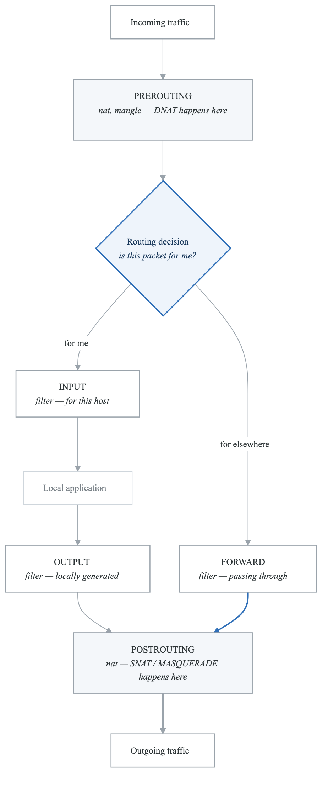
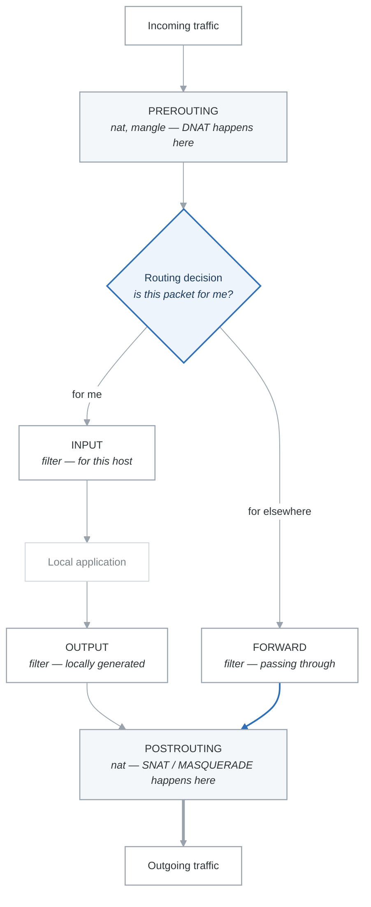

# Module 11: Firewalls and Security

## Introduction

Firewalls are essential for protecting Linux systems from unauthorized access. This module covers firewall configuration using iptables and firewalld, as well as basic security hardening practices for Linux systems.

## Learning Objectives

After completing this module, you will be able to:
- Configure iptables rules
- Manage firewalld zones and services
- Implement basic network security
- Harden Linux systems

## Firewall Fundamentals

### How Firewalls Work

<!-- figure: generated from the Mermaid below by _shared/diagrams/embed-figures.py — do not edit the image -->


<details>
<summary>Diagram source (Mermaid)</summary>



</details>

Two things fall out of this picture that catch people:

- **A forwarded packet never touches `INPUT`.** Blocking a port in `INPUT` does nothing for traffic
  your host is routing on behalf of others — that is `FORWARD`.
- **DNAT is decided before routing, SNAT after.** So a port-forwarding rule belongs in `PREROUTING`,
  and a masquerade rule belongs in `POSTROUTING`. Putting either in the other chain silently does
  nothing.

| Action | Effect |
|---|---|
| `ACCEPT` | Let the packet through |
| `DROP` | Discard silently — the sender waits for a timeout |
| `REJECT` | Discard and send an ICMP error — the sender fails immediately |
| `LOG` | Record it and **keep evaluating** — `LOG` is not a verdict |

## iptables

### Basic iptables Commands

```bash
# List rules
sudo iptables -L
sudo iptables -L -v -n           # Verbose, numeric
sudo iptables -L -v -n --line-numbers

# List specific table
sudo iptables -t nat -L
sudo iptables -t mangle -L

# Flush all rules (CAREFUL!)
sudo iptables -F
sudo iptables -t nat -F

# Set default policy
sudo iptables -P INPUT DROP
sudo iptables -P FORWARD DROP
sudo iptables -P OUTPUT ACCEPT
```

### Adding Rules

```bash
# Allow established connections
sudo iptables -A INPUT -m conntrack --ctstate ESTABLISHED,RELATED -j ACCEPT

# Allow loopback
sudo iptables -A INPUT -i lo -j ACCEPT

# Allow SSH
sudo iptables -A INPUT -p tcp --dport 22 -j ACCEPT

# Allow HTTP/HTTPS
sudo iptables -A INPUT -p tcp --dport 80 -j ACCEPT
sudo iptables -A INPUT -p tcp --dport 443 -j ACCEPT

# Allow from specific IP
sudo iptables -A INPUT -s 192.168.1.100 -j ACCEPT

# Allow from subnet
sudo iptables -A INPUT -s 192.168.1.0/24 -j ACCEPT

# Allow ping
sudo iptables -A INPUT -p icmp --icmp-type echo-request -j ACCEPT

# Drop all other input (if policy is ACCEPT)
sudo iptables -A INPUT -j DROP
```

### Rule Management

```bash
# Insert rule at position
sudo iptables -I INPUT 1 -p tcp --dport 22 -j ACCEPT

# Delete rule by specification
sudo iptables -D INPUT -p tcp --dport 80 -j ACCEPT

# Delete rule by line number
sudo iptables -D INPUT 3

# Replace rule
sudo iptables -R INPUT 2 -p tcp --dport 8080 -j ACCEPT
```

### Common iptables Configurations

```bash
#!/bin/bash
# basic-firewall.sh - Basic server firewall

# Flush existing rules
iptables -F
iptables -X

# Set default policies
iptables -P INPUT DROP
iptables -P FORWARD DROP
iptables -P OUTPUT ACCEPT

# Allow loopback
iptables -A INPUT -i lo -j ACCEPT

# Allow established connections
iptables -A INPUT -m conntrack --ctstate ESTABLISHED,RELATED -j ACCEPT

# Allow SSH (with rate limiting)
iptables -A INPUT -p tcp --dport 22 -m conntrack --ctstate NEW \
  -m recent --set --name SSH
iptables -A INPUT -p tcp --dport 22 -m conntrack --ctstate NEW \
  -m recent --update --seconds 60 --hitcount 4 --name SSH -j DROP
iptables -A INPUT -p tcp --dport 22 -j ACCEPT

# Allow HTTP/HTTPS
iptables -A INPUT -p tcp --dport 80 -j ACCEPT
iptables -A INPUT -p tcp --dport 443 -j ACCEPT

# Allow ping (limited)
iptables -A INPUT -p icmp --icmp-type echo-request \
  -m limit --limit 1/s --limit-burst 4 -j ACCEPT

# Log dropped packets
iptables -A INPUT -j LOG --log-prefix "DROPPED: " --log-level 4

# Drop everything else
iptables -A INPUT -j DROP
```

### Saving iptables Rules

```bash
# Debian/Ubuntu
sudo apt install iptables-persistent
sudo netfilter-persistent save
# Rules saved to /etc/iptables/rules.v4

# RHEL/CentOS 7 (with iptables-services)
sudo yum install iptables-services
sudo service iptables save
# Rules saved to /etc/sysconfig/iptables

# Manual save
sudo iptables-save > /etc/iptables.rules

# Restore rules
sudo iptables-restore < /etc/iptables.rules
```

## firewalld

### firewalld Basics

```bash
# Check status
sudo systemctl status firewalld
sudo firewall-cmd --state

# Start/stop firewalld
sudo systemctl start firewalld
sudo systemctl enable firewalld

# Get active zones
sudo firewall-cmd --get-active-zones

# Get default zone
sudo firewall-cmd --get-default-zone

# List all zones
sudo firewall-cmd --get-zones
```

### Zone Management

```bash
# firewalld zones (from least to most trusted)
# drop      - Drop all incoming
# block     - Reject incoming with icmp-prohibited
# public    - Public networks (default)
# external  - External networks with NAT
# dmz       - DMZ networks
# work      - Work networks
# home      - Home networks
# internal  - Internal networks
# trusted   - All traffic accepted

# Set default zone
sudo firewall-cmd --set-default-zone=public

# Add interface to zone
sudo firewall-cmd --zone=public --add-interface=eth0 --permanent

# Get zone info
sudo firewall-cmd --zone=public --list-all
```

### Managing Services and Ports

```bash
# List available services
sudo firewall-cmd --get-services

# Add service
sudo firewall-cmd --zone=public --add-service=http
sudo firewall-cmd --zone=public --add-service=http --permanent

# Remove service
sudo firewall-cmd --zone=public --remove-service=http --permanent

# Add port
sudo firewall-cmd --zone=public --add-port=8080/tcp --permanent

# Add port range
sudo firewall-cmd --zone=public --add-port=5000-5100/tcp --permanent

# Remove port
sudo firewall-cmd --zone=public --remove-port=8080/tcp --permanent

# Reload to apply permanent changes
sudo firewall-cmd --reload
```

### Rich Rules

```bash
# Allow specific IP
sudo firewall-cmd --zone=public --add-rich-rule='
  rule family="ipv4"
  source address="192.168.1.100"
  accept' --permanent

# Allow subnet to service
sudo firewall-cmd --zone=public --add-rich-rule='
  rule family="ipv4"
  source address="192.168.1.0/24"
  service name="ssh"
  accept' --permanent

# Rate limiting
sudo firewall-cmd --zone=public --add-rich-rule='
  rule family="ipv4"
  service name="ssh"
  accept
  limit value="3/m"' --permanent

# Log and drop
sudo firewall-cmd --zone=public --add-rich-rule='
  rule family="ipv4"
  source address="10.0.0.0/8"
  log prefix="SUSPECT: " level="warning"
  drop' --permanent
```

### Port Forwarding

```bash
# Forward port 80 to 8080 locally
sudo firewall-cmd --zone=public \
  --add-forward-port=port=80:proto=tcp:toport=8080 --permanent

# Forward to another host
sudo firewall-cmd --zone=public \
  --add-forward-port=port=80:proto=tcp:toaddr=192.168.1.100:toport=80 --permanent

# Enable masquerading (required for forwarding to other hosts)
sudo firewall-cmd --zone=public --add-masquerade --permanent
```

## ufw (Uncomplicated Firewall)

```bash
# Ubuntu's user-friendly firewall

# Enable/disable
sudo ufw enable
sudo ufw disable

# Check status
sudo ufw status
sudo ufw status verbose
sudo ufw status numbered

# Default policies
sudo ufw default deny incoming
sudo ufw default allow outgoing

# Allow services
sudo ufw allow ssh
sudo ufw allow http
sudo ufw allow https

# Allow specific port
sudo ufw allow 8080/tcp
sudo ufw allow 5000:5100/tcp

# Allow from IP
sudo ufw allow from 192.168.1.100

# Allow from subnet to port
sudo ufw allow from 192.168.1.0/24 to any port 22

# Delete rule
sudo ufw delete allow 8080/tcp
sudo ufw delete 3  # By number

# Logging
sudo ufw logging on
sudo ufw logging medium
```

## System Security Hardening

### SSH Hardening

```bash
# /etc/ssh/sshd_config

# Disable root login
PermitRootLogin no

# Disable password authentication
PasswordAuthentication no
PubkeyAuthentication yes

# Use strong encryption
Ciphers chacha20-poly1305@openssh.com,aes256-gcm@openssh.com
MACs hmac-sha2-512-etm@openssh.com,hmac-sha2-256-etm@openssh.com
KexAlgorithms curve25519-sha256@libssh.org

# Limit users
AllowUsers admin deploy

# Rate limiting
MaxAuthTries 3
MaxStartups 10:30:60

# Timeout settings
ClientAliveInterval 300
ClientAliveCountMax 2

# Restart SSH after changes
sudo systemctl restart sshd
```

### Fail2ban Configuration

```bash
# Install fail2ban
sudo apt install fail2ban

# Create local configuration
sudo cp /etc/fail2ban/jail.conf /etc/fail2ban/jail.local

# Edit jail.local
[DEFAULT]
bantime = 3600
findtime = 600
maxretry = 5
banaction = iptables-multiport

[sshd]
enabled = true
port = ssh
filter = sshd
logpath = /var/log/auth.log
maxretry = 3
bantime = 86400

# Start fail2ban
sudo systemctl enable fail2ban
sudo systemctl start fail2ban

# Check status
sudo fail2ban-client status
sudo fail2ban-client status sshd
```

### Security Checklist

```yaml
hardening_checklist:
  user_access:
    - Disable root SSH login
    - Use SSH keys, not passwords
    - Remove unnecessary users
    - Set strong password policies
    - Configure sudo properly

  network_security:
    - Configure firewall (deny by default)
    - Close unnecessary ports
    - Use fail2ban for brute force protection
    - Enable SYN cookies
    - Disable ICMP redirects

  system_security:
    - Keep system updated
    - Remove unnecessary packages
    - Disable unnecessary services
    - Set file permissions correctly
    - Enable SELinux/AppArmor

  monitoring:
    - Enable system logging
    - Configure log rotation
    - Set up intrusion detection
    - Monitor failed login attempts
```

## Summary

Key firewall and security concepts:

1. **iptables** provides low-level firewall control
2. **firewalld** offers zone-based management
3. **ufw** provides simplified firewall configuration
4. **SSH hardening** protects remote access
5. **Fail2ban** prevents brute force attacks

## Knowledge Check

1. What is the difference between DROP and REJECT in iptables?
2. How do firewalld zones work?
3. What are the essential SSH hardening steps?
4. How does fail2ban protect against attacks?
5. Why should you use default deny policies?

## Phase Summary

You have completed Phase 1: Linux & Networking Fundamentals. You should now:

- Navigate and manage Linux systems confidently
- Understand file systems, permissions, and processes
- Write shell scripts for automation
- Explain networking fundamentals
- Troubleshoot network issues
- Configure firewalls

Continue to Phase 2: Containers & Orchestration to learn Docker and Kubernetes.

<!-- feynman-check -->

---

## Feynman check

Close the file. Blank page, no notes. Explain each of these to a competent engineer who has never
used this tool — **under five minutes, no jargon you can't define on the spot:**

- Firewall Fundamentals
- iptables
- firewalld
- ufw (Uncomplicated Firewall)

**The gap is not what you forgot. It is where you used a word instead of a mechanism.**

| | |
|---|---|
| ✗ | *"The kernel manages processes."* |
| ✓ | *"A process is an entry in the kernel's task table with its own memory map and file-descriptor table. `fork()` copies it, `exec()` replaces the program inside it, and the parent must call `wait()` or the entry stays behind as a zombie."* |

**Trace it:** `ls -l /etc` → characters on your terminal. Name every syscall and every kernel structure between the keypress and the output.

Stop at the first component you cannot name. Reopen this file and read **only** that.

**Go deeper — only once the gap has a name:** [`man 7 namespaces`](https://man7.org/linux/man-pages/man7/namespaces.7.html) and the [LWN namespaces series](https://lwn.net/Articles/531114/) — the primary sources, not summaries of them.
Full list per domain: [`SOURCES.md`](../../SOURCES.md#linux-networking)

→ Protocol, the three levels of knowing, and worked examples: [`MASTERY.md`](../../MASTERY.md)

<!-- /feynman-check -->
