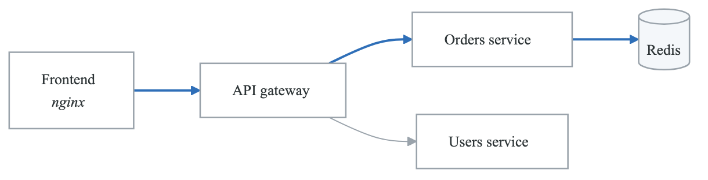
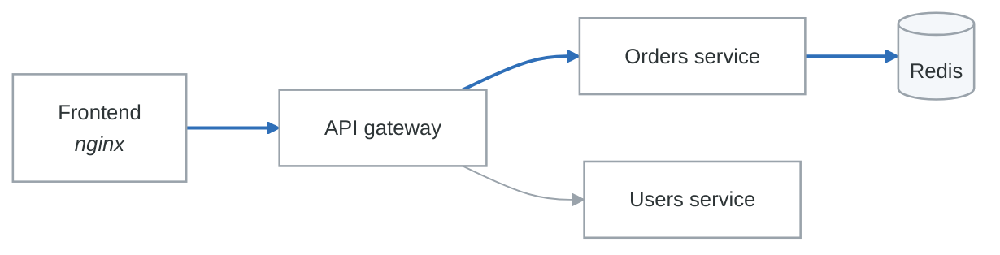

# Phase 5 Practical Assessment: Observability & SRE Implementation

## Assessment Overview

**Duration**: 4 hours
**Total Points**: 100
**Passing Score**: 70%

This practical assessment evaluates your ability to implement observability solutions, configure monitoring and alerting, define SLOs, and respond to incidents using real-world scenarios.

---

## Assessment Environment

### Provided Resources
- Kubernetes cluster (minikube or kind)
- Docker environment
- Sample microservices application
- Prometheus, Grafana, Loki, Tempo (to be installed)

### Prerequisites Check
```bash
# Verify your environment
kubectl version --client
docker version
helm version

# Create assessment namespace
kubectl create namespace assessment

# Verify cluster is running
kubectl get nodes
```

### Sample Application Architecture
<!-- figure: generated from the Mermaid below by _shared/diagrams/embed-figures.py — do not edit the image -->


<details>
<summary>Diagram source (Mermaid)</summary>



</details>

---

## Task 1: Observability Stack Deployment (25 points)

### Objective
Deploy a complete observability stack including metrics, logging, and tracing.

### Requirements

#### 1.1 Deploy Prometheus Stack (10 points)

Deploy Prometheus using the kube-prometheus-stack Helm chart with custom configuration.

```bash
# Add Helm repositories
helm repo add prometheus-community https://prometheus-community.github.io/helm-charts
helm repo update
```

Create a values file with the following requirements:

- [ ] **Prometheus Configuration** (4 points)
  - Enable 15-day retention
  - Configure 10Gi storage
  - Set scrape interval to 15s

- [ ] **Alertmanager Configuration** (3 points)
  - Configure Slack webhook integration (use placeholder URL)
  - Set up routing for critical and warning alerts

- [ ] **Grafana Configuration** (3 points)
  - Enable persistence
  - Configure admin password via secret
  - Enable anonymous access for dashboards (read-only)

**Deliverable**: `prometheus-values.yaml` file and deployment commands

```yaml
# prometheus-values.yaml - Complete this configuration
prometheus:
  prometheusSpec:
    retention: # TODO
    storageSpec:
      volumeClaimTemplate:
        spec:
          # TODO
    scrapeInterval: # TODO

alertmanager:
  config:
    # TODO: Configure routing and receivers

grafana:
  persistence:
    enabled: # TODO
  adminPassword: # TODO (reference secret)
```

#### 1.2 Deploy Loki for Logging (8 points)

Deploy Grafana Loki with Promtail for log collection.

- [ ] **Loki Deployment** (4 points)
  - Deploy in single binary mode for assessment
  - Configure 7-day retention
  - Add Loki datasource to Grafana

- [ ] **Promtail Configuration** (4 points)
  - Collect logs from all pods in `assessment` namespace
  - Add Kubernetes metadata labels
  - Parse JSON logs

**Deliverable**: `loki-values.yaml` and `promtail-values.yaml` files

#### 1.3 Deploy Tempo for Tracing (7 points)

Deploy Grafana Tempo and configure trace collection.

- [ ] **Tempo Deployment** (3 points)
  - Deploy with OTLP receiver enabled
  - Configure 48-hour retention

- [ ] **Integration** (4 points)
  - Add Tempo datasource to Grafana
  - Configure trace-to-logs correlation
  - Configure trace-to-metrics correlation

**Deliverable**: `tempo-values.yaml` file

---

## Task 2: Application Instrumentation (20 points)

### Objective
Instrument the sample application with OpenTelemetry to emit metrics, logs, and traces.

### Provided Application Code

```python
# api_gateway/app.py - Instrument this application
from flask import Flask, request, jsonify
import requests
import time
import logging

app = Flask(__name__)
logger = logging.getLogger(__name__)

@app.route('/api/orders', methods=['POST'])
def create_order():
    start_time = time.time()

    # Call users service
    user_response = requests.get('http://users-service:8080/users/123')

    # Call orders service
    order_data = request.json
    order_response = requests.post(
        'http://orders-service:8080/orders',
        json=order_data
    )

    duration = time.time() - start_time
    logger.info(f"Order created in {duration:.3f}s")

    return jsonify(order_response.json()), 201

@app.route('/health')
def health():
    return jsonify({"status": "healthy"})

if __name__ == '__main__':
    app.run(host='0.0.0.0', port=8080)
```

### Requirements

#### 2.1 Add OpenTelemetry Instrumentation (10 points)

Modify the application to include:

- [ ] **Tracing** (4 points)
  - Auto-instrument Flask and requests library
  - Add custom span attributes (order_id, user_id)
  - Set appropriate span names

- [ ] **Metrics** (3 points)
  - Add request counter with labels (endpoint, method, status)
  - Add request duration histogram
  - Add custom business metric (orders_created_total)

- [ ] **Structured Logging** (3 points)
  - Configure JSON log format
  - Include trace_id and span_id in logs
  - Add appropriate log levels

**Deliverable**: Modified `app.py` with OpenTelemetry instrumentation

```python
# Complete the instrumentation
from opentelemetry import trace, metrics
from opentelemetry.instrumentation.flask import FlaskInstrumentor
from opentelemetry.instrumentation.requests import RequestsInstrumentor
# Add remaining imports and configuration

# TODO: Configure OpenTelemetry
# TODO: Create metrics
# TODO: Configure structured logging

# Instrumented version of the application
```

#### 2.2 Create Kubernetes Deployment (10 points)

Create Kubernetes manifests for deploying the instrumented application.

- [ ] **Deployment Manifest** (4 points)
  - Include OTel environment variables
  - Configure resource limits
  - Add appropriate labels and annotations

- [ ] **Service Configuration** (2 points)
  - Create ClusterIP service
  - Configure health check endpoints

- [ ] **ServiceMonitor** (4 points)
  - Create Prometheus ServiceMonitor
  - Configure correct scrape path and port
  - Add relabeling for service discovery

**Deliverable**: `deployment.yaml`, `service.yaml`, `servicemonitor.yaml`

---

## Task 3: Dashboards and Alerting (25 points)

### Objective
Create Grafana dashboards and Prometheus alerting rules for the application.

### Requirements

#### 3.1 Create Application Dashboard (12 points)

Create a Grafana dashboard with the following panels:

- [ ] **RED Metrics Row** (4 points)
  - Request Rate (requests/second by endpoint)
  - Error Rate (percentage of 5xx responses)
  - Duration (P50, P95, P99 latency)

- [ ] **Resource Metrics Row** (4 points)
  - CPU usage by pod
  - Memory usage by pod
  - Pod restart count

- [ ] **Business Metrics Row** (4 points)
  - Orders created (counter)
  - Order creation latency distribution
  - Active users (if applicable)

**Deliverable**: `dashboard.json` (Grafana dashboard JSON)

```json
{
  "title": "API Gateway Dashboard",
  "uid": "api-gateway",
  "panels": [
    // TODO: Create panels for RED metrics
    // TODO: Create panels for resource metrics
    // TODO: Create panels for business metrics
  ],
  "templating": {
    "list": [
      // TODO: Add namespace and service variables
    ]
  }
}
```

#### 3.2 Create Alert Rules (13 points)

Create Prometheus alerting rules for the following scenarios:

- [ ] **High Error Rate Alert** (3 points)
  ```yaml
  # Alert when error rate > 5% for 5 minutes
  ```

- [ ] **High Latency Alert** (3 points)
  ```yaml
  # Alert when P99 latency > 1s for 5 minutes
  ```

- [ ] **Pod Restart Alert** (2 points)
  ```yaml
  # Alert when pod restarts > 3 in 15 minutes
  ```

- [ ] **SLO Burn Rate Alert** (5 points)
  ```yaml
  # Multi-window burn rate alert for 99.9% availability SLO
  # Fast burn: 14.4x burn rate over 1h (2% budget in 1h)
  # Slow burn: 6x burn rate over 6h (5% budget in 6h)
  ```

**Deliverable**: `alerting-rules.yaml`

---

## Task 4: SLO Implementation (15 points)

### Objective
Define and implement SLOs for the API Gateway service.

### Requirements

#### 4.1 Define SLOs (7 points)

Create an SLO document that includes:

- [ ] **Availability SLO** (3 points)
  - Define the SLI (what counts as successful?)
  - Set appropriate target (justify your choice)
  - Calculate error budget for 30-day window

- [ ] **Latency SLO** (4 points)
  - Define the SLI (which latency percentile?)
  - Set appropriate threshold and target
  - Explain the business reasoning

**Deliverable**: `slo-definition.md`

```markdown
# API Gateway SLO Document

## Service Description
[Brief description of the service]

## SLO 1: Availability
- **SLI**: [Definition]
- **SLO Target**: [Target %]
- **Error Budget**: [Calculation]
- **Measurement Window**: 30 days

## SLO 2: Latency
- **SLI**: [Definition]
- **SLO Target**: [Target]
- **Reasoning**: [Business justification]
```

#### 4.2 Implement SLO Recording Rules (8 points)

Create Prometheus recording rules for SLO tracking:

- [ ] **SLI Recording Rules** (4 points)
  ```yaml
  # Create recording rules for availability and latency SLIs
  # Include multiple time windows (5m, 30m, 1h, 6h, 1d, 30d)
  ```

- [ ] **Error Budget Recording Rules** (4 points)
  ```yaml
  # Create recording rules for error budget tracking
  # Include burn rate calculation
  ```

**Deliverable**: `slo-recording-rules.yaml`

---

## Task 5: Incident Response (15 points)

### Objective
Demonstrate incident response capabilities using the observability stack.

### Scenario

At 14:30 UTC, users start reporting that order creation is failing. Your monitoring shows:
- Error rate spiked from 0.1% to 25%
- P99 latency increased from 200ms to 5s
- Orders service showing high CPU usage

### Requirements

#### 5.1 Create Investigation Runbook (8 points)

Document your investigation process:

- [ ] **Initial Triage** (2 points)
  - What dashboards/queries would you check first?
  - How would you assess customer impact?

- [ ] **Deep Dive Investigation** (4 points)
  - Provide specific PromQL queries for investigation
  - Provide LogQL queries to find relevant errors
  - Explain how you would use traces to identify root cause

- [ ] **Resolution Verification** (2 points)
  - How would you confirm the issue is resolved?
  - What metrics would you monitor post-resolution?

**Deliverable**: `runbook-order-failures.md`

````markdown
# Runbook: Order Creation Failures

## Alert
High error rate on orders endpoint

## Initial Triage
### Dashboard Links
- [Link to dashboard]

### Impact Assessment Query
```promql
# Query to assess customer impact
```

## Investigation Steps

### Step 1: Check Error Rate
```promql
# Query
```

### Step 2: Check Dependencies
```promql
# Query
```

### Step 3: Analyze Logs
```logql
# Query
```

### Step 4: Trace Analysis
[Process for finding relevant traces]

## Resolution Verification
[Metrics to verify resolution]
````

#### 5.2 Create Postmortem Template (7 points)

Based on the scenario, create a postmortem document:

- [ ] **Incident Timeline** (2 points)
- [ ] **Root Cause Analysis** (2 points)
- [ ] **Action Items** (3 points)

**Deliverable**: `postmortem-template.md`

---

## Submission Checklist

### Task 1 Deliverables
- [ ] `prometheus-values.yaml`
- [ ] `loki-values.yaml`
- [ ] `promtail-values.yaml`
- [ ] `tempo-values.yaml`
- [ ] Screenshot of Grafana showing all datasources configured

### Task 2 Deliverables
- [ ] Modified `app.py` with OpenTelemetry instrumentation
- [ ] `deployment.yaml`
- [ ] `service.yaml`
- [ ] `servicemonitor.yaml`

### Task 3 Deliverables
- [ ] `dashboard.json`
- [ ] `alerting-rules.yaml`
- [ ] Screenshot of dashboard with sample data

### Task 4 Deliverables
- [ ] `slo-definition.md`
- [ ] `slo-recording-rules.yaml`

### Task 5 Deliverables
- [ ] `runbook-order-failures.md`
- [ ] `postmortem-template.md`

---

## Grading Rubric

### Task 1: Observability Stack (25 points)
| Criteria | Points |
|----------|--------|
| Prometheus correctly configured with retention and storage | 4 |
| Alertmanager routing properly configured | 3 |
| Grafana persistence and access configured | 3 |
| Loki deployed with correct retention | 4 |
| Promtail collecting and parsing logs correctly | 4 |
| Tempo deployed with OTLP receiver | 3 |
| Datasources integrated and correlations configured | 4 |

### Task 2: Application Instrumentation (20 points)
| Criteria | Points |
|----------|--------|
| Tracing auto-instrumentation working | 2 |
| Custom span attributes added | 2 |
| Request counter metric implemented | 1.5 |
| Request duration histogram implemented | 1.5 |
| Custom business metric implemented | 2 |
| Structured logging with trace context | 3 |
| Deployment manifest correct | 4 |
| ServiceMonitor correctly configured | 4 |

### Task 3: Dashboards and Alerting (25 points)
| Criteria | Points |
|----------|--------|
| RED metrics panels correct and functional | 4 |
| Resource metrics panels correct | 4 |
| Business metrics panels included | 4 |
| High error rate alert correct | 3 |
| High latency alert correct | 3 |
| Pod restart alert correct | 2 |
| SLO burn rate alert correctly implemented | 5 |

### Task 4: SLO Implementation (15 points)
| Criteria | Points |
|----------|--------|
| Availability SLI clearly defined | 1.5 |
| Availability SLO target justified | 1.5 |
| Error budget correctly calculated | 2 |
| Latency SLI clearly defined | 2 |
| Latency SLO target justified | 2 |
| Recording rules cover multiple windows | 2 |
| Burn rate recording rules correct | 4 |

### Task 5: Incident Response (15 points)
| Criteria | Points |
|----------|--------|
| Initial triage process documented | 2 |
| Investigation queries correct and useful | 4 |
| Resolution verification process clear | 2 |
| Postmortem timeline accurate | 2 |
| Root cause analysis thorough | 2 |
| Action items specific and actionable | 3 |

---

## Sample Solutions (For Instructors)

### Task 2.1 - Instrumented Application

```python
from flask import Flask, request, jsonify, g
import requests
import time
import logging
import json

from opentelemetry import trace, metrics
from opentelemetry.sdk.trace import TracerProvider
from opentelemetry.sdk.metrics import MeterProvider
from opentelemetry.sdk.resources import Resource
from opentelemetry.exporter.otlp.proto.grpc.trace_exporter import OTLPSpanExporter
from opentelemetry.exporter.otlp.proto.grpc.metric_exporter import OTLPMetricExporter
from opentelemetry.sdk.trace.export import BatchSpanProcessor
from opentelemetry.sdk.metrics.export import PeriodicExportingMetricReader
from opentelemetry.instrumentation.flask import FlaskInstrumentor
from opentelemetry.instrumentation.requests import RequestsInstrumentor
from opentelemetry.trace import get_current_span

# Configure resource
resource = Resource.create({
    "service.name": "api-gateway",
    "service.version": "1.0.0",
    "deployment.environment": "assessment"
})

# Configure tracing
trace.set_tracer_provider(TracerProvider(resource=resource))
tracer_provider = trace.get_tracer_provider()
tracer_provider.add_span_processor(
    BatchSpanProcessor(OTLPSpanExporter())
)

# Configure metrics
metric_reader = PeriodicExportingMetricReader(OTLPMetricExporter())
metrics.set_meter_provider(MeterProvider(
    resource=resource,
    metric_readers=[metric_reader]
))

tracer = trace.get_tracer(__name__)
meter = metrics.get_meter(__name__)

# Create metrics
request_counter = meter.create_counter(
    "http_requests_total",
    description="Total HTTP requests"
)
request_duration = meter.create_histogram(
    "http_request_duration_seconds",
    description="HTTP request duration"
)
orders_counter = meter.create_counter(
    "orders_created_total",
    description="Total orders created"
)

# Structured logging
class JsonFormatter(logging.Formatter):
    def format(self, record):
        span = get_current_span()
        span_context = span.get_span_context()

        log_record = {
            "timestamp": self.formatTime(record),
            "level": record.levelname,
            "message": record.getMessage(),
            "logger": record.name,
            "trace_id": format(span_context.trace_id, '032x') if span_context.is_valid else None,
            "span_id": format(span_context.span_id, '016x') if span_context.is_valid else None
        }
        return json.dumps(log_record)

handler = logging.StreamHandler()
handler.setFormatter(JsonFormatter())
logger = logging.getLogger(__name__)
logger.addHandler(handler)
logger.setLevel(logging.INFO)

app = Flask(__name__)

# Auto-instrument
FlaskInstrumentor().instrument_app(app)
RequestsInstrumentor().instrument()

@app.route('/api/orders', methods=['POST'])
def create_order():
    start_time = time.time()
    span = get_current_span()

    order_data = request.json
    span.set_attribute("order.customer_id", order_data.get("customer_id"))

    try:
        # Call users service
        user_response = requests.get('http://users-service:8080/users/123')
        span.set_attribute("user.status_code", user_response.status_code)

        # Call orders service
        order_response = requests.post(
            'http://orders-service:8080/orders',
            json=order_data
        )

        if order_response.status_code == 201:
            order_id = order_response.json().get("order_id")
            span.set_attribute("order.id", order_id)
            orders_counter.add(1, {"status": "success"})

        duration = time.time() - start_time
        request_counter.add(1, {"endpoint": "/api/orders", "method": "POST", "status": "200"})
        request_duration.record(duration, {"endpoint": "/api/orders"})

        logger.info("Order created successfully", extra={"order_id": order_id, "duration": duration})
        return jsonify(order_response.json()), 201

    except Exception as e:
        duration = time.time() - start_time
        request_counter.add(1, {"endpoint": "/api/orders", "method": "POST", "status": "500"})
        request_duration.record(duration, {"endpoint": "/api/orders"})
        orders_counter.add(1, {"status": "failure"})

        logger.error(f"Order creation failed: {str(e)}")
        span.record_exception(e)
        return jsonify({"error": str(e)}), 500

@app.route('/health')
def health():
    return jsonify({"status": "healthy"})

if __name__ == '__main__':
    app.run(host='0.0.0.0', port=8080)
```

### Task 3.2 - SLO Burn Rate Alert

```yaml
groups:
  - name: slo-burn-rate
    rules:
      # Fast burn: 2% of monthly budget in 1 hour
      # 14.4x normal burn rate
      - alert: SLOFastBurn
        expr: |
          (
            sum(rate(http_requests_total{status=~"5.."}[5m]))
            / sum(rate(http_requests_total[5m]))
          ) > (14.4 * 0.001)
          and
          (
            sum(rate(http_requests_total{status=~"5.."}[1h]))
            / sum(rate(http_requests_total[1h]))
          ) > (14.4 * 0.001)
        for: 2m
        labels:
          severity: critical
          slo: availability
        annotations:
          summary: "SLO burn rate is critical - 2% of monthly budget consumed in 1 hour"

      # Slow burn: 5% of monthly budget in 6 hours
      # 6x normal burn rate
      - alert: SLOSlowBurn
        expr: |
          (
            sum(rate(http_requests_total{status=~"5.."}[30m]))
            / sum(rate(http_requests_total[30m]))
          ) > (6 * 0.001)
          and
          (
            sum(rate(http_requests_total{status=~"5.."}[6h]))
            / sum(rate(http_requests_total[6h]))
          ) > (6 * 0.001)
        for: 15m
        labels:
          severity: warning
          slo: availability
        annotations:
          summary: "SLO burn rate is elevated - 5% of monthly budget consumed in 6 hours"
```

<!-- feynman-check -->

---

## Feynman check

Close the file. Blank page, no notes. Explain each of these to a competent engineer who has never
used this tool — **under five minutes, no jargon you can't define on the spot:**

- Assessment Environment
- Observability Stack Deployment
- Application Instrumentation
- Dashboards and Alerting

**The gap is not what you forgot. It is where you used a word instead of a mechanism.**

| | |
|---|---|
| ✗ | *"Prometheus monitors the service."* |
| ✓ | *"Prometheus discovers targets from the Kubernetes API, applies relabelling rules, scrapes `/metrics` over HTTP on an interval, and appends samples to a local TSDB. Nothing is pushed — so a target missing from a dashboard is a service-discovery problem, not an application one."* |

**Trace it:** A latency regression → a phone ringing. Name each hop: sample, rule evaluation, alert state transition, routing, notification — and where each one can silently stop.

Stop at the first component you cannot name. Reopen this file and read **only** that.

**Go deeper — only once the gap has a name:** [SRE Workbook ch. 5, *Alerting on SLOs*](https://sre.google/workbook/alerting-on-slos/) — free, and the best thing written on why static thresholds page you for nothing.
Full list per domain: [`SOURCES.md`](../SOURCES.md#observability-sre)

→ Protocol, the three levels of knowing, and worked examples: [`MASTERY.md`](../MASTERY.md)

<!-- /feynman-check -->
