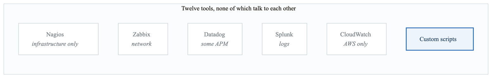
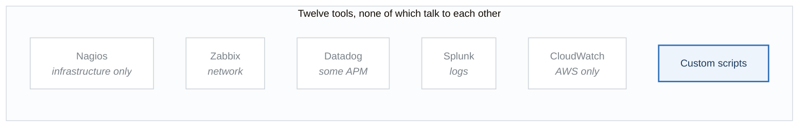
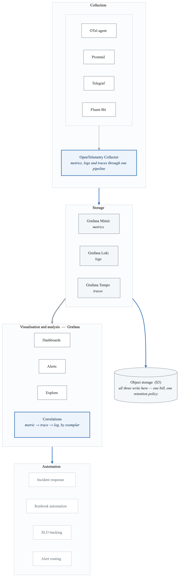
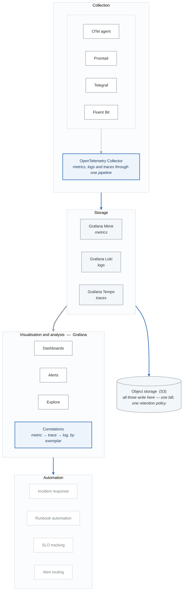

# Case Study 01: Enterprise Observability Platform Transformation

## Executive Summary

A global e-commerce company with $5B annual revenue transformed their fragmented monitoring approach into a unified observability platform. This case study examines how they achieved 99.99% availability, reduced MTTR from 4 hours to 15 minutes, and saved $3M annually in operational costs.

## Company Profile

- **Industry**: E-Commerce & Retail Technology
- **Size**: 8,000 employees, 1,200 engineers
- **Scale**: 50M daily active users, 2M orders/day
- **Infrastructure**: Hybrid cloud (AWS + on-premises), 500+ microservices
- **Annual Revenue**: $5B
- **Timeline**: 12 months

## Initial State Analysis

### Legacy Monitoring Landscape

<!-- figure: generated from the Mermaid below by _shared/diagrams/embed-figures.py — do not edit the image -->


<details>
<summary>Diagram source (Mermaid)</summary>



</details>

| | |
|---|---|
| MTTR | 4 hours on average |
| Alert volume | 5,000+ per day, roughly **80% noise** |
| Coverage | 60% of services monitored at all |
| Annual cost | $4.5M licensing + $2M operations |
| Tools in use | 12 |

The 80% noise figure is the one that explains the 4-hour MTTR. When most alerts are meaningless, the
first hour of every incident is spent deciding whether this one is real.

### Critical Pain Points

1. **Tool Sprawl**
   - 12 different monitoring tools across teams
   - No unified view of system health
   - Each team maintaining their own dashboards
   - Duplicate data collection causing performance issues

2. **Observability Gaps**
   - No distributed tracing for microservices
   - Log correlation required manual effort
   - Metrics silos between infrastructure and application teams
   - 40% of services had no monitoring

3. **Alert Chaos**
   - 5,000+ alerts per day across all systems
   - 80% were false positives or duplicates
   - On-call engineers overwhelmed with noise
   - Critical alerts buried in volume

4. **Incident Response Failures**
   - Average MTTR of 4 hours
   - Root cause analysis took days
   - No correlation between symptoms and causes
   - Tribal knowledge required for debugging

5. **Cost Inefficiency**
   - $4.5M annual licensing costs
   - $2M operational overhead
   - 25 FTEs managing monitoring infrastructure
   - Data duplication across tools

## Strategic Solution Design

### Target Architecture

<!-- figure: generated from the Mermaid below by _shared/diagrams/embed-figures.py — do not edit the image -->


<details>
<summary>Diagram source (Mermaid)</summary>



</details>

### Technology Stack Selection

| Component | Technology | Rationale |
|-----------|------------|-----------|
| Metrics | Grafana Mimir | Horizontally scalable, Prometheus-compatible |
| Logs | Grafana Loki | Cost-effective, label-based querying |
| Traces | Grafana Tempo | Native Grafana integration, cost-efficient |
| Visualization | Grafana Enterprise | Unified interface, correlation features |
| Collection | OpenTelemetry | Vendor-neutral, single instrumentation |
| Alerting | Grafana Alerting + PagerDuty | Multi-channel, escalation policies |
| Storage | AWS S3 | Cost-effective long-term storage |

## Implementation Phases

### Phase 1: Foundation (Months 1-3)

**Objectives:**
- Deploy core observability infrastructure
- Establish data collection standards
- Migrate critical services

**Infrastructure Deployment:**

```yaml
# Mimir deployment configuration
apiVersion: apps/v1
kind: StatefulSet
metadata:
  name: mimir-ingester
  namespace: observability
spec:
  replicas: 6
  selector:
    matchLabels:
      app: mimir-ingester
  template:
    spec:
      containers:
        - name: mimir
          image: grafana/mimir:2.10.0
          args:
            - -target=ingester
            - -config.file=/etc/mimir/mimir.yaml
          resources:
            requests:
              cpu: "2"
              memory: 8Gi
            limits:
              cpu: "4"
              memory: 16Gi
          volumeMounts:
            - name: config
              mountPath: /etc/mimir
            - name: data
              mountPath: /data
      volumes:
        - name: config
          configMap:
            name: mimir-config
  volumeClaimTemplates:
    - metadata:
        name: data
      spec:
        accessModes: ["ReadWriteOnce"]
        storageClassName: gp3
        resources:
          requests:
            storage: 100Gi
```

**OpenTelemetry Collector Pipeline:**

```yaml
# OTel Collector configuration
receivers:
  otlp:
    protocols:
      grpc:
        endpoint: 0.0.0.0:4317
      http:
        endpoint: 0.0.0.0:4318
  prometheus:
    config:
      scrape_configs:
        - job_name: 'kubernetes-pods'
          kubernetes_sd_configs:
            - role: pod
  filelog:
    include:
      - /var/log/containers/*.log
    operators:
      - type: json_parser
        timestamp:
          parse_from: attributes.time
          layout: '%Y-%m-%dT%H:%M:%S.%LZ'

processors:
  batch:
    timeout: 5s
    send_batch_size: 10000
  memory_limiter:
    limit_mib: 1024
    spike_limit_mib: 256
  resource:
    attributes:
      - key: environment
        value: production
        action: insert
  tail_sampling:
    decision_wait: 10s
    policies:
      - name: error-sampling
        type: status_code
        status_code:
          status_codes: [ERROR]
      - name: high-latency
        type: latency
        latency:
          threshold_ms: 1000
      - name: probabilistic
        type: probabilistic
        probabilistic:
          sampling_percentage: 10

exporters:
  prometheusremotewrite:
    endpoint: http://mimir-distributor:8080/api/v1/push
    tls:
      insecure: true
  loki:
    endpoint: http://loki-gateway:3100/loki/api/v1/push
  otlp:
    endpoint: tempo-distributor:4317
    tls:
      insecure: true

service:
  pipelines:
    metrics:
      receivers: [otlp, prometheus]
      processors: [memory_limiter, batch, resource]
      exporters: [prometheusremotewrite]
    logs:
      receivers: [filelog, otlp]
      processors: [memory_limiter, batch, resource]
      exporters: [loki]
    traces:
      receivers: [otlp]
      processors: [memory_limiter, tail_sampling, batch]
      exporters: [otlp]
```

**Results:**
- Core platform operational
- 50 critical services instrumented
- Baseline metrics established

### Phase 2: Service Migration (Months 4-7)

**Objectives:**
- Migrate all services to new platform
- Implement standardized instrumentation
- Establish SLO framework

**Service Instrumentation Standard:**

```python
# Python service instrumentation template
from opentelemetry import trace, metrics
from opentelemetry.instrumentation.fastapi import FastAPIInstrumentor
from opentelemetry.instrumentation.sqlalchemy import SQLAlchemyInstrumentor
from opentelemetry.instrumentation.redis import RedisInstrumentor
from opentelemetry.sdk.trace import TracerProvider
from opentelemetry.sdk.metrics import MeterProvider
from opentelemetry.exporter.otlp.proto.grpc.trace_exporter import OTLPSpanExporter
from opentelemetry.exporter.otlp.proto.grpc.metric_exporter import OTLPMetricExporter

def configure_observability(service_name: str, environment: str):
    """Configure OpenTelemetry instrumentation for service."""

    # Configure tracing
    trace.set_tracer_provider(TracerProvider(
        resource=Resource.create({
            "service.name": service_name,
            "deployment.environment": environment,
            "service.version": os.getenv("APP_VERSION", "unknown")
        })
    ))

    tracer_provider = trace.get_tracer_provider()
    tracer_provider.add_span_processor(
        BatchSpanProcessor(OTLPSpanExporter(
            endpoint=os.getenv("OTEL_EXPORTER_OTLP_ENDPOINT", "localhost:4317")
        ))
    )

    # Configure metrics
    metrics.set_meter_provider(MeterProvider(
        resource=Resource.create({
            "service.name": service_name,
            "deployment.environment": environment
        }),
        metric_readers=[
            PeriodicExportingMetricReader(OTLPMetricExporter())
        ]
    ))

    # Auto-instrument frameworks
    FastAPIInstrumentor.instrument()
    SQLAlchemyInstrumentor().instrument()
    RedisInstrumentor().instrument()

    return trace.get_tracer(service_name), metrics.get_meter(service_name)


# Custom business metrics
class OrderMetrics:
    def __init__(self, meter):
        self.orders_total = meter.create_counter(
            "orders_total",
            description="Total number of orders processed"
        )
        self.order_value = meter.create_histogram(
            "order_value_dollars",
            description="Order value in dollars"
        )
        self.order_processing_time = meter.create_histogram(
            "order_processing_duration_seconds",
            description="Time to process an order"
        )

    def record_order(self, value: float, duration: float, status: str):
        self.orders_total.add(1, {"status": status})
        self.order_value.record(value, {"status": status})
        self.order_processing_time.record(duration, {"status": status})
```

**SLO Implementation:**

```yaml
# SLO definitions
apiVersion: sloth.slok.dev/v1
kind: PrometheusServiceLevel
metadata:
  name: checkout-service-slo
  namespace: observability
spec:
  service: checkout-service
  labels:
    team: payments
    tier: critical
  slos:
    - name: availability
      objective: 99.9
      description: "Checkout service availability"
      sli:
        events:
          errorQuery: >
            sum(rate(http_requests_total{
              service="checkout",
              status=~"5.."
            }[{{.window}}]))
          totalQuery: >
            sum(rate(http_requests_total{
              service="checkout"
            }[{{.window}}]))
      alerting:
        name: CheckoutAvailability
        labels:
          severity: critical
          team: payments
        annotations:
          summary: "Checkout availability SLO at risk"
        pageAlert:
          labels:
            severity: page
        ticketAlert:
          labels:
            severity: ticket

    - name: latency
      objective: 99.0
      description: "Checkout P99 latency under 500ms"
      sli:
        events:
          errorQuery: >
            sum(rate(http_request_duration_seconds_bucket{
              service="checkout",
              le="0.5"
            }[{{.window}}]))
          totalQuery: >
            sum(rate(http_request_duration_seconds_count{
              service="checkout"
            }[{{.window}}]))
```

**Migration Progress Dashboard:**

```json
{
  "title": "Observability Migration Progress",
  "panels": [
    {
      "title": "Services Instrumented",
      "type": "stat",
      "targets": [
        {
          "expr": "count(up{job=~\".*-service\"})",
          "legendFormat": "Instrumented"
        }
      ],
      "fieldConfig": {
        "defaults": {
          "thresholds": {
            "steps": [
              {"value": 0, "color": "red"},
              {"value": 250, "color": "yellow"},
              {"value": 450, "color": "green"}
            ]
          },
          "max": 500
        }
      }
    },
    {
      "title": "Trace Coverage",
      "type": "gauge",
      "targets": [
        {
          "expr": "sum(rate(traces_spanmetrics_calls_total[1h])) by (service) / count(up{job=~\".*-service\"}) * 100"
        }
      ]
    }
  ]
}
```

**Results:**
- 450/500 services migrated
- 95% trace coverage achieved
- SLOs defined for all tier-1 services

### Phase 3: Intelligence Layer (Months 8-10)

**Objectives:**
- Implement advanced alerting
- Deploy automated correlation
- Enable predictive analytics

**Multi-Window Burn Rate Alerting:**

```yaml
# Alert rules for SLO burn rate
groups:
  - name: slo-burn-rate-alerts
    rules:
      # Fast burn - 2% budget consumed in 1 hour
      - alert: SLOBurnRateFast
        expr: |
          (
            sum(rate(http_requests_total{status=~"5.."}[5m])) by (service)
            /
            sum(rate(http_requests_total[5m])) by (service)
          ) > (14.4 * 0.001)
          and
          (
            sum(rate(http_requests_total{status=~"5.."}[1h])) by (service)
            /
            sum(rate(http_requests_total[1h])) by (service)
          ) > (14.4 * 0.001)
        for: 2m
        labels:
          severity: critical
          alert_type: slo_burn
        annotations:
          summary: "{{ $labels.service }} is burning error budget rapidly"
          description: "Service {{ $labels.service }} is consuming error budget at 14.4x normal rate"
          runbook_url: "https://runbooks.company.com/slo-burn-rate"

      # Slow burn - 5% budget consumed in 6 hours
      - alert: SLOBurnRateSlow
        expr: |
          (
            sum(rate(http_requests_total{status=~"5.."}[30m])) by (service)
            /
            sum(rate(http_requests_total[30m])) by (service)
          ) > (6 * 0.001)
          and
          (
            sum(rate(http_requests_total{status=~"5.."}[6h])) by (service)
            /
            sum(rate(http_requests_total[6h])) by (service)
          ) > (6 * 0.001)
        for: 15m
        labels:
          severity: warning
          alert_type: slo_burn
```

**Automated Root Cause Analysis:**

```python
# Root cause analysis automation
from dataclasses import dataclass
from typing import List, Dict, Optional
import asyncio

@dataclass
class CorrelatedIncident:
    primary_alert: str
    related_alerts: List[str]
    probable_root_cause: str
    confidence: float
    affected_services: List[str]
    suggested_actions: List[str]

class RootCauseAnalyzer:
    def __init__(self, mimir_client, loki_client, tempo_client):
        self.mimir = mimir_client
        self.loki = loki_client
        self.tempo = tempo_client

    async def analyze_incident(self, alert_name: str,
                                start_time: datetime) -> CorrelatedIncident:
        """Perform automated root cause analysis for an incident."""

        # Gather related data concurrently
        metrics_task = self._query_related_metrics(alert_name, start_time)
        logs_task = self._query_error_logs(alert_name, start_time)
        traces_task = self._query_error_traces(alert_name, start_time)
        deps_task = self._query_dependency_health(alert_name, start_time)

        metrics, logs, traces, dependencies = await asyncio.gather(
            metrics_task, logs_task, traces_task, deps_task
        )

        # Analyze service dependency graph
        affected_services = self._trace_impact_path(traces, dependencies)

        # Identify correlation patterns
        correlations = self._find_correlations(metrics, logs, traces)

        # Determine probable root cause
        root_cause, confidence = self._determine_root_cause(
            correlations, affected_services
        )

        # Generate suggested actions
        actions = self._generate_actions(root_cause, affected_services)

        return CorrelatedIncident(
            primary_alert=alert_name,
            related_alerts=correlations.get("related_alerts", []),
            probable_root_cause=root_cause,
            confidence=confidence,
            affected_services=affected_services,
            suggested_actions=actions
        )

    async def _query_related_metrics(self, alert: str,
                                      start: datetime) -> Dict:
        """Query metrics around the incident timeframe."""
        queries = {
            "error_rate": f'rate(http_requests_total{{status=~"5.."}}[5m])',
            "latency_p99": 'histogram_quantile(0.99, rate(http_request_duration_seconds_bucket[5m]))',
            "cpu_usage": 'rate(container_cpu_usage_seconds_total[5m])',
            "memory_usage": 'container_memory_usage_bytes',
            "network_errors": 'rate(container_network_receive_errors_total[5m])'
        }

        results = {}
        for name, query in queries.items():
            results[name] = await self.mimir.query_range(
                query, start - timedelta(minutes=30), start + timedelta(minutes=30)
            )
        return results

    def _trace_impact_path(self, traces: List,
                           dependencies: Dict) -> List[str]:
        """Trace the path of impact through service dependencies."""
        affected = set()

        for trace in traces:
            for span in trace.spans:
                if span.status.is_error:
                    affected.add(span.service_name)
                    # Add downstream services
                    affected.update(
                        dependencies.get(span.service_name, {}).get("downstream", [])
                    )

        return sorted(affected, key=lambda s: dependencies.get(s, {}).get("tier", 99))
```

**Anomaly Detection:**

```yaml
# Prometheus recording rules for anomaly detection
groups:
  - name: anomaly-detection
    interval: 1m
    rules:
      # Calculate hourly baseline
      - record: service:request_rate:hourly_avg
        expr: |
          avg_over_time(
            sum(rate(http_requests_total[5m])) by (service)
            [1h:5m]
          )

      # Calculate standard deviation
      - record: service:request_rate:hourly_stddev
        expr: |
          stddev_over_time(
            sum(rate(http_requests_total[5m])) by (service)
            [1h:5m]
          )

      # Anomaly score (z-score)
      - record: service:request_rate:anomaly_score
        expr: |
          (
            sum(rate(http_requests_total[5m])) by (service)
            -
            service:request_rate:hourly_avg
          )
          /
          service:request_rate:hourly_stddev

      # Latency anomaly detection
      - record: service:latency_p99:anomaly_score
        expr: |
          (
            histogram_quantile(0.99, sum(rate(http_request_duration_seconds_bucket[5m])) by (service, le))
            -
            avg_over_time(
              histogram_quantile(0.99, sum(rate(http_request_duration_seconds_bucket[5m])) by (service, le))
              [1h:5m]
            )
          )
          /
          stddev_over_time(
            histogram_quantile(0.99, sum(rate(http_request_duration_seconds_bucket[5m])) by (service, le))
            [1h:5m]
          )
```

**Results:**
- 90% reduction in alert volume
- Automated RCA for 70% of incidents
- Anomaly detection catching issues before user impact

### Phase 4: Optimization (Months 11-12)

**Objectives:**
- Optimize storage costs
- Implement self-service capabilities
- Establish governance

**Storage Optimization:**

```yaml
# Mimir compactor configuration
compactor:
  compaction_interval: 1h
  deletion_delay: 12h
  tenant_cleanup_delay: 12h

# Retention policies
limits:
  compactor_blocks_retention_period: 90d

# Downsampling configuration
ruler:
  recording_rules:
    - name: downsample_1h
      interval: 1h
      rules:
        - record: :http_requests_total:1h_avg
          expr: avg_over_time(http_requests_total[1h])
    - name: downsample_1d
      interval: 24h
      rules:
        - record: :http_requests_total:1d_avg
          expr: avg_over_time(http_requests_total[1d])
```

**Self-Service Portal:**

```python
# Dashboard provisioning API
from fastapi import FastAPI, HTTPException
from pydantic import BaseModel
from typing import List, Optional

app = FastAPI(title="Observability Self-Service Portal")

class DashboardRequest(BaseModel):
    team: str
    service_name: str
    dashboard_type: str  # "application", "infrastructure", "business"
    custom_metrics: Optional[List[str]] = None

class AlertRequest(BaseModel):
    team: str
    service_name: str
    alert_name: str
    condition: str
    threshold: float
    severity: str
    notification_channels: List[str]

@app.post("/api/v1/dashboards")
async def provision_dashboard(request: DashboardRequest):
    """Provision a new dashboard from templates."""

    # Load appropriate template
    template = load_dashboard_template(request.dashboard_type)

    # Customize for service
    dashboard = customize_dashboard(
        template,
        service_name=request.service_name,
        team=request.team,
        custom_metrics=request.custom_metrics
    )

    # Deploy to Grafana
    result = await grafana_client.create_dashboard(
        dashboard,
        folder=f"team-{request.team}"
    )

    # Record in service catalog
    await service_catalog.update_service(
        request.service_name,
        {"dashboard_url": result["url"]}
    )

    return {"dashboard_url": result["url"], "dashboard_uid": result["uid"]}

@app.post("/api/v1/alerts")
async def create_alert(request: AlertRequest):
    """Create a new alert rule with guardrails."""

    # Validate alert doesn't duplicate existing
    existing = await check_duplicate_alerts(
        request.service_name,
        request.alert_name
    )
    if existing:
        raise HTTPException(400, "Similar alert already exists")

    # Enforce team quotas
    team_alerts = await count_team_alerts(request.team)
    if team_alerts >= MAX_ALERTS_PER_TEAM:
        raise HTTPException(429, "Team alert quota exceeded")

    # Create alert rule
    rule = generate_alert_rule(request)

    # Deploy to Grafana Alerting
    await grafana_client.create_alert_rule(rule)

    return {"status": "created", "alert_name": request.alert_name}
```

**Results:**
- 40% storage cost reduction through optimization
- 100% of teams using self-service portal
- Governance policies enforced automatically

## Business Outcomes

### Quantitative Results

| Metric | Before | After | Improvement |
|--------|--------|-------|-------------|
| MTTR | 4 hours | 15 minutes | 94% reduction |
| Alert Volume | 5,000/day | 50/day | 99% reduction |
| False Positive Rate | 80% | 5% | 94% reduction |
| Service Coverage | 60% | 100% | 67% improvement |
| Annual Cost | $6.5M | $3.5M | 46% reduction |
| On-Call Burden | 40 hrs/week | 8 hrs/week | 80% reduction |
| Availability | 99.9% | 99.99% | 0.09% improvement |

### Financial Impact

**Cost analysis &nbsp;(annual)**

| | Legacy | New platform |
|---|---|---|
| Licensing | $4,500,000 *(12 tools)* | $450,000 *(Grafana Enterprise)* |
| Infrastructure | $1,200,000 | $800,000 |
| Operations | $3,750,000 *(25 FTE)* | $1,200,000 *(8 FTE)* |
| Incident cost | $2,000,000 | $200,000 |
| **Total** | **$11,450,000** | **$2,650,000** |

| | |
|---|---|
| **Annual saving** | **$8,800,000** |
| Implementation cost | $1,500,000 |
| Payback period | 2.1 months |

Two of those four rows are not licensing. Operations fell because 17 people stopped maintaining
twelve integrations, and incident cost fell because MTTR did — which is the argument to make to a
CFO, since the licence line alone would only have justified half the project.

### Developer Experience Improvements

1. **Single Pane of Glass**
   - One dashboard for all telemetry types
   - Seamless drill-down from metrics to traces to logs
   - Context preserved across investigations

2. **Self-Service Capabilities**
   - Dashboard provisioning in < 5 minutes
   - Alert creation without platform team involvement
   - SLO tracking available to all teams

3. **Faster Debugging**
   - Trace-log correlation automatic
   - Service dependency visualization
   - Automated anomaly highlighting

## Lessons Learned

### What Worked Well

1. **Phased Migration**
   - Starting with critical services built confidence
   - Early wins demonstrated value to stakeholders
   - Allowed team to learn before scaling

2. **OpenTelemetry Investment**
   - Single instrumentation for all telemetry
   - Vendor flexibility preserved
   - Community support accelerating adoption

3. **SLO-First Approach**
   - Aligned alerting with business impact
   - Reduced alert fatigue dramatically
   - Gave teams meaningful targets

### Challenges Faced

1. **Cultural Resistance**
   - Some teams attached to familiar tools
   - Mitigated through training and showing wins

2. **Data Volume Management**
   - Initial trace sampling too aggressive
   - Adjusted sampling strategies iteratively

3. **Dashboard Sprawl Prevention**
   - Without governance, teams created duplicate dashboards
   - Implemented dashboard review process

### Recommendations

1. **Start with observability standards** - Define instrumentation and naming conventions before migration

2. **Invest in training** - Teams need education on distributed tracing concepts

3. **Automate everything** - Self-service reduces bottlenecks and increases adoption

4. **Measure migration progress** - Track coverage metrics to maintain momentum

## Conclusion

The transformation from fragmented monitoring to unified observability delivered exceptional results: 94% MTTR reduction, 99% alert noise reduction, and $8.8M annual savings. The key success factors were a phased approach, OpenTelemetry standardization, and SLO-driven alerting. This platform now serves as a competitive advantage, enabling the company to deliver better customer experiences with higher reliability.

## References

- [OpenTelemetry Documentation](https://opentelemetry.io/docs/)
- [Grafana Mimir Architecture](https://grafana.com/docs/mimir/latest/references/architecture/)
- [Google SRE Book - Monitoring Distributed Systems](https://sre.google/sre-book/monitoring-distributed-systems/)
- [The Art of SLOs Workshop](https://cloud.google.com/blog/products/management-tools/practical-guide-to-setting-slos)

<!-- feynman-check -->

---

## Feynman check

Close the file. Blank page, no notes. Explain each of these to a competent engineer who has never
used this tool — **under five minutes, no jargon you can't define on the spot:**

- Initial State Analysis
- Strategic Solution Design
- Implementation Phases
- Business Outcomes

**The gap is not what you forgot. It is where you used a word instead of a mechanism.**

| | |
|---|---|
| ✗ | *"Prometheus monitors the service."* |
| ✓ | *"Prometheus discovers targets from the Kubernetes API, applies relabelling rules, scrapes `/metrics` over HTTP on an interval, and appends samples to a local TSDB. Nothing is pushed — so a target missing from a dashboard is a service-discovery problem, not an application one."* |

**Trace it:** A latency regression → a phone ringing. Name each hop: sample, rule evaluation, alert state transition, routing, notification — and where each one can silently stop.

Stop at the first component you cannot name. Reopen this file and read **only** that.

**Go deeper — only once the gap has a name:** [SRE Workbook ch. 5, *Alerting on SLOs*](https://sre.google/workbook/alerting-on-slos/) — free, and the best thing written on why static thresholds page you for nothing.
Full list per domain: [`SOURCES.md`](../SOURCES.md#observability-sre)

→ Protocol, the three levels of knowing, and worked examples: [`MASTERY.md`](../MASTERY.md)

<!-- /feynman-check -->
