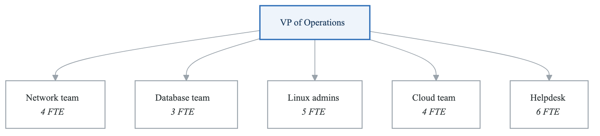
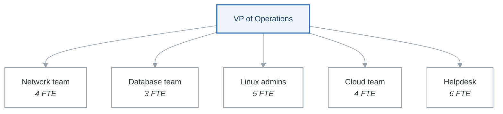
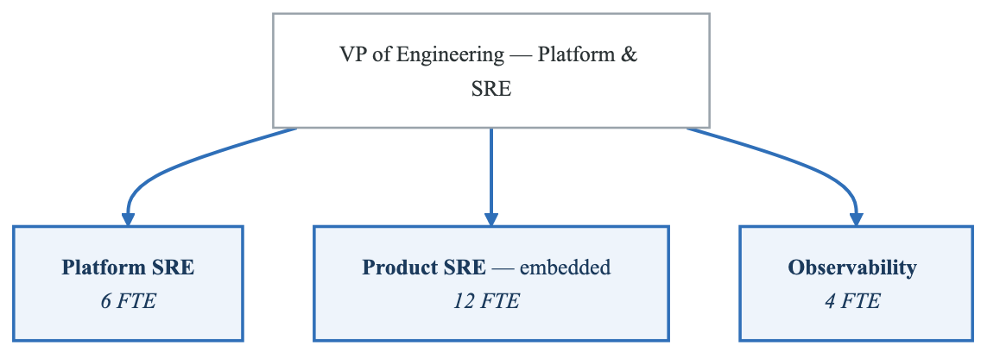
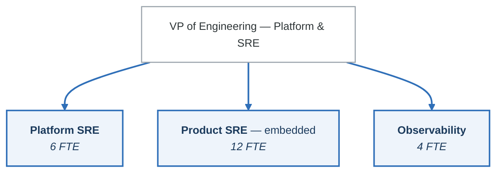

# Case Study 02: SRE Implementation Journey - From Ops to Engineering

## Executive Summary

A rapidly growing SaaS company serving 10,000+ B2B customers transformed their traditional operations team into a Site Reliability Engineering organization. This case study documents their 18-month journey implementing SRE practices, establishing SLOs, and reducing toil by 75% while improving system reliability from 99.5% to 99.95%.

## Company Profile

- **Industry**: B2B SaaS (Project Management Platform)
- **Size**: 2,000 employees, 400 engineers
- **Customers**: 10,000+ enterprise customers
- **Scale**: 5M daily active users, 500K API calls/minute
- **Revenue Model**: Subscription-based, $200M ARR
- **Timeline**: 18 months

## Initial State Analysis

### Operations Team Structure

<!-- figure: generated from the Mermaid below by _shared/diagrams/embed-figures.py — do not edit the image -->


<details>
<summary>Diagram source (Mermaid)</summary>



</details>

**22 FTE.** A 24/7 on-call rotation in every team, and a ticket-driven work model.

Organised by *technology*, which means every incident that crosses a boundary — and they all do —
starts with a handoff. The helpdesk being the largest team is the tell: most of the headcount is
absorbing the consequences of the structure above it.

### Key Challenges

1. **Reactive Operations Model**
   - 80% of work was reactive (tickets, incidents)
   - No time for proactive reliability improvements
   - "Firefighting" culture normalized
   - Engineers burned out from constant escalations

2. **No Reliability Standards**
   - No defined SLIs or SLOs
   - Availability measured only during postmortems
   - No error budgets to balance velocity and reliability
   - Arbitrary performance targets

3. **Tribal Knowledge Dependencies**
   - Critical systems understood by 1-2 people
   - No runbooks or automation
   - Knowledge lost with attrition
   - Mean time to onboard: 6 months

4. **Unsustainable On-Call**
   - 1-in-4 rotation per team
   - Average 15 pages per on-call shift
   - 60% of pages were non-actionable
   - High attrition (40% annual turnover)

### Reliability Metrics (Before)

| Metric | Value |
|--------|-------|
| Availability | 99.5% (43+ hours downtime/year) |
| MTTR | 2.5 hours |
| MTTD | 45 minutes |
| Change Failure Rate | 25% |
| Deployment Frequency | Weekly |
| On-Call Pages | 450/month |
| Toil Ratio | 80% |
| Customer Escalations | 150/month |

## SRE Transformation Strategy

### Target Organization Structure

<!-- figure: generated from the Mermaid below by _shared/diagrams/embed-figures.py — do not edit the image -->


<details>
<summary>Diagram source (Mermaid)</summary>



</details>

| Team | Owns |
|---|---|
| **Platform SRE** *(6)* | Kubernetes platform · CI/CD infrastructure · database platforms · network and edge |
| **Product SRE** *(12, embedded)* | Core Platform (4) · Collaboration Services (4) · Data Platform (4) |
| **Observability** *(4)* | Metrics platform · logging · distributed tracing · alerting and dashboards |

22 FTE became 22 FTE. The change is not headcount, it is *what they are organised around*: platform
teams own a product used by engineers, and product SREs sit **inside** the teams whose services they
support, so the handoff that used to start every incident no longer exists.

### Implementation Phases

## Phase 1: Foundation (Months 1-4)

### SLI/SLO Framework Implementation

**Step 1: Define Service Tiers**

```yaml
# Service tier definitions
service_tiers:
  tier_1_critical:
    description: "Core services affecting all users"
    availability_target: 99.95%
    latency_p99_target: 200ms
    error_budget_policy: "Halt deployments at 50% budget consumed"
    examples:
      - authentication-service
      - api-gateway
      - core-data-service

  tier_2_important:
    description: "Features used by majority of users"
    availability_target: 99.9%
    latency_p99_target: 500ms
    error_budget_policy: "Review deployments at 25% budget consumed"
    examples:
      - notification-service
      - search-service
      - reporting-service

  tier_3_standard:
    description: "Non-critical features"
    availability_target: 99.5%
    latency_p99_target: 2000ms
    error_budget_policy: "Weekly budget review"
    examples:
      - analytics-service
      - export-service
      - integration-connectors
```

**Step 2: Define SLIs**

```python
# SLI definitions for Core API Service
class CoreAPISLIs:
    """Service Level Indicators for the Core API."""

    @staticmethod
    def availability_sli() -> str:
        """
        Availability: Ratio of successful requests to total requests.
        Successful = HTTP status 2xx, 3xx, 4xx (client errors excluded from failures)
        """
        return """
        sum(rate(http_requests_total{
            service="core-api",
            status!~"5.."
        }[5m]))
        /
        sum(rate(http_requests_total{
            service="core-api"
        }[5m]))
        """

    @staticmethod
    def latency_sli() -> str:
        """
        Latency: Ratio of requests served within threshold.
        Threshold: 200ms for P99
        """
        return """
        sum(rate(http_request_duration_seconds_bucket{
            service="core-api",
            le="0.2"
        }[5m]))
        /
        sum(rate(http_request_duration_seconds_count{
            service="core-api"
        }[5m]))
        """

    @staticmethod
    def throughput_sli() -> str:
        """
        Throughput: Requests per second handled.
        Used for capacity SLOs, not reliability.
        """
        return """
        sum(rate(http_requests_total{
            service="core-api"
        }[5m]))
        """

    @staticmethod
    def error_rate_by_type() -> str:
        """
        Error breakdown for debugging.
        Not an SLO, but useful for investigation.
        """
        return """
        sum(rate(http_requests_total{
            service="core-api",
            status=~"5.."
        }[5m])) by (status, endpoint)
        """
```

**Step 3: Implement SLO Tracking**

```yaml
# Prometheus recording rules for SLO calculation
groups:
  - name: slo_recording_rules
    interval: 1m
    rules:
      # Availability - 5m window
      - record: slo:availability:ratio_rate5m
        expr: |
          sum(rate(http_requests_total{status!~"5.."}[5m])) by (service)
          /
          sum(rate(http_requests_total[5m])) by (service)

      # Availability - 30m window
      - record: slo:availability:ratio_rate30m
        expr: |
          sum(rate(http_requests_total{status!~"5.."}[30m])) by (service)
          /
          sum(rate(http_requests_total[30m])) by (service)

      # Availability - 1h window
      - record: slo:availability:ratio_rate1h
        expr: |
          sum(rate(http_requests_total{status!~"5.."}[1h])) by (service)
          /
          sum(rate(http_requests_total[1h])) by (service)

      # Availability - 6h window
      - record: slo:availability:ratio_rate6h
        expr: |
          sum(rate(http_requests_total{status!~"5.."}[6h])) by (service)
          /
          sum(rate(http_requests_total[6h])) by (service)

      # Availability - 1d window
      - record: slo:availability:ratio_rate1d
        expr: |
          sum(rate(http_requests_total{status!~"5.."}[1d])) by (service)
          /
          sum(rate(http_requests_total[1d])) by (service)

      # Availability - 30d window (monthly SLO period)
      - record: slo:availability:ratio_rate30d
        expr: |
          sum(rate(http_requests_total{status!~"5.."}[30d])) by (service)
          /
          sum(rate(http_requests_total[30d])) by (service)

      # Error budget remaining (30d period)
      - record: slo:error_budget:remaining
        expr: |
          1 - (
            (1 - slo:availability:ratio_rate30d)
            /
            (1 - 0.9995)  # 99.95% SLO
          )
        labels:
          slo_target: "99.95"

      # Error budget burn rate
      - record: slo:error_budget:burn_rate_1h
        expr: |
          (1 - slo:availability:ratio_rate1h)
          /
          (1 - 0.9995)
```

**Step 4: Error Budget Policies**

```python
# Error budget policy implementation
from dataclasses import dataclass
from enum import Enum
from typing import Optional
import asyncio

class BudgetState(Enum):
    HEALTHY = "healthy"           # > 50% remaining
    CAUTION = "caution"           # 25-50% remaining
    AT_RISK = "at_risk"          # 10-25% remaining
    EXHAUSTED = "exhausted"       # < 10% remaining
    EXCEEDED = "exceeded"         # Negative budget

@dataclass
class ErrorBudgetPolicy:
    service: str
    tier: str
    slo_target: float
    budget_remaining: float
    burn_rate: float
    state: BudgetState

    def get_policy_actions(self) -> dict:
        """Return required actions based on budget state."""
        policies = {
            BudgetState.HEALTHY: {
                "deployments": "normal",
                "experiments": "allowed",
                "toil_reduction": "prioritize",
                "review_cadence": "weekly"
            },
            BudgetState.CAUTION: {
                "deployments": "careful_review",
                "experiments": "limited",
                "toil_reduction": "pause",
                "review_cadence": "daily"
            },
            BudgetState.AT_RISK: {
                "deployments": "critical_only",
                "experiments": "halted",
                "toil_reduction": "pause",
                "review_cadence": "twice_daily"
            },
            BudgetState.EXHAUSTED: {
                "deployments": "emergency_only",
                "experiments": "halted",
                "toil_reduction": "pause",
                "review_cadence": "continuous"
            },
            BudgetState.EXCEEDED: {
                "deployments": "frozen",
                "experiments": "halted",
                "toil_reduction": "pause",
                "review_cadence": "continuous",
                "escalation": "vp_level"
            }
        }
        return policies[self.state]


class ErrorBudgetEnforcer:
    """Enforces error budget policies across services."""

    def __init__(self, prometheus_client, deployment_client, slack_client):
        self.prometheus = prometheus_client
        self.deployment = deployment_client
        self.slack = slack_client

    async def evaluate_deployment_request(self,
                                          service: str,
                                          deployment_type: str) -> dict:
        """Evaluate if deployment should proceed based on error budget."""

        # Get current error budget state
        budget_state = await self._get_budget_state(service)
        policy = budget_state.get_policy_actions()

        deployment_allowed = self._check_deployment_allowed(
            policy["deployments"],
            deployment_type
        )

        if not deployment_allowed:
            await self._notify_deployment_blocked(service, budget_state)

        return {
            "allowed": deployment_allowed,
            "budget_remaining": budget_state.budget_remaining,
            "burn_rate": budget_state.burn_rate,
            "state": budget_state.state.value,
            "required_approvals": self._get_required_approvals(budget_state)
        }

    async def _get_budget_state(self, service: str) -> ErrorBudgetPolicy:
        """Query Prometheus for current error budget state."""

        queries = {
            "budget_remaining": f'slo:error_budget:remaining{{service="{service}"}}',
            "burn_rate": f'slo:error_budget:burn_rate_1h{{service="{service}"}}'
        }

        results = {}
        for name, query in queries.items():
            result = await self.prometheus.query(query)
            results[name] = float(result[0]["value"][1]) if result else 0

        # Determine state
        remaining = results["budget_remaining"]
        if remaining > 0.5:
            state = BudgetState.HEALTHY
        elif remaining > 0.25:
            state = BudgetState.CAUTION
        elif remaining > 0.1:
            state = BudgetState.AT_RISK
        elif remaining > 0:
            state = BudgetState.EXHAUSTED
        else:
            state = BudgetState.EXCEEDED

        return ErrorBudgetPolicy(
            service=service,
            tier=await self._get_service_tier(service),
            slo_target=0.9995,
            budget_remaining=remaining,
            burn_rate=results["burn_rate"],
            state=state
        )
```

### Results - Phase 1

- SLOs defined for 45 services
- Error budget tracking operational
- Baseline established: 99.5% availability
- Deployment decisions now data-driven

## Phase 2: Toil Reduction (Months 5-8)

### Toil Identification

**Toil Survey Results:**

**Toil Categories Identified**

```
Manual Deployments          ████████████████████ 25%
Certificate Renewals        ██████████████ 15%
Database Maintenance        ████████████ 12%
User Access Requests        ██████████ 10%
Capacity Adjustments        ████████ 8%
Log Investigation          ████████ 8%
On-Call Noise              ██████ 7%
Configuration Changes      ██████ 6%
Incident Bridge Mgmt       ████ 5%
Other Manual Tasks         ████ 4%
Total Toil: 80% of engineering time
```


**Toil Automation Projects:**

```python
# Automated certificate renewal
from kubernetes import client, config
from cryptography import x509
from datetime import datetime, timedelta
import asyncio

class CertificateAutomation:
    """Automated TLS certificate management."""

    def __init__(self):
        config.load_incluster_config()
        self.v1 = client.CoreV1Api()
        self.cert_manager = CertManagerClient()

    async def scan_expiring_certificates(self,
                                          days_threshold: int = 30) -> list:
        """Find certificates expiring within threshold."""

        expiring = []
        secrets = self.v1.list_secret_for_all_namespaces(
            field_selector="type=kubernetes.io/tls"
        )

        for secret in secrets.items:
            cert_data = secret.data.get("tls.crt")
            if cert_data:
                cert = x509.load_pem_x509_certificate(
                    base64.b64decode(cert_data)
                )
                days_until_expiry = (
                    cert.not_valid_after - datetime.utcnow()
                ).days

                if days_until_expiry < days_threshold:
                    expiring.append({
                        "namespace": secret.metadata.namespace,
                        "name": secret.metadata.name,
                        "expires": cert.not_valid_after,
                        "days_remaining": days_until_expiry
                    })

        return expiring

    async def auto_renew_certificates(self):
        """Automatically renew certificates via cert-manager."""

        expiring = await self.scan_expiring_certificates(days_threshold=14)

        for cert in expiring:
            # Trigger cert-manager renewal
            await self.cert_manager.trigger_renewal(
                namespace=cert["namespace"],
                certificate_name=cert["name"]
            )

            # Log renewal
            logger.info(
                f"Triggered renewal for {cert['namespace']}/{cert['name']}, "
                f"was expiring in {cert['days_remaining']} days"
            )

        return len(expiring)


# Automated capacity adjustment
class CapacityAutomation:
    """Automated capacity management based on predictive scaling."""

    def __init__(self, prometheus_client, k8s_client):
        self.prometheus = prometheus_client
        self.k8s = k8s_client

    async def predict_capacity_needs(self,
                                      service: str,
                                      hours_ahead: int = 24) -> dict:
        """Predict capacity needs using historical patterns."""

        # Query historical usage patterns
        query = f"""
        predict_linear(
            avg_over_time(
                container_cpu_usage_seconds_total{{
                    namespace="production",
                    pod=~"{service}.*"
                }}[7d]
            )[7d:1h],
            {hours_ahead * 3600}
        )
        """

        prediction = await self.prometheus.query(query)

        current_replicas = await self._get_current_replicas(service)
        predicted_load = float(prediction[0]["value"][1])

        # Calculate needed replicas (with 30% headroom)
        cpu_per_replica = 0.5  # 500m CPU per replica
        needed_replicas = int((predicted_load / cpu_per_replica) * 1.3)

        return {
            "service": service,
            "current_replicas": current_replicas,
            "predicted_replicas_needed": needed_replicas,
            "recommendation": "scale_up" if needed_replicas > current_replicas else "maintain"
        }

    async def auto_scale_proactively(self, service: str):
        """Proactively scale based on predictions."""

        prediction = await self.predict_capacity_needs(service)

        if prediction["recommendation"] == "scale_up":
            # Scale with approval workflow for large changes
            change_size = (
                prediction["predicted_replicas_needed"]
                - prediction["current_replicas"]
            )

            if change_size > 5:
                # Large change - request approval
                await self._request_scale_approval(service, prediction)
            else:
                # Small change - auto-approve
                await self._execute_scale(
                    service,
                    prediction["predicted_replicas_needed"]
                )
```

**Runbook Automation:**

```yaml
# Automated runbook execution
apiVersion: v1
kind: ConfigMap
metadata:
  name: runbook-database-failover
  namespace: sre-automation
data:
  runbook.yaml: |
    name: Database Primary Failover
    trigger:
      alert: PostgresPrimaryDown
      auto_execute: false  # Requires approval

    steps:
      - name: verify_primary_down
        action: prometheus_query
        query: pg_up{role="primary"} == 0
        expected: true
        timeout: 30s

      - name: check_replica_lag
        action: prometheus_query
        query: pg_replication_lag_seconds < 5
        expected: true
        timeout: 30s
        on_failure: abort

      - name: notify_stakeholders
        action: slack_message
        channel: "#incident-response"
        message: "Database failover initiated for {{ .cluster_name }}"

      - name: promote_replica
        action: kubectl_exec
        namespace: databases
        pod_selector: role=replica,cluster={{ .cluster_name }}
        command: "pg_ctl promote"
        timeout: 60s

      - name: update_connection_string
        action: kubectl_patch
        resource: configmap/database-config
        patch:
          data:
            primary_host: "{{ .new_primary_host }}"

      - name: verify_new_primary
        action: prometheus_query
        query: pg_up{role="primary",pod="{{ .new_primary_pod }}"} == 1
        expected: true
        timeout: 120s
        retries: 3

      - name: notify_completion
        action: slack_message
        channel: "#incident-response"
        message: |
          Database failover completed successfully.
          New primary: {{ .new_primary_host }}
          Failover duration: {{ .elapsed_time }}
```

### Results - Phase 2

| Metric | Before | After |
|--------|--------|-------|
| Deployment Time | 45 min (manual) | 8 min (automated) |
| Certificate Renewals | 50/month manual | 0 manual |
| Access Provisioning | 24 hours | 15 minutes |
| Capacity Changes | 2 hours/request | Automated |
| Toil Ratio | 80% | 35% |

## Phase 3: Incident Management Transformation (Months 9-12)

### On-Call Optimization

**Alert Consolidation:**

```yaml
# Alert routing and aggregation
groups:
  - name: service_alerts
    rules:
      # Aggregate multiple symptoms into single actionable alert
      - alert: ServiceDegraded
        expr: |
          (
            # High error rate
            sum(rate(http_requests_total{status=~"5.."}[5m])) by (service)
            /
            sum(rate(http_requests_total[5m])) by (service)
            > 0.01
          )
          or
          (
            # High latency
            histogram_quantile(0.99,
              sum(rate(http_request_duration_seconds_bucket[5m])) by (service, le)
            ) > 0.5
          )
          or
          (
            # Low throughput (compared to baseline)
            sum(rate(http_requests_total[5m])) by (service)
            <
            sum(rate(http_requests_total[5m] offset 1d)) by (service) * 0.5
          )
        for: 5m
        labels:
          severity: warning
        annotations:
          summary: "{{ $labels.service }} is showing degraded performance"
          dashboard: "https://grafana/d/service-health?var-service={{ $labels.service }}"
          runbook: "https://runbooks/service-degraded"

      # Critical: Multiple services affected
      - alert: PlatformOutage
        expr: |
          count(
            sum(rate(http_requests_total{status=~"5.."}[5m])) by (service)
            /
            sum(rate(http_requests_total[5m])) by (service)
            > 0.05
          ) > 3
        for: 2m
        labels:
          severity: critical
        annotations:
          summary: "Platform-wide outage detected - {{ $value }} services affected"
          runbook: "https://runbooks/platform-outage"
```

**PagerDuty Integration with Intelligent Routing:**

```python
# Intelligent alert routing
class AlertRouter:
    """Route alerts to appropriate responders based on context."""

    def __init__(self, pagerduty_client, service_catalog):
        self.pagerduty = pagerduty_client
        self.catalog = service_catalog

    async def route_alert(self, alert: dict) -> dict:
        """Determine optimal routing for an alert."""

        service = alert.get("labels", {}).get("service")
        severity = alert.get("labels", {}).get("severity")

        # Get service ownership
        ownership = await self.catalog.get_service_ownership(service)

        # Determine if this is business hours
        is_business_hours = self._is_business_hours(ownership["timezone"])

        # Check current incident load
        team_load = await self._get_team_incident_load(ownership["team"])

        # Routing decision
        if severity == "critical":
            # Critical always pages primary on-call
            escalation = ownership["escalation_policy_critical"]
            notify_immediately = True
        elif severity == "warning" and is_business_hours:
            # Warnings during business hours go to team channel
            escalation = None
            notify_immediately = False
            await self._notify_slack(ownership["slack_channel"], alert)
        elif severity == "warning" and team_load > 5:
            # High load - escalate to secondary
            escalation = ownership["escalation_policy_secondary"]
            notify_immediately = True
        else:
            # Standard routing
            escalation = ownership["escalation_policy_standard"]
            notify_immediately = True

        if escalation and notify_immediately:
            incident = await self.pagerduty.create_incident(
                title=alert["annotations"]["summary"],
                service_id=ownership["pagerduty_service_id"],
                escalation_policy_id=escalation,
                urgency="high" if severity == "critical" else "low",
                body={
                    "type": "incident_body",
                    "details": alert["annotations"].get("description", "")
                }
            )
            return {"routed_to": "pagerduty", "incident_id": incident["id"]}

        return {"routed_to": "slack", "channel": ownership["slack_channel"]}
```

**Incident Response Automation:**

```python
# Automated incident response bot
class IncidentBot:
    """Automated incident coordination and response."""

    def __init__(self, slack_client, jira_client, prometheus_client):
        self.slack = slack_client
        self.jira = jira_client
        self.prometheus = prometheus_client

    async def handle_new_incident(self, alert: dict) -> dict:
        """Automated incident initialization."""

        incident_id = generate_incident_id()
        service = alert["labels"]["service"]
        severity = alert["labels"]["severity"]

        # 1. Create incident channel
        channel = await self.slack.create_channel(
            name=f"inc-{incident_id}-{service[:20]}",
            is_private=False
        )

        # 2. Gather initial context
        context = await self._gather_incident_context(service, alert)

        # 3. Post incident summary
        await self.slack.post_message(
            channel=channel["id"],
            blocks=self._format_incident_summary(alert, context)
        )

        # 4. Add relevant people
        responders = await self._identify_responders(service, severity)
        for responder in responders:
            await self.slack.invite_to_channel(channel["id"], responder)

        # 5. Create tracking ticket
        ticket = await self.jira.create_issue(
            project="INC",
            issue_type="Incident",
            summary=f"[{severity.upper()}] {alert['annotations']['summary']}",
            description=self._format_ticket_description(alert, context),
            labels=["incident", service, severity]
        )

        # 6. Start timeline
        await self._start_incident_timeline(channel["id"], incident_id)

        return {
            "incident_id": incident_id,
            "channel_id": channel["id"],
            "ticket_key": ticket["key"],
            "responders": responders
        }

    async def _gather_incident_context(self,
                                        service: str,
                                        alert: dict) -> dict:
        """Gather relevant context for incident response."""

        context = {}

        # Recent deployments
        context["recent_deployments"] = await self._query_recent_deployments(
            service, minutes=60
        )

        # Recent changes
        context["recent_changes"] = await self._query_recent_changes(
            service, minutes=60
        )

        # Current metrics
        context["current_metrics"] = {
            "error_rate": await self.prometheus.query(
                f'sum(rate(http_requests_total{{service="{service}",status=~"5.."}}[5m]))'
            ),
            "latency_p99": await self.prometheus.query(
                f'histogram_quantile(0.99, sum(rate(http_request_duration_seconds_bucket{{service="{service}"}}[5m])) by (le))'
            ),
            "request_rate": await self.prometheus.query(
                f'sum(rate(http_requests_total{{service="{service}"}}[5m]))'
            )
        }

        # Dependency health
        context["dependency_health"] = await self._check_dependencies(service)

        # Similar past incidents
        context["similar_incidents"] = await self._find_similar_incidents(
            service, alert["annotations"]["summary"]
        )

        return context

    def _format_incident_summary(self, alert: dict, context: dict) -> list:
        """Format incident summary for Slack."""

        blocks = [
            {
                "type": "header",
                "text": {
                    "type": "plain_text",
                    "text": f"🚨 Incident: {alert['annotations']['summary']}"
                }
            },
            {
                "type": "section",
                "fields": [
                    {"type": "mrkdwn", "text": f"*Service:* {alert['labels']['service']}"},
                    {"type": "mrkdwn", "text": f"*Severity:* {alert['labels']['severity']}"},
                    {"type": "mrkdwn", "text": f"*Started:* {alert['startsAt']}"},
                    {"type": "mrkdwn", "text": f"*Error Rate:* {context['current_metrics']['error_rate']:.2%}"}
                ]
            },
            {
                "type": "section",
                "text": {
                    "type": "mrkdwn",
                    "text": f"*Dashboard:* <{alert['annotations']['dashboard']}|View Dashboard>\n"
                           f"*Runbook:* <{alert['annotations']['runbook']}|View Runbook>"
                }
            }
        ]

        # Add recent deployments if any
        if context["recent_deployments"]:
            blocks.append({
                "type": "section",
                "text": {
                    "type": "mrkdwn",
                    "text": f"⚠️ *Recent Deployments:*\n" +
                           "\n".join([
                               f"• {d['version']} at {d['time']} by {d['author']}"
                               for d in context["recent_deployments"][:3]
                           ])
                }
            })

        # Add similar incidents if found
        if context["similar_incidents"]:
            blocks.append({
                "type": "section",
                "text": {
                    "type": "mrkdwn",
                    "text": f"📚 *Similar Past Incidents:*\n" +
                           "\n".join([
                               f"• <{i['url']}|{i['title']}> - {i['resolution']}"
                               for i in context["similar_incidents"][:3]
                           ])
                }
            })

        return blocks
```

### Results - Phase 3

| Metric | Before | After |
|--------|--------|-------|
| Alerts/Month | 450 | 85 |
| Pages/On-Call Shift | 15 | 3 |
| Non-Actionable Alerts | 60% | 8% |
| MTTD | 45 min | 5 min |
| MTTR | 2.5 hours | 25 min |
| Incident Channel Setup | 15 min | 30 sec |

## Phase 4: Cultural Transformation (Months 13-18)

### Blameless Postmortem Process

**Postmortem Template:**

```markdown
# Postmortem: [INC-XXXX] Brief Description

## Incident Summary
| Field | Value |
|-------|-------|
| Incident ID | INC-XXXX |
| Date | YYYY-MM-DD |
| Duration | X hours Y minutes |
| Severity | SEV-1/2/3 |
| Services Affected | service-a, service-b |
| Customer Impact | X% of users affected |
| Error Budget Impact | X% of monthly budget consumed |

## Timeline (All times in UTC)

| Time | Event |
|------|-------|
| HH:MM | First alert fired |
| HH:MM | On-call acknowledged |
| HH:MM | Incident channel created |
| HH:MM | Root cause identified |
| HH:MM | Mitigation applied |
| HH:MM | Service restored |
| HH:MM | All-clear declared |

## Root Cause Analysis

### What Happened
[Technical description of the failure]

### Why It Happened
[5 Whys analysis or similar]

1. Why? [First level]
2. Why? [Second level]
3. Why? [Third level]
4. Why? [Fourth level]
5. Why? [Root cause]

### Contributing Factors
- [ ] Recent deployment
- [ ] Configuration change
- [ ] Dependency failure
- [ ] Capacity exhaustion
- [ ] External factor
- [ ] Other: ___

## Impact Analysis

### Customer Impact
- Users affected: X,XXX
- Features impacted: Feature A, Feature B
- Data loss: None / Describe

### Business Impact
- Revenue impact: $X,XXX estimated
- SLA breach: Yes/No
- Customer escalations: X

## Response Analysis

### What Went Well
- Detection was fast (X minutes)
- Runbook was helpful
- Team collaboration was effective

### What Could Be Improved
- Alert didn't fire for initial symptom
- Runbook was outdated
- Communication to stakeholders was delayed

## Action Items

| Priority | Action | Owner | Due Date | Status |
|----------|--------|-------|----------|--------|
| P1 | Add missing alert for X | @engineer | YYYY-MM-DD | Open |
| P1 | Update runbook section Y | @engineer | YYYY-MM-DD | Open |
| P2 | Implement circuit breaker | @engineer | YYYY-MM-DD | Open |
| P3 | Add capacity monitoring | @engineer | YYYY-MM-DD | Open |

## Lessons Learned

### Detection
How can we detect this faster next time?

### Prevention
How can we prevent this from happening again?

### Mitigation
How can we reduce impact if this happens again?

## Appendix

### Relevant Logs
[Link to log queries]

### Relevant Metrics
[Link to dashboard]

### Related Incidents
[Links to similar incidents]
```

**Postmortem Review Process:**

```python
# Postmortem workflow automation
class PostmortemWorkflow:
    """Manage postmortem creation and tracking."""

    SEVERITY_THRESHOLDS = {
        "SEV-1": {"review_required": True, "review_level": "vp"},
        "SEV-2": {"review_required": True, "review_level": "director"},
        "SEV-3": {"review_required": False, "review_level": "manager"}
    }

    async def initiate_postmortem(self, incident: dict) -> dict:
        """Create postmortem document and schedule review."""

        # Create document from template
        doc = await self.docs_client.create_from_template(
            template_id="postmortem-template",
            title=f"Postmortem: {incident['id']} - {incident['title']}",
            folder=f"Postmortems/{incident['date'].year}/{incident['date'].month}"
        )

        # Pre-fill known information
        await self._prefill_postmortem(doc, incident)

        # Assign owners
        severity_config = self.SEVERITY_THRESHOLDS[incident["severity"]]

        # Schedule review meeting
        if severity_config["review_required"]:
            meeting = await self._schedule_review_meeting(
                incident=incident,
                review_level=severity_config["review_level"],
                doc_url=doc["url"]
            )
        else:
            meeting = None

        # Create tracking ticket for action items
        ticket = await self.jira_client.create_issue(
            project="SRE",
            issue_type="Postmortem",
            summary=f"Postmortem: {incident['id']}",
            description=f"Track action items from {incident['id']}\nDoc: {doc['url']}"
        )

        # Notify stakeholders
        await self._notify_postmortem_created(incident, doc, meeting)

        return {
            "document_url": doc["url"],
            "tracking_ticket": ticket["key"],
            "review_meeting": meeting
        }

    async def track_action_items(self, postmortem_id: str) -> dict:
        """Track completion of postmortem action items."""

        items = await self.jira_client.get_subtasks(postmortem_id)

        stats = {
            "total": len(items),
            "completed": len([i for i in items if i["status"] == "Done"]),
            "overdue": len([
                i for i in items
                if i["due_date"] < datetime.now() and i["status"] != "Done"
            ]),
            "blocked": len([i for i in items if i["status"] == "Blocked"])
        }

        # Alert on overdue items
        if stats["overdue"] > 0:
            await self._alert_overdue_items(postmortem_id, items)

        return stats
```

### SRE Team Embedding Model

```yaml
# SRE embedding guidelines
sre_embedding_model:
  engagement_types:
    consulting:
      description: "Short-term engagement for specific reliability improvements"
      duration: "2-4 weeks"
      activities:
        - Architecture review
        - SLO definition
        - Alert tuning
        - Runbook creation

    embedded:
      description: "Long-term embedding with product team"
      duration: "3-6 months"
      activities:
        - Full team integration
        - On-call participation
        - Design reviews
        - Reliability roadmap
        - Knowledge transfer

    platform:
      description: "Building shared reliability infrastructure"
      duration: "Ongoing"
      activities:
        - Observability platform
        - Deployment infrastructure
        - Incident response tooling
        - SLO framework

  graduation_criteria:
    description: "When product teams can self-serve reliability"
    metrics:
      - slo_compliance: "> 99% for 3 months"
      - toil_ratio: "< 30%"
      - incident_mttr: "< 30 minutes"
      - runbook_coverage: "> 90%"
      - on_call_quality: "< 5 pages/week"

  knowledge_transfer:
    - reliability_design_patterns
    - monitoring_best_practices
    - incident_response_procedures
    - capacity_planning
    - chaos_engineering
```

## Business Outcomes

### Final Metrics Comparison

**SRE Transformation Results**

**Metric**

| Item | What it is |
|---|---|
| Reduced downtime costs | $2.4M/year saved |
| Reduced escalation costs | $500K/year saved |
| Improved velocity value | $3M/year estimated |
| Reduced turnover costs | $800K/year saved |

Availability              99.5%          99.95%       +0.45%
MTTR                      2.5 hours      25 minutes   -83%
MTTD                      45 minutes     5 minutes    -89%
Change Failure Rate       25%            8%           -68%
Deployment Frequency      Weekly         Daily        +600%
On-Call Pages/Month       450            85           -81%
Toil Ratio               80%            25%          -69%
Customer Escalations      150/month      15/month     -90%
Engineer Turnover         40%            12%          -70%
Financial Impact:
Total Annual Impact:          $6.7M


### Customer Satisfaction Impact

| Metric | Before | After |
|--------|--------|-------|
| NPS Score | 32 | 58 |
| Support Tickets (Platform) | 1,200/month | 300/month |
| Enterprise Renewals | 85% | 96% |
| Uptime Page Visits | 5,000/day | 500/day |

## Lessons Learned

### Success Factors

1. **Executive Sponsorship**
   - CTO championed the transformation
   - Budget allocated for tools and training
   - SRE metrics added to company OKRs

2. **Gradual Cultural Shift**
   - Started with willing teams
   - Demonstrated value before mandating
   - Celebrated wins publicly

3. **Investing in Tooling**
   - Self-service reduced bottlenecks
   - Automation reduced toil
   - Good observability enabled fast debugging

4. **Focus on Developer Experience**
   - SREs embedded to learn pain points
   - Built tools developers wanted to use
   - Reduced friction, not added process

### Challenges Overcome

1. **Resistance to Change**
   - Some ops engineers felt threatened
   - Addressed through retraining and role evolution
   - Created clear career paths for SRE

2. **Defining SLOs**
   - Initial SLOs were either too loose or too tight
   - Iterated based on customer feedback
   - Took 6 months to stabilize

3. **Balancing Priorities**
   - Pressure to ship features vs. reliability work
   - Error budgets provided objective framework
   - Regular reliability reviews maintained focus

## Conclusion

The 18-month SRE transformation delivered exceptional results: availability improved from 99.5% to 99.95%, MTTR dropped from 2.5 hours to 25 minutes, and the team went from 80% reactive toil to 75% proactive engineering work. The financial impact of $6.7M annual savings and improved customer satisfaction validated the investment. The key success factors were executive support, gradual cultural change, and a relentless focus on automation and developer experience.

## References

- [Google SRE Book](https://sre.google/sre-book/table-of-contents/)
- [Google SRE Workbook](https://sre.google/workbook/table-of-contents/)
- [The Art of SLOs](https://sre.google/resources/practices-and-processes/art-of-slos/)
- [Incident Management at Google](https://sre.google/sre-book/managing-incidents/)

<!-- feynman-check -->

---

## Feynman check

Close the file. Blank page, no notes. Explain each of these to a competent engineer who has never
used this tool — **under five minutes, no jargon you can't define on the spot:**

- Initial State Analysis
- SRE Transformation Strategy
- Foundation (Months 1-4)
- Toil Reduction (Months 5-8)

**The gap is not what you forgot. It is where you used a word instead of a mechanism.**

| | |
|---|---|
| ✗ | *"Prometheus monitors the service."* |
| ✓ | *"Prometheus discovers targets from the Kubernetes API, applies relabelling rules, scrapes `/metrics` over HTTP on an interval, and appends samples to a local TSDB. Nothing is pushed — so a target missing from a dashboard is a service-discovery problem, not an application one."* |

**Trace it:** A latency regression → a phone ringing. Name each hop: sample, rule evaluation, alert state transition, routing, notification — and where each one can silently stop.

Stop at the first component you cannot name. Reopen this file and read **only** that.

**Go deeper — only once the gap has a name:** [SRE Workbook ch. 5, *Alerting on SLOs*](https://sre.google/workbook/alerting-on-slos/) — free, and the best thing written on why static thresholds page you for nothing.
Full list per domain: [`SOURCES.md`](../SOURCES.md#observability-sre)

→ Protocol, the three levels of knowing, and worked examples: [`MASTERY.md`](../MASTERY.md)

<!-- /feynman-check -->
