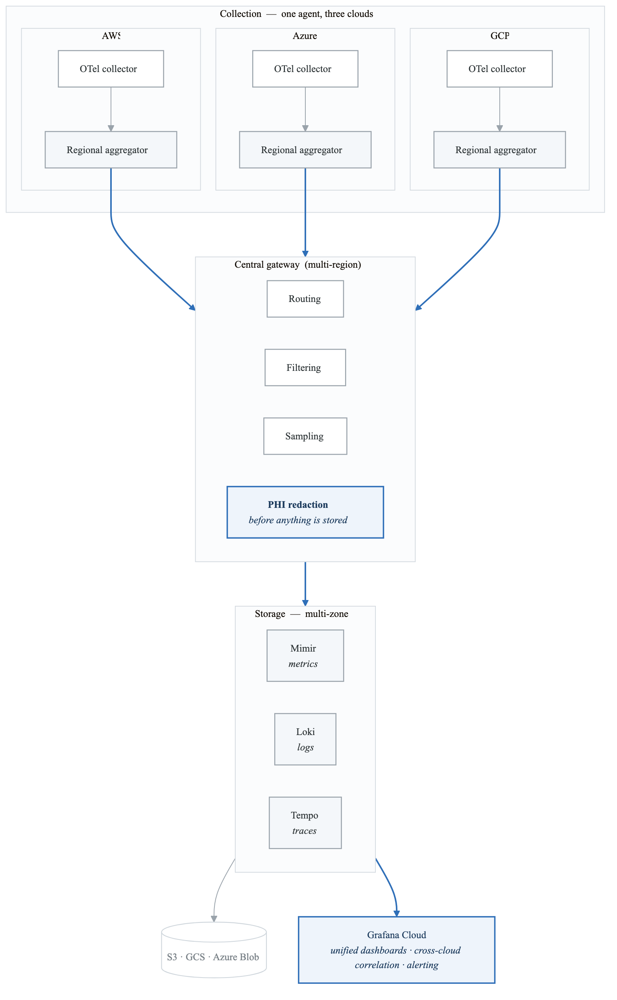
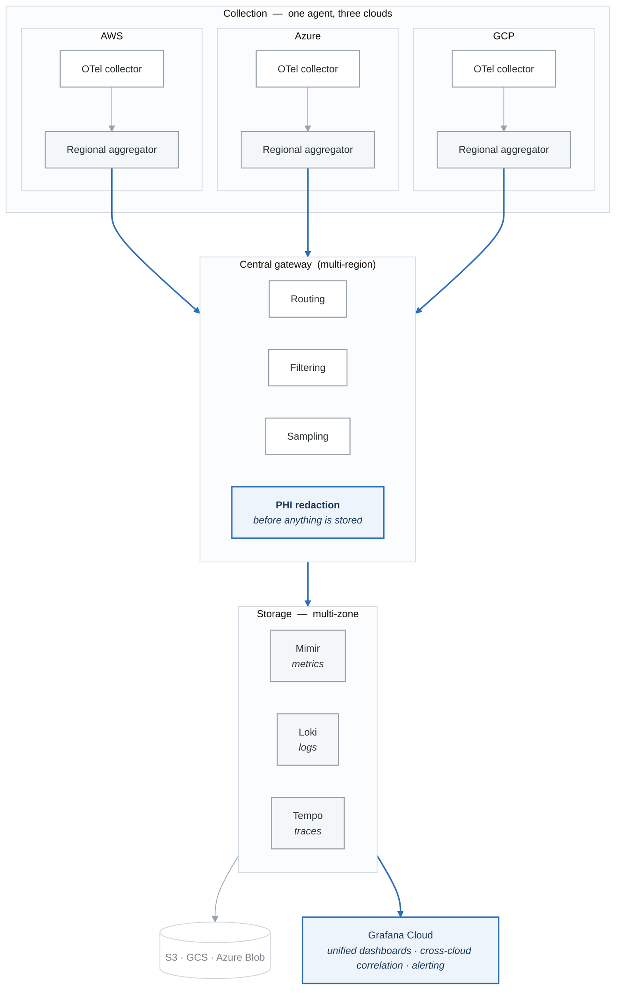

# Case Study 03: Multi-Cloud Observability Strategy

## Executive Summary

A global healthcare technology company operating across AWS, Azure, and GCP implemented a unified multi-cloud observability strategy. This case study examines how they achieved consistent visibility across 3 cloud providers, 12 regions, and 800+ services while meeting strict healthcare compliance requirements and reducing observability costs by 55%.

## Company Profile

- **Industry**: Healthcare Technology (Health Records & Analytics)
- **Size**: 5,000 employees, 800 engineers
- **Customers**: 2,000+ hospitals, 50M patient records
- **Infrastructure**: Multi-cloud (AWS primary, Azure for enterprise clients, GCP for ML workloads)
- **Compliance**: HIPAA, SOC 2 Type II, HITRUST
- **Annual Revenue**: $800M
- **Timeline**: 15 months

## Initial State Analysis

### Multi-Cloud Landscape

**The estate being monitored**

| | AWS *(primary)* | Azure | GCP |
|---|---|---|---|
| Regions | us-east-1, us-west-2, eu-west-1, ap-southeast-1 | East US, West Europe, Southeast Asia | us-central1, europe-west1 |
| Services | 500+ microservices | 200+ microservices | 100+ ML services |
| Workloads | Core platform, APIs, databases | Enterprise integrations, AD auth, B2B APIs | ML training, BigQuery, Vertex AI |
| Monitoring in place | CloudWatch, X-Ray, Datadog | Azure Monitor, Application Insights | Cloud Monitoring, Cloud Trace |

Plus **50+ services that span providers**, 12 regions and 800+ services in total. The cross-cloud
services are the problem in one line: no single provider's monitoring can see a request end to end,
so nobody could answer "where did this request spend its time?".

### Observability Pain Points

1. **Fragmented Visibility**
   - 6 different monitoring tools across clouds
   - No unified view of cross-cloud transactions
   - Each team using different dashboards
   - Incident correlation done manually

2. **Tool Sprawl and Costs**
   **Annual Observability Costs:**

| Item | Value |
|---|---|
| Datadog (AWS) | $1,200,000 |
| Azure Monitor | $  400,000 |
| GCP Operations Suite | $  300,000 |
| Splunk (Logs) | $  800,000 |
| PagerDuty | $  150,000 |
| Custom Solutions | $  200,000 |
| Operations Overhead | $1,500,000 |

Total:                 $4,550,000


3. **Compliance Challenges**
   - PHI data in logs across multiple systems
   - Inconsistent retention policies
   - Audit trail gaps in cross-cloud flows
   - Data residency concerns

4. **Operational Complexity**
   - Different alerting rules per cloud
   - Separate on-call rotations per platform
   - No unified incident response
   - Cross-cloud debugging took hours

### Critical Incidents Highlighting Problems

**Incident 1: Cross-Cloud Payment Processing Failure**
- Duration: 4 hours
- Root cause discovery time: 3 hours
- Issue: Azure service timeout causing AWS retries causing GCP queue backup
- Problem: No single view of the transaction flow

**Incident 2: HIPAA Audit Finding**
- Finding: PHI exposed in debug logs across 3 platforms
- Remediation time: 6 weeks
- Problem: Inconsistent log sanitization

## Strategic Solution Design

### Target Architecture

<!-- figure: generated from the Mermaid below by _shared/diagrams/embed-figures.py — do not edit the image -->


<details>
<summary>Diagram source (Mermaid)</summary>



</details>

### Technology Decisions

| Requirement | Solution | Rationale |
|-------------|----------|-----------|
| Unified Collection | OpenTelemetry | Cloud-agnostic, single SDK |
| Metrics Storage | Grafana Mimir | Prometheus-compatible, scalable |
| Log Storage | Grafana Loki | Cost-effective, cloud-native |
| Trace Storage | Grafana Tempo | Native correlation, scalable |
| Visualization | Grafana Cloud | Single pane, cross-cloud |
| PHI Protection | Custom OTel Processor | HIPAA compliance |
| Alert Management | Grafana Alerting + Opsgenie | Unified routing |

## Implementation Phases

### Phase 1: Foundation & Compliance (Months 1-4)

**Objective:** Deploy core infrastructure with HIPAA-compliant data handling

**PHI Redaction Pipeline:**

```yaml
# OpenTelemetry Collector configuration with PHI redaction
receivers:
  otlp:
    protocols:
      grpc:
        endpoint: 0.0.0.0:4317
      http:
        endpoint: 0.0.0.0:4318

processors:
  # PHI detection and redaction
  transform/phi_redaction:
    error_mode: ignore
    log_statements:
      - context: log
        statements:
          # Redact SSN patterns
          - replace_pattern(body, "\\b\\d{3}-\\d{2}-\\d{4}\\b", "[SSN-REDACTED]")
          # Redact MRN (Medical Record Numbers)
          - replace_pattern(body, "\\bMRN[:\\s]*\\d{6,12}\\b", "[MRN-REDACTED]")
          # Redact dates of birth
          - replace_pattern(body, "\\bDOB[:\\s]*\\d{1,2}/\\d{1,2}/\\d{2,4}\\b", "[DOB-REDACTED]")
          # Redact patient names (from structured fields)
          - replace_pattern(attributes["patient.name"], ".*", "[NAME-REDACTED]")
          # Redact email addresses
          - replace_pattern(body, "\\b[A-Za-z0-9._%+-]+@[A-Za-z0-9.-]+\\.[A-Z|a-z]{2,}\\b", "[EMAIL-REDACTED]")
          # Redact phone numbers
          - replace_pattern(body, "\\b\\d{3}[-.]?\\d{3}[-.]?\\d{4}\\b", "[PHONE-REDACTED]")

    trace_statements:
      - context: span
        statements:
          # Redact PHI from span attributes
          - replace_pattern(attributes["http.url"], "patient_id=\\d+", "patient_id=[REDACTED]")
          - replace_pattern(attributes["db.statement"], "patient_id\\s*=\\s*'?\\d+'?", "patient_id=[REDACTED]")

  # Add compliance metadata
  attributes/compliance:
    actions:
      - key: compliance.phi_redacted
        value: true
        action: insert
      - key: compliance.processed_at
        from_attribute: ""
        action: insert
      - key: compliance.retention_class
        value: "hipaa_7_year"
        action: insert

  # Sampling for high-volume services
  tail_sampling:
    decision_wait: 10s
    policies:
      - name: error-traces
        type: status_code
        status_code:
          status_codes: [ERROR]
      - name: slow-traces
        type: latency
        latency:
          threshold_ms: 1000
      - name: phi-access-traces
        type: string_attribute
        string_attribute:
          key: service.name
          values: ["patient-records-service", "clinical-data-api"]
          enabled_regex_matching: false
      - name: probabilistic
        type: probabilistic
        probabilistic:
          sampling_percentage: 5

  batch:
    timeout: 5s
    send_batch_size: 10000

exporters:
  otlphttp/mimir:
    endpoint: https://mimir.observability.internal/otlp
    headers:
      X-Scope-OrgID: healthcare-prod

  otlphttp/loki:
    endpoint: https://loki.observability.internal/otlp
    headers:
      X-Scope-OrgID: healthcare-prod

  otlphttp/tempo:
    endpoint: https://tempo.observability.internal/otlp
    headers:
      X-Scope-OrgID: healthcare-prod

  # Audit log for compliance
  otlphttp/audit:
    endpoint: https://audit-logs.observability.internal/otlp
    headers:
      X-Scope-OrgID: compliance-audit

service:
  pipelines:
    traces:
      receivers: [otlp]
      processors: [transform/phi_redaction, attributes/compliance, tail_sampling, batch]
      exporters: [otlphttp/tempo, otlphttp/audit]
    metrics:
      receivers: [otlp]
      processors: [attributes/compliance, batch]
      exporters: [otlphttp/mimir]
    logs:
      receivers: [otlp]
      processors: [transform/phi_redaction, attributes/compliance, batch]
      exporters: [otlphttp/loki, otlphttp/audit]
```

**Multi-Cloud Collector Deployment:**

```yaml
# AWS EKS Collector DaemonSet
apiVersion: apps/v1
kind: DaemonSet
metadata:
  name: otel-collector
  namespace: observability
  labels:
    cloud: aws
spec:
  selector:
    matchLabels:
      app: otel-collector
  template:
    metadata:
      labels:
        app: otel-collector
        cloud: aws
    spec:
      serviceAccountName: otel-collector
      containers:
        - name: otel-collector
          image: otel/opentelemetry-collector-contrib:0.88.0
          args:
            - --config=/conf/otel-collector-config.yaml
          env:
            - name: CLOUD_PROVIDER
              value: "aws"
            - name: REGION
              valueFrom:
                fieldRef:
                  fieldPath: metadata.labels['topology.kubernetes.io/region']
            - name: K8S_NODE_NAME
              valueFrom:
                fieldRef:
                  fieldPath: spec.nodeName
          resources:
            limits:
              cpu: 1000m
              memory: 2Gi
            requests:
              cpu: 200m
              memory: 400Mi
          volumeMounts:
            - name: config
              mountPath: /conf
            - name: varlog
              mountPath: /var/log
              readOnly: true
            - name: dockercontainers
              mountPath: /var/lib/docker/containers
              readOnly: true
      volumes:
        - name: config
          configMap:
            name: otel-collector-config
        - name: varlog
          hostPath:
            path: /var/log
        - name: dockercontainers
          hostPath:
            path: /var/lib/docker/containers
```

**Compliance Audit Dashboard:**

```json
{
  "title": "HIPAA Compliance - PHI Access Audit",
  "uid": "phi-audit",
  "panels": [
    {
      "title": "PHI Access Events (Last 24h)",
      "type": "stat",
      "targets": [
        {
          "expr": "sum(increase(phi_access_total[24h]))",
          "legendFormat": "Total PHI Accesses"
        }
      ]
    },
    {
      "title": "PHI Access by Service",
      "type": "piechart",
      "targets": [
        {
          "expr": "sum by (service) (increase(phi_access_total[24h]))"
        }
      ]
    },
    {
      "title": "PHI Access by User Role",
      "type": "barchart",
      "targets": [
        {
          "expr": "sum by (user_role) (increase(phi_access_total[24h]))"
        }
      ]
    },
    {
      "title": "Redaction Events",
      "type": "timeseries",
      "targets": [
        {
          "expr": "sum by (redaction_type) (rate(phi_redaction_total[5m]))"
        }
      ]
    },
    {
      "title": "Audit Log Completeness",
      "type": "gauge",
      "targets": [
        {
          "expr": "sum(audit_log_events_total) / sum(phi_access_total) * 100"
        }
      ],
      "fieldConfig": {
        "defaults": {
          "thresholds": {
            "steps": [
              {"value": 0, "color": "red"},
              {"value": 99, "color": "yellow"},
              {"value": 99.9, "color": "green"}
            ]
          },
          "unit": "percent",
          "max": 100
        }
      }
    }
  ]
}
```

### Phase 2: Cross-Cloud Correlation (Months 5-8)

**Objective:** Enable end-to-end visibility across cloud boundaries

**Cross-Cloud Trace Propagation:**

```python
# Python SDK configuration for cross-cloud tracing
from opentelemetry import trace
from opentelemetry.sdk.trace import TracerProvider
from opentelemetry.sdk.resources import Resource
from opentelemetry.propagate import set_global_textmap
from opentelemetry.propagators.composite import CompositePropagator
from opentelemetry.propagators.b3 import B3MultiFormat
from opentelemetry.trace.propagation.tracecontext import TraceContextTextMapPropagator

def configure_cross_cloud_tracing(
    service_name: str,
    cloud_provider: str,
    region: str
):
    """Configure OpenTelemetry for cross-cloud trace propagation."""

    # Resource attributes for cloud identification
    resource = Resource.create({
        "service.name": service_name,
        "cloud.provider": cloud_provider,
        "cloud.region": region,
        "deployment.environment": os.getenv("ENVIRONMENT", "production"),
        "service.version": os.getenv("SERVICE_VERSION", "unknown"),
        "cloud.account.id": os.getenv("CLOUD_ACCOUNT_ID", "unknown"),
    })

    # Set up composite propagator for cross-cloud compatibility
    # W3C TraceContext (standard) + B3 (for legacy systems)
    propagator = CompositePropagator([
        TraceContextTextMapPropagator(),
        B3MultiFormat(),
    ])
    set_global_textmap(propagator)

    # Configure tracer provider
    provider = TracerProvider(resource=resource)

    # Add span processor with cross-cloud attributes
    provider.add_span_processor(
        CrossCloudSpanProcessor()
    )

    # Add OTLP exporter
    provider.add_span_processor(
        BatchSpanProcessor(
            OTLPSpanExporter(
                endpoint=os.getenv("OTEL_EXPORTER_OTLP_ENDPOINT"),
                headers={
                    "X-Scope-OrgID": os.getenv("OTEL_TENANT_ID", "default")
                }
            )
        )
    )

    trace.set_tracer_provider(provider)
    return trace.get_tracer(service_name)


class CrossCloudSpanProcessor(SpanProcessor):
    """Add cross-cloud correlation attributes to spans."""

    def on_start(self, span: Span, parent_context: Context) -> None:
        # Extract parent span info for cross-cloud correlation
        parent_span = trace.get_current_span(parent_context)

        if parent_span and parent_span.is_recording():
            parent_context_info = parent_span.get_span_context()

            # Add cross-cloud correlation attributes
            span.set_attribute(
                "cross_cloud.parent_trace_id",
                format(parent_context_info.trace_id, '032x')
            )
            span.set_attribute(
                "cross_cloud.parent_span_id",
                format(parent_context_info.span_id, '016x')
            )

            # Propagate cloud origin
            parent_cloud = parent_span.attributes.get("cloud.provider", "unknown")
            if parent_cloud != os.getenv("CLOUD_PROVIDER"):
                span.set_attribute("cross_cloud.origin", parent_cloud)
                span.set_attribute("cross_cloud.hop", True)

    def on_end(self, span: ReadableSpan) -> None:
        pass

    def shutdown(self) -> None:
        pass

    def force_flush(self, timeout_millis: int = 30000) -> bool:
        return True
```

**Cross-Cloud Service Map:**

```yaml
# Grafana dashboard for cross-cloud service map
apiVersion: 1
kind: ConfigMap
metadata:
  name: cross-cloud-service-map
data:
  dashboard.json: |
    {
      "title": "Cross-Cloud Service Map",
      "panels": [
        {
          "title": "Service Dependencies",
          "type": "nodeGraph",
          "datasource": "Tempo",
          "targets": [
            {
              "queryType": "serviceMap",
              "filters": []
            }
          ],
          "fieldConfig": {
            "defaults": {
              "custom": {
                "nodeGraphField": {
                  "mainStat": "rate",
                  "secondaryStat": "error_rate",
                  "arc": [
                    {"field": "aws_requests", "color": "orange"},
                    {"field": "azure_requests", "color": "blue"},
                    {"field": "gcp_requests", "color": "green"}
                  ]
                }
              }
            }
          }
        },
        {
          "title": "Cross-Cloud Latency Matrix",
          "type": "table",
          "targets": [
            {
              "expr": "histogram_quantile(0.99, sum by (source_cloud, target_cloud, le) (rate(cross_cloud_request_duration_seconds_bucket[5m])))",
              "format": "table"
            }
          ]
        },
        {
          "title": "Cross-Cloud Error Rates",
          "type": "timeseries",
          "targets": [
            {
              "expr": "sum by (source_cloud, target_cloud) (rate(cross_cloud_request_errors_total[5m])) / sum by (source_cloud, target_cloud) (rate(cross_cloud_requests_total[5m]))",
              "legendFormat": "{{source_cloud}} → {{target_cloud}}"
            }
          ]
        }
      ]
    }
```

**Cross-Cloud SLO Definition:**

```yaml
# Cross-cloud transaction SLOs
apiVersion: sloth.slok.dev/v1
kind: PrometheusServiceLevel
metadata:
  name: cross-cloud-patient-records
  namespace: observability
spec:
  service: "patient-records-flow"
  labels:
    flow_type: "cross-cloud"
    compliance: "hipaa"
  slos:
    - name: "end_to_end_availability"
      objective: 99.95
      description: "Patient record retrieval across all clouds"
      sli:
        events:
          errorQuery: |
            sum(rate(patient_record_requests_total{
              status="error",
              flow="cross_cloud"
            }[{{.window}}]))
          totalQuery: |
            sum(rate(patient_record_requests_total{
              flow="cross_cloud"
            }[{{.window}}]))
      alerting:
        name: CrossCloudPatientRecordsSLO
        labels:
          severity: critical
        pageAlert:
          labels:
            severity: page

    - name: "end_to_end_latency"
      objective: 99.0
      description: "Cross-cloud requests complete within 2s"
      sli:
        events:
          errorQuery: |
            sum(rate(patient_record_request_duration_seconds_bucket{
              flow="cross_cloud",
              le="2"
            }[{{.window}}]))
          totalQuery: |
            sum(rate(patient_record_request_duration_seconds_count{
              flow="cross_cloud"
            }[{{.window}}]))
```

### Phase 3: Unified Alerting & Incident Response (Months 9-12)

**Objective:** Consolidate alerting across all clouds into unified system

**Alert Aggregation Configuration:**

```yaml
# Grafana Alerting rules for multi-cloud
apiVersion: 1
groups:
  - name: multi-cloud-health
    folder: Multi-Cloud
    interval: 1m
    rules:
      # Cloud-level health
      - uid: cloud-connectivity
        title: Cloud Connectivity Issue
        condition: C
        data:
          - refId: A
            datasourceUid: mimir
            model:
              expr: |
                sum by (source_cloud, target_cloud) (
                  rate(cross_cloud_requests_total[5m])
                ) == 0
                and
                sum by (source_cloud, target_cloud) (
                  rate(cross_cloud_requests_total[5m] offset 1h)
                ) > 0
          - refId: B
            datasourceUid: mimir
            model:
              expr: |
                sum by (source_cloud, target_cloud) (
                  rate(cross_cloud_request_errors_total[5m])
                )
                /
                sum by (source_cloud, target_cloud) (
                  rate(cross_cloud_requests_total[5m])
                ) > 0.5
          - refId: C
            datasourceUid: __expr__
            model:
              type: classic_conditions
              conditions:
                - evaluator:
                    type: gt
                    params: [0]
                  operator:
                    type: or
                  query:
                    params: [A, B]
        labels:
          severity: critical
          team: platform
        annotations:
          summary: "Cross-cloud connectivity issue: {{ $labels.source_cloud }} → {{ $labels.target_cloud }}"
          runbook_url: "https://runbooks/cross-cloud-connectivity"

      # Regional health aggregation
      - uid: regional-degradation
        title: Regional Service Degradation
        condition: A
        data:
          - refId: A
            datasourceUid: mimir
            model:
              expr: |
                (
                  sum by (cloud, region) (
                    rate(http_requests_total{status=~"5.."}[5m])
                  )
                  /
                  sum by (cloud, region) (
                    rate(http_requests_total[5m])
                  )
                ) > 0.05
        labels:
          severity: warning
          team: platform
        annotations:
          summary: "Regional degradation in {{ $labels.cloud }}/{{ $labels.region }}"
```

**Unified Incident Response:**

```python
# Multi-cloud incident coordinator
from dataclasses import dataclass
from typing import List, Dict, Optional
from enum import Enum
import asyncio

class CloudProvider(Enum):
    AWS = "aws"
    AZURE = "azure"
    GCP = "gcp"

@dataclass
class MultiCloudIncident:
    incident_id: str
    title: str
    severity: str
    affected_clouds: List[CloudProvider]
    affected_regions: List[str]
    affected_services: List[str]
    cross_cloud_impact: bool
    customer_impact: str
    compliance_relevant: bool

class MultiCloudIncidentCoordinator:
    """Coordinate incident response across multiple clouds."""

    def __init__(self, slack_client, opsgenie_client, grafana_client):
        self.slack = slack_client
        self.opsgenie = opsgenie_client
        self.grafana = grafana_client

    async def handle_cross_cloud_incident(self,
                                           alert: dict) -> MultiCloudIncident:
        """Handle incident that spans multiple clouds."""

        # Analyze scope
        scope = await self._analyze_incident_scope(alert)

        # Create incident record
        incident = MultiCloudIncident(
            incident_id=generate_incident_id(),
            title=alert["annotations"]["summary"],
            severity=self._determine_severity(scope),
            affected_clouds=scope["clouds"],
            affected_regions=scope["regions"],
            affected_services=scope["services"],
            cross_cloud_impact=len(scope["clouds"]) > 1,
            customer_impact=await self._assess_customer_impact(scope),
            compliance_relevant=await self._check_compliance_relevance(scope)
        )

        # Create war room with cloud-specific responders
        channel = await self._create_war_room(incident)

        # Notify appropriate teams
        await self._notify_cloud_teams(incident, channel)

        # Generate cross-cloud investigation dashboard
        dashboard_url = await self._create_investigation_dashboard(incident)

        # Post initial context
        await self._post_incident_context(channel, incident, dashboard_url)

        # If compliance-relevant, notify compliance team
        if incident.compliance_relevant:
            await self._notify_compliance_team(incident)

        return incident

    async def _analyze_incident_scope(self, alert: dict) -> dict:
        """Determine full scope of cross-cloud incident."""

        scope = {
            "clouds": set(),
            "regions": set(),
            "services": set(),
            "traces": []
        }

        # Query Tempo for related traces
        traces = await self.grafana.query_tempo(
            f'{{status=error}} | {alert["labels"]["service"]}'
        )

        for trace in traces:
            for span in trace.spans:
                scope["clouds"].add(span.attributes.get("cloud.provider"))
                scope["regions"].add(span.attributes.get("cloud.region"))
                scope["services"].add(span.attributes.get("service.name"))

        # Query Mimir for correlated services
        correlated = await self.grafana.query_mimir(
            f'''
            topk(10,
              sum by (service, cloud, region) (
                rate(http_requests_total{{status=~"5.."}}[5m])
              )
            )
            '''
        )

        for result in correlated:
            scope["clouds"].add(result["metric"]["cloud"])
            scope["regions"].add(result["metric"]["region"])
            scope["services"].add(result["metric"]["service"])

        return {
            "clouds": list(scope["clouds"]),
            "regions": list(scope["regions"]),
            "services": list(scope["services"])
        }

    async def _create_investigation_dashboard(self,
                                               incident: MultiCloudIncident) -> str:
        """Create dynamic dashboard for incident investigation."""

        dashboard = {
            "title": f"Incident {incident.incident_id} Investigation",
            "uid": f"inc-{incident.incident_id}",
            "panels": [],
            "templating": {
                "list": [
                    {
                        "name": "cloud",
                        "type": "custom",
                        "options": [
                            {"text": c.value, "value": c.value}
                            for c in incident.affected_clouds
                        ],
                        "includeAll": True
                    }
                ]
            }
        }

        # Add cloud-specific panels
        y_pos = 0
        for cloud in incident.affected_clouds:
            dashboard["panels"].extend([
                {
                    "title": f"{cloud.value.upper()} Error Rate",
                    "type": "timeseries",
                    "gridPos": {"x": 0, "y": y_pos, "w": 12, "h": 8},
                    "targets": [{
                        "expr": f'sum by (service) (rate(http_requests_total{{cloud="{cloud.value}",status=~"5.."}}[5m]))'
                    }]
                },
                {
                    "title": f"{cloud.value.upper()} Latency P99",
                    "type": "timeseries",
                    "gridPos": {"x": 12, "y": y_pos, "w": 12, "h": 8},
                    "targets": [{
                        "expr": f'histogram_quantile(0.99, sum by (service, le) (rate(http_request_duration_seconds_bucket{{cloud="{cloud.value}"}}[5m])))'
                    }]
                }
            ])
            y_pos += 8

        # Add cross-cloud panels
        dashboard["panels"].append({
            "title": "Cross-Cloud Transaction Flow",
            "type": "nodeGraph",
            "gridPos": {"x": 0, "y": y_pos, "w": 24, "h": 12},
            "targets": [{
                "datasource": "Tempo",
                "queryType": "serviceMap"
            }]
        })

        result = await self.grafana.create_dashboard(dashboard)
        return result["url"]
```

### Phase 4: Cost Optimization & Governance (Months 13-15)

**Objective:** Optimize costs and establish governance framework

**Multi-Tenant Cost Attribution:**

```yaml
# OpenTelemetry Collector cost attribution processor
processors:
  attributes/cost_center:
    actions:
      - key: cost_center
        from_attribute: kubernetes.namespace
        action: insert
      - key: team
        from_attribute: kubernetes.labels.team
        action: insert

  # Route to tenant-specific storage
  routing:
    from_attribute: cost_center
    table:
      - value: platform
        exporters: [otlp/platform]
      - value: clinical
        exporters: [otlp/clinical]
      - value: analytics
        exporters: [otlp/analytics]
    default_exporters: [otlp/default]
```

**Cost Dashboard:**

```json
{
  "title": "Observability Cost Attribution",
  "panels": [
    {
      "title": "Monthly Cost by Cloud",
      "type": "piechart",
      "targets": [
        {
          "expr": "sum by (cloud) (observability_storage_bytes * 0.023 / 1e9)",
          "legendFormat": "{{cloud}}"
        }
      ]
    },
    {
      "title": "Cost by Team",
      "type": "barchart",
      "targets": [
        {
          "expr": "sum by (team) (observability_ingestion_bytes_total * 0.35 / 1e9)",
          "legendFormat": "{{team}}"
        }
      ]
    },
    {
      "title": "Ingestion Rate by Service (Top 20)",
      "type": "table",
      "targets": [
        {
          "expr": "topk(20, sum by (service, team) (rate(observability_ingestion_bytes_total[1h])))",
          "format": "table"
        }
      ],
      "transformations": [
        {
          "type": "calculateField",
          "options": {
            "alias": "Monthly Cost ($)",
            "formula": "$value * 720 * 0.35 / 1e9"
          }
        }
      ]
    },
    {
      "title": "Cost Trend",
      "type": "timeseries",
      "targets": [
        {
          "expr": "sum(observability_storage_bytes) * 0.023 / 1e9 + sum(rate(observability_ingestion_bytes_total[1d])) * 86400 * 0.35 / 1e9",
          "legendFormat": "Daily Cost"
        }
      ]
    }
  ]
}
```

**Governance Policies:**

```python
# Observability governance automation
class ObservabilityGovernance:
    """Enforce observability standards across all clouds."""

    def __init__(self, k8s_clients: Dict[str, KubernetesClient]):
        self.k8s_clients = k8s_clients

    async def audit_compliance(self) -> dict:
        """Audit observability compliance across all clouds."""

        results = {
            "compliant": [],
            "non_compliant": [],
            "warnings": []
        }

        for cloud, client in self.k8s_clients.items():
            # Check all deployments have OTel sidecar
            deployments = await client.list_deployments()

            for deployment in deployments:
                checks = await self._check_deployment_compliance(deployment)

                if checks["all_passed"]:
                    results["compliant"].append({
                        "cloud": cloud,
                        "deployment": deployment.name,
                        "namespace": deployment.namespace
                    })
                else:
                    results["non_compliant"].append({
                        "cloud": cloud,
                        "deployment": deployment.name,
                        "namespace": deployment.namespace,
                        "failures": checks["failures"]
                    })

        return results

    async def _check_deployment_compliance(self, deployment) -> dict:
        """Check if deployment meets observability standards."""

        failures = []

        # Check OTel instrumentation
        has_otel = any(
            c.name == "otel-collector" or
            "OTEL_" in str(c.env)
            for c in deployment.spec.template.spec.containers
        )
        if not has_otel:
            failures.append("Missing OpenTelemetry instrumentation")

        # Check required labels
        required_labels = ["team", "service", "tier"]
        missing_labels = [
            l for l in required_labels
            if l not in deployment.metadata.labels
        ]
        if missing_labels:
            failures.append(f"Missing labels: {missing_labels}")

        # Check resource annotations for cost attribution
        if "cost-center" not in deployment.metadata.annotations:
            failures.append("Missing cost-center annotation")

        # Check health probes
        for container in deployment.spec.template.spec.containers:
            if not container.liveness_probe:
                failures.append(f"Container {container.name} missing liveness probe")
            if not container.readiness_probe:
                failures.append(f"Container {container.name} missing readiness probe")

        return {
            "all_passed": len(failures) == 0,
            "failures": failures
        }

    async def enforce_retention_policies(self):
        """Enforce data retention policies for compliance."""

        retention_policies = {
            "hipaa": {
                "audit_logs": "7y",
                "phi_access": "7y",
                "metrics": "90d",
                "traces": "30d"
            },
            "standard": {
                "metrics": "30d",
                "traces": "14d",
                "logs": "30d"
            }
        }

        # Apply to Mimir
        await self.mimir_client.set_retention(
            retention_policies["standard"]["metrics"]
        )

        # Apply to Loki
        await self.loki_client.set_retention({
            "default": retention_policies["standard"]["logs"],
            "compliance": retention_policies["hipaa"]["audit_logs"]
        })

        # Apply to Tempo
        await self.tempo_client.set_retention(
            retention_policies["standard"]["traces"]
        )
```

## Business Outcomes

### Final Metrics

**Results**

| Metric | Before | After | Change |
|---|---|---|---|
| Monitoring tools | 6 | 1 unified | −83% |
| Cross-cloud MTTR | 4 hours | 35 minutes | −85% |
| Alert noise | 2,000/day | 150/day | −92% |
| Trace coverage | 45% | 98% | +118% |
| Cross-cloud visibility | 0% | 100% | — |
| HIPAA audit findings | 12 | 0 | −100% |

**Annual cost**

| Category | Before | After | Saving |
|---|---|---|---|
| Datadog | $1,200,000 | $0 | $1,200,000 |
| Azure Monitor | $400,000 | $0 | $400,000 |
| GCP Operations | $300,000 | $0 | $300,000 |
| Splunk | $800,000 | $0 | $800,000 |
| Grafana Cloud | $0 | $450,000 | −$450,000 |
| Infrastructure | $350,000 | $250,000 | $100,000 |
| PagerDuty → Opsgenie | $150,000 | $80,000 | $70,000 |
| Operations overhead | $1,500,000 | $600,000 | $900,000 |
| Custom solutions | $200,000 | $50,000 | $150,000 |
| **Total** | **$4,900,000** | **$1,430,000** | **$3,470,000 &nbsp;(71%)** |

The row that would be missing from a vendor's version of this table is *operations overhead* — $900k,
the largest single saving, and the one that comes from deleting integrations rather than from
renegotiating a licence.

### Compliance Achievements

| Requirement | Before | After |
|-------------|--------|-------|
| PHI in Logs | 12 audit findings | 0 findings |
| Audit Trail Coverage | 60% | 100% |
| Data Residency Compliance | Manual verification | Automated enforcement |
| Retention Policy Compliance | Inconsistent | Fully compliant |
| Access Logging | Partial | Complete |

### Operational Improvements

1. **Unified Visibility**
   - Single dashboard for all clouds
   - Cross-cloud trace correlation automatic
   - Service map shows cloud boundaries

2. **Faster Incident Response**
   - Cross-cloud incidents detected in minutes
   - Automated scope analysis
   - Pre-built investigation dashboards

3. **Team Efficiency**
   - Reduced tool context switching
   - Consistent query language (PromQL, LogQL)
   - Shared runbooks across clouds

## Lessons Learned

### What Worked Well

1. **OpenTelemetry First**
   - Single instrumentation SDK
   - Cloud-agnostic collection
   - Future-proofed architecture

2. **Compliance by Design**
   - PHI redaction in collection pipeline
   - Audit logging from day one
   - Passed HIPAA audit with zero findings

3. **Gradual Migration**
   - Started with one cloud (AWS)
   - Proved value before expanding
   - Teams adopted willingly

### Challenges Overcome

1. **Network Complexity**
   - Cross-cloud data transfer costs
   - Solved with regional aggregators
   - Compressed data before cross-region transfer

2. **Query Federation**
   - Different clouds had different naming
   - Created mapping layer in collectors
   - Standardized resource attributes

3. **Team Resistance**
   - Azure team preferred Application Insights
   - Demonstrated superior cross-cloud correlation
   - Provided training and migration support

### Recommendations

1. **Start with standards** - Define naming conventions and resource attributes before deployment

2. **Plan for compliance** - Build PHI handling into the pipeline from the start

3. **Invest in collection layer** - OpenTelemetry Collector is the key integration point

4. **Build cross-cloud dashboards early** - Demonstrates value of unified platform

5. **Automate governance** - Policy enforcement prevents drift across clouds

## Conclusion

The multi-cloud observability transformation delivered exceptional results: unified visibility across 3 clouds and 12 regions, 85% reduction in cross-cloud MTTR, and $3.47M annual cost savings. The HIPAA compliance improvements eliminated audit findings and reduced risk. The key success factors were adopting OpenTelemetry for cloud-agnostic collection, building compliance into the architecture from the start, and demonstrating cross-cloud correlation value to drive adoption.

## References

- [OpenTelemetry Documentation](https://opentelemetry.io/docs/)
- [Grafana Multi-Cloud Observability](https://grafana.com/docs/grafana/latest/)
- [HIPAA Technical Safeguards](https://www.hhs.gov/hipaa/for-professionals/security/guidance/index.html)
- [Cloud-Native Observability Patterns](https://www.cncf.io/projects/opentelemetry/)

<!-- feynman-check -->

---

## Feynman check

Close the file. Blank page, no notes. Explain each of these to a competent engineer who has never
used this tool — **under five minutes, no jargon you can't define on the spot:**

- Initial State Analysis
- Strategic Solution Design
- Implementation Phases
- Business Outcomes

**The gap is not what you forgot. It is where you used a word instead of a mechanism.**

| | |
|---|---|
| ✗ | *"Prometheus monitors the service."* |
| ✓ | *"Prometheus discovers targets from the Kubernetes API, applies relabelling rules, scrapes `/metrics` over HTTP on an interval, and appends samples to a local TSDB. Nothing is pushed — so a target missing from a dashboard is a service-discovery problem, not an application one."* |

**Trace it:** A latency regression → a phone ringing. Name each hop: sample, rule evaluation, alert state transition, routing, notification — and where each one can silently stop.

Stop at the first component you cannot name. Reopen this file and read **only** that.

**Go deeper — only once the gap has a name:** [SRE Workbook ch. 5, *Alerting on SLOs*](https://sre.google/workbook/alerting-on-slos/) — free, and the best thing written on why static thresholds page you for nothing.
Full list per domain: [`SOURCES.md`](../SOURCES.md#observability-sre)

→ Protocol, the three levels of knowing, and worked examples: [`MASTERY.md`](../MASTERY.md)

<!-- /feynman-check -->
